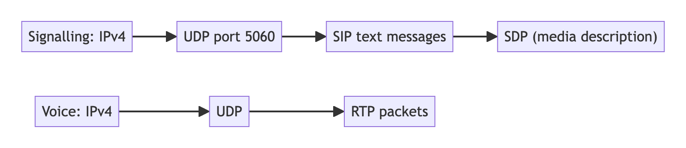
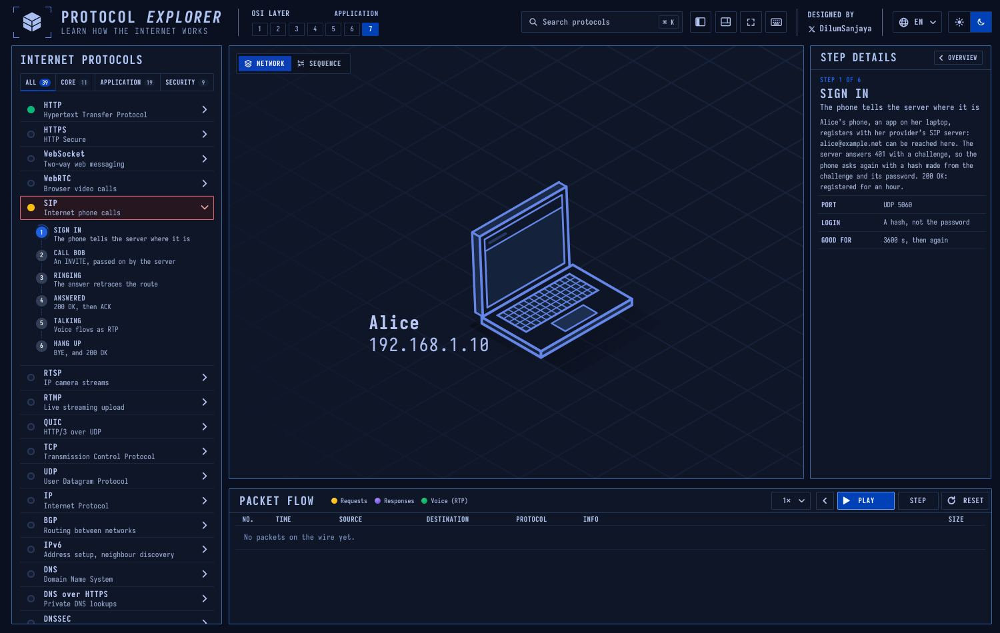
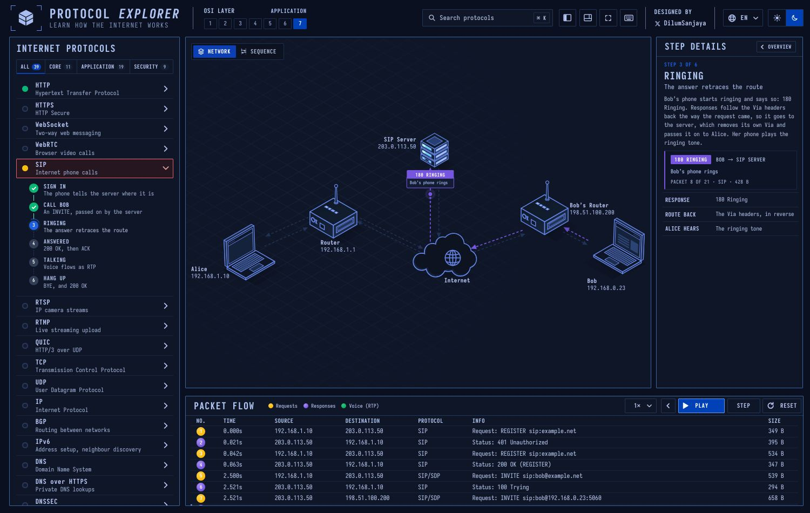
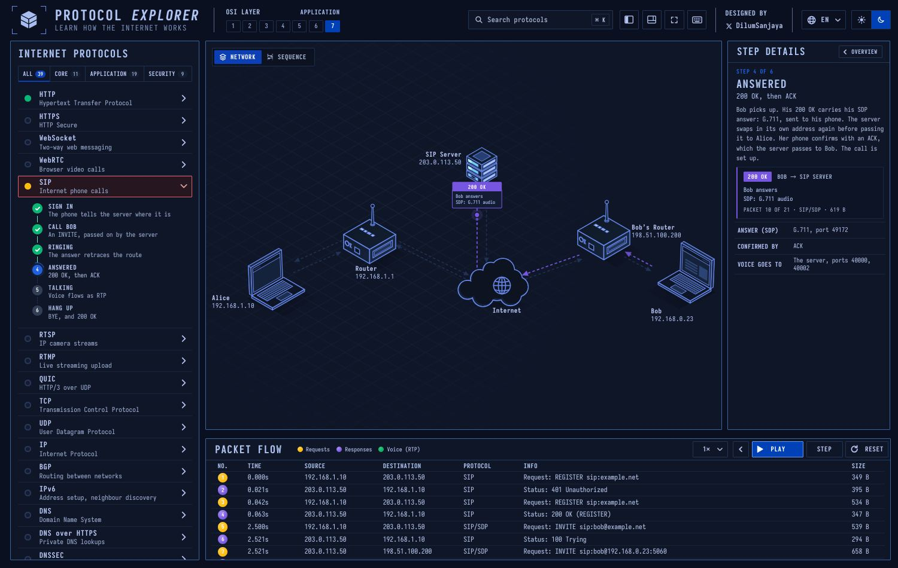
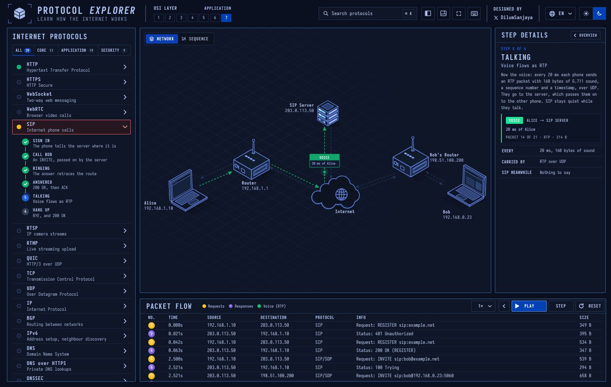
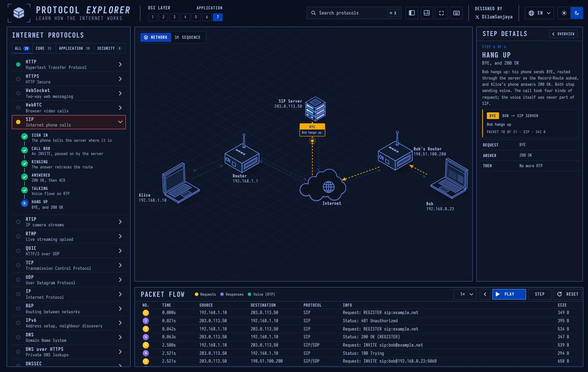
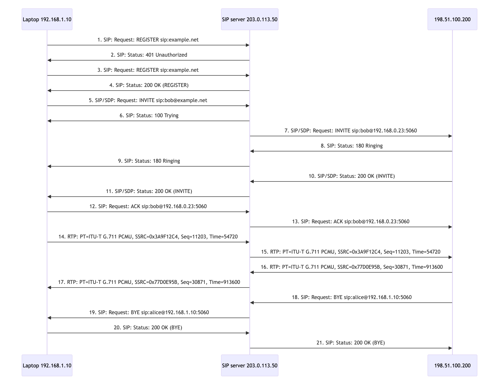
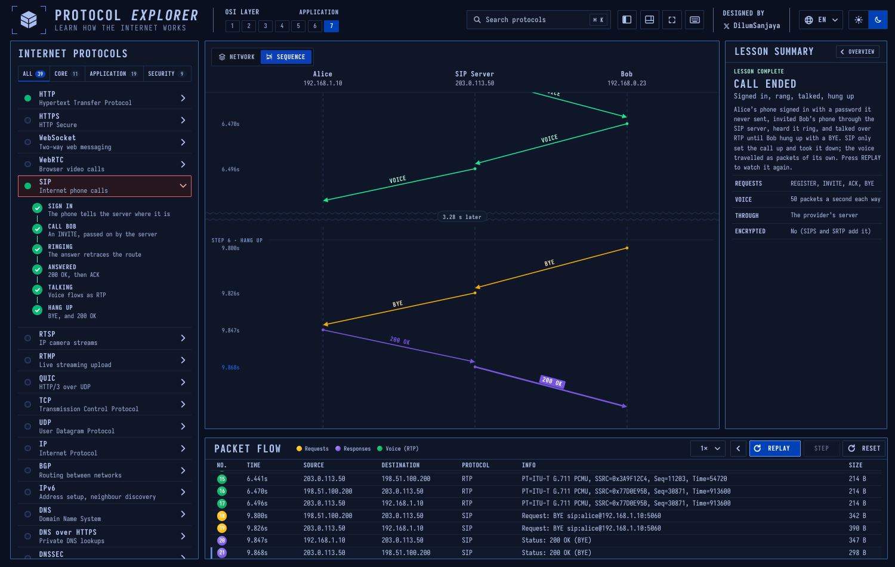
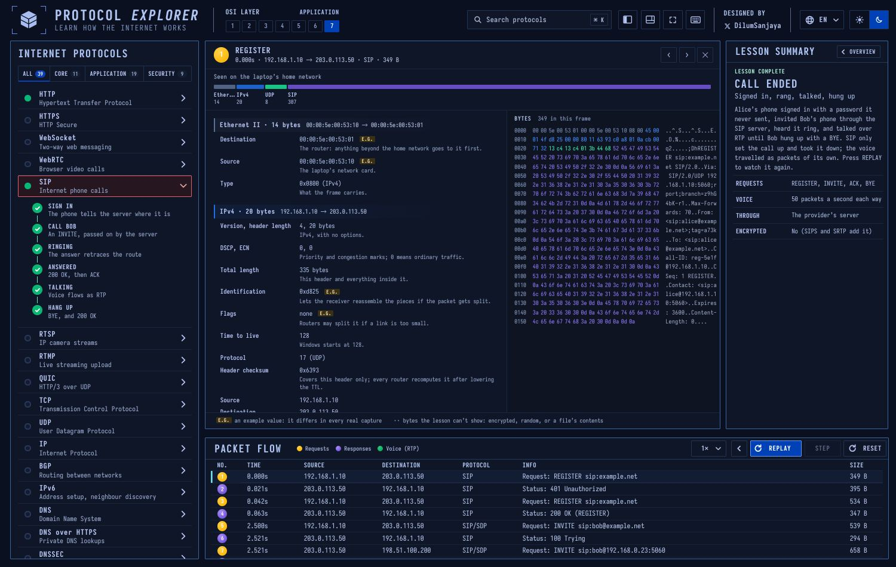

# SIP – Internet phone calls

<!-- nav -->
⬅ [04 WebRTC](04-webrtc.md) · [Index](00_Protocols_Index.md) · [06 RTSP](06-rtsp.md) ➡
<!-- nav -->

*Source: Protocol Explorer – https://protocol-explorer-alpha.vercel.app/ (interactive lesson #5). Screenshots captured from the live lesson; packet decodes are the site's example capture (values marked **E.G.** differ in every real capture).*

## Overview

### How the layers fit together (outer to inner)

## In-depth explanation of the example (plain-language version)

### The big picture in one minute
**Alice** uses a phone app on her laptop (`192.168.1.10`) to call **Bob** (`bob@example.net`) who is at `198.51.100.200`. Both are customers of one provider whose **SIP server** is at `203.0.113.50`. The lesson has **21 messages over about 10 seconds**: sign-in, making the call, a few voice packets, and hanging up.

**SIP is only the "switchboard".** It finds the other person, makes their phone ring, and agrees *how* the voice will be sent. The voice itself travels separately in small packets (called **RTP**). SIP messages are plain text that look a lot like HTTP.

Think of an old telephone exchange: the operator (the SIP server) connects you to the person you want and tells both phones how to talk, but the conversation itself doesn't go through the operator's notebook.

> **Words you'll see:** *SIP address* = like an email address for calls (`bob@example.net`). *Codec* = a way to turn voice into numbers. *UDP* = a "just send it" delivery method, ideal for live voice.

---

### Step 1 – Signing in (REGISTER) – packets 1 to 4
**Why sign in?** Phones move and change addresses. Signing in tells the server: "Alice can currently be reached at `192.168.1.10:5060`." Without it, nobody could call her.
- **Packet 1 – `REGISTER`.** Key lines:
  - `Via` → the route taken; replies follow it back. Its `branch` is a unique ID for this request.
  - `From` / `To` → both Alice (she registers herself). `Call-ID` is a unique ID for the conversation and `CSeq` is a running number.
  - `Contact` → **where to reach her**. `Expires: 3600` → "for one hour."
- **Packet 2 – `401 Unauthorized`.** The server says: "Prove it's you." It sends a random challenge (a *nonce*).
- **Packet 3 – REGISTER again,** now with a **digest**: a scrambled fingerprint made from her username, password and the challenge. **Her password is never sent**, only the proof.
- **Packet 4 – `200 OK`.** She's registered for an hour, and the phone will sign in again before it runs out. The server also tells her the public address it saw, which helps with home routers.

### Step 2 – Calling Bob (INVITE) – packets 5, 6, 7
- **Packet 5 – `INVITE sip:bob@example.net`.** It carries an **offer** (in a format called SDP) saying: "Send voice to my address on port 49170, using codec **G.711** (the classic phone-quality codec), and I also understand keypad tones."
- **Packet 6 – `100 Trying`.** The server immediately says "got it, working on it," so Alice's phone doesn't keep re-sending.
- **Packet 7.** The server looks up where Bob is signed in and forwards the INVITE to him. It adds its own address to the route (so replies come back through it) and swaps the voice address in the offer for **its own**, so it can relay the voice. That neatly solves the home-router problem for both sides.

### Step 3 – It rings – packets 8, 9
Bob's phone rings and answers **`180 Ringing`**. The reply retraces the `Via` route back through the server to Alice, whose phone plays the ringing sound.

### Step 4 – Bob answers – packets 10 to 13
- **Packet 10 – `200 OK`** from Bob with his answer: "I accept G.711, send voice to my port 49172." The server relays it (packet 11), again swapping in its own address.
- **Packet 12 – `ACK`** from Alice (forwarded in packet 13).
So a call starts with a three-way greeting: **INVITE → 200 OK → ACK.** The final ACK is needed because ringing can take a long time, so the "answered" message is explicitly confirmed.

### Step 5 – Talking – packets 14 to 17
SIP goes quiet and **voice packets (RTP over UDP)** take over. Every **20 ms** a phone sends one packet with **160 bytes of sound**. Each carries:
- a **sequence number** (+1 each time) so lost or out-of-order packets are noticed,
- a **timestamp** (+160 each time) so the receiver plays at the correct speed,
- an ID for the stream.
UDP is used because a re-sent voice packet would arrive too late to be useful. Here the packets go phone → server → phone.

### Step 6 – Hanging up (BYE) – packets 18 to 21
Bob hangs up: **`BYE`** goes through the server to Alice, her phone replies **`200 OK`**, and both stop sending voice. The call used four kinds of request: **REGISTER, INVITE, ACK, BYE.** The voice was never part of SIP.

---

### The key messages at a glance
| Packets | What | Why |
|---|---|---|
| 1–4 | REGISTER, 401, REGISTER, 200 | sign in safely |
| 5–7 | INVITE, 100 Trying, forwarded INVITE | start the call |
| 8–9 | 180 Ringing | the other phone is ringing |
| 10–13 | 200 OK, ACK | answered and confirmed |
| 14–17 | RTP voice | the actual talking |
| 18–21 | BYE, 200 OK | hang up |

### What to remember
- A call is identified by **Call-ID + the two tags**; each request has a number and method (`CSeq`).
- Response codes are grouped: **1xx** in progress (Trying, Ringing), **2xx** success, **3xx** redirect, **4xx** client problem (401 login needed, 404 not found), **5xx** server problem.
- **SIP = signalling (text, port 5060), SDP = the description of the media, RTP = the voice.** WebRTC borrowed this same offer/answer idea.
- The secure versions are **SIPS/TLS (port 5061)** for signalling and **SRTP** for the voice. This lesson uses the plain version so you can read it.

## Under the hood – technical details

- **Message format.** SIP is text, much like HTTP: a request line (`INVITE sip:bob@example.net SIP/2.0`) or status line (`SIP/2.0 200 OK`), headers, a blank line and an optional body (here SDP).
- **Dialog identity.** A call is identified by `Call-ID` plus the `tag` in `From` and the `tag` in `To`. `CSeq` is a counter plus method name and orders requests inside the dialog.
- **Via header.** Each hop that forwards a request adds its own `Via` line, including a `branch` parameter (starting `z9hG4bK`) that identifies the transaction. Responses follow the `Via` lines in reverse order. `rport` asks the server to reply to the actual source port (useful behind NAT) and `received=` shows the address the server saw.
- **Digest authentication.** The server sends `WWW-Authenticate` with a `realm` and a random `nonce`. The client answers with `response = MD5( MD5(user:realm:password) : nonce : MD5(method:uri) )` (more modern versions use SHA-256). The password never travels, and the nonce stops replays.
- **Registration.** `Contact` says where to reach you and `Expires: 3600` says for how long. The phone re-registers before the time runs out. NAT-aware setups also send keep-alives.
- **Responses.** `1xx` provisional (`100 Trying`, `180 Ringing`), `2xx` success, `3xx` redirect, `4xx` client error (`401`, `404`), `5xx` server error, `6xx` global failure.
- **INVITE handshake.** `INVITE` can take a long time (the phone rings), so the final response `200 OK` is confirmed with an `ACK`: INVITE, 200, ACK. `Record-Route` makes later requests (like `BYE`) pass through the proxy.
- **SDP offer/answer.** `c=` gives the media address, `m=audio 49170 RTP/AVP 0 101` gives port and payload types, `a=rtpmap:0 PCMU/8000` says payload 0 is G.711 µ-law at 8 kHz (64 kbit/s), and `101` carries DTMF keypad tones.
- **RTP voice.** 160 bytes of sound every 20 ms (8,000 samples/s x 0.02 s). The 12-byte RTP header carries the payload type, a sequence number (+1) and a timestamp (+160), so the receiver can spot loss and compute jitter. It runs over UDP because late voice is useless.
- **Security.** `SIPS` (SIP over TLS, port 5061) protects signalling; `SRTP` protects the voice. The plain version shown here is readable by anyone on the path.

## Step-by-step walkthrough

### Step 1: SIGN IN – The phone tells the server where it is

### Step 2: CALL BOB – An INVITE, passed on by the server

### Step 3: RINGING – The answer retraces the route

### Step 4: ANSWERED – 200 OK, then ACK

### Step 5: TALKING – Voice flows as RTP

### Step 6: HANG UP – BYE, and 200 OK

### Lesson summary

## Packet flow (whole lesson)

| No. | Time | Source | Destination | Protocol | Info | Size |
|---|---|---|---|---|---|---|
| 1 | 0.000s | 192.168.1.10 | 203.0.113.50 | SIP | Request: REGISTER sip:example.net | 349 B |
| 2 | 0.021s | 203.0.113.50 | 192.168.1.10 | SIP | Status: 401 Unauthorized | 395 B |
| 3 | 0.042s | 192.168.1.10 | 203.0.113.50 | SIP | Request: REGISTER sip:example.net | 534 B |
| 4 | 0.063s | 203.0.113.50 | 192.168.1.10 | SIP | Status: 200 OK (REGISTER) | 347 B |
| 5 | 2.500s | 192.168.1.10 | 203.0.113.50 | SIP/SDP | Request: INVITE sip:bob@example.net | 539 B |
| 6 | 2.521s | 203.0.113.50 | 192.168.1.10 | SIP | Status: 100 Trying | 294 B |
| 7 | 2.521s | 203.0.113.50 | 198.51.100.200 | SIP/SDP | Request: INVITE sip:bob@192.168.0.23:5060 | 658 B |
| 8 | 2.560s | 198.51.100.200 | 203.0.113.50 | SIP | Status: 180 Ringing | 428 B |
| 9 | 2.586s | 203.0.113.50 | 192.168.1.10 | SIP | Status: 180 Ringing | 379 B |
| 10 | 6.320s | 198.51.100.200 | 203.0.113.50 | SIP/SDP | Status: 200 OK (INVITE) | 619 B |
| 11 | 6.346s | 203.0.113.50 | 192.168.1.10 | SIP/SDP | Status: 200 OK (INVITE) | 570 B |
| 12 | 6.367s | 192.168.1.10 | 203.0.113.50 | SIP | Request: ACK sip:bob@192.168.0.23:5060 | 340 B |
| 13 | 6.388s | 203.0.113.50 | 198.51.100.200 | SIP | Request: ACK sip:bob@192.168.0.23:5060 | 386 B |
| 14 | 6.420s | 192.168.1.10 | 203.0.113.50 | RTP | PT=ITU-T G.711 PCMU, SSRC=0x3A9F12C4, Seq=11203, Time=54720 | 214 B |
| 15 | 6.441s | 203.0.113.50 | 198.51.100.200 | RTP | PT=ITU-T G.711 PCMU, SSRC=0x3A9F12C4, Seq=11203, Time=54720 | 214 B |
| 16 | 6.470s | 198.51.100.200 | 203.0.113.50 | RTP | PT=ITU-T G.711 PCMU, SSRC=0x77D0E95B, Seq=30871, Time=913600 | 214 B |
| 17 | 6.496s | 203.0.113.50 | 192.168.1.10 | RTP | PT=ITU-T G.711 PCMU, SSRC=0x77D0E95B, Seq=30871, Time=913600 | 214 B |
| 18 | 9.800s | 198.51.100.200 | 203.0.113.50 | SIP | Request: BYE sip:alice@192.168.1.10:5060 | 342 B |
| 19 | 9.826s | 203.0.113.50 | 192.168.1.10 | SIP | Request: BYE sip:alice@192.168.1.10:5060 | 390 B |
| 20 | 9.847s | 192.168.1.10 | 203.0.113.50 | SIP | Status: 200 OK (BYE) | 347 B |
| 21 | 9.868s | 203.0.113.50 | 198.51.100.200 | SIP | Status: 200 OK (BYE) | 298 B |

### Sequence diagram

*The lesson's own sequence diagram:*

## Packet decoder screenshots

The lesson's decoder view for the first, middle and last packet: headers, field values and the raw hex bytes.

### Packet 1: SIP – Request: REGISTER sip:example.net

*192.168.1.10 → 203.0.113.50 · 349 B · t = 0.000s*

### Packet 11: SIP/SDP – Status: 200 OK (INVITE)

*203.0.113.50 → 192.168.1.10 · 570 B · t = 6.346s*

### Packet 21: SIP – Status: 200 OK (BYE)

*203.0.113.50 → 198.51.100.200 · 298 B · t = 9.868s*

---

<!-- nav -->
⬅ [04 WebRTC](04-webrtc.md) · [Index](00_Protocols_Index.md) · [06 RTSP](06-rtsp.md) ➡
<!-- nav -->
