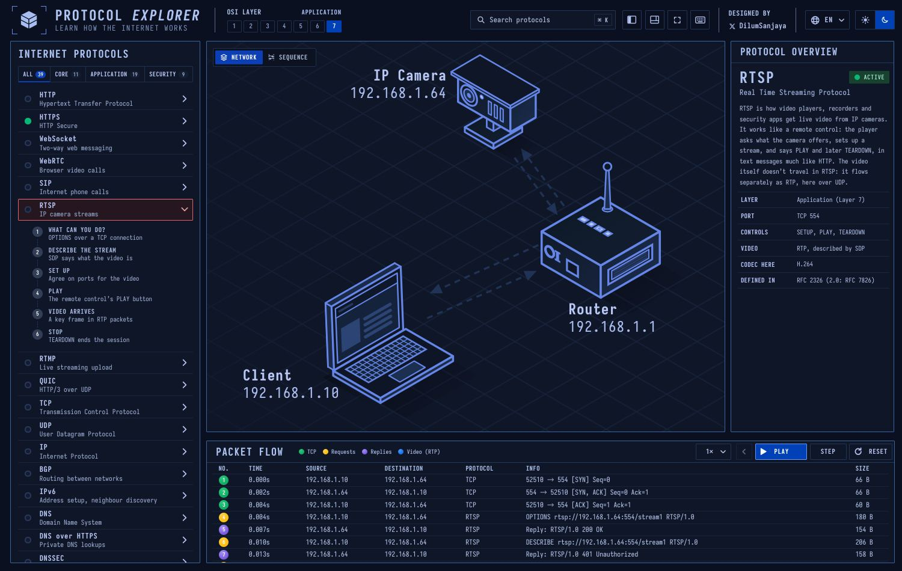
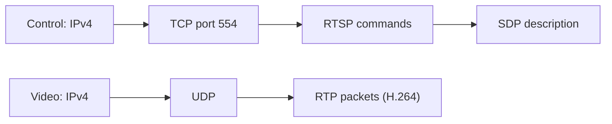
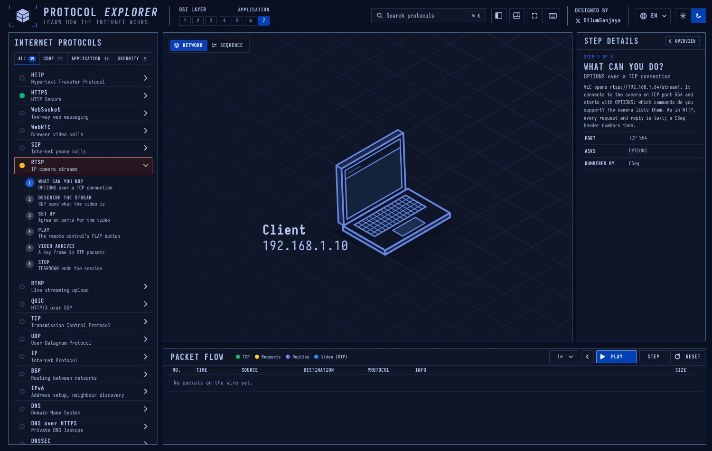
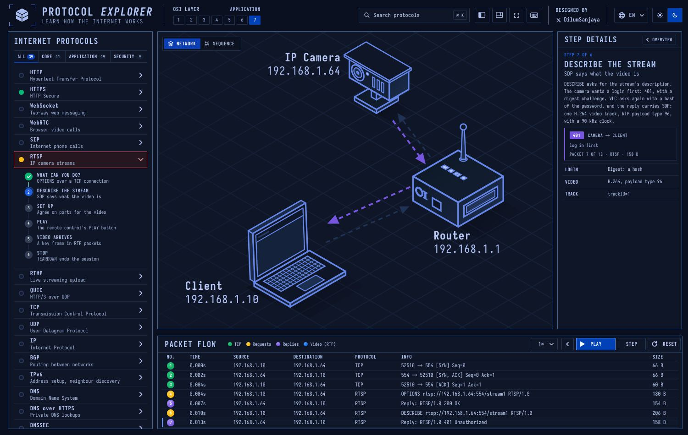
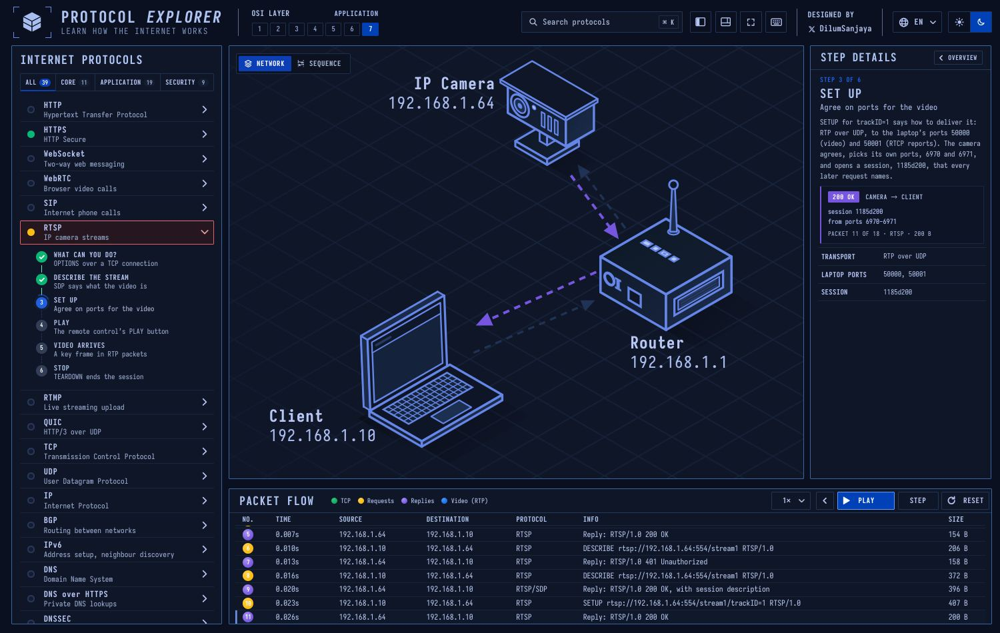
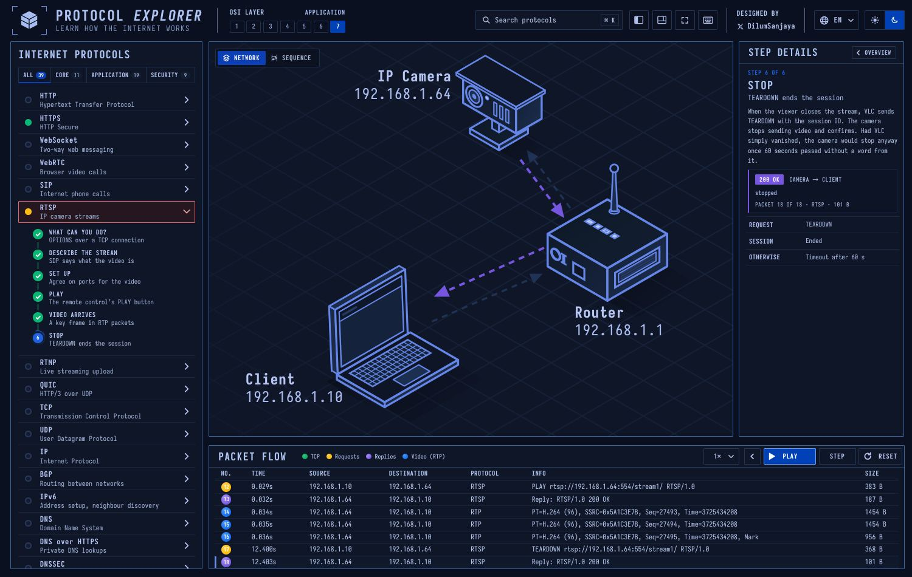
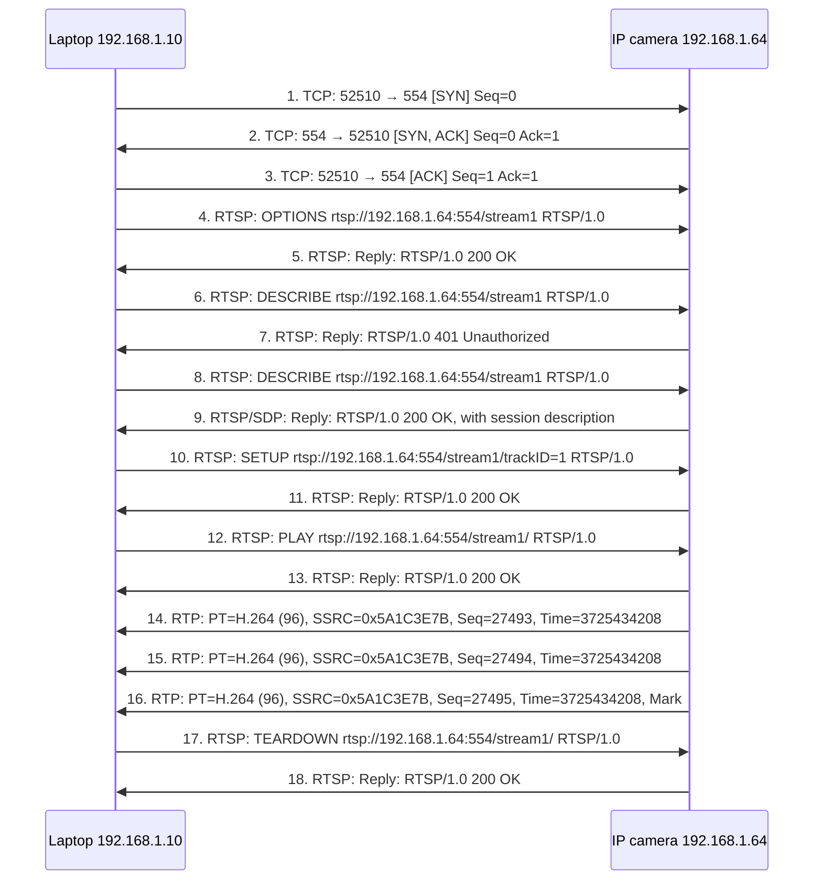
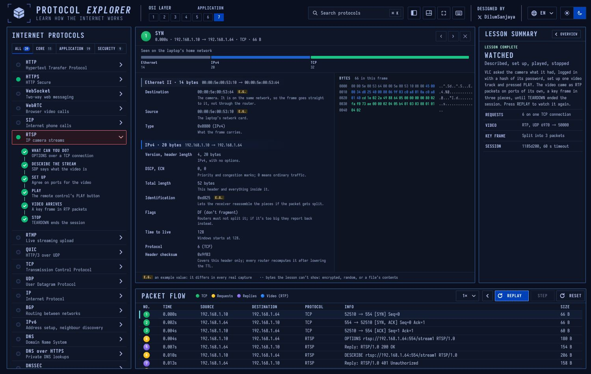
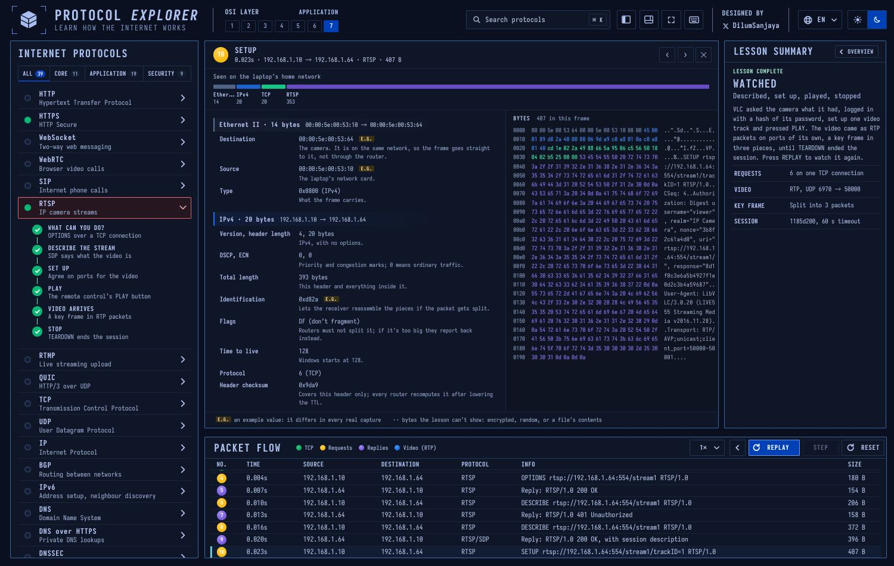
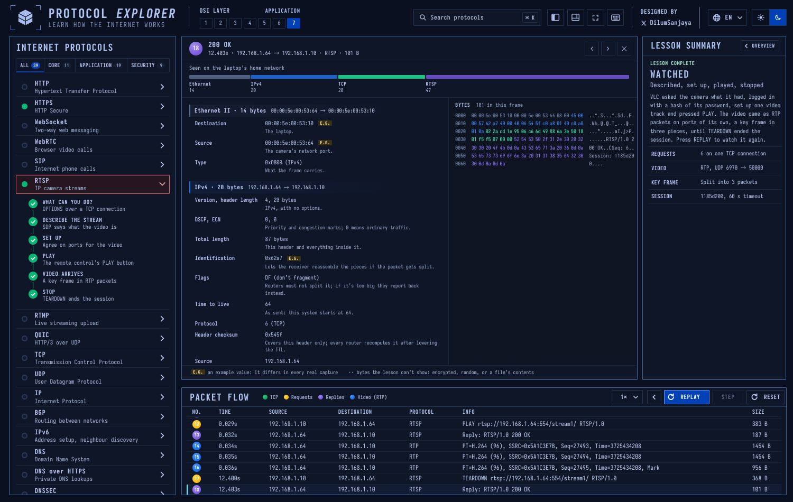

# RTSP – IP camera streams

<!-- nav -->
⬅ [05 SIP](05-sip.md) · [Index](00_Protocols_Index.md) · [07 RTMP](07-rtmp.md) ➡
<!-- nav -->

*Source: Protocol Explorer – https://protocol-explorer-alpha.vercel.app/ (interactive lesson #6). Screenshots captured from the live lesson; packet decodes are the site's example capture (values marked **E.G.** differ in every real capture).*

## Overview

### How the layers fit together (outer to inner)

## In-depth explanation of the example (plain-language version)

### The big picture in one minute
A viewer opens `rtsp://192.168.1.64/stream1` in the **VLC** player to watch an **IP security camera** on the same home network. The lesson shows **18 messages in about 12 seconds**: connect, a short text conversation to set things up, three pieces of video, and a goodbye.

**RTSP is a remote control, not the video itself.** It carries only short text *commands* ("describe the stream", "play"). The actual video travels on a **separate path** as small UDP packets (RTP).

Think of a TV remote: the remote sends commands (play, pause, stop), but the picture comes through a different cable.

> **Words you'll see:** *Stream* = video sent continuously. *Codec* = the method used to compress video (here H.264). *UDP* = "just send it" delivery; if a packet is lost, the video glitches a little rather than waiting. *Nonce* = a random challenge used for login.

---

### Step 1 – Connect and ask what's possible (OPTIONS) – packets 1 to 5
- VLC opens a TCP connection to the camera's **port 554** (packets 1–3, only 4 ms because it's local).
- **Packet 4 – `OPTIONS`:** "Which commands do you support?" Every RTSP request has a counter, `CSeq: 1`, and the reply repeats it so the two can be matched.
- **Packet 5 – `200 OK`** with a list: OPTIONS, DESCRIBE, SETUP, PLAY, PAUSE, TEARDOWN, GET_PARAMETER.

### Step 2 – "Describe the stream" and log in (DESCRIBE) – packets 6 to 9
- **Packet 6 – `DESCRIBE`:** "Please describe this stream."
- **Packet 7 – `401 Unauthorized`:** the camera wants a login and sends a random challenge.
- **Packet 8 – DESCRIBE again,** now with a **digest** (a scrambled proof built from the username, password and the challenge). The password itself never travels.
- **Packet 9 – `200 OK` plus a description** (SDP). It says:
  - there is one **video** track, labelled payload type 96;
  - the codec is **H.264** with a 90 kHz clock;
  - some H.264 settings;
  - and the track's own address, to be used in the next step.

### Step 3 – Choose how to deliver it (SETUP) – packets 10, 11
- **Packet 10 – `SETUP`:** VLC says "send the video as RTP over UDP to my ports **50000** (video) and **50001** (quality reports)."
- **Packet 11 – `200 OK`:** the camera picks its own sending ports (6970/6971) and creates a **session** with an ID (`1185d200`). Every later request must include that ID.

### Step 4 – Start (PLAY) – packets 12, 13
- **Packet 12 – `PLAY`** with the session ID: "start from now, no end."
- **Packet 13 – `200 OK`** that includes the **first sequence number and timestamp** of the video, so VLC can keep things in sync and spot losses right away.

### Step 5 – The video arrives – packets 14 to 16
RTSP goes quiet. The camera now sends video from port 6970 to port 50000. The first picture is a **key frame** (a complete image), which is bigger than one packet, so it's cut into **three pieces**:
- all three have the same stream ID and the **same timestamp** (they belong to one frame),
- their sequence numbers go **27493, 27494, 27495**,
- the last piece has a "marker" flag meaning "end of the frame".
After that come smaller frames that only contain what changed, 25 times a second. If a packet is lost, the video simply glitches and carries on; the player doesn't wait.

### Step 6 – Stop (TEARDOWN) – packets 17, 18
When you close the stream, VLC sends **`TEARDOWN`** with the session ID. The camera stops sending and says `200 OK`. If VLC had just vanished, the camera would stop by itself after a 60-second timeout.

---

### The 18 messages at a glance
| Packets | What | Why |
|---|---|---|
| 1–3 | TCP handshake | open the control connection |
| 4–5 | OPTIONS | learn the commands |
| 6–9 | DESCRIBE (with login) | get the stream details |
| 10–11 | SETUP | agree on ports and make a session |
| 12–13 | PLAY | start the video |
| 14–16 | RTP video packets | the picture |
| 17–18 | TEARDOWN | stop |

### What to remember
- **Two paths:** control over **TCP port 554**, video over **UDP** (RTP, plus RTCP reports). This split is similar to FTP's control/data split. If UDP is blocked, the video can be tucked inside the TCP connection instead.
- Commands: **OPTIONS, DESCRIBE, SETUP, PLAY, PAUSE, TEARDOWN.**
- Replies use HTTP-style codes (200, 401, 404). `CSeq` and `Session` tie everything together.
- URLs start with `rtsp://` (or `rtsps://` for the secure version). Many cameras ship with weak default passwords, so always change them.

## Under the hood – technical details

- **Style.** RTSP looks like HTTP: a request line (`DESCRIBE rtsp://host/stream1 RTSP/1.0`), headers, a blank line, optional body. The big differences: the server remembers state (a *session*), and the video travels on a separate channel.
- **CSeq.** A sequence number on every request. The reply repeats it, so replies can be matched even if several requests are outstanding.
- **Methods.** `OPTIONS` (what can you do?), `DESCRIBE` (give me the stream description), `SETUP` (agree on transport), `PLAY`, `PAUSE`, `TEARDOWN`, and `GET_PARAMETER` (often used as a keep-alive).
- **Digest login.** Same idea as HTTP and SIP: the server sends a `nonce`, the client returns a hash of username, password, realm, nonce and URI. The password stays off the wire.
- **SDP body.** Lines such as `m=video 0 RTP/AVP 96`, `a=rtpmap:96 H264/90000` (H.264 video with a 90 kHz clock) and `a=fmtp:96 packetization-mode=1; profile-level-id=640028` (H.264 settings: High profile, level 4.0) describe each track. `a=control:` gives the URL used in `SETUP`.
- **Transport negotiation.** `Transport: RTP/AVP;unicast;client_port=50000-50001` asks for RTP on port 50000 and RTCP on the next port. The server answers with its own ports and a `Session:` ID that every later request must include.
- **RTP-Info.** The `PLAY` reply tells the player the first sequence number and RTP timestamp, so it can synchronise several streams (audio and video) and detect loss from the first packet.
- **Fragmentation of video.** A key frame (I-frame) is bigger than one packet, so H.264 is split into *FU-A fragments* (start, middle, end). All pieces of one frame share the same RTP timestamp, and the *marker bit* is set on the last. Between key frames, small P-frames carry only the changes.
- **Reliability choice.** RTP over UDP tolerates loss (a glitch). RTCP reports on loss and jitter flow on the neighbouring port. If UDP is blocked, RTP can be *interleaved* inside the RTSP TCP connection.
- **Session timeout.** Typically 60 seconds without a request (or a `GET_PARAMETER`) ends the session.
- **Security.** `rtsps://` runs RTSP over TLS. Many cameras ship with weak default passwords, so change them.

## Step-by-step walkthrough (screenshots from the lesson)

### Step 1: WHAT CAN YOU DO? – OPTIONS over a TCP connection

### Step 2: DESCRIBE THE STREAM – SDP says what the video is

### Step 3: SET UP – Agree on ports for the video

### Step 4: PLAY – The remote control’s PLAY button

### Step 5: VIDEO ARRIVES – A key frame in RTP packets

### Step 6: STOP – TEARDOWN ends the session

### Lesson summary

## Packet flow (whole lesson)

| No. | Time | Source | Destination | Protocol | Info | Size |
|---|---|---|---|---|---|---|
| 1 | 0.000s | 192.168.1.10 | 192.168.1.64 | TCP | 52510 → 554 [SYN] Seq=0 | 66 B |
| 2 | 0.002s | 192.168.1.64 | 192.168.1.10 | TCP | 554 → 52510 [SYN, ACK] Seq=0 Ack=1 | 66 B |
| 3 | 0.004s | 192.168.1.10 | 192.168.1.64 | TCP | 52510 → 554 [ACK] Seq=1 Ack=1 | 60 B |
| 4 | 0.004s | 192.168.1.10 | 192.168.1.64 | RTSP | OPTIONS rtsp://192.168.1.64:554/stream1 RTSP/1.0 | 180 B |
| 5 | 0.007s | 192.168.1.64 | 192.168.1.10 | RTSP | Reply: RTSP/1.0 200 OK | 154 B |
| 6 | 0.010s | 192.168.1.10 | 192.168.1.64 | RTSP | DESCRIBE rtsp://192.168.1.64:554/stream1 RTSP/1.0 | 206 B |
| 7 | 0.013s | 192.168.1.64 | 192.168.1.10 | RTSP | Reply: RTSP/1.0 401 Unauthorized | 158 B |
| 8 | 0.016s | 192.168.1.10 | 192.168.1.64 | RTSP | DESCRIBE rtsp://192.168.1.64:554/stream1 RTSP/1.0 | 372 B |
| 9 | 0.020s | 192.168.1.64 | 192.168.1.10 | RTSP/SDP | Reply: RTSP/1.0 200 OK, with session description | 396 B |
| 10 | 0.023s | 192.168.1.10 | 192.168.1.64 | RTSP | SETUP rtsp://192.168.1.64:554/stream1/trackID=1 RTSP/1.0 | 407 B |
| 11 | 0.026s | 192.168.1.64 | 192.168.1.10 | RTSP | Reply: RTSP/1.0 200 OK | 200 B |
| 12 | 0.029s | 192.168.1.10 | 192.168.1.64 | RTSP | PLAY rtsp://192.168.1.64:554/stream1/ RTSP/1.0 | 383 B |
| 13 | 0.032s | 192.168.1.64 | 192.168.1.10 | RTSP | Reply: RTSP/1.0 200 OK | 187 B |
| 14 | 0.034s | 192.168.1.64 | 192.168.1.10 | RTP | PT=H.264 (96), SSRC=0x5A1C3E7B, Seq=27493, Time=3725434208 | 1454 B |
| 15 | 0.035s | 192.168.1.64 | 192.168.1.10 | RTP | PT=H.264 (96), SSRC=0x5A1C3E7B, Seq=27494, Time=3725434208 | 1454 B |
| 16 | 0.036s | 192.168.1.64 | 192.168.1.10 | RTP | PT=H.264 (96), SSRC=0x5A1C3E7B, Seq=27495, Time=3725434208, Mark | 956 B |
| 17 | 12.400s | 192.168.1.10 | 192.168.1.64 | RTSP | TEARDOWN rtsp://192.168.1.64:554/stream1/ RTSP/1.0 | 368 B |
| 18 | 12.403s | 192.168.1.64 | 192.168.1.10 | RTSP | Reply: RTSP/1.0 200 OK | 101 B |

### Sequence diagram

*The lesson's own sequence diagram:*

## Packet decoder screenshots

The lesson's decoder view for the first, middle and last packet: headers, field values and the raw hex bytes.

### Packet 1: TCP – 52510 → 554 [SYN] Seq=0

*192.168.1.10 → 192.168.1.64 · 66 B · t = 0.000s*

### Packet 10: RTSP – SETUP rtsp://192.168.1.64:554/stream1/trackID=1 RTSP/1.0

*192.168.1.10 → 192.168.1.64 · 407 B · t = 0.023s*

### Packet 18: RTSP – Reply: RTSP/1.0 200 OK

*192.168.1.64 → 192.168.1.10 · 101 B · t = 12.403s*

---

<!-- nav -->
⬅ [05 SIP](05-sip.md) · [Index](00_Protocols_Index.md) · [07 RTMP](07-rtmp.md) ➡
<!-- nav -->
