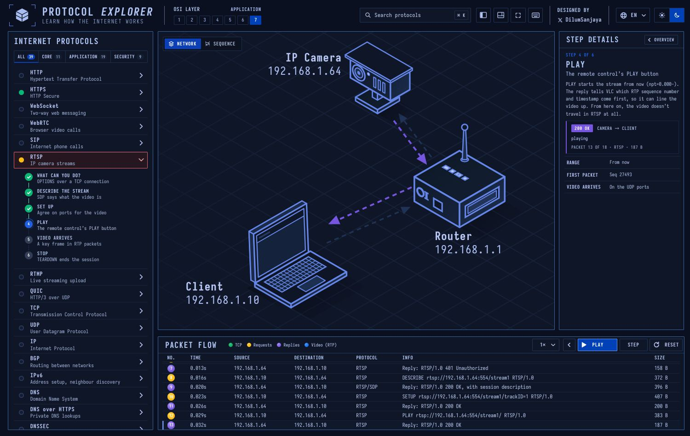
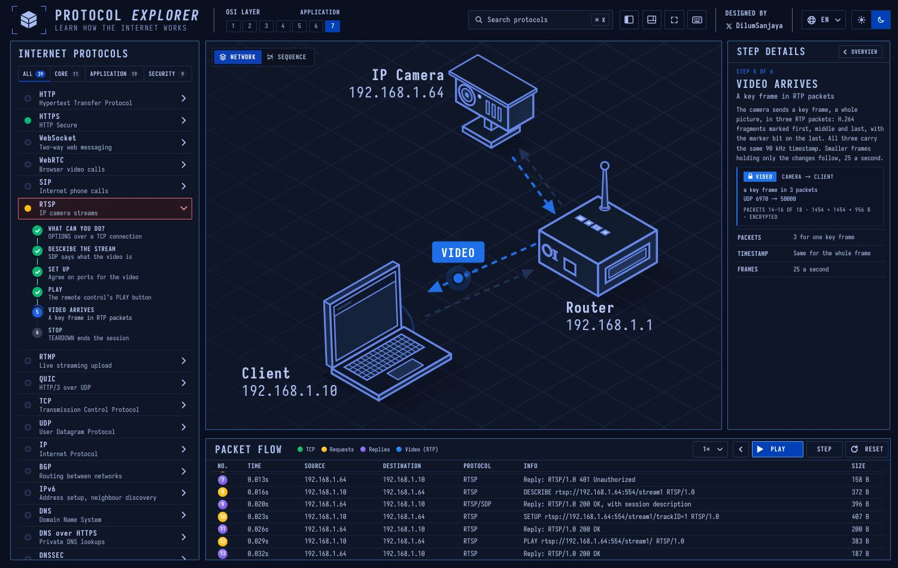
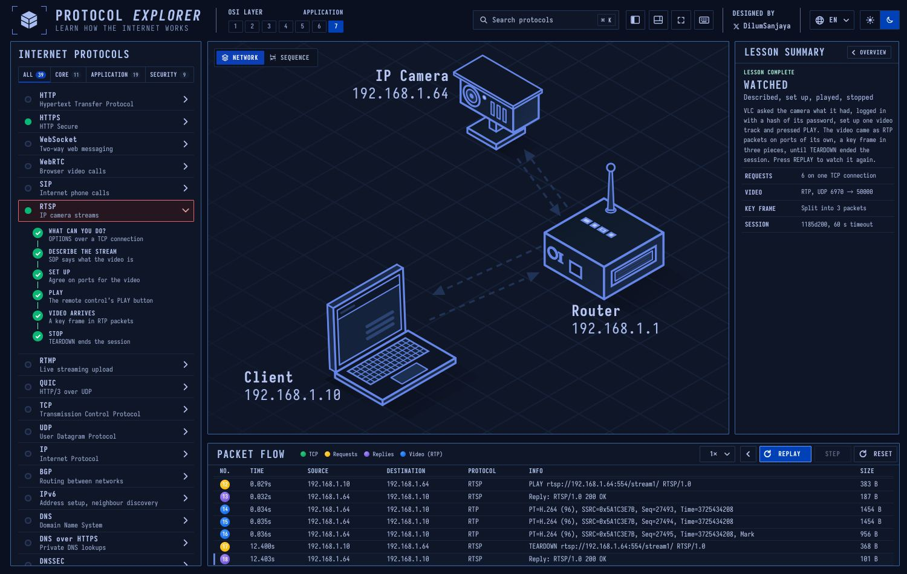
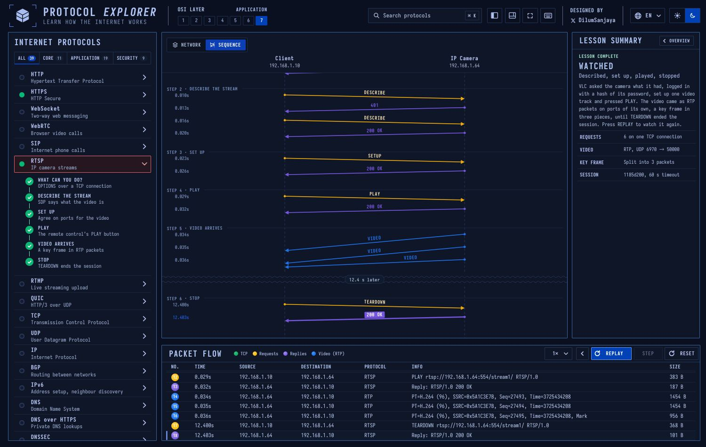

# RTSP – IP camera streams

<!-- nav -->
⬅ [05 SIP](05-sip.md) · [Index](00_Protocols_Index.md) · [07 RTMP](07-rtmp.md) ➡
<!-- nav -->

*Source: Protocol Explorer – https://protocol-explorer-alpha.vercel.app/ (interactive lesson #6). Screenshots captured from the live lesson; packet decodes are the site's example capture (values marked **E.G.** differ in every real capture).*

## Overview


> PROTOCOL OVERVIEW  
> RTSP  
> ACTIVE  
> Real Time Streaming Protocol  
> RTSP is how video players, recorders and security apps get live video from IP cameras. It works like a remote control: the player asks what the camera offers, sets up a stream, and says PLAY and later TEARDOWN, in text messages much like HTTP. The video itself doesn’t travel in RTSP: it flows separately as RTP, here over UDP.  
> LAYER  
> Application (Layer 7)  
> PORT  
> TCP 554  
> CONTROLS  
> SETUP, PLAY, TEARDOWN  
> VIDEO  
> RTP, described by SDP  
> CODEC HERE  
> H.264  
> DEFINED IN  
> RFC 2326 (2.0: RFC 7826)  

## In-depth explanation of the example (plain-language version)

### The big picture in one minute
A viewer opens `rtsp://192.168.1.64/stream1` in the **VLC** player to watch an **IP security camera** on the same home network. The lesson shows **18 messages in about 12 seconds**: connect, a short text conversation to set things up, three pieces of video, and a goodbye.

**RTSP is a remote control, not the video itself.** It carries only short text *commands* ("describe the stream", "play"). The actual video travels on a **separate path** as small UDP packets (RTP).

Think of a TV remote: the remote sends commands (play, pause, stop), but the picture comes through a different cable.

> **Words you'll see:** *Stream* = video sent continuously. *Codec* = the method used to compress video (here H.264). *UDP* = "just send it" delivery; if a packet is lost, the video glitches a little rather than waiting. *Nonce* = a random challenge used for login.

---

### Step 1 – Connect and ask what's possible (OPTIONS) – packets 1 to 5
- VLC opens a TCP connection to the camera's **port 554** (packets 1–3, only 4 ms because it's local).
- **Packet 4 – `OPTIONS`:** "Which commands do you support?" Every RTSP request has a counter, `CSeq: 1`, and the reply repeats it so the two can be matched.
- **Packet 5 – `200 OK`** with a list: OPTIONS, DESCRIBE, SETUP, PLAY, PAUSE, TEARDOWN, GET_PARAMETER.

### Step 2 – "Describe the stream" and log in (DESCRIBE) – packets 6 to 9
- **Packet 6 – `DESCRIBE`:** "Please describe this stream."
- **Packet 7 – `401 Unauthorized`:** the camera wants a login and sends a random challenge.
- **Packet 8 – DESCRIBE again,** now with a **digest** (a scrambled proof built from the username, password and the challenge). The password itself never travels.
- **Packet 9 – `200 OK` plus a description** (SDP). It says:
  - there is one **video** track, labelled payload type 96;
  - the codec is **H.264** with a 90 kHz clock;
  - some H.264 settings;
  - and the track's own address, to be used in the next step.

### Step 3 – Choose how to deliver it (SETUP) – packets 10, 11
- **Packet 10 – `SETUP`:** VLC says "send the video as RTP over UDP to my ports **50000** (video) and **50001** (quality reports)."
- **Packet 11 – `200 OK`:** the camera picks its own sending ports (6970/6971) and creates a **session** with an ID (`1185d200`). Every later request must include that ID.

### Step 4 – Start (PLAY) – packets 12, 13
- **Packet 12 – `PLAY`** with the session ID: "start from now, no end."
- **Packet 13 – `200 OK`** that includes the **first sequence number and timestamp** of the video, so VLC can keep things in sync and spot losses right away.

### Step 5 – The video arrives – packets 14 to 16
RTSP goes quiet. The camera now sends video from port 6970 to port 50000. The first picture is a **key frame** (a complete image), which is bigger than one packet, so it's cut into **three pieces**:
- all three have the same stream ID and the **same timestamp** (they belong to one frame),
- their sequence numbers go **27493, 27494, 27495**,
- the last piece has a "marker" flag meaning "end of the frame".
After that come smaller frames that only contain what changed, 25 times a second. If a packet is lost, the video simply glitches and carries on; the player doesn't wait.

### Step 6 – Stop (TEARDOWN) – packets 17, 18
When you close the stream, VLC sends **`TEARDOWN`** with the session ID. The camera stops sending and says `200 OK`. If VLC had just vanished, the camera would stop by itself after a 60-second timeout.

---

### The 18 messages at a glance
| Packets | What | Why |
|---|---|---|
| 1–3 | TCP handshake | open the control connection |
| 4–5 | OPTIONS | learn the commands |
| 6–9 | DESCRIBE (with login) | get the stream details |
| 10–11 | SETUP | agree on ports and make a session |
| 12–13 | PLAY | start the video |
| 14–16 | RTP video packets | the picture |
| 17–18 | TEARDOWN | stop |

### What to remember
- **Two paths:** control over **TCP port 554**, video over **UDP** (RTP, plus RTCP reports). This split is similar to FTP's control/data split. If UDP is blocked, the video can be tucked inside the TCP connection instead.
- Commands: **OPTIONS, DESCRIBE, SETUP, PLAY, PAUSE, TEARDOWN.**
- Replies use HTTP-style codes (200, 401, 404). `CSeq` and `Session` tie everything together.
- URLs start with `rtsp://` (or `rtsps://` for the secure version). Many cameras ship with weak default passwords, so always change them.

## Step-by-step walkthrough (screenshots from the lesson)

### Step 1: WHAT CAN YOU DO? – OPTIONS over a TCP connection


> STEP 1 OF 6  
> WHAT CAN YOU DO?  
> OPTIONS over a TCP connection  
> VLC opens rtsp://192.168.1.64/stream1. It connects to the camera on TCP port 554 and starts with OPTIONS: which commands do you support? The camera lists them. As in HTTP, every request and reply is text; a CSeq header numbers them.  
> PORT  
> TCP 554  
> ASKS  
> OPTIONS  
> NUMBERED BY  
> CSeq  

### Step 2: DESCRIBE THE STREAM – SDP says what the video is


> STEP 2 OF 6  
> DESCRIBE THE STREAM  
> SDP says what the video is  
> DESCRIBE asks for the stream’s description. The camera wants a login first: 401, with a digest challenge. VLC asks again with a hash of the password, and the reply carries SDP: one H.264 video track, RTP payload type 96, with a 90 kHz clock.  
> 401  
> CAMERA → CLIENT  
> log in first  
> PACKET 7 OF 18 · RTSP · 158 B  
> LOGIN  
> Digest: a hash  
> VIDEO  
> H.264, payload type 96  
> TRACK  
> trackID=1  

### Step 3: SET UP – Agree on ports for the video


> STEP 3 OF 6  
> SET UP  
> Agree on ports for the video  
> SETUP for trackID=1 says how to deliver it: RTP over UDP, to the laptop’s ports 50000 (video) and 50001 (RTCP reports). The camera agrees, picks its own ports, 6970 and 6971, and opens a session, 1185d200, that every later request names.  
> 200 OK  
> CAMERA → CLIENT  
> session 1185d200  
> from ports 6970-6971  
> PACKET 11 OF 18 · RTSP · 200 B  
> TRANSPORT  
> RTP over UDP  
> LAPTOP PORTS  
> 50000, 50001  
> SESSION  
> 1185d200  

### Step 4: PLAY – The remote control’s PLAY button



> STEP 4 OF 6  
> PLAY  
> The remote control’s PLAY button  
> PLAY starts the stream from now (npt=0.000-). The reply tells VLC which RTP sequence number and timestamp come first, so it can line the video up. From here on, the video doesn’t travel in RTSP at all.  
> 200 OK  
> CAMERA → CLIENT  
> playing  
> PACKET 13 OF 18 · RTSP · 187 B  
> RANGE  
> From now  
> FIRST PACKET  
> Seq 27493  
> VIDEO ARRIVES  
> On the UDP ports  

### Step 5: VIDEO ARRIVES – A key frame in RTP packets



> STEP 5 OF 6  
> VIDEO ARRIVES  
> A key frame in RTP packets  
> The camera sends a key frame, a whole picture, in three RTP packets: H.264 fragments marked first, middle and last, with the marker bit on the last. All three carry the same 90 kHz timestamp. Smaller frames holding only the changes follow, 25 a second.  
> VIDEO  
> CAMERA → CLIENT  
> a key frame in 3 packets  
> UDP 6970 → 50000  
> PACKETS 14–16 OF 18 · 1454 + 1454 + 956 B · ENCRYPTED  
> PACKETS  
> 3 for one key frame  
> TIMESTAMP  
> Same for the whole frame  
> FRAMES  
> 25 a second  

### Step 6: STOP – TEARDOWN ends the session


> STEP 6 OF 6  
> STOP  
> TEARDOWN ends the session  
> When the viewer closes the stream, VLC sends TEARDOWN with the session ID. The camera stops sending video and confirms. Had VLC simply vanished, the camera would stop anyway once 60 seconds passed without a word from it.  
> 200 OK  
> CAMERA → CLIENT  
> stopped  
> PACKET 18 OF 18 · RTSP · 101 B  
> REQUEST  
> TEARDOWN  
> SESSION  
> Ended  
> OTHERWISE  
> Timeout after 60 s  

### Lesson summary



> LESSON SUMMARY  
> LESSON COMPLETE  
> WATCHED  
> Described, set up, played, stopped  
> VLC asked the camera what it had, logged in with a hash of its password, set up one video track and pressed PLAY. The video came as RTP packets on ports of its own, a key frame in three pieces, until TEARDOWN ended the session. Press REPLAY to watch it again.  
> 200 OK  
> CAMERA → CLIENT  
> stopped  
> PACKET 18 OF 18 · RTSP · 101 B  
> REQUESTS  
> 6 on one TCP connection  
> VIDEO  
> RTP, UDP 6970 → 50000  
> KEY FRAME  
> Split into 3 packets  
> SESSION  
> 1185d200, 60 s timeout  

## Packet flow (whole lesson)

| No. | Time | Source | Destination | Protocol | Info | Size |
|---|---|---|---|---|---|---|
| 1 | 0.000s | 192.168.1.10 | 192.168.1.64 | TCP | 52510 → 554 [SYN] Seq=0 | 66 B |
| 2 | 0.002s | 192.168.1.64 | 192.168.1.10 | TCP | 554 → 52510 [SYN, ACK] Seq=0 Ack=1 | 66 B |
| 3 | 0.004s | 192.168.1.10 | 192.168.1.64 | TCP | 52510 → 554 [ACK] Seq=1 Ack=1 | 60 B |
| 4 | 0.004s | 192.168.1.10 | 192.168.1.64 | RTSP | OPTIONS rtsp://192.168.1.64:554/stream1 RTSP/1.0 | 180 B |
| 5 | 0.007s | 192.168.1.64 | 192.168.1.10 | RTSP | Reply: RTSP/1.0 200 OK | 154 B |
| 6 | 0.010s | 192.168.1.10 | 192.168.1.64 | RTSP | DESCRIBE rtsp://192.168.1.64:554/stream1 RTSP/1.0 | 206 B |
| 7 | 0.013s | 192.168.1.64 | 192.168.1.10 | RTSP | Reply: RTSP/1.0 401 Unauthorized | 158 B |
| 8 | 0.016s | 192.168.1.10 | 192.168.1.64 | RTSP | DESCRIBE rtsp://192.168.1.64:554/stream1 RTSP/1.0 | 372 B |
| 9 | 0.020s | 192.168.1.64 | 192.168.1.10 | RTSP/SDP | Reply: RTSP/1.0 200 OK, with session description | 396 B |
| 10 | 0.023s | 192.168.1.10 | 192.168.1.64 | RTSP | SETUP rtsp://192.168.1.64:554/stream1/trackID=1 RTSP/1.0 | 407 B |
| 11 | 0.026s | 192.168.1.64 | 192.168.1.10 | RTSP | Reply: RTSP/1.0 200 OK | 200 B |
| 12 | 0.029s | 192.168.1.10 | 192.168.1.64 | RTSP | PLAY rtsp://192.168.1.64:554/stream1/ RTSP/1.0 | 383 B |
| 13 | 0.032s | 192.168.1.64 | 192.168.1.10 | RTSP | Reply: RTSP/1.0 200 OK | 187 B |
| 14 | 0.034s | 192.168.1.64 | 192.168.1.10 | RTP | PT=H.264 (96), SSRC=0x5A1C3E7B, Seq=27493, Time=3725434208 | 1454 B |
| 15 | 0.035s | 192.168.1.64 | 192.168.1.10 | RTP | PT=H.264 (96), SSRC=0x5A1C3E7B, Seq=27494, Time=3725434208 | 1454 B |
| 16 | 0.036s | 192.168.1.64 | 192.168.1.10 | RTP | PT=H.264 (96), SSRC=0x5A1C3E7B, Seq=27495, Time=3725434208, Mark | 956 B |
| 17 | 12.400s | 192.168.1.10 | 192.168.1.64 | RTSP | TEARDOWN rtsp://192.168.1.64:554/stream1/ RTSP/1.0 | 368 B |
| 18 | 12.403s | 192.168.1.64 | 192.168.1.10 | RTSP | Reply: RTSP/1.0 200 OK | 101 B |

### Sequence diagram



## Packets decoded byte by byte

Each packet below is the lesson's own decode (headers, field values and the plain-English meaning of each field). Screenshots show the first, middle and last packet in the lesson's decoder view with the raw hex bytes.

### Packet 1: TCP – 52510 → 554 [SYN] Seq=0

*192.168.1.10 → 192.168.1.64 · 66 B · t = 0.000s*


<details><summary>Decoded fields</summary>

```text
1
SYN
0.000s · 192.168.1.10 → 192.168.1.64 · TCP · 66 B
Seen on the laptop’s home network
Ethernet
14
IPv4
20
TCP
32
Ethernet II · 14 bytes
00:00:5e:00:53:10 → 00:00:5e:00:53:64
Destination
00:00:5e:00:53:64 E.G.

The camera. It is on the same network, so the frame goes straight to it, not through the router.

Source
00:00:5e:00:53:10 E.G.

The laptop’s network card.

Type
0x0800 (IPv4)

What the frame carries.

IPv4 · 20 bytes
192.168.1.10 → 192.168.1.64
Version, header length
4, 20 bytes

IPv4, with no options.

DSCP, ECN
0, 0

Priority and congestion marks; 0 means ordinary traffic.

Total length
52 bytes

This header and everything inside it.

Identification
0xd825 E.G.

Lets the receiver reassemble the pieces if the packet gets split.

Flags
DF (don’t fragment)

Routers must not split it; if it’s too big they report back instead.

Time to live
128

Windows starts at 128.

Protocol
6 (TCP)
Header checksum
0x9f03

Covers this header only; every router recomputes it after lowering the TTL.

Source
192.168.1.10
Destination
192.168.1.64
TCP · 32 bytes
52510 → 554, SYN
Source port
52510

Picked by the laptop’s system for this connection.

Destination port
554
Sequence number
0 (relative)

This side’s starting number. Shown as 0; the real one is random.

Real sequence number
1233675269 E.G.
Acknowledgment
0 (not used yet)

A first SYN has nothing to acknowledge.

Header length
32 bytes

20 bytes, plus 12 of options.

Flags
0x002 (SYN)
Window
64240 E.G.

How much more data this side can take right now.

Checksum
0x73ae

Covers the header, the data and the IP addresses, so damage is caught.

Urgent pointer
0
Options
12 bytes
Maximum segment size
1460 bytes

The most data this side wants in one segment.

No-op
1

Spacing, so the next option lines up.

Window scale
× 256

Window values are multiplied by this, so windows can be larger than 64 KB.

No-op
1

Spacing, so the next option lines up.

No-op
1

Spacing, so the next option lines up.

SACK permitted
yes

This side understands selective acknowledgements.

BYTES 66 in this frame
0000
00
00
5e
00
53
64
00
00
5e
00
53
10
08
00
45
00
.
.
^
.
S
d
.
.
^
.
S
.
.
.
E
.
0010
00
34
d8
25
40
00
80
06
9f
03
c0
a8
01
0a
c0
a8
.
4
.
%
@
.
.
.
.
.
.
.
.
.
.
.
0020
01
40
cd
1e
02
2a
49
88
64
05
00
00
00
00
80
02
.
@
.
.
.
*
I
.
d
.
.
.
.
.
.
.
0030
fa
f0
73
ae
00
00
02
04
05
b4
01
03
03
08
01
01
.
.
s
.
.
.
.
.
.
.
.
.
.
.
.
.
0040
04
02
.
.
E.G. an example value: it differs in every real capture
·· bytes the lesson can’t show: encrypted, random, or a file’s contents
```

</details>

### Packet 2: TCP – 554 → 52510 [SYN, ACK] Seq=0 Ack=1

*192.168.1.64 → 192.168.1.10 · 66 B · t = 0.002s*

<details><summary>Decoded fields</summary>

```text
2
SYN-ACK
0.002s · 192.168.1.64 → 192.168.1.10 · TCP · 66 B
Seen on the laptop’s home network
Ethernet
14
IPv4
20
TCP
32
Ethernet II · 14 bytes
00:00:5e:00:53:64 → 00:00:5e:00:53:10
Destination
00:00:5e:00:53:10 E.G.

The laptop.

Source
00:00:5e:00:53:64 E.G.

The camera’s network port.

Type
0x0800 (IPv4)

What the frame carries.

IPv4 · 20 bytes
192.168.1.64 → 192.168.1.10
Version, header length
4, 20 bytes

IPv4, with no options.

DSCP, ECN
0, 0

Priority and congestion marks; 0 means ordinary traffic.

Total length
52 bytes

This header and everything inside it.

Identification
0x629e E.G.

Lets the receiver reassemble the pieces if the packet gets split.

Flags
DF (don’t fragment)

Routers must not split it; if it’s too big they report back instead.

Time to live
64

As sent: this system starts at 64.

Protocol
6 (TCP)
Header checksum
0x548b

Covers this header only; every router recomputes it after lowering the TTL.

Source
192.168.1.64
Destination
192.168.1.10
TCP · 32 bytes
554 → 52510, SYN, ACK
Source port
554
Destination port
52510
Sequence number
0 (relative)

This side’s starting number. Shown as 0; the real one is random.

Real sequence number
2500248371 E.G.
Acknowledgment
1 (relative)

The next byte this side expects: everything before it has arrived.

Header length
32 bytes

20 bytes, plus 12 of options.

Flags
0x012 (SYN, ACK)
Window
64240 E.G.

How much more data this side can take right now.

Checksum
0x1b64

Covers the header, the data and the IP addresses, so damage is caught.

Urgent pointer
0
Options
12 bytes
Maximum segment size
1460 bytes

The most data this side wants in one segment.

No-op
1

Spacing, so the next option lines up.

No-op
1

Spacing, so the next option lines up.

SACK permitted
yes

This side understands selective acknowledgements.

No-op
1

Spacing, so the next option lines up.

Window scale
× 128

Window values are multiplied by this, so windows can be larger than 64 KB.

BYTES 66 in this frame
0000
00
00
5e
00
53
10
00
00
5e
00
53
64
08
00
45
00
.
.
^
.
S
.
.
.
^
.
S
d
.
.
E
.
0010
00
34
62
9e
40
00
40
06
54
8b
c0
a8
01
40
c0
a8
.
4
b
.
@
.
@
.
T
.
.
.
.
@
.
.
0020
01
0a
02
2a
cd
1e
95
06
c3
33
49
88
64
06
80
12
.
.
.
*
.
.
.
.
.
3
I
.
d
.
.
.
0030
fa
f0
1b
64
00
00
02
04
05
b4
01
01
04
02
01
03
.
.
.
d
.
.
.
.
.
.
.
.
.
.
.
.
0040
03
07
.
.
E.G. an example value: it differs in every real capture
·· bytes the lesson can’t show: encrypted, random, or a file’s contents
```

</details>

### Packet 3: TCP – 52510 → 554 [ACK] Seq=1 Ack=1

*192.168.1.10 → 192.168.1.64 · 60 B · t = 0.004s*

<details><summary>Decoded fields</summary>

```text
3
ACK
0.004s · 192.168.1.10 → 192.168.1.64 · TCP · 60 B
Seen on the laptop’s home network
Ethernet
14
IPv4
20
TCP
20
Padding
6
Ethernet II · 14 bytes
00:00:5e:00:53:10 → 00:00:5e:00:53:64
Destination
00:00:5e:00:53:64 E.G.

The camera. It is on the same network, so the frame goes straight to it, not through the router.

Source
00:00:5e:00:53:10 E.G.

The laptop’s network card.

Type
0x0800 (IPv4)

What the frame carries.

IPv4 · 20 bytes
192.168.1.10 → 192.168.1.64
Version, header length
4, 20 bytes

IPv4, with no options.

DSCP, ECN
0, 0

Priority and congestion marks; 0 means ordinary traffic.

Total length
40 bytes

This header and everything inside it.

Identification
0xd826 E.G.

Lets the receiver reassemble the pieces if the packet gets split.

Flags
DF (don’t fragment)

Routers must not split it; if it’s too big they report back instead.

Time to live
128

Windows starts at 128.

Protocol
6 (TCP)
Header checksum
0x9f0e

Covers this header only; every router recomputes it after lowering the TTL.

Source
192.168.1.10
Destination
192.168.1.64
TCP · 20 bytes
52510 → 554, ACK
Source port
52510

Picked by the laptop’s system for this connection.

Destination port
554
Sequence number
1 (relative)

Position of this segment’s first byte, counted from this side’s SYN.

Real sequence number
1233675270 E.G.
Acknowledgment
1 (relative)

The next byte this side expects: everything before it has arrived.

Header length
20 bytes
Flags
0x010 (ACK)
Window
1026 (× 256 = 262,656 bytes) E.G.

How much more data this side can take right now.

Checksum
0x5325

Covers the header, the data and the IP addresses, so damage is caught.

Urgent pointer
0
Ethernet padding · 6 bytes
Padding
6 zero bytes

Ethernet frames are at least 60 bytes (64 with the checksum the card adds), so short ones are padded.

BYTES 60 in this frame
0000
00
00
5e
00
53
64
00
00
5e
00
53
10
08
00
45
00
.
.
^
.
S
d
.
.
^
.
S
.
.
.
E
.
0010
00
28
d8
26
40
00
80
06
9f
0e
c0
a8
01
0a
c0
a8
.
(
.
&
@
.
.
.
.
.
.
.
.
.
.
.
0020
01
40
cd
1e
02
2a
49
88
64
06
95
06
c3
34
50
10
.
@
.
.
.
*
I
.
d
.
.
.
.
4
P
.
0030
04
02
53
25
00
00
00
00
00
00
00
00
.
.
S
%
.
.
.
.
.
.
.
.
E.G. an example value: it differs in every real capture
·· bytes the lesson can’t show: encrypted, random, or a file’s contents
```

</details>

### Packet 4: RTSP – OPTIONS rtsp://192.168.1.64:554/stream1 RTSP/1.0

*192.168.1.10 → 192.168.1.64 · 180 B · t = 0.004s*

<details><summary>Decoded fields</summary>

```text
4
OPTIONS
0.004s · 192.168.1.10 → 192.168.1.64 · RTSP · 180 B
Seen on the laptop’s home network
Ethernet
14
IPv4
20
TCP
20
RTSP
126
Ethernet II · 14 bytes
00:00:5e:00:53:10 → 00:00:5e:00:53:64
Destination
00:00:5e:00:53:64 E.G.

The camera. It is on the same network, so the frame goes straight to it, not through the router.

Source
00:00:5e:00:53:10 E.G.

The laptop’s network card.

Type
0x0800 (IPv4)

What the frame carries.

IPv4 · 20 bytes
192.168.1.10 → 192.168.1.64
Version, header length
4, 20 bytes

IPv4, with no options.

DSCP, ECN
0, 0

Priority and congestion marks; 0 means ordinary traffic.

Total length
166 bytes

This header and everything inside it.

Identification
0xd827 E.G.

Lets the receiver reassemble the pieces if the packet gets split.

Flags
DF (don’t fragment)

Routers must not split it; if it’s too big they report back instead.

Time to live
128

Windows starts at 128.

Protocol
6 (TCP)
Header checksum
0x9e8f

Covers this header only; every router recomputes it after lowering the TTL.

Source
192.168.1.10
Destination
192.168.1.64
TCP · 20 bytes
52510 → 554, PSH, ACK
Source port
52510

Picked by the laptop’s system for this connection.

Destination port
554
Sequence number
1 (relative)

Position of this segment’s first byte, counted from this side’s SYN.

Real sequence number
1233675270 E.G.
Acknowledgment
1 (relative)

The next byte this side expects: everything before it has arrived.

Header length
20 bytes
Flags
0x018 (PSH, ACK)
Window
1026 (× 256 = 262,656 bytes) E.G.

How much more data this side can take right now.

Checksum
0xff93

Covers the header, the data and the IP addresses, so damage is caught.

Urgent pointer
0
RTSP
Text
OPTIONS rtsp://192.168.1.64:554/stream1 RTSP/1.0␍␊
CSeq: 1␍␊
User-Agent: LibVLC/3.0.20 (LIVE555 Streaming Media v2016.11.28)␍␊
␍␊
BYTES 180 in this frame
0000
00
00
5e
00
53
64
00
00
5e
00
53
10
08
00
45
00
.
.
^
.
S
d
.
.
^
.
S
.
.
.
E
.
0010
00
a6
d8
27
40
00
80
06
9e
8f
c0
a8
01
0a
c0
a8
.
.
.
'
@
.
.
.
.
.
.
.
.
.
.
.
0020
01
40
cd
1e
02
2a
49
88
64
06
95
06
c3
34
50
18
.
@
.
.
.
*
I
.
d
.
.
.
.
4
P
.
0030
04
02
ff
93
00
00
4f
50
54
49
4f
4e
53
20
72
74
.
.
.
.
.
.
O
P
T
I
O
N
S
r
t
0040
73
70
3a
2f
2f
31
39
32
2e
31
36
38
2e
31
2e
36
s
p
:
/
/
1
9
2
.
1
6
8
.
1
.
6
0050
34
3a
35
35
34
2f
73
74
72
65
61
6d
31
20
52
54
4
:
5
5
4
/
s
t
r
e
a
m
1
R
T
0060
53
50
2f
31
2e
30
0d
0a
43
53
65
71
3a
20
31
0d
S
P
/
1
.
0
.
.
C
S
e
q
:
1
.
0070
0a
55
73
65
72
2d
41
67
65
6e
74
3a
20
4c
69
62
.
U
s
e
r
-
A
g
e
n
t
:
L
i
b
0080
56
4c
43
2f
33
2e
30
2e
32
30
20
28
4c
49
56
45
V
L
C
/
3
.
0
.
2
0
(
L
I
V
E
0090
35
35
35
20
53
74
72
65
61
6d
69
6e
67
20
4d
65
5
5
5
S
t
r
e
a
m
i
n
g
M
e
00a0
64
69
61
20
76
32
30
31
36
2e
31
31
2e
32
38
29
d
i
a
v
2
0
1
6
.
1
1
.
2
8
)
00b0
0d
0a
0d
0a
.
.
.
.
E.G. an example value: it differs in every real capture
·· bytes the lesson can’t show: encrypted, random, or a file’s contents
```

</details>

### Packet 5: RTSP – Reply: RTSP/1.0 200 OK

*192.168.1.64 → 192.168.1.10 · 154 B · t = 0.007s*

<details><summary>Decoded fields</summary>

```text
5
200 OK
0.007s · 192.168.1.64 → 192.168.1.10 · RTSP · 154 B
Seen on the laptop’s home network
Ethernet
14
IPv4
20
TCP
20
RTSP
100
Ethernet II · 14 bytes
00:00:5e:00:53:64 → 00:00:5e:00:53:10
Destination
00:00:5e:00:53:10 E.G.

The laptop.

Source
00:00:5e:00:53:64 E.G.

The camera’s network port.

Type
0x0800 (IPv4)

What the frame carries.

IPv4 · 20 bytes
192.168.1.64 → 192.168.1.10
Version, header length
4, 20 bytes

IPv4, with no options.

DSCP, ECN
0, 0

Priority and congestion marks; 0 means ordinary traffic.

Total length
140 bytes

This header and everything inside it.

Identification
0x629f E.G.

Lets the receiver reassemble the pieces if the packet gets split.

Flags
DF (don’t fragment)

Routers must not split it; if it’s too big they report back instead.

Time to live
64

As sent: this system starts at 64.

Protocol
6 (TCP)
Header checksum
0x5432

Covers this header only; every router recomputes it after lowering the TTL.

Source
192.168.1.64
Destination
192.168.1.10
TCP · 20 bytes
554 → 52510, PSH, ACK
Source port
554
Destination port
52510
Sequence number
1 (relative)

Position of this segment’s first byte, counted from this side’s SYN.

Real sequence number
2500248372 E.G.
Acknowledgment
127 (relative)

The next byte this side expects: everything before it has arrived.

Header length
20 bytes
Flags
0x018 (PSH, ACK)
Window
501 (× 128 = 64,128 bytes) E.G.

How much more data this side can take right now.

Checksum
0xf451

Covers the header, the data and the IP addresses, so damage is caught.

Urgent pointer
0
RTSP
Text
RTSP/1.0 200 OK␍␊
CSeq: 1␍␊
Public: OPTIONS, DESCRIBE, SETUP, PLAY, PAUSE, TEARDOWN, GET_PARAMETER␍␊
␍␊
BYTES 154 in this frame
0000
00
00
5e
00
53
10
00
00
5e
00
53
64
08
00
45
00
.
.
^
.
S
.
.
.
^
.
S
d
.
.
E
.
0010
00
8c
62
9f
40
00
40
06
54
32
c0
a8
01
40
c0
a8
.
.
b
.
@
.
@
.
T
2
.
.
.
@
.
.
0020
01
0a
02
2a
cd
1e
95
06
c3
34
49
88
64
84
50
18
.
.
.
*
.
.
.
.
.
4
I
.
d
.
P
.
0030
01
f5
f4
51
00
00
52
54
53
50
2f
31
2e
30
20
32
.
.
.
Q
.
.
R
T
S
P
/
1
.
0
2
0040
30
30
20
4f
4b
0d
0a
43
53
65
71
3a
20
31
0d
0a
0
0
O
K
.
.
C
S
e
q
:
1
.
.
0050
50
75
62
6c
69
63
3a
20
4f
50
54
49
4f
4e
53
2c
P
u
b
l
i
c
:
O
P
T
I
O
N
S
,
0060
20
44
45
53
43
52
49
42
45
2c
20
53
45
54
55
50
D
E
S
C
R
I
B
E
,
S
E
T
U
P
0070
2c
20
50
4c
41
59
2c
20
50
41
55
53
45
2c
20
54
,
P
L
A
Y
,
P
A
U
S
E
,
T
0080
45
41
52
44
4f
57
4e
2c
20
47
45
54
5f
50
41
52
E
A
R
D
O
W
N
,
G
E
T
_
P
A
R
0090
41
4d
45
54
45
52
0d
0a
0d
0a
A
M
E
T
E
R
.
.
.
.
E.G. an example value: it differs in every real capture
·· bytes the lesson can’t show: encrypted, random, or a file’s contents
```

</details>

### Packet 6: RTSP – DESCRIBE rtsp://192.168.1.64:554/stream1 RTSP/1.0

*192.168.1.10 → 192.168.1.64 · 206 B · t = 0.010s*

<details><summary>Decoded fields</summary>

```text
6
DESCRIBE
0.010s · 192.168.1.10 → 192.168.1.64 · RTSP · 206 B
Seen on the laptop’s home network
Ethernet
14
IPv4
20
TCP
20
RTSP
152
Ethernet II · 14 bytes
00:00:5e:00:53:10 → 00:00:5e:00:53:64
Destination
00:00:5e:00:53:64 E.G.

The camera. It is on the same network, so the frame goes straight to it, not through the router.

Source
00:00:5e:00:53:10 E.G.

The laptop’s network card.

Type
0x0800 (IPv4)

What the frame carries.

IPv4 · 20 bytes
192.168.1.10 → 192.168.1.64
Version, header length
4, 20 bytes

IPv4, with no options.

DSCP, ECN
0, 0

Priority and congestion marks; 0 means ordinary traffic.

Total length
192 bytes

This header and everything inside it.

Identification
0xd828 E.G.

Lets the receiver reassemble the pieces if the packet gets split.

Flags
DF (don’t fragment)

Routers must not split it; if it’s too big they report back instead.

Time to live
128

Windows starts at 128.

Protocol
6 (TCP)
Header checksum
0x9e74

Covers this header only; every router recomputes it after lowering the TTL.

Source
192.168.1.10
Destination
192.168.1.64
TCP · 20 bytes
52510 → 554, PSH, ACK
Source port
52510

Picked by the laptop’s system for this connection.

Destination port
554
Sequence number
127 (relative)

Position of this segment’s first byte, counted from this side’s SYN.

Real sequence number
1233675396 E.G.
Acknowledgment
101 (relative)

The next byte this side expects: everything before it has arrived.

Header length
20 bytes
Flags
0x018 (PSH, ACK)
Window
1026 (× 256 = 262,656 bytes) E.G.

How much more data this side can take right now.

Checksum
0xdccf

Covers the header, the data and the IP addresses, so damage is caught.

Urgent pointer
0
RTSP
Text
DESCRIBE rtsp://192.168.1.64:554/stream1 RTSP/1.0␍␊
CSeq: 2␍␊
User-Agent: LibVLC/3.0.20 (LIVE555 Streaming Media v2016.11.28)␍␊
Accept: application/sdp␍␊
␍␊
BYTES 206 in this frame
0000
00
00
5e
00
53
64
00
00
5e
00
53
10
08
00
45
00
.
.
^
.
S
d
.
.
^
.
S
.
.
.
E
.
0010
00
c0
d8
28
40
00
80
06
9e
74
c0
a8
01
0a
c0
a8
.
.
.
(
@
.
.
.
.
t
.
.
.
.
.
.
0020
01
40
cd
1e
02
2a
49
88
64
84
95
06
c3
98
50
18
.
@
.
.
.
*
I
.
d
.
.
.
.
.
P
.
0030
04
02
dc
cf
00
00
44
45
53
43
52
49
42
45
20
72
.
.
.
.
.
.
D
E
S
C
R
I
B
E
r
0040
74
73
70
3a
2f
2f
31
39
32
2e
31
36
38
2e
31
2e
t
s
p
:
/
/
1
9
2
.
1
6
8
.
1
.
0050
36
34
3a
35
35
34
2f
73
74
72
65
61
6d
31
20
52
6
4
:
5
5
4
/
s
t
r
e
a
m
1
R
0060
54
53
50
2f
31
2e
30
0d
0a
43
53
65
71
3a
20
32
T
S
P
/
1
.
0
.
.
C
S
e
q
:
2
0070
0d
0a
55
73
65
72
2d
41
67
65
6e
74
3a
20
4c
69
.
.
U
s
e
r
-
A
g
e
n
t
:
L
i
0080
62
56
4c
43
2f
33
2e
30
2e
32
30
20
28
4c
49
56
b
V
L
C
/
3
.
0
.
2
0
(
L
I
V
0090
45
35
35
35
20
53
74
72
65
61
6d
69
6e
67
20
4d
E
5
5
5
S
t
r
e
a
m
i
n
g
M
00a0
65
64
69
61
20
76
32
30
31
36
2e
31
31
2e
32
38
e
d
i
a
v
2
0
1
6
.
1
1
.
2
8
00b0
29
0d
0a
41
63
63
65
70
74
3a
20
61
70
70
6c
69
)
.
.
A
c
c
e
p
t
:
a
p
p
l
i
00c0
63
61
74
69
6f
6e
2f
73
64
70
0d
0a
0d
0a
c
a
t
i
o
n
/
s
d
p
.
.
.
.
E.G. an example value: it differs in every real capture
·· bytes the lesson can’t show: encrypted, random, or a file’s contents
```

</details>

### Packet 7: RTSP – Reply: RTSP/1.0 401 Unauthorized

*192.168.1.64 → 192.168.1.10 · 158 B · t = 0.013s*

<details><summary>Decoded fields</summary>

```text
7
401
0.013s · 192.168.1.64 → 192.168.1.10 · RTSP · 158 B
Seen on the laptop’s home network
Ethernet
14
IPv4
20
TCP
20
RTSP
104
Ethernet II · 14 bytes
00:00:5e:00:53:64 → 00:00:5e:00:53:10
Destination
00:00:5e:00:53:10 E.G.

The laptop.

Source
00:00:5e:00:53:64 E.G.

The camera’s network port.

Type
0x0800 (IPv4)

What the frame carries.

IPv4 · 20 bytes
192.168.1.64 → 192.168.1.10
Version, header length
4, 20 bytes

IPv4, with no options.

DSCP, ECN
0, 0

Priority and congestion marks; 0 means ordinary traffic.

Total length
144 bytes

This header and everything inside it.

Identification
0x62a0 E.G.

Lets the receiver reassemble the pieces if the packet gets split.

Flags
DF (don’t fragment)

Routers must not split it; if it’s too big they report back instead.

Time to live
64

As sent: this system starts at 64.

Protocol
6 (TCP)
Header checksum
0x542d

Covers this header only; every router recomputes it after lowering the TTL.

Source
192.168.1.64
Destination
192.168.1.10
TCP · 20 bytes
554 → 52510, PSH, ACK
Source port
554
Destination port
52510
Sequence number
101 (relative)

Position of this segment’s first byte, counted from this side’s SYN.

Real sequence number
2500248472 E.G.
Acknowledgment
279 (relative)

The next byte this side expects: everything before it has arrived.

Header length
20 bytes
Flags
0x018 (PSH, ACK)
Window
501 (× 128 = 64,128 bytes) E.G.

How much more data this side can take right now.

Checksum
0xa9e9

Covers the header, the data and the IP addresses, so damage is caught.

Urgent pointer
0
RTSP
Text
RTSP/1.0 401 Unauthorized␍␊
CSeq: 2␍␊
WWW-Authenticate: Digest realm=\"IP Camera\", nonce=\"3b8f2c61a4d0\"␍␊
␍␊
BYTES 158 in this frame
0000
00
00
5e
00
53
10
00
00
5e
00
53
64
08
00
45
00
.
.
^
.
S
.
.
.
^
.
S
d
.
.
E
.
0010
00
90
62
a0
40
00
40
06
54
2d
c0
a8
01
40
c0
a8
.
.
b
.
@
.
@
.
T
-
.
.
.
@
.
.
0020
01
0a
02
2a
cd
1e
95
06
c3
98
49
88
65
1c
50
18
.
.
.
*
.
.
.
.
.
.
I
.
e
.
P
.
0030
01
f5
a9
e9
00
00
52
54
53
50
2f
31
2e
30
20
34
.
.
.
.
.
.
R
T
S
P
/
1
.
0
4
0040
30
31
20
55
6e
61
75
74
68
6f
72
69
7a
65
64
0d
0
1
U
n
a
u
t
h
o
r
i
z
e
d
.
0050
0a
43
53
65
71
3a
20
32
0d
0a
57
57
57
2d
41
75
.
C
S
e
q
:
2
.
.
W
W
W
-
A
u
0060
74
68
65
6e
74
69
63
61
74
65
3a
20
44
69
67
65
t
h
e
n
t
i
c
a
t
e
:
D
i
g
e
0070
73
74
20
72
65
61
6c
6d
3d
22
49
50
20
43
61
6d
s
t
r
e
a
l
m
=
"
I
P
C
a
m
0080
65
72
61
22
2c
20
6e
6f
6e
63
65
3d
22
33
62
38
e
r
a
"
,
n
o
n
c
e
=
"
3
b
8
0090
66
32
63
36
31
61
34
64
30
22
0d
0a
0d
0a
f
2
c
6
1
a
4
d
0
"
.
.
.
.
E.G. an example value: it differs in every real capture
·· bytes the lesson can’t show: encrypted, random, or a file’s contents
```

</details>

### Packet 8: RTSP – DESCRIBE rtsp://192.168.1.64:554/stream1 RTSP/1.0

*192.168.1.10 → 192.168.1.64 · 372 B · t = 0.016s*

<details><summary>Decoded fields</summary>

```text
8
DESCRIBE
0.016s · 192.168.1.10 → 192.168.1.64 · RTSP · 372 B
Seen on the laptop’s home network
Ethernet
14
IPv4
20
TCP
20
RTSP
318
Ethernet II · 14 bytes
00:00:5e:00:53:10 → 00:00:5e:00:53:64
Destination
00:00:5e:00:53:64 E.G.

The camera. It is on the same network, so the frame goes straight to it, not through the router.

Source
00:00:5e:00:53:10 E.G.

The laptop’s network card.

Type
0x0800 (IPv4)

What the frame carries.

IPv4 · 20 bytes
192.168.1.10 → 192.168.1.64
Version, header length
4, 20 bytes

IPv4, with no options.

DSCP, ECN
0, 0

Priority and congestion marks; 0 means ordinary traffic.

Total length
358 bytes

This header and everything inside it.

Identification
0xd829 E.G.

Lets the receiver reassemble the pieces if the packet gets split.

Flags
DF (don’t fragment)

Routers must not split it; if it’s too big they report back instead.

Time to live
128

Windows starts at 128.

Protocol
6 (TCP)
Header checksum
0x9dcd

Covers this header only; every router recomputes it after lowering the TTL.

Source
192.168.1.10
Destination
192.168.1.64
TCP · 20 bytes
52510 → 554, PSH, ACK
Source port
52510

Picked by the laptop’s system for this connection.

Destination port
554
Sequence number
279 (relative)

Position of this segment’s first byte, counted from this side’s SYN.

Real sequence number
1233675548 E.G.
Acknowledgment
205 (relative)

The next byte this side expects: everything before it has arrived.

Header length
20 bytes
Flags
0x018 (PSH, ACK)
Window
1026 (× 256 = 262,656 bytes) E.G.

How much more data this side can take right now.

Checksum
0x69d8

Covers the header, the data and the IP addresses, so damage is caught.

Urgent pointer
0
RTSP
Text
DESCRIBE rtsp://192.168.1.64:554/stream1 RTSP/1.0␍␊
CSeq: 3␍␊
Authorization: Digest username=\"viewer\", realm=\"IP Camera\", nonce=\"3b8f2c61a4d0\", uri=\"rtsp://192.168.1.64:554/stream1\", response=\"8d1f0c3e6a5b4927f1e0d2c3b4a59687\"␍␊
User-Agent: LibVLC/3.0.20 (LIVE555 Streaming Media v2016.11.28)␍␊
Accept: application/sdp␍␊
␍␊
BYTES 372 in this frame
0000
00
00
5e
00
53
64
00
00
5e
00
53
10
08
00
45
00
.
.
^
.
S
d
.
.
^
.
S
.
.
.
E
.
0010
01
66
d8
29
40
00
80
06
9d
cd
c0
a8
01
0a
c0
a8
.
f
.
)
@
.
.
.
.
.
.
.
.
.
.
.
0020
01
40
cd
1e
02
2a
49
88
65
1c
95
06
c4
00
50
18
.
@
.
.
.
*
I
.
e
.
.
.
.
.
P
.
0030
04
02
69
d8
00
00
44
45
53
43
52
49
42
45
20
72
.
.
i
.
.
.
D
E
S
C
R
I
B
E
r
0040
74
73
70
3a
2f
2f
31
39
32
2e
31
36
38
2e
31
2e
t
s
p
:
/
/
1
9
2
.
1
6
8
.
1
.
0050
36
34
3a
35
35
34
2f
73
74
72
65
61
6d
31
20
52
6
4
:
5
5
4
/
s
t
r
e
a
m
1
R
0060
54
53
50
2f
31
2e
30
0d
0a
43
53
65
71
3a
20
33
T
S
P
/
1
.
0
.
.
C
S
e
q
:
3
0070
0d
0a
41
75
74
68
6f
72
69
7a
61
74
69
6f
6e
3a
.
.
A
u
t
h
o
r
i
z
a
t
i
o
n
:
0080
20
44
69
67
65
73
74
20
75
73
65
72
6e
61
6d
65
D
i
g
e
s
t
u
s
e
r
n
a
m
e
0090
3d
22
76
69
65
77
65
72
22
2c
20
72
65
61
6c
6d
=
"
v
i
e
w
e
r
"
,
r
e
a
l
m
00a0
3d
22
49
50
20
43
61
6d
65
72
61
22
2c
20
6e
6f
=
"
I
P
C
a
m
e
r
a
"
,
n
o
00b0
6e
63
65
3d
22
33
62
38
66
32
63
36
31
61
34
64
n
c
e
=
"
3
b
8
f
2
c
6
1
a
4
d
00c0
30
22
2c
20
75
72
69
3d
22
72
74
73
70
3a
2f
2f
0
"
,
u
r
i
=
"
r
t
s
p
:
/
/
00d0
31
39
32
2e
31
36
38
2e
31
2e
36
34
3a
35
35
34
1
9
2
.
1
6
8
.
1
.
6
4
:
5
5
4
00e0
2f
73
74
72
65
61
6d
31
22
2c
20
72
65
73
70
6f
/
s
t
r
e
a
m
1
"
,
r
e
s
p
o
00f0
6e
73
65
3d
22
38
64
31
66
30
63
33
65
36
61
35
n
s
e
=
"
8
d
1
f
0
c
3
e
6
a
5
0100
62
34
39
32
37
66
31
65
30
64
32
63
33
62
34
61
b
4
9
2
7
f
1
e
0
d
2
c
3
b
4
a
0110
35
39
36
38
37
22
0d
0a
55
73
65
72
2d
41
67
65
5
9
6
8
7
"
.
.
U
s
e
r
-
A
g
e
0120
6e
74
3a
20
4c
69
62
56
4c
43
2f
33
2e
30
2e
32
n
t
:
L
i
b
V
L
C
/
3
.
0
.
2
0130
30
20
28
4c
49
56
45
35
35
35
20
53
74
72
65
61
0
(
L
I
V
E
5
5
5
S
t
r
e
a
0140
6d
69
6e
67
20
4d
65
64
69
61
20
76
32
30
31
36
m
i
n
g
M
e
d
i
a
v
2
0
1
6
0150
2e
31
31
2e
32
38
29
0d
0a
41
63
63
65
70
74
3a
.
1
1
.
2
8
)
.
.
A
c
c
e
p
t
:
0160
20
61
70
70
6c
69
63
61
74
69
6f
6e
2f
73
64
70
a
p
p
l
i
c
a
t
i
o
n
/
s
d
p
0170
0d
0a
0d
0a
.
.
.
.
E.G. an example value: it differs in every real capture
·· bytes the lesson can’t show: encrypted, random, or a file’s contents
```

</details>

### Packet 9: RTSP/SDP – Reply: RTSP/1.0 200 OK, with session description

*192.168.1.64 → 192.168.1.10 · 396 B · t = 0.020s*

<details><summary>Decoded fields</summary>

```text
9
200 OK
0.020s · 192.168.1.64 → 192.168.1.10 · RTSP/SDP · 396 B
Seen on the laptop’s home network
Ethernet
14
IPv4
20
TCP
20
RTSP
342
Ethernet II · 14 bytes
00:00:5e:00:53:64 → 00:00:5e:00:53:10
Destination
00:00:5e:00:53:10 E.G.

The laptop.

Source
00:00:5e:00:53:64 E.G.

The camera’s network port.

Type
0x0800 (IPv4)

What the frame carries.

IPv4 · 20 bytes
192.168.1.64 → 192.168.1.10
Version, header length
4, 20 bytes

IPv4, with no options.

DSCP, ECN
0, 0

Priority and congestion marks; 0 means ordinary traffic.

Total length
382 bytes

This header and everything inside it.

Identification
0x62a1 E.G.

Lets the receiver reassemble the pieces if the packet gets split.

Flags
DF (don’t fragment)

Routers must not split it; if it’s too big they report back instead.

Time to live
64

As sent: this system starts at 64.

Protocol
6 (TCP)
Header checksum
0x533e

Covers this header only; every router recomputes it after lowering the TTL.

Source
192.168.1.64
Destination
192.168.1.10
TCP · 20 bytes
554 → 52510, PSH, ACK
Source port
554
Destination port
52510
Sequence number
205 (relative)

Position of this segment’s first byte, counted from this side’s SYN.

Real sequence number
2500248576 E.G.
Acknowledgment
597 (relative)

The next byte this side expects: everything before it has arrived.

Header length
20 bytes
Flags
0x018 (PSH, ACK)
Window
501 (× 128 = 64,128 bytes) E.G.

How much more data this side can take right now.

Checksum
0x1b41

Covers the header, the data and the IP addresses, so damage is caught.

Urgent pointer
0
RTSP
Text
RTSP/1.0 200 OK␍␊
CSeq: 3␍␊
Content-Base: rtsp://192.168.1.64:554/stream1/␍␊
Content-Type: application/sdp␍␊
Content-Length: 214␍␊
␍␊
v=0␍␊
o=- 1701864000 1 IN IP4 192.168.1.64␍␊
s=Camera␍␊
c=IN IP4 0.0.0.0␍␊
t=0 0␍␊
a=control:*␍␊
m=video 0 RTP/AVP 96␍␊
a=rtpmap:96 H264/90000␍␊
a=fmtp:96 packetization-mode=1;profile-level-id=640028␍␊
a=control:trackID=1␍␊
BYTES 396 in this frame
0000
00
00
5e
00
53
10
00
00
5e
00
53
64
08
00
45
00
.
.
^
.
S
.
.
.
^
.
S
d
.
.
E
.
0010
01
7e
62
a1
40
00
40
06
53
3e
c0
a8
01
40
c0
a8
.
~
b
.
@
.
@
.
S
>
.
.
.
@
.
.
0020
01
0a
02
2a
cd
1e
95
06
c4
00
49
88
66
5a
50
18
.
.
.
*
.
.
.
.
.
.
I
.
f
Z
P
.
0030
01
f5
1b
41
00
00
52
54
53
50
2f
31
2e
30
20
32
.
.
.
A
.
.
R
T
S
P
/
1
.
0
2
0040
30
30
20
4f
4b
0d
0a
43
53
65
71
3a
20
33
0d
0a
0
0
O
K
.
.
C
S
e
q
:
3
.
.
0050
43
6f
6e
74
65
6e
74
2d
42
61
73
65
3a
20
72
74
C
o
n
t
e
n
t
-
B
a
s
e
:
r
t
0060
73
70
3a
2f
2f
31
39
32
2e
31
36
38
2e
31
2e
36
s
p
:
/
/
1
9
2
.
1
6
8
.
1
.
6
0070
34
3a
35
35
34
2f
73
74
72
65
61
6d
31
2f
0d
0a
4
:
5
5
4
/
s
t
r
e
a
m
1
/
.
.
0080
43
6f
6e
74
65
6e
74
2d
54
79
70
65
3a
20
61
70
C
o
n
t
e
n
t
-
T
y
p
e
:
a
p
0090
70
6c
69
63
61
74
69
6f
6e
2f
73
64
70
0d
0a
43
p
l
i
c
a
t
i
o
n
/
s
d
p
.
.
C
00a0
6f
6e
74
65
6e
74
2d
4c
65
6e
67
74
68
3a
20
32
o
n
t
e
n
t
-
L
e
n
g
t
h
:
2
00b0
31
34
0d
0a
0d
0a
76
3d
30
0d
0a
6f
3d
2d
20
31
1
4
.
.
.
.
v
=
0
.
.
o
=
-
1
00c0
37
30
31
38
36
34
30
30
30
20
31
20
49
4e
20
49
7
0
1
8
6
4
0
0
0
1
I
N
I
00d0
50
34
20
31
39
32
2e
31
36
38
2e
31
2e
36
34
0d
P
4
1
9
2
.
1
6
8
.
1
.
6
4
.
00e0
0a
73
3d
43
61
6d
65
72
61
0d
0a
63
3d
49
4e
20
.
s
=
C
a
m
e
r
a
.
.
c
=
I
N
00f0
49
50
34
20
30
2e
30
2e
30
2e
30
0d
0a
74
3d
30
I
P
4
0
.
0
.
0
.
0
.
.
t
=
0
0100
20
30
0d
0a
61
3d
63
6f
6e
74
72
6f
6c
3a
2a
0d
0
.
.
a
=
c
o
n
t
r
o
l
:
*
.
0110
0a
6d
3d
76
69
64
65
6f
20
30
20
52
54
50
2f
41
.
m
=
v
i
d
e
o
0
R
T
P
/
A
0120
56
50
20
39
36
0d
0a
61
3d
72
74
70
6d
61
70
3a
V
P
9
6
.
.
a
=
r
t
p
m
a
p
:
0130
39
36
20
48
32
36
34
2f
39
30
30
30
30
0d
0a
61
9
6
H
2
6
4
/
9
0
0
0
0
.
.
a
0140
3d
66
6d
74
70
3a
39
36
20
70
61
63
6b
65
74
69
=
f
m
t
p
:
9
6
p
a
c
k
e
t
i
0150
7a
61
74
69
6f
6e
2d
6d
6f
64
65
3d
31
3b
70
72
z
a
t
i
o
n
-
m
o
d
e
=
1
;
p
r
0160
6f
66
69
6c
65
2d
6c
65
76
65
6c
2d
69
64
3d
36
o
f
i
l
e
-
l
e
v
e
l
-
i
d
=
6
0170
34
30
30
32
38
0d
0a
61
3d
63
6f
6e
74
72
6f
6c
4
0
0
2
8
.
.
a
=
c
o
n
t
r
o
l
0180
3a
74
72
61
63
6b
49
44
3d
31
0d
0a
:
t
r
a
c
k
I
D
=
1
.
.
E.G. an example value: it differs in every real capture
·· bytes the lesson can’t show: encrypted, random, or a file’s contents
```

</details>

### Packet 10: RTSP – SETUP rtsp://192.168.1.64:554/stream1/trackID=1 RTSP/1.0

*192.168.1.10 → 192.168.1.64 · 407 B · t = 0.023s*


<details><summary>Decoded fields</summary>

```text
10
SETUP
0.023s · 192.168.1.10 → 192.168.1.64 · RTSP · 407 B
Seen on the laptop’s home network
Ethernet
14
IPv4
20
TCP
20
RTSP
353
Ethernet II · 14 bytes
00:00:5e:00:53:10 → 00:00:5e:00:53:64
Destination
00:00:5e:00:53:64 E.G.

The camera. It is on the same network, so the frame goes straight to it, not through the router.

Source
00:00:5e:00:53:10 E.G.

The laptop’s network card.

Type
0x0800 (IPv4)

What the frame carries.

IPv4 · 20 bytes
192.168.1.10 → 192.168.1.64
Version, header length
4, 20 bytes

IPv4, with no options.

DSCP, ECN
0, 0

Priority and congestion marks; 0 means ordinary traffic.

Total length
393 bytes

This header and everything inside it.

Identification
0xd82a E.G.

Lets the receiver reassemble the pieces if the packet gets split.

Flags
DF (don’t fragment)

Routers must not split it; if it’s too big they report back instead.

Time to live
128

Windows starts at 128.

Protocol
6 (TCP)
Header checksum
0x9da9

Covers this header only; every router recomputes it after lowering the TTL.

Source
192.168.1.10
Destination
192.168.1.64
TCP · 20 bytes
52510 → 554, PSH, ACK
Source port
52510

Picked by the laptop’s system for this connection.

Destination port
554
Sequence number
597 (relative)

Position of this segment’s first byte, counted from this side’s SYN.

Real sequence number
1233675866 E.G.
Acknowledgment
547 (relative)

The next byte this side expects: everything before it has arrived.

Header length
20 bytes
Flags
0x018 (PSH, ACK)
Window
1026 (× 256 = 262,656 bytes) E.G.

How much more data this side can take right now.

Checksum
0xb525

Covers the header, the data and the IP addresses, so damage is caught.

Urgent pointer
0
RTSP
Text
SETUP rtsp://192.168.1.64:554/stream1/trackID=1 RTSP/1.0␍␊
CSeq: 4␍␊
Authorization: Digest username=\"viewer\", realm=\"IP Camera\", nonce=\"3b8f2c61a4d0\", uri=\"rtsp://192.168.1.64:554/stream1/\", response=\"8d1f0c3e6a5b4927f1e0d2c3b4a59687\"␍␊
User-Agent: LibVLC/3.0.20 (LIVE555 Streaming Media v2016.11.28)␍␊
Transport: RTP/AVP;unicast;client_port=50000-50001␍␊
␍␊
BYTES 407 in this frame
0000
00
00
5e
00
53
64
00
00
5e
00
53
10
08
00
45
00
.
.
^
.
S
d
.
.
^
.
S
.
.
.
E
.
0010
01
89
d8
2a
40
00
80
06
9d
a9
c0
a8
01
0a
c0
a8
.
.
.
*
@
.
.
.
.
.
.
.
.
.
.
.
0020
01
40
cd
1e
02
2a
49
88
66
5a
95
06
c5
56
50
18
.
@
.
.
.
*
I
.
f
Z
.
.
.
V
P
.
0030
04
02
b5
25
00
00
53
45
54
55
50
20
72
74
73
70
.
.
.
%
.
.
S
E
T
U
P
r
t
s
p
0040
3a
2f
2f
31
39
32
2e
31
36
38
2e
31
2e
36
34
3a
:
/
/
1
9
2
.
1
6
8
.
1
.
6
4
:
0050
35
35
34
2f
73
74
72
65
61
6d
31
2f
74
72
61
63
5
5
4
/
s
t
r
e
a
m
1
/
t
r
a
c
0060
6b
49
44
3d
31
20
52
54
53
50
2f
31
2e
30
0d
0a
k
I
D
=
1
R
T
S
P
/
1
.
0
.
.
0070
43
53
65
71
3a
20
34
0d
0a
41
75
74
68
6f
72
69
C
S
e
q
:
4
.
.
A
u
t
h
o
r
i
0080
7a
61
74
69
6f
6e
3a
20
44
69
67
65
73
74
20
75
z
a
t
i
o
n
:
D
i
g
e
s
t
u
0090
73
65
72
6e
61
6d
65
3d
22
76
69
65
77
65
72
22
s
e
r
n
a
m
e
=
"
v
i
e
w
e
r
"
00a0
2c
20
72
65
61
6c
6d
3d
22
49
50
20
43
61
6d
65
,
r
e
a
l
m
=
"
I
P
C
a
m
e
00b0
72
61
22
2c
20
6e
6f
6e
63
65
3d
22
33
62
38
66
r
a
"
,
n
o
n
c
e
=
"
3
b
8
f
00c0
32
63
36
31
61
34
64
30
22
2c
20
75
72
69
3d
22
2
c
6
1
a
4
d
0
"
,
u
r
i
=
"
00d0
72
74
73
70
3a
2f
2f
31
39
32
2e
31
36
38
2e
31
r
t
s
p
:
/
/
1
9
2
.
1
6
8
.
1
00e0
2e
36
34
3a
35
35
34
2f
73
74
72
65
61
6d
31
2f
.
6
4
:
5
5
4
/
s
t
r
e
a
m
1
/
00f0
22
2c
20
72
65
73
70
6f
6e
73
65
3d
22
38
64
31
"
,
r
e
s
p
o
n
s
e
=
"
8
d
1
0100
66
30
63
33
65
36
61
35
62
34
39
32
37
66
31
65
f
0
c
3
e
6
a
5
b
4
9
2
7
f
1
e
0110
30
64
32
63
33
62
34
61
35
39
36
38
37
22
0d
0a
0
d
2
c
3
b
4
a
5
9
6
8
7
"
.
.
0120
55
73
65
72
2d
41
67
65
6e
74
3a
20
4c
69
62
56
U
s
e
r
-
A
g
e
n
t
:
L
i
b
V
0130
4c
43
2f
33
2e
30
2e
32
30
20
28
4c
49
56
45
35
L
C
/
3
.
0
.
2
0
(
L
I
V
E
5
0140
35
35
20
53
74
72
65
61
6d
69
6e
67
20
4d
65
64
5
5
S
t
r
e
a
m
i
n
g
M
e
d
0150
69
61
20
76
32
30
31
36
2e
31
31
2e
32
38
29
0d
i
a
v
2
0
1
6
.
1
1
.
2
8
)
.
0160
0a
54
72
61
6e
73
70
6f
72
74
3a
20
52
54
50
2f
.
T
r
a
n
s
p
o
r
t
:
R
T
P
/
0170
41
56
50
3b
75
6e
69
63
61
73
74
3b
63
6c
69
65
A
V
P
;
u
n
i
c
a
s
t
;
c
l
i
e
0180
6e
74
5f
70
6f
72
74
3d
35
30
30
30
30
2d
35
30
n
t
_
p
o
r
t
=
5
0
0
0
0
-
5
0
0190
30
30
31
0d
0a
0d
0a
0
0
1
.
.
.
.
E.G. an example value: it differs in every real capture
·· bytes the lesson can’t show: encrypted, random, or a file’s contents
```

</details>

### Packet 11: RTSP – Reply: RTSP/1.0 200 OK

*192.168.1.64 → 192.168.1.10 · 200 B · t = 0.026s*

<details><summary>Decoded fields</summary>

```text
11
200 OK
0.026s · 192.168.1.64 → 192.168.1.10 · RTSP · 200 B
Seen on the laptop’s home network
Ethernet
14
IPv4
20
TCP
20
RTSP
146
Ethernet II · 14 bytes
00:00:5e:00:53:64 → 00:00:5e:00:53:10
Destination
00:00:5e:00:53:10 E.G.

The laptop.

Source
00:00:5e:00:53:64 E.G.

The camera’s network port.

Type
0x0800 (IPv4)

What the frame carries.

IPv4 · 20 bytes
192.168.1.64 → 192.168.1.10
Version, header length
4, 20 bytes

IPv4, with no options.

DSCP, ECN
0, 0

Priority and congestion marks; 0 means ordinary traffic.

Total length
186 bytes

This header and everything inside it.

Identification
0x62a2 E.G.

Lets the receiver reassemble the pieces if the packet gets split.

Flags
DF (don’t fragment)

Routers must not split it; if it’s too big they report back instead.

Time to live
64

As sent: this system starts at 64.

Protocol
6 (TCP)
Header checksum
0x5401

Covers this header only; every router recomputes it after lowering the TTL.

Source
192.168.1.64
Destination
192.168.1.10
TCP · 20 bytes
554 → 52510, PSH, ACK
Source port
554
Destination port
52510
Sequence number
547 (relative)

Position of this segment’s first byte, counted from this side’s SYN.

Real sequence number
2500248918 E.G.
Acknowledgment
950 (relative)

The next byte this side expects: everything before it has arrived.

Header length
20 bytes
Flags
0x018 (PSH, ACK)
Window
501 (× 128 = 64,128 bytes) E.G.

How much more data this side can take right now.

Checksum
0x6dfc

Covers the header, the data and the IP addresses, so damage is caught.

Urgent pointer
0
RTSP
Text
RTSP/1.0 200 OK␍␊
CSeq: 4␍␊
Session: 1185d200;timeout=60␍␊
Transport: RTP/AVP;unicast;client_port=50000-50001;server_port=6970-6971;ssrc=5A1C3E7B␍␊
␍␊
BYTES 200 in this frame
0000
00
00
5e
00
53
10
00
00
5e
00
53
64
08
00
45
00
.
.
^
.
S
.
.
.
^
.
S
d
.
.
E
.
0010
00
ba
62
a2
40
00
40
06
54
01
c0
a8
01
40
c0
a8
.
.
b
.
@
.
@
.
T
.
.
.
.
@
.
.
0020
01
0a
02
2a
cd
1e
95
06
c5
56
49
88
67
bb
50
18
.
.
.
*
.
.
.
.
.
V
I
.
g
.
P
.
0030
01
f5
6d
fc
00
00
52
54
53
50
2f
31
2e
30
20
32
.
.
m
.
.
.
R
T
S
P
/
1
.
0
2
0040
30
30
20
4f
4b
0d
0a
43
53
65
71
3a
20
34
0d
0a
0
0
O
K
.
.
C
S
e
q
:
4
.
.
0050
53
65
73
73
69
6f
6e
3a
20
31
31
38
35
64
32
30
S
e
s
s
i
o
n
:
1
1
8
5
d
2
0
0060
30
3b
74
69
6d
65
6f
75
74
3d
36
30
0d
0a
54
72
0
;
t
i
m
e
o
u
t
=
6
0
.
.
T
r
0070
61
6e
73
70
6f
72
74
3a
20
52
54
50
2f
41
56
50
a
n
s
p
o
r
t
:
R
T
P
/
A
V
P
0080
3b
75
6e
69
63
61
73
74
3b
63
6c
69
65
6e
74
5f
;
u
n
i
c
a
s
t
;
c
l
i
e
n
t
_
0090
70
6f
72
74
3d
35
30
30
30
30
2d
35
30
30
30
31
p
o
r
t
=
5
0
0
0
0
-
5
0
0
0
1
00a0
3b
73
65
72
76
65
72
5f
70
6f
72
74
3d
36
39
37
;
s
e
r
v
e
r
_
p
o
r
t
=
6
9
7
00b0
30
2d
36
39
37
31
3b
73
73
72
63
3d
35
41
31
43
0
-
6
9
7
1
;
s
s
r
c
=
5
A
1
C
00c0
33
45
37
42
0d
0a
0d
0a
3
E
7
B
.
.
.
.
E.G. an example value: it differs in every real capture
·· bytes the lesson can’t show: encrypted, random, or a file’s contents
```

</details>

### Packet 12: RTSP – PLAY rtsp://192.168.1.64:554/stream1/ RTSP/1.0

*192.168.1.10 → 192.168.1.64 · 383 B · t = 0.029s*

<details><summary>Decoded fields</summary>

```text
12
PLAY⁠
0.029s · 192.168.1.10 → 192.168.1.64 · RTSP · 383 B
Seen on the laptop’s home network
Ethernet
14
IPv4
20
TCP
20
RTSP
329
Ethernet II · 14 bytes
00:00:5e:00:53:10 → 00:00:5e:00:53:64
Destination
00:00:5e:00:53:64 E.G.

The camera. It is on the same network, so the frame goes straight to it, not through the router.

Source
00:00:5e:00:53:10 E.G.

The laptop’s network card.

Type
0x0800 (IPv4)

What the frame carries.

IPv4 · 20 bytes
192.168.1.10 → 192.168.1.64
Version, header length
4, 20 bytes

IPv4, with no options.

DSCP, ECN
0, 0

Priority and congestion marks; 0 means ordinary traffic.

Total length
369 bytes

This header and everything inside it.

Identification
0xd82b E.G.

Lets the receiver reassemble the pieces if the packet gets split.

Flags
DF (don’t fragment)

Routers must not split it; if it’s too big they report back instead.

Time to live
128

Windows starts at 128.

Protocol
6 (TCP)
Header checksum
0x9dc0

Covers this header only; every router recomputes it after lowering the TTL.

Source
192.168.1.10
Destination
192.168.1.64
TCP · 20 bytes
52510 → 554, PSH, ACK
Source port
52510

Picked by the laptop’s system for this connection.

Destination port
554
Sequence number
950 (relative)

Position of this segment’s first byte, counted from this side’s SYN.

Real sequence number
1233676219 E.G.
Acknowledgment
693 (relative)

The next byte this side expects: everything before it has arrived.

Header length
20 bytes
Flags
0x018 (PSH, ACK)
Window
1026 (× 256 = 262,656 bytes) E.G.

How much more data this side can take right now.

Checksum
0x34ca

Covers the header, the data and the IP addresses, so damage is caught.

Urgent pointer
0
RTSP
Text
PLAY rtsp://192.168.1.64:554/stream1/ RTSP/1.0␍␊
CSeq: 5␍␊
Authorization: Digest username=\"viewer\", realm=\"IP Camera\", nonce=\"3b8f2c61a4d0\", uri=\"rtsp://192.168.1.64:554/stream1/\", response=\"8d1f0c3e6a5b4927f1e0d2c3b4a59687\"␍␊
User-Agent: LibVLC/3.0.20 (LIVE555 Streaming Media v2016.11.28)␍␊
Session: 1185d200␍␊
Range: npt=0.000-␍␊
␍␊
BYTES 383 in this frame
0000
00
00
5e
00
53
64
00
00
5e
00
53
10
08
00
45
00
.
.
^
.
S
d
.
.
^
.
S
.
.
.
E
.
0010
01
71
d8
2b
40
00
80
06
9d
c0
c0
a8
01
0a
c0
a8
.
q
.
+
@
.
.
.
.
.
.
.
.
.
.
.
0020
01
40
cd
1e
02
2a
49
88
67
bb
95
06
c5
e8
50
18
.
@
.
.
.
*
I
.
g
.
.
.
.
.
P
.
0030
04
02
34
ca
00
00
50
4c
41
59
20
72
74
73
70
3a
.
.
4
.
.
.
P
L
A
Y
r
t
s
p
:
0040
2f
2f
31
39
32
2e
31
36
38
2e
31
2e
36
34
3a
35
/
/
1
9
2
.
1
6
8
.
1
.
6
4
:
5
0050
35
34
2f
73
74
72
65
61
6d
31
2f
20
52
54
53
50
5
4
/
s
t
r
e
a
m
1
/
R
T
S
P
0060
2f
31
2e
30
0d
0a
43
53
65
71
3a
20
35
0d
0a
41
/
1
.
0
.
.
C
S
e
q
:
5
.
.
A
0070
75
74
68
6f
72
69
7a
61
74
69
6f
6e
3a
20
44
69
u
t
h
o
r
i
z
a
t
i
o
n
:
D
i
0080
67
65
73
74
20
75
73
65
72
6e
61
6d
65
3d
22
76
g
e
s
t
u
s
e
r
n
a
m
e
=
"
v
0090
69
65
77
65
72
22
2c
20
72
65
61
6c
6d
3d
22
49
i
e
w
e
r
"
,
r
e
a
l
m
=
"
I
00a0
50
20
43
61
6d
65
72
61
22
2c
20
6e
6f
6e
63
65
P
C
a
m
e
r
a
"
,
n
o
n
c
e
00b0
3d
22
33
62
38
66
32
63
36
31
61
34
64
30
22
2c
=
"
3
b
8
f
2
c
6
1
a
4
d
0
"
,
00c0
20
75
72
69
3d
22
72
74
73
70
3a
2f
2f
31
39
32
u
r
i
=
"
r
t
s
p
:
/
/
1
9
2
00d0
2e
31
36
38
2e
31
2e
36
34
3a
35
35
34
2f
73
74
.
1
6
8
.
1
.
6
4
:
5
5
4
/
s
t
00e0
72
65
61
6d
31
2f
22
2c
20
72
65
73
70
6f
6e
73
r
e
a
m
1
/
"
,
r
e
s
p
o
n
s
00f0
65
3d
22
38
64
31
66
30
63
33
65
36
61
35
62
34
e
=
"
8
d
1
f
0
c
3
e
6
a
5
b
4
0100
39
32
37
66
31
65
30
64
32
63
33
62
34
61
35
39
9
2
7
f
1
e
0
d
2
c
3
b
4
a
5
9
0110
36
38
37
22
0d
0a
55
73
65
72
2d
41
67
65
6e
74
6
8
7
"
.
.
U
s
e
r
-
A
g
e
n
t
0120
3a
20
4c
69
62
56
4c
43
2f
33
2e
30
2e
32
30
20
:
L
i
b
V
L
C
/
3
.
0
.
2
0
0130
28
4c
49
56
45
35
35
35
20
53
74
72
65
61
6d
69
(
L
I
V
E
5
5
5
S
t
r
e
a
m
i
0140
6e
67
20
4d
65
64
69
61
20
76
32
30
31
36
2e
31
n
g
M
e
d
i
a
v
2
0
1
6
.
1
0150
31
2e
32
38
29
0d
0a
53
65
73
73
69
6f
6e
3a
20
1
.
2
8
)
.
.
S
e
s
s
i
o
n
:
0160
31
31
38
35
64
32
30
30
0d
0a
52
61
6e
67
65
3a
1
1
8
5
d
2
0
0
.
.
R
a
n
g
e
:
0170
20
6e
70
74
3d
30
2e
30
30
30
2d
0d
0a
0d
0a
n
p
t
=
0
.
0
0
0
-
.
.
.
.
E.G. an example value: it differs in every real capture
·· bytes the lesson can’t show: encrypted, random, or a file’s contents
```

</details>

### Packet 13: RTSP – Reply: RTSP/1.0 200 OK

*192.168.1.64 → 192.168.1.10 · 187 B · t = 0.032s*

<details><summary>Decoded fields</summary>

```text
13
200 OK
0.032s · 192.168.1.64 → 192.168.1.10 · RTSP · 187 B
Seen on the laptop’s home network
Ethernet
14
IPv4
20
TCP
20
RTSP
133
Ethernet II · 14 bytes
00:00:5e:00:53:64 → 00:00:5e:00:53:10
Destination
00:00:5e:00:53:10 E.G.

The laptop.

Source
00:00:5e:00:53:64 E.G.

The camera’s network port.

Type
0x0800 (IPv4)

What the frame carries.

IPv4 · 20 bytes
192.168.1.64 → 192.168.1.10
Version, header length
4, 20 bytes

IPv4, with no options.

DSCP, ECN
0, 0

Priority and congestion marks; 0 means ordinary traffic.

Total length
173 bytes

This header and everything inside it.

Identification
0x62a3 E.G.

Lets the receiver reassemble the pieces if the packet gets split.

Flags
DF (don’t fragment)

Routers must not split it; if it’s too big they report back instead.

Time to live
64

As sent: this system starts at 64.

Protocol
6 (TCP)
Header checksum
0x540d

Covers this header only; every router recomputes it after lowering the TTL.

Source
192.168.1.64
Destination
192.168.1.10
TCP · 20 bytes
554 → 52510, PSH, ACK
Source port
554
Destination port
52510
Sequence number
693 (relative)

Position of this segment’s first byte, counted from this side’s SYN.

Real sequence number
2500249064 E.G.
Acknowledgment
1279 (relative)

The next byte this side expects: everything before it has arrived.

Header length
20 bytes
Flags
0x018 (PSH, ACK)
Window
501 (× 128 = 64,128 bytes) E.G.

How much more data this side can take right now.

Checksum
0xdbb2

Covers the header, the data and the IP addresses, so damage is caught.

Urgent pointer
0
RTSP
Text
RTSP/1.0 200 OK␍␊
CSeq: 5␍␊
Session: 1185d200␍␊
RTP-Info: url=rtsp://192.168.1.64:554/stream1/trackID=1;seq=27493;rtptime=3725434208␍␊
␍␊
BYTES 187 in this frame
0000
00
00
5e
00
53
10
00
00
5e
00
53
64
08
00
45
00
.
.
^
.
S
.
.
.
^
.
S
d
.
.
E
.
0010
00
ad
62
a3
40
00
40
06
54
0d
c0
a8
01
40
c0
a8
.
.
b
.
@
.
@
.
T
.
.
.
.
@
.
.
0020
01
0a
02
2a
cd
1e
95
06
c5
e8
49
88
69
04
50
18
.
.
.
*
.
.
.
.
.
.
I
.
i
.
P
.
0030
01
f5
db
b2
00
00
52
54
53
50
2f
31
2e
30
20
32
.
.
.
.
.
.
R
T
S
P
/
1
.
0
2
0040
30
30
20
4f
4b
0d
0a
43
53
65
71
3a
20
35
0d
0a
0
0
O
K
.
.
C
S
e
q
:
5
.
.
0050
53
65
73
73
69
6f
6e
3a
20
31
31
38
35
64
32
30
S
e
s
s
i
o
n
:
1
1
8
5
d
2
0
0060
30
0d
0a
52
54
50
2d
49
6e
66
6f
3a
20
75
72
6c
0
.
.
R
T
P
-
I
n
f
o
:
u
r
l
0070
3d
72
74
73
70
3a
2f
2f
31
39
32
2e
31
36
38
2e
=
r
t
s
p
:
/
/
1
9
2
.
1
6
8
.
0080
31
2e
36
34
3a
35
35
34
2f
73
74
72
65
61
6d
31
1
.
6
4
:
5
5
4
/
s
t
r
e
a
m
1
0090
2f
74
72
61
63
6b
49
44
3d
31
3b
73
65
71
3d
32
/
t
r
a
c
k
I
D
=
1
;
s
e
q
=
2
00a0
37
34
39
33
3b
72
74
70
74
69
6d
65
3d
33
37
32
7
4
9
3
;
r
t
p
t
i
m
e
=
3
7
2
00b0
35
34
33
34
32
30
38
0d
0a
0d
0a
5
4
3
4
2
0
8
.
.
.
.
E.G. an example value: it differs in every real capture
·· bytes the lesson can’t show: encrypted, random, or a file’s contents
```

</details>

### Packet 14: RTP – PT=H.264 (96), SSRC=0x5A1C3E7B, Seq=27493, Time=3725434208

*192.168.1.64 → 192.168.1.10 · 1454 B · t = 0.034s*

<details><summary>Decoded fields</summary>

```text
14
VIDEO
0.034s · 192.168.1.64 → 192.168.1.10 · RTP · 1454 B
Seen on the laptop’s home network
Ethernet
14
IPv4
20
UDP
8
RTP + video
1412
Ethernet II · 14 bytes
00:00:5e:00:53:64 → 00:00:5e:00:53:10
Destination
00:00:5e:00:53:10 E.G.

The laptop.

Source
00:00:5e:00:53:64 E.G.

The camera’s network port.

Type
0x0800 (IPv4)

What the frame carries.

IPv4 · 20 bytes
192.168.1.64 → 192.168.1.10
Version, header length
4, 20 bytes

IPv4, with no options.

DSCP, ECN
0, 0

Priority and congestion marks; 0 means ordinary traffic.

Total length
1440 bytes

This header and everything inside it.

Identification
0x62a4 E.G.

Lets the receiver reassemble the pieces if the packet gets split.

Flags
DF (don’t fragment) E.G.

Routers must not split it; if it’s too big they report back instead.

Time to live
64

As sent: this system starts at 64.

Protocol
17 (UDP)
Header checksum
0x4f0e

Covers this header only; every router recomputes it after lowering the TTL.

Source
192.168.1.64
Destination
192.168.1.10
UDP · 8 bytes
6970 → 50000
Source port
6970
Destination port
50000
Length
1420 bytes

UDP header and data. That is all of UDP: no numbering, no acknowledgements.

Checksum
covers bytes not shown here

Covers the header, the data and the IP addresses.

RTP + video
Version etc.
2, no padding, no extension, no CSRCs
Marker, payload type
0, 96 (H.264, as the camera’s description said) E.G.

Marker clear: more of this frame follows.

Sequence number
27493 E.G.

Counts up by one per packet, so the app can spot a missing or late one.

Timestamp
3725434208 E.G.

Video clock at 90,000 per second; every packet of one frame has the same value.

SSRC
0x5a1c3e7b E.G.

Identifies this video stream.

FU indicator
0x7c (fragment of a frame)

Fragmentation unit: one piece of a frame too big for one packet.

FU header
0x85 (first piece of a key frame)

Type 5: a key frame (IDR), a whole picture the decoder can start from.

Video
1398 bytes of the key frame
BYTES 1454 in this frame
0000
00
00
5e
00
53
10
00
00
5e
00
53
64
08
00
45
00
.
.
^
.
S
.
.
.
^
.
S
d
.
.
E
.
0010
05
a0
62
a4
40
00
40
11
4f
0e
c0
a8
01
40
c0
a8
.
.
b
.
@
.
@
.
O
.
.
.
.
@
.
.
0020
01
0a
1b
3a
c3
50
05
8c
··
··
80
60
6b
65
de
0d
.
.
.
:
.
P
.
.
·
·
.
`
k
e
.
.
0030
9d
60
5a
1c
3e
7b
7c
85
··
··
··
··
··
··
··
··
.
`
Z
.
>
{
|
.
·
·
·
·
·
·
·
·
0040
··
··
··
··
··
··
··
··
··
··
··
··
··
··
··
··
·
·
·
·
·
·
·
·
·
·
·
·
·
·
·
·
0050
··
··
··
··
··
··
··
··
··
··
··
··
··
··
··
··
·
·
·
·
·
·
·
·
·
·
·
·
·
·
·
·
0060
··
··
··
··
··
··
··
··
··
··
··
··
··
··
··
··
·
·
·
·
·
·
·
·
·
·
·
·
·
·
·
·
0070
··
··
··
··
··
··
··
··
··
··
··
··
··
··
··
··
·
·
·
·
·
·
·
·
·
·
·
·
·
·
·
·
0080
··
··
··
··
··
··
··
··
··
··
··
··
··
··
··
··
·
·
·
·
·
·
·
·
·
·
·
·
·
·
·
·
0090
··
··
··
··
··
··
··
··
··
··
··
··
··
··
··
··
·
·
·
·
·
·
·
·
·
·
·
·
·
·
·
·
00a0
··
··
··
··
··
··
··
··
··
··
··
··
··
··
··
··
·
·
·
·
·
·
·
·
·
·
·
·
·
·
·
·
00b0
··
··
··
··
··
··
··
··
··
··
··
··
··
··
··
··
·
·
·
·
·
·
·
·
·
·
·
·
·
·
·
·
00c0
··
··
··
··
··
··
··
··
··
··
··
··
··
··
··
··
·
·
·
·
·
·
·
·
·
·
·
·
·
·
·
·
00d0
··
··
··
··
··
··
··
··
··
··
··
··
··
··
··
··
·
·
·
·
·
·
·
·
·
·
·
·
·
·
·
·
00e0
··
··
··
··
··
··
··
··
··
··
··
··
··
··
··
··
·
·
·
·
·
·
·
·
·
·
·
·
·
·
·
·
00f0
··
··
··
··
··
··
··
··
··
··
··
··
··
··
··
··
·
·
·
·
·
·
·
·
·
·
·
·
·
·
·
·
0100
··
··
··
··
··
··
··
··
··
··
··
··
··
··
··
··
·
·
·
·
·
·
·
·
·
·
·
·
·
·
·
·
0110
··
··
··
··
··
··
··
··
··
··
··
··
··
··
··
··
·
·
·
·
·
·
·
·
·
·
·
·
·
·
·
·
0120
··
··
··
··
··
··
··
··
··
··
··
··
··
··
··
··
·
·
·
·
·
·
·
·
·
·
·
·
·
·
·
·
0130
··
··
··
··
··
··
··
··
··
··
··
··
··
··
··
··
·
·
·
·
·
·
·
·
·
·
·
·
·
·
·
·
0140
··
··
··
··
··
··
··
··
··
··
··
··
··
··
··
··
·
·
·
·
·
·
·
·
·
·
·
·
·
·
·
·
0150
··
··
··
··
··
··
··
··
··
··
··
··
··
··
··
··
·
·
·
·
·
·
·
·
·
·
·
·
·
·
·
·
0160
··
··
··
··
··
··
··
··
··
··
··
··
··
··
··
··
·
·
·
·
·
·
·
·
·
·
·
·
·
·
·
·
0170
··
··
··
··
··
··
··
··
··
··
··
··
··
··
··
··
·
·
·
·
·
·
·
·
·
·
·
·
·
·
·
·
0180
··
··
··
··
··
··
··
··
··
··
··
··
··
··
··
··
·
·
·
·
·
·
·
·
·
·
·
·
·
·
·
·
0190
··
··
··
··
··
··
··
··
··
··
··
··
··
··
··
··
·
·
·
·
·
·
·
·
·
·
·
·
·
·
·
·
01a0
··
··
··
··
··
··
··
··
··
··
··
··
··
··
··
··
·
·
·
·
·
·
·
·
·
·
·
·
·
·
·
·
01b0
··
··
··
··
··
··
··
··
··
··
··
··
··
··
··
··
·
·
·
·
·
·
·
·
·
·
·
·
·
·
·
·
01c0
··
··
··
··
··
··
··
··
··
··
··
··
··
··
··
··
·
·
·
·
·
·
·
·
·
·
·
·
·
·
·
·
01d0
··
··
··
··
··
··
··
··
··
··
··
··
··
··
··
··
·
·
·
·
·
·
·
·
·
·
·
·
·
·
·
·
01e0
··
··
··
··
··
··
··
··
··
··
··
··
··
··
··
··
·
·
·
·
·
·
·
·
·
·
·
·
·
·
·
·
01f0
··
··
··
··
··
··
··
··
··
··
··
··
··
··
··
··
·
·
·
·
·
·
·
·
·
·
·
·
·
·
·
·
0200
··
··
··
··
··
··
··
··
··
··
··
··
··
··
··
··
·
·
·
·
·
·
·
·
·
·
·
·
·
·
·
·
0210
··
··
··
··
··
··
··
··
··
··
··
··
··
··
··
··
·
·
·
·
·
·
·
·
·
·
·
·
·
·
·
·
0220
··
··
··
··
··
··
··
··
··
··
··
··
··
··
··
··
·
·
·
·
·
·
·
·
·
·
·
·
·
·
·
·
0230
··
··
··
··
··
··
··
··
··
··
··
··
··
··
··
··
·
·
·
·
·
·
·
·
·
·
·
·
·
·
·
·
0240
··
··
··
··
··
··
··
··
··
··
··
··
··
··
··
··
·
·
·
·
·
·
·
·
·
·
·
·
·
·
·
·
0250
··
··
··
··
··
··
··
··
··
··
··
··
··
··
··
··
·
·
·
·
·
·
·
·
·
·
·
·
·
·
·
·
0260
··
··
··
··
··
··
··
··
··
··
··
··
··
··
··
··
·
·
·
·
·
·
·
·
·
·
·
·
·
·
·
·
0270
··
··
··
··
··
··
··
··
··
··
··
··
··
··
··
··
·
·
·
·
·
·
·
·
·
·
·
·
·
·
·
·
0280
··
··
··
··
··
··
··
··
··
··
··
··
··
··
··
··
·
·
·
·
·
·
·
·
·
·
·
·
·
·
·
·
0290
··
··
··
··
··
··
··
··
··
··
··
··
··
··
··
··
·
·
·
·
·
·
·
·
·
·
·
·
·
·
·
·
02a0
··
··
··
··
··
··
··
··
··
··
··
··
··
··
··
··
·
·
·
·
·
·
·
·
·
·
·
·
·
·
·
·
02b0
··
··
··
··
··
··
··
··
··
··
··
··
··
··
··
··
·
·
·
·
·
·
·
·
·
·
·
·
·
·
·
·
02c0
··
··
··
··
··
··
··
··
··
··
··
··
··
··
··
··
·
·
·
·
·
·
·
·
·
·
·
·
·
·
·
·
02d0
··
··
··
··
··
··
··
··
··
··
··
··
··
··
··
··
·
·
·
·
·
·
·
·
·
·
·
·
·
·
·
·
02e0
··
··
··
··
··
··
··
··
··
··
··
··
··
··
··
··
·
·
·
·
·
·
·
·
·
·
·
·
·
·
·
·
02f0
··
··
··
··
··
··
··
··
··
··
··
··
··
··
··
··
·
·
·
·
·
·
·
·
·
·
·
·
·
·
·
·
0300
··
··
··
··
··
··
··
··
··
··
··
··
··
··
··
··
·
·
·
·
·
·
·
·
·
·
·
·
·
·
·
·
0310
··
··
··
··
··
··
··
··
··
··
··
··
··
··
··
··
·
·
·
·
·
·
·
·
·
·
·
·
·
·
·
·
0320
··
··
··
··
··
··
··
··
··
··
··
··
··
··
··
··
·
·
·
·
·
·
·
·
·
·
·
·
·
·
·
·
0330
··
··
··
··
··
··
··
··
··
··
··
··
··
··
··
··
·
·
·
·
·
·
·
·
·
·
·
·
·
·
·
·
0340
··
··
··
··
··
··
··
··
··
··
··
··
··
··
··
··
·
·
·
·
·
·
·
·
·
·
·
·
·
·
·
·
0350
··
··
··
··
··
··
··
··
··
··
··
··
··
··
··
··
·
·
·
·
·
·
·
·
·
·
·
·
·
·
·
·
0360
··
··
··
··
··
··
··
··
··
··
··
··
··
··
··
··
·
·
·
·
·
·
·
·
·
·
·
·
·
·
·
·
0370
··
··
··
··
··
··
··
··
··
··
··
··
··
··
··
··
·
·
·
·
·
·
·
·
·
·
·
·
·
·
·
·
0380
··
··
··
··
··
··
··
··
··
··
··
··
··
··
··
··
·
·
·
·
·
·
·
·
·
·
·
·
·
·
·
·
0390
··
··
··
··
··
··
··
··
··
··
··
··
··
··
··
··
·
·
·
·
·
·
·
·
·
·
·
·
·
·
·
·
03a0
··
··
··
··
··
··
··
··
··
··
··
··
··
··
··
··
·
·
·
·
·
·
·
·
·
·
·
·
·
·
·
·
03b0
··
··
··
··
··
··
··
··
··
··
··
··
··
··
··
··
·
·
·
·
·
·
·
·
·
·
·
·
·
·
·
·
03c0
··
··
··
··
··
··
··
··
··
··
··
··
··
··
··
··
·
·
·
·
·
·
·
·
·
·
·
·
·
·
·
·
03d0
··
··
··
··
··
··
··
··
··
··
··
··
··
··
··
··
·
·
·
·
·
·
·
·
·
·
·
·
·
·
·
·
03e0
··
··
··
··
··
··
··
··
··
··
··
··
··
··
··
··
·
·
·
·
·
·
·
·
·
·
·
·
·
·
·
·
03f0
··
··
··
··
··
··
··
··
··
··
··
··
··
··
··
··
·
·
·
·
·
·
·
·
·
·
·
·
·
·
·
·
0400
··
··
··
··
··
··
··
··
··
··
··
··
··
··
··
··
·
·
·
·
·
·
·
·
·
·
·
·
·
·
·
·
0410
··
··
··
··
··
··
··
··
··
··
··
··
··
··
··
··
·
·
·
·
·
·
·
·
·
·
·
·
·
·
·
·
0420
··
··
··
··
··
··
··
··
··
··
··
··
··
··
··
··
·
·
·
·
·
·
·
·
·
·
·
·
·
·
·
·
0430
··
··
··
··
··
··
··
··
··
··
··
··
··
··
··
··
·
·
·
·
·
·
·
·
·
·
·
·
·
·
·
·
0440
··
··
··
··
··
··
··
··
··
··
··
··
··
··
··
··
·
·
·
·
·
·
·
·
·
·
·
·
·
·
·
·
0450
··
··
··
··
··
··
··
··
··
··
··
··
··
··
··
··
·
·
·
·
·
·
·
·
·
·
·
·
·
·
·
·
0460
··
··
··
··
··
··
··
··
··
··
··
··
··
··
··
··
·
·
·
·
·
·
·
·
·
·
·
·
·
·
·
·
0470
··
··
··
··
··
··
··
··
··
··
··
··
··
··
··
··
·
·
·
·
·
·
·
·
·
·
·
·
·
·
·
·
0480
··
··
··
··
··
··
··
··
··
··
··
··
··
··
··
··
·
·
·
·
·
·
·
·
·
·
·
·
·
·
·
·
0490
··
··
··
··
··
··
··
··
··
··
··
··
··
··
··
··
·
·
·
·
·
·
·
·
·
·
·
·
·
·
·
·
04a0
··
··
··
··
··
··
··
··
··
··
··
··
··
··
··
··
·
·
·
·
·
·
·
·
·
·
·
·
·
·
·
·
04b0
··
··
··
··
··
··
··
··
··
··
··
··
··
··
··
··
·
·
·
·
·
·
·
·
·
·
·
·
·
·
·
·
04c0
··
··
··
··
··
··
··
··
··
··
··
··
··
··
··
··
·
·
·
·
·
·
·
·
·
·
·
·
·
·
·
·
04d0
··
··
··
··
··
··
··
··
··
··
··
··
··
··
··
··
·
·
·
·
·
·
·
·
·
·
·
·
·
·
·
·
04e0
··
··
··
··
··
··
··
··
··
··
··
··
··
··
··
··
·
·
·
·
·
·
·
·
·
·
·
·
·
·
·
·
04f0
··
··
··
··
··
··
··
··
··
··
··
··
··
··
··
··
·
·
·
·
·
·
·
·
·
·
·
·
·
·
·
·
0500
··
··
··
··
··
··
··
··
··
··
··
··
··
··
··
··
·
·
·
·
·
·
·
·
·
·
·
·
·
·
·
·
0510
··
··
··
··
··
··
··
··
··
··
··
··
··
··
··
··
·
·
·
·
·
·
·
·
·
·
·
·
·
·
·
·
0520
··
··
··
··
··
··
··
··
··
··
··
··
··
··
··
··
·
·
·
·
·
·
·
·
·
·
·
·
·
·
·
·
0530
··
··
··
··
··
··
··
··
··
··
··
··
··
··
··
··
·
·
·
·
·
·
·
·
·
·
·
·
·
·
·
·
0540
··
··
··
··
··
··
··
··
··
··
··
··
··
··
··
··
·
·
·
·
·
·
·
·
·
·
·
·
·
·
·
·
0550
··
··
··
··
··
··
··
··
··
··
··
··
··
··
··
··
·
·
·
·
·
·
·
·
·
·
·
·
·
·
·
·
0560
··
··
··
··
··
··
··
··
··
··
··
··
··
··
··
··
·
·
·
·
·
·
·
·
·
·
·
·
·
·
·
·
0570
··
··
··
··
··
··
··
··
··
··
··
··
··
··
··
··
·
·
·
·
·
·
·
·
·
·
·
·
·
·
·
·
0580
··
··
··
··
··
··
··
··
··
··
··
··
··
··
··
··
·
·
·
·
·
·
·
·
·
·
·
·
·
·
·
·
0590
··
··
··
··
··
··
··
··
··
··
··
··
··
··
··
··
·
·
·
·
·
·
·
·
·
·
·
·
·
·
·
·
05a0
··
··
··
··
··
··
··
··
··
··
··
··
··
··
·
·
·
·
·
·
·
·
·
·
·
·
·
·
E.G. an example value: it differs in every real capture
·· bytes the lesson can’t show: encrypted, random, or a file’s contents
```

</details>

### Packet 15: RTP – PT=H.264 (96), SSRC=0x5A1C3E7B, Seq=27494, Time=3725434208

*192.168.1.64 → 192.168.1.10 · 1454 B · t = 0.035s*

<details><summary>Decoded fields</summary>

```text
15
VIDEO
0.035s · 192.168.1.64 → 192.168.1.10 · RTP · 1454 B
Seen on the laptop’s home network
Ethernet
14
IPv4
20
UDP
8
RTP + video
1412
Ethernet II · 14 bytes
00:00:5e:00:53:64 → 00:00:5e:00:53:10
Destination
00:00:5e:00:53:10 E.G.

The laptop.

Source
00:00:5e:00:53:64 E.G.

The camera’s network port.

Type
0x0800 (IPv4)

What the frame carries.

IPv4 · 20 bytes
192.168.1.64 → 192.168.1.10
Version, header length
4, 20 bytes

IPv4, with no options.

DSCP, ECN
0, 0

Priority and congestion marks; 0 means ordinary traffic.

Total length
1440 bytes

This header and everything inside it.

Identification
0x62a5 E.G.

Lets the receiver reassemble the pieces if the packet gets split.

Flags
DF (don’t fragment) E.G.

Routers must not split it; if it’s too big they report back instead.

Time to live
64

As sent: this system starts at 64.

Protocol
17 (UDP)
Header checksum
0x4f0d

Covers this header only; every router recomputes it after lowering the TTL.

Source
192.168.1.64
Destination
192.168.1.10
UDP · 8 bytes
6970 → 50000
Source port
6970
Destination port
50000
Length
1420 bytes

UDP header and data. That is all of UDP: no numbering, no acknowledgements.

Checksum
covers bytes not shown here

Covers the header, the data and the IP addresses.

RTP + video
Version etc.
2, no padding, no extension, no CSRCs
Marker, payload type
0, 96 (H.264, as the camera’s description said) E.G.

Marker clear: more of this frame follows.

Sequence number
27494 E.G.

Counts up by one per packet, so the app can spot a missing or late one.

Timestamp
3725434208 E.G.

Video clock at 90,000 per second; every packet of one frame has the same value.

SSRC
0x5a1c3e7b E.G.

Identifies this video stream.

FU indicator
0x7c (fragment of a frame)

Fragmentation unit: one piece of a frame too big for one packet.

FU header
0x05 (middle piece of a key frame)

Type 5: a key frame (IDR), a whole picture the decoder can start from.

Video
1398 bytes of the key frame
BYTES 1454 in this frame
0000
00
00
5e
00
53
10
00
00
5e
00
53
64
08
00
45
00
.
.
^
.
S
.
.
.
^
.
S
d
.
.
E
.
0010
05
a0
62
a5
40
00
40
11
4f
0d
c0
a8
01
40
c0
a8
.
.
b
.
@
.
@
.
O
.
.
.
.
@
.
.
0020
01
0a
1b
3a
c3
50
05
8c
··
··
80
60
6b
66
de
0d
.
.
.
:
.
P
.
.
·
·
.
`
k
f
.
.
0030
9d
60
5a
1c
3e
7b
7c
05
··
··
··
··
··
··
··
··
.
`
Z
.
>
{
|
.
·
·
·
·
·
·
·
·
0040
··
··
··
··
··
··
··
··
··
··
··
··
··
··
··
··
·
·
·
·
·
·
·
·
·
·
·
·
·
·
·
·
0050
··
··
··
··
··
··
··
··
··
··
··
··
··
··
··
··
·
·
·
·
·
·
·
·
·
·
·
·
·
·
·
·
0060
··
··
··
··
··
··
··
··
··
··
··
··
··
··
··
··
·
·
·
·
·
·
·
·
·
·
·
·
·
·
·
·
0070
··
··
··
··
··
··
··
··
··
··
··
··
··
··
··
··
·
·
·
·
·
·
·
·
·
·
·
·
·
·
·
·
0080
··
··
··
··
··
··
··
··
··
··
··
··
··
··
··
··
·
·
·
·
·
·
·
·
·
·
·
·
·
·
·
·
0090
··
··
··
··
··
··
··
··
··
··
··
··
··
··
··
··
·
·
·
·
·
·
·
·
·
·
·
·
·
·
·
·
00a0
··
··
··
··
··
··
··
··
··
··
··
··
··
··
··
··
·
·
·
·
·
·
·
·
·
·
·
·
·
·
·
·
00b0
··
··
··
··
··
··
··
··
··
··
··
··
··
··
··
··
·
·
·
·
·
·
·
·
·
·
·
·
·
·
·
·
00c0
··
··
··
··
··
··
··
··
··
··
··
··
··
··
··
··
·
·
·
·
·
·
·
·
·
·
·
·
·
·
·
·
00d0
··
··
··
··
··
··
··
··
··
··
··
··
··
··
··
··
·
·
·
·
·
·
·
·
·
·
·
·
·
·
·
·
00e0
··
··
··
··
··
··
··
··
··
··
··
··
··
··
··
··
·
·
·
·
·
·
·
·
·
·
·
·
·
·
·
·
00f0
··
··
··
··
··
··
··
··
··
··
··
··
··
··
··
··
·
·
·
·
·
·
·
·
·
·
·
·
·
·
·
·
0100
··
··
··
··
··
··
··
··
··
··
··
··
··
··
··
··
·
·
·
·
·
·
·
·
·
·
·
·
·
·
·
·
0110
··
··
··
··
··
··
··
··
··
··
··
··
··
··
··
··
·
·
·
·
·
·
·
·
·
·
·
·
·
·
·
·
0120
··
··
··
··
··
··
··
··
··
··
··
··
··
··
··
··
·
·
·
·
·
·
·
·
·
·
·
·
·
·
·
·
0130
··
··
··
··
··
··
··
··
··
··
··
··
··
··
··
··
·
·
·
·
·
·
·
·
·
·
·
·
·
·
·
·
0140
··
··
··
··
··
··
··
··
··
··
··
··
··
··
··
··
·
·
·
·
·
·
·
·
·
·
·
·
·
·
·
·
0150
··
··
··
··
··
··
··
··
··
··
··
··
··
··
··
··
·
·
·
·
·
·
·
·
·
·
·
·
·
·
·
·
0160
··
··
··
··
··
··
··
··
··
··
··
··
··
··
··
··
·
·
·
·
·
·
·
·
·
·
·
·
·
·
·
·
0170
··
··
··
··
··
··
··
··
··
··
··
··
··
··
··
··
·
·
·
·
·
·
·
·
·
·
·
·
·
·
·
·
0180
··
··
··
··
··
··
··
··
··
··
··
··
··
··
··
··
·
·
·
·
·
·
·
·
·
·
·
·
·
·
·
·
0190
··
··
··
··
··
··
··
··
··
··
··
··
··
··
··
··
·
·
·
·
·
·
·
·
·
·
·
·
·
·
·
·
01a0
··
··
··
··
··
··
··
··
··
··
··
··
··
··
··
··
·
·
·
·
·
·
·
·
·
·
·
·
·
·
·
·
01b0
··
··
··
··
··
··
··
··
··
··
··
··
··
··
··
··
·
·
·
·
·
·
·
·
·
·
·
·
·
·
·
·
01c0
··
··
··
··
··
··
··
··
··
··
··
··
··
··
··
··
·
·
·
·
·
·
·
·
·
·
·
·
·
·
·
·
01d0
··
··
··
··
··
··
··
··
··
··
··
··
··
··
··
··
·
·
·
·
·
·
·
·
·
·
·
·
·
·
·
·
01e0
··
··
··
··
··
··
··
··
··
··
··
··
··
··
··
··
·
·
·
·
·
·
·
·
·
·
·
·
·
·
·
·
01f0
··
··
··
··
··
··
··
··
··
··
··
··
··
··
··
··
·
·
·
·
·
·
·
·
·
·
·
·
·
·
·
·
0200
··
··
··
··
··
··
··
··
··
··
··
··
··
··
··
··
·
·
·
·
·
·
·
·
·
·
·
·
·
·
·
·
0210
··
··
··
··
··
··
··
··
··
··
··
··
··
··
··
··
·
·
·
·
·
·
·
·
·
·
·
·
·
·
·
·
0220
··
··
··
··
··
··
··
··
··
··
··
··
··
··
··
··
·
·
·
·
·
·
·
·
·
·
·
·
·
·
·
·
0230
··
··
··
··
··
··
··
··
··
··
··
··
··
··
··
··
·
·
·
·
·
·
·
·
·
·
·
·
·
·
·
·
0240
··
··
··
··
··
··
··
··
··
··
··
··
··
··
··
··
·
·
·
·
·
·
·
·
·
·
·
·
·
·
·
·
0250
··
··
··
··
··
··
··
··
··
··
··
··
··
··
··
··
·
·
·
·
·
·
·
·
·
·
·
·
·
·
·
·
0260
··
··
··
··
··
··
··
··
··
··
··
··
··
··
··
··
·
·
·
·
·
·
·
·
·
·
·
·
·
·
·
·
0270
··
··
··
··
··
··
··
··
··
··
··
··
··
··
··
··
·
·
·
·
·
·
·
·
·
·
·
·
·
·
·
·
0280
··
··
··
··
··
··
··
··
··
··
··
··
··
··
··
··
·
·
·
·
·
·
·
·
·
·
·
·
·
·
·
·
0290
··
··
··
··
··
··
··
··
··
··
··
··
··
··
··
··
·
·
·
·
·
·
·
·
·
·
·
·
·
·
·
·
02a0
··
··
··
··
··
··
··
··
··
··
··
··
··
··
··
··
·
·
·
·
·
·
·
·
·
·
·
·
·
·
·
·
02b0
··
··
··
··
··
··
··
··
··
··
··
··
··
··
··
··
·
·
·
·
·
·
·
·
·
·
·
·
·
·
·
·
02c0
··
··
··
··
··
··
··
··
··
··
··
··
··
··
··
··
·
·
·
·
·
·
·
·
·
·
·
·
·
·
·
·
02d0
··
··
··
··
··
··
··
··
··
··
··
··
··
··
··
··
·
·
·
·
·
·
·
·
·
·
·
·
·
·
·
·
02e0
··
··
··
··
··
··
··
··
··
··
··
··
··
··
··
··
·
·
·
·
·
·
·
·
·
·
·
·
·
·
·
·
02f0
··
··
··
··
··
··
··
··
··
··
··
··
··
··
··
··
·
·
·
·
·
·
·
·
·
·
·
·
·
·
·
·
0300
··
··
··
··
··
··
··
··
··
··
··
··
··
··
··
··
·
·
·
·
·
·
·
·
·
·
·
·
·
·
·
·
0310
··
··
··
··
··
··
··
··
··
··
··
··
··
··
··
··
·
·
·
·
·
·
·
·
·
·
·
·
·
·
·
·
0320
··
··
··
··
··
··
··
··
··
··
··
··
··
··
··
··
·
·
·
·
·
·
·
·
·
·
·
·
·
·
·
·
0330
··
··
··
··
··
··
··
··
··
··
··
··
··
··
··
··
·
·
·
·
·
·
·
·
·
·
·
·
·
·
·
·
0340
··
··
··
··
··
··
··
··
··
··
··
··
··
··
··
··
·
·
·
·
·
·
·
·
·
·
·
·
·
·
·
·
0350
··
··
··
··
··
··
··
··
··
··
··
··
··
··
··
··
·
·
·
·
·
·
·
·
·
·
·
·
·
·
·
·
0360
··
··
··
··
··
··
··
··
··
··
··
··
··
··
··
··
·
·
·
·
·
·
·
·
·
·
·
·
·
·
·
·
0370
··
··
··
··
··
··
··
··
··
··
··
··
··
··
··
··
·
·
·
·
·
·
·
·
·
·
·
·
·
·
·
·
0380
··
··
··
··
··
··
··
··
··
··
··
··
··
··
··
··
·
·
·
·
·
·
·
·
·
·
·
·
·
·
·
·
0390
··
··
··
··
··
··
··
··
··
··
··
··
··
··
··
··
·
·
·
·
·
·
·
·
·
·
·
·
·
·
·
·
03a0
··
··
··
··
··
··
··
··
··
··
··
··
··
··
··
··
·
·
·
·
·
·
·
·
·
·
·
·
·
·
·
·
03b0
··
··
··
··
··
··
··
··
··
··
··
··
··
··
··
··
·
·
·
·
·
·
·
·
·
·
·
·
·
·
·
·
03c0
··
··
··
··
··
··
··
··
··
··
··
··
··
··
··
··
·
·
·
·
·
·
·
·
·
·
·
·
·
·
·
·
03d0
··
··
··
··
··
··
··
··
··
··
··
··
··
··
··
··
·
·
·
·
·
·
·
·
·
·
·
·
·
·
·
·
03e0
··
··
··
··
··
··
··
··
··
··
··
··
··
··
··
··
·
·
·
·
·
·
·
·
·
·
·
·
·
·
·
·
03f0
··
··
··
··
··
··
··
··
··
··
··
··
··
··
··
··
·
·
·
·
·
·
·
·
·
·
·
·
·
·
·
·
0400
··
··
··
··
··
··
··
··
··
··
··
··
··
··
··
··
·
·
·
·
·
·
·
·
·
·
·
·
·
·
·
·
0410
··
··
··
··
··
··
··
··
··
··
··
··
··
··
··
··
·
·
·
·
·
·
·
·
·
·
·
·
·
·
·
·
0420
··
··
··
··
··
··
··
··
··
··
··
··
··
··
··
··
·
·
·
·
·
·
·
·
·
·
·
·
·
·
·
·
0430
··
··
··
··
··
··
··
··
··
··
··
··
··
··
··
··
·
·
·
·
·
·
·
·
·
·
·
·
·
·
·
·
0440
··
··
··
··
··
··
··
··
··
··
··
··
··
··
··
··
·
·
·
·
·
·
·
·
·
·
·
·
·
·
·
·
0450
··
··
··
··
··
··
··
··
··
··
··
··
··
··
··
··
·
·
·
·
·
·
·
·
·
·
·
·
·
·
·
·
0460
··
··
··
··
··
··
··
··
··
··
··
··
··
··
··
··
·
·
·
·
·
·
·
·
·
·
·
·
·
·
·
·
0470
··
··
··
··
··
··
··
··
··
··
··
··
··
··
··
··
·
·
·
·
·
·
·
·
·
·
·
·
·
·
·
·
0480
··
··
··
··
··
··
··
··
··
··
··
··
··
··
··
··
·
·
·
·
·
·
·
·
·
·
·
·
·
·
·
·
0490
··
··
··
··
··
··
··
··
··
··
··
··
··
··
··
··
·
·
·
·
·
·
·
·
·
·
·
·
·
·
·
·
04a0
··
··
··
··
··
··
··
··
··
··
··
··
··
··
··
··
·
·
·
·
·
·
·
·
·
·
·
·
·
·
·
·
04b0
··
··
··
··
··
··
··
··
··
··
··
··
··
··
··
··
·
·
·
·
·
·
·
·
·
·
·
·
·
·
·
·
04c0
··
··
··
··
··
··
··
··
··
··
··
··
··
··
··
··
·
·
·
·
·
·
·
·
·
·
·
·
·
·
·
·
04d0
··
··
··
··
··
··
··
··
··
··
··
··
··
··
··
··
·
·
·
·
·
·
·
·
·
·
·
·
·
·
·
·
04e0
··
··
··
··
··
··
··
··
··
··
··
··
··
··
··
··
·
·
·
·
·
·
·
·
·
·
·
·
·
·
·
·
04f0
··
··
··
··
··
··
··
··
··
··
··
··
··
··
··
··
·
·
·
·
·
·
·
·
·
·
·
·
·
·
·
·
0500
··
··
··
··
··
··
··
··
··
··
··
··
··
··
··
··
·
·
·
·
·
·
·
·
·
·
·
·
·
·
·
·
0510
··
··
··
··
··
··
··
··
··
··
··
··
··
··
··
··
·
·
·
·
·
·
·
·
·
·
·
·
·
·
·
·
0520
··
··
··
··
··
··
··
··
··
··
··
··
··
··
··
··
·
·
·
·
·
·
·
·
·
·
·
·
·
·
·
·
0530
··
··
··
··
··
··
··
··
··
··
··
··
··
··
··
··
·
·
·
·
·
·
·
·
·
·
·
·
·
·
·
·
0540
··
··
··
··
··
··
··
··
··
··
··
··
··
··
··
··
·
·
·
·
·
·
·
·
·
·
·
·
·
·
·
·
0550
··
··
··
··
··
··
··
··
··
··
··
··
··
··
··
··
·
·
·
·
·
·
·
·
·
·
·
·
·
·
·
·
0560
··
··
··
··
··
··
··
··
··
··
··
··
··
··
··
··
·
·
·
·
·
·
·
·
·
·
·
·
·
·
·
·
0570
··
··
··
··
··
··
··
··
··
··
··
··
··
··
··
··
·
·
·
·
·
·
·
·
·
·
·
·
·
·
·
·
0580
··
··
··
··
··
··
··
··
··
··
··
··
··
··
··
··
·
·
·
·
·
·
·
·
·
·
·
·
·
·
·
·
0590
··
··
··
··
··
··
··
··
··
··
··
··
··
··
··
··
·
·
·
·
·
·
·
·
·
·
·
·
·
·
·
·
05a0
··
··
··
··
··
··
··
··
··
··
··
··
··
··
·
·
·
·
·
·
·
·
·
·
·
·
·
·
E.G. an example value: it differs in every real capture
·· bytes the lesson can’t show: encrypted, random, or a file’s contents
```

</details>

### Packet 16: RTP – PT=H.264 (96), SSRC=0x5A1C3E7B, Seq=27495, Time=3725434208, Mark

*192.168.1.64 → 192.168.1.10 · 956 B · t = 0.036s*

<details><summary>Decoded fields</summary>

```text
16
VIDEO
0.036s · 192.168.1.64 → 192.168.1.10 · RTP · 956 B
Seen on the laptop’s home network
Ethernet
14
IPv4
20
UDP
8
RTP + video
914
Ethernet II · 14 bytes
00:00:5e:00:53:64 → 00:00:5e:00:53:10
Destination
00:00:5e:00:53:10 E.G.

The laptop.

Source
00:00:5e:00:53:64 E.G.

The camera’s network port.

Type
0x0800 (IPv4)

What the frame carries.

IPv4 · 20 bytes
192.168.1.64 → 192.168.1.10
Version, header length
4, 20 bytes

IPv4, with no options.

DSCP, ECN
0, 0

Priority and congestion marks; 0 means ordinary traffic.

Total length
942 bytes

This header and everything inside it.

Identification
0x62a6 E.G.

Lets the receiver reassemble the pieces if the packet gets split.

Flags
DF (don’t fragment) E.G.

Routers must not split it; if it’s too big they report back instead.

Time to live
64

As sent: this system starts at 64.

Protocol
17 (UDP)
Header checksum
0x50fe

Covers this header only; every router recomputes it after lowering the TTL.

Source
192.168.1.64
Destination
192.168.1.10
UDP · 8 bytes
6970 → 50000
Source port
6970
Destination port
50000
Length
922 bytes

UDP header and data. That is all of UDP: no numbering, no acknowledgements.

Checksum
covers bytes not shown here

Covers the header, the data and the IP addresses.

RTP + video
Version etc.
2, no padding, no extension, no CSRCs
Marker, payload type
1, 96 (H.264, as the camera’s description said) E.G.

Marker set: the last packet of a frame.

Sequence number
27495 E.G.

Counts up by one per packet, so the app can spot a missing or late one.

Timestamp
3725434208 E.G.

Video clock at 90,000 per second; every packet of one frame has the same value.

SSRC
0x5a1c3e7b E.G.

Identifies this video stream.

FU indicator
0x7c (fragment of a frame)

Fragmentation unit: one piece of a frame too big for one packet.

FU header
0x45 (last piece of a key frame)

Type 5: a key frame (IDR), a whole picture the decoder can start from.

Video
900 bytes of the key frame
BYTES 956 in this frame
0000
00
00
5e
00
53
10
00
00
5e
00
53
64
08
00
45
00
.
.
^
.
S
.
.
.
^
.
S
d
.
.
E
.
0010
03
ae
62
a6
40
00
40
11
50
fe
c0
a8
01
40
c0
a8
.
.
b
.
@
.
@
.
P
.
.
.
.
@
.
.
0020
01
0a
1b
3a
c3
50
03
9a
··
··
80
e0
6b
67
de
0d
.
.
.
:
.
P
.
.
·
·
.
.
k
g
.
.
0030
9d
60
5a
1c
3e
7b
7c
45
··
··
··
··
··
··
··
··
.
`
Z
.
>
{
|
E
·
·
·
·
·
·
·
·
0040
··
··
··
··
··
··
··
··
··
··
··
··
··
··
··
··
·
·
·
·
·
·
·
·
·
·
·
·
·
·
·
·
0050
··
··
··
··
··
··
··
··
··
··
··
··
··
··
··
··
·
·
·
·
·
·
·
·
·
·
·
·
·
·
·
·
0060
··
··
··
··
··
··
··
··
··
··
··
··
··
··
··
··
·
·
·
·
·
·
·
·
·
·
·
·
·
·
·
·
0070
··
··
··
··
··
··
··
··
··
··
··
··
··
··
··
··
·
·
·
·
·
·
·
·
·
·
·
·
·
·
·
·
0080
··
··
··
··
··
··
··
··
··
··
··
··
··
··
··
··
·
·
·
·
·
·
·
·
·
·
·
·
·
·
·
·
0090
··
··
··
··
··
··
··
··
··
··
··
··
··
··
··
··
·
·
·
·
·
·
·
·
·
·
·
·
·
·
·
·
00a0
··
··
··
··
··
··
··
··
··
··
··
··
··
··
··
··
·
·
·
·
·
·
·
·
·
·
·
·
·
·
·
·
00b0
··
··
··
··
··
··
··
··
··
··
··
··
··
··
··
··
·
·
·
·
·
·
·
·
·
·
·
·
·
·
·
·
00c0
··
··
··
··
··
··
··
··
··
··
··
··
··
··
··
··
·
·
·
·
·
·
·
·
·
·
·
·
·
·
·
·
00d0
··
··
··
··
··
··
··
··
··
··
··
··
··
··
··
··
·
·
·
·
·
·
·
·
·
·
·
·
·
·
·
·
00e0
··
··
··
··
··
··
··
··
··
··
··
··
··
··
··
··
·
·
·
·
·
·
·
·
·
·
·
·
·
·
·
·
00f0
··
··
··
··
··
··
··
··
··
··
··
··
··
··
··
··
·
·
·
·
·
·
·
·
·
·
·
·
·
·
·
·
0100
··
··
··
··
··
··
··
··
··
··
··
··
··
··
··
··
·
·
·
·
·
·
·
·
·
·
·
·
·
·
·
·
0110
··
··
··
··
··
··
··
··
··
··
··
··
··
··
··
··
·
·
·
·
·
·
·
·
·
·
·
·
·
·
·
·
0120
··
··
··
··
··
··
··
··
··
··
··
··
··
··
··
··
·
·
·
·
·
·
·
·
·
·
·
·
·
·
·
·
0130
··
··
··
··
··
··
··
··
··
··
··
··
··
··
··
··
·
·
·
·
·
·
·
·
·
·
·
·
·
·
·
·
0140
··
··
··
··
··
··
··
··
··
··
··
··
··
··
··
··
·
·
·
·
·
·
·
·
·
·
·
·
·
·
·
·
0150
··
··
··
··
··
··
··
··
··
··
··
··
··
··
··
··
·
·
·
·
·
·
·
·
·
·
·
·
·
·
·
·
0160
··
··
··
··
··
··
··
··
··
··
··
··
··
··
··
··
·
·
·
·
·
·
·
·
·
·
·
·
·
·
·
·
0170
··
··
··
··
··
··
··
··
··
··
··
··
··
··
··
··
·
·
·
·
·
·
·
·
·
·
·
·
·
·
·
·
0180
··
··
··
··
··
··
··
··
··
··
··
··
··
··
··
··
·
·
·
·
·
·
·
·
·
·
·
·
·
·
·
·
0190
··
··
··
··
··
··
··
··
··
··
··
··
··
··
··
··
·
·
·
·
·
·
·
·
·
·
·
·
·
·
·
·
01a0
··
··
··
··
··
··
··
··
··
··
··
··
··
··
··
··
·
·
·
·
·
·
·
·
·
·
·
·
·
·
·
·
01b0
··
··
··
··
··
··
··
··
··
··
··
··
··
··
··
··
·
·
·
·
·
·
·
·
·
·
·
·
·
·
·
·
01c0
··
··
··
··
··
··
··
··
··
··
··
··
··
··
··
··
·
·
·
·
·
·
·
·
·
·
·
·
·
·
·
·
01d0
··
··
··
··
··
··
··
··
··
··
··
··
··
··
··
··
·
·
·
·
·
·
·
·
·
·
·
·
·
·
·
·
01e0
··
··
··
··
··
··
··
··
··
··
··
··
··
··
··
··
·
·
·
·
·
·
·
·
·
·
·
·
·
·
·
·
01f0
··
··
··
··
··
··
··
··
··
··
··
··
··
··
··
··
·
·
·
·
·
·
·
·
·
·
·
·
·
·
·
·
0200
··
··
··
··
··
··
··
··
··
··
··
··
··
··
··
··
·
·
·
·
·
·
·
·
·
·
·
·
·
·
·
·
0210
··
··
··
··
··
··
··
··
··
··
··
··
··
··
··
··
·
·
·
·
·
·
·
·
·
·
·
·
·
·
·
·
0220
··
··
··
··
··
··
··
··
··
··
··
··
··
··
··
··
·
·
·
·
·
·
·
·
·
·
·
·
·
·
·
·
0230
··
··
··
··
··
··
··
··
··
··
··
··
··
··
··
··
·
·
·
·
·
·
·
·
·
·
·
·
·
·
·
·
0240
··
··
··
··
··
··
··
··
··
··
··
··
··
··
··
··
·
·
·
·
·
·
·
·
·
·
·
·
·
·
·
·
0250
··
··
··
··
··
··
··
··
··
··
··
··
··
··
··
··
·
·
·
·
·
·
·
·
·
·
·
·
·
·
·
·
0260
··
··
··
··
··
··
··
··
··
··
··
··
··
··
··
··
·
·
·
·
·
·
·
·
·
·
·
·
·
·
·
·
0270
··
··
··
··
··
··
··
··
··
··
··
··
··
··
··
··
·
·
·
·
·
·
·
·
·
·
·
·
·
·
·
·
0280
··
··
··
··
··
··
··
··
··
··
··
··
··
··
··
··
·
·
·
·
·
·
·
·
·
·
·
·
·
·
·
·
0290
··
··
··
··
··
··
··
··
··
··
··
··
··
··
··
··
·
·
·
·
·
·
·
·
·
·
·
·
·
·
·
·
02a0
··
··
··
··
··
··
··
··
··
··
··
··
··
··
··
··
·
·
·
·
·
·
·
·
·
·
·
·
·
·
·
·
02b0
··
··
··
··
··
··
··
··
··
··
··
··
··
··
··
··
·
·
·
·
·
·
·
·
·
·
·
·
·
·
·
·
02c0
··
··
··
··
··
··
··
··
··
··
··
··
··
··
··
··
·
·
·
·
·
·
·
·
·
·
·
·
·
·
·
·
02d0
··
··
··
··
··
··
··
··
··
··
··
··
··
··
··
··
·
·
·
·
·
·
·
·
·
·
·
·
·
·
·
·
02e0
··
··
··
··
··
··
··
··
··
··
··
··
··
··
··
··
·
·
·
·
·
·
·
·
·
·
·
·
·
·
·
·
02f0
··
··
··
··
··
··
··
··
··
··
··
··
··
··
··
··
·
·
·
·
·
·
·
·
·
·
·
·
·
·
·
·
0300
··
··
··
··
··
··
··
··
··
··
··
··
··
··
··
··
·
·
·
·
·
·
·
·
·
·
·
·
·
·
·
·
0310
··
··
··
··
··
··
··
··
··
··
··
··
··
··
··
··
·
·
·
·
·
·
·
·
·
·
·
·
·
·
·
·
0320
··
··
··
··
··
··
··
··
··
··
··
··
··
··
··
··
·
·
·
·
·
·
·
·
·
·
·
·
·
·
·
·
0330
··
··
··
··
··
··
··
··
··
··
··
··
··
··
··
··
·
·
·
·
·
·
·
·
·
·
·
·
·
·
·
·
0340
··
··
··
··
··
··
··
··
··
··
··
··
··
··
··
··
·
·
·
·
·
·
·
·
·
·
·
·
·
·
·
·
0350
··
··
··
··
··
··
··
··
··
··
··
··
··
··
··
··
·
·
·
·
·
·
·
·
·
·
·
·
·
·
·
·
0360
··
··
··
··
··
··
··
··
··
··
··
··
··
··
··
··
·
·
·
·
·
·
·
·
·
·
·
·
·
·
·
·
0370
··
··
··
··
··
··
··
··
··
··
··
··
··
··
··
··
·
·
·
·
·
·
·
·
·
·
·
·
·
·
·
·
0380
··
··
··
··
··
··
··
··
··
··
··
··
··
··
··
··
·
·
·
·
·
·
·
·
·
·
·
·
·
·
·
·
0390
··
··
··
··
··
··
··
··
··
··
··
··
··
··
··
··
·
·
·
·
·
·
·
·
·
·
·
·
·
·
·
·
03a0
··
··
··
··
··
··
··
··
··
··
··
··
··
··
··
··
·
·
·
·
·
·
·
·
·
·
·
·
·
·
·
·
03b0
··
··
··
··
··
··
··
··
··
··
··
··
·
·
·
·
·
·
·
·
·
·
·
·
E.G. an example value: it differs in every real capture
·· bytes the lesson can’t show: encrypted, random, or a file’s contents
```

</details>

### Packet 17: RTSP – TEARDOWN rtsp://192.168.1.64:554/stream1/ RTSP/1.0

*192.168.1.10 → 192.168.1.64 · 368 B · t = 12.400s*

<details><summary>Decoded fields</summary>

```text
17
TEARDOWN
12.400s · 192.168.1.10 → 192.168.1.64 · RTSP · 368 B
Seen on the laptop’s home network
Ethernet
14
IPv4
20
TCP
20
RTSP
314
Ethernet II · 14 bytes
00:00:5e:00:53:10 → 00:00:5e:00:53:64
Destination
00:00:5e:00:53:64 E.G.

The camera. It is on the same network, so the frame goes straight to it, not through the router.

Source
00:00:5e:00:53:10 E.G.

The laptop’s network card.

Type
0x0800 (IPv4)

What the frame carries.

IPv4 · 20 bytes
192.168.1.10 → 192.168.1.64
Version, header length
4, 20 bytes

IPv4, with no options.

DSCP, ECN
0, 0

Priority and congestion marks; 0 means ordinary traffic.

Total length
354 bytes

This header and everything inside it.

Identification
0xd82c E.G.

Lets the receiver reassemble the pieces if the packet gets split.

Flags
DF (don’t fragment)

Routers must not split it; if it’s too big they report back instead.

Time to live
128

Windows starts at 128.

Protocol
6 (TCP)
Header checksum
0x9dce

Covers this header only; every router recomputes it after lowering the TTL.

Source
192.168.1.10
Destination
192.168.1.64
TCP · 20 bytes
52510 → 554, PSH, ACK
Source port
52510

Picked by the laptop’s system for this connection.

Destination port
554
Sequence number
1279 (relative)

Position of this segment’s first byte, counted from this side’s SYN.

Real sequence number
1233676548 E.G.
Acknowledgment
826 (relative)

The next byte this side expects: everything before it has arrived.

Header length
20 bytes
Flags
0x018 (PSH, ACK)
Window
1026 (× 256 = 262,656 bytes) E.G.

How much more data this side can take right now.

Checksum
0x1902

Covers the header, the data and the IP addresses, so damage is caught.

Urgent pointer
0
RTSP
Text
TEARDOWN rtsp://192.168.1.64:554/stream1/ RTSP/1.0␍␊
CSeq: 6␍␊
Authorization: Digest username=\"viewer\", realm=\"IP Camera\", nonce=\"3b8f2c61a4d0\", uri=\"rtsp://192.168.1.64:554/stream1/\", response=\"8d1f0c3e6a5b4927f1e0d2c3b4a59687\"␍␊
User-Agent: LibVLC/3.0.20 (LIVE555 Streaming Media v2016.11.28)␍␊
Session: 1185d200␍␊
␍␊
BYTES 368 in this frame
0000
00
00
5e
00
53
64
00
00
5e
00
53
10
08
00
45
00
.
.
^
.
S
d
.
.
^
.
S
.
.
.
E
.
0010
01
62
d8
2c
40
00
80
06
9d
ce
c0
a8
01
0a
c0
a8
.
b
.
,
@
.
.
.
.
.
.
.
.
.
.
.
0020
01
40
cd
1e
02
2a
49
88
69
04
95
06
c6
6d
50
18
.
@
.
.
.
*
I
.
i
.
.
.
.
m
P
.
0030
04
02
19
02
00
00
54
45
41
52
44
4f
57
4e
20
72
.
.
.
.
.
.
T
E
A
R
D
O
W
N
r
0040
74
73
70
3a
2f
2f
31
39
32
2e
31
36
38
2e
31
2e
t
s
p
:
/
/
1
9
2
.
1
6
8
.
1
.
0050
36
34
3a
35
35
34
2f
73
74
72
65
61
6d
31
2f
20
6
4
:
5
5
4
/
s
t
r
e
a
m
1
/
0060
52
54
53
50
2f
31
2e
30
0d
0a
43
53
65
71
3a
20
R
T
S
P
/
1
.
0
.
.
C
S
e
q
:
0070
36
0d
0a
41
75
74
68
6f
72
69
7a
61
74
69
6f
6e
6
.
.
A
u
t
h
o
r
i
z
a
t
i
o
n
0080
3a
20
44
69
67
65
73
74
20
75
73
65
72
6e
61
6d
:
D
i
g
e
s
t
u
s
e
r
n
a
m
0090
65
3d
22
76
69
65
77
65
72
22
2c
20
72
65
61
6c
e
=
"
v
i
e
w
e
r
"
,
r
e
a
l
00a0
6d
3d
22
49
50
20
43
61
6d
65
72
61
22
2c
20
6e
m
=
"
I
P
C
a
m
e
r
a
"
,
n
00b0
6f
6e
63
65
3d
22
33
62
38
66
32
63
36
31
61
34
o
n
c
e
=
"
3
b
8
f
2
c
6
1
a
4
00c0
64
30
22
2c
20
75
72
69
3d
22
72
74
73
70
3a
2f
d
0
"
,
u
r
i
=
"
r
t
s
p
:
/
00d0
2f
31
39
32
2e
31
36
38
2e
31
2e
36
34
3a
35
35
/
1
9
2
.
1
6
8
.
1
.
6
4
:
5
5
00e0
34
2f
73
74
72
65
61
6d
31
2f
22
2c
20
72
65
73
4
/
s
t
r
e
a
m
1
/
"
,
r
e
s
00f0
70
6f
6e
73
65
3d
22
38
64
31
66
30
63
33
65
36
p
o
n
s
e
=
"
8
d
1
f
0
c
3
e
6
0100
61
35
62
34
39
32
37
66
31
65
30
64
32
63
33
62
a
5
b
4
9
2
7
f
1
e
0
d
2
c
3
b
0110
34
61
35
39
36
38
37
22
0d
0a
55
73
65
72
2d
41
4
a
5
9
6
8
7
"
.
.
U
s
e
r
-
A
0120
67
65
6e
74
3a
20
4c
69
62
56
4c
43
2f
33
2e
30
g
e
n
t
:
L
i
b
V
L
C
/
3
.
0
0130
2e
32
30
20
28
4c
49
56
45
35
35
35
20
53
74
72
.
2
0
(
L
I
V
E
5
5
5
S
t
r
0140
65
61
6d
69
6e
67
20
4d
65
64
69
61
20
76
32
30
e
a
m
i
n
g
M
e
d
i
a
v
2
0
0150
31
36
2e
31
31
2e
32
38
29
0d
0a
53
65
73
73
69
1
6
.
1
1
.
2
8
)
.
.
S
e
s
s
i
0160
6f
6e
3a
20
31
31
38
35
64
32
30
30
0d
0a
0d
0a
o
n
:
1
1
8
5
d
2
0
0
.
.
.
.
E.G. an example value: it differs in every real capture
·· bytes the lesson can’t show: encrypted, random, or a file’s contents
```

</details>

### Packet 18: RTSP – Reply: RTSP/1.0 200 OK

*192.168.1.64 → 192.168.1.10 · 101 B · t = 12.403s*


<details><summary>Decoded fields</summary>

```text
18
200 OK
12.403s · 192.168.1.64 → 192.168.1.10 · RTSP · 101 B
Seen on the laptop’s home network
Ethernet
14
IPv4
20
TCP
20
RTSP
47
Ethernet II · 14 bytes
00:00:5e:00:53:64 → 00:00:5e:00:53:10
Destination
00:00:5e:00:53:10 E.G.

The laptop.

Source
00:00:5e:00:53:64 E.G.

The camera’s network port.

Type
0x0800 (IPv4)

What the frame carries.

IPv4 · 20 bytes
192.168.1.64 → 192.168.1.10
Version, header length
4, 20 bytes

IPv4, with no options.

DSCP, ECN
0, 0

Priority and congestion marks; 0 means ordinary traffic.

Total length
87 bytes

This header and everything inside it.

Identification
0x62a7 E.G.

Lets the receiver reassemble the pieces if the packet gets split.

Flags
DF (don’t fragment)

Routers must not split it; if it’s too big they report back instead.

Time to live
64

As sent: this system starts at 64.

Protocol
6 (TCP)
Header checksum
0x545f

Covers this header only; every router recomputes it after lowering the TTL.

Source
192.168.1.64
Destination
192.168.1.10
TCP · 20 bytes
554 → 52510, PSH, ACK
Source port
554
Destination port
52510
Sequence number
826 (relative)

Position of this segment’s first byte, counted from this side’s SYN.

Real sequence number
2500249197 E.G.
Acknowledgment
1593 (relative)

The next byte this side expects: everything before it has arrived.

Header length
20 bytes
Flags
0x018 (PSH, ACK)
Window
501 (× 128 = 64,128 bytes) E.G.

How much more data this side can take right now.

Checksum
0xf507

Covers the header, the data and the IP addresses, so damage is caught.

Urgent pointer
0
RTSP
Text
RTSP/1.0 200 OK␍␊
CSeq: 6␍␊
Session: 1185d200␍␊
␍␊
BYTES 101 in this frame
0000
00
00
5e
00
53
10
00
00
5e
00
53
64
08
00
45
00
.
.
^
.
S
.
.
.
^
.
S
d
.
.
E
.
0010
00
57
62
a7
40
00
40
06
54
5f
c0
a8
01
40
c0
a8
.
W
b
.
@
.
@
.
T
_
.
.
.
@
.
.
0020
01
0a
02
2a
cd
1e
95
06
c6
6d
49
88
6a
3e
50
18
.
.
.
*
.
.
.
.
.
m
I
.
j
>
P
.
0030
01
f5
f5
07
00
00
52
54
53
50
2f
31
2e
30
20
32
.
.
.
.
.
.
R
T
S
P
/
1
.
0
2
0040
30
30
20
4f
4b
0d
0a
43
53
65
71
3a
20
36
0d
0a
0
0
O
K
.
.
C
S
e
q
:
6
.
.
0050
53
65
73
73
69
6f
6e
3a
20
31
31
38
35
64
32
30
S
e
s
s
i
o
n
:
1
1
8
5
d
2
0
0060
30
0d
0a
0d
0a
0
.
.
.
.
E.G. an example value: it differs in every real capture
·· bytes the lesson can’t show: encrypted, random, or a file’s contents
```

</details>

---

<!-- nav -->
⬅ [05 SIP](05-sip.md) · [Index](00_Protocols_Index.md) · [07 RTMP](07-rtmp.md) ➡
<!-- nav -->
