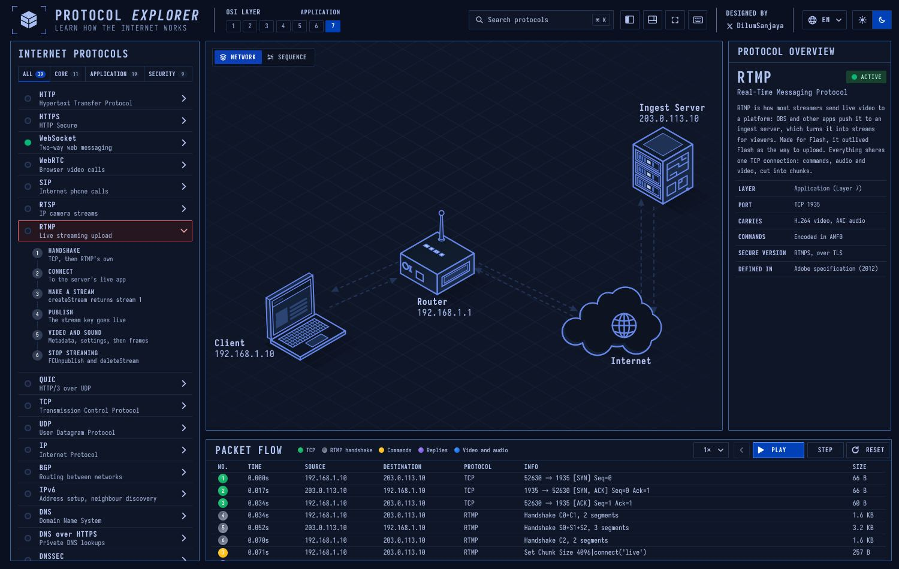
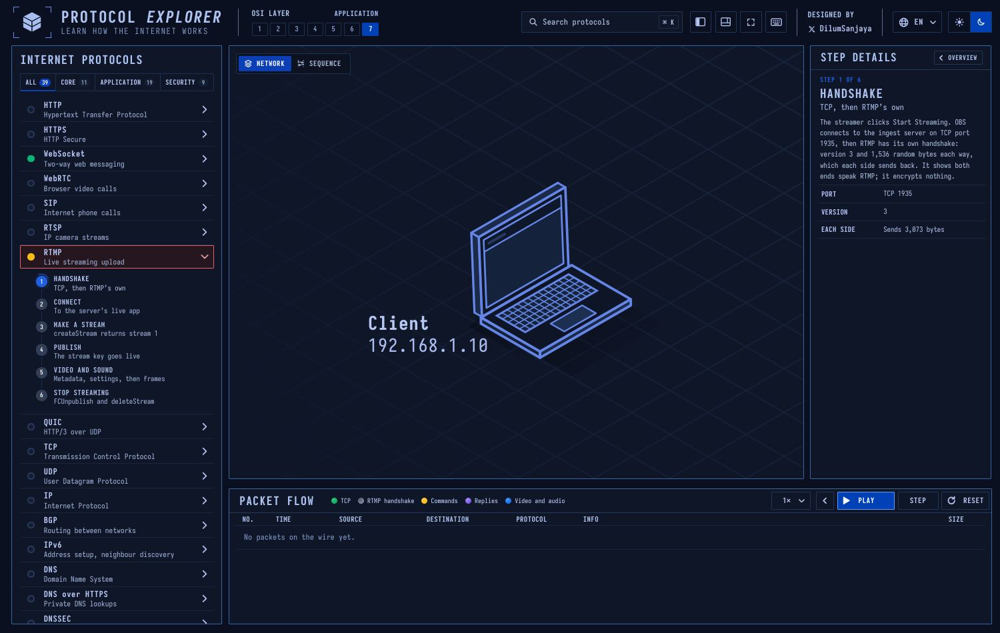
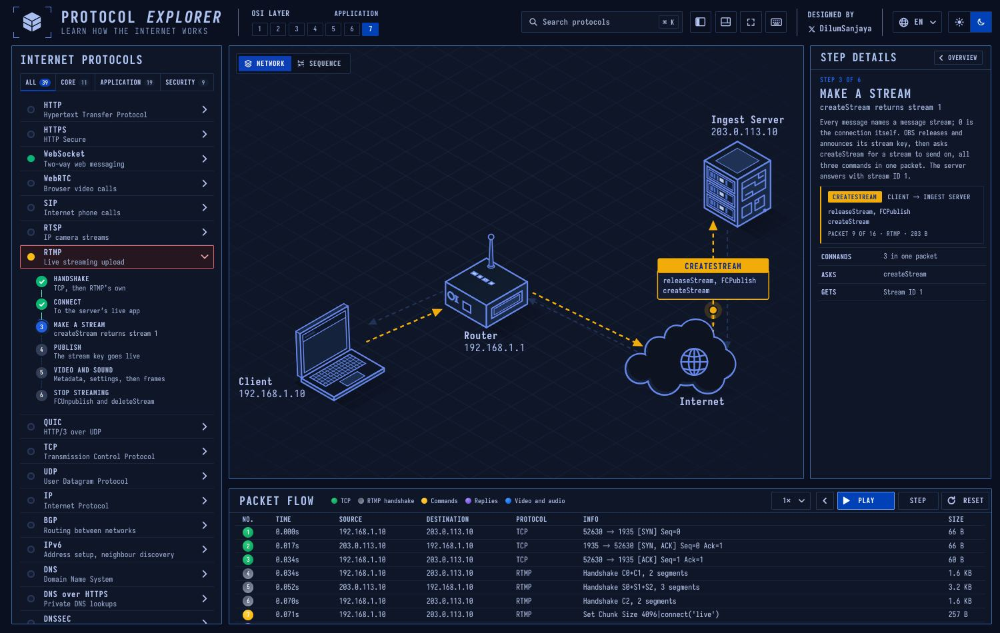
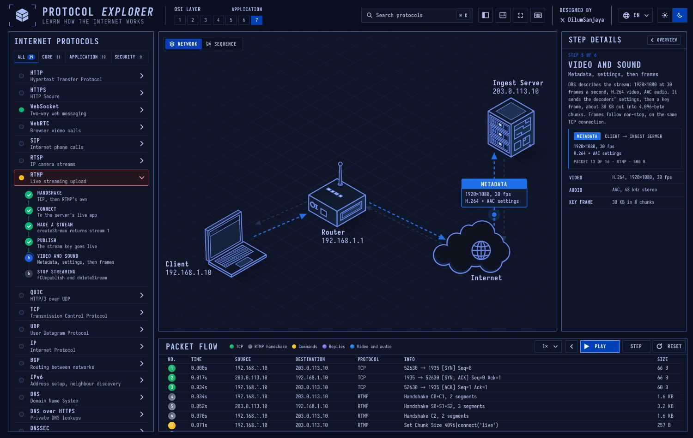
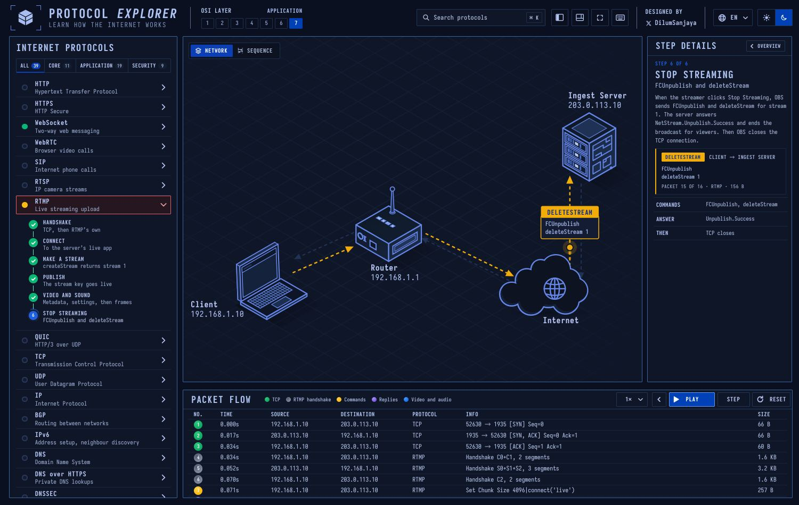
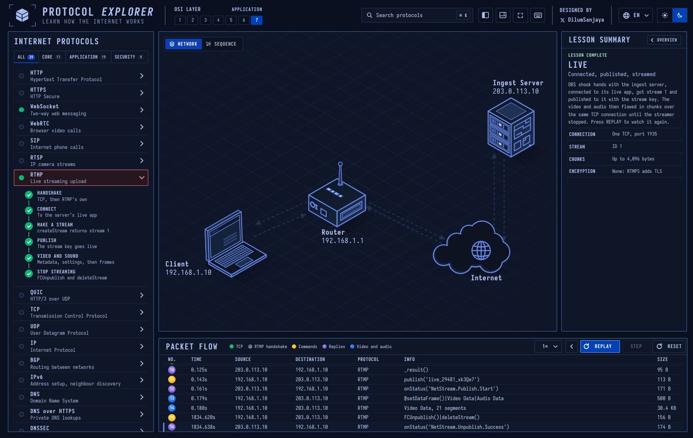
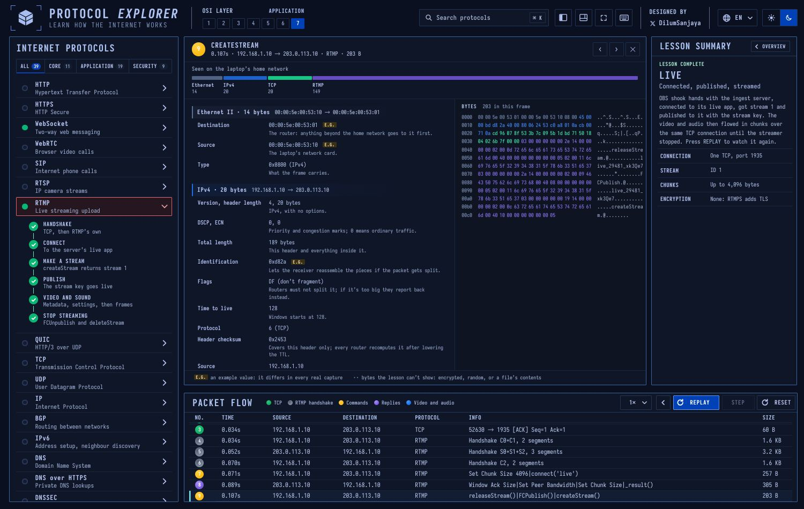
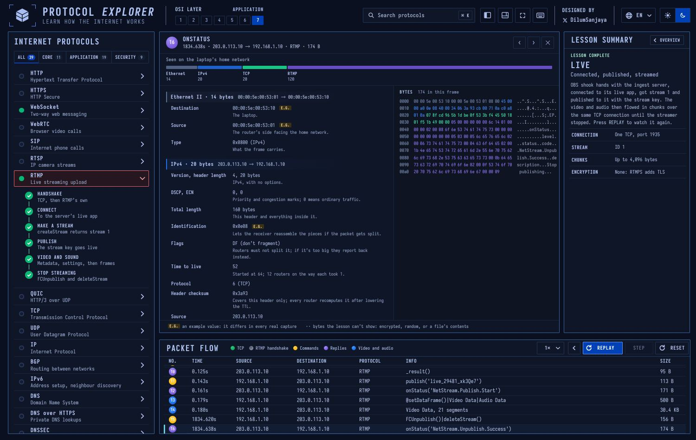

# RTMP – Live streaming upload

<!-- nav -->
⬅ [06 RTSP](06-rtsp.md) · [Index](00_Protocols_Index.md) · [08 QUIC](08-quic.md) ➡
<!-- nav -->

*Source: Protocol Explorer – https://protocol-explorer-alpha.vercel.app/ (interactive lesson #7). Screenshots captured from the live lesson; packet decodes are the site's example capture (values marked **E.G.** differ in every real capture).*

## Overview



> PROTOCOL OVERVIEW  
> RTMP  
> ACTIVE  
> Real-Time Messaging Protocol  
> RTMP is how most streamers send live video to a platform: OBS and other apps push it to an ingest server, which turns it into streams for viewers. Made for Flash, it outlived Flash as the way to upload. Everything shares one TCP connection: commands, audio and video, cut into chunks.  
> LAYER  
> Application (Layer 7)  
> PORT  
> TCP 1935  
> CARRIES  
> H.264 video, AAC audio  
> COMMANDS  
> Encoded in AMF0  
> SECURE VERSION  
> RTMPS, over TLS  
> DEFINED IN  
> Adobe specification (2012)  

## In-depth explanation of the example (plain-language version)

### The big picture in one minute
A streamer clicks **Start Streaming** in **OBS**. OBS pushes the live camera feed to an **ingest server** (`203.0.113.10`), which then makes it available to viewers. The lesson shows **16 messages**: open a connection, a short RTMP greeting, a few setup commands, the first video and sound, and the stop about 30 minutes later.

**RTMP is the "upload" half of live streaming.** Viewers often watch using other technologies, but streamers send their feed with RTMP because it is simple, quick and every encoder supports it. **Commands, sound and video all share one TCP connection (port 1935)**, cut into small pieces called *chunks*.

Think of a live radio contributor phoning the studio: first a greeting, then "I'm John from the show, put me on channel 1" and then they start talking non-stop.

> **Words you'll see:** *Ingest server* = the server that receives your stream. *Stream key* = a secret code that says whose channel this is. *Chunk* = a small slice of a bigger message. *Encoder* = software (like OBS) that compresses video and sound.

---

### Step 1 – Greetings (the RTMP handshake) – packets 1 to 6
After the normal TCP handshake (packets 1–3), RTMP does its own three-part greeting:
- **Client → server (packet 4):** "I speak RTMP version 3" plus 1,536 bytes of mostly random data.
- **Server → client (packet 5):** its own version byte, its own 1,536 random bytes, and a copy of what the client sent.
- **Client → server (packet 6):** a copy of the server's random data.
Each side proves it received the other's data, so both know they really speak RTMP and the path works. **This is a sanity check, not security.** Nothing is encrypted. The secure version is **RTMPS** (RTMP inside TLS).

### Step 2 – Connect to the "live" application – packets 7, 8
- **Packet 7:** OBS says "I'll send chunks up to 4,096 bytes" (the default is a tiny 128, so this means less overhead) and sends the **`connect`** command for the app called `live`.
- Commands are written in a compact binary format called **AMF** (inherited from Flash) that holds names, numbers and small objects.
- Each chunk begins with a small header that says which *message type* it carries (for example 20 = command, 8 = audio, 9 = video) and which *stream* it belongs to.
- **Packet 8:** the server answers with some limits (how much data may be sent before an acknowledgement) and a success reply: `NetConnection.Connect.Success`.

### Step 3 – Create a stream – packets 9, 10
Stream number 0 is just the connection itself, so to send video you need a new stream. OBS sends `releaseStream`, `FCPublish` (these reserve and announce the stream key) and `createStream`. The server replies with **stream ID 1**. (Each command has a transaction number so a reply can be matched to its request.)

### Step 4 – Go live (publish) – packets 11, 12
OBS sends **`publish('live_29481_xk3Qe7')`**. That text is the **stream key**, the secret that tells the platform which channel you are. Because plain RTMP has **no encryption**, the key travels in the clear; that's why platforms recommend RTMPS. The server checks it and answers `NetStream.Publish.Start`. **You're live.**

### Step 5 – Video and sound – packets 13, 14
- **Packet 13:** details about the stream (1920×1080, 30 fps, codecs, bitrates) and the **decoder settings** for H.264 video and AAC audio. A decoder needs these before it can show anything.
- **Packet 14:** the first **key frame** (a complete picture, about 30 KB), cut into 4,096-byte chunks. From here on, audio and video chunks are mixed together, each with a timestamp, for the whole session.
Since it's TCP, lost data is re-sent. That's reliable, but also why RTMP delay can jump on a poor connection.

### Step 6 – Stop – packets 15, 16
After about 30 minutes, OBS sends `FCUnpublish` and `deleteStream`. The server confirms with `NetStream.Unpublish.Success`, ends the broadcast for viewers, and the connection closes.

---

### The 16 messages at a glance
| Packets | What | Why |
|---|---|---|
| 1–3 | TCP handshake | open the connection |
| 4–6 | RTMP handshake | check both sides speak RTMP |
| 7–8 | connect | enter the `live` app |
| 9–10 | createStream | get stream ID 1 |
| 11–12 | publish | announce the channel (stream key) |
| 13–14 | metadata, first video and audio | the broadcast begins |
| 15–16 | unpublish, delete | end |

### What to remember
- Layers: **TCP port 1935 → RTMP chunks → messages (commands, audio, video).**
- To go live: **connect → createStream → publish → send data → unpublish.**
- The stream key is effectively a password in plain view unless you use **RTMPS**.
- RTMP outlived Flash because it is still the easiest way to *send* a stream to a platform. Modern alternatives include SRT, WebRTC (WHIP) and RIST.

## Step-by-step walkthrough (screenshots from the lesson)

### Step 1: HANDSHAKE – TCP, then RTMP’s own



> STEP 1 OF 6  
> HANDSHAKE  
> TCP, then RTMP’s own  
> The streamer clicks Start Streaming. OBS connects to the ingest server on TCP port 1935, then RTMP has its own handshake: version 3 and 1,536 random bytes each way, which each side sends back. It shows both ends speak RTMP; it encrypts nothing.  
> PORT  
> TCP 1935  
> VERSION  
> 3  
> EACH SIDE  
> Sends 3,073 bytes  

### Step 2: CONNECT – To the server’s live app


> STEP 2 OF 6  
> CONNECT  
> To the server’s live app  
> OBS raises its chunk size to 4,096 bytes and sends connect for the app called live, in AMF0, a compact binary format from Flash. The server sets its own window, bandwidth and chunk size, and answers _result: NetConnection.Connect.Success.  
> CONNECT  
> CLIENT → INGEST SERVER  
> app: live  
> chunk size 4,096  
> PACKET 7 OF 16 · RTMP · 257 B  
> APP  
> live  
> ENCODING  
> AMF0  
> CHUNKS  
> Up to 4,096 bytes  

### Step 3: MAKE A STREAM – createStream returns stream 1



> STEP 3 OF 6  
> MAKE A STREAM  
> createStream returns stream 1  
> Every message names a message stream; 0 is the connection itself. OBS releases and announces its stream key, then asks createStream for a stream to send on, all three commands in one packet. The server answers with stream ID 1.  
> CREATESTREAM  
> CLIENT → INGEST SERVER  
> releaseStream, FCPublish  
> createStream  
> PACKET 9 OF 16 · RTMP · 203 B  
> COMMANDS  
> 3 in one packet  
> ASKS  
> createStream  
> GETS  
> Stream ID 1  

### Step 4: PUBLISH – The stream key goes live


> STEP 4 OF 6  
> PUBLISH  
> The stream key goes live  
> publish names the stream key, the secret that says whose channel this is. RTMP has no encryption, so the key crosses in plain text; platforms prefer RTMPS, the same over TLS. The server checks the key and answers NetStream.Publish.Start.  
> PUBLISH  
> CLIENT → INGEST SERVER  
> on stream 1  
> stream key, live  
> PACKET 11 OF 16 · RTMP · 113 B  
> SENDS  
> The stream key  
> ENCRYPTION  
> None (RTMPS adds TLS)  
> ANSWER  
> Publish.Start  

### Step 5: VIDEO AND SOUND – Metadata, settings, then frames



> STEP 5 OF 6  
> VIDEO AND SOUND  
> Metadata, settings, then frames  
> OBS describes the stream: 1920×1080 at 30 frames a second, H.264 video, AAC audio. It sends the decoders’ settings, then a key frame, about 30 KB cut into 4,096-byte chunks. Frames follow non-stop, on the same TCP connection.  
> METADATA  
> CLIENT → INGEST SERVER  
> 1920×1080, 30 fps  
> H.264 + AAC settings  
> PACKET 13 OF 16 · RTMP · 500 B  
> VIDEO  
> H.264, 1920×1080, 30 fps  
> AUDIO  
> AAC, 48 kHz stereo  
> KEY FRAME  
> 30 KB in 8 chunks  

### Step 6: STOP STREAMING – FCUnpublish and deleteStream



> STEP 6 OF 6  
> STOP STREAMING  
> FCUnpublish and deleteStream  
> When the streamer clicks Stop Streaming, OBS sends FCUnpublish and deleteStream for stream 1. The server answers NetStream.Unpublish.Success and ends the broadcast for viewers. Then OBS closes the TCP connection.  
> DELETESTREAM  
> CLIENT → INGEST SERVER  
> FCUnpublish  
> deleteStream 1  
> PACKET 15 OF 16 · RTMP · 156 B  
> COMMANDS  
> FCUnpublish, deleteStream  
> ANSWER  
> Unpublish.Success  
> THEN  
> TCP closes  

### Lesson summary



> LESSON SUMMARY  
> LESSON COMPLETE  
> LIVE  
> Connected, published, streamed  
> OBS shook hands with the ingest server, connected to its live app, got stream 1 and published to it with the stream key. The video and audio then flowed in chunks over the same TCP connection until the streamer stopped. Press REPLAY to watch it again.  
> ONSTATUS  
> INGEST SERVER → CLIENT  
> Unpublish.Success  
> PACKET 16 OF 16 · RTMP · 174 B  
> CONNECTION  
> One TCP, port 1935  
> STREAM  
> ID 1  
> CHUNKS  
> Up to 4,096 bytes  
> ENCRYPTION  
> None: RTMPS adds TLS  

## Packet flow (whole lesson)

| No. | Time | Source | Destination | Protocol | Info | Size |
|---|---|---|---|---|---|---|
| 1 | 0.000s | 192.168.1.10 | 203.0.113.10 | TCP | 52630 → 1935 [SYN] Seq=0 | 66 B |
| 2 | 0.017s | 203.0.113.10 | 192.168.1.10 | TCP | 1935 → 52630 [SYN, ACK] Seq=0 Ack=1 | 66 B |
| 3 | 0.034s | 192.168.1.10 | 203.0.113.10 | TCP | 52630 → 1935 [ACK] Seq=1 Ack=1 | 60 B |
| 4 | 0.034s | 192.168.1.10 | 203.0.113.10 | RTMP | Handshake C0+C1, 2 segments | 1.6 KB |
| 5 | 0.052s | 203.0.113.10 | 192.168.1.10 | RTMP | Handshake S0+S1+S2, 3 segments | 3.2 KB |
| 6 | 0.070s | 192.168.1.10 | 203.0.113.10 | RTMP | Handshake C2, 2 segments | 1.6 KB |
| 7 | 0.071s | 192.168.1.10 | 203.0.113.10 | RTMP | Set Chunk Size 4096\|connect('live') | 257 B |
| 8 | 0.089s | 203.0.113.10 | 192.168.1.10 | RTMP | Window Ack Size\|Set Peer Bandwidth\|Set Chunk Size\|_result() | 305 B |
| 9 | 0.107s | 192.168.1.10 | 203.0.113.10 | RTMP | releaseStream()\|FCPublish()\|createStream() | 203 B |
| 10 | 0.125s | 203.0.113.10 | 192.168.1.10 | RTMP | _result() | 95 B |
| 11 | 0.143s | 192.168.1.10 | 203.0.113.10 | RTMP | publish('live_29481_xk3Qe7') | 113 B |
| 12 | 0.161s | 203.0.113.10 | 192.168.1.10 | RTMP | onStatus('NetStream.Publish.Start') | 171 B |
| 13 | 0.179s | 192.168.1.10 | 203.0.113.10 | RTMP | @setDataFrame()\|Video Data\|Audio Data | 500 B |
| 14 | 0.180s | 192.168.1.10 | 203.0.113.10 | RTMP | Video Data, 21 segments | 30.4 KB |
| 15 | 1834.620s | 192.168.1.10 | 203.0.113.10 | RTMP | FCUnpublish()\|deleteStream() | 156 B |
| 16 | 1834.638s | 203.0.113.10 | 192.168.1.10 | RTMP | onStatus('NetStream.Unpublish.Success') | 174 B |

### Sequence diagram


## Packets decoded byte by byte

Each packet below is the lesson's own decode (headers, field values and the plain-English meaning of each field). Screenshots show the first, middle and last packet in the lesson's decoder view with the raw hex bytes.

### Packet 1: TCP – 52630 → 1935 [SYN] Seq=0

*192.168.1.10 → 203.0.113.10 · 66 B · t = 0.000s*


<details><summary>Decoded fields</summary>

```text
1
SYN
0.000s · 192.168.1.10 → 203.0.113.10 · TCP · 66 B
Seen on the laptop’s home network
Ethernet
14
IPv4
20
TCP
32
Ethernet II · 14 bytes
00:00:5e:00:53:10 → 00:00:5e:00:53:01
Destination
00:00:5e:00:53:01 E.G.

The router: anything beyond the home network goes to it first.

Source
00:00:5e:00:53:10 E.G.

The laptop’s network card.

Type
0x0800 (IPv4)

What the frame carries.

IPv4 · 20 bytes
192.168.1.10 → 203.0.113.10
Version, header length
4, 20 bytes

IPv4, with no options.

DSCP, ECN
0, 0

Priority and congestion marks; 0 means ordinary traffic.

Total length
52 bytes

This header and everything inside it.

Identification
0xd825 E.G.

Lets the receiver reassemble the pieces if the packet gets split.

Flags
DF (don’t fragment)

Routers must not split it; if it’s too big they report back instead.

Time to live
128

Windows starts at 128.

Protocol
6 (TCP)
Header checksum
0x24e1

Covers this header only; every router recomputes it after lowering the TTL.

Source
192.168.1.10
Destination
203.0.113.10
TCP · 32 bytes
52630 → 1935, SYN
Source port
52630

Picked by the laptop’s system for this connection.

Destination port
1935
Sequence number
0 (relative)

This side’s starting number. Shown as 0; the real one is random.

Real sequence number
1396404028 E.G.
Acknowledgment
0 (not used yet)

A first SYN has nothing to acknowledge.

Header length
32 bytes

20 bytes, plus 12 of options.

Flags
0x002 (SYN)
Window
64240 E.G.

How much more data this side can take right now.

Checksum
0xdec4

Covers the header, the data and the IP addresses, so damage is caught.

Urgent pointer
0
Options
12 bytes
Maximum segment size
1460 bytes

The most data this side wants in one segment.

No-op
1

Spacing, so the next option lines up.

Window scale
× 256

Window values are multiplied by this, so windows can be larger than 64 KB.

No-op
1

Spacing, so the next option lines up.

No-op
1

Spacing, so the next option lines up.

SACK permitted
yes

This side understands selective acknowledgements.

BYTES 66 in this frame
0000
00
00
5e
00
53
01
00
00
5e
00
53
10
08
00
45
00
.
.
^
.
S
.
.
.
^
.
S
.
.
.
E
.
0010
00
34
d8
25
40
00
80
06
24
e1
c0
a8
01
0a
cb
00
.
4
.
%
@
.
.
.
$
.
.
.
.
.
.
.
0020
71
0a
cd
96
07
8f
53
3b
6f
3c
00
00
00
00
80
02
q
.
.
.
.
.
S
;
o
<
.
.
.
.
.
.
0030
fa
f0
de
c4
00
00
02
04
05
b4
01
03
03
08
01
01
.
.
.
.
.
.
.
.
.
.
.
.
.
.
.
.
0040
04
02
.
.
E.G. an example value: it differs in every real capture
·· bytes the lesson can’t show: encrypted, random, or a file’s contents
```

</details>

### Packet 2: TCP – 1935 → 52630 [SYN, ACK] Seq=0 Ack=1

*203.0.113.10 → 192.168.1.10 · 66 B · t = 0.017s*

<details><summary>Decoded fields</summary>

```text
2
SYN-ACK
0.017s · 203.0.113.10 → 192.168.1.10 · TCP · 66 B
Seen on the laptop’s home network
Ethernet
14
IPv4
20
TCP
32
Ethernet II · 14 bytes
00:00:5e:00:53:01 → 00:00:5e:00:53:10
Destination
00:00:5e:00:53:10 E.G.

The laptop.

Source
00:00:5e:00:53:01 E.G.

The router’s side facing the home network.

Type
0x0800 (IPv4)

What the frame carries.

IPv4 · 20 bytes
203.0.113.10 → 192.168.1.10
Version, header length
4, 20 bytes

IPv4, with no options.

DSCP, ECN
0, 0

Priority and congestion marks; 0 means ordinary traffic.

Total length
52 bytes

This header and everything inside it.

Identification
0x0e03 E.G.

Lets the receiver reassemble the pieces if the packet gets split.

Flags
DF (don’t fragment)

Routers must not split it; if it’s too big they report back instead.

Time to live
52

Started at 64; 12 routers on the way each took 1.

Protocol
6 (TCP)
Header checksum
0x3b04

Covers this header only; every router recomputes it after lowering the TTL.

Source
203.0.113.10
Destination
192.168.1.10
TCP · 32 bytes
1935 → 52630, SYN, ACK
Source port
1935
Destination port
52630
Sequence number
0 (relative)

This side’s starting number. Shown as 0; the real one is random.

Real sequence number
1528672372 E.G.
Acknowledgment
1 (relative)

The next byte this side expects: everything before it has arrived.

Header length
32 bytes

20 bytes, plus 12 of options.

Flags
0x012 (SYN, ACK)
Window
64240 E.G.

How much more data this side can take right now.

Checksum
0xd322

Covers the header, the data and the IP addresses, so damage is caught.

Urgent pointer
0
Options
12 bytes
Maximum segment size
1460 bytes

The most data this side wants in one segment.

No-op
1

Spacing, so the next option lines up.

No-op
1

Spacing, so the next option lines up.

SACK permitted
yes

This side understands selective acknowledgements.

No-op
1

Spacing, so the next option lines up.

Window scale
× 128

Window values are multiplied by this, so windows can be larger than 64 KB.

BYTES 66 in this frame
0000
00
00
5e
00
53
10
00
00
5e
00
53
01
08
00
45
00
.
.
^
.
S
.
.
.
^
.
S
.
.
.
E
.
0010
00
34
0e
03
40
00
34
06
3b
04
cb
00
71
0a
c0
a8
.
4
.
.
@
.
4
.
;
.
.
.
q
.
.
.
0020
01
0a
07
8f
cd
96
5b
1d
b0
74
53
3b
6f
3d
80
12
.
.
.
.
.
.
[
.
.
t
S
;
o
=
.
.
0030
fa
f0
d3
22
00
00
02
04
05
b4
01
01
04
02
01
03
.
.
.
"
.
.
.
.
.
.
.
.
.
.
.
.
0040
03
07
.
.
E.G. an example value: it differs in every real capture
·· bytes the lesson can’t show: encrypted, random, or a file’s contents
```

</details>

### Packet 3: TCP – 52630 → 1935 [ACK] Seq=1 Ack=1

*192.168.1.10 → 203.0.113.10 · 60 B · t = 0.034s*

<details><summary>Decoded fields</summary>

```text
3
ACK
0.034s · 192.168.1.10 → 203.0.113.10 · TCP · 60 B
Seen on the laptop’s home network
Ethernet
14
IPv4
20
TCP
20
Padding
6
Ethernet II · 14 bytes
00:00:5e:00:53:10 → 00:00:5e:00:53:01
Destination
00:00:5e:00:53:01 E.G.

The router: anything beyond the home network goes to it first.

Source
00:00:5e:00:53:10 E.G.

The laptop’s network card.

Type
0x0800 (IPv4)

What the frame carries.

IPv4 · 20 bytes
192.168.1.10 → 203.0.113.10
Version, header length
4, 20 bytes

IPv4, with no options.

DSCP, ECN
0, 0

Priority and congestion marks; 0 means ordinary traffic.

Total length
40 bytes

This header and everything inside it.

Identification
0xd826 E.G.

Lets the receiver reassemble the pieces if the packet gets split.

Flags
DF (don’t fragment)

Routers must not split it; if it’s too big they report back instead.

Time to live
128

Windows starts at 128.

Protocol
6 (TCP)
Header checksum
0x24ec

Covers this header only; every router recomputes it after lowering the TTL.

Source
192.168.1.10
Destination
203.0.113.10
TCP · 20 bytes
52630 → 1935, ACK
Source port
52630

Picked by the laptop’s system for this connection.

Destination port
1935
Sequence number
1 (relative)

Position of this segment’s first byte, counted from this side’s SYN.

Real sequence number
1396404029 E.G.
Acknowledgment
1 (relative)

The next byte this side expects: everything before it has arrived.

Header length
20 bytes
Flags
0x010 (ACK)
Window
1026 (× 256 = 262,656 bytes) E.G.

How much more data this side can take right now.

Checksum
0x0ae4

Covers the header, the data and the IP addresses, so damage is caught.

Urgent pointer
0
Ethernet padding · 6 bytes
Padding
6 zero bytes

Ethernet frames are at least 60 bytes (64 with the checksum the card adds), so short ones are padded.

BYTES 60 in this frame
0000
00
00
5e
00
53
01
00
00
5e
00
53
10
08
00
45
00
.
.
^
.
S
.
.
.
^
.
S
.
.
.
E
.
0010
00
28
d8
26
40
00
80
06
24
ec
c0
a8
01
0a
cb
00
.
(
.
&
@
.
.
.
$
.
.
.
.
.
.
.
0020
71
0a
cd
96
07
8f
53
3b
6f
3d
5b
1d
b0
75
50
10
q
.
.
.
.
.
S
;
o
=
[
.
.
u
P
.
0030
04
02
0a
e4
00
00
00
00
00
00
00
00
.
.
.
.
.
.
.
.
.
.
.
.
E.G. an example value: it differs in every real capture
·· bytes the lesson can’t show: encrypted, random, or a file’s contents
```

</details>

### Packet 4: RTMP – Handshake C0+C1, 2 segments

*192.168.1.10 → 203.0.113.10 · 1.6 KB · t = 0.034s*

<details><summary>Decoded fields</summary>

```text
4
C0+C1
0.034s · 192.168.1.10 → 203.0.113.10 · RTMP · 1.6 KB
Seen on the laptop’s home network · This row stands for 2 TCP segments carrying a 1,537-byte message; the first segment is shown
Ethernet
14
IPv4
20
TCP
20
RTMP handshake
1460
Ethernet II · 14 bytes
00:00:5e:00:53:10 → 00:00:5e:00:53:01
Destination
00:00:5e:00:53:01 E.G.

The router: anything beyond the home network goes to it first.

Source
00:00:5e:00:53:10 E.G.

The laptop’s network card.

Type
0x0800 (IPv4)

What the frame carries.

IPv4 · 20 bytes
192.168.1.10 → 203.0.113.10
Version, header length
4, 20 bytes

IPv4, with no options.

DSCP, ECN
0, 0

Priority and congestion marks; 0 means ordinary traffic.

Total length
1500 bytes

This header and everything inside it.

Identification
0xd827 E.G.

Lets the receiver reassemble the pieces if the packet gets split.

Flags
DF (don’t fragment)

Routers must not split it; if it’s too big they report back instead.

Time to live
128

Windows starts at 128.

Protocol
6 (TCP)
Header checksum
0x1f37

Covers this header only; every router recomputes it after lowering the TTL.

Source
192.168.1.10
Destination
203.0.113.10
TCP · 20 bytes
52630 → 1935, PSH, ACK
Source port
52630

Picked by the laptop’s system for this connection.

Destination port
1935
Sequence number
1 (relative)

Position of this segment’s first byte, counted from this side’s SYN.

Real sequence number
1396404029 E.G.
Acknowledgment
1 (relative)

The next byte this side expects: everything before it has arrived.

Header length
20 bytes
Flags
0x018 (PSH, ACK)
Window
1026 (× 256 = 262,656 bytes) E.G.

How much more data this side can take right now.

Checksum
covers bytes not shown here

Covers the header, the data and the IP addresses, so damage is caught.

Urgent pointer
0
RTMP handshake · C0+C1
C0: version
3

RTMP version 3, the only one in use.

C1
1,536 bytes
Time
0

A timestamp; zero is allowed.

Zero
0
Random data
1,528 bytes

Random bytes the server must send back.

BYTES 1514 in this frame
0000
00
00
5e
00
53
01
00
00
5e
00
53
10
08
00
45
00
.
.
^
.
S
.
.
.
^
.
S
.
.
.
E
.
0010
05
dc
d8
27
40
00
80
06
1f
37
c0
a8
01
0a
cb
00
.
.
.
'
@
.
.
.
.
7
.
.
.
.
.
.
0020
71
0a
cd
96
07
8f
53
3b
6f
3d
5b
1d
b0
75
50
18
q
.
.
.
.
.
S
;
o
=
[
.
.
u
P
.
0030
04
02
··
··
00
00
03
00
00
00
00
00
00
00
00
··
.
.
·
·
.
.
.
.
.
.
.
.
.
.
.
·
0040
··
··
··
··
··
··
··
··
··
··
··
··
··
··
··
··
·
·
·
·
·
·
·
·
·
·
·
·
·
·
·
·
0050
··
··
··
··
··
··
··
··
··
··
··
··
··
··
··
··
·
·
·
·
·
·
·
·
·
·
·
·
·
·
·
·
0060
··
··
··
··
··
··
··
··
··
··
··
··
··
··
··
··
·
·
·
·
·
·
·
·
·
·
·
·
·
·
·
·
0070
··
··
··
··
··
··
··
··
··
··
··
··
··
··
··
··
·
·
·
·
·
·
·
·
·
·
·
·
·
·
·
·
0080
··
··
··
··
··
··
··
··
··
··
··
··
··
··
··
··
·
·
·
·
·
·
·
·
·
·
·
·
·
·
·
·
0090
··
··
··
··
··
··
··
··
··
··
··
··
··
··
··
··
·
·
·
·
·
·
·
·
·
·
·
·
·
·
·
·
00a0
··
··
··
··
··
··
··
··
··
··
··
··
··
··
··
··
·
·
·
·
·
·
·
·
·
·
·
·
·
·
·
·
00b0
··
··
··
··
··
··
··
··
··
··
··
··
··
··
··
··
·
·
·
·
·
·
·
·
·
·
·
·
·
·
·
·
00c0
··
··
··
··
··
··
··
··
··
··
··
··
··
··
··
··
·
·
·
·
·
·
·
·
·
·
·
·
·
·
·
·
00d0
··
··
··
··
··
··
··
··
··
··
··
··
··
··
··
··
·
·
·
·
·
·
·
·
·
·
·
·
·
·
·
·
00e0
··
··
··
··
··
··
··
··
··
··
··
··
··
··
··
··
·
·
·
·
·
·
·
·
·
·
·
·
·
·
·
·
00f0
··
··
··
··
··
··
··
··
··
··
··
··
··
··
··
··
·
·
·
·
·
·
·
·
·
·
·
·
·
·
·
·
0100
··
··
··
··
··
··
··
··
··
··
··
··
··
··
··
··
·
·
·
·
·
·
·
·
·
·
·
·
·
·
·
·
0110
··
··
··
··
··
··
··
··
··
··
··
··
··
··
··
··
·
·
·
·
·
·
·
·
·
·
·
·
·
·
·
·
0120
··
··
··
··
··
··
··
··
··
··
··
··
··
··
··
··
·
·
·
·
·
·
·
·
·
·
·
·
·
·
·
·
0130
··
··
··
··
··
··
··
··
··
··
··
··
··
··
··
··
·
·
·
·
·
·
·
·
·
·
·
·
·
·
·
·
0140
··
··
··
··
··
··
··
··
··
··
··
··
··
··
··
··
·
·
·
·
·
·
·
·
·
·
·
·
·
·
·
·
0150
··
··
··
··
··
··
··
··
··
··
··
··
··
··
··
··
·
·
·
·
·
·
·
·
·
·
·
·
·
·
·
·
0160
··
··
··
··
··
··
··
··
··
··
··
··
··
··
··
··
·
·
·
·
·
·
·
·
·
·
·
·
·
·
·
·
0170
··
··
··
··
··
··
··
··
··
··
··
··
··
··
··
··
·
·
·
·
·
·
·
·
·
·
·
·
·
·
·
·
0180
··
··
··
··
··
··
··
··
··
··
··
··
··
··
··
··
·
·
·
·
·
·
·
·
·
·
·
·
·
·
·
·
0190
··
··
··
··
··
··
··
··
··
··
··
··
··
··
··
··
·
·
·
·
·
·
·
·
·
·
·
·
·
·
·
·
01a0
··
··
··
··
··
··
··
··
··
··
··
··
··
··
··
··
·
·
·
·
·
·
·
·
·
·
·
·
·
·
·
·
01b0
··
··
··
··
··
··
··
··
··
··
··
··
··
··
··
··
·
·
·
·
·
·
·
·
·
·
·
·
·
·
·
·
01c0
··
··
··
··
··
··
··
··
··
··
··
··
··
··
··
··
·
·
·
·
·
·
·
·
·
·
·
·
·
·
·
·
01d0
··
··
··
··
··
··
··
··
··
··
··
··
··
··
··
··
·
·
·
·
·
·
·
·
·
·
·
·
·
·
·
·
01e0
··
··
··
··
··
··
··
··
··
··
··
··
··
··
··
··
·
·
·
·
·
·
·
·
·
·
·
·
·
·
·
·
01f0
··
··
··
··
··
··
··
··
··
··
··
··
··
··
··
··
·
·
·
·
·
·
·
·
·
·
·
·
·
·
·
·
0200
··
··
··
··
··
··
··
··
··
··
··
··
··
··
··
··
·
·
·
·
·
·
·
·
·
·
·
·
·
·
·
·
0210
··
··
··
··
··
··
··
··
··
··
··
··
··
··
··
··
·
·
·
·
·
·
·
·
·
·
·
·
·
·
·
·
0220
··
··
··
··
··
··
··
··
··
··
··
··
··
··
··
··
·
·
·
·
·
·
·
·
·
·
·
·
·
·
·
·
0230
··
··
··
··
··
··
··
··
··
··
··
··
··
··
··
··
·
·
·
·
·
·
·
·
·
·
·
·
·
·
·
·
0240
··
··
··
··
··
··
··
··
··
··
··
··
··
··
··
··
·
·
·
·
·
·
·
·
·
·
·
·
·
·
·
·
0250
··
··
··
··
··
··
··
··
··
··
··
··
··
··
··
··
·
·
·
·
·
·
·
·
·
·
·
·
·
·
·
·
0260
··
··
··
··
··
··
··
··
··
··
··
··
··
··
··
··
·
·
·
·
·
·
·
·
·
·
·
·
·
·
·
·
0270
··
··
··
··
··
··
··
··
··
··
··
··
··
··
··
··
·
·
·
·
·
·
·
·
·
·
·
·
·
·
·
·
0280
··
··
··
··
··
··
··
··
··
··
··
··
··
··
··
··
·
·
·
·
·
·
·
·
·
·
·
·
·
·
·
·
0290
··
··
··
··
··
··
··
··
··
··
··
··
··
··
··
··
·
·
·
·
·
·
·
·
·
·
·
·
·
·
·
·
02a0
··
··
··
··
··
··
··
··
··
··
··
··
··
··
··
··
·
·
·
·
·
·
·
·
·
·
·
·
·
·
·
·
02b0
··
··
··
··
··
··
··
··
··
··
··
··
··
··
··
··
·
·
·
·
·
·
·
·
·
·
·
·
·
·
·
·
02c0
··
··
··
··
··
··
··
··
··
··
··
··
··
··
··
··
·
·
·
·
·
·
·
·
·
·
·
·
·
·
·
·
02d0
··
··
··
··
··
··
··
··
··
··
··
··
··
··
··
··
·
·
·
·
·
·
·
·
·
·
·
·
·
·
·
·
02e0
··
··
··
··
··
··
··
··
··
··
··
··
··
··
··
··
·
·
·
·
·
·
·
·
·
·
·
·
·
·
·
·
02f0
··
··
··
··
··
··
··
··
··
··
··
··
··
··
··
··
·
·
·
·
·
·
·
·
·
·
·
·
·
·
·
·
0300
··
··
··
··
··
··
··
··
··
··
··
··
··
··
··
··
·
·
·
·
·
·
·
·
·
·
·
·
·
·
·
·
0310
··
··
··
··
··
··
··
··
··
··
··
··
··
··
··
··
·
·
·
·
·
·
·
·
·
·
·
·
·
·
·
·
0320
··
··
··
··
··
··
··
··
··
··
··
··
··
··
··
··
·
·
·
·
·
·
·
·
·
·
·
·
·
·
·
·
0330
··
··
··
··
··
··
··
··
··
··
··
··
··
··
··
··
·
·
·
·
·
·
·
·
·
·
·
·
·
·
·
·
0340
··
··
··
··
··
··
··
··
··
··
··
··
··
··
··
··
·
·
·
·
·
·
·
·
·
·
·
·
·
·
·
·
0350
··
··
··
··
··
··
··
··
··
··
··
··
··
··
··
··
·
·
·
·
·
·
·
·
·
·
·
·
·
·
·
·
0360
··
··
··
··
··
··
··
··
··
··
··
··
··
··
··
··
·
·
·
·
·
·
·
·
·
·
·
·
·
·
·
·
0370
··
··
··
··
··
··
··
··
··
··
··
··
··
··
··
··
·
·
·
·
·
·
·
·
·
·
·
·
·
·
·
·
0380
··
··
··
··
··
··
··
··
··
··
··
··
··
··
··
··
·
·
·
·
·
·
·
·
·
·
·
·
·
·
·
·
0390
··
··
··
··
··
··
··
··
··
··
··
··
··
··
··
··
·
·
·
·
·
·
·
·
·
·
·
·
·
·
·
·
03a0
··
··
··
··
··
··
··
··
··
··
··
··
··
··
··
··
·
·
·
·
·
·
·
·
·
·
·
·
·
·
·
·
03b0
··
··
··
··
··
··
··
··
··
··
··
··
··
··
··
··
·
·
·
·
·
·
·
·
·
·
·
·
·
·
·
·
03c0
··
··
··
··
··
··
··
··
··
··
··
··
··
··
··
··
·
·
·
·
·
·
·
·
·
·
·
·
·
·
·
·
03d0
··
··
··
··
··
··
··
··
··
··
··
··
··
··
··
··
·
·
·
·
·
·
·
·
·
·
·
·
·
·
·
·
03e0
··
··
··
··
··
··
··
··
··
··
··
··
··
··
··
··
·
·
·
·
·
·
·
·
·
·
·
·
·
·
·
·
03f0
··
··
··
··
··
··
··
··
··
··
··
··
··
··
··
··
·
·
·
·
·
·
·
·
·
·
·
·
·
·
·
·
0400
··
··
··
··
··
··
··
··
··
··
··
··
··
··
··
··
·
·
·
·
·
·
·
·
·
·
·
·
·
·
·
·
0410
··
··
··
··
··
··
··
··
··
··
··
··
··
··
··
··
·
·
·
·
·
·
·
·
·
·
·
·
·
·
·
·
0420
··
··
··
··
··
··
··
··
··
··
··
··
··
··
··
··
·
·
·
·
·
·
·
·
·
·
·
·
·
·
·
·
0430
··
··
··
··
··
··
··
··
··
··
··
··
··
··
··
··
·
·
·
·
·
·
·
·
·
·
·
·
·
·
·
·
0440
··
··
··
··
··
··
··
··
··
··
··
··
··
··
··
··
·
·
·
·
·
·
·
·
·
·
·
·
·
·
·
·
0450
··
··
··
··
··
··
··
··
··
··
··
··
··
··
··
··
·
·
·
·
·
·
·
·
·
·
·
·
·
·
·
·
0460
··
··
··
··
··
··
··
··
··
··
··
··
··
··
··
··
·
·
·
·
·
·
·
·
·
·
·
·
·
·
·
·
0470
··
··
··
··
··
··
··
··
··
··
··
··
··
··
··
··
·
·
·
·
·
·
·
·
·
·
·
·
·
·
·
·
0480
··
··
··
··
··
··
··
··
··
··
··
··
··
··
··
··
·
·
·
·
·
·
·
·
·
·
·
·
·
·
·
·
0490
··
··
··
··
··
··
··
··
··
··
··
··
··
··
··
··
·
·
·
·
·
·
·
·
·
·
·
·
·
·
·
·
04a0
··
··
··
··
··
··
··
··
··
··
··
··
··
··
··
··
·
·
·
·
·
·
·
·
·
·
·
·
·
·
·
·
04b0
··
··
··
··
··
··
··
··
··
··
··
··
··
··
··
··
·
·
·
·
·
·
·
·
·
·
·
·
·
·
·
·
04c0
··
··
··
··
··
··
··
··
··
··
··
··
··
··
··
··
·
·
·
·
·
·
·
·
·
·
·
·
·
·
·
·
04d0
··
··
··
··
··
··
··
··
··
··
··
··
··
··
··
··
·
·
·
·
·
·
·
·
·
·
·
·
·
·
·
·
04e0
··
··
··
··
··
··
··
··
··
··
··
··
··
··
··
··
·
·
·
·
·
·
·
·
·
·
·
·
·
·
·
·
04f0
··
··
··
··
··
··
··
··
··
··
··
··
··
··
··
··
·
·
·
·
·
·
·
·
·
·
·
·
·
·
·
·
0500
··
··
··
··
··
··
··
··
··
··
··
··
··
··
··
··
·
·
·
·
·
·
·
·
·
·
·
·
·
·
·
·
0510
··
··
··
··
··
··
··
··
··
··
··
··
··
··
··
··
·
·
·
·
·
·
·
·
·
·
·
·
·
·
·
·
0520
··
··
··
··
··
··
··
··
··
··
··
··
··
··
··
··
·
·
·
·
·
·
·
·
·
·
·
·
·
·
·
·
0530
··
··
··
··
··
··
··
··
··
··
··
··
··
··
··
··
·
·
·
·
·
·
·
·
·
·
·
·
·
·
·
·
0540
··
··
··
··
··
··
··
··
··
··
··
··
··
··
··
··
·
·
·
·
·
·
·
·
·
·
·
·
·
·
·
·
0550
··
··
··
··
··
··
··
··
··
··
··
··
··
··
··
··
·
·
·
·
·
·
·
·
·
·
·
·
·
·
·
·
0560
··
··
··
··
··
··
··
··
··
··
··
··
··
··
··
··
·
·
·
·
·
·
·
·
·
·
·
·
·
·
·
·
0570
··
··
··
··
··
··
··
··
··
··
··
··
··
··
··
··
·
·
·
·
·
·
·
·
·
·
·
·
·
·
·
·
0580
··
··
··
··
··
··
··
··
··
··
··
··
··
··
··
··
·
·
·
·
·
·
·
·
·
·
·
·
·
·
·
·
0590
··
··
··
··
··
··
··
··
··
··
··
··
··
··
··
··
·
·
·
·
·
·
·
·
·
·
·
·
·
·
·
·
05a0
··
··
··
··
··
··
··
··
··
··
··
··
··
··
··
··
·
·
·
·
·
·
·
·
·
·
·
·
·
·
·
·
05b0
··
··
··
··
··
··
··
··
··
··
··
··
··
··
··
··
·
·
·
·
·
·
·
·
·
·
·
·
·
·
·
·
05c0
··
··
··
··
··
··
··
··
··
··
··
··
··
··
··
··
·
·
·
·
·
·
·
·
·
·
·
·
·
·
·
·
05d0
··
··
··
··
··
··
··
··
··
··
··
··
··
··
··
··
·
·
·
·
·
·
·
·
·
·
·
·
·
·
·
·
05e0
··
··
··
··
··
··
··
··
··
··
·
·
·
·
·
·
·
·
·
·
E.G. an example value: it differs in every real capture
·· bytes the lesson can’t show: encrypted, random, or a file’s contents
```

</details>

### Packet 5: RTMP – Handshake S0+S1+S2, 3 segments

*203.0.113.10 → 192.168.1.10 · 3.2 KB · t = 0.052s*

<details><summary>Decoded fields</summary>

```text
5
S0+S1+S2
0.052s · 203.0.113.10 → 192.168.1.10 · RTMP · 3.2 KB
Seen on the laptop’s home network · This row stands for 3 TCP segments carrying a 3,073-byte message; the first segment is shown
Ethernet
14
IPv4
20
TCP
20
RTMP handshake
1460
Ethernet II · 14 bytes
00:00:5e:00:53:01 → 00:00:5e:00:53:10
Destination
00:00:5e:00:53:10 E.G.

The laptop.

Source
00:00:5e:00:53:01 E.G.

The router’s side facing the home network.

Type
0x0800 (IPv4)

What the frame carries.

IPv4 · 20 bytes
203.0.113.10 → 192.168.1.10
Version, header length
4, 20 bytes

IPv4, with no options.

DSCP, ECN
0, 0

Priority and congestion marks; 0 means ordinary traffic.

Total length
1500 bytes

This header and everything inside it.

Identification
0x0e04 E.G.

Lets the receiver reassemble the pieces if the packet gets split.

Flags
DF (don’t fragment)

Routers must not split it; if it’s too big they report back instead.

Time to live
52

Started at 64; 12 routers on the way each took 1.

Protocol
6 (TCP)
Header checksum
0x355b

Covers this header only; every router recomputes it after lowering the TTL.

Source
203.0.113.10
Destination
192.168.1.10
TCP · 20 bytes
1935 → 52630, PSH, ACK
Source port
1935
Destination port
52630
Sequence number
1 (relative)

Position of this segment’s first byte, counted from this side’s SYN.

Real sequence number
1528672373 E.G.
Acknowledgment
1538 (relative)

The next byte this side expects: everything before it has arrived.

Header length
20 bytes
Flags
0x018 (PSH, ACK)
Window
501 (× 128 = 64,128 bytes) E.G.

How much more data this side can take right now.

Checksum
covers bytes not shown here

Covers the header, the data and the IP addresses, so damage is caught.

Urgent pointer
0
RTMP handshake · S0+S1+S2
S0: version
3

RTMP version 3, the only one in use.

S1
1,536 bytes
Time
0

A timestamp; zero is allowed.

Zero
0
Random data
1,528 bytes

Random bytes the client must send back.

S2
1,536 bytes: C1 back
Time
0

The timestamp from the block it echoes.

Time read
0 E.G.
Echo
1,528 bytes

C1’s random bytes, sent back unchanged.

BYTES 1514 in this frame
0000
00
00
5e
00
53
10
00
00
5e
00
53
01
08
00
45
00
.
.
^
.
S
.
.
.
^
.
S
.
.
.
E
.
0010
05
dc
0e
04
40
00
34
06
35
5b
cb
00
71
0a
c0
a8
.
.
.
.
@
.
4
.
5
[
.
.
q
.
.
.
0020
01
0a
07
8f
cd
96
5b
1d
b0
75
53
3b
75
3e
50
18
.
.
.
.
.
.
[
.
.
u
S
;
u
>
P
.
0030
01
f5
··
··
00
00
03
00
00
00
00
00
00
00
00
··
.
.
·
·
.
.
.
.
.
.
.
.
.
.
.
·
0040
··
··
··
··
··
··
··
··
··
··
··
··
··
··
··
··
·
·
·
·
·
·
·
·
·
·
·
·
·
·
·
·
0050
··
··
··
··
··
··
··
··
··
··
··
··
··
··
··
··
·
·
·
·
·
·
·
·
·
·
·
·
·
·
·
·
0060
··
··
··
··
··
··
··
··
··
··
··
··
··
··
··
··
·
·
·
·
·
·
·
·
·
·
·
·
·
·
·
·
0070
··
··
··
··
··
··
··
··
··
··
··
··
··
··
··
··
·
·
·
·
·
·
·
·
·
·
·
·
·
·
·
·
0080
··
··
··
··
··
··
··
··
··
··
··
··
··
··
··
··
·
·
·
·
·
·
·
·
·
·
·
·
·
·
·
·
0090
··
··
··
··
··
··
··
··
··
··
··
··
··
··
··
··
·
·
·
·
·
·
·
·
·
·
·
·
·
·
·
·
00a0
··
··
··
··
··
··
··
··
··
··
··
··
··
··
··
··
·
·
·
·
·
·
·
·
·
·
·
·
·
·
·
·
00b0
··
··
··
··
··
··
··
··
··
··
··
··
··
··
··
··
·
·
·
·
·
·
·
·
·
·
·
·
·
·
·
·
00c0
··
··
··
··
··
··
··
··
··
··
··
··
··
··
··
··
·
·
·
·
·
·
·
·
·
·
·
·
·
·
·
·
00d0
··
··
··
··
··
··
··
··
··
··
··
··
··
··
··
··
·
·
·
·
·
·
·
·
·
·
·
·
·
·
·
·
00e0
··
··
··
··
··
··
··
··
··
··
··
··
··
··
··
··
·
·
·
·
·
·
·
·
·
·
·
·
·
·
·
·
00f0
··
··
··
··
··
··
··
··
··
··
··
··
··
··
··
··
·
·
·
·
·
·
·
·
·
·
·
·
·
·
·
·
0100
··
··
··
··
··
··
··
··
··
··
··
··
··
··
··
··
·
·
·
·
·
·
·
·
·
·
·
·
·
·
·
·
0110
··
··
··
··
··
··
··
··
··
··
··
··
··
··
··
··
·
·
·
·
·
·
·
·
·
·
·
·
·
·
·
·
0120
··
··
··
··
··
··
··
··
··
··
··
··
··
··
··
··
·
·
·
·
·
·
·
·
·
·
·
·
·
·
·
·
0130
··
··
··
··
··
··
··
··
··
··
··
··
··
··
··
··
·
·
·
·
·
·
·
·
·
·
·
·
·
·
·
·
0140
··
··
··
··
··
··
··
··
··
··
··
··
··
··
··
··
·
·
·
·
·
·
·
·
·
·
·
·
·
·
·
·
0150
··
··
··
··
··
··
··
··
··
··
··
··
··
··
··
··
·
·
·
·
·
·
·
·
·
·
·
·
·
·
·
·
0160
··
··
··
··
··
··
··
··
··
··
··
··
··
··
··
··
·
·
·
·
·
·
·
·
·
·
·
·
·
·
·
·
0170
··
··
··
··
··
··
··
··
··
··
··
··
··
··
··
··
·
·
·
·
·
·
·
·
·
·
·
·
·
·
·
·
0180
··
··
··
··
··
··
··
··
··
··
··
··
··
··
··
··
·
·
·
·
·
·
·
·
·
·
·
·
·
·
·
·
0190
··
··
··
··
··
··
··
··
··
··
··
··
··
··
··
··
·
·
·
·
·
·
·
·
·
·
·
·
·
·
·
·
01a0
··
··
··
··
··
··
··
··
··
··
··
··
··
··
··
··
·
·
·
·
·
·
·
·
·
·
·
·
·
·
·
·
01b0
··
··
··
··
··
··
··
··
··
··
··
··
··
··
··
··
·
·
·
·
·
·
·
·
·
·
·
·
·
·
·
·
01c0
··
··
··
··
··
··
··
··
··
··
··
··
··
··
··
··
·
·
·
·
·
·
·
·
·
·
·
·
·
·
·
·
01d0
··
··
··
··
··
··
··
··
··
··
··
··
··
··
··
··
·
·
·
·
·
·
·
·
·
·
·
·
·
·
·
·
01e0
··
··
··
··
··
··
··
··
··
··
··
··
··
··
··
··
·
·
·
·
·
·
·
·
·
·
·
·
·
·
·
·
01f0
··
··
··
··
··
··
··
··
··
··
··
··
··
··
··
··
·
·
·
·
·
·
·
·
·
·
·
·
·
·
·
·
0200
··
··
··
··
··
··
··
··
··
··
··
··
··
··
··
··
·
·
·
·
·
·
·
·
·
·
·
·
·
·
·
·
0210
··
··
··
··
··
··
··
··
··
··
··
··
··
··
··
··
·
·
·
·
·
·
·
·
·
·
·
·
·
·
·
·
0220
··
··
··
··
··
··
··
··
··
··
··
··
··
··
··
··
·
·
·
·
·
·
·
·
·
·
·
·
·
·
·
·
0230
··
··
··
··
··
··
··
··
··
··
··
··
··
··
··
··
·
·
·
·
·
·
·
·
·
·
·
·
·
·
·
·
0240
··
··
··
··
··
··
··
··
··
··
··
··
··
··
··
··
·
·
·
·
·
·
·
·
·
·
·
·
·
·
·
·
0250
··
··
··
··
··
··
··
··
··
··
··
··
··
··
··
··
·
·
·
·
·
·
·
·
·
·
·
·
·
·
·
·
0260
··
··
··
··
··
··
··
··
··
··
··
··
··
··
··
··
·
·
·
·
·
·
·
·
·
·
·
·
·
·
·
·
0270
··
··
··
··
··
··
··
··
··
··
··
··
··
··
··
··
·
·
·
·
·
·
·
·
·
·
·
·
·
·
·
·
0280
··
··
··
··
··
··
··
··
··
··
··
··
··
··
··
··
·
·
·
·
·
·
·
·
·
·
·
·
·
·
·
·
0290
··
··
··
··
··
··
··
··
··
··
··
··
··
··
··
··
·
·
·
·
·
·
·
·
·
·
·
·
·
·
·
·
02a0
··
··
··
··
··
··
··
··
··
··
··
··
··
··
··
··
·
·
·
·
·
·
·
·
·
·
·
·
·
·
·
·
02b0
··
··
··
··
··
··
··
··
··
··
··
··
··
··
··
··
·
·
·
·
·
·
·
·
·
·
·
·
·
·
·
·
02c0
··
··
··
··
··
··
··
··
··
··
··
··
··
··
··
··
·
·
·
·
·
·
·
·
·
·
·
·
·
·
·
·
02d0
··
··
··
··
··
··
··
··
··
··
··
··
··
··
··
··
·
·
·
·
·
·
·
·
·
·
·
·
·
·
·
·
02e0
··
··
··
··
··
··
··
··
··
··
··
··
··
··
··
··
·
·
·
·
·
·
·
·
·
·
·
·
·
·
·
·
02f0
··
··
··
··
··
··
··
··
··
··
··
··
··
··
··
··
·
·
·
·
·
·
·
·
·
·
·
·
·
·
·
·
0300
··
··
··
··
··
··
··
··
··
··
··
··
··
··
··
··
·
·
·
·
·
·
·
·
·
·
·
·
·
·
·
·
0310
··
··
··
··
··
··
··
··
··
··
··
··
··
··
··
··
·
·
·
·
·
·
·
·
·
·
·
·
·
·
·
·
0320
··
··
··
··
··
··
··
··
··
··
··
··
··
··
··
··
·
·
·
·
·
·
·
·
·
·
·
·
·
·
·
·
0330
··
··
··
··
··
··
··
··
··
··
··
··
··
··
··
··
·
·
·
·
·
·
·
·
·
·
·
·
·
·
·
·
0340
··
··
··
··
··
··
··
··
··
··
··
··
··
··
··
··
·
·
·
·
·
·
·
·
·
·
·
·
·
·
·
·
0350
··
··
··
··
··
··
··
··
··
··
··
··
··
··
··
··
·
·
·
·
·
·
·
·
·
·
·
·
·
·
·
·
0360
··
··
··
··
··
··
··
··
··
··
··
··
··
··
··
··
·
·
·
·
·
·
·
·
·
·
·
·
·
·
·
·
0370
··
··
··
··
··
··
··
··
··
··
··
··
··
··
··
··
·
·
·
·
·
·
·
·
·
·
·
·
·
·
·
·
0380
··
··
··
··
··
··
··
··
··
··
··
··
··
··
··
··
·
·
·
·
·
·
·
·
·
·
·
·
·
·
·
·
0390
··
··
··
··
··
··
··
··
··
··
··
··
··
··
··
··
·
·
·
·
·
·
·
·
·
·
·
·
·
·
·
·
03a0
··
··
··
··
··
··
··
··
··
··
··
··
··
··
··
··
·
·
·
·
·
·
·
·
·
·
·
·
·
·
·
·
03b0
··
··
··
··
··
··
··
··
··
··
··
··
··
··
··
··
·
·
·
·
·
·
·
·
·
·
·
·
·
·
·
·
03c0
··
··
··
··
··
··
··
··
··
··
··
··
··
··
··
··
·
·
·
·
·
·
·
·
·
·
·
·
·
·
·
·
03d0
··
··
··
··
··
··
··
··
··
··
··
··
··
··
··
··
·
·
·
·
·
·
·
·
·
·
·
·
·
·
·
·
03e0
··
··
··
··
··
··
··
··
··
··
··
··
··
··
··
··
·
·
·
·
·
·
·
·
·
·
·
·
·
·
·
·
03f0
··
··
··
··
··
··
··
··
··
··
··
··
··
··
··
··
·
·
·
·
·
·
·
·
·
·
·
·
·
·
·
·
0400
··
··
··
··
··
··
··
··
··
··
··
··
··
··
··
··
·
·
·
·
·
·
·
·
·
·
·
·
·
·
·
·
0410
··
··
··
··
··
··
··
··
··
··
··
··
··
··
··
··
·
·
·
·
·
·
·
·
·
·
·
·
·
·
·
·
0420
··
··
··
··
··
··
··
··
··
··
··
··
··
··
··
··
·
·
·
·
·
·
·
·
·
·
·
·
·
·
·
·
0430
··
··
··
··
··
··
··
··
··
··
··
··
··
··
··
··
·
·
·
·
·
·
·
·
·
·
·
·
·
·
·
·
0440
··
··
··
··
··
··
··
··
··
··
··
··
··
··
··
··
·
·
·
·
·
·
·
·
·
·
·
·
·
·
·
·
0450
··
··
··
··
··
··
··
··
··
··
··
··
··
··
··
··
·
·
·
·
·
·
·
·
·
·
·
·
·
·
·
·
0460
··
··
··
··
··
··
··
··
··
··
··
··
··
··
··
··
·
·
·
·
·
·
·
·
·
·
·
·
·
·
·
·
0470
··
··
··
··
··
··
··
··
··
··
··
··
··
··
··
··
·
·
·
·
·
·
·
·
·
·
·
·
·
·
·
·
0480
··
··
··
··
··
··
··
··
··
··
··
··
··
··
··
··
·
·
·
·
·
·
·
·
·
·
·
·
·
·
·
·
0490
··
··
··
··
··
··
··
··
··
··
··
··
··
··
··
··
·
·
·
·
·
·
·
·
·
·
·
·
·
·
·
·
04a0
··
··
··
··
··
··
··
··
··
··
··
··
··
··
··
··
·
·
·
·
·
·
·
·
·
·
·
·
·
·
·
·
04b0
··
··
··
··
··
··
··
··
··
··
··
··
··
··
··
··
·
·
·
·
·
·
·
·
·
·
·
·
·
·
·
·
04c0
··
··
··
··
··
··
··
··
··
··
··
··
··
··
··
··
·
·
·
·
·
·
·
·
·
·
·
·
·
·
·
·
04d0
··
··
··
··
··
··
··
··
··
··
··
··
··
··
··
··
·
·
·
·
·
·
·
·
·
·
·
·
·
·
·
·
04e0
··
··
··
··
··
··
··
··
··
··
··
··
··
··
··
··
·
·
·
·
·
·
·
·
·
·
·
·
·
·
·
·
04f0
··
··
··
··
··
··
··
··
··
··
··
··
··
··
··
··
·
·
·
·
·
·
·
·
·
·
·
·
·
·
·
·
0500
··
··
··
··
··
··
··
··
··
··
··
··
··
··
··
··
·
·
·
·
·
·
·
·
·
·
·
·
·
·
·
·
0510
··
··
··
··
··
··
··
··
··
··
··
··
··
··
··
··
·
·
·
·
·
·
·
·
·
·
·
·
·
·
·
·
0520
··
··
··
··
··
··
··
··
··
··
··
··
··
··
··
··
·
·
·
·
·
·
·
·
·
·
·
·
·
·
·
·
0530
··
··
··
··
··
··
··
··
··
··
··
··
··
··
··
··
·
·
·
·
·
·
·
·
·
·
·
·
·
·
·
·
0540
··
··
··
··
··
··
··
··
··
··
··
··
··
··
··
··
·
·
·
·
·
·
·
·
·
·
·
·
·
·
·
·
0550
··
··
··
··
··
··
··
··
··
··
··
··
··
··
··
··
·
·
·
·
·
·
·
·
·
·
·
·
·
·
·
·
0560
··
··
··
··
··
··
··
··
··
··
··
··
··
··
··
··
·
·
·
·
·
·
·
·
·
·
·
·
·
·
·
·
0570
··
··
··
··
··
··
··
··
··
··
··
··
··
··
··
··
·
·
·
·
·
·
·
·
·
·
·
·
·
·
·
·
0580
··
··
··
··
··
··
··
··
··
··
··
··
··
··
··
··
·
·
·
·
·
·
·
·
·
·
·
·
·
·
·
·
0590
··
··
··
··
··
··
··
··
··
··
··
··
··
··
··
··
·
·
·
·
·
·
·
·
·
·
·
·
·
·
·
·
05a0
··
··
··
··
··
··
··
··
··
··
··
··
··
··
··
··
·
·
·
·
·
·
·
·
·
·
·
·
·
·
·
·
05b0
··
··
··
··
··
··
··
··
··
··
··
··
··
··
··
··
·
·
·
·
·
·
·
·
·
·
·
·
·
·
·
·
05c0
··
··
··
··
··
··
··
··
··
··
··
··
··
··
··
··
·
·
·
·
·
·
·
·
·
·
·
·
·
·
·
·
05d0
··
··
··
··
··
··
··
··
··
··
··
··
··
··
··
··
·
·
·
·
·
·
·
·
·
·
·
·
·
·
·
·
05e0
··
··
··
··
··
··
··
··
··
··
·
·
·
·
·
·
·
·
·
·
E.G. an example value: it differs in every real capture
·· bytes the lesson can’t show: encrypted, random, or a file’s contents
```

</details>

### Packet 6: RTMP – Handshake C2, 2 segments

*192.168.1.10 → 203.0.113.10 · 1.6 KB · t = 0.070s*

<details><summary>Decoded fields</summary>

```text
6
C2
0.070s · 192.168.1.10 → 203.0.113.10 · RTMP · 1.6 KB
Seen on the laptop’s home network · This row stands for 2 TCP segments carrying a 1,536-byte message; the first segment is shown
Ethernet
14
IPv4
20
TCP
20
RTMP handshake
1460
Ethernet II · 14 bytes
00:00:5e:00:53:10 → 00:00:5e:00:53:01
Destination
00:00:5e:00:53:01 E.G.

The router: anything beyond the home network goes to it first.

Source
00:00:5e:00:53:10 E.G.

The laptop’s network card.

Type
0x0800 (IPv4)

What the frame carries.

IPv4 · 20 bytes
192.168.1.10 → 203.0.113.10
Version, header length
4, 20 bytes

IPv4, with no options.

DSCP, ECN
0, 0

Priority and congestion marks; 0 means ordinary traffic.

Total length
1500 bytes

This header and everything inside it.

Identification
0xd828 E.G.

Lets the receiver reassemble the pieces if the packet gets split.

Flags
DF (don’t fragment)

Routers must not split it; if it’s too big they report back instead.

Time to live
128

Windows starts at 128.

Protocol
6 (TCP)
Header checksum
0x1f36

Covers this header only; every router recomputes it after lowering the TTL.

Source
192.168.1.10
Destination
203.0.113.10
TCP · 20 bytes
52630 → 1935, PSH, ACK
Source port
52630

Picked by the laptop’s system for this connection.

Destination port
1935
Sequence number
1538 (relative)

Position of this segment’s first byte, counted from this side’s SYN.

Real sequence number
1396405566 E.G.
Acknowledgment
3074 (relative)

The next byte this side expects: everything before it has arrived.

Header length
20 bytes
Flags
0x018 (PSH, ACK)
Window
1026 (× 256 = 262,656 bytes) E.G.

How much more data this side can take right now.

Checksum
covers bytes not shown here

Covers the header, the data and the IP addresses, so damage is caught.

Urgent pointer
0
RTMP handshake · C2
C2
1,536 bytes: S1 back
Time
0

The timestamp from the block it echoes.

Time read
0 E.G.
Echo
1,528 bytes

S1’s random bytes, sent back unchanged.

BYTES 1514 in this frame
0000
00
00
5e
00
53
01
00
00
5e
00
53
10
08
00
45
00
.
.
^
.
S
.
.
.
^
.
S
.
.
.
E
.
0010
05
dc
d8
28
40
00
80
06
1f
36
c0
a8
01
0a
cb
00
.
.
.
(
@
.
.
.
.
6
.
.
.
.
.
.
0020
71
0a
cd
96
07
8f
53
3b
75
3e
5b
1d
bc
76
50
18
q
.
.
.
.
.
S
;
u
>
[
.
.
v
P
.
0030
04
02
··
··
00
00
00
00
00
00
00
00
00
00
··
··
.
.
·
·
.
.
.
.
.
.
.
.
.
.
·
·
0040
··
··
··
··
··
··
··
··
··
··
··
··
··
··
··
··
·
·
·
·
·
·
·
·
·
·
·
·
·
·
·
·
0050
··
··
··
··
··
··
··
··
··
··
··
··
··
··
··
··
·
·
·
·
·
·
·
·
·
·
·
·
·
·
·
·
0060
··
··
··
··
··
··
··
··
··
··
··
··
··
··
··
··
·
·
·
·
·
·
·
·
·
·
·
·
·
·
·
·
0070
··
··
··
··
··
··
··
··
··
··
··
··
··
··
··
··
·
·
·
·
·
·
·
·
·
·
·
·
·
·
·
·
0080
··
··
··
··
··
··
··
··
··
··
··
··
··
··
··
··
·
·
·
·
·
·
·
·
·
·
·
·
·
·
·
·
0090
··
··
··
··
··
··
··
··
··
··
··
··
··
··
··
··
·
·
·
·
·
·
·
·
·
·
·
·
·
·
·
·
00a0
··
··
··
··
··
··
··
··
··
··
··
··
··
··
··
··
·
·
·
·
·
·
·
·
·
·
·
·
·
·
·
·
00b0
··
··
··
··
··
··
··
··
··
··
··
··
··
··
··
··
·
·
·
·
·
·
·
·
·
·
·
·
·
·
·
·
00c0
··
··
··
··
··
··
··
··
··
··
··
··
··
··
··
··
·
·
·
·
·
·
·
·
·
·
·
·
·
·
·
·
00d0
··
··
··
··
··
··
··
··
··
··
··
··
··
··
··
··
·
·
·
·
·
·
·
·
·
·
·
·
·
·
·
·
00e0
··
··
··
··
··
··
··
··
··
··
··
··
··
··
··
··
·
·
·
·
·
·
·
·
·
·
·
·
·
·
·
·
00f0
··
··
··
··
··
··
··
··
··
··
··
··
··
··
··
··
·
·
·
·
·
·
·
·
·
·
·
·
·
·
·
·
0100
··
··
··
··
··
··
··
··
··
··
··
··
··
··
··
··
·
·
·
·
·
·
·
·
·
·
·
·
·
·
·
·
0110
··
··
··
··
··
··
··
··
··
··
··
··
··
··
··
··
·
·
·
·
·
·
·
·
·
·
·
·
·
·
·
·
0120
··
··
··
··
··
··
··
··
··
··
··
··
··
··
··
··
·
·
·
·
·
·
·
·
·
·
·
·
·
·
·
·
0130
··
··
··
··
··
··
··
··
··
··
··
··
··
··
··
··
·
·
·
·
·
·
·
·
·
·
·
·
·
·
·
·
0140
··
··
··
··
··
··
··
··
··
··
··
··
··
··
··
··
·
·
·
·
·
·
·
·
·
·
·
·
·
·
·
·
0150
··
··
··
··
··
··
··
··
··
··
··
··
··
··
··
··
·
·
·
·
·
·
·
·
·
·
·
·
·
·
·
·
0160
··
··
··
··
··
··
··
··
··
··
··
··
··
··
··
··
·
·
·
·
·
·
·
·
·
·
·
·
·
·
·
·
0170
··
··
··
··
··
··
··
··
··
··
··
··
··
··
··
··
·
·
·
·
·
·
·
·
·
·
·
·
·
·
·
·
0180
··
··
··
··
··
··
··
··
··
··
··
··
··
··
··
··
·
·
·
·
·
·
·
·
·
·
·
·
·
·
·
·
0190
··
··
··
··
··
··
··
··
··
··
··
··
··
··
··
··
·
·
·
·
·
·
·
·
·
·
·
·
·
·
·
·
01a0
··
··
··
··
··
··
··
··
··
··
··
··
··
··
··
··
·
·
·
·
·
·
·
·
·
·
·
·
·
·
·
·
01b0
··
··
··
··
··
··
··
··
··
··
··
··
··
··
··
··
·
·
·
·
·
·
·
·
·
·
·
·
·
·
·
·
01c0
··
··
··
··
··
··
··
··
··
··
··
··
··
··
··
··
·
·
·
·
·
·
·
·
·
·
·
·
·
·
·
·
01d0
··
··
··
··
··
··
··
··
··
··
··
··
··
··
··
··
·
·
·
·
·
·
·
·
·
·
·
·
·
·
·
·
01e0
··
··
··
··
··
··
··
··
··
··
··
··
··
··
··
··
·
·
·
·
·
·
·
·
·
·
·
·
·
·
·
·
01f0
··
··
··
··
··
··
··
··
··
··
··
··
··
··
··
··
·
·
·
·
·
·
·
·
·
·
·
·
·
·
·
·
0200
··
··
··
··
··
··
··
··
··
··
··
··
··
··
··
··
·
·
·
·
·
·
·
·
·
·
·
·
·
·
·
·
0210
··
··
··
··
··
··
··
··
··
··
··
··
··
··
··
··
·
·
·
·
·
·
·
·
·
·
·
·
·
·
·
·
0220
··
··
··
··
··
··
··
··
··
··
··
··
··
··
··
··
·
·
·
·
·
·
·
·
·
·
·
·
·
·
·
·
0230
··
··
··
··
··
··
··
··
··
··
··
··
··
··
··
··
·
·
·
·
·
·
·
·
·
·
·
·
·
·
·
·
0240
··
··
··
··
··
··
··
··
··
··
··
··
··
··
··
··
·
·
·
·
·
·
·
·
·
·
·
·
·
·
·
·
0250
··
··
··
··
··
··
··
··
··
··
··
··
··
··
··
··
·
·
·
·
·
·
·
·
·
·
·
·
·
·
·
·
0260
··
··
··
··
··
··
··
··
··
··
··
··
··
··
··
··
·
·
·
·
·
·
·
·
·
·
·
·
·
·
·
·
0270
··
··
··
··
··
··
··
··
··
··
··
··
··
··
··
··
·
·
·
·
·
·
·
·
·
·
·
·
·
·
·
·
0280
··
··
··
··
··
··
··
··
··
··
··
··
··
··
··
··
·
·
·
·
·
·
·
·
·
·
·
·
·
·
·
·
0290
··
··
··
··
··
··
··
··
··
··
··
··
··
··
··
··
·
·
·
·
·
·
·
·
·
·
·
·
·
·
·
·
02a0
··
··
··
··
··
··
··
··
··
··
··
··
··
··
··
··
·
·
·
·
·
·
·
·
·
·
·
·
·
·
·
·
02b0
··
··
··
··
··
··
··
··
··
··
··
··
··
··
··
··
·
·
·
·
·
·
·
·
·
·
·
·
·
·
·
·
02c0
··
··
··
··
··
··
··
··
··
··
··
··
··
··
··
··
·
·
·
·
·
·
·
·
·
·
·
·
·
·
·
·
02d0
··
··
··
··
··
··
··
··
··
··
··
··
··
··
··
··
·
·
·
·
·
·
·
·
·
·
·
·
·
·
·
·
02e0
··
··
··
··
··
··
··
··
··
··
··
··
··
··
··
··
·
·
·
·
·
·
·
·
·
·
·
·
·
·
·
·
02f0
··
··
··
··
··
··
··
··
··
··
··
··
··
··
··
··
·
·
·
·
·
·
·
·
·
·
·
·
·
·
·
·
0300
··
··
··
··
··
··
··
··
··
··
··
··
··
··
··
··
·
·
·
·
·
·
·
·
·
·
·
·
·
·
·
·
0310
··
··
··
··
··
··
··
··
··
··
··
··
··
··
··
··
·
·
·
·
·
·
·
·
·
·
·
·
·
·
·
·
0320
··
··
··
··
··
··
··
··
··
··
··
··
··
··
··
··
·
·
·
·
·
·
·
·
·
·
·
·
·
·
·
·
0330
··
··
··
··
··
··
··
··
··
··
··
··
··
··
··
··
·
·
·
·
·
·
·
·
·
·
·
·
·
·
·
·
0340
··
··
··
··
··
··
··
··
··
··
··
··
··
··
··
··
·
·
·
·
·
·
·
·
·
·
·
·
·
·
·
·
0350
··
··
··
··
··
··
··
··
··
··
··
··
··
··
··
··
·
·
·
·
·
·
·
·
·
·
·
·
·
·
·
·
0360
··
··
··
··
··
··
··
··
··
··
··
··
··
··
··
··
·
·
·
·
·
·
·
·
·
·
·
·
·
·
·
·
0370
··
··
··
··
··
··
··
··
··
··
··
··
··
··
··
··
·
·
·
·
·
·
·
·
·
·
·
·
·
·
·
·
0380
··
··
··
··
··
··
··
··
··
··
··
··
··
··
··
··
·
·
·
·
·
·
·
·
·
·
·
·
·
·
·
·
0390
··
··
··
··
··
··
··
··
··
··
··
··
··
··
··
··
·
·
·
·
·
·
·
·
·
·
·
·
·
·
·
·
03a0
··
··
··
··
··
··
··
··
··
··
··
··
··
··
··
··
·
·
·
·
·
·
·
·
·
·
·
·
·
·
·
·
03b0
··
··
··
··
··
··
··
··
··
··
··
··
··
··
··
··
·
·
·
·
·
·
·
·
·
·
·
·
·
·
·
·
03c0
··
··
··
··
··
··
··
··
··
··
··
··
··
··
··
··
·
·
·
·
·
·
·
·
·
·
·
·
·
·
·
·
03d0
··
··
··
··
··
··
··
··
··
··
··
··
··
··
··
··
·
·
·
·
·
·
·
·
·
·
·
·
·
·
·
·
03e0
··
··
··
··
··
··
··
··
··
··
··
··
··
··
··
··
·
·
·
·
·
·
·
·
·
·
·
·
·
·
·
·
03f0
··
··
··
··
··
··
··
··
··
··
··
··
··
··
··
··
·
·
·
·
·
·
·
·
·
·
·
·
·
·
·
·
0400
··
··
··
··
··
··
··
··
··
··
··
··
··
··
··
··
·
·
·
·
·
·
·
·
·
·
·
·
·
·
·
·
0410
··
··
··
··
··
··
··
··
··
··
··
··
··
··
··
··
·
·
·
·
·
·
·
·
·
·
·
·
·
·
·
·
0420
··
··
··
··
··
··
··
··
··
··
··
··
··
··
··
··
·
·
·
·
·
·
·
·
·
·
·
·
·
·
·
·
0430
··
··
··
··
··
··
··
··
··
··
··
··
··
··
··
··
·
·
·
·
·
·
·
·
·
·
·
·
·
·
·
·
0440
··
··
··
··
··
··
··
··
··
··
··
··
··
··
··
··
·
·
·
·
·
·
·
·
·
·
·
·
·
·
·
·
0450
··
··
··
··
··
··
··
··
··
··
··
··
··
··
··
··
·
·
·
·
·
·
·
·
·
·
·
·
·
·
·
·
0460
··
··
··
··
··
··
··
··
··
··
··
··
··
··
··
··
·
·
·
·
·
·
·
·
·
·
·
·
·
·
·
·
0470
··
··
··
··
··
··
··
··
··
··
··
··
··
··
··
··
·
·
·
·
·
·
·
·
·
·
·
·
·
·
·
·
0480
··
··
··
··
··
··
··
··
··
··
··
··
··
··
··
··
·
·
·
·
·
·
·
·
·
·
·
·
·
·
·
·
0490
··
··
··
··
··
··
··
··
··
··
··
··
··
··
··
··
·
·
·
·
·
·
·
·
·
·
·
·
·
·
·
·
04a0
··
··
··
··
··
··
··
··
··
··
··
··
··
··
··
··
·
·
·
·
·
·
·
·
·
·
·
·
·
·
·
·
04b0
··
··
··
··
··
··
··
··
··
··
··
··
··
··
··
··
·
·
·
·
·
·
·
·
·
·
·
·
·
·
·
·
04c0
··
··
··
··
··
··
··
··
··
··
··
··
··
··
··
··
·
·
·
·
·
·
·
·
·
·
·
·
·
·
·
·
04d0
··
··
··
··
··
··
··
··
··
··
··
··
··
··
··
··
·
·
·
·
·
·
·
·
·
·
·
·
·
·
·
·
04e0
··
··
··
··
··
··
··
··
··
··
··
··
··
··
··
··
·
·
·
·
·
·
·
·
·
·
·
·
·
·
·
·
04f0
··
··
··
··
··
··
··
··
··
··
··
··
··
··
··
··
·
·
·
·
·
·
·
·
·
·
·
·
·
·
·
·
0500
··
··
··
··
··
··
··
··
··
··
··
··
··
··
··
··
·
·
·
·
·
·
·
·
·
·
·
·
·
·
·
·
0510
··
··
··
··
··
··
··
··
··
··
··
··
··
··
··
··
·
·
·
·
·
·
·
·
·
·
·
·
·
·
·
·
0520
··
··
··
··
··
··
··
··
··
··
··
··
··
··
··
··
·
·
·
·
·
·
·
·
·
·
·
·
·
·
·
·
0530
··
··
··
··
··
··
··
··
··
··
··
··
··
··
··
··
·
·
·
·
·
·
·
·
·
·
·
·
·
·
·
·
0540
··
··
··
··
··
··
··
··
··
··
··
··
··
··
··
··
·
·
·
·
·
·
·
·
·
·
·
·
·
·
·
·
0550
··
··
··
··
··
··
··
··
··
··
··
··
··
··
··
··
·
·
·
·
·
·
·
·
·
·
·
·
·
·
·
·
0560
··
··
··
··
··
··
··
··
··
··
··
··
··
··
··
··
·
·
·
·
·
·
·
·
·
·
·
·
·
·
·
·
0570
··
··
··
··
··
··
··
··
··
··
··
··
··
··
··
··
·
·
·
·
·
·
·
·
·
·
·
·
·
·
·
·
0580
··
··
··
··
··
··
··
··
··
··
··
··
··
··
··
··
·
·
·
·
·
·
·
·
·
·
·
·
·
·
·
·
0590
··
··
··
··
··
··
··
··
··
··
··
··
··
··
··
··
·
·
·
·
·
·
·
·
·
·
·
·
·
·
·
·
05a0
··
··
··
··
··
··
··
··
··
··
··
··
··
··
··
··
·
·
·
·
·
·
·
·
·
·
·
·
·
·
·
·
05b0
··
··
··
··
··
··
··
··
··
··
··
··
··
··
··
··
·
·
·
·
·
·
·
·
·
·
·
·
·
·
·
·
05c0
··
··
··
··
··
··
··
··
··
··
··
··
··
··
··
··
·
·
·
·
·
·
·
·
·
·
·
·
·
·
·
·
05d0
··
··
··
··
··
··
··
··
··
··
··
··
··
··
··
··
·
·
·
·
·
·
·
·
·
·
·
·
·
·
·
·
05e0
··
··
··
··
··
··
··
··
··
··
·
·
·
·
·
·
·
·
·
·
E.G. an example value: it differs in every real capture
·· bytes the lesson can’t show: encrypted, random, or a file’s contents
```

</details>

### Packet 7: RTMP – Set Chunk Size 4096|connect('live')

*192.168.1.10 → 203.0.113.10 · 257 B · t = 0.071s*

<details><summary>Decoded fields</summary>

```text
7
CONNECT
0.071s · 192.168.1.10 → 203.0.113.10 · RTMP · 257 B
Seen on the laptop’s home network
Ethernet
14
IPv4
20
TCP
20
RTMP
203
Ethernet II · 14 bytes
00:00:5e:00:53:10 → 00:00:5e:00:53:01
Destination
00:00:5e:00:53:01 E.G.

The router: anything beyond the home network goes to it first.

Source
00:00:5e:00:53:10 E.G.

The laptop’s network card.

Type
0x0800 (IPv4)

What the frame carries.

IPv4 · 20 bytes
192.168.1.10 → 203.0.113.10
Version, header length
4, 20 bytes

IPv4, with no options.

DSCP, ECN
0, 0

Priority and congestion marks; 0 means ordinary traffic.

Total length
243 bytes

This header and everything inside it.

Identification
0xd829 E.G.

Lets the receiver reassemble the pieces if the packet gets split.

Flags
DF (don’t fragment)

Routers must not split it; if it’s too big they report back instead.

Time to live
128

Windows starts at 128.

Protocol
6 (TCP)
Header checksum
0x241e

Covers this header only; every router recomputes it after lowering the TTL.

Source
192.168.1.10
Destination
203.0.113.10
TCP · 20 bytes
52630 → 1935, PSH, ACK
Source port
52630

Picked by the laptop’s system for this connection.

Destination port
1935
Sequence number
3074 (relative)

Position of this segment’s first byte, counted from this side’s SYN.

Real sequence number
1396407102 E.G.
Acknowledgment
3074 (relative)

The next byte this side expects: everything before it has arrived.

Header length
20 bytes
Flags
0x018 (PSH, ACK)
Window
1026 (× 256 = 262,656 bytes) E.G.

How much more data this side can take right now.

Checksum
0xc6f7

Covers the header, the data and the IP addresses, so damage is caught.

Urgent pointer
0
RTMP · 2 messages
First message
Set Chunk Size
Chunk header
type 0, chunk stream 2 E.G.

A full header follows: this chunk starts a message.

Timestamp
0 ms
Message length
4 bytes
Message type
1 (Set Chunk Size)
Message stream
0

Stream 0: the connection itself. (This number alone is little-endian.)

Chunk size
4,096 bytes

From now on this side cuts messages into chunks of up to this size (128 until it says otherwise).

Second message
connect()
Chunk header
type 0, chunk stream 3 E.G.

A full header follows: this chunk starts a message.

Timestamp
0 ms
Message length
175 bytes
Message type
20 (AMF0 Command)
Message stream
0

Stream 0: the connection itself. (This number alone is little-endian.)

Command
"connect"
Transaction ID
1

Matches a reply to its request.

Command object
object, 5 properties

Which app on the server, and the address OBS was given.

app
"live"
type
"nonprivate"
flashVer
"FMLE/3.0 (compatible; FMSc/1.0)"
swfUrl
"rtmp://live.example.com/live"
tcUrl
"rtmp://live.example.com/live"
End of object
00 00 09
BYTES 257 in this frame
0000
00
00
5e
00
53
01
00
00
5e
00
53
10
08
00
45
00
.
.
^
.
S
.
.
.
^
.
S
.
.
.
E
.
0010
00
f3
d8
29
40
00
80
06
24
1e
c0
a8
01
0a
cb
00
.
.
.
)
@
.
.
.
$
.
.
.
.
.
.
.
0020
71
0a
cd
96
07
8f
53
3b
7b
3e
5b
1d
bc
76
50
18
q
.
.
.
.
.
S
;
{
>
[
.
.
v
P
.
0030
04
02
c6
f7
00
00
02
00
00
00
00
00
04
01
00
00
.
.
.
.
.
.
.
.
.
.
.
.
.
.
.
.
0040
00
00
00
00
10
00
03
00
00
00
00
00
af
14
00
00
.
.
.
.
.
.
.
.
.
.
.
.
.
.
.
.
0050
00
00
02
00
07
63
6f
6e
6e
65
63
74
00
3f
f0
00
.
.
.
.
.
c
o
n
n
e
c
t
.
?
.
.
0060
00
00
00
00
00
03
00
03
61
70
70
02
00
04
6c
69
.
.
.
.
.
.
.
.
a
p
p
.
.
.
l
i
0070
76
65
00
04
74
79
70
65
02
00
0a
6e
6f
6e
70
72
v
e
.
.
t
y
p
e
.
.
.
n
o
n
p
r
0080
69
76
61
74
65
00
08
66
6c
61
73
68
56
65
72
02
i
v
a
t
e
.
.
f
l
a
s
h
V
e
r
.
0090
00
1f
46
4d
4c
45
2f
33
2e
30
20
28
63
6f
6d
70
.
.
F
M
L
E
/
3
.
0
(
c
o
m
p
00a0
61
74
69
62
6c
65
3b
20
46
4d
53
63
2f
31
2e
30
a
t
i
b
l
e
;
F
M
S
c
/
1
.
0
00b0
29
00
06
73
77
66
55
72
6c
02
00
1c
72
74
6d
70
)
.
.
s
w
f
U
r
l
.
.
.
r
t
m
p
00c0
3a
2f
2f
6c
69
76
65
2e
65
78
61
6d
70
6c
65
2e
:
/
/
l
i
v
e
.
e
x
a
m
p
l
e
.
00d0
63
6f
6d
2f
6c
69
76
65
00
05
74
63
55
72
6c
02
c
o
m
/
l
i
v
e
.
.
t
c
U
r
l
.
00e0
00
1c
72
74
6d
70
3a
2f
2f
6c
69
76
65
2e
65
78
.
.
r
t
m
p
:
/
/
l
i
v
e
.
e
x
00f0
61
6d
70
6c
65
2e
63
6f
6d
2f
6c
69
76
65
00
00
a
m
p
l
e
.
c
o
m
/
l
i
v
e
.
.
0100
09
.
E.G. an example value: it differs in every real capture
·· bytes the lesson can’t show: encrypted, random, or a file’s contents
```

</details>

### Packet 8: RTMP – Window Ack Size|Set Peer Bandwidth|Set Chunk Size|_result()

*203.0.113.10 → 192.168.1.10 · 305 B · t = 0.089s*

<details><summary>Decoded fields</summary>

```text
8
_RESULT
0.089s · 203.0.113.10 → 192.168.1.10 · RTMP · 305 B
Seen on the laptop’s home network
Ethernet
14
IPv4
20
TCP
20
RTMP
251
Ethernet II · 14 bytes
00:00:5e:00:53:01 → 00:00:5e:00:53:10
Destination
00:00:5e:00:53:10 E.G.

The laptop.

Source
00:00:5e:00:53:01 E.G.

The router’s side facing the home network.

Type
0x0800 (IPv4)

What the frame carries.

IPv4 · 20 bytes
203.0.113.10 → 192.168.1.10
Version, header length
4, 20 bytes

IPv4, with no options.

DSCP, ECN
0, 0

Priority and congestion marks; 0 means ordinary traffic.

Total length
291 bytes

This header and everything inside it.

Identification
0x0e05 E.G.

Lets the receiver reassemble the pieces if the packet gets split.

Flags
DF (don’t fragment)

Routers must not split it; if it’s too big they report back instead.

Time to live
52

Started at 64; 12 routers on the way each took 1.

Protocol
6 (TCP)
Header checksum
0x3a13

Covers this header only; every router recomputes it after lowering the TTL.

Source
203.0.113.10
Destination
192.168.1.10
TCP · 20 bytes
1935 → 52630, PSH, ACK
Source port
1935
Destination port
52630
Sequence number
3074 (relative)

Position of this segment’s first byte, counted from this side’s SYN.

Real sequence number
1528675446 E.G.
Acknowledgment
3277 (relative)

The next byte this side expects: everything before it has arrived.

Header length
20 bytes
Flags
0x018 (PSH, ACK)
Window
501 (× 128 = 64,128 bytes) E.G.

How much more data this side can take right now.

Checksum
0x6386

Covers the header, the data and the IP addresses, so damage is caught.

Urgent pointer
0
RTMP · 4 messages
First message
Window Acknowledgement Size
Chunk header
type 0, chunk stream 2 E.G.

A full header follows: this chunk starts a message.

Timestamp
0 ms
Message length
4 bytes
Message type
5 (Window Acknowledgement Size)
Message stream
0

Stream 0: the connection itself. (This number alone is little-endian.)

Window
5,000,000 bytes

The other side should hear back after every this many bytes it sends.

Second message
Set Peer Bandwidth
Chunk header
type 0, chunk stream 2 E.G.

A full header follows: this chunk starts a message.

Timestamp
0 ms
Message length
5 bytes
Message type
6 (Set Peer Bandwidth)
Message stream
0

Stream 0: the connection itself. (This number alone is little-endian.)

Bandwidth, limit
5,000,000 bytes, dynamic

How much the sender may have unacknowledged at once.

Third message
Set Chunk Size
Chunk header
type 0, chunk stream 2 E.G.

A full header follows: this chunk starts a message.

Timestamp
0 ms
Message length
4 bytes
Message type
1 (Set Chunk Size)
Message stream
0

Stream 0: the connection itself. (This number alone is little-endian.)

Chunk size
4,096 bytes

From now on this side cuts messages into chunks of up to this size (128 until it says otherwise).

Fourth message
_result()
Chunk header
type 0, chunk stream 3 E.G.

A full header follows: this chunk starts a message.

Timestamp
0 ms
Message length
190 bytes
Message type
20 (AMF0 Command)
Message stream
0

Stream 0: the connection itself. (This number alone is little-endian.)

Command
"_result"
Transaction ID
1

Matches a reply to its request.

Properties
object, 2 properties
fmsVer
"FMS/3,0,1,123"
capabilities
31
End of object
00 00 09
Information
object, 4 properties
level
"status"
code
"NetConnection.Connect.Success"
description
"Connection succeeded."
objectEncoding
0
End of object
00 00 09
BYTES 305 in this frame
0000
00
00
5e
00
53
10
00
00
5e
00
53
01
08
00
45
00
.
.
^
.
S
.
.
.
^
.
S
.
.
.
E
.
0010
01
23
0e
05
40
00
34
06
3a
13
cb
00
71
0a
c0
a8
.
#
.
.
@
.
4
.
:
.
.
.
q
.
.
.
0020
01
0a
07
8f
cd
96
5b
1d
bc
76
53
3b
7c
09
50
18
.
.
.
.
.
.
[
.
.
v
S
;
|
.
P
.
0030
01
f5
63
86
00
00
02
00
00
00
00
00
04
05
00
00
.
.
c
.
.
.
.
.
.
.
.
.
.
.
.
.
0040
00
00
00
4c
4b
40
02
00
00
00
00
00
05
06
00
00
.
.
.
L
K
@
.
.
.
.
.
.
.
.
.
.
0050
00
00
00
4c
4b
40
02
02
00
00
00
00
00
04
01
00
.
.
.
L
K
@
.
.
.
.
.
.
.
.
.
.
0060
00
00
00
00
00
10
00
03
00
00
00
00
00
be
14
00
.
.
.
.
.
.
.
.
.
.
.
.
.
.
.
.
0070
00
00
00
02
00
07
5f
72
65
73
75
6c
74
00
3f
f0
.
.
.
.
.
.
_
r
e
s
u
l
t
.
?
.
0080
00
00
00
00
00
00
03
00
06
66
6d
73
56
65
72
02
.
.
.
.
.
.
.
.
.
f
m
s
V
e
r
.
0090
00
0d
46
4d
53
2f
33
2c
30
2c
31
2c
31
32
33
00
.
.
F
M
S
/
3
,
0
,
1
,
1
2
3
.
00a0
0c
63
61
70
61
62
69
6c
69
74
69
65
73
00
40
3f
.
c
a
p
a
b
i
l
i
t
i
e
s
.
@
?
00b0
00
00
00
00
00
00
00
00
09
03
00
05
6c
65
76
65
.
.
.
.
.
.
.
.
.
.
.
.
l
e
v
e
00c0
6c
02
00
06
73
74
61
74
75
73
00
04
63
6f
64
65
l
.
.
.
s
t
a
t
u
s
.
.
c
o
d
e
00d0
02
00
1d
4e
65
74
43
6f
6e
6e
65
63
74
69
6f
6e
.
.
.
N
e
t
C
o
n
n
e
c
t
i
o
n
00e0
2e
43
6f
6e
6e
65
63
74
2e
53
75
63
63
65
73
73
.
C
o
n
n
e
c
t
.
S
u
c
c
e
s
s
00f0
00
0b
64
65
73
63
72
69
70
74
69
6f
6e
02
00
15
.
.
d
e
s
c
r
i
p
t
i
o
n
.
.
.
0100
43
6f
6e
6e
65
63
74
69
6f
6e
20
73
75
63
63
65
C
o
n
n
e
c
t
i
o
n
s
u
c
c
e
0110
65
64
65
64
2e
00
0e
6f
62
6a
65
63
74
45
6e
63
e
d
e
d
.
.
.
o
b
j
e
c
t
E
n
c
0120
6f
64
69
6e
67
00
00
00
00
00
00
00
00
00
00
00
o
d
i
n
g
.
.
.
.
.
.
.
.
.
.
.
0130
09
.
E.G. an example value: it differs in every real capture
·· bytes the lesson can’t show: encrypted, random, or a file’s contents
```

</details>

### Packet 9: RTMP – releaseStream()|FCPublish()|createStream()

*192.168.1.10 → 203.0.113.10 · 203 B · t = 0.107s*



<details><summary>Decoded fields</summary>

```text
9
CREATESTREAM
0.107s · 192.168.1.10 → 203.0.113.10 · RTMP · 203 B
Seen on the laptop’s home network
Ethernet
14
IPv4
20
TCP
20
RTMP
149
Ethernet II · 14 bytes
00:00:5e:00:53:10 → 00:00:5e:00:53:01
Destination
00:00:5e:00:53:01 E.G.

The router: anything beyond the home network goes to it first.

Source
00:00:5e:00:53:10 E.G.

The laptop’s network card.

Type
0x0800 (IPv4)

What the frame carries.

IPv4 · 20 bytes
192.168.1.10 → 203.0.113.10
Version, header length
4, 20 bytes

IPv4, with no options.

DSCP, ECN
0, 0

Priority and congestion marks; 0 means ordinary traffic.

Total length
189 bytes

This header and everything inside it.

Identification
0xd82a E.G.

Lets the receiver reassemble the pieces if the packet gets split.

Flags
DF (don’t fragment)

Routers must not split it; if it’s too big they report back instead.

Time to live
128

Windows starts at 128.

Protocol
6 (TCP)
Header checksum
0x2453

Covers this header only; every router recomputes it after lowering the TTL.

Source
192.168.1.10
Destination
203.0.113.10
TCP · 20 bytes
52630 → 1935, PSH, ACK
Source port
52630

Picked by the laptop’s system for this connection.

Destination port
1935
Sequence number
3277 (relative)

Position of this segment’s first byte, counted from this side’s SYN.

Real sequence number
1396407305 E.G.
Acknowledgment
3325 (relative)

The next byte this side expects: everything before it has arrived.

Header length
20 bytes
Flags
0x018 (PSH, ACK)
Window
1026 (× 256 = 262,656 bytes) E.G.

How much more data this side can take right now.

Checksum
0x6b7f

Covers the header, the data and the IP addresses, so damage is caught.

Urgent pointer
0
RTMP · 3 messages
First message
releaseStream()
Chunk header
type 0, chunk stream 3 E.G.

A full header follows: this chunk starts a message.

Timestamp
0 ms
Message length
46 bytes
Message type
20 (AMF0 Command)
Message stream
0

Stream 0: the connection itself. (This number alone is little-endian.)

Command
"releaseStream"
Transaction ID
2

Matches a reply to its request.

Command object
null

Nothing: AMF0 null.

Stream key
"live_29481_xk3Qe7"

Which channel this is. It works like a password, and here it travels unencrypted.

Second message
FCPublish()
Chunk header
type 0, chunk stream 3 E.G.

A full header follows: this chunk starts a message.

Timestamp
0 ms
Message length
42 bytes
Message type
20 (AMF0 Command)
Message stream
0

Stream 0: the connection itself. (This number alone is little-endian.)

Command
"FCPublish"
Transaction ID
3

Matches a reply to its request.

Command object
null

Nothing: AMF0 null.

Stream key
"live_29481_xk3Qe7"

Which channel this is. It works like a password, and here it travels unencrypted.

Third message
createStream()
Chunk header
type 0, chunk stream 3 E.G.

A full header follows: this chunk starts a message.

Timestamp
0 ms
Message length
25 bytes
Message type
20 (AMF0 Command)
Message stream
0

Stream 0: the connection itself. (This number alone is little-endian.)

Command
"createStream"
Transaction ID
4

Matches a reply to its request.

Command object
null

Nothing: AMF0 null.

BYTES 203 in this frame
0000
00
00
5e
00
53
01
00
00
5e
00
53
10
08
00
45
00
.
.
^
.
S
.
.
.
^
.
S
.
.
.
E
.
0010
00
bd
d8
2a
40
00
80
06
24
53
c0
a8
01
0a
cb
00
.
.
.
*
@
.
.
.
$
S
.
.
.
.
.
.
0020
71
0a
cd
96
07
8f
53
3b
7c
09
5b
1d
bd
71
50
18
q
.
.
.
.
.
S
;
|
.
[
.
.
q
P
.
0030
04
02
6b
7f
00
00
03
00
00
00
00
00
2e
14
00
00
.
.
k
.
.
.
.
.
.
.
.
.
.
.
.
.
0040
00
00
02
00
0d
72
65
6c
65
61
73
65
53
74
72
65
.
.
.
.
.
r
e
l
e
a
s
e
S
t
r
e
0050
61
6d
00
40
00
00
00
00
00
00
00
05
02
00
11
6c
a
m
.
@
.
.
.
.
.
.
.
.
.
.
.
l
0060
69
76
65
5f
32
39
34
38
31
5f
78
6b
33
51
65
37
i
v
e
_
2
9
4
8
1
_
x
k
3
Q
e
7
0070
03
00
00
00
00
00
2a
14
00
00
00
00
02
00
09
46
.
.
.
.
.
.
*
.
.
.
.
.
.
.
.
F
0080
43
50
75
62
6c
69
73
68
00
40
08
00
00
00
00
00
C
P
u
b
l
i
s
h
.
@
.
.
.
.
.
.
0090
00
05
02
00
11
6c
69
76
65
5f
32
39
34
38
31
5f
.
.
.
.
.
l
i
v
e
_
2
9
4
8
1
_
00a0
78
6b
33
51
65
37
03
00
00
00
00
00
19
14
00
00
x
k
3
Q
e
7
.
.
.
.
.
.
.
.
.
.
00b0
00
00
02
00
0c
63
72
65
61
74
65
53
74
72
65
61
.
.
.
.
.
c
r
e
a
t
e
S
t
r
e
a
00c0
6d
00
40
10
00
00
00
00
00
00
05
m
.
@
.
.
.
.
.
.
.
.
E.G. an example value: it differs in every real capture
·· bytes the lesson can’t show: encrypted, random, or a file’s contents
```

</details>

### Packet 10: RTMP – _result()

*203.0.113.10 → 192.168.1.10 · 95 B · t = 0.125s*

<details><summary>Decoded fields</summary>

```text
10
_RESULT
0.125s · 203.0.113.10 → 192.168.1.10 · RTMP · 95 B
Seen on the laptop’s home network
Ethernet
14
IPv4
20
TCP
20
RTMP
41
Ethernet II · 14 bytes
00:00:5e:00:53:01 → 00:00:5e:00:53:10
Destination
00:00:5e:00:53:10 E.G.

The laptop.

Source
00:00:5e:00:53:01 E.G.

The router’s side facing the home network.

Type
0x0800 (IPv4)

What the frame carries.

IPv4 · 20 bytes
203.0.113.10 → 192.168.1.10
Version, header length
4, 20 bytes

IPv4, with no options.

DSCP, ECN
0, 0

Priority and congestion marks; 0 means ordinary traffic.

Total length
81 bytes

This header and everything inside it.

Identification
0x0e06 E.G.

Lets the receiver reassemble the pieces if the packet gets split.

Flags
DF (don’t fragment)

Routers must not split it; if it’s too big they report back instead.

Time to live
52

Started at 64; 12 routers on the way each took 1.

Protocol
6 (TCP)
Header checksum
0x3ae4

Covers this header only; every router recomputes it after lowering the TTL.

Source
203.0.113.10
Destination
192.168.1.10
TCP · 20 bytes
1935 → 52630, PSH, ACK
Source port
1935
Destination port
52630
Sequence number
3325 (relative)

Position of this segment’s first byte, counted from this side’s SYN.

Real sequence number
1528675697 E.G.
Acknowledgment
3426 (relative)

The next byte this side expects: everything before it has arrived.

Header length
20 bytes
Flags
0x018 (PSH, ACK)
Window
501 (× 128 = 64,128 bytes) E.G.

How much more data this side can take right now.

Checksum
0x761b

Covers the header, the data and the IP addresses, so damage is caught.

Urgent pointer
0
RTMP
Message
_result()
Chunk header
type 0, chunk stream 3 E.G.

A full header follows: this chunk starts a message.

Timestamp
0 ms
Message length
29 bytes
Message type
20 (AMF0 Command)
Message stream
0

Stream 0: the connection itself. (This number alone is little-endian.)

Command
"_result"
Transaction ID
4

Matches a reply to its request.

Command object
null

Nothing: AMF0 null.

Stream ID
1

The new stream: video and audio will go on it.

BYTES 95 in this frame
0000
00
00
5e
00
53
10
00
00
5e
00
53
01
08
00
45
00
.
.
^
.
S
.
.
.
^
.
S
.
.
.
E
.
0010
00
51
0e
06
40
00
34
06
3a
e4
cb
00
71
0a
c0
a8
.
Q
.
.
@
.
4
.
:
.
.
.
q
.
.
.
0020
01
0a
07
8f
cd
96
5b
1d
bd
71
53
3b
7c
9e
50
18
.
.
.
.
.
.
[
.
.
q
S
;
|
.
P
.
0030
01
f5
76
1b
00
00
03
00
00
00
00
00
1d
14
00
00
.
.
v
.
.
.
.
.
.
.
.
.
.
.
.
.
0040
00
00
02
00
07
5f
72
65
73
75
6c
74
00
40
10
00
.
.
.
.
.
_
r
e
s
u
l
t
.
@
.
.
0050
00
00
00
00
00
05
00
3f
f0
00
00
00
00
00
00
.
.
.
.
.
.
.
?
.
.
.
.
.
.
.
E.G. an example value: it differs in every real capture
·· bytes the lesson can’t show: encrypted, random, or a file’s contents
```

</details>

### Packet 11: RTMP – publish('live_29481_xk3Qe7')

*192.168.1.10 → 203.0.113.10 · 113 B · t = 0.143s*

<details><summary>Decoded fields</summary>

```text
11
PUBLISH
0.143s · 192.168.1.10 → 203.0.113.10 · RTMP · 113 B
Seen on the laptop’s home network
Ethernet
14
IPv4
20
TCP
20
RTMP
59
Ethernet II · 14 bytes
00:00:5e:00:53:10 → 00:00:5e:00:53:01
Destination
00:00:5e:00:53:01 E.G.

The router: anything beyond the home network goes to it first.

Source
00:00:5e:00:53:10 E.G.

The laptop’s network card.

Type
0x0800 (IPv4)

What the frame carries.

IPv4 · 20 bytes
192.168.1.10 → 203.0.113.10
Version, header length
4, 20 bytes

IPv4, with no options.

DSCP, ECN
0, 0

Priority and congestion marks; 0 means ordinary traffic.

Total length
99 bytes

This header and everything inside it.

Identification
0xd82b E.G.

Lets the receiver reassemble the pieces if the packet gets split.

Flags
DF (don’t fragment)

Routers must not split it; if it’s too big they report back instead.

Time to live
128

Windows starts at 128.

Protocol
6 (TCP)
Header checksum
0x24ac

Covers this header only; every router recomputes it after lowering the TTL.

Source
192.168.1.10
Destination
203.0.113.10
TCP · 20 bytes
52630 → 1935, PSH, ACK
Source port
52630

Picked by the laptop’s system for this connection.

Destination port
1935
Sequence number
3426 (relative)

Position of this segment’s first byte, counted from this side’s SYN.

Real sequence number
1396407454 E.G.
Acknowledgment
3366 (relative)

The next byte this side expects: everything before it has arrived.

Header length
20 bytes
Flags
0x018 (PSH, ACK)
Window
1026 (× 256 = 262,656 bytes) E.G.

How much more data this side can take right now.

Checksum
0xe933

Covers the header, the data and the IP addresses, so damage is caught.

Urgent pointer
0
RTMP
Message
publish()
Chunk header
type 0, chunk stream 4 E.G.

A full header follows: this chunk starts a message.

Timestamp
0 ms
Message length
47 bytes
Message type
20 (AMF0 Command)
Message stream
1

Stream 1, the one createStream made.

Command
"publish"
Transaction ID
5

Matches a reply to its request.

Command object
null

Nothing: AMF0 null.

Stream key
"live_29481_xk3Qe7"

Which channel this is. It works like a password, and here it travels unencrypted.

Publishing type
"live"

Live: not recorded by this request.

BYTES 113 in this frame
0000
00
00
5e
00
53
01
00
00
5e
00
53
10
08
00
45
00
.
.
^
.
S
.
.
.
^
.
S
.
.
.
E
.
0010
00
63
d8
2b
40
00
80
06
24
ac
c0
a8
01
0a
cb
00
.
c
.
+
@
.
.
.
$
.
.
.
.
.
.
.
0020
71
0a
cd
96
07
8f
53
3b
7c
9e
5b
1d
bd
9a
50
18
q
.
.
.
.
.
S
;
|
.
[
.
.
.
P
.
0030
04
02
e9
33
00
00
04
00
00
00
00
00
2f
14
01
00
.
.
.
3
.
.
.
.
.
.
.
.
/
.
.
.
0040
00
00
02
00
07
70
75
62
6c
69
73
68
00
40
14
00
.
.
.
.
.
p
u
b
l
i
s
h
.
@
.
.
0050
00
00
00
00
00
05
02
00
11
6c
69
76
65
5f
32
39
.
.
.
.
.
.
.
.
.
l
i
v
e
_
2
9
0060
34
38
31
5f
78
6b
33
51
65
37
02
00
04
6c
69
76
4
8
1
_
x
k
3
Q
e
7
.
.
.
l
i
v
0070
65
e
E.G. an example value: it differs in every real capture
·· bytes the lesson can’t show: encrypted, random, or a file’s contents
```

</details>

### Packet 12: RTMP – onStatus('NetStream.Publish.Start')

*203.0.113.10 → 192.168.1.10 · 171 B · t = 0.161s*

<details><summary>Decoded fields</summary>

```text
12
ONSTATUS
0.161s · 203.0.113.10 → 192.168.1.10 · RTMP · 171 B
Seen on the laptop’s home network
Ethernet
14
IPv4
20
TCP
20
RTMP
117
Ethernet II · 14 bytes
00:00:5e:00:53:01 → 00:00:5e:00:53:10
Destination
00:00:5e:00:53:10 E.G.

The laptop.

Source
00:00:5e:00:53:01 E.G.

The router’s side facing the home network.

Type
0x0800 (IPv4)

What the frame carries.

IPv4 · 20 bytes
203.0.113.10 → 192.168.1.10
Version, header length
4, 20 bytes

IPv4, with no options.

DSCP, ECN
0, 0

Priority and congestion marks; 0 means ordinary traffic.

Total length
157 bytes

This header and everything inside it.

Identification
0x0e07 E.G.

Lets the receiver reassemble the pieces if the packet gets split.

Flags
DF (don’t fragment)

Routers must not split it; if it’s too big they report back instead.

Time to live
52

Started at 64; 12 routers on the way each took 1.

Protocol
6 (TCP)
Header checksum
0x3a97

Covers this header only; every router recomputes it after lowering the TTL.

Source
203.0.113.10
Destination
192.168.1.10
TCP · 20 bytes
1935 → 52630, PSH, ACK
Source port
1935
Destination port
52630
Sequence number
3366 (relative)

Position of this segment’s first byte, counted from this side’s SYN.

Real sequence number
1528675738 E.G.
Acknowledgment
3485 (relative)

The next byte this side expects: everything before it has arrived.

Header length
20 bytes
Flags
0x018 (PSH, ACK)
Window
501 (× 128 = 64,128 bytes) E.G.

How much more data this side can take right now.

Checksum
0x31dc

Covers the header, the data and the IP addresses, so damage is caught.

Urgent pointer
0
RTMP
Message
onStatus()
Chunk header
type 0, chunk stream 5 E.G.

A full header follows: this chunk starts a message.

Timestamp
0 ms
Message length
105 bytes
Message type
20 (AMF0 Command)
Message stream
1

Stream 1, the one createStream made.

Command
"onStatus"
Transaction ID
0

Matches a reply to its request.

Command object
null

Nothing: AMF0 null.

Information
object, 3 properties
level
"status"
code
"NetStream.Publish.Start"
description
"Start publishing"
End of object
00 00 09
BYTES 171 in this frame
0000
00
00
5e
00
53
10
00
00
5e
00
53
01
08
00
45
00
.
.
^
.
S
.
.
.
^
.
S
.
.
.
E
.
0010
00
9d
0e
07
40
00
34
06
3a
97
cb
00
71
0a
c0
a8
.
.
.
.
@
.
4
.
:
.
.
.
q
.
.
.
0020
01
0a
07
8f
cd
96
5b
1d
bd
9a
53
3b
7c
d9
50
18
.
.
.
.
.
.
[
.
.
.
S
;
|
.
P
.
0030
01
f5
31
dc
00
00
05
00
00
00
00
00
69
14
01
00
.
.
1
.
.
.
.
.
.
.
.
.
i
.
.
.
0040
00
00
02
00
08
6f
6e
53
74
61
74
75
73
00
00
00
.
.
.
.
.
o
n
S
t
a
t
u
s
.
.
.
0050
00
00
00
00
00
00
05
03
00
05
6c
65
76
65
6c
02
.
.
.
.
.
.
.
.
.
.
l
e
v
e
l
.
0060
00
06
73
74
61
74
75
73
00
04
63
6f
64
65
02
00
.
.
s
t
a
t
u
s
.
.
c
o
d
e
.
.
0070
17
4e
65
74
53
74
72
65
61
6d
2e
50
75
62
6c
69
.
N
e
t
S
t
r
e
a
m
.
P
u
b
l
i
0080
73
68
2e
53
74
61
72
74
00
0b
64
65
73
63
72
69
s
h
.
S
t
a
r
t
.
.
d
e
s
c
r
i
0090
70
74
69
6f
6e
02
00
10
53
74
61
72
74
20
70
75
p
t
i
o
n
.
.
.
S
t
a
r
t
p
u
00a0
62
6c
69
73
68
69
6e
67
00
00
09
b
l
i
s
h
i
n
g
.
.
.
E.G. an example value: it differs in every real capture
·· bytes the lesson can’t show: encrypted, random, or a file’s contents
```

</details>

### Packet 13: RTMP – @setDataFrame()|Video Data|Audio Data

*192.168.1.10 → 203.0.113.10 · 500 B · t = 0.179s*

<details><summary>Decoded fields</summary>

```text
13
METADATA
0.179s · 192.168.1.10 → 203.0.113.10 · RTMP · 500 B
Seen on the laptop’s home network
Ethernet
14
IPv4
20
TCP
20
RTMP
446
Ethernet II · 14 bytes
00:00:5e:00:53:10 → 00:00:5e:00:53:01
Destination
00:00:5e:00:53:01 E.G.

The router: anything beyond the home network goes to it first.

Source
00:00:5e:00:53:10 E.G.

The laptop’s network card.

Type
0x0800 (IPv4)

What the frame carries.

IPv4 · 20 bytes
192.168.1.10 → 203.0.113.10
Version, header length
4, 20 bytes

IPv4, with no options.

DSCP, ECN
0, 0

Priority and congestion marks; 0 means ordinary traffic.

Total length
486 bytes

This header and everything inside it.

Identification
0xd82c E.G.

Lets the receiver reassemble the pieces if the packet gets split.

Flags
DF (don’t fragment)

Routers must not split it; if it’s too big they report back instead.

Time to live
128

Windows starts at 128.

Protocol
6 (TCP)
Header checksum
0x2328

Covers this header only; every router recomputes it after lowering the TTL.

Source
192.168.1.10
Destination
203.0.113.10
TCP · 20 bytes
52630 → 1935, PSH, ACK
Source port
52630

Picked by the laptop’s system for this connection.

Destination port
1935
Sequence number
3485 (relative)

Position of this segment’s first byte, counted from this side’s SYN.

Real sequence number
1396407513 E.G.
Acknowledgment
3483 (relative)

The next byte this side expects: everything before it has arrived.

Header length
20 bytes
Flags
0x018 (PSH, ACK)
Window
1026 (× 256 = 262,656 bytes) E.G.

How much more data this side can take right now.

Checksum
covers bytes not shown here

Covers the header, the data and the IP addresses, so damage is caught.

Urgent pointer
0
RTMP · 3 messages
First message
@setDataFrame()
Chunk header
type 0, chunk stream 4 E.G.

A full header follows: this chunk starts a message.

Timestamp
0 ms
Message length
361 bytes
Message type
18 (AMF0 Data)
Message stream
1

Stream 1, the one createStream made.

Handler
"@setDataFrame"
Event
"onMetaData"
Metadata
array of 14

Codec IDs as in Flash video files: 7 is H.264, 10 is AAC.

duration
0
fileSize
0
width
1,920
height
1,080
videocodecid
7
videodatarate
6,000
framerate
30
audiocodecid
10
audiodatarate
160
audiosamplerate
48,000
audiosamplesize
16
audiochannels
2
stereo
true
encoder
"obs-output module (libobs version 30.2.3)"
End of object
00 00 09
Second message
Video Data
Chunk header
type 0, chunk stream 6 E.G.

A full header follows: this chunk starts a message.

Timestamp
0 ms
Message length
45 bytes
Message type
9 (Video Data)
Message stream
1

Stream 1, the one createStream made.

Frame, codec
0x17 (key frame, H.264)
AVC packet type
0 (decoder settings)

The sequence header: the settings a decoder needs before the first frame.

Composition time
0
Video
40 bytes

The H.264 profile, level and parameter sets.

Third message
Audio Data
Chunk header
type 0, chunk stream 4 E.G.

A full header follows: this chunk starts a message.

Timestamp
0 ms
Message length
4 bytes
Message type
8 (Audio Data)
Message stream
1

Stream 1, the one createStream made.

Format
0xaf (AAC)

AAC; the other bits are fixed for AAC.

AAC packet type
0 (decoder settings)

Sample rate and channels, for the decoder.

Audio
2 bytes
BYTES 500 in this frame
0000
00
00
5e
00
53
01
00
00
5e
00
53
10
08
00
45
00
.
.
^
.
S
.
.
.
^
.
S
.
.
.
E
.
0010
01
e6
d8
2c
40
00
80
06
23
28
c0
a8
01
0a
cb
00
.
.
.
,
@
.
.
.
#
(
.
.
.
.
.
.
0020
71
0a
cd
96
07
8f
53
3b
7c
d9
5b
1d
be
0f
50
18
q
.
.
.
.
.
S
;
|
.
[
.
.
.
P
.
0030
04
02
··
··
00
00
04
00
00
00
00
01
69
12
01
00
.
.
·
·
.
.
.
.
.
.
.
.
i
.
.
.
0040
00
00
02
00
0d
40
73
65
74
44
61
74
61
46
72
61
.
.
.
.
.
@
s
e
t
D
a
t
a
F
r
a
0050
6d
65
02
00
0a
6f
6e
4d
65
74
61
44
61
74
61
08
m
e
.
.
.
o
n
M
e
t
a
D
a
t
a
.
0060
00
00
00
0e
00
08
64
75
72
61
74
69
6f
6e
00
00
.
.
.
.
.
.
d
u
r
a
t
i
o
n
.
.
0070
00
00
00
00
00
00
00
00
08
66
69
6c
65
53
69
7a
.
.
.
.
.
.
.
.
.
f
i
l
e
S
i
z
0080
65
00
00
00
00
00
00
00
00
00
00
05
77
69
64
74
e
.
.
.
.
.
.
.
.
.
.
.
w
i
d
t
0090
68
00
40
9e
00
00
00
00
00
00
00
06
68
65
69
67
h
.
@
.
.
.
.
.
.
.
.
.
h
e
i
g
00a0
68
74
00
40
90
e0
00
00
00
00
00
00
0c
76
69
64
h
t
.
@
.
.
.
.
.
.
.
.
.
v
i
d
00b0
65
6f
63
6f
64
65
63
69
64
00
40
1c
00
00
00
00
e
o
c
o
d
e
c
i
d
.
@
.
.
.
.
.
00c0
00
00
00
0d
76
69
64
65
6f
64
61
74
61
72
61
74
.
.
.
.
v
i
d
e
o
d
a
t
a
r
a
t
00d0
65
00
40
b7
70
00
00
00
00
00
00
09
66
72
61
6d
e
.
@
.
p
.
.
.
.
.
.
.
f
r
a
m
00e0
65
72
61
74
65
00
40
3e
00
00
00
00
00
00
00
0c
e
r
a
t
e
.
@
>
.
.
.
.
.
.
.
.
00f0
61
75
64
69
6f
63
6f
64
65
63
69
64
00
40
24
00
a
u
d
i
o
c
o
d
e
c
i
d
.
@
$
.
0100
00
00
00
00
00
00
0d
61
75
64
69
6f
64
61
74
61
.
.
.
.
.
.
.
a
u
d
i
o
d
a
t
a
0110
72
61
74
65
00
40
64
00
00
00
00
00
00
00
0f
61
r
a
t
e
.
@
d
.
.
.
.
.
.
.
.
a
0120
75
64
69
6f
73
61
6d
70
6c
65
72
61
74
65
00
40
u
d
i
o
s
a
m
p
l
e
r
a
t
e
.
@
0130
e7
70
00
00
00
00
00
00
0f
61
75
64
69
6f
73
61
.
p
.
.
.
.
.
.
.
a
u
d
i
o
s
a
0140
6d
70
6c
65
73
69
7a
65
00
40
30
00
00
00
00
00
m
p
l
e
s
i
z
e
.
@
0
.
.
.
.
.
0150
00
00
0d
61
75
64
69
6f
63
68
61
6e
6e
65
6c
73
.
.
.
a
u
d
i
o
c
h
a
n
n
e
l
s
0160
00
40
00
00
00
00
00
00
00
00
06
73
74
65
72
65
.
@
.
.
.
.
.
.
.
.
.
s
t
e
r
e
0170
6f
01
01
00
07
65
6e
63
6f
64
65
72
02
00
29
6f
o
.
.
.
.
e
n
c
o
d
e
r
.
.
)
o
0180
62
73
2d
6f
75
74
70
75
74
20
6d
6f
64
75
6c
65
b
s
-
o
u
t
p
u
t
m
o
d
u
l
e
0190
20
28
6c
69
62
6f
62
73
20
76
65
72
73
69
6f
6e
(
l
i
b
o
b
s
v
e
r
s
i
o
n
01a0
20
33
30
2e
32
2e
33
29
00
00
09
06
00
00
00
00
3
0
.
2
.
3
)
.
.
.
.
.
.
.
.
01b0
00
2d
09
01
00
00
00
17
00
00
00
00
··
··
··
··
.
-
.
.
.
.
.
.
.
.
.
.
·
·
·
·
01c0
··
··
··
··
··
··
··
··
··
··
··
··
··
··
··
··
·
·
·
·
·
·
·
·
·
·
·
·
·
·
·
·
01d0
··
··
··
··
··
··
··
··
··
··
··
··
··
··
··
··
·
·
·
·
·
·
·
·
·
·
·
·
·
·
·
·
01e0
··
··
··
··
04
00
00
00
00
00
04
08
01
00
00
00
·
·
·
·
.
.
.
.
.
.
.
.
.
.
.
.
01f0
af
00
··
··
.
.
·
·
E.G. an example value: it differs in every real capture
·· bytes the lesson can’t show: encrypted, random, or a file’s contents
```

</details>

### Packet 14: RTMP – Video Data, 21 segments

*192.168.1.10 → 203.0.113.10 · 30.4 KB · t = 0.180s*

<details><summary>Decoded fields</summary>

```text
14
KEY FRAME
0.180s · 192.168.1.10 → 203.0.113.10 · RTMP · 30.4 KB
Seen on the laptop’s home network · This row stands for 21 TCP segments carrying a 30,024-byte message; the first segment is shown
Ethernet
14
IPv4
20
TCP
20
RTMP
1460
Ethernet II · 14 bytes
00:00:5e:00:53:10 → 00:00:5e:00:53:01
Destination
00:00:5e:00:53:01 E.G.

The router: anything beyond the home network goes to it first.

Source
00:00:5e:00:53:10 E.G.

The laptop’s network card.

Type
0x0800 (IPv4)

What the frame carries.

IPv4 · 20 bytes
192.168.1.10 → 203.0.113.10
Version, header length
4, 20 bytes

IPv4, with no options.

DSCP, ECN
0, 0

Priority and congestion marks; 0 means ordinary traffic.

Total length
1500 bytes

This header and everything inside it.

Identification
0xd82d E.G.

Lets the receiver reassemble the pieces if the packet gets split.

Flags
DF (don’t fragment)

Routers must not split it; if it’s too big they report back instead.

Time to live
128

Windows starts at 128.

Protocol
6 (TCP)
Header checksum
0x1f31

Covers this header only; every router recomputes it after lowering the TTL.

Source
192.168.1.10
Destination
203.0.113.10
TCP · 20 bytes
52630 → 1935, PSH, ACK
Source port
52630

Picked by the laptop’s system for this connection.

Destination port
1935
Sequence number
3931 (relative)

Position of this segment’s first byte, counted from this side’s SYN.

Real sequence number
1396407959 E.G.
Acknowledgment
3483 (relative)

The next byte this side expects: everything before it has arrived.

Header length
20 bytes
Flags
0x018 (PSH, ACK)
Window
1026 (× 256 = 262,656 bytes) E.G.

How much more data this side can take right now.

Checksum
covers bytes not shown here

Covers the header, the data and the IP addresses, so damage is caught.

Urgent pointer
0
RTMP
Message
Video Data
Chunk header
type 0, chunk stream 6 E.G.

A full header follows: this chunk starts a message.

Timestamp
0 ms
Message length
30,005 bytes
Message type
9 (Video Data)
Message stream
1

Stream 1, the one createStream made.

Frame, codec
0x17 (key frame, H.264)
AVC packet type
1 (video)

Compressed picture data.

Composition time
0
Video
30,000 bytes

The key frame: a whole picture. Every 4,096 bytes a 1-byte chunk header continues it.

BYTES 1514 in this frame
0000
00
00
5e
00
53
01
00
00
5e
00
53
10
08
00
45
00
.
.
^
.
S
.
.
.
^
.
S
.
.
.
E
.
0010
05
dc
d8
2d
40
00
80
06
1f
31
c0
a8
01
0a
cb
00
.
.
.
-
@
.
.
.
.
1
.
.
.
.
.
.
0020
71
0a
cd
96
07
8f
53
3b
7e
97
5b
1d
be
0f
50
18
q
.
.
.
.
.
S
;
~
.
[
.
.
.
P
.
0030
04
02
··
··
00
00
06
00
00
00
00
75
35
09
01
00
.
.
·
·
.
.
.
.
.
.
.
u
5
.
.
.
0040
00
00
17
01
00
00
00
··
··
··
··
··
··
··
··
··
.
.
.
.
.
.
.
·
·
·
·
·
·
·
·
·
0050
··
··
··
··
··
··
··
··
··
··
··
··
··
··
··
··
·
·
·
·
·
·
·
·
·
·
·
·
·
·
·
·
0060
··
··
··
··
··
··
··
··
··
··
··
··
··
··
··
··
·
·
·
·
·
·
·
·
·
·
·
·
·
·
·
·
0070
··
··
··
··
··
··
··
··
··
··
··
··
··
··
··
··
·
·
·
·
·
·
·
·
·
·
·
·
·
·
·
·
0080
··
··
··
··
··
··
··
··
··
··
··
··
··
··
··
··
·
·
·
·
·
·
·
·
·
·
·
·
·
·
·
·
0090
··
··
··
··
··
··
··
··
··
··
··
··
··
··
··
··
·
·
·
·
·
·
·
·
·
·
·
·
·
·
·
·
00a0
··
··
··
··
··
··
··
··
··
··
··
··
··
··
··
··
·
·
·
·
·
·
·
·
·
·
·
·
·
·
·
·
00b0
··
··
··
··
··
··
··
··
··
··
··
··
··
··
··
··
·
·
·
·
·
·
·
·
·
·
·
·
·
·
·
·
00c0
··
··
··
··
··
··
··
··
··
··
··
··
··
··
··
··
·
·
·
·
·
·
·
·
·
·
·
·
·
·
·
·
00d0
··
··
··
··
··
··
··
··
··
··
··
··
··
··
··
··
·
·
·
·
·
·
·
·
·
·
·
·
·
·
·
·
00e0
··
··
··
··
··
··
··
··
··
··
··
··
··
··
··
··
·
·
·
·
·
·
·
·
·
·
·
·
·
·
·
·
00f0
··
··
··
··
··
··
··
··
··
··
··
··
··
··
··
··
·
·
·
·
·
·
·
·
·
·
·
·
·
·
·
·
0100
··
··
··
··
··
··
··
··
··
··
··
··
··
··
··
··
·
·
·
·
·
·
·
·
·
·
·
·
·
·
·
·
0110
··
··
··
··
··
··
··
··
··
··
··
··
··
··
··
··
·
·
·
·
·
·
·
·
·
·
·
·
·
·
·
·
0120
··
··
··
··
··
··
··
··
··
··
··
··
··
··
··
··
·
·
·
·
·
·
·
·
·
·
·
·
·
·
·
·
0130
··
··
··
··
··
··
··
··
··
··
··
··
··
··
··
··
·
·
·
·
·
·
·
·
·
·
·
·
·
·
·
·
0140
··
··
··
··
··
··
··
··
··
··
··
··
··
··
··
··
·
·
·
·
·
·
·
·
·
·
·
·
·
·
·
·
0150
··
··
··
··
··
··
··
··
··
··
··
··
··
··
··
··
·
·
·
·
·
·
·
·
·
·
·
·
·
·
·
·
0160
··
··
··
··
··
··
··
··
··
··
··
··
··
··
··
··
·
·
·
·
·
·
·
·
·
·
·
·
·
·
·
·
0170
··
··
··
··
··
··
··
··
··
··
··
··
··
··
··
··
·
·
·
·
·
·
·
·
·
·
·
·
·
·
·
·
0180
··
··
··
··
··
··
··
··
··
··
··
··
··
··
··
··
·
·
·
·
·
·
·
·
·
·
·
·
·
·
·
·
0190
··
··
··
··
··
··
··
··
··
··
··
··
··
··
··
··
·
·
·
·
·
·
·
·
·
·
·
·
·
·
·
·
01a0
··
··
··
··
··
··
··
··
··
··
··
··
··
··
··
··
·
·
·
·
·
·
·
·
·
·
·
·
·
·
·
·
01b0
··
··
··
··
··
··
··
··
··
··
··
··
··
··
··
··
·
·
·
·
·
·
·
·
·
·
·
·
·
·
·
·
01c0
··
··
··
··
··
··
··
··
··
··
··
··
··
··
··
··
·
·
·
·
·
·
·
·
·
·
·
·
·
·
·
·
01d0
··
··
··
··
··
··
··
··
··
··
··
··
··
··
··
··
·
·
·
·
·
·
·
·
·
·
·
·
·
·
·
·
01e0
··
··
··
··
··
··
··
··
··
··
··
··
··
··
··
··
·
·
·
·
·
·
·
·
·
·
·
·
·
·
·
·
01f0
··
··
··
··
··
··
··
··
··
··
··
··
··
··
··
··
·
·
·
·
·
·
·
·
·
·
·
·
·
·
·
·
0200
··
··
··
··
··
··
··
··
··
··
··
··
··
··
··
··
·
·
·
·
·
·
·
·
·
·
·
·
·
·
·
·
0210
··
··
··
··
··
··
··
··
··
··
··
··
··
··
··
··
·
·
·
·
·
·
·
·
·
·
·
·
·
·
·
·
0220
··
··
··
··
··
··
··
··
··
··
··
··
··
··
··
··
·
·
·
·
·
·
·
·
·
·
·
·
·
·
·
·
0230
··
··
··
··
··
··
··
··
··
··
··
··
··
··
··
··
·
·
·
·
·
·
·
·
·
·
·
·
·
·
·
·
0240
··
··
··
··
··
··
··
··
··
··
··
··
··
··
··
··
·
·
·
·
·
·
·
·
·
·
·
·
·
·
·
·
0250
··
··
··
··
··
··
··
··
··
··
··
··
··
··
··
··
·
·
·
·
·
·
·
·
·
·
·
·
·
·
·
·
0260
··
··
··
··
··
··
··
··
··
··
··
··
··
··
··
··
·
·
·
·
·
·
·
·
·
·
·
·
·
·
·
·
0270
··
··
··
··
··
··
··
··
··
··
··
··
··
··
··
··
·
·
·
·
·
·
·
·
·
·
·
·
·
·
·
·
0280
··
··
··
··
··
··
··
··
··
··
··
··
··
··
··
··
·
·
·
·
·
·
·
·
·
·
·
·
·
·
·
·
0290
··
··
··
··
··
··
··
··
··
··
··
··
··
··
··
··
·
·
·
·
·
·
·
·
·
·
·
·
·
·
·
·
02a0
··
··
··
··
··
··
··
··
··
··
··
··
··
··
··
··
·
·
·
·
·
·
·
·
·
·
·
·
·
·
·
·
02b0
··
··
··
··
··
··
··
··
··
··
··
··
··
··
··
··
·
·
·
·
·
·
·
·
·
·
·
·
·
·
·
·
02c0
··
··
··
··
··
··
··
··
··
··
··
··
··
··
··
··
·
·
·
·
·
·
·
·
·
·
·
·
·
·
·
·
02d0
··
··
··
··
··
··
··
··
··
··
··
··
··
··
··
··
·
·
·
·
·
·
·
·
·
·
·
·
·
·
·
·
02e0
··
··
··
··
··
··
··
··
··
··
··
··
··
··
··
··
·
·
·
·
·
·
·
·
·
·
·
·
·
·
·
·
02f0
··
··
··
··
··
··
··
··
··
··
··
··
··
··
··
··
·
·
·
·
·
·
·
·
·
·
·
·
·
·
·
·
0300
··
··
··
··
··
··
··
··
··
··
··
··
··
··
··
··
·
·
·
·
·
·
·
·
·
·
·
·
·
·
·
·
0310
··
··
··
··
··
··
··
··
··
··
··
··
··
··
··
··
·
·
·
·
·
·
·
·
·
·
·
·
·
·
·
·
0320
··
··
··
··
··
··
··
··
··
··
··
··
··
··
··
··
·
·
·
·
·
·
·
·
·
·
·
·
·
·
·
·
0330
··
··
··
··
··
··
··
··
··
··
··
··
··
··
··
··
·
·
·
·
·
·
·
·
·
·
·
·
·
·
·
·
0340
··
··
··
··
··
··
··
··
··
··
··
··
··
··
··
··
·
·
·
·
·
·
·
·
·
·
·
·
·
·
·
·
0350
··
··
··
··
··
··
··
··
··
··
··
··
··
··
··
··
·
·
·
·
·
·
·
·
·
·
·
·
·
·
·
·
0360
··
··
··
··
··
··
··
··
··
··
··
··
··
··
··
··
·
·
·
·
·
·
·
·
·
·
·
·
·
·
·
·
0370
··
··
··
··
··
··
··
··
··
··
··
··
··
··
··
··
·
·
·
·
·
·
·
·
·
·
·
·
·
·
·
·
0380
··
··
··
··
··
··
··
··
··
··
··
··
··
··
··
··
·
·
·
·
·
·
·
·
·
·
·
·
·
·
·
·
0390
··
··
··
··
··
··
··
··
··
··
··
··
··
··
··
··
·
·
·
·
·
·
·
·
·
·
·
·
·
·
·
·
03a0
··
··
··
··
··
··
··
··
··
··
··
··
··
··
··
··
·
·
·
·
·
·
·
·
·
·
·
·
·
·
·
·
03b0
··
··
··
··
··
··
··
··
··
··
··
··
··
··
··
··
·
·
·
·
·
·
·
·
·
·
·
·
·
·
·
·
03c0
··
··
··
··
··
··
··
··
··
··
··
··
··
··
··
··
·
·
·
·
·
·
·
·
·
·
·
·
·
·
·
·
03d0
··
··
··
··
··
··
··
··
··
··
··
··
··
··
··
··
·
·
·
·
·
·
·
·
·
·
·
·
·
·
·
·
03e0
··
··
··
··
··
··
··
··
··
··
··
··
··
··
··
··
·
·
·
·
·
·
·
·
·
·
·
·
·
·
·
·
03f0
··
··
··
··
··
··
··
··
··
··
··
··
··
··
··
··
·
·
·
·
·
·
·
·
·
·
·
·
·
·
·
·
0400
··
··
··
··
··
··
··
··
··
··
··
··
··
··
··
··
·
·
·
·
·
·
·
·
·
·
·
·
·
·
·
·
0410
··
··
··
··
··
··
··
··
··
··
··
··
··
··
··
··
·
·
·
·
·
·
·
·
·
·
·
·
·
·
·
·
0420
··
··
··
··
··
··
··
··
··
··
··
··
··
··
··
··
·
·
·
·
·
·
·
·
·
·
·
·
·
·
·
·
0430
··
··
··
··
··
··
··
··
··
··
··
··
··
··
··
··
·
·
·
·
·
·
·
·
·
·
·
·
·
·
·
·
0440
··
··
··
··
··
··
··
··
··
··
··
··
··
··
··
··
·
·
·
·
·
·
·
·
·
·
·
·
·
·
·
·
0450
··
··
··
··
··
··
··
··
··
··
··
··
··
··
··
··
·
·
·
·
·
·
·
·
·
·
·
·
·
·
·
·
0460
··
··
··
··
··
··
··
··
··
··
··
··
··
··
··
··
·
·
·
·
·
·
·
·
·
·
·
·
·
·
·
·
0470
··
··
··
··
··
··
··
··
··
··
··
··
··
··
··
··
·
·
·
·
·
·
·
·
·
·
·
·
·
·
·
·
0480
··
··
··
··
··
··
··
··
··
··
··
··
··
··
··
··
·
·
·
·
·
·
·
·
·
·
·
·
·
·
·
·
0490
··
··
··
··
··
··
··
··
··
··
··
··
··
··
··
··
·
·
·
·
·
·
·
·
·
·
·
·
·
·
·
·
04a0
··
··
··
··
··
··
··
··
··
··
··
··
··
··
··
··
·
·
·
·
·
·
·
·
·
·
·
·
·
·
·
·
04b0
··
··
··
··
··
··
··
··
··
··
··
··
··
··
··
··
·
·
·
·
·
·
·
·
·
·
·
·
·
·
·
·
04c0
··
··
··
··
··
··
··
··
··
··
··
··
··
··
··
··
·
·
·
·
·
·
·
·
·
·
·
·
·
·
·
·
04d0
··
··
··
··
··
··
··
··
··
··
··
··
··
··
··
··
·
·
·
·
·
·
·
·
·
·
·
·
·
·
·
·
04e0
··
··
··
··
··
··
··
··
··
··
··
··
··
··
··
··
·
·
·
·
·
·
·
·
·
·
·
·
·
·
·
·
04f0
··
··
··
··
··
··
··
··
··
··
··
··
··
··
··
··
·
·
·
·
·
·
·
·
·
·
·
·
·
·
·
·
0500
··
··
··
··
··
··
··
··
··
··
··
··
··
··
··
··
·
·
·
·
·
·
·
·
·
·
·
·
·
·
·
·
0510
··
··
··
··
··
··
··
··
··
··
··
··
··
··
··
··
·
·
·
·
·
·
·
·
·
·
·
·
·
·
·
·
0520
··
··
··
··
··
··
··
··
··
··
··
··
··
··
··
··
·
·
·
·
·
·
·
·
·
·
·
·
·
·
·
·
0530
··
··
··
··
··
··
··
··
··
··
··
··
··
··
··
··
·
·
·
·
·
·
·
·
·
·
·
·
·
·
·
·
0540
··
··
··
··
··
··
··
··
··
··
··
··
··
··
··
··
·
·
·
·
·
·
·
·
·
·
·
·
·
·
·
·
0550
··
··
··
··
··
··
··
··
··
··
··
··
··
··
··
··
·
·
·
·
·
·
·
·
·
·
·
·
·
·
·
·
0560
··
··
··
··
··
··
··
··
··
··
··
··
··
··
··
··
·
·
·
·
·
·
·
·
·
·
·
·
·
·
·
·
0570
··
··
··
··
··
··
··
··
··
··
··
··
··
··
··
··
·
·
·
·
·
·
·
·
·
·
·
·
·
·
·
·
0580
··
··
··
··
··
··
··
··
··
··
··
··
··
··
··
··
·
·
·
·
·
·
·
·
·
·
·
·
·
·
·
·
0590
··
··
··
··
··
··
··
··
··
··
··
··
··
··
··
··
·
·
·
·
·
·
·
·
·
·
·
·
·
·
·
·
05a0
··
··
··
··
··
··
··
··
··
··
··
··
··
··
··
··
·
·
·
·
·
·
·
·
·
·
·
·
·
·
·
·
05b0
··
··
··
··
··
··
··
··
··
··
··
··
··
··
··
··
·
·
·
·
·
·
·
·
·
·
·
·
·
·
·
·
05c0
··
··
··
··
··
··
··
··
··
··
··
··
··
··
··
··
·
·
·
·
·
·
·
·
·
·
·
·
·
·
·
·
05d0
··
··
··
··
··
··
··
··
··
··
··
··
··
··
··
··
·
·
·
·
·
·
·
·
·
·
·
·
·
·
·
·
05e0
··
··
··
··
··
··
··
··
··
··
·
·
·
·
·
·
·
·
·
·
E.G. an example value: it differs in every real capture
·· bytes the lesson can’t show: encrypted, random, or a file’s contents
```

</details>

### Packet 15: RTMP – FCUnpublish()|deleteStream()

*192.168.1.10 → 203.0.113.10 · 156 B · t = 1834.620s*

<details><summary>Decoded fields</summary>

```text
15
DELETESTREAM
1834.620s · 192.168.1.10 → 203.0.113.10 · RTMP · 156 B
Seen on the laptop’s home network
Ethernet
14
IPv4
20
TCP
20
RTMP
102
Ethernet II · 14 bytes
00:00:5e:00:53:10 → 00:00:5e:00:53:01
Destination
00:00:5e:00:53:01 E.G.

The router: anything beyond the home network goes to it first.

Source
00:00:5e:00:53:10 E.G.

The laptop’s network card.

Type
0x0800 (IPv4)

What the frame carries.

IPv4 · 20 bytes
192.168.1.10 → 203.0.113.10
Version, header length
4, 20 bytes

IPv4, with no options.

DSCP, ECN
0, 0

Priority and congestion marks; 0 means ordinary traffic.

Total length
142 bytes

This header and everything inside it.

Identification
0xd82e E.G.

Lets the receiver reassemble the pieces if the packet gets split.

Flags
DF (don’t fragment)

Routers must not split it; if it’s too big they report back instead.

Time to live
128

Windows starts at 128.

Protocol
6 (TCP)
Header checksum
0x247e

Covers this header only; every router recomputes it after lowering the TTL.

Source
192.168.1.10
Destination
203.0.113.10
TCP · 20 bytes
52630 → 1935, PSH, ACK
Source port
52630

Picked by the laptop’s system for this connection.

Destination port
1935
Sequence number
33955 (relative)

Position of this segment’s first byte, counted from this side’s SYN.

Real sequence number
1396437983 E.G.
Acknowledgment
3483 (relative)

The next byte this side expects: everything before it has arrived.

Header length
20 bytes
Flags
0x018 (PSH, ACK)
Window
1026 (× 256 = 262,656 bytes) E.G.

How much more data this side can take right now.

Checksum
0x620c

Covers the header, the data and the IP addresses, so damage is caught.

Urgent pointer
0
RTMP · 2 messages
First message
FCUnpublish()
Chunk header
type 0, chunk stream 3 E.G.

A full header follows: this chunk starts a message.

Timestamp
0 ms
Message length
44 bytes
Message type
20 (AMF0 Command)
Message stream
0

Stream 0: the connection itself. (This number alone is little-endian.)

Command
"FCUnpublish"
Transaction ID
6

Matches a reply to its request.

Command object
null

Nothing: AMF0 null.

Stream key
"live_29481_xk3Qe7"

Which channel this is. It works like a password, and here it travels unencrypted.

Second message
deleteStream()
Chunk header
type 0, chunk stream 3 E.G.

A full header follows: this chunk starts a message.

Timestamp
0 ms
Message length
34 bytes
Message type
20 (AMF0 Command)
Message stream
0

Stream 0: the connection itself. (This number alone is little-endian.)

Command
"deleteStream"
Transaction ID
7

Matches a reply to its request.

Command object
null

Nothing: AMF0 null.

Stream ID
1
BYTES 156 in this frame
0000
00
00
5e
00
53
01
00
00
5e
00
53
10
08
00
45
00
.
.
^
.
S
.
.
.
^
.
S
.
.
.
E
.
0010
00
8e
d8
2e
40
00
80
06
24
7e
c0
a8
01
0a
cb
00
.
.
.
.
@
.
.
.
$
~
.
.
.
.
.
.
0020
71
0a
cd
96
07
8f
53
3b
f3
df
5b
1d
be
0f
50
18
q
.
.
.
.
.
S
;
.
.
[
.
.
.
P
.
0030
04
02
62
0c
00
00
03
00
00
00
00
00
2c
14
00
00
.
.
b
.
.
.
.
.
.
.
.
.
,
.
.
.
0040
00
00
02
00
0b
46
43
55
6e
70
75
62
6c
69
73
68
.
.
.
.
.
F
C
U
n
p
u
b
l
i
s
h
0050
00
40
18
00
00
00
00
00
00
05
02
00
11
6c
69
76
.
@
.
.
.
.
.
.
.
.
.
.
.
l
i
v
0060
65
5f
32
39
34
38
31
5f
78
6b
33
51
65
37
03
00
e
_
2
9
4
8
1
_
x
k
3
Q
e
7
.
.
0070
00
00
00
00
22
14
00
00
00
00
02
00
0c
64
65
6c
.
.
.
.
"
.
.
.
.
.
.
.
.
d
e
l
0080
65
74
65
53
74
72
65
61
6d
00
40
1c
00
00
00
00
e
t
e
S
t
r
e
a
m
.
@
.
.
.
.
.
0090
00
00
05
00
3f
f0
00
00
00
00
00
00
.
.
.
.
?
.
.
.
.
.
.
.
E.G. an example value: it differs in every real capture
·· bytes the lesson can’t show: encrypted, random, or a file’s contents
```

</details>

### Packet 16: RTMP – onStatus('NetStream.Unpublish.Success')

*203.0.113.10 → 192.168.1.10 · 174 B · t = 1834.638s*



<details><summary>Decoded fields</summary>

```text
16
ONSTATUS
1834.638s · 203.0.113.10 → 192.168.1.10 · RTMP · 174 B
Seen on the laptop’s home network
Ethernet
14
IPv4
20
TCP
20
RTMP
120
Ethernet II · 14 bytes
00:00:5e:00:53:01 → 00:00:5e:00:53:10
Destination
00:00:5e:00:53:10 E.G.

The laptop.

Source
00:00:5e:00:53:01 E.G.

The router’s side facing the home network.

Type
0x0800 (IPv4)

What the frame carries.

IPv4 · 20 bytes
203.0.113.10 → 192.168.1.10
Version, header length
4, 20 bytes

IPv4, with no options.

DSCP, ECN
0, 0

Priority and congestion marks; 0 means ordinary traffic.

Total length
160 bytes

This header and everything inside it.

Identification
0x0e08 E.G.

Lets the receiver reassemble the pieces if the packet gets split.

Flags
DF (don’t fragment)

Routers must not split it; if it’s too big they report back instead.

Time to live
52

Started at 64; 12 routers on the way each took 1.

Protocol
6 (TCP)
Header checksum
0x3a93

Covers this header only; every router recomputes it after lowering the TTL.

Source
203.0.113.10
Destination
192.168.1.10
TCP · 20 bytes
1935 → 52630, PSH, ACK
Source port
1935
Destination port
52630
Sequence number
3483 (relative)

Position of this segment’s first byte, counted from this side’s SYN.

Real sequence number
1528675855 E.G.
Acknowledgment
34057 (relative)

The next byte this side expects: everything before it has arrived.

Header length
20 bytes
Flags
0x018 (PSH, ACK)
Window
501 (× 128 = 64,128 bytes) E.G.

How much more data this side can take right now.

Checksum
0x1b49

Covers the header, the data and the IP addresses, so damage is caught.

Urgent pointer
0
RTMP
Message
onStatus()
Chunk header
type 0, chunk stream 5 E.G.

A full header follows: this chunk starts a message.

Timestamp
0 ms
Message length
108 bytes
Message type
20 (AMF0 Command)
Message stream
1

Stream 1, the one createStream made.

Command
"onStatus"
Transaction ID
0

Matches a reply to its request.

Command object
null

Nothing: AMF0 null.

Information
object, 3 properties
level
"status"
code
"NetStream.Unpublish.Success"
description
"Stop publishing"
End of object
00 00 09
BYTES 174 in this frame
0000
00
00
5e
00
53
10
00
00
5e
00
53
01
08
00
45
00
.
.
^
.
S
.
.
.
^
.
S
.
.
.
E
.
0010
00
a0
0e
08
40
00
34
06
3a
93
cb
00
71
0a
c0
a8
.
.
.
.
@
.
4
.
:
.
.
.
q
.
.
.
0020
01
0a
07
8f
cd
96
5b
1d
be
0f
53
3b
f4
45
50
18
.
.
.
.
.
.
[
.
.
.
S
;
.
E
P
.
0030
01
f5
1b
49
00
00
05
00
00
00
00
00
6c
14
01
00
.
.
.
I
.
.
.
.
.
.
.
.
l
.
.
.
0040
00
00
02
00
08
6f
6e
53
74
61
74
75
73
00
00
00
.
.
.
.
.
o
n
S
t
a
t
u
s
.
.
.
0050
00
00
00
00
00
00
05
03
00
05
6c
65
76
65
6c
02
.
.
.
.
.
.
.
.
.
.
l
e
v
e
l
.
0060
00
06
73
74
61
74
75
73
00
04
63
6f
64
65
02
00
.
.
s
t
a
t
u
s
.
.
c
o
d
e
.
.
0070
1b
4e
65
74
53
74
72
65
61
6d
2e
55
6e
70
75
62
.
N
e
t
S
t
r
e
a
m
.
U
n
p
u
b
0080
6c
69
73
68
2e
53
75
63
63
65
73
73
00
0b
64
65
l
i
s
h
.
S
u
c
c
e
s
s
.
.
d
e
0090
73
63
72
69
70
74
69
6f
6e
02
00
0f
53
74
6f
70
s
c
r
i
p
t
i
o
n
.
.
.
S
t
o
p
00a0
20
70
75
62
6c
69
73
68
69
6e
67
00
00
09
p
u
b
l
i
s
h
i
n
g
.
.
.
E.G. an example value: it differs in every real capture
·· bytes the lesson can’t show: encrypted, random, or a file’s contents
```

</details>

---

<!-- nav -->
⬅ [06 RTSP](06-rtsp.md) · [Index](00_Protocols_Index.md) · [08 QUIC](08-quic.md) ➡
<!-- nav -->
