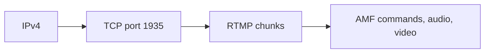
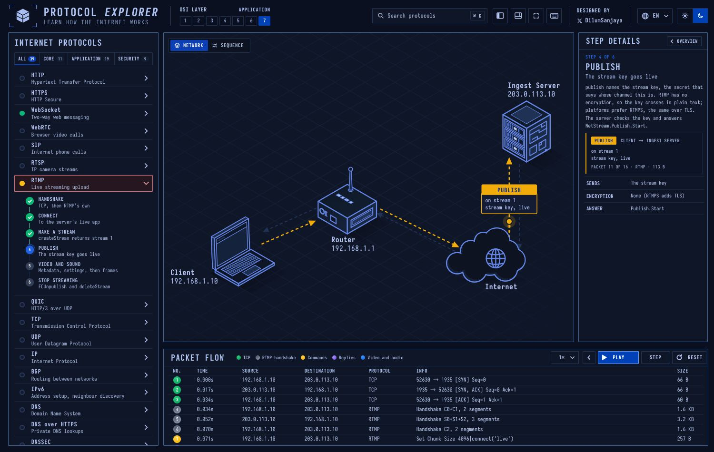
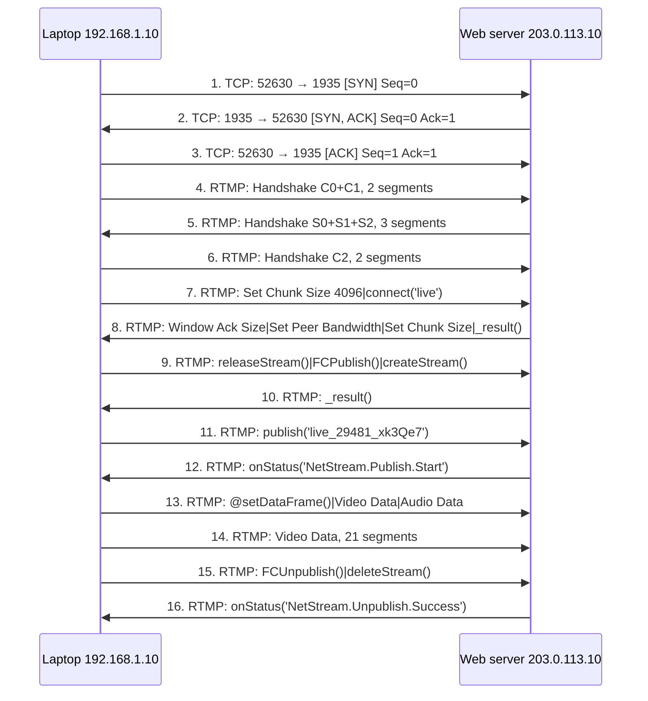
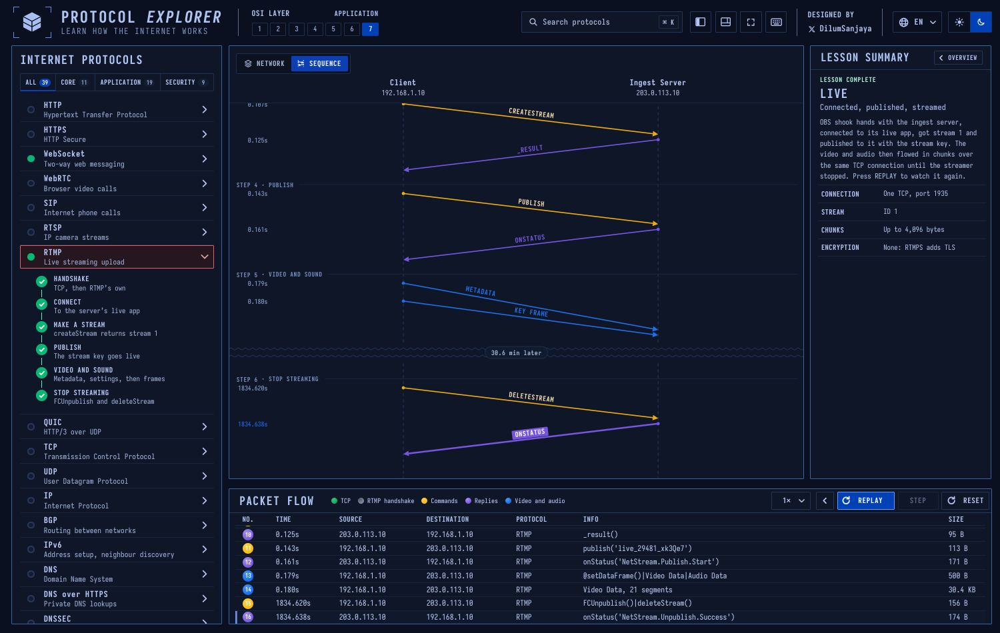
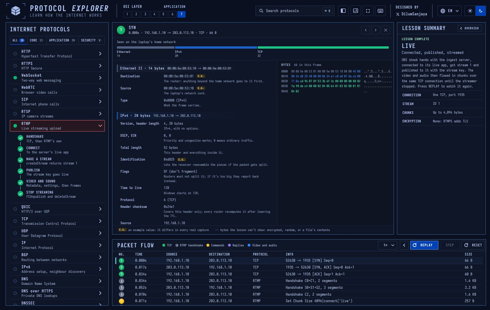

# RTMP – Live streaming upload

<!-- nav -->
⬅ [06 RTSP](06-rtsp.md) · [Index](00_Protocols_Index.md) · [08 QUIC](08-quic.md) ➡
<!-- nav -->

*Source: Protocol Explorer – https://protocol-explorer-alpha.vercel.app/ (interactive lesson #7). Screenshots captured from the live lesson; packet decodes are the site's example capture (values marked **E.G.** differ in every real capture).*

## Overview

### How the layers fit together (outer to inner)

## In-depth explanation of the example (plain-language version)

### The big picture in one minute
A streamer clicks **Start Streaming** in **OBS**. OBS pushes the live camera feed to an **ingest server** (`203.0.113.10`), which then makes it available to viewers. The lesson shows **16 messages**: open a connection, a short RTMP greeting, a few setup commands, the first video and sound, and the stop about 30 minutes later.

**RTMP is the "upload" half of live streaming.** Viewers often watch using other technologies, but streamers send their feed with RTMP because it is simple, quick and every encoder supports it. **Commands, sound and video all share one TCP connection (port 1935)**, cut into small pieces called *chunks*.

Think of a live radio contributor phoning the studio: first a greeting, then "I'm John from the show, put me on channel 1" and then they start talking non-stop.

> **Words you'll see:** *Ingest server* = the server that receives your stream. *Stream key* = a secret code that says whose channel this is. *Chunk* = a small slice of a bigger message. *Encoder* = software (like OBS) that compresses video and sound.

---

### Step 1 – Greetings (the RTMP handshake) – packets 1 to 6
After the normal TCP handshake (packets 1–3), RTMP does its own three-part greeting:
- **Client → server (packet 4):** "I speak RTMP version 3" plus 1,536 bytes of mostly random data.
- **Server → client (packet 5):** its own version byte, its own 1,536 random bytes, and a copy of what the client sent.
- **Client → server (packet 6):** a copy of the server's random data.
Each side proves it received the other's data, so both know they really speak RTMP and the path works. **This is a sanity check, not security.** Nothing is encrypted. The secure version is **RTMPS** (RTMP inside TLS).

### Step 2 – Connect to the "live" application – packets 7, 8
- **Packet 7:** OBS says "I'll send chunks up to 4,096 bytes" (the default is a tiny 128, so this means less overhead) and sends the **`connect`** command for the app called `live`.
- Commands are written in a compact binary format called **AMF** (inherited from Flash) that holds names, numbers and small objects.
- Each chunk begins with a small header that says which *message type* it carries (for example 20 = command, 8 = audio, 9 = video) and which *stream* it belongs to.
- **Packet 8:** the server answers with some limits (how much data may be sent before an acknowledgement) and a success reply: `NetConnection.Connect.Success`.

### Step 3 – Create a stream – packets 9, 10
Stream number 0 is just the connection itself, so to send video you need a new stream. OBS sends `releaseStream`, `FCPublish` (these reserve and announce the stream key) and `createStream`. The server replies with **stream ID 1**. (Each command has a transaction number so a reply can be matched to its request.)

### Step 4 – Go live (publish) – packets 11, 12
OBS sends **`publish('live_29481_xk3Qe7')`**. That text is the **stream key**, the secret that tells the platform which channel you are. Because plain RTMP has **no encryption**, the key travels in the clear; that's why platforms recommend RTMPS. The server checks it and answers `NetStream.Publish.Start`. **You're live.**

### Step 5 – Video and sound – packets 13, 14
- **Packet 13:** details about the stream (1920×1080, 30 fps, codecs, bitrates) and the **decoder settings** for H.264 video and AAC audio. A decoder needs these before it can show anything.
- **Packet 14:** the first **key frame** (a complete picture, about 30 KB), cut into 4,096-byte chunks. From here on, audio and video chunks are mixed together, each with a timestamp, for the whole session.
Since it's TCP, lost data is re-sent. That's reliable, but also why RTMP delay can jump on a poor connection.

### Step 6 – Stop – packets 15, 16
After about 30 minutes, OBS sends `FCUnpublish` and `deleteStream`. The server confirms with `NetStream.Unpublish.Success`, ends the broadcast for viewers, and the connection closes.

---

### The 16 messages at a glance
| Packets | What | Why |
|---|---|---|
| 1–3 | TCP handshake | open the connection |
| 4–6 | RTMP handshake | check both sides speak RTMP |
| 7–8 | connect | enter the `live` app |
| 9–10 | createStream | get stream ID 1 |
| 11–12 | publish | announce the channel (stream key) |
| 13–14 | metadata, first video and audio | the broadcast begins |
| 15–16 | unpublish, delete | end |

### What to remember
- Layers: **TCP port 1935 → RTMP chunks → messages (commands, audio, video).**
- To go live: **connect → createStream → publish → send data → unpublish.**
- The stream key is effectively a password in plain view unless you use **RTMPS**.
- RTMP outlived Flash because it is still the easiest way to *send* a stream to a platform. Modern alternatives include SRT, WebRTC (WHIP) and RIST.

## Under the hood – technical details

- **Handshake bytes.** `C0` is 1 byte (version 3). `C1` is 1,536 bytes: 4-byte time, 4 zero bytes, 1,528 random bytes. The server replies `S0`, `S1` and `S2` (a copy of `C1`), and the client sends `C2` (a copy of `S1`). It checks both sides really speak RTMP; it has no security value.
- **Chunks.** All data is cut into chunks. The default size is 128 bytes; here the client sets **4,096** with *Set Chunk Size* so there are fewer headers.
- **Chunk header.** A *basic header* (2-bit format type plus a chunk stream ID) is followed by a *message header*. Format 0 carries everything (timestamp, message length, message type, message stream ID). Formats 1, 2 and 3 are shorter and reuse values from the previous chunk on the same chunk stream, saving bytes.
- **Message types.** `1` Set Chunk Size, `3` Acknowledgement, `5` Window Acknowledgement Size, `6` Set Peer Bandwidth, `8` audio, `9` video, `18` data/metadata (AMF0), `20` command (AMF0).
- **AMF0.** A compact binary encoding of strings, numbers, booleans and objects. A command message is: command name, transaction ID, command object, then arguments. For example `connect` carries an object with `app`, `tcUrl`, `flashVer` and supported codecs.
- **Streams.** Message stream `0` is the connection itself. `createStream` returns a new ID (here `1`) used for the media.
- **Sequence to go live.** `connect` -> `_result NetConnection.Connect.Success` -> `releaseStream` and `FCPublish` -> `createStream` -> `publish(streamKey)` -> `onStatus NetStream.Publish.Start` -> metadata (`@setDataFrame onMetaData`) and decoder configuration -> audio and video.
- **Decoder configuration.** For H.264 the *AVC sequence header* carries SPS/PPS; for AAC, the *AudioSpecificConfig* (sample rate, channels). A decoder cannot decode anything before it has these.
- **Flow control.** The window acknowledgement size says how much data may be sent before an acknowledgement is required.
- **Timestamps.** Each audio/video message has a timestamp in milliseconds, so the player can align audio and video even though they are interleaved.
- **Latency and loss.** RTMP runs over TCP, so loss causes retransmission and delay spikes. Modern ingest alternatives: SRT, WebRTC (WHIP), RIST. The secure form is **RTMPS** (RTMP inside TLS) because the stream key is otherwise visible.

## Step-by-step walkthrough (screenshots from the lesson)

### Step 1: HANDSHAKE – TCP, then RTMP’s own

### Step 2: CONNECT – To the server’s live app

### Step 3: MAKE A STREAM – createStream returns stream 1

### Step 4: PUBLISH – The stream key goes live

### Step 5: VIDEO AND SOUND – Metadata, settings, then frames

### Step 6: STOP STREAMING – FCUnpublish and deleteStream

### Lesson summary

## Packet flow (whole lesson)

| No. | Time | Source | Destination | Protocol | Info | Size |
|---|---|---|---|---|---|---|
| 1 | 0.000s | 192.168.1.10 | 203.0.113.10 | TCP | 52630 → 1935 [SYN] Seq=0 | 66 B |
| 2 | 0.017s | 203.0.113.10 | 192.168.1.10 | TCP | 1935 → 52630 [SYN, ACK] Seq=0 Ack=1 | 66 B |
| 3 | 0.034s | 192.168.1.10 | 203.0.113.10 | TCP | 52630 → 1935 [ACK] Seq=1 Ack=1 | 60 B |
| 4 | 0.034s | 192.168.1.10 | 203.0.113.10 | RTMP | Handshake C0+C1, 2 segments | 1.6 KB |
| 5 | 0.052s | 203.0.113.10 | 192.168.1.10 | RTMP | Handshake S0+S1+S2, 3 segments | 3.2 KB |
| 6 | 0.070s | 192.168.1.10 | 203.0.113.10 | RTMP | Handshake C2, 2 segments | 1.6 KB |
| 7 | 0.071s | 192.168.1.10 | 203.0.113.10 | RTMP | Set Chunk Size 4096\|connect('live') | 257 B |
| 8 | 0.089s | 203.0.113.10 | 192.168.1.10 | RTMP | Window Ack Size\|Set Peer Bandwidth\|Set Chunk Size\|_result() | 305 B |
| 9 | 0.107s | 192.168.1.10 | 203.0.113.10 | RTMP | releaseStream()\|FCPublish()\|createStream() | 203 B |
| 10 | 0.125s | 203.0.113.10 | 192.168.1.10 | RTMP | _result() | 95 B |
| 11 | 0.143s | 192.168.1.10 | 203.0.113.10 | RTMP | publish('live_29481_xk3Qe7') | 113 B |
| 12 | 0.161s | 203.0.113.10 | 192.168.1.10 | RTMP | onStatus('NetStream.Publish.Start') | 171 B |
| 13 | 0.179s | 192.168.1.10 | 203.0.113.10 | RTMP | @setDataFrame()\|Video Data\|Audio Data | 500 B |
| 14 | 0.180s | 192.168.1.10 | 203.0.113.10 | RTMP | Video Data, 21 segments | 30.4 KB |
| 15 | 1834.620s | 192.168.1.10 | 203.0.113.10 | RTMP | FCUnpublish()\|deleteStream() | 156 B |
| 16 | 1834.638s | 203.0.113.10 | 192.168.1.10 | RTMP | onStatus('NetStream.Unpublish.Success') | 174 B |

### Sequence diagram

*The lesson's own sequence diagram:*

## Packet decoder screenshots

The lesson's decoder view for the first, middle and last packet: headers, field values and the raw hex bytes.

### Packet 1: TCP – 52630 → 1935 [SYN] Seq=0

*192.168.1.10 → 203.0.113.10 · 66 B · t = 0.000s*

### Packet 9: RTMP – releaseStream()|FCPublish()|createStream()

*192.168.1.10 → 203.0.113.10 · 203 B · t = 0.107s*

### Packet 16: RTMP – onStatus('NetStream.Unpublish.Success')

*203.0.113.10 → 192.168.1.10 · 174 B · t = 1834.638s*

---

<!-- nav -->
⬅ [06 RTSP](06-rtsp.md) · [Index](00_Protocols_Index.md) · [08 QUIC](08-quic.md) ➡
<!-- nav -->
