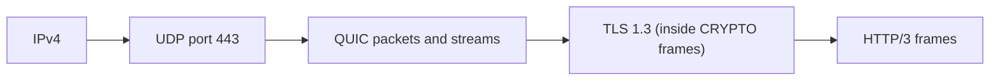
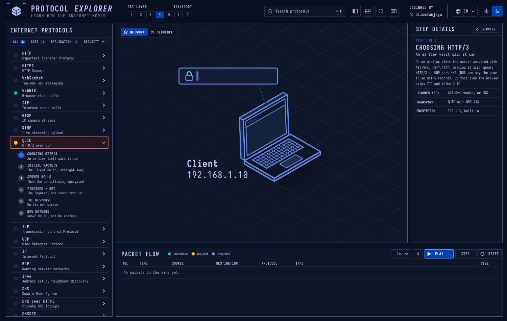
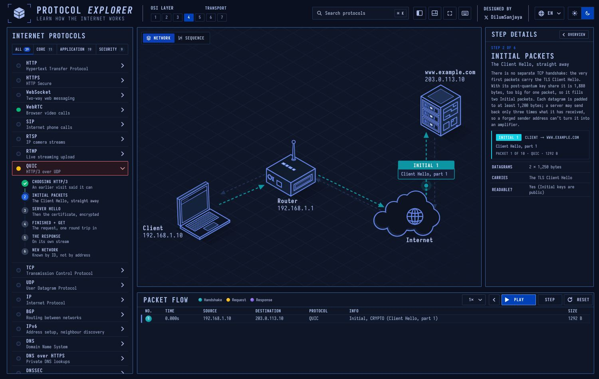
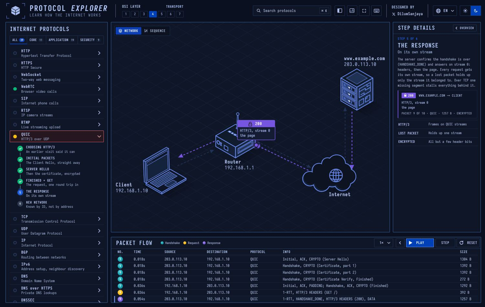
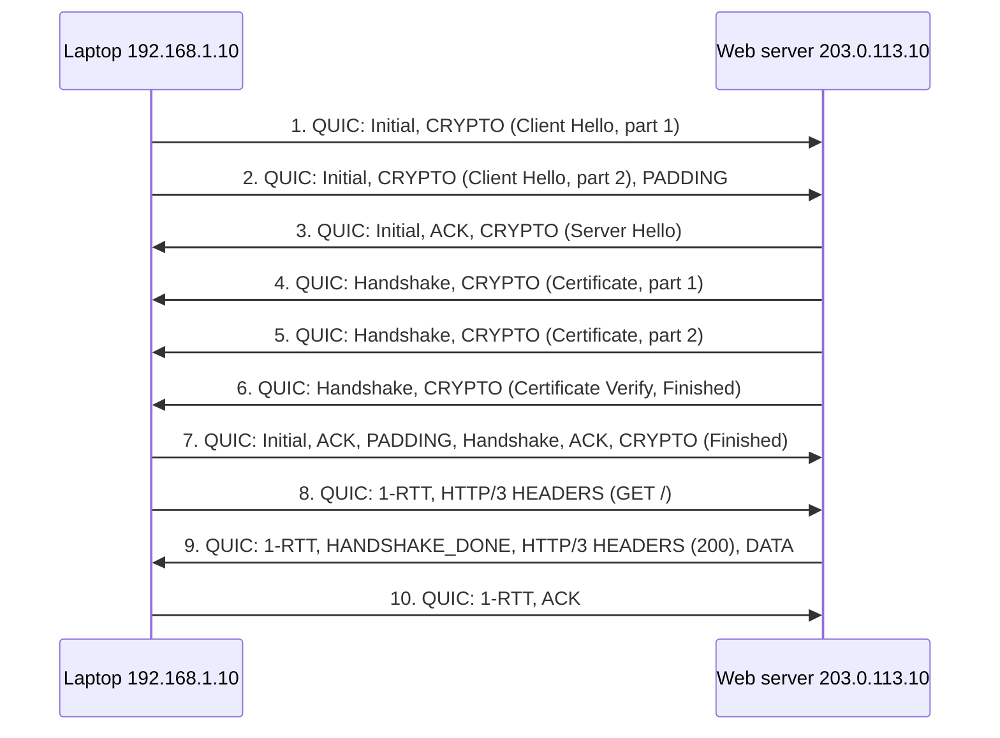
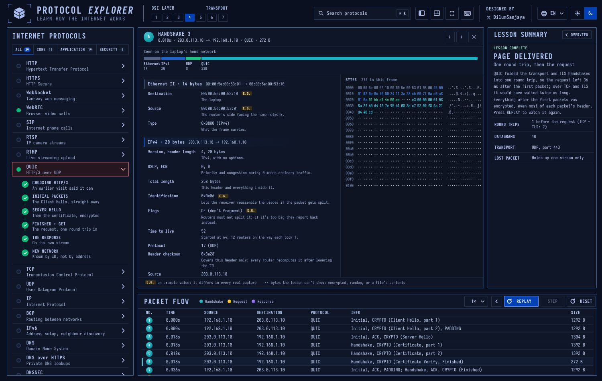
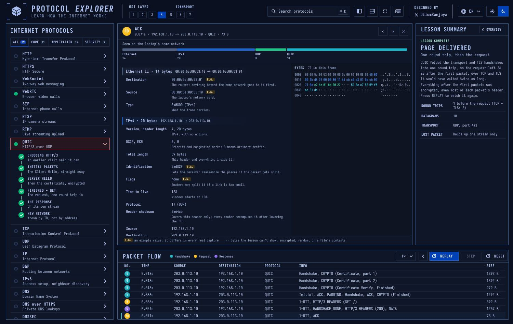

# QUIC – HTTP/3 over UDP

<!-- nav -->
⬅ [07 RTMP](07-rtmp.md) · [Index](00_Protocols_Index.md) · [09 TCP](09-tcp.md) ➡
<!-- nav -->

*Source: Protocol Explorer – https://protocol-explorer-alpha.vercel.app/ (interactive lesson #8). Screenshots captured from the live lesson; packet decodes are the site's example capture (values marked **E.G.** differ in every real capture).*

## Overview

### How the layers fit together (outer to inner)

## In-depth explanation of the example (plain-language version)

### The big picture in one minute
The laptop fetches `https://www.example.com/` again, but this time over **HTTP/3**, which runs on **QUIC**. QUIC uses **UDP port 443** instead of TCP. Connection, request and page all fit in **10 messages and 71 milliseconds**.

**Why QUIC exists.** Normal HTTPS needs a TCP handshake *and then* a TLS handshake, so two back-and-forth trips happen before you can even ask for the page. TCP also has two annoying habits:
- It delivers one single ordered stream, so **one lost packet makes everything behind it wait** ("head-of-line blocking").
- A TCP connection is tied to your IP address, so switching from Wi-Fi to mobile data **breaks it**.
QUIC fixes all three problems, with **encryption (TLS 1.3) built in**.

Think of it as a courier service that combines "introduce yourself", "show your ID" and "hand over the order" into **one visit** instead of two.

> **Words you'll see:** *Datagram* = one UDP packet. *Stream* = an independent lane inside one connection. *Connection ID* = a label that identifies the connection (instead of your IP address). *RTT* = one round trip, i.e. a message going out and the reply coming back.

---

### Step 1 – Deciding to use HTTP/3
On a previous visit, the server added a header `Alt-Svc: h3=":443"`, meaning "I also speak HTTP/3 on UDP 443." So this time the browser skips TCP entirely and sends QUIC packets.

### Step 2 – The first packets ("Initial") – packets 1, 2
- There is **no separate connection handshake**. The very first packets already carry the **TLS 1.3 "Client Hello"** (the browser's list of abilities and its half of the key agreement).
- That message is 1,880 bytes, too big for one datagram, so it spans **two packets**.
- **Padding:** each first packet from the client is padded to at least 1,200 bytes. Reason: until the server has confirmed your address, it may reply with **at most 3× the data it received**. Big first packets give the server room to send its certificate, and stop an attacker who fakes a victim's address from using the server to flood that victim.
- The header contains a **Version** and two **Connection IDs** (one chosen by the client for the server, and the client's own). The connection IDs, not the IP address, are what identify the connection. The first packets are scrambled with a key that anyone can work out, so they are only disguised, not secret.

### Step 3 – The server answers – packets 3 to 6
- **Packet 3:** the server's "Server Hello" plus an acknowledgement. Both sides can now compute the keys.
- **Packets 4–6:** encrypted "Handshake" packets carrying the server's **certificate** (its ID card, in two parts), its signature and a "Finished" message. All four packets leave at the same instant, because QUIC doesn't need a slow warm-up for the handshake. The amount sent stays within the 3× limit.

### Step 4 – "Finished" and the request in one go – packets 7, 8
The laptop checks the certificate and immediately sends:
- **Packet 7:** its own "Finished" and acknowledgements.
- **Packet 8:** the actual **HTTP/3 request** (`GET /`, with compressed headers) on **stream 0**, already fully encrypted with the final keys.
So the request leaves **one round trip** after the very first packet. TCP + TLS needs two. (A returning visitor with a saved ticket can send the request in the *first* flight, which is called **0-RTT**.)

### Step 5 – The page comes back – packets 9, 10
The server sends "handshake done", then the answer on stream 0: status `200` and the page. **Each request gets its own stream** (the next one would use stream 4, and so on), so **a lost packet only delays its own stream**; the other streams keep flowing. Packet 10 is the laptop's acknowledgement. Almost everything in these packets is encrypted, even most of the packet header.

### Step 6 (not shown) – Changing networks
Because the connection is identified by its **connection ID**, if your laptop moves from Wi-Fi to 5G and gets a new address, it simply keeps going after a quick check that the new path works. No new handshake, no broken download.

---

### The 10 messages at a glance
| Packets | What | Why |
|---|---|---|
| 1–2 | Client Initial (Hello) | start the connection and key agreement in one go |
| 3 | Server Initial (Hello + ack) | answer; both sides get keys |
| 4–6 | Server Handshake | certificate, signature, finished |
| 7 | Client Finished | complete the handshake |
| 8 | Request on stream 0 | ask for the page |
| 9 | Handshake done + response | the page |
| 10 | Ack | confirm receipt |

### What to remember
- Layers: **UDP → QUIC → TLS 1.3 (inside QUIC) → HTTP/3.**
- Benefits: **faster setup** (1 trip, or 0 when returning), **no blocking between streams**, **survives network changes**, **always encrypted**.
- Costs: some networks block or slow UDP (browsers then fall back to HTTP/2 over TCP), and it uses more CPU than plain TCP.
- Related standards: RFC 9000 (QUIC), 9001 (TLS in QUIC), 9114 (HTTP/3).

## Under the hood – technical details

- **Layers.** UDP carries QUIC packets; QUIC provides reliable streams, loss recovery and congestion control; TLS 1.3 is built in (its handshake messages travel in QUIC `CRYPTO` frames); HTTP/3 runs on QUIC streams.
- **Packet types.** *Long header* packets are used during set-up: `Initial`, `0-RTT`, `Handshake`, `Retry`. *Short header* (`1-RTT`) packets carry data after the handshake and contain only a few flag bits and the destination connection ID.
- **Connection IDs.** The destination and source IDs (up to 20 bytes) identify the connection, not the IP address and port. That is what allows *connection migration* when a phone moves from Wi-Fi to mobile data. A `PATH_CHALLENGE` / `PATH_RESPONSE` pair checks the new path first.
- **Initial packet protection.** Initial packets are encrypted with keys derived from the public destination connection ID and a fixed salt, so anyone can read them. This is obfuscation, not secrecy. Handshake and 1-RTT packets use keys from the real TLS handshake.
- **Header protection.** The packet number and some flag bits are masked with a value derived from a sample of the encrypted payload, hiding them from observers.
- **Anti-amplification.** Before the client's address is validated, a server may send at most **3x** the bytes it has received. Clients therefore pad Initial datagrams to at least 1,200 bytes. This also prevents spoofed-address floods.
- **Frames.** A packet holds frames: `CRYPTO`, `ACK`, `STREAM`, `NEW_CONNECTION_ID`, `HANDSHAKE_DONE`, `PADDING`, `PING`, `CONNECTION_CLOSE` and more.
- **Streams.** Each HTTP request uses its own stream. Client-initiated bidirectional streams have IDs 0, 4, 8, and so on. A lost packet delays only the stream whose data it carried; other streams continue. This is how QUIC removes TCP's head-of-line blocking.
- **HTTP/3 and QPACK.** HTTP/3 sends `HEADERS` and `DATA` frames. QPACK compresses headers using static and dynamic tables, designed so that one lost packet does not block unrelated requests.
- **1-RTT and 0-RTT.** A new connection needs one round trip before the request; a returning client with a saved ticket can send the request in its first flight (0-RTT, with replay risk).
- **Discovery.** A server announces HTTP/3 with the `Alt-Svc` header or a DNS `HTTPS` record. If UDP is blocked, browsers fall back to HTTP/2 over TCP.
- **Standards.** RFC 9000 (QUIC), 9001 (TLS in QUIC), 9002 (loss recovery and congestion control), 9114 (HTTP/3).

## Step-by-step walkthrough (screenshots from the lesson)

### Step 1: CHOOSING HTTP/3 – An earlier visit said it can

### Step 2: INITIAL PACKETS – The Client Hello, straight away

### Step 3: SERVER HELLO – Then the certificate, encrypted

### Step 4: FINISHED + GET – The request, one round trip in

### Step 5: THE RESPONSE – On its own stream

### Step 6: NEW NETWORK – Known by ID, not by address

### Lesson summary

## Packet flow (whole lesson)

| No. | Time | Source | Destination | Protocol | Info | Size |
|---|---|---|---|---|---|---|
| 1 | 0.000s | 192.168.1.10 | 203.0.113.10 | QUIC | Initial, CRYPTO (Client Hello, part 1) | 1292 B |
| 2 | 0.000s | 192.168.1.10 | 203.0.113.10 | QUIC | Initial, CRYPTO (Client Hello, part 2), PADDING | 1292 B |
| 3 | 0.018s | 203.0.113.10 | 192.168.1.10 | QUIC | Initial, ACK, CRYPTO (Server Hello) | 1304 B |
| 4 | 0.018s | 203.0.113.10 | 192.168.1.10 | QUIC | Handshake, CRYPTO (Certificate, part 1) | 1392 B |
| 5 | 0.018s | 203.0.113.10 | 192.168.1.10 | QUIC | Handshake, CRYPTO (Certificate, part 2) | 1392 B |
| 6 | 0.018s | 203.0.113.10 | 192.168.1.10 | QUIC | Handshake, CRYPTO (Certificate Verify, Finished) | 272 B |
| 7 | 0.036s | 192.168.1.10 | 203.0.113.10 | QUIC | Initial, ACK, PADDING; Handshake, ACK, CRYPTO (Finished) | 1292 B |
| 8 | 0.036s | 192.168.1.10 | 203.0.113.10 | QUIC | 1-RTT, HTTP/3 HEADERS (GET /) | 392 B |
| 9 | 0.054s | 203.0.113.10 | 192.168.1.10 | QUIC | 1-RTT, HANDSHAKE_DONE, HTTP/3 HEADERS (200), DATA | 1257 B |
| 10 | 0.071s | 192.168.1.10 | 203.0.113.10 | QUIC | 1-RTT, ACK | 73 B |

### Sequence diagram

*The lesson's own sequence diagram:*

## Packet decoder screenshots

The lesson's decoder view for the first, middle and last packet: headers, field values and the raw hex bytes.

### Packet 1: QUIC – Initial, CRYPTO (Client Hello, part 1)

*192.168.1.10 → 203.0.113.10 · 1292 B · t = 0.000s*

### Packet 6: QUIC – Handshake, CRYPTO (Certificate Verify, Finished)

*203.0.113.10 → 192.168.1.10 · 272 B · t = 0.018s*

### Packet 10: QUIC – 1-RTT, ACK

*192.168.1.10 → 203.0.113.10 · 73 B · t = 0.071s*

---

<!-- nav -->
⬅ [07 RTMP](07-rtmp.md) · [Index](00_Protocols_Index.md) · [09 TCP](09-tcp.md) ➡
<!-- nav -->
