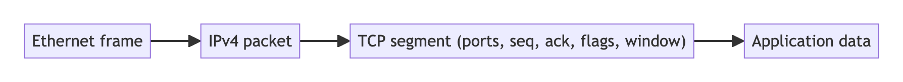
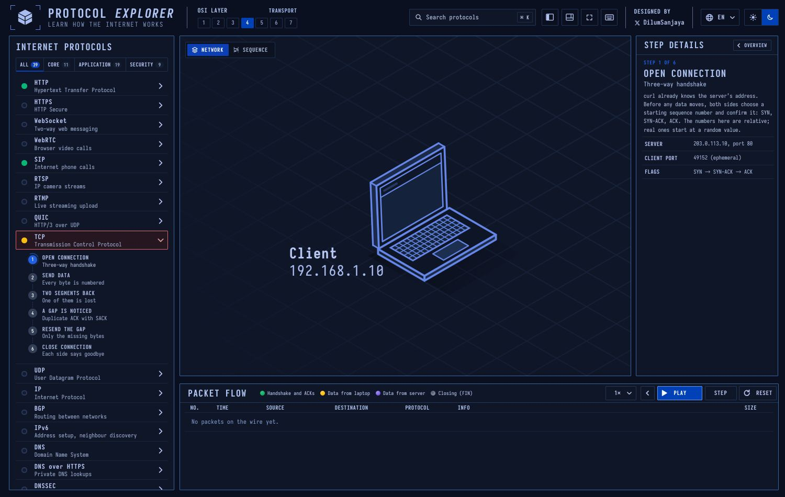
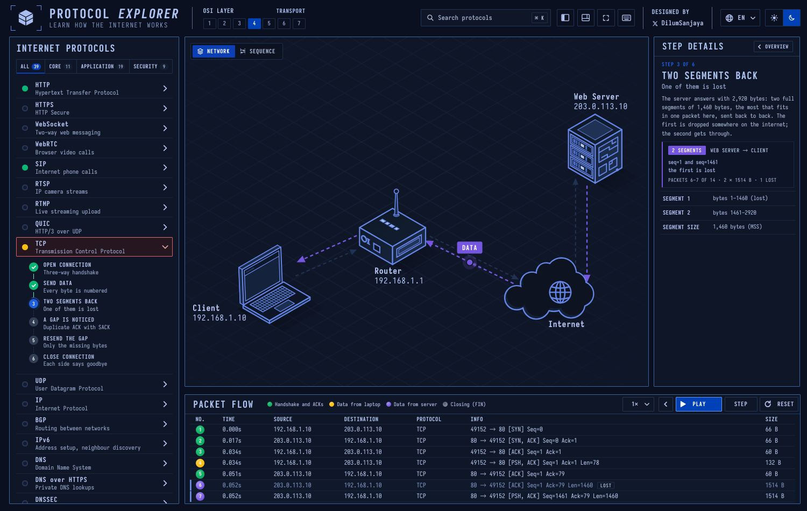
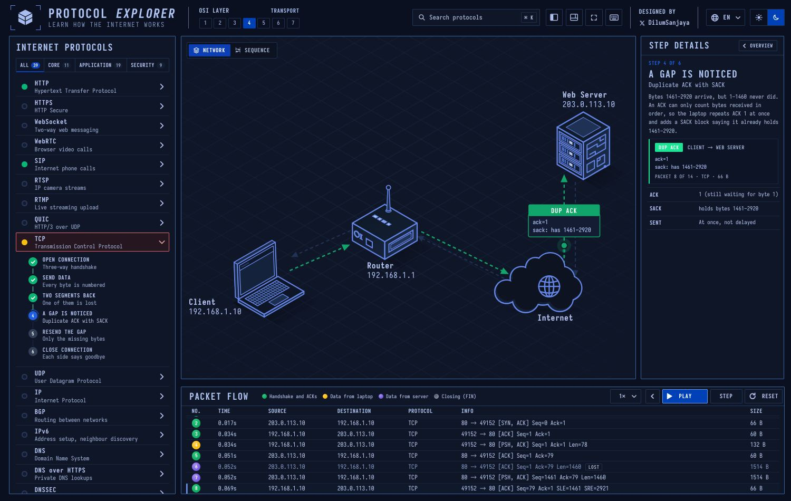
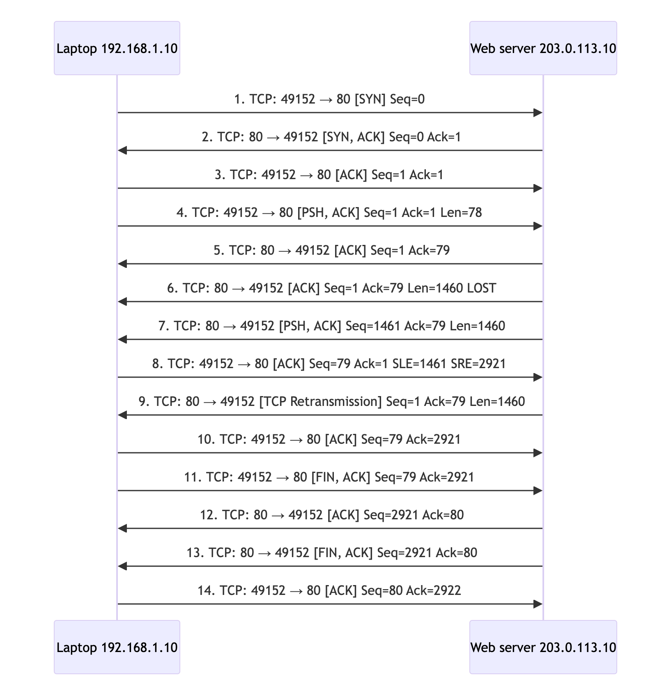
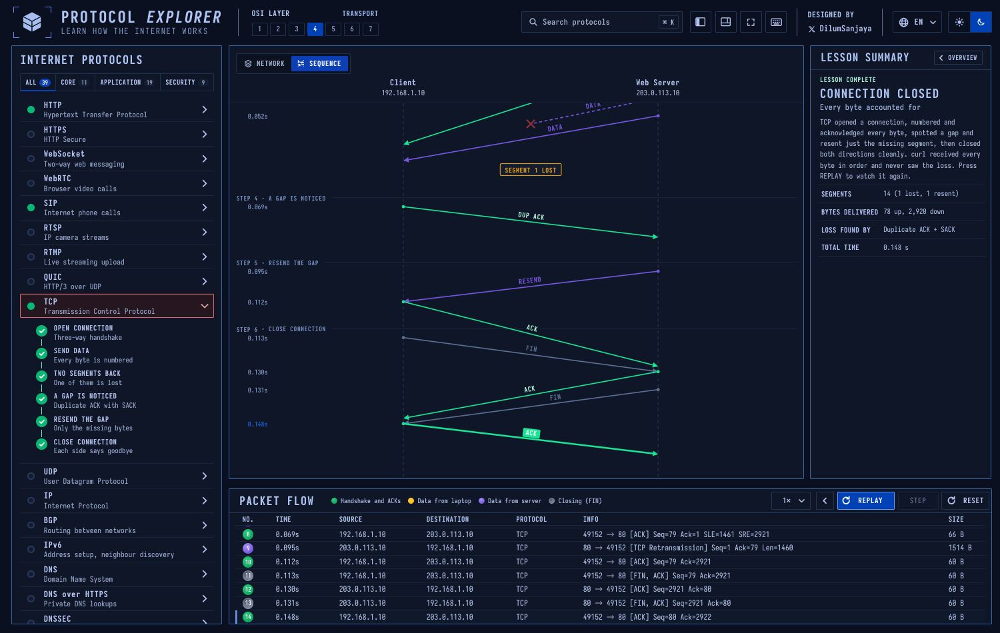
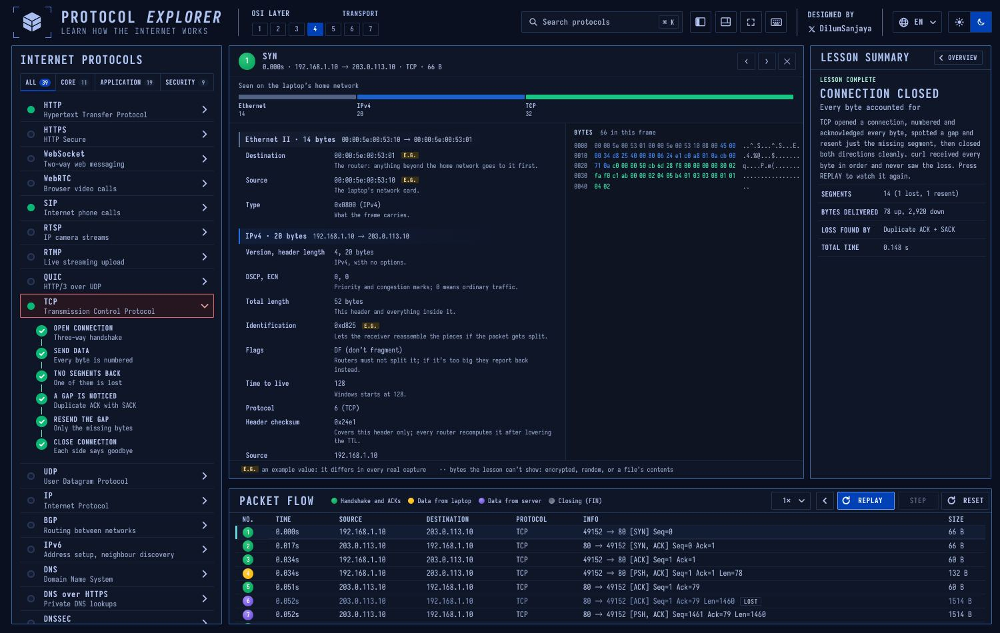
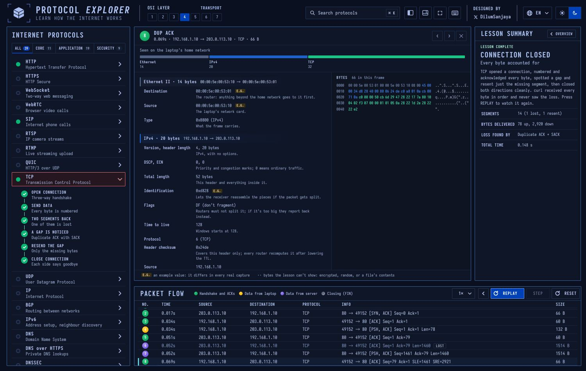

# TCP – Transmission Control Protocol

<!-- nav -->
⬅ [08 QUIC](08-quic.md) · [Index](00_Protocols_Index.md) · [10 UDP](10-udp.md) ➡
<!-- nav -->

*Source: Protocol Explorer – https://protocol-explorer-alpha.vercel.app/ (interactive lesson #9). Screenshots captured from the live lesson; packet decodes are the site's example capture (values marked **E.G.** differ in every real capture).*

## Overview

### How the layers fit together (outer to inner)

## In-depth explanation of the example (plain-language version)

### The big picture in one minute
The program `curl` on the laptop downloads a small page from a web server. The example is designed to show **everything TCP does**: opening a connection, numbering data, **losing a packet**, noticing the loss, **re-sending** it, and closing politely. **14 messages in 148 milliseconds.**

**What TCP promises:** the internet underneath is unreliable (packets can get lost, duplicated or arrive out of order). TCP sits on top and gives you a **reliable, in-order stream of bytes**, as if you had a perfect pipe. It does this by **numbering every byte**, **confirming receipt**, **re-sending anything missing**, and **slowing down when the network is busy**.

Think of sending a long letter as numbered postcards. The receiver says "I have everything up to number 78", and if postcard 1 is missing you send it again.

> **Words you'll see:** *Segment* = one TCP packet. *ACK* = "I received it." *Sequence number* = the position of a byte in the stream. *Port* = a numbered "door" on a computer. The lesson shows sequence numbers starting at 0 for readability; real ones start at a random number (which makes it harder for attackers to inject fake data).

---

### Step 1 – Opening the connection (three-way handshake) – packets 1 to 3
1. **SYN** (laptop → server): "Let's talk. My byte count starts at 0." It also announces some abilities: the biggest piece it can receive (**1,460 bytes**, called MSS), a way to use bigger "windows", and whether it supports **SACK** (a smarter way to report missing data).
2. **SYN-ACK** (server → laptop): "OK. Mine starts at 0 too. I'm expecting your byte 1 next." (`Ack=1`)
3. **ACK** (laptop → server): "Got it." Now both directions are open (about 34 ms).
**Why three messages?** Each side must pick its own starting number and have the other side confirm it. The server combines its "SYN" and "ACK" into one packet, so three messages are enough.

### Step 2 – Sending data – packets 4, 5
- **Packet 4:** the laptop sends curl's 78-byte request. It occupies bytes **1 to 78**.
- **Packet 5:** the server replies **"Ack=79"**, which means "the next byte I expect is 79, so I have everything up to 78." Acknowledgements are **cumulative** (they say how far you've got without gaps).

### Step 3 – Two pieces go back, and one is lost – packets 6, 7
The server's answer is 2,920 bytes, i.e. two full 1,460-byte segments sent back to back:
- **Segment 1** (bytes 1–1460): **lost somewhere on the internet** (packet 6).
- **Segment 2** (bytes 1461–2920): arrives (packet 7).

### Step 4 – The gap is noticed – packet 8
The laptop has bytes 1461–2920, but byte 1 never came. An ACK can only say "everything below N has arrived", so it **repeats `Ack=1`** straight away (a *duplicate ACK*). Because SACK was agreed at the start, it adds: "but I **do** have 1461–2920." It sends this immediately, because a gap should be reported fast.

### Step 5 – Re-send only what's missing – packets 9, 10
- Thanks to the SACK information, the server knows exactly what is missing and **re-sends only segment 1** (packet 9), not the one that already arrived.
- **Packet 10:** the laptop now has bytes 1–2920 in order and answers **`Ack=2921`**. curl gets everything perfectly, and only noticed a small delay.
- *If no ACK had come at all,* timers take over: a quick "probe" first, then a **retransmission timeout** (200 ms or more) that doubles on repeated failure. Three duplicate ACKs normally trigger a **fast retransmit**.
- *Not drawn:* after a loss the sender slows down (it cuts its **congestion window**, often by half) and then speeds up again gradually. This is how TCP avoids overloading the network.

### Step 6 – Closing – packets 11 to 14
TCP closes **each direction separately**:
1. Laptop: **FIN** – "I'm done sending."
2. Server: **ACK** – "Noted."
3. Server: **FIN** – "I'm done too."
4. Laptop: final **ACK**.
The side that closes first waits a while (**TIME-WAIT**, typically 60 seconds) so that straggler packets from this connection can't be mistaken for a new one. An abrupt close uses **RST** instead.

---

### The 14 messages at a glance
| Packets | What | Why |
|---|---|---|
| 1–3 | SYN, SYN-ACK, ACK | open the connection |
| 4 | request (bytes 1–78) | send data |
| 5 | ACK 79 | confirm receipt |
| 6–7 | two data segments, one lost | send the answer |
| 8 | duplicate ACK + SACK | report the gap |
| 9 | retransmission | resend only the missing part |
| 10 | ACK 2921 | everything arrived |
| 11–14 | FIN, ACK, FIN, ACK | close |

### What to remember
- **Sequence number = position of the first byte in the packet. ACK number = the next byte expected.** SYN and FIN each count as one byte.
- Main header fields: source and destination **port**, sequence, acknowledgement, **flags** (SYN, ACK, FIN, RST, PSH), **window** (how much the receiver can take), checksum and options.
- Reliability toolbox: **ACKs + re-sending + SACK + timers.** Speed control: **flow control** (don't overwhelm the receiver) and **congestion control** (don't overwhelm the network).
- Cost: the opening handshake delay, and **head-of-line blocking** (a lost segment holds back everything after it), which QUIC was designed to fix.
- A connection is identified by four things: client IP, client port, server IP, server port.

## Under the hood – technical details

- **Header fields.** Source and destination port (16 bits each), sequence number and acknowledgement number (32 bits each), header length, flags (`SYN`, `ACK`, `FIN`, `RST`, `PSH`, `URG`), window size, checksum, urgent pointer and options. The basic header is 20 bytes.
- **Sequence numbers count bytes.** The sequence number is the position of the first data byte in the segment. The acknowledgement number is the next byte expected. `SYN` and `FIN` each use up one sequence number, which is why `Ack=1` follows a `SYN` with `Seq=0`. Real connections start at a random *initial sequence number*, which makes blind injection harder.
- **Handshake options.** `MSS` (largest data per segment, 1,460 on Ethernet), *window scale* (multiplier so the 16-bit window can describe more than 64 KB), `SACK permitted` and *timestamps* (for round-trip measurement).
- **Flow control.** The receiver advertises a *window*: how many more bytes it can accept. The sender never has more unacknowledged data in flight than that.
- **Congestion control.** The sender keeps a *congestion window*. It starts small (*slow start*, roughly doubling each round trip), grows steadily after a threshold, and shrinks on loss (for example halved). Algorithms: Reno, CUBIC, BBR.
- **Loss detection.** Three ways: three duplicate ACKs trigger *fast retransmit*; a **SACK** block names exactly which byte ranges arrived, so only the missing part is resent; if nothing returns, the *retransmission timeout* (RTO) fires, at least 200 ms on Linux, doubling after each failure.
- **Cumulative ACK.** `Ack=N` means "I have every byte below N". Out-of-order data is held back until the gap is filled, so the application always sees an ordered stream.
- **Closing.** `FIN` closes one direction, so a connection can be half-closed. The side that closes first enters `TIME-WAIT` for about 2 x MSL (often 60 s) so late duplicates cannot be mistaken for a new connection and the final ACK can be resent. `RST` aborts at once.
- **Connection identity.** A connection is identified by the four-tuple (client IP, client port, server IP, server port).
- **Costs.** One round trip for the handshake and *head-of-line blocking*: one lost segment delays everything after it. QUIC avoids this by using independent streams.
- **Security notes.** `SYN` floods are countered with SYN cookies; sequence-number guessing is why initial numbers are random.

## Step-by-step walkthrough

### Step 1: OPEN CONNECTION – Three-way handshake

### Step 2: SEND DATA – Every byte is numbered

### Step 3: TWO SEGMENTS BACK – One of them is lost

### Step 4: A GAP IS NOTICED – Duplicate ACK with SACK

### Step 5: RESEND THE GAP – Only the missing bytes

### Step 6: CLOSE CONNECTION – Each side says goodbye

### Lesson summary

## Packet flow (whole lesson)

| No. | Time | Source | Destination | Protocol | Info | Size |
|---|---|---|---|---|---|---|
| 1 | 0.000s | 192.168.1.10 | 203.0.113.10 | TCP | 49152 → 80 [SYN] Seq=0 | 66 B |
| 2 | 0.017s | 203.0.113.10 | 192.168.1.10 | TCP | 80 → 49152 [SYN, ACK] Seq=0 Ack=1 | 66 B |
| 3 | 0.034s | 192.168.1.10 | 203.0.113.10 | TCP | 49152 → 80 [ACK] Seq=1 Ack=1 | 60 B |
| 4 | 0.034s | 192.168.1.10 | 203.0.113.10 | TCP | 49152 → 80 [PSH, ACK] Seq=1 Ack=1 Len=78 | 132 B |
| 5 | 0.051s | 203.0.113.10 | 192.168.1.10 | TCP | 80 → 49152 [ACK] Seq=1 Ack=79 | 60 B |
| 6 | 0.052s | 203.0.113.10 | 192.168.1.10 | TCP | 80 → 49152 [ACK] Seq=1 Ack=79 Len=1460LOST | 1514 B |
| 7 | 0.052s | 203.0.113.10 | 192.168.1.10 | TCP | 80 → 49152 [PSH, ACK] Seq=1461 Ack=79 Len=1460 | 1514 B |
| 8 | 0.069s | 192.168.1.10 | 203.0.113.10 | TCP | 49152 → 80 [ACK] Seq=79 Ack=1 SLE=1461 SRE=2921 | 66 B |
| 9 | 0.095s | 203.0.113.10 | 192.168.1.10 | TCP | 80 → 49152 [TCP Retransmission] Seq=1 Ack=79 Len=1460 | 1514 B |
| 10 | 0.112s | 192.168.1.10 | 203.0.113.10 | TCP | 49152 → 80 [ACK] Seq=79 Ack=2921 | 60 B |
| 11 | 0.113s | 192.168.1.10 | 203.0.113.10 | TCP | 49152 → 80 [FIN, ACK] Seq=79 Ack=2921 | 60 B |
| 12 | 0.130s | 203.0.113.10 | 192.168.1.10 | TCP | 80 → 49152 [ACK] Seq=2921 Ack=80 | 60 B |
| 13 | 0.131s | 203.0.113.10 | 192.168.1.10 | TCP | 80 → 49152 [FIN, ACK] Seq=2921 Ack=80 | 60 B |
| 14 | 0.148s | 192.168.1.10 | 203.0.113.10 | TCP | 49152 → 80 [ACK] Seq=80 Ack=2922 | 60 B |

### Sequence diagram

*The lesson's own sequence diagram:*

## Packet decoder screenshots

The lesson's decoder view for the first, middle and last packet: headers, field values and the raw hex bytes.

### Packet 1: TCP – 49152 → 80 [SYN] Seq=0

*192.168.1.10 → 203.0.113.10 · 66 B · t = 0.000s*

### Packet 8: TCP – 49152 → 80 [ACK] Seq=79 Ack=1 SLE=1461 SRE=2921

*192.168.1.10 → 203.0.113.10 · 66 B · t = 0.069s*

### Packet 14: TCP – 49152 → 80 [ACK] Seq=80 Ack=2922

*192.168.1.10 → 203.0.113.10 · 60 B · t = 0.148s*

---

<!-- nav -->
⬅ [08 QUIC](08-quic.md) · [Index](00_Protocols_Index.md) · [10 UDP](10-udp.md) ➡
<!-- nav -->
