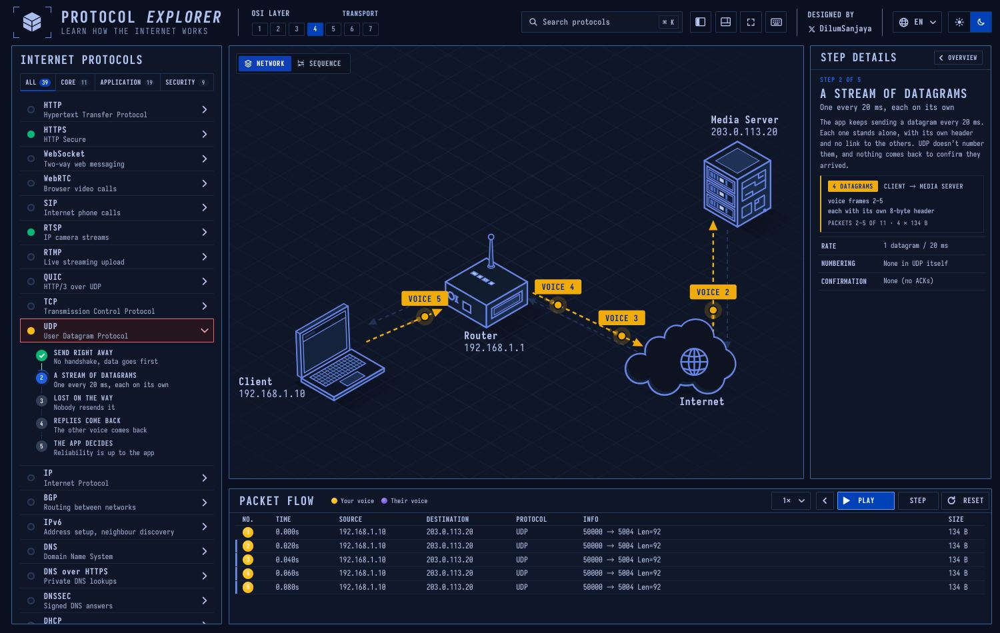
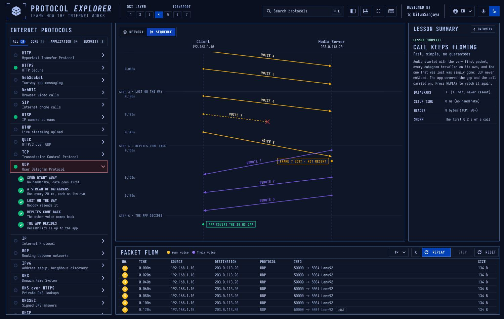
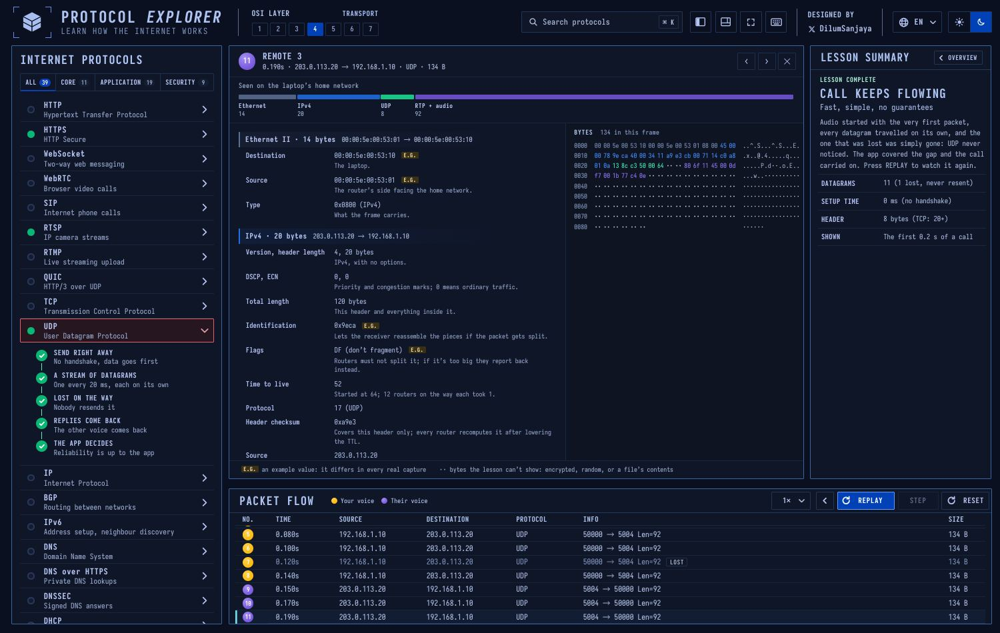

# UDP – User Datagram Protocol

<!-- nav -->
⬅ [09 TCP](09-tcp.md) · [Index](00_Protocols_Index.md) · [11 IP](11-ip.md) ➡
<!-- nav -->

*Source: Protocol Explorer – https://protocol-explorer-alpha.vercel.app/ (interactive lesson #10). Screenshots captured from the live lesson; packet decodes are the site's example capture (values marked **E.G.** differ in every real capture).*

## Overview


> PROTOCOL OVERVIEW  
> UDP  
> ACTIVE  
> User Datagram Protocol  
> UDP sends data in independent packets called datagrams, with no connection, no acknowledgements and no resends. That keeps it fast and light: right for voice, video, games and DNS, where a late answer is worse than a missing one.  
> LAYER  
> Transport (Layer 4)  
> CONNECTION  
> None  
> RELIABILITY  
> None (no ACKs, no resends)  
> ORDERING  
> Not guaranteed  
> HEADER  
> 8 bytes  
> DEFINED IN  
> RFC 768  

## In-depth explanation of the example (plain-language version)

### The big picture in one minute
A voice-call app on the laptop (port **50000**) sends audio to a media server (port **5004**). The lesson shows the **first 0.2 seconds of a call**: 8 small packets from the laptop (**one gets lost**) and 3 coming back. 11 messages in total, **with no handshake and no acknowledgements.**

**UDP in one sentence: "Here is a packet. Good luck."** It adds only the bare minimum to IP: **ports** (so the data reaches the right program), a **length** and a **checksum**. That's an **8-byte header** (TCP's is 20 bytes or more). UDP does **not** open connections, number packets, confirm receipt, re-send, reorder or slow down.

Think of **dropping postcards in a mailbox** versus **registered mail**. Postcards are fast and cheap, but some may get lost, and nobody tells you.

> **Words you'll see:** *Datagram* = one UDP packet. *Port* = a numbered "door" on a computer. *NAT* = your home router sharing one public address between all your devices.

---

### Step 1 – Just send it – packet 1
The app already knows the server's address and port (from signing in; see the SIP and WebRTC notes), so it needs **no set-up**. The very first packet already carries **20 milliseconds of voice**. The whole UDP header is four small fields:
| Field | Value | Meaning |
|---|---|---|
| Source port | 50000 | the app's own door |
| Destination port | 5004 | the server's door for audio |
| Length | 100 bytes | 8 header + 92 data |
| Checksum | (a number) | detects corruption |

### Step 2 – A steady stream – packets 2 to 5
Every **20 ms** the app sends another datagram. Each is **independent**: UDP gives it no number and nothing comes back to confirm it. (Voice apps add their own numbering inside the data, in a header called RTP.)

### Step 3 – One goes missing – packets 6 to 8
**Datagram 7 is lost** on the internet. The server doesn't ask for it and the laptop is never told, because there are no acknowledgements to go missing. Datagrams 6 and 8 arrive fine. **UDP never notices.** The result is a 20 ms hole in the sound, which the app hides (for example by repeating the previous sound a little).
**Why not re-send it?** By the time a re-sent packet arrived, its 20 ms of speech would already be in the past. Waiting for it would add *delay*, which sounds worse than a tiny glitch. The core idea: **"a late answer is worse than a missing one."**

### Step 4 – Replies come back – packets 9 to 11
The other person's voice comes back as separate datagrams from port 5004 to port 50000. They get through your home router thanks to **NAT**: when your first packet left, the router noted "private `192.168.1.10:50000` ↔ public address and port" and keeps that note for a short while. Replies from that address match the note and are let in. UDP has no connection, so the router uses a **timer** instead, which is why call apps send tiny keep-alive packets.

### Step 5 – The result
Sound started with the very first packet (zero set-up time), each packet travelled alone, and the lost one is simply gone. The app covered the gap and the call went on.

---

### The 11 messages at a glance
| Packets | What | Why |
|---|---|---|
| 1–5 | datagrams every 20 ms | outgoing voice |
| 6–8 | one datagram lost | UDP doesn't notice or repair |
| 9–11 | return datagrams | the other person's voice |

### What to remember
- **The header is just 8 bytes:** source port, destination port, length, checksum.
- **No** connection, ordering, reliability, re-sending, flow control or congestion control. **The application adds whatever it needs.** (QUIC rebuilds TCP-like features on top of UDP; RTP adds numbers and timestamps for voice.)
- **Choose UDP when fresh data beats complete data:** voice and video calls, live streaming, online games, **DNS**, DHCP, NTP, VPNs (WireGuard), QUIC / HTTP-3.
- Being connectionless also allows **broadcast and multicast**, which TCP cannot do.
- Downsides: it can be abused for "reflection" attacks, firewalls may block or limit it, and apps must handle congestion themselves.

## Step-by-step walkthrough (screenshots from the lesson)

### Step 1: SEND RIGHT AWAY – No handshake, data goes first


> STEP 1 OF 5  
> SEND RIGHT AWAY  
> No handshake, data goes first  
> A call app already knows the media server’s address and port from signing in. It doesn’t open a connection: the very first datagram already carries 20 ms of your voice, behind an 8-byte UDP header.  
> SETUP  
> None  
> HEADER  
> 8 bytes  
> PORTS  
> 50000 → 5004  

### Step 2: A STREAM OF DATAGRAMS – One every 20 ms, each on its own



> STEP 2 OF 5  
> A STREAM OF DATAGRAMS  
> One every 20 ms, each on its own  
> The app keeps sending a datagram every 20 ms. Each one stands alone, with its own header and no link to the others. UDP doesn’t number them, and nothing comes back to confirm they arrived.  
> 4 DATAGRAMS  
> CLIENT → MEDIA SERVER  
> voice frames 2–5  
> each with its own 8-byte header  
> PACKETS 2–5 OF 11 · 4 × 134 B  
> RATE  
> 1 datagram / 20 ms  
> NUMBERING  
> None in UDP itself  
> CONFIRMATION  
> None (no ACKs)  

### Step 3: LOST ON THE WAY – Nobody resends it


> STEP 3 OF 5  
> LOST ON THE WAY  
> Nobody resends it  
> Frame 7 is dropped somewhere on the internet. The media server never asks for it, and UDP never tells the laptop: there are no acknowledgements to miss. The datagrams after it arrive as normal.  
> 3 DATAGRAMS  
> CLIENT → MEDIA SERVER  
> voice frames 6–8  
> frame 7 is lost  
> PACKETS 6–8 OF 11 · 3 × 134 B · 1 LOST  
> LOST  
> Voice frame 7  
> RESENT  
> Never (no ACKs)  
> MISSING  
> 20 ms of audio  

### Step 4: REPLIES COME BACK – The other voice comes back


> STEP 4 OF 5  
> REPLIES COME BACK  
> The other voice comes back  
> The other person’s voice arrives the same way, as separate datagrams sent to port 50000. They get back in because your router remembered the outgoing port when it translated your address (NAT).  
> 3 DATAGRAMS  
> MEDIA SERVER → CLIENT  
> the other person’s voice  
> sent to port 50000  
> PACKETS 9–11 OF 11 · 3 × 134 B  
> PORTS  
> 5004 → 50000  
> DIRECTION  
> Independent of ours  
> THROUGH NAT  
> Router remembers the port  

### Step 5: THE APP DECIDES – Reliability is up to the app


> LESSON SUMMARY  
> LESSON COMPLETE  
> CALL KEEPS FLOWING  
> Fast, simple, no guarantees  
> Audio started with the very first packet, every datagram travelled on its own, and the one that was lost was simply gone: UDP never noticed. The app covered the gap and the call carried on. Press REPLAY to watch it again.  
> 3 DATAGRAMS  
> MEDIA SERVER → CLIENT  
> the other person’s voice  
> sent to port 50000  
> PACKETS 9–11 OF 11 · 3 × 134 B  
> DATAGRAMS  
> 11 (1 lost, never resent)  
> SETUP TIME  
> 0 ms (no handshake)  
> HEADER  
> 8 bytes (TCP: 20+)  
> SHOWN  
> The first 0.2 s of a call  

### Lesson summary


> LESSON SUMMARY  
> LESSON COMPLETE  
> CALL KEEPS FLOWING  
> Fast, simple, no guarantees  
> Audio started with the very first packet, every datagram travelled on its own, and the one that was lost was simply gone: UDP never noticed. The app covered the gap and the call carried on. Press REPLAY to watch it again.  
> 3 DATAGRAMS  
> MEDIA SERVER → CLIENT  
> the other person’s voice  
> sent to port 50000  
> PACKETS 9–11 OF 11 · 3 × 134 B  
> DATAGRAMS  
> 11 (1 lost, never resent)  
> SETUP TIME  
> 0 ms (no handshake)  
> HEADER  
> 8 bytes (TCP: 20+)  
> SHOWN  
> The first 0.2 s of a call  

## Packet flow (whole lesson)

| No. | Time | Source | Destination | Protocol | Info | Size |
|---|---|---|---|---|---|---|
| 1 | 0.000s | 192.168.1.10 | 203.0.113.20 | UDP | 50000 → 5004 Len=92 | 134 B |
| 2 | 0.020s | 192.168.1.10 | 203.0.113.20 | UDP | 50000 → 5004 Len=92 | 134 B |
| 3 | 0.040s | 192.168.1.10 | 203.0.113.20 | UDP | 50000 → 5004 Len=92 | 134 B |
| 4 | 0.060s | 192.168.1.10 | 203.0.113.20 | UDP | 50000 → 5004 Len=92 | 134 B |
| 5 | 0.080s | 192.168.1.10 | 203.0.113.20 | UDP | 50000 → 5004 Len=92 | 134 B |
| 6 | 0.100s | 192.168.1.10 | 203.0.113.20 | UDP | 50000 → 5004 Len=92 | 134 B |
| 7 | 0.120s | 192.168.1.10 | 203.0.113.20 | UDP | 50000 → 5004 Len=92LOST | 134 B |
| 8 | 0.140s | 192.168.1.10 | 203.0.113.20 | UDP | 50000 → 5004 Len=92 | 134 B |
| 9 | 0.150s | 203.0.113.20 | 192.168.1.10 | UDP | 5004 → 50000 Len=92 | 134 B |
| 10 | 0.170s | 203.0.113.20 | 192.168.1.10 | UDP | 5004 → 50000 Len=92 | 134 B |
| 11 | 0.190s | 203.0.113.20 | 192.168.1.10 | UDP | 5004 → 50000 Len=92 | 134 B |

### Sequence diagram



## Packets decoded byte by byte

Each packet below is the lesson's own decode (headers, field values and the plain-English meaning of each field). Screenshots show the first, middle and last packet in the lesson's decoder view with the raw hex bytes.

### Packet 1: UDP – 50000 → 5004 Len=92

*192.168.1.10 → 203.0.113.20 · 134 B · t = 0.000s*


<details><summary>Decoded fields</summary>

```text
1
VOICE 1
0.000s · 192.168.1.10 → 203.0.113.20 · UDP · 134 B
Seen on the laptop’s home network
Ethernet
14
IPv4
20
UDP
8
RTP + audio
92
Ethernet II · 14 bytes
00:00:5e:00:53:10 → 00:00:5e:00:53:01
Destination
00:00:5e:00:53:01 E.G.

The router: anything beyond the home network goes to it first.

Source
00:00:5e:00:53:10 E.G.

The laptop’s network card.

Type
0x0800 (IPv4)

What the frame carries.

IPv4 · 20 bytes
192.168.1.10 → 203.0.113.20
Version, header length
4, 20 bytes

IPv4, with no options.

DSCP, ECN
0, 0

Priority and congestion marks; 0 means ordinary traffic.

Total length
120 bytes

This header and everything inside it.

Identification
0xd825 E.G.

Lets the receiver reassemble the pieces if the packet gets split.

Flags
none E.G.

Routers may split it if a link is too small.

Time to live
128

Windows starts at 128.

Protocol
17 (UDP)
Header checksum
0x6488

Covers this header only; every router recomputes it after lowering the TTL.

Source
192.168.1.10
Destination
203.0.113.20
UDP · 8 bytes
50000 → 5004
Source port
50000
Destination port
5004
Length
100 bytes

UDP header and data. That is all of UDP: no numbering, no acknowledgements.

Checksum
covers bytes not shown here

Covers the header, the data and the IP addresses.

RTP + audio
Version etc.
2, no padding, no extension, no CSRCs
Marker, payload type
1, 111 (Opus, agreed when the call was set up) E.G.
Sequence number
21738 E.G.

Counts up by one per packet, so the app can spot a missing or late one.

Timestamp
2617440 E.G.

Audio clock at 48,000 per second: +960 per 20 ms frame.

SSRC
0x5ec6a2d1 E.G.

Identifies this audio stream.

Audio
80 bytes of Opus audio (20 ms)
BYTES 134 in this frame
0000
00
00
5e
00
53
01
00
00
5e
00
53
10
08
00
45
00
.
.
^
.
S
.
.
.
^
.
S
.
.
.
E
.
0010
00
78
d8
25
00
00
80
11
64
88
c0
a8
01
0a
cb
00
.
x
.
%
.
.
.
.
d
.
.
.
.
.
.
.
0020
71
14
c3
50
13
8c
00
64
··
··
80
ef
54
ea
00
27
q
.
.
P
.
.
.
d
·
·
.
.
T
.
.
'
0030
f0
60
5e
c6
a2
d1
··
··
··
··
··
··
··
··
··
··
.
`
^
.
.
.
·
·
·
·
·
·
·
·
·
·
0040
··
··
··
··
··
··
··
··
··
··
··
··
··
··
··
··
·
·
·
·
·
·
·
·
·
·
·
·
·
·
·
·
0050
··
··
··
··
··
··
··
··
··
··
··
··
··
··
··
··
·
·
·
·
·
·
·
·
·
·
·
·
·
·
·
·
0060
··
··
··
··
··
··
··
··
··
··
··
··
··
··
··
··
·
·
·
·
·
·
·
·
·
·
·
·
·
·
·
·
0070
··
··
··
··
··
··
··
··
··
··
··
··
··
··
··
··
·
·
·
·
·
·
·
·
·
·
·
·
·
·
·
·
0080
··
··
··
··
··
··
·
·
·
·
·
·
E.G. an example value: it differs in every real capture
·· bytes the lesson can’t show: encrypted, random, or a file’s contents
```

</details>

### Packet 2: UDP – 50000 → 5004 Len=92

*192.168.1.10 → 203.0.113.20 · 134 B · t = 0.020s*

<details><summary>Decoded fields</summary>

```text
2
VOICE 2
0.020s · 192.168.1.10 → 203.0.113.20 · UDP · 134 B
Seen on the laptop’s home network
Ethernet
14
IPv4
20
UDP
8
RTP + audio
92
Ethernet II · 14 bytes
00:00:5e:00:53:10 → 00:00:5e:00:53:01
Destination
00:00:5e:00:53:01 E.G.

The router: anything beyond the home network goes to it first.

Source
00:00:5e:00:53:10 E.G.

The laptop’s network card.

Type
0x0800 (IPv4)

What the frame carries.

IPv4 · 20 bytes
192.168.1.10 → 203.0.113.20
Version, header length
4, 20 bytes

IPv4, with no options.

DSCP, ECN
0, 0

Priority and congestion marks; 0 means ordinary traffic.

Total length
120 bytes

This header and everything inside it.

Identification
0xd826 E.G.

Lets the receiver reassemble the pieces if the packet gets split.

Flags
none E.G.

Routers may split it if a link is too small.

Time to live
128

Windows starts at 128.

Protocol
17 (UDP)
Header checksum
0x6487

Covers this header only; every router recomputes it after lowering the TTL.

Source
192.168.1.10
Destination
203.0.113.20
UDP · 8 bytes
50000 → 5004
Source port
50000
Destination port
5004
Length
100 bytes

UDP header and data. That is all of UDP: no numbering, no acknowledgements.

Checksum
covers bytes not shown here

Covers the header, the data and the IP addresses.

RTP + audio
Version etc.
2, no padding, no extension, no CSRCs
Marker, payload type
0, 111 (Opus, agreed when the call was set up) E.G.
Sequence number
21739 E.G.

Counts up by one per packet, so the app can spot a missing or late one.

Timestamp
2618400 E.G.

Audio clock at 48,000 per second: +960 per 20 ms frame.

SSRC
0x5ec6a2d1 E.G.

Identifies this audio stream.

Audio
80 bytes of Opus audio (20 ms)
BYTES 134 in this frame
0000
00
00
5e
00
53
01
00
00
5e
00
53
10
08
00
45
00
.
.
^
.
S
.
.
.
^
.
S
.
.
.
E
.
0010
00
78
d8
26
00
00
80
11
64
87
c0
a8
01
0a
cb
00
.
x
.
&
.
.
.
.
d
.
.
.
.
.
.
.
0020
71
14
c3
50
13
8c
00
64
··
··
80
6f
54
eb
00
27
q
.
.
P
.
.
.
d
·
·
.
o
T
.
.
'
0030
f4
20
5e
c6
a2
d1
··
··
··
··
··
··
··
··
··
··
.
^
.
.
.
·
·
·
·
·
·
·
·
·
·
0040
··
··
··
··
··
··
··
··
··
··
··
··
··
··
··
··
·
·
·
·
·
·
·
·
·
·
·
·
·
·
·
·
0050
··
··
··
··
··
··
··
··
··
··
··
··
··
··
··
··
·
·
·
·
·
·
·
·
·
·
·
·
·
·
·
·
0060
··
··
··
··
··
··
··
··
··
··
··
··
··
··
··
··
·
·
·
·
·
·
·
·
·
·
·
·
·
·
·
·
0070
··
··
··
··
··
··
··
··
··
··
··
··
··
··
··
··
·
·
·
·
·
·
·
·
·
·
·
·
·
·
·
·
0080
··
··
··
··
··
··
·
·
·
·
·
·
E.G. an example value: it differs in every real capture
·· bytes the lesson can’t show: encrypted, random, or a file’s contents
```

</details>

### Packet 3: UDP – 50000 → 5004 Len=92

*192.168.1.10 → 203.0.113.20 · 134 B · t = 0.040s*

<details><summary>Decoded fields</summary>

```text
3
VOICE 3
0.040s · 192.168.1.10 → 203.0.113.20 · UDP · 134 B
Seen on the laptop’s home network
Ethernet
14
IPv4
20
UDP
8
RTP + audio
92
Ethernet II · 14 bytes
00:00:5e:00:53:10 → 00:00:5e:00:53:01
Destination
00:00:5e:00:53:01 E.G.

The router: anything beyond the home network goes to it first.

Source
00:00:5e:00:53:10 E.G.

The laptop’s network card.

Type
0x0800 (IPv4)

What the frame carries.

IPv4 · 20 bytes
192.168.1.10 → 203.0.113.20
Version, header length
4, 20 bytes

IPv4, with no options.

DSCP, ECN
0, 0

Priority and congestion marks; 0 means ordinary traffic.

Total length
120 bytes

This header and everything inside it.

Identification
0xd827 E.G.

Lets the receiver reassemble the pieces if the packet gets split.

Flags
none E.G.

Routers may split it if a link is too small.

Time to live
128

Windows starts at 128.

Protocol
17 (UDP)
Header checksum
0x6486

Covers this header only; every router recomputes it after lowering the TTL.

Source
192.168.1.10
Destination
203.0.113.20
UDP · 8 bytes
50000 → 5004
Source port
50000
Destination port
5004
Length
100 bytes

UDP header and data. That is all of UDP: no numbering, no acknowledgements.

Checksum
covers bytes not shown here

Covers the header, the data and the IP addresses.

RTP + audio
Version etc.
2, no padding, no extension, no CSRCs
Marker, payload type
0, 111 (Opus, agreed when the call was set up) E.G.
Sequence number
21740 E.G.

Counts up by one per packet, so the app can spot a missing or late one.

Timestamp
2619360 E.G.

Audio clock at 48,000 per second: +960 per 20 ms frame.

SSRC
0x5ec6a2d1 E.G.

Identifies this audio stream.

Audio
80 bytes of Opus audio (20 ms)
BYTES 134 in this frame
0000
00
00
5e
00
53
01
00
00
5e
00
53
10
08
00
45
00
.
.
^
.
S
.
.
.
^
.
S
.
.
.
E
.
0010
00
78
d8
27
00
00
80
11
64
86
c0
a8
01
0a
cb
00
.
x
.
'
.
.
.
.
d
.
.
.
.
.
.
.
0020
71
14
c3
50
13
8c
00
64
··
··
80
6f
54
ec
00
27
q
.
.
P
.
.
.
d
·
·
.
o
T
.
.
'
0030
f7
e0
5e
c6
a2
d1
··
··
··
··
··
··
··
··
··
··
.
.
^
.
.
.
·
·
·
·
·
·
·
·
·
·
0040
··
··
··
··
··
··
··
··
··
··
··
··
··
··
··
··
·
·
·
·
·
·
·
·
·
·
·
·
·
·
·
·
0050
··
··
··
··
··
··
··
··
··
··
··
··
··
··
··
··
·
·
·
·
·
·
·
·
·
·
·
·
·
·
·
·
0060
··
··
··
··
··
··
··
··
··
··
··
··
··
··
··
··
·
·
·
·
·
·
·
·
·
·
·
·
·
·
·
·
0070
··
··
··
··
··
··
··
··
··
··
··
··
··
··
··
··
·
·
·
·
·
·
·
·
·
·
·
·
·
·
·
·
0080
··
··
··
··
··
··
·
·
·
·
·
·
E.G. an example value: it differs in every real capture
·· bytes the lesson can’t show: encrypted, random, or a file’s contents
```

</details>

### Packet 4: UDP – 50000 → 5004 Len=92

*192.168.1.10 → 203.0.113.20 · 134 B · t = 0.060s*

<details><summary>Decoded fields</summary>

```text
4
VOICE 4
0.060s · 192.168.1.10 → 203.0.113.20 · UDP · 134 B
Seen on the laptop’s home network
Ethernet
14
IPv4
20
UDP
8
RTP + audio
92
Ethernet II · 14 bytes
00:00:5e:00:53:10 → 00:00:5e:00:53:01
Destination
00:00:5e:00:53:01 E.G.

The router: anything beyond the home network goes to it first.

Source
00:00:5e:00:53:10 E.G.

The laptop’s network card.

Type
0x0800 (IPv4)

What the frame carries.

IPv4 · 20 bytes
192.168.1.10 → 203.0.113.20
Version, header length
4, 20 bytes

IPv4, with no options.

DSCP, ECN
0, 0

Priority and congestion marks; 0 means ordinary traffic.

Total length
120 bytes

This header and everything inside it.

Identification
0xd828 E.G.

Lets the receiver reassemble the pieces if the packet gets split.

Flags
none E.G.

Routers may split it if a link is too small.

Time to live
128

Windows starts at 128.

Protocol
17 (UDP)
Header checksum
0x6485

Covers this header only; every router recomputes it after lowering the TTL.

Source
192.168.1.10
Destination
203.0.113.20
UDP · 8 bytes
50000 → 5004
Source port
50000
Destination port
5004
Length
100 bytes

UDP header and data. That is all of UDP: no numbering, no acknowledgements.

Checksum
covers bytes not shown here

Covers the header, the data and the IP addresses.

RTP + audio
Version etc.
2, no padding, no extension, no CSRCs
Marker, payload type
0, 111 (Opus, agreed when the call was set up) E.G.
Sequence number
21741 E.G.

Counts up by one per packet, so the app can spot a missing or late one.

Timestamp
2620320 E.G.

Audio clock at 48,000 per second: +960 per 20 ms frame.

SSRC
0x5ec6a2d1 E.G.

Identifies this audio stream.

Audio
80 bytes of Opus audio (20 ms)
BYTES 134 in this frame
0000
00
00
5e
00
53
01
00
00
5e
00
53
10
08
00
45
00
.
.
^
.
S
.
.
.
^
.
S
.
.
.
E
.
0010
00
78
d8
28
00
00
80
11
64
85
c0
a8
01
0a
cb
00
.
x
.
(
.
.
.
.
d
.
.
.
.
.
.
.
0020
71
14
c3
50
13
8c
00
64
··
··
80
6f
54
ed
00
27
q
.
.
P
.
.
.
d
·
·
.
o
T
.
.
'
0030
fb
a0
5e
c6
a2
d1
··
··
··
··
··
··
··
··
··
··
.
.
^
.
.
.
·
·
·
·
·
·
·
·
·
·
0040
··
··
··
··
··
··
··
··
··
··
··
··
··
··
··
··
·
·
·
·
·
·
·
·
·
·
·
·
·
·
·
·
0050
··
··
··
··
··
··
··
··
··
··
··
··
··
··
··
··
·
·
·
·
·
·
·
·
·
·
·
·
·
·
·
·
0060
··
··
··
··
··
··
··
··
··
··
··
··
··
··
··
··
·
·
·
·
·
·
·
·
·
·
·
·
·
·
·
·
0070
··
··
··
··
··
··
··
··
··
··
··
··
··
··
··
··
·
·
·
·
·
·
·
·
·
·
·
·
·
·
·
·
0080
··
··
··
··
··
··
·
·
·
·
·
·
E.G. an example value: it differs in every real capture
·· bytes the lesson can’t show: encrypted, random, or a file’s contents
```

</details>

### Packet 5: UDP – 50000 → 5004 Len=92

*192.168.1.10 → 203.0.113.20 · 134 B · t = 0.080s*

<details><summary>Decoded fields</summary>

```text
5
VOICE 5
0.080s · 192.168.1.10 → 203.0.113.20 · UDP · 134 B
Seen on the laptop’s home network
Ethernet
14
IPv4
20
UDP
8
RTP + audio
92
Ethernet II · 14 bytes
00:00:5e:00:53:10 → 00:00:5e:00:53:01
Destination
00:00:5e:00:53:01 E.G.

The router: anything beyond the home network goes to it first.

Source
00:00:5e:00:53:10 E.G.

The laptop’s network card.

Type
0x0800 (IPv4)

What the frame carries.

IPv4 · 20 bytes
192.168.1.10 → 203.0.113.20
Version, header length
4, 20 bytes

IPv4, with no options.

DSCP, ECN
0, 0

Priority and congestion marks; 0 means ordinary traffic.

Total length
120 bytes

This header and everything inside it.

Identification
0xd829 E.G.

Lets the receiver reassemble the pieces if the packet gets split.

Flags
none E.G.

Routers may split it if a link is too small.

Time to live
128

Windows starts at 128.

Protocol
17 (UDP)
Header checksum
0x6484

Covers this header only; every router recomputes it after lowering the TTL.

Source
192.168.1.10
Destination
203.0.113.20
UDP · 8 bytes
50000 → 5004
Source port
50000
Destination port
5004
Length
100 bytes

UDP header and data. That is all of UDP: no numbering, no acknowledgements.

Checksum
covers bytes not shown here

Covers the header, the data and the IP addresses.

RTP + audio
Version etc.
2, no padding, no extension, no CSRCs
Marker, payload type
0, 111 (Opus, agreed when the call was set up) E.G.
Sequence number
21742 E.G.

Counts up by one per packet, so the app can spot a missing or late one.

Timestamp
2621280 E.G.

Audio clock at 48,000 per second: +960 per 20 ms frame.

SSRC
0x5ec6a2d1 E.G.

Identifies this audio stream.

Audio
80 bytes of Opus audio (20 ms)
BYTES 134 in this frame
0000
00
00
5e
00
53
01
00
00
5e
00
53
10
08
00
45
00
.
.
^
.
S
.
.
.
^
.
S
.
.
.
E
.
0010
00
78
d8
29
00
00
80
11
64
84
c0
a8
01
0a
cb
00
.
x
.
)
.
.
.
.
d
.
.
.
.
.
.
.
0020
71
14
c3
50
13
8c
00
64
··
··
80
6f
54
ee
00
27
q
.
.
P
.
.
.
d
·
·
.
o
T
.
.
'
0030
ff
60
5e
c6
a2
d1
··
··
··
··
··
··
··
··
··
··
.
`
^
.
.
.
·
·
·
·
·
·
·
·
·
·
0040
··
··
··
··
··
··
··
··
··
··
··
··
··
··
··
··
·
·
·
·
·
·
·
·
·
·
·
·
·
·
·
·
0050
··
··
··
··
··
··
··
··
··
··
··
··
··
··
··
··
·
·
·
·
·
·
·
·
·
·
·
·
·
·
·
·
0060
··
··
··
··
··
··
··
··
··
··
··
··
··
··
··
··
·
·
·
·
·
·
·
·
·
·
·
·
·
·
·
·
0070
··
··
··
··
··
··
··
··
··
··
··
··
··
··
··
··
·
·
·
·
·
·
·
·
·
·
·
·
·
·
·
·
0080
··
··
··
··
··
··
·
·
·
·
·
·
E.G. an example value: it differs in every real capture
·· bytes the lesson can’t show: encrypted, random, or a file’s contents
```

</details>

### Packet 6: UDP – 50000 → 5004 Len=92

*192.168.1.10 → 203.0.113.20 · 134 B · t = 0.100s*


<details><summary>Decoded fields</summary>

```text
6
VOICE 6
0.100s · 192.168.1.10 → 203.0.113.20 · UDP · 134 B
Seen on the laptop’s home network
Ethernet
14
IPv4
20
UDP
8
RTP + audio
92
Ethernet II · 14 bytes
00:00:5e:00:53:10 → 00:00:5e:00:53:01
Destination
00:00:5e:00:53:01 E.G.

The router: anything beyond the home network goes to it first.

Source
00:00:5e:00:53:10 E.G.

The laptop’s network card.

Type
0x0800 (IPv4)

What the frame carries.

IPv4 · 20 bytes
192.168.1.10 → 203.0.113.20
Version, header length
4, 20 bytes

IPv4, with no options.

DSCP, ECN
0, 0

Priority and congestion marks; 0 means ordinary traffic.

Total length
120 bytes

This header and everything inside it.

Identification
0xd82a E.G.

Lets the receiver reassemble the pieces if the packet gets split.

Flags
none E.G.

Routers may split it if a link is too small.

Time to live
128

Windows starts at 128.

Protocol
17 (UDP)
Header checksum
0x6483

Covers this header only; every router recomputes it after lowering the TTL.

Source
192.168.1.10
Destination
203.0.113.20
UDP · 8 bytes
50000 → 5004
Source port
50000
Destination port
5004
Length
100 bytes

UDP header and data. That is all of UDP: no numbering, no acknowledgements.

Checksum
covers bytes not shown here

Covers the header, the data and the IP addresses.

RTP + audio
Version etc.
2, no padding, no extension, no CSRCs
Marker, payload type
0, 111 (Opus, agreed when the call was set up) E.G.
Sequence number
21743 E.G.

Counts up by one per packet, so the app can spot a missing or late one.

Timestamp
2622240 E.G.

Audio clock at 48,000 per second: +960 per 20 ms frame.

SSRC
0x5ec6a2d1 E.G.

Identifies this audio stream.

Audio
80 bytes of Opus audio (20 ms)
BYTES 134 in this frame
0000
00
00
5e
00
53
01
00
00
5e
00
53
10
08
00
45
00
.
.
^
.
S
.
.
.
^
.
S
.
.
.
E
.
0010
00
78
d8
2a
00
00
80
11
64
83
c0
a8
01
0a
cb
00
.
x
.
*
.
.
.
.
d
.
.
.
.
.
.
.
0020
71
14
c3
50
13
8c
00
64
··
··
80
6f
54
ef
00
28
q
.
.
P
.
.
.
d
·
·
.
o
T
.
.
(
0030
03
20
5e
c6
a2
d1
··
··
··
··
··
··
··
··
··
··
.
^
.
.
.
·
·
·
·
·
·
·
·
·
·
0040
··
··
··
··
··
··
··
··
··
··
··
··
··
··
··
··
·
·
·
·
·
·
·
·
·
·
·
·
·
·
·
·
0050
··
··
··
··
··
··
··
··
··
··
··
··
··
··
··
··
·
·
·
·
·
·
·
·
·
·
·
·
·
·
·
·
0060
··
··
··
··
··
··
··
··
··
··
··
··
··
··
··
··
·
·
·
·
·
·
·
·
·
·
·
·
·
·
·
·
0070
··
··
··
··
··
··
··
··
··
··
··
··
··
··
··
··
·
·
·
·
·
·
·
·
·
·
·
·
·
·
·
·
0080
··
··
··
··
··
··
·
·
·
·
·
·
E.G. an example value: it differs in every real capture
·· bytes the lesson can’t show: encrypted, random, or a file’s contents
```

</details>

### Packet 7: UDP – 50000 → 5004 Len=92LOST

*192.168.1.10 → 203.0.113.20 · 134 B · t = 0.120s*

<details><summary>Decoded fields</summary>

```text
7
VOICE 7
0.120s · 192.168.1.10 → 203.0.113.20 · UDP · 134 B
Seen on the laptop’s home network · This packet was lost on the way
Ethernet
14
IPv4
20
UDP
8
RTP + audio
92
Ethernet II · 14 bytes
00:00:5e:00:53:10 → 00:00:5e:00:53:01
Destination
00:00:5e:00:53:01 E.G.

The router: anything beyond the home network goes to it first.

Source
00:00:5e:00:53:10 E.G.

The laptop’s network card.

Type
0x0800 (IPv4)

What the frame carries.

IPv4 · 20 bytes
192.168.1.10 → 203.0.113.20
Version, header length
4, 20 bytes

IPv4, with no options.

DSCP, ECN
0, 0

Priority and congestion marks; 0 means ordinary traffic.

Total length
120 bytes

This header and everything inside it.

Identification
0xd82b E.G.

Lets the receiver reassemble the pieces if the packet gets split.

Flags
none E.G.

Routers may split it if a link is too small.

Time to live
128

Windows starts at 128.

Protocol
17 (UDP)
Header checksum
0x6482

Covers this header only; every router recomputes it after lowering the TTL.

Source
192.168.1.10
Destination
203.0.113.20
UDP · 8 bytes
50000 → 5004
Source port
50000
Destination port
5004
Length
100 bytes

UDP header and data. That is all of UDP: no numbering, no acknowledgements.

Checksum
covers bytes not shown here

Covers the header, the data and the IP addresses.

RTP + audio
Version etc.
2, no padding, no extension, no CSRCs
Marker, payload type
0, 111 (Opus, agreed when the call was set up) E.G.
Sequence number
21744 E.G.

Counts up by one per packet, so the app can spot a missing or late one.

Timestamp
2623200 E.G.

Audio clock at 48,000 per second: +960 per 20 ms frame.

SSRC
0x5ec6a2d1 E.G.

Identifies this audio stream.

Audio
80 bytes of Opus audio (20 ms)
BYTES 134 in this frame
0000
00
00
5e
00
53
01
00
00
5e
00
53
10
08
00
45
00
.
.
^
.
S
.
.
.
^
.
S
.
.
.
E
.
0010
00
78
d8
2b
00
00
80
11
64
82
c0
a8
01
0a
cb
00
.
x
.
+
.
.
.
.
d
.
.
.
.
.
.
.
0020
71
14
c3
50
13
8c
00
64
··
··
80
6f
54
f0
00
28
q
.
.
P
.
.
.
d
·
·
.
o
T
.
.
(
0030
06
e0
5e
c6
a2
d1
··
··
··
··
··
··
··
··
··
··
.
.
^
.
.
.
·
·
·
·
·
·
·
·
·
·
0040
··
··
··
··
··
··
··
··
··
··
··
··
··
··
··
··
·
·
·
·
·
·
·
·
·
·
·
·
·
·
·
·
0050
··
··
··
··
··
··
··
··
··
··
··
··
··
··
··
··
·
·
·
·
·
·
·
·
·
·
·
·
·
·
·
·
0060
··
··
··
··
··
··
··
··
··
··
··
··
··
··
··
··
·
·
·
·
·
·
·
·
·
·
·
·
·
·
·
·
0070
··
··
··
··
··
··
··
··
··
··
··
··
··
··
··
··
·
·
·
·
·
·
·
·
·
·
·
·
·
·
·
·
0080
··
··
··
··
··
··
·
·
·
·
·
·
E.G. an example value: it differs in every real capture
·· bytes the lesson can’t show: encrypted, random, or a file’s contents
```

</details>

### Packet 8: UDP – 50000 → 5004 Len=92

*192.168.1.10 → 203.0.113.20 · 134 B · t = 0.140s*

<details><summary>Decoded fields</summary>

```text
8
VOICE 8
0.140s · 192.168.1.10 → 203.0.113.20 · UDP · 134 B
Seen on the laptop’s home network
Ethernet
14
IPv4
20
UDP
8
RTP + audio
92
Ethernet II · 14 bytes
00:00:5e:00:53:10 → 00:00:5e:00:53:01
Destination
00:00:5e:00:53:01 E.G.

The router: anything beyond the home network goes to it first.

Source
00:00:5e:00:53:10 E.G.

The laptop’s network card.

Type
0x0800 (IPv4)

What the frame carries.

IPv4 · 20 bytes
192.168.1.10 → 203.0.113.20
Version, header length
4, 20 bytes

IPv4, with no options.

DSCP, ECN
0, 0

Priority and congestion marks; 0 means ordinary traffic.

Total length
120 bytes

This header and everything inside it.

Identification
0xd82c E.G.

Lets the receiver reassemble the pieces if the packet gets split.

Flags
none E.G.

Routers may split it if a link is too small.

Time to live
128

Windows starts at 128.

Protocol
17 (UDP)
Header checksum
0x6481

Covers this header only; every router recomputes it after lowering the TTL.

Source
192.168.1.10
Destination
203.0.113.20
UDP · 8 bytes
50000 → 5004
Source port
50000
Destination port
5004
Length
100 bytes

UDP header and data. That is all of UDP: no numbering, no acknowledgements.

Checksum
covers bytes not shown here

Covers the header, the data and the IP addresses.

RTP + audio
Version etc.
2, no padding, no extension, no CSRCs
Marker, payload type
0, 111 (Opus, agreed when the call was set up) E.G.
Sequence number
21745 E.G.

Counts up by one per packet, so the app can spot a missing or late one.

Timestamp
2624160 E.G.

Audio clock at 48,000 per second: +960 per 20 ms frame.

SSRC
0x5ec6a2d1 E.G.

Identifies this audio stream.

Audio
80 bytes of Opus audio (20 ms)
BYTES 134 in this frame
0000
00
00
5e
00
53
01
00
00
5e
00
53
10
08
00
45
00
.
.
^
.
S
.
.
.
^
.
S
.
.
.
E
.
0010
00
78
d8
2c
00
00
80
11
64
81
c0
a8
01
0a
cb
00
.
x
.
,
.
.
.
.
d
.
.
.
.
.
.
.
0020
71
14
c3
50
13
8c
00
64
··
··
80
6f
54
f1
00
28
q
.
.
P
.
.
.
d
·
·
.
o
T
.
.
(
0030
0a
a0
5e
c6
a2
d1
··
··
··
··
··
··
··
··
··
··
.
.
^
.
.
.
·
·
·
·
·
·
·
·
·
·
0040
··
··
··
··
··
··
··
··
··
··
··
··
··
··
··
··
·
·
·
·
·
·
·
·
·
·
·
·
·
·
·
·
0050
··
··
··
··
··
··
··
··
··
··
··
··
··
··
··
··
·
·
·
·
·
·
·
·
·
·
·
·
·
·
·
·
0060
··
··
··
··
··
··
··
··
··
··
··
··
··
··
··
··
·
·
·
·
·
·
·
·
·
·
·
·
·
·
·
·
0070
··
··
··
··
··
··
··
··
··
··
··
··
··
··
··
··
·
·
·
·
·
·
·
·
·
·
·
·
·
·
·
·
0080
··
··
··
··
··
··
·
·
·
·
·
·
E.G. an example value: it differs in every real capture
·· bytes the lesson can’t show: encrypted, random, or a file’s contents
```

</details>

### Packet 9: UDP – 5004 → 50000 Len=92

*203.0.113.20 → 192.168.1.10 · 134 B · t = 0.150s*

<details><summary>Decoded fields</summary>

```text
9
REMOTE 1
0.150s · 203.0.113.20 → 192.168.1.10 · UDP · 134 B
Seen on the laptop’s home network
Ethernet
14
IPv4
20
UDP
8
RTP + audio
92
Ethernet II · 14 bytes
00:00:5e:00:53:01 → 00:00:5e:00:53:10
Destination
00:00:5e:00:53:10 E.G.

The laptop.

Source
00:00:5e:00:53:01 E.G.

The router’s side facing the home network.

Type
0x0800 (IPv4)

What the frame carries.

IPv4 · 20 bytes
203.0.113.20 → 192.168.1.10
Version, header length
4, 20 bytes

IPv4, with no options.

DSCP, ECN
0, 0

Priority and congestion marks; 0 means ordinary traffic.

Total length
120 bytes

This header and everything inside it.

Identification
0x9ec8 E.G.

Lets the receiver reassemble the pieces if the packet gets split.

Flags
DF (don’t fragment) E.G.

Routers must not split it; if it’s too big they report back instead.

Time to live
52

Started at 64; 12 routers on the way each took 1.

Protocol
17 (UDP)
Header checksum
0xa9e5

Covers this header only; every router recomputes it after lowering the TTL.

Source
203.0.113.20
Destination
192.168.1.10
UDP · 8 bytes
5004 → 50000
Source port
5004
Destination port
50000
Length
100 bytes

UDP header and data. That is all of UDP: no numbering, no acknowledgements.

Checksum
covers bytes not shown here

Covers the header, the data and the IP addresses.

RTP + audio
Version etc.
2, no padding, no extension, no CSRCs
Marker, payload type
1, 111 (Opus, agreed when the call was set up) E.G.
Sequence number
4419 E.G.

Counts up by one per packet, so the app can spot a missing or late one.

Timestamp
913280 E.G.

Audio clock at 48,000 per second: +960 per 20 ms frame.

SSRC
0x1b77c40e E.G.

Identifies this audio stream.

Audio
80 bytes of Opus audio (20 ms)
BYTES 134 in this frame
0000
00
00
5e
00
53
10
00
00
5e
00
53
01
08
00
45
00
.
.
^
.
S
.
.
.
^
.
S
.
.
.
E
.
0010
00
78
9e
c8
40
00
34
11
a9
e5
cb
00
71
14
c0
a8
.
x
.
.
@
.
4
.
.
.
.
.
q
.
.
.
0020
01
0a
13
8c
c3
50
00
64
··
··
80
ef
11
43
00
0d
.
.
.
.
.
P
.
d
·
·
.
.
.
C
.
.
0030
ef
80
1b
77
c4
0e
··
··
··
··
··
··
··
··
··
··
.
.
.
w
.
.
·
·
·
·
·
·
·
·
·
·
0040
··
··
··
··
··
··
··
··
··
··
··
··
··
··
··
··
·
·
·
·
·
·
·
·
·
·
·
·
·
·
·
·
0050
··
··
··
··
··
··
··
··
··
··
··
··
··
··
··
··
·
·
·
·
·
·
·
·
·
·
·
·
·
·
·
·
0060
··
··
··
··
··
··
··
··
··
··
··
··
··
··
··
··
·
·
·
·
·
·
·
·
·
·
·
·
·
·
·
·
0070
··
··
··
··
··
··
··
··
··
··
··
··
··
··
··
··
·
·
·
·
·
·
·
·
·
·
·
·
·
·
·
·
0080
··
··
··
··
··
··
·
·
·
·
·
·
E.G. an example value: it differs in every real capture
·· bytes the lesson can’t show: encrypted, random, or a file’s contents
```

</details>

### Packet 10: UDP – 5004 → 50000 Len=92

*203.0.113.20 → 192.168.1.10 · 134 B · t = 0.170s*

<details><summary>Decoded fields</summary>

```text
10
REMOTE 2
0.170s · 203.0.113.20 → 192.168.1.10 · UDP · 134 B
Seen on the laptop’s home network
Ethernet
14
IPv4
20
UDP
8
RTP + audio
92
Ethernet II · 14 bytes
00:00:5e:00:53:01 → 00:00:5e:00:53:10
Destination
00:00:5e:00:53:10 E.G.

The laptop.

Source
00:00:5e:00:53:01 E.G.

The router’s side facing the home network.

Type
0x0800 (IPv4)

What the frame carries.

IPv4 · 20 bytes
203.0.113.20 → 192.168.1.10
Version, header length
4, 20 bytes

IPv4, with no options.

DSCP, ECN
0, 0

Priority and congestion marks; 0 means ordinary traffic.

Total length
120 bytes

This header and everything inside it.

Identification
0x9ec9 E.G.

Lets the receiver reassemble the pieces if the packet gets split.

Flags
DF (don’t fragment) E.G.

Routers must not split it; if it’s too big they report back instead.

Time to live
52

Started at 64; 12 routers on the way each took 1.

Protocol
17 (UDP)
Header checksum
0xa9e4

Covers this header only; every router recomputes it after lowering the TTL.

Source
203.0.113.20
Destination
192.168.1.10
UDP · 8 bytes
5004 → 50000
Source port
5004
Destination port
50000
Length
100 bytes

UDP header and data. That is all of UDP: no numbering, no acknowledgements.

Checksum
covers bytes not shown here

Covers the header, the data and the IP addresses.

RTP + audio
Version etc.
2, no padding, no extension, no CSRCs
Marker, payload type
0, 111 (Opus, agreed when the call was set up) E.G.
Sequence number
4420 E.G.

Counts up by one per packet, so the app can spot a missing or late one.

Timestamp
914240 E.G.

Audio clock at 48,000 per second: +960 per 20 ms frame.

SSRC
0x1b77c40e E.G.

Identifies this audio stream.

Audio
80 bytes of Opus audio (20 ms)
BYTES 134 in this frame
0000
00
00
5e
00
53
10
00
00
5e
00
53
01
08
00
45
00
.
.
^
.
S
.
.
.
^
.
S
.
.
.
E
.
0010
00
78
9e
c9
40
00
34
11
a9
e4
cb
00
71
14
c0
a8
.
x
.
.
@
.
4
.
.
.
.
.
q
.
.
.
0020
01
0a
13
8c
c3
50
00
64
··
··
80
6f
11
44
00
0d
.
.
.
.
.
P
.
d
·
·
.
o
.
D
.
.
0030
f3
40
1b
77
c4
0e
··
··
··
··
··
··
··
··
··
··
.
@
.
w
.
.
·
·
·
·
·
·
·
·
·
·
0040
··
··
··
··
··
··
··
··
··
··
··
··
··
··
··
··
·
·
·
·
·
·
·
·
·
·
·
·
·
·
·
·
0050
··
··
··
··
··
··
··
··
··
··
··
··
··
··
··
··
·
·
·
·
·
·
·
·
·
·
·
·
·
·
·
·
0060
··
··
··
··
··
··
··
··
··
··
··
··
··
··
··
··
·
·
·
·
·
·
·
·
·
·
·
·
·
·
·
·
0070
··
··
··
··
··
··
··
··
··
··
··
··
··
··
··
··
·
·
·
·
·
·
·
·
·
·
·
·
·
·
·
·
0080
··
··
··
··
··
··
·
·
·
·
·
·
E.G. an example value: it differs in every real capture
·· bytes the lesson can’t show: encrypted, random, or a file’s contents
```

</details>

### Packet 11: UDP – 5004 → 50000 Len=92

*203.0.113.20 → 192.168.1.10 · 134 B · t = 0.190s*



<details><summary>Decoded fields</summary>

```text
11
REMOTE 3
0.190s · 203.0.113.20 → 192.168.1.10 · UDP · 134 B
Seen on the laptop’s home network
Ethernet
14
IPv4
20
UDP
8
RTP + audio
92
Ethernet II · 14 bytes
00:00:5e:00:53:01 → 00:00:5e:00:53:10
Destination
00:00:5e:00:53:10 E.G.

The laptop.

Source
00:00:5e:00:53:01 E.G.

The router’s side facing the home network.

Type
0x0800 (IPv4)

What the frame carries.

IPv4 · 20 bytes
203.0.113.20 → 192.168.1.10
Version, header length
4, 20 bytes

IPv4, with no options.

DSCP, ECN
0, 0

Priority and congestion marks; 0 means ordinary traffic.

Total length
120 bytes

This header and everything inside it.

Identification
0x9eca E.G.

Lets the receiver reassemble the pieces if the packet gets split.

Flags
DF (don’t fragment) E.G.

Routers must not split it; if it’s too big they report back instead.

Time to live
52

Started at 64; 12 routers on the way each took 1.

Protocol
17 (UDP)
Header checksum
0xa9e3

Covers this header only; every router recomputes it after lowering the TTL.

Source
203.0.113.20
Destination
192.168.1.10
UDP · 8 bytes
5004 → 50000
Source port
5004
Destination port
50000
Length
100 bytes

UDP header and data. That is all of UDP: no numbering, no acknowledgements.

Checksum
covers bytes not shown here

Covers the header, the data and the IP addresses.

RTP + audio
Version etc.
2, no padding, no extension, no CSRCs
Marker, payload type
0, 111 (Opus, agreed when the call was set up) E.G.
Sequence number
4421 E.G.

Counts up by one per packet, so the app can spot a missing or late one.

Timestamp
915200 E.G.

Audio clock at 48,000 per second: +960 per 20 ms frame.

SSRC
0x1b77c40e E.G.

Identifies this audio stream.

Audio
80 bytes of Opus audio (20 ms)
BYTES 134 in this frame
0000
00
00
5e
00
53
10
00
00
5e
00
53
01
08
00
45
00
.
.
^
.
S
.
.
.
^
.
S
.
.
.
E
.
0010
00
78
9e
ca
40
00
34
11
a9
e3
cb
00
71
14
c0
a8
.
x
.
.
@
.
4
.
.
.
.
.
q
.
.
.
0020
01
0a
13
8c
c3
50
00
64
··
··
80
6f
11
45
00
0d
.
.
.
.
.
P
.
d
·
·
.
o
.
E
.
.
0030
f7
00
1b
77
c4
0e
··
··
··
··
··
··
··
··
··
··
.
.
.
w
.
.
·
·
·
·
·
·
·
·
·
·
0040
··
··
··
··
··
··
··
··
··
··
··
··
··
··
··
··
·
·
·
·
·
·
·
·
·
·
·
·
·
·
·
·
0050
··
··
··
··
··
··
··
··
··
··
··
··
··
··
··
··
·
·
·
·
·
·
·
·
·
·
·
·
·
·
·
·
0060
··
··
··
··
··
··
··
··
··
··
··
··
··
··
··
··
·
·
·
·
·
·
·
·
·
·
·
·
·
·
·
·
0070
··
··
··
··
··
··
··
··
··
··
··
··
··
··
··
··
·
·
·
·
·
·
·
·
·
·
·
·
·
·
·
·
0080
··
··
··
··
··
··
·
·
·
·
·
·
E.G. an example value: it differs in every real capture
·· bytes the lesson can’t show: encrypted, random, or a file’s contents
```

</details>

---

<!-- nav -->
⬅ [09 TCP](09-tcp.md) · [Index](00_Protocols_Index.md) · [11 IP](11-ip.md) ➡
<!-- nav -->
