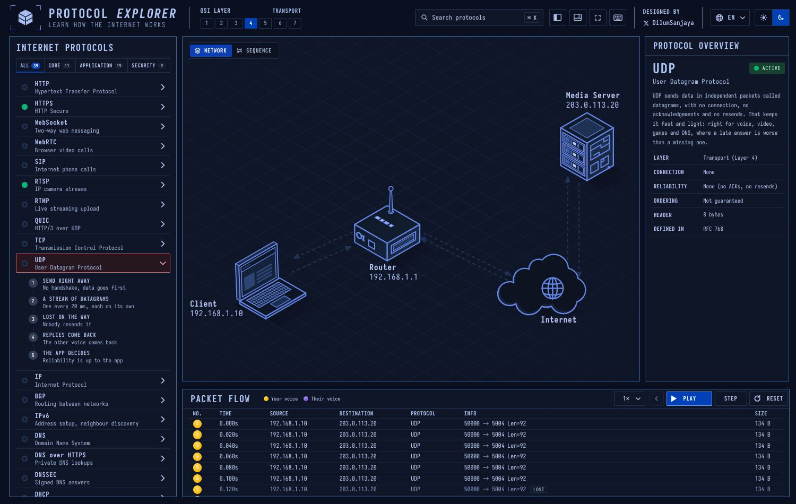
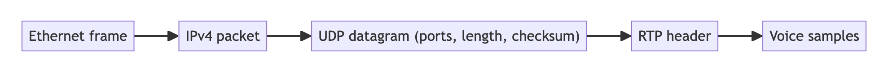
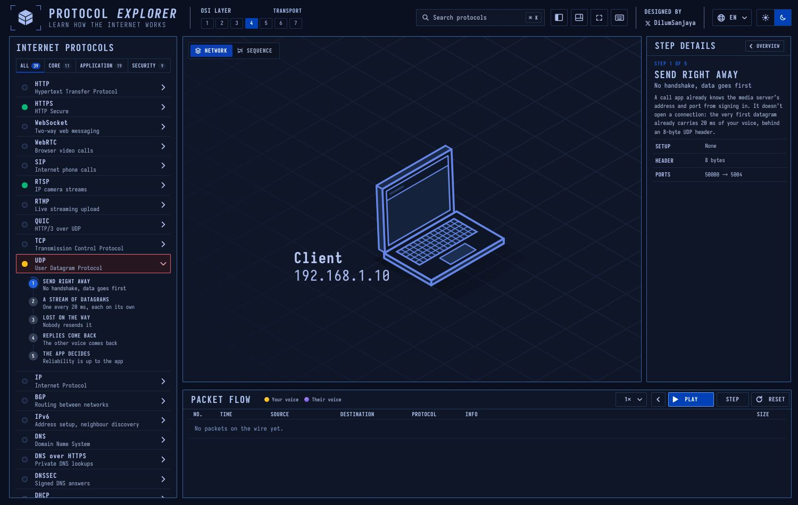
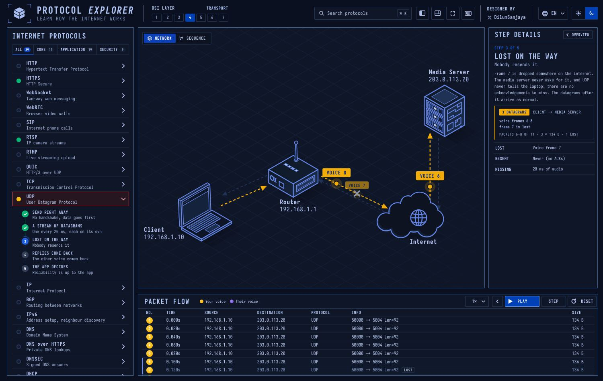
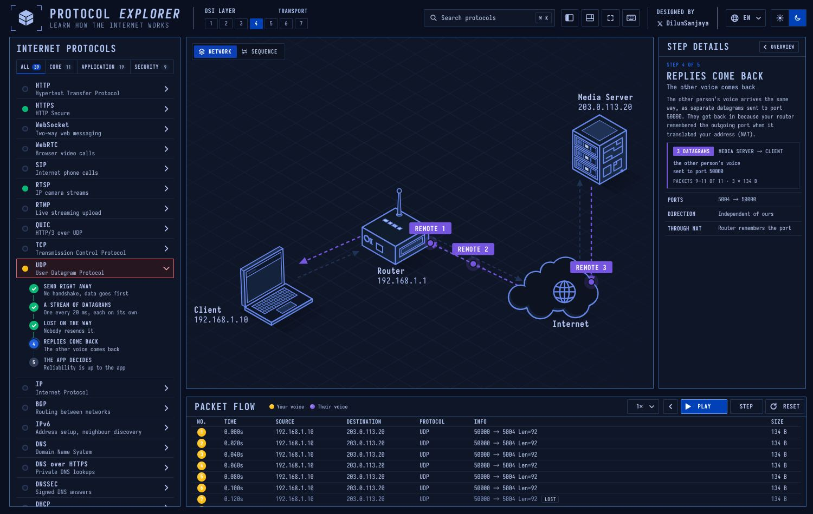
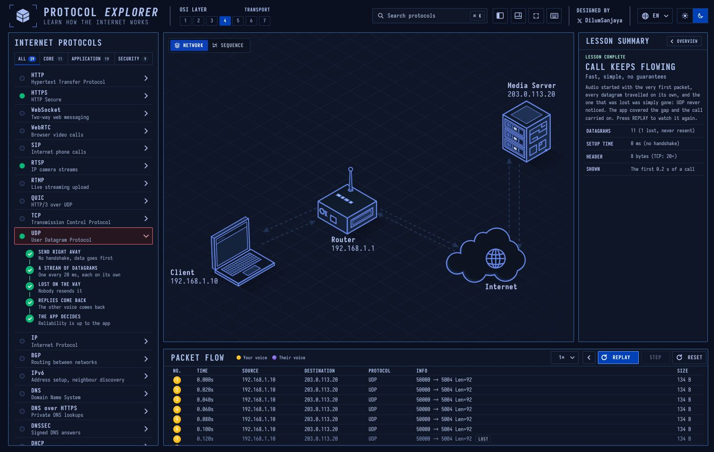
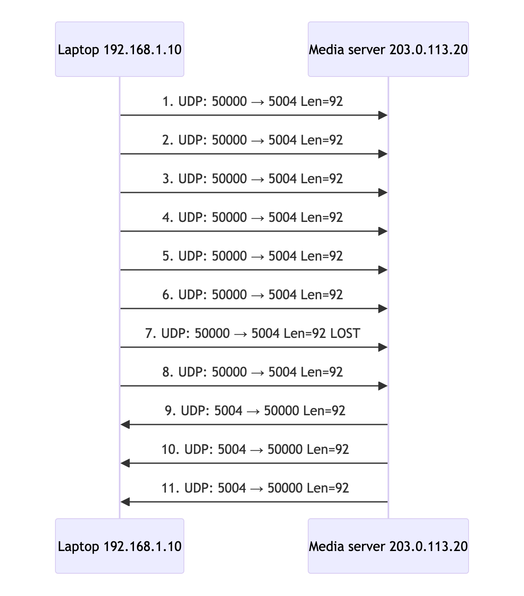
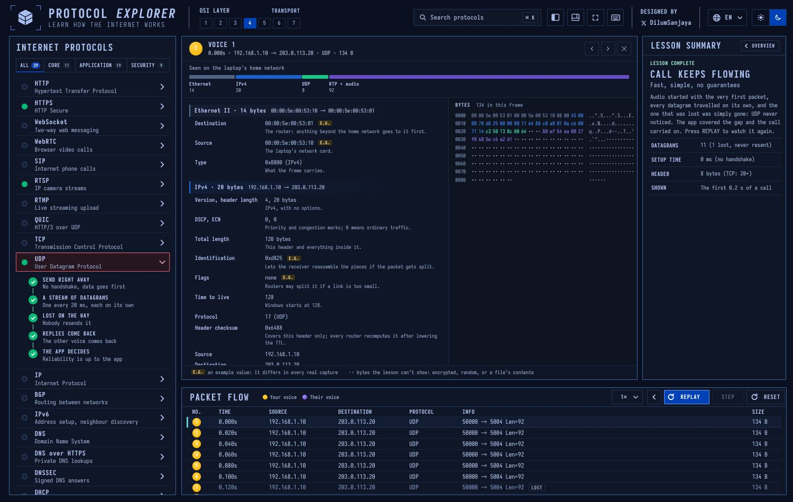
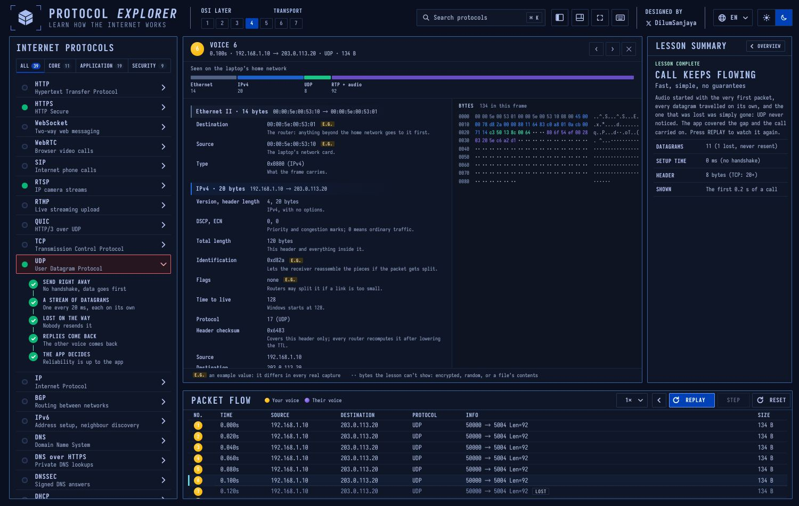

# UDP – User Datagram Protocol

<!-- nav -->
⬅ [09 TCP](09-tcp.md) · [Index](00_Protocols_Index.md) · [11 IP](11-ip.md) ➡
<!-- nav -->

*Source: Protocol Explorer – https://protocol-explorer-alpha.vercel.app/ (interactive lesson #10). Screenshots captured from the live lesson; packet decodes are the site's example capture (values marked **E.G.** differ in every real capture).*

## Overview

### How the layers fit together (outer to inner)

## In-depth explanation of the example (plain-language version)

### The big picture in one minute
A voice-call app on the laptop (port **50000**) sends audio to a media server (port **5004**). The lesson shows the **first 0.2 seconds of a call**: 8 small packets from the laptop (**one gets lost**) and 3 coming back. 11 messages in total, **with no handshake and no acknowledgements.**

**UDP in one sentence: "Here is a packet. Good luck."** It adds only the bare minimum to IP: **ports** (so the data reaches the right program), a **length** and a **checksum**. That's an **8-byte header** (TCP's is 20 bytes or more). UDP does **not** open connections, number packets, confirm receipt, re-send, reorder or slow down.

Think of **dropping postcards in a mailbox** versus **registered mail**. Postcards are fast and cheap, but some may get lost, and nobody tells you.

> **Words you'll see:** *Datagram* = one UDP packet. *Port* = a numbered "door" on a computer. *NAT* = your home router sharing one public address between all your devices.

---

### Step 1 – Just send it – packet 1
The app already knows the server's address and port (from signing in; see the SIP and WebRTC notes), so it needs **no set-up**. The very first packet already carries **20 milliseconds of voice**. The whole UDP header is four small fields:
| Field | Value | Meaning |
|---|---|---|
| Source port | 50000 | the app's own door |
| Destination port | 5004 | the server's door for audio |
| Length | 100 bytes | 8 header + 92 data |
| Checksum | (a number) | detects corruption |

### Step 2 – A steady stream – packets 2 to 5
Every **20 ms** the app sends another datagram. Each is **independent**: UDP gives it no number and nothing comes back to confirm it. (Voice apps add their own numbering inside the data, in a header called RTP.)

### Step 3 – One goes missing – packets 6 to 8
**Datagram 7 is lost** on the internet. The server doesn't ask for it and the laptop is never told, because there are no acknowledgements to go missing. Datagrams 6 and 8 arrive fine. **UDP never notices.** The result is a 20 ms hole in the sound, which the app hides (for example by repeating the previous sound a little).
**Why not re-send it?** By the time a re-sent packet arrived, its 20 ms of speech would already be in the past. Waiting for it would add *delay*, which sounds worse than a tiny glitch. The core idea: **"a late answer is worse than a missing one."**

### Step 4 – Replies come back – packets 9 to 11
The other person's voice comes back as separate datagrams from port 5004 to port 50000. They get through your home router thanks to **NAT**: when your first packet left, the router noted "private `192.168.1.10:50000` ↔ public address and port" and keeps that note for a short while. Replies from that address match the note and are let in. UDP has no connection, so the router uses a **timer** instead, which is why call apps send tiny keep-alive packets.

### Step 5 – The result
Sound started with the very first packet (zero set-up time), each packet travelled alone, and the lost one is simply gone. The app covered the gap and the call went on.

---

### The 11 messages at a glance
| Packets | What | Why |
|---|---|---|
| 1–5 | datagrams every 20 ms | outgoing voice |
| 6–8 | one datagram lost | UDP doesn't notice or repair |
| 9–11 | return datagrams | the other person's voice |

### What to remember
- **The header is just 8 bytes:** source port, destination port, length, checksum.
- **No** connection, ordering, reliability, re-sending, flow control or congestion control. **The application adds whatever it needs.** (QUIC rebuilds TCP-like features on top of UDP; RTP adds numbers and timestamps for voice.)
- **Choose UDP when fresh data beats complete data:** voice and video calls, live streaming, online games, **DNS**, DHCP, NTP, VPNs (WireGuard), QUIC / HTTP-3.
- Being connectionless also allows **broadcast and multicast**, which TCP cannot do.
- Downsides: it can be abused for "reflection" attacks, firewalls may block or limit it, and apps must handle congestion themselves.

## Under the hood – technical details

- **The whole header.** Four 16-bit fields: source port, destination port, length (header + data) and checksum, which makes **8 bytes**. In this example 8 header bytes + 92 data bytes = 100.
- **Checksum.** Covers the UDP header, the data and a *pseudo-header* (the source and destination IP addresses, the protocol number and the UDP length). In IPv4 it is optional (0 means unused); in IPv6 it is required.
- **What UDP does not give.** No connection set-up, no ordering, no retransmission, no flow control, no congestion control. Whatever the application needs, it builds itself: RTP adds sequence numbers and timestamps for voice; QUIC rebuilds reliability and congestion control; DNS retries on its own.
- **Datagram boundaries are kept.** Each `send` becomes exactly one datagram, and each `receive` returns exactly one. TCP, in contrast, is a stream with no message boundaries.
- **Size limits.** The maximum UDP payload is about 65,507 bytes, but anything bigger than the path MTU (usually 1,500 bytes on Ethernet, so about 1,472 bytes of data) is *fragmented* by IP, and one lost fragment loses the whole datagram. Real-time apps keep datagrams small.
- **Voice example.** The 92 data bytes in each datagram are a 12-byte RTP header plus 80 bytes of compressed audio covering 20 ms (about 32 kbit/s). A new datagram goes out every 20 ms, which is 50 packets per second.
- **Packet loss concealment.** The decoder repeats or smoothly fades the previous sound for a lost 20 ms frame. Waiting for a resend would delay all later audio.
- **NAT and UDP.** A router creates a mapping when the first datagram leaves and keeps it for a short timeout (often 30 s or less). Call apps send keep-alive packets to hold it open.
- **Multicast and broadcast.** Because there is no connection, UDP can address a group (multicast) or everyone (broadcast), which TCP cannot.
- **Typical users.** DNS (port 53), DHCP (67/68), NTP (123), VoIP and video, games, VPNs (WireGuard), QUIC/HTTP-3, SNMP, syslog, streaming.
- **Risks.** Easy to spoof the source address, so open UDP services can be abused for *reflection and amplification* attacks. Firewalls often rate-limit it.

## Step-by-step walkthrough (screenshots from the lesson)

### Step 1: SEND RIGHT AWAY – No handshake, data goes first

### Step 2: A STREAM OF DATAGRAMS – One every 20 ms, each on its own

### Step 3: LOST ON THE WAY – Nobody resends it

### Step 4: REPLIES COME BACK – The other voice comes back

### Step 5: THE APP DECIDES – Reliability is up to the app

### Lesson summary

## Packet flow (whole lesson)

| No. | Time | Source | Destination | Protocol | Info | Size |
|---|---|---|---|---|---|---|
| 1 | 0.000s | 192.168.1.10 | 203.0.113.20 | UDP | 50000 → 5004 Len=92 | 134 B |
| 2 | 0.020s | 192.168.1.10 | 203.0.113.20 | UDP | 50000 → 5004 Len=92 | 134 B |
| 3 | 0.040s | 192.168.1.10 | 203.0.113.20 | UDP | 50000 → 5004 Len=92 | 134 B |
| 4 | 0.060s | 192.168.1.10 | 203.0.113.20 | UDP | 50000 → 5004 Len=92 | 134 B |
| 5 | 0.080s | 192.168.1.10 | 203.0.113.20 | UDP | 50000 → 5004 Len=92 | 134 B |
| 6 | 0.100s | 192.168.1.10 | 203.0.113.20 | UDP | 50000 → 5004 Len=92 | 134 B |
| 7 | 0.120s | 192.168.1.10 | 203.0.113.20 | UDP | 50000 → 5004 Len=92LOST | 134 B |
| 8 | 0.140s | 192.168.1.10 | 203.0.113.20 | UDP | 50000 → 5004 Len=92 | 134 B |
| 9 | 0.150s | 203.0.113.20 | 192.168.1.10 | UDP | 5004 → 50000 Len=92 | 134 B |
| 10 | 0.170s | 203.0.113.20 | 192.168.1.10 | UDP | 5004 → 50000 Len=92 | 134 B |
| 11 | 0.190s | 203.0.113.20 | 192.168.1.10 | UDP | 5004 → 50000 Len=92 | 134 B |

### Sequence diagram

*The lesson's own sequence diagram:*

## Packet decoder screenshots

The lesson's decoder view for the first, middle and last packet: headers, field values and the raw hex bytes.

### Packet 1: UDP – 50000 → 5004 Len=92

*192.168.1.10 → 203.0.113.20 · 134 B · t = 0.000s*

### Packet 6: UDP – 50000 → 5004 Len=92

*192.168.1.10 → 203.0.113.20 · 134 B · t = 0.100s*

### Packet 11: UDP – 5004 → 50000 Len=92

*203.0.113.20 → 192.168.1.10 · 134 B · t = 0.190s*

---

<!-- nav -->
⬅ [09 TCP](09-tcp.md) · [Index](00_Protocols_Index.md) · [11 IP](11-ip.md) ➡
<!-- nav -->
