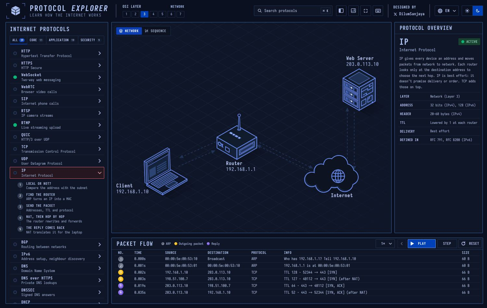
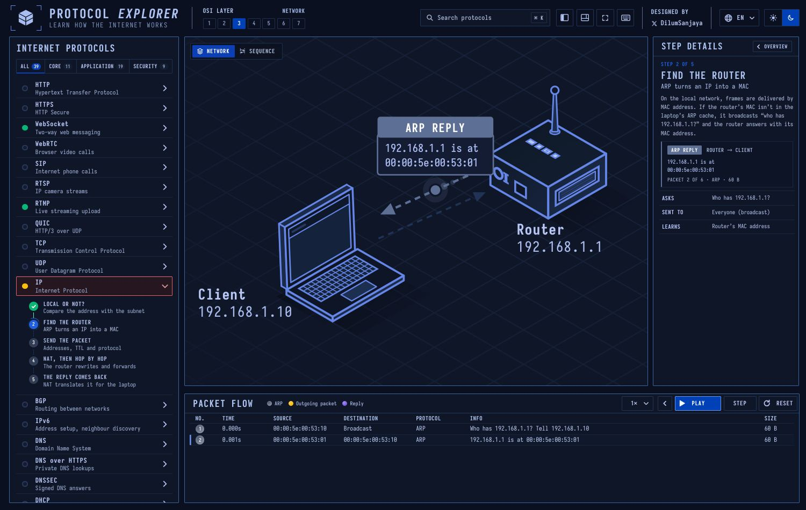
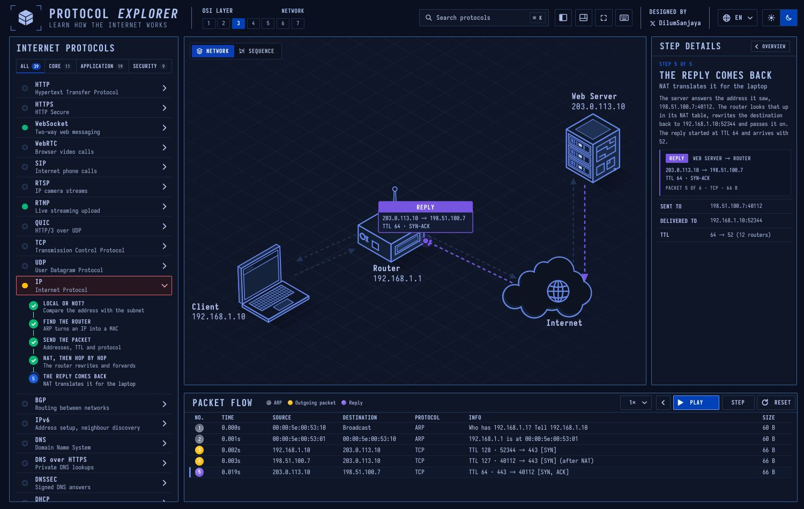
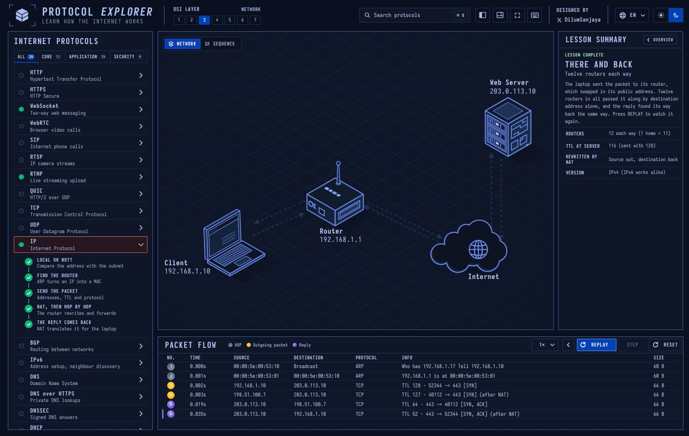
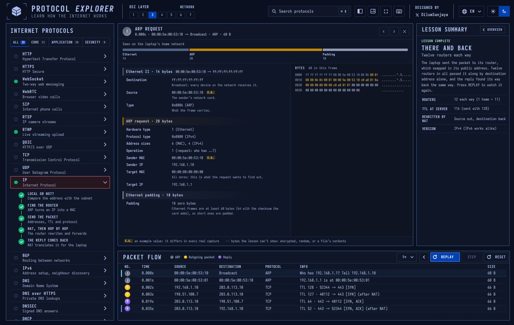
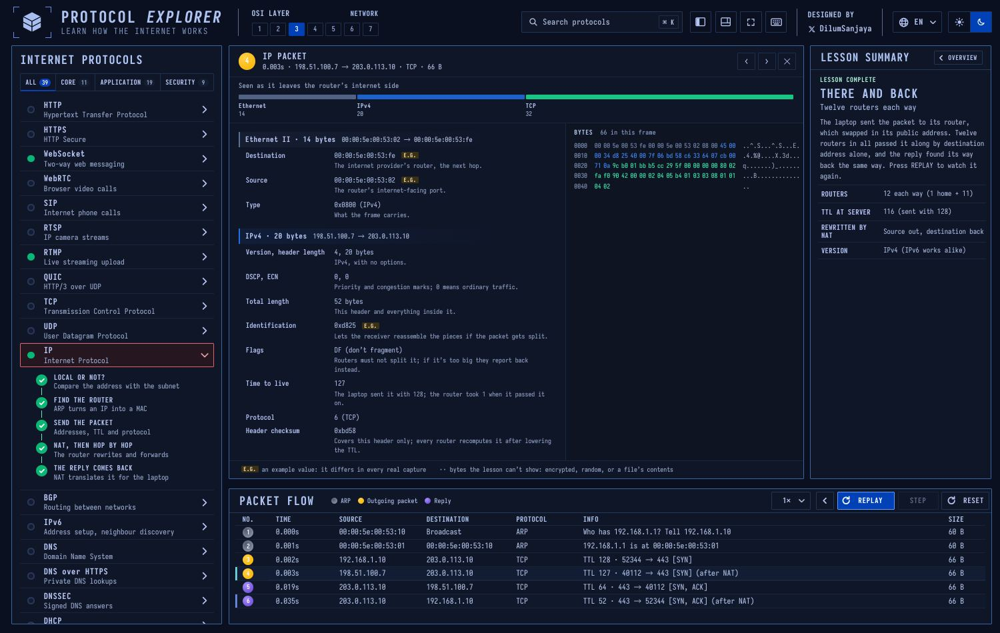

# IP – Internet Protocol

<!-- nav -->
⬅ [10 UDP](10-udp.md) · [Index](00_Protocols_Index.md) · [12 BGP](12-bgp.md) ➡
<!-- nav -->

*Source: Protocol Explorer – https://protocol-explorer-alpha.vercel.app/ (interactive lesson #11). Screenshots captured from the live lesson; packet decodes are the site's example capture (values marked **E.G.** differ in every real capture).*

## Overview



> PROTOCOL OVERVIEW  
> IP  
> ACTIVE  
> Internet Protocol  
> IP gives every device an address and moves packets from network to network. Each router looks only at the destination address to choose the next hop. IP is best effort: it doesn’t promise delivery or order. TCP adds those on top.  
> LAYER  
> Network (Layer 3)  
> ADDRESS  
> 32 bits (IPv4), 128 (IPv6)  
> HEADER  
> 20–60 bytes (IPv4)  
> TTL  
> Lowered by 1 at each router  
> DELIVERY  
> Best effort  
> DEFINED IN  
> RFC 791, RFC 8200 (IPv6)  

## In-depth explanation of the example (plain-language version)

### The big picture in one minute
The laptop (`192.168.1.10`) wants to connect to a server at `203.0.113.10` on the internet. The lesson follows **the very first packet** on its journey and back: deciding whether the destination is nearby, asking for the router's hardware address (**ARP**), sending the packet, the router swapping addresses (**NAT**), the hop-by-hop trip, and the reply being translated back. **6 messages in about 35 ms.**

**IP's job:** give every device an **address** and move small packets **from network to network.** Each router only looks at the **destination address** and decides the next hop. IP is **"best effort"**: it doesn't promise delivery or order. (TCP adds those promises on top.)

Think of the postal system: a letter has a destination address, each sorting office just decides which way to send it next, and nobody guarantees it arrives.

> **Words you'll see:** *IP address* = a device's number on a network. *MAC address* = a network card's built-in hardware ID. *Router* = a device that forwards packets between networks. *Hop* = one router along the way.

---

### Step 1 – Is the destination nearby or far? (the subnet check)
The laptop is `192.168.1.10/24`. The `/24` means "the first 24 bits are the network", so its own neighbourhood is **`192.168.1.0` to `192.168.1.255`**. The destination `203.0.113.10` is outside that range, so the laptop doesn't try to deliver it directly. It hands the packet to its **default gateway**, the home router `192.168.1.1`. (Had the destination been `192.168.1.20`, it would go straight to that machine.)

### Step 2 – Finding the router's hardware address (ARP) – packets 1, 2
Inside a local network, delivery uses **MAC addresses**, not IP addresses. The laptop knows the router's IP but not its MAC, so it asks:
- **Packet 1 – ARP request** (shouted to everyone on the network): "Who has `192.168.1.1`? Tell `192.168.1.10`."
- **Packet 2 – ARP reply** (just to the laptop): "`192.168.1.1` is at `00:00:5e:00:53:01`." The laptop remembers this for a few minutes (the ARP cache).
**Key point:** the packet's final IP destination stays `203.0.113.10`, but this local delivery is addressed to the **router's MAC**. IP addresses stay the same end to end; MAC addresses change at every hop.

### Step 3 – The IP packet – packet 3
Important fields in the IP header:
- **Source** `192.168.1.10`, **destination** `203.0.113.10`.
- **TTL = 128** ("time to live"). It's a hop budget. Every router subtracts 1, and a packet that reaches 0 is dropped. This stops packets from circling forever. (Windows starts at 128; Linux and macOS start at 64. The `traceroute` tool uses this trick.)
- **Protocol = 6** means the contents are TCP. (17 = UDP, 1 = ICMP.)
- Inside is a TCP SYN from port 52344 to port 443.

### Step 4 – NAT, then hop by hop – packet 4
- `192.168.1.10` is a **private** address and can't be used on the internet. So the router performs **NAT**: it replaces the source with its own **public address `198.51.100.7`**, changes the source port from 52344 to 40112, and writes down the pair in its **NAT table**. It also recalculates the checksums and lowers the TTL to 127.
- Then **11 more routers** each look at the destination, choose the next hop from their routing table, and lower the TTL. The packet reaches the server with TTL 116.

### Step 5 – The reply returns – packets 5, 6
- The server (starting TTL **64**) replies to the address it saw: `198.51.100.7:40112` (packet 5).
- The router checks its **NAT table**, sees that port 40112 belongs to `192.168.1.10:52344`, rewrites the destination back, and forwards it. After 12 hops the TTL has dropped from 64 to 52 (packet 6). The laptop never knew its address was swapped.
- Bonus trick: by looking at the TTL you can guess the sender's operating system (128 = Windows, 64 = Linux/macOS) and the number of hops (64 − 52 = 12).

---

### The 6 messages at a glance
| Packets | What | Why |
|---|---|---|
| 1–2 | ARP request and reply | learn the router's MAC |
| 3 | IP packet (TCP SYN) | start the connection |
| 4 | same packet after NAT and routers | cross the internet |
| 5–6 | reply, NAT back, final delivery | return to the laptop |

### What to remember
- **Two layers of addresses:** MAC (one hop at a time, inside a local network) and IP (end to end). Routers change the MAC at every hop; the IP stays the same, except where **NAT** rewrites it.
- **Default gateway** = where packets go when the destination isn't local; **ARP** finds its MAC.
- **TTL** prevents loops; the **Protocol** field says TCP, UDP or ICMP; the header **checksum** is recalculated at every hop.
- IPv4 addresses are 32 bits; IPv6 addresses are 128 bits (see the IPv6 note).
- IP is best effort: packets can be lost, duplicated or reordered. Higher layers (TCP, QUIC) repair that.

## Step-by-step walkthrough (screenshots from the lesson)

### Step 1: LOCAL OR NOT? – Compare the address with the subnet


> STEP 1 OF 5  
> LOCAL OR NOT?  
> Compare the address with the subnet  
> The laptop is 192.168.1.10 with a /24 mask, so its own network is 192.168.1.0 to 192.168.1.255. The server, 203.0.113.10, is outside that range, so the packet has to go to the default gateway: the home router.  
> LAPTOP  
> 192.168.1.10/24  
> LOCAL RANGE  
> 192.168.1.0 – .255  
> GATEWAY  
> 192.168.1.1  

### Step 2: FIND THE ROUTER – ARP turns an IP into a MAC



> STEP 2 OF 5  
> FIND THE ROUTER  
> ARP turns an IP into a MAC  
> On the local network, frames are delivered by MAC address. If the router’s MAC isn’t in the laptop’s ARP cache, it broadcasts “who has 192.168.1.1?” and the router answers with its MAC address.  
> ARP REPLY  
> ROUTER → CLIENT  
> 192.168.1.1 is at  
> 00:00:5e:00:53:01  
> PACKET 2 OF 6 · ARP · 60 B  
> ASKS  
> Who has 192.168.1.1?  
> SENT TO  
> Everyone (broadcast)  
> LEARNS  
> Router’s MAC address  

### Step 3: SEND THE PACKET – Addresses, TTL and protocol


> STEP 3 OF 5  
> SEND THE PACKET  
> Addresses, TTL and protocol  
> The IP header carries the source and destination addresses, a TTL and the protocol inside. Here it holds a TCP SYN to port 443. Windows starts the TTL at 128 (Linux and macOS use 64).  
> IP PACKET  
> CLIENT → ROUTER  
> 192.168.1.10 → 203.0.113.10  
> TTL 128 · protocol TCP  
> PACKET 3 OF 6 · TCP · 66 B  
> FROM → TO  
> 192.168.1.10 → 203.0.113.10  
> TTL  
> 128  
> PROTOCOL  
> 6 (TCP)  

### Step 4: NAT, THEN HOP BY HOP – The router rewrites and forwards


> STEP 4 OF 5  
> NAT, THEN HOP BY HOP  
> The router rewrites and forwards  
> The router swaps the private source for its public address 198.51.100.7 (and here port 52344 for 40112), notes the mapping, and lowers the TTL to 127. Then 11 routers on the internet each choose the next hop by destination and lower the TTL again.  
> IP PACKET  
> ROUTER → WEB SERVER  
> 198.51.100.7 → 203.0.113.10  
> TTL 127 · after NAT  
> PACKET 4 OF 6 · TCP · 66 B  
> NEW SOURCE  
> 198.51.100.7:40112  
> LEAVES HOME  
> TTL 127  
> AT THE SERVER  
> TTL 116 (11 more hops)  

### Step 5: THE REPLY COMES BACK – NAT translates it for the laptop



> STEP 5 OF 5  
> THE REPLY COMES BACK  
> NAT translates it for the laptop  
> The server answers the address it saw, 198.51.100.7:40112. The router looks that up in its NAT table, rewrites the destination back to 192.168.1.10:52344 and passes it on. The reply started at TTL 64 and arrives with 52.  
> REPLY  
> WEB SERVER → ROUTER  
> 203.0.113.10 → 198.51.100.7  
> TTL 64 · SYN-ACK  
> PACKET 5 OF 6 · TCP · 66 B  
> SENT TO  
> 198.51.100.7:40112  
> DELIVERED TO  
> 192.168.1.10:52344  
> TTL  
> 64 → 52 (12 routers)  

### Lesson summary



> LESSON SUMMARY  
> LESSON COMPLETE  
> THERE AND BACK  
> Twelve routers each way  
> The laptop sent the packet to its router, which swapped in its public address. Twelve routers in all passed it along by destination address alone, and the reply found its way back the same way. Press REPLAY to watch it again.  
> REPLY  
> ROUTER → CLIENT  
> 203.0.113.10 → 192.168.1.10  
> TTL 52 · after NAT  
> PACKET 6 OF 6 · TCP · 66 B  
> ROUTERS  
> 12 each way (1 home + 11)  
> TTL AT SERVER  
> 116 (sent with 128)  
> REWRITTEN BY NAT  
> Source out, destination back  
> VERSION  
> IPv4 (IPv6 works alike)  

## Packet flow (whole lesson)

| No. | Time | Source | Destination | Protocol | Info | Size |
|---|---|---|---|---|---|---|
| 1 | 0.000s | 00:00:5e:00:53:10 | Broadcast | ARP | Who has 192.168.1.1? Tell 192.168.1.10 | 60 B |
| 2 | 0.001s | 00:00:5e:00:53:01 | 00:00:5e:00:53:10 | ARP | 192.168.1.1 is at 00:00:5e:00:53:01 | 60 B |
| 3 | 0.002s | 192.168.1.10 | 203.0.113.10 | TCP | TTL 128 · 52344 → 443 [SYN] | 66 B |
| 4 | 0.003s | 198.51.100.7 | 203.0.113.10 | TCP | TTL 127 · 40112 → 443 [SYN] (after NAT) | 66 B |
| 5 | 0.019s | 203.0.113.10 | 198.51.100.7 | TCP | TTL 64 · 443 → 40112 [SYN, ACK] | 66 B |
| 6 | 0.035s | 203.0.113.10 | 192.168.1.10 | TCP | TTL 52 · 443 → 52344 [SYN, ACK] (after NAT) | 66 B |

### Sequence diagram


## Packets decoded byte by byte

Each packet below is the lesson's own decode (headers, field values and the plain-English meaning of each field). Screenshots show the first, middle and last packet in the lesson's decoder view with the raw hex bytes.

### Packet 1: ARP – Who has 192.168.1.1? Tell 192.168.1.10

*00:00:5e:00:53:10 → Broadcast · 60 B · t = 0.000s*



<details><summary>Decoded fields</summary>

```text
1
ARP REQUEST
0.000s · 00:00:5e:00:53:10 → Broadcast · ARP · 60 B
Seen on the laptop’s home network
Ethernet
14
ARP
28
Padding
18
Ethernet II · 14 bytes
00:00:5e:00:53:10 → ff:ff:ff:ff:ff:ff
Destination
ff:ff:ff:ff:ff:ff

Broadcast: every device on the network receives it.

Source
00:00:5e:00:53:10 E.G.

The sender’s network card.

Type
0x0806 (ARP)

What the frame carries.

ARP request · 28 bytes
Hardware type
1 (Ethernet)
Protocol type
0x0800 (IPv4)
Address sizes
6 (MAC), 4 (IPv4)
Operation
1 (request: who has …?)
Sender MAC
00:00:5e:00:53:10 E.G.
Sender IP
192.168.1.10
Target MAC
00:00:00:00:00:00

All zeros: this is what the request wants to find out.

Target IP
192.168.1.1
Ethernet padding · 18 bytes
Padding
18 zero bytes

Ethernet frames are at least 60 bytes (64 with the checksum the card adds), so short ones are padded.

BYTES 60 in this frame
0000
ff
ff
ff
ff
ff
ff
00
00
5e
00
53
10
08
06
00
01
.
.
.
.
.
.
.
.
^
.
S
.
.
.
.
.
0010
08
00
06
04
00
01
00
00
5e
00
53
10
c0
a8
01
0a
.
.
.
.
.
.
.
.
^
.
S
.
.
.
.
.
0020
00
00
00
00
00
00
c0
a8
01
01
00
00
00
00
00
00
.
.
.
.
.
.
.
.
.
.
.
.
.
.
.
.
0030
00
00
00
00
00
00
00
00
00
00
00
00
.
.
.
.
.
.
.
.
.
.
.
.
E.G. an example value: it differs in every real capture
·· bytes the lesson can’t show: encrypted, random, or a file’s contents
```

</details>

### Packet 2: ARP – 192.168.1.1 is at 00:00:5e:00:53:01

*00:00:5e:00:53:01 → 00:00:5e:00:53:10 · 60 B · t = 0.001s*

<details><summary>Decoded fields</summary>

```text
2
ARP REPLY
0.001s · 00:00:5e:00:53:01 → 00:00:5e:00:53:10 · ARP · 60 B
Seen on the laptop’s home network
Ethernet
14
ARP
28
Padding
18
Ethernet II · 14 bytes
00:00:5e:00:53:01 → 00:00:5e:00:53:10
Destination
00:00:5e:00:53:10 E.G.

Straight back to the device that asked.

Source
00:00:5e:00:53:01 E.G.

The sender’s network card.

Type
0x0806 (ARP)

What the frame carries.

ARP reply · 28 bytes
Hardware type
1 (Ethernet)
Protocol type
0x0800 (IPv4)
Address sizes
6 (MAC), 4 (IPv4)
Operation
2 (reply: … is at …)
Sender MAC
00:00:5e:00:53:01 E.G.
Sender IP
192.168.1.1
Target MAC
00:00:5e:00:53:10 E.G.
Target IP
192.168.1.10
Ethernet padding · 18 bytes
Padding
18 zero bytes

Ethernet frames are at least 60 bytes (64 with the checksum the card adds), so short ones are padded.

BYTES 60 in this frame
0000
00
00
5e
00
53
10
00
00
5e
00
53
01
08
06
00
01
.
.
^
.
S
.
.
.
^
.
S
.
.
.
.
.
0010
08
00
06
04
00
02
00
00
5e
00
53
01
c0
a8
01
01
.
.
.
.
.
.
.
.
^
.
S
.
.
.
.
.
0020
00
00
5e
00
53
10
c0
a8
01
0a
00
00
00
00
00
00
.
.
^
.
S
.
.
.
.
.
.
.
.
.
.
.
0030
00
00
00
00
00
00
00
00
00
00
00
00
.
.
.
.
.
.
.
.
.
.
.
.
E.G. an example value: it differs in every real capture
·· bytes the lesson can’t show: encrypted, random, or a file’s contents
```

</details>

### Packet 3: TCP – TTL 128 · 52344 → 443 [SYN]

*192.168.1.10 → 203.0.113.10 · 66 B · t = 0.002s*

<details><summary>Decoded fields</summary>

```text
3
IP PACKET
0.002s · 192.168.1.10 → 203.0.113.10 · TCP · 66 B
Seen on the laptop’s home network
Ethernet
14
IPv4
20
TCP
32
Ethernet II · 14 bytes
00:00:5e:00:53:10 → 00:00:5e:00:53:01
Destination
00:00:5e:00:53:01 E.G.

The router: anything beyond the home network goes to it first.

Source
00:00:5e:00:53:10 E.G.

The laptop’s network card.

Type
0x0800 (IPv4)

What the frame carries.

IPv4 · 20 bytes
192.168.1.10 → 203.0.113.10
Version, header length
4, 20 bytes

IPv4, with no options.

DSCP, ECN
0, 0

Priority and congestion marks; 0 means ordinary traffic.

Total length
52 bytes

This header and everything inside it.

Identification
0xd825 E.G.

Lets the receiver reassemble the pieces if the packet gets split.

Flags
DF (don’t fragment)

Routers must not split it; if it’s too big they report back instead.

Time to live
128

Windows starts at 128.

Protocol
6 (TCP)
Header checksum
0x24e1

Covers this header only; every router recomputes it after lowering the TTL.

Source
192.168.1.10
Destination
203.0.113.10
TCP · 32 bytes
52344 → 443, SYN
Source port
52344

Picked by the laptop’s system for this connection.

Destination port
443
Sequence number
0 (relative)

This side’s starting number. Shown as 0; the real one is random.

Real sequence number
3050056031 E.G.
Acknowledgment
0 (not used yet)

A first SYN has nothing to acknowledge.

Header length
32 bytes

20 bytes, plus 12 of options.

Flags
0x002 (SYN)
Window
64240 E.G.

How much more data this side can take right now.

Checksum
0xc902

Covers the header, the data and the IP addresses, so damage is caught.

Urgent pointer
0
Options
12 bytes
Maximum segment size
1460 bytes

The most data this side wants in one segment.

No-op
1

Spacing, so the next option lines up.

Window scale
× 256

Window values are multiplied by this, so windows can be larger than 64 KB.

No-op
1

Spacing, so the next option lines up.

No-op
1

Spacing, so the next option lines up.

SACK permitted
yes

This side understands selective acknowledgements.

BYTES 66 in this frame
0000
00
00
5e
00
53
01
00
00
5e
00
53
10
08
00
45
00
.
.
^
.
S
.
.
.
^
.
S
.
.
.
E
.
0010
00
34
d8
25
40
00
80
06
24
e1
c0
a8
01
0a
cb
00
.
4
.
%
@
.
.
.
$
.
.
.
.
.
.
.
0020
71
0a
cc
78
01
bb
b5
cc
29
5f
00
00
00
00
80
02
q
.
.
x
.
.
.
.
)
_
.
.
.
.
.
.
0030
fa
f0
c9
02
00
00
02
04
05
b4
01
03
03
08
01
01
.
.
.
.
.
.
.
.
.
.
.
.
.
.
.
.
0040
04
02
.
.
E.G. an example value: it differs in every real capture
·· bytes the lesson can’t show: encrypted, random, or a file’s contents
```

</details>

### Packet 4: TCP – TTL 127 · 40112 → 443 [SYN] (after NAT)

*198.51.100.7 → 203.0.113.10 · 66 B · t = 0.003s*



<details><summary>Decoded fields</summary>

```text
4
IP PACKET
0.003s · 198.51.100.7 → 203.0.113.10 · TCP · 66 B
Seen as it leaves the router’s internet side
Ethernet
14
IPv4
20
TCP
32
Ethernet II · 14 bytes
00:00:5e:00:53:02 → 00:00:5e:00:53:fe
Destination
00:00:5e:00:53:fe E.G.

The internet provider’s router, the next hop.

Source
00:00:5e:00:53:02 E.G.

The router’s internet-facing port.

Type
0x0800 (IPv4)

What the frame carries.

IPv4 · 20 bytes
198.51.100.7 → 203.0.113.10
Version, header length
4, 20 bytes

IPv4, with no options.

DSCP, ECN
0, 0

Priority and congestion marks; 0 means ordinary traffic.

Total length
52 bytes

This header and everything inside it.

Identification
0xd825 E.G.

Lets the receiver reassemble the pieces if the packet gets split.

Flags
DF (don’t fragment)

Routers must not split it; if it’s too big they report back instead.

Time to live
127

The laptop sent it with 128; the router took 1 when it passed it on.

Protocol
6 (TCP)
Header checksum
0xbd58

Covers this header only; every router recomputes it after lowering the TTL.

Source
198.51.100.7
Destination
203.0.113.10
TCP · 32 bytes
40112 → 443, SYN
Source port
40112

The router’s NAT swapped in its own port for the laptop’s.

Destination port
443
Sequence number
0 (relative)

This side’s starting number. Shown as 0; the real one is random.

Real sequence number
3050056031 E.G.
Acknowledgment
0 (not used yet)

A first SYN has nothing to acknowledge.

Header length
32 bytes

20 bytes, plus 12 of options.

Flags
0x002 (SYN)
Window
64240 E.G.

How much more data this side can take right now.

Checksum
0x9042

Covers the header, the data and the IP addresses, so damage is caught.

Urgent pointer
0
Options
12 bytes
Maximum segment size
1460 bytes

The most data this side wants in one segment.

No-op
1

Spacing, so the next option lines up.

Window scale
× 256

Window values are multiplied by this, so windows can be larger than 64 KB.

No-op
1

Spacing, so the next option lines up.

No-op
1

Spacing, so the next option lines up.

SACK permitted
yes

This side understands selective acknowledgements.

BYTES 66 in this frame
0000
00
00
5e
00
53
fe
00
00
5e
00
53
02
08
00
45
00
.
.
^
.
S
.
.
.
^
.
S
.
.
.
E
.
0010
00
34
d8
25
40
00
7f
06
bd
58
c6
33
64
07
cb
00
.
4
.
%
@
.
.
.
.
X
.
3
d
.
.
.
0020
71
0a
9c
b0
01
bb
b5
cc
29
5f
00
00
00
00
80
02
q
.
.
.
.
.
.
.
)
_
.
.
.
.
.
.
0030
fa
f0
90
42
00
00
02
04
05
b4
01
03
03
08
01
01
.
.
.
B
.
.
.
.
.
.
.
.
.
.
.
.
0040
04
02
.
.
E.G. an example value: it differs in every real capture
·· bytes the lesson can’t show: encrypted, random, or a file’s contents
```

</details>

### Packet 5: TCP – TTL 64 · 443 → 40112 [SYN, ACK]

*203.0.113.10 → 198.51.100.7 · 66 B · t = 0.019s*

<details><summary>Decoded fields</summary>

```text
5
REPLY
0.019s · 203.0.113.10 → 198.51.100.7 · TCP · 66 B
Seen as it leaves 203.0.113.10
Ethernet
14
IPv4
20
TCP
32
Ethernet II · 14 bytes
00:00:5e:00:53:40 → 00:00:5e:00:53:80
Destination
00:00:5e:00:53:80 E.G.

The sender’s next router; each hop puts the packet in a new frame.

Source
00:00:5e:00:53:40 E.G.

The sender’s network card.

Type
0x0800 (IPv4)

What the frame carries.

IPv4 · 20 bytes
203.0.113.10 → 198.51.100.7
Version, header length
4, 20 bytes

IPv4, with no options.

DSCP, ECN
0, 0

Priority and congestion marks; 0 means ordinary traffic.

Total length
52 bytes

This header and everything inside it.

Identification
0x0e03 E.G.

Lets the receiver reassemble the pieces if the packet gets split.

Flags
DF (don’t fragment)

Routers must not split it; if it’s too big they report back instead.

Time to live
64

As sent: this system starts at 64.

Protocol
6 (TCP)
Header checksum
0xc67b

Covers this header only; every router recomputes it after lowering the TTL.

Source
203.0.113.10
Destination
198.51.100.7
TCP · 32 bytes
443 → 40112, SYN, ACK
Source port
443
Destination port
40112
Sequence number
0 (relative)

This side’s starting number. Shown as 0; the real one is random.

Real sequence number
2403980576 E.G.
Acknowledgment
1 (relative)

The next byte this side expects: everything before it has arrived.

Header length
32 bytes

20 bytes, plus 12 of options.

Flags
0x012 (SYN, ACK)
Window
64240 E.G.

How much more data this side can take right now.

Checksum
0x2bc8

Covers the header, the data and the IP addresses, so damage is caught.

Urgent pointer
0
Options
12 bytes
Maximum segment size
1460 bytes

The most data this side wants in one segment.

No-op
1

Spacing, so the next option lines up.

No-op
1

Spacing, so the next option lines up.

SACK permitted
yes

This side understands selective acknowledgements.

No-op
1

Spacing, so the next option lines up.

Window scale
× 128

Window values are multiplied by this, so windows can be larger than 64 KB.

BYTES 66 in this frame
0000
00
00
5e
00
53
80
00
00
5e
00
53
40
08
00
45
00
.
.
^
.
S
.
.
.
^
.
S
@
.
.
E
.
0010
00
34
0e
03
40
00
40
06
c6
7b
cb
00
71
0a
c6
33
.
4
.
.
@
.
@
.
.
{
.
.
q
.
.
3
0020
64
07
01
bb
9c
b0
8f
49
d5
20
b5
cc
29
60
80
12
d
.
.
.
.
.
.
I
.
.
.
)
`
.
.
0030
fa
f0
2b
c8
00
00
02
04
05
b4
01
01
04
02
01
03
.
.
+
.
.
.
.
.
.
.
.
.
.
.
.
.
0040
03
07
.
.
E.G. an example value: it differs in every real capture
·· bytes the lesson can’t show: encrypted, random, or a file’s contents
```

</details>

### Packet 6: TCP – TTL 52 · 443 → 52344 [SYN, ACK] (after NAT)

*203.0.113.10 → 192.168.1.10 · 66 B · t = 0.035s*


<details><summary>Decoded fields</summary>

```text
6
REPLY
0.035s · 203.0.113.10 → 192.168.1.10 · TCP · 66 B
Seen on the laptop’s home network
Ethernet
14
IPv4
20
TCP
32
Ethernet II · 14 bytes
00:00:5e:00:53:01 → 00:00:5e:00:53:10
Destination
00:00:5e:00:53:10 E.G.

The laptop.

Source
00:00:5e:00:53:01 E.G.

The router’s side facing the home network.

Type
0x0800 (IPv4)

What the frame carries.

IPv4 · 20 bytes
203.0.113.10 → 192.168.1.10
Version, header length
4, 20 bytes

IPv4, with no options.

DSCP, ECN
0, 0

Priority and congestion marks; 0 means ordinary traffic.

Total length
52 bytes

This header and everything inside it.

Identification
0x0e03 E.G.

Lets the receiver reassemble the pieces if the packet gets split.

Flags
DF (don’t fragment)

Routers must not split it; if it’s too big they report back instead.

Time to live
52

Started at 64; 12 routers on the way each took 1.

Protocol
6 (TCP)
Header checksum
0x3b04

Covers this header only; every router recomputes it after lowering the TTL.

Source
203.0.113.10
Destination
192.168.1.10
TCP · 32 bytes
443 → 52344, SYN, ACK
Source port
443
Destination port
52344
Sequence number
0 (relative)

This side’s starting number. Shown as 0; the real one is random.

Real sequence number
2403980576 E.G.
Acknowledgment
1 (relative)

The next byte this side expects: everything before it has arrived.

Header length
32 bytes

20 bytes, plus 12 of options.

Flags
0x012 (SYN, ACK)
Window
64240 E.G.

How much more data this side can take right now.

Checksum
0x6488

Covers the header, the data and the IP addresses, so damage is caught.

Urgent pointer
0
Options
12 bytes
Maximum segment size
1460 bytes

The most data this side wants in one segment.

No-op
1

Spacing, so the next option lines up.

No-op
1

Spacing, so the next option lines up.

SACK permitted
yes

This side understands selective acknowledgements.

No-op
1

Spacing, so the next option lines up.

Window scale
× 128

Window values are multiplied by this, so windows can be larger than 64 KB.

BYTES 66 in this frame
0000
00
00
5e
00
53
10
00
00
5e
00
53
01
08
00
45
00
.
.
^
.
S
.
.
.
^
.
S
.
.
.
E
.
0010
00
34
0e
03
40
00
34
06
3b
04
cb
00
71
0a
c0
a8
.
4
.
.
@
.
4
.
;
.
.
.
q
.
.
.
0020
01
0a
01
bb
cc
78
8f
49
d5
20
b5
cc
29
60
80
12
.
.
.
.
.
x
.
I
.
.
.
)
`
.
.
0030
fa
f0
64
88
00
00
02
04
05
b4
01
01
04
02
01
03
.
.
d
.
.
.
.
.
.
.
.
.
.
.
.
.
0040
03
07
.
.
E.G. an example value: it differs in every real capture
·· bytes the lesson can’t show: encrypted, random, or a file’s contents
```

</details>

---

<!-- nav -->
⬅ [10 UDP](10-udp.md) · [Index](00_Protocols_Index.md) · [12 BGP](12-bgp.md) ➡
<!-- nav -->
