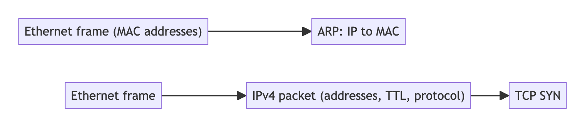
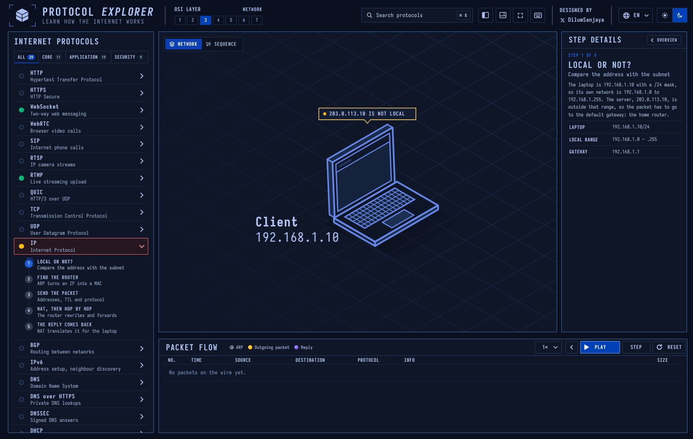
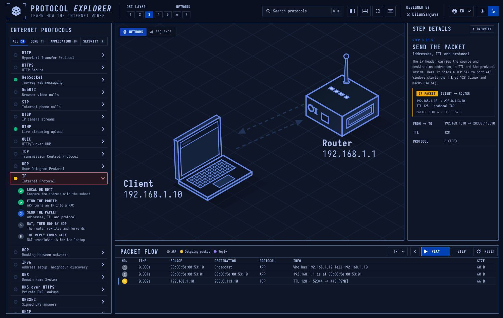
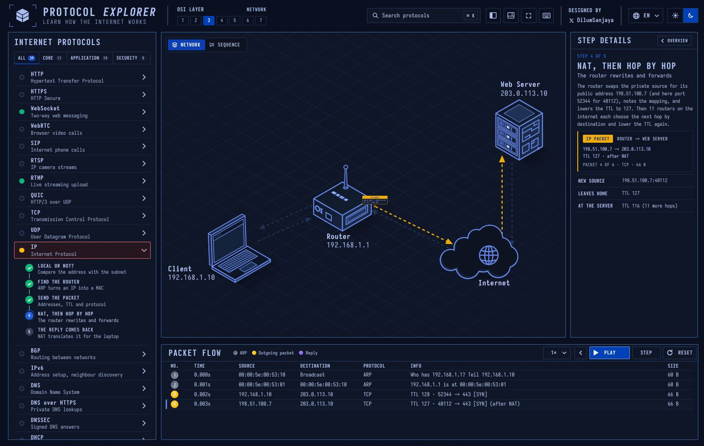
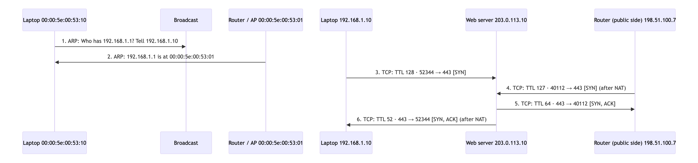
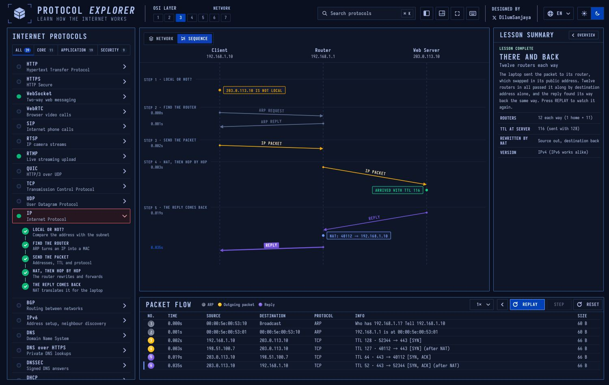
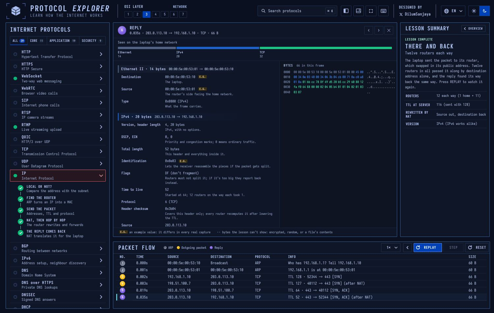

# IP – Internet Protocol

<!-- nav -->
⬅ [10 UDP](10-udp.md) · [Index](00_Protocols_Index.md) · [12 BGP](12-bgp.md) ➡
<!-- nav -->

*Source: Protocol Explorer – https://protocol-explorer-alpha.vercel.app/ (interactive lesson #11). Screenshots captured from the live lesson; packet decodes are the site's example capture (values marked **E.G.** differ in every real capture).*

## Overview

### How the layers fit together (outer to inner)

## In-depth explanation of the example (plain-language version)

### The big picture in one minute
The laptop (`192.168.1.10`) wants to connect to a server at `203.0.113.10` on the internet. The lesson follows **the very first packet** on its journey and back: deciding whether the destination is nearby, asking for the router's hardware address (**ARP**), sending the packet, the router swapping addresses (**NAT**), the hop-by-hop trip, and the reply being translated back. **6 messages in about 35 ms.**

**IP's job:** give every device an **address** and move small packets **from network to network.** Each router only looks at the **destination address** and decides the next hop. IP is **"best effort"**: it doesn't promise delivery or order. (TCP adds those promises on top.)

Think of the postal system: a letter has a destination address, each sorting office just decides which way to send it next, and nobody guarantees it arrives.

> **Words you'll see:** *IP address* = a device's number on a network. *MAC address* = a network card's built-in hardware ID. *Router* = a device that forwards packets between networks. *Hop* = one router along the way.

---

### Step 1 – Is the destination nearby or far? (the subnet check)
The laptop is `192.168.1.10/24`. The `/24` means "the first 24 bits are the network", so its own neighbourhood is **`192.168.1.0` to `192.168.1.255`**. The destination `203.0.113.10` is outside that range, so the laptop doesn't try to deliver it directly. It hands the packet to its **default gateway**, the home router `192.168.1.1`. (Had the destination been `192.168.1.20`, it would go straight to that machine.)

### Step 2 – Finding the router's hardware address (ARP) – packets 1, 2
Inside a local network, delivery uses **MAC addresses**, not IP addresses. The laptop knows the router's IP but not its MAC, so it asks:
- **Packet 1 – ARP request** (shouted to everyone on the network): "Who has `192.168.1.1`? Tell `192.168.1.10`."
- **Packet 2 – ARP reply** (just to the laptop): "`192.168.1.1` is at `00:00:5e:00:53:01`." The laptop remembers this for a few minutes (the ARP cache).
**Key point:** the packet's final IP destination stays `203.0.113.10`, but this local delivery is addressed to the **router's MAC**. IP addresses stay the same end to end; MAC addresses change at every hop.

### Step 3 – The IP packet – packet 3
Important fields in the IP header:
- **Source** `192.168.1.10`, **destination** `203.0.113.10`.
- **TTL = 128** ("time to live"). It's a hop budget. Every router subtracts 1, and a packet that reaches 0 is dropped. This stops packets from circling forever. (Windows starts at 128; Linux and macOS start at 64. The `traceroute` tool uses this trick.)
- **Protocol = 6** means the contents are TCP. (17 = UDP, 1 = ICMP.)
- Inside is a TCP SYN from port 52344 to port 443.

### Step 4 – NAT, then hop by hop – packet 4
- `192.168.1.10` is a **private** address and can't be used on the internet. So the router performs **NAT**: it replaces the source with its own **public address `198.51.100.7`**, changes the source port from 52344 to 40112, and writes down the pair in its **NAT table**. It also recalculates the checksums and lowers the TTL to 127.
- Then **11 more routers** each look at the destination, choose the next hop from their routing table, and lower the TTL. The packet reaches the server with TTL 116.

### Step 5 – The reply returns – packets 5, 6
- The server (starting TTL **64**) replies to the address it saw: `198.51.100.7:40112` (packet 5).
- The router checks its **NAT table**, sees that port 40112 belongs to `192.168.1.10:52344`, rewrites the destination back, and forwards it. After 12 hops the TTL has dropped from 64 to 52 (packet 6). The laptop never knew its address was swapped.
- Bonus trick: by looking at the TTL you can guess the sender's operating system (128 = Windows, 64 = Linux/macOS) and the number of hops (64 − 52 = 12).

---

### The 6 messages at a glance
| Packets | What | Why |
|---|---|---|
| 1–2 | ARP request and reply | learn the router's MAC |
| 3 | IP packet (TCP SYN) | start the connection |
| 4 | same packet after NAT and routers | cross the internet |
| 5–6 | reply, NAT back, final delivery | return to the laptop |

### What to remember
- **Two layers of addresses:** MAC (one hop at a time, inside a local network) and IP (end to end). Routers change the MAC at every hop; the IP stays the same, except where **NAT** rewrites it.
- **Default gateway** = where packets go when the destination isn't local; **ARP** finds its MAC.
- **TTL** prevents loops; the **Protocol** field says TCP, UDP or ICMP; the header **checksum** is recalculated at every hop.
- IPv4 addresses are 32 bits; IPv6 addresses are 128 bits (see the IPv6 note).
- IP is best effort: packets can be lost, duplicated or reordered. Higher layers (TCP, QUIC) repair that.

## Under the hood – technical details

- **IPv4 header (20 to 60 bytes).** Version (4), header length, type of service, total length, *identification* + *flags* + *fragment offset* (used when a packet must be split), **TTL**, **protocol**, header checksum, source address and destination address (32 bits each).
- **TTL (time to live).** A hop budget. Each router subtracts 1 and drops the packet when it reaches 0, which stops routing loops. Typical starting values: 128 (Windows), 64 (Linux and macOS), 255 (many network devices). The `traceroute` tool exploits this.
- **Protocol field.** Says what is inside: `6` TCP, `17` UDP, `1` ICMP, `2` IGMP, `50` ESP. The receiving host uses it to hand the data to the right protocol.
- **Subnet mask test.** `192.168.1.10/24` means the first 24 bits are the network. The host ANDs the destination address with the mask. If the result equals its own network (`192.168.1.0`), the destination is local. Otherwise the packet goes to the *default gateway*.
- **ARP.** On a LAN, frames are delivered by MAC address. ARP asks "who has 192.168.1.1?" as a broadcast to `ff:ff:ff:ff:ff:ff`, and the owner replies directly. The result is cached for minutes. The IP destination stays the same end to end; the Ethernet destination is the next hop's MAC and changes at every router.
- **Routing.** Each router looks up the destination in its routing table using the **longest-prefix match** (the most specific route wins) and forwards to the next hop. It never knows the whole path.
- **NAT.** A private address (`192.168.0.0/16`, `10.0.0.0/8`, `172.16.0.0/12`) is not routable on the internet. The router rewrites the source address and port (`192.168.1.10:52344` to `198.51.100.7:40112`), remembers the pair in its NAT table, recalculates the IP and TCP checksums, and reverses the change for replies.
- **Checksum.** The IPv4 header checksum covers only the header and is recalculated at every hop (because TTL changes).
- **MTU and fragmentation.** Ethernet's MTU is 1,500 bytes. Larger packets are fragmented unless the `DF` (don't fragment) flag is set, in which case a router sends back ICMP "fragmentation needed" (used by Path MTU Discovery).
- **Best effort.** IP can lose, duplicate or reorder packets. TCP and QUIC repair that.
- **IPv6.** 128-bit addresses, a fixed 40-byte header, no header checksum and no router fragmentation (see the IPv6 note).

## Step-by-step walkthrough

### Step 1: LOCAL OR NOT? – Compare the address with the subnet

### Step 2: FIND THE ROUTER – ARP turns an IP into a MAC

### Step 3: SEND THE PACKET – Addresses, TTL and protocol

### Step 4: NAT, THEN HOP BY HOP – The router rewrites and forwards

### Step 5: THE REPLY COMES BACK – NAT translates it for the laptop

### Lesson summary

## Packet flow (whole lesson)

| No. | Time | Source | Destination | Protocol | Info | Size |
|---|---|---|---|---|---|---|
| 1 | 0.000s | 00:00:5e:00:53:10 | Broadcast | ARP | Who has 192.168.1.1? Tell 192.168.1.10 | 60 B |
| 2 | 0.001s | 00:00:5e:00:53:01 | 00:00:5e:00:53:10 | ARP | 192.168.1.1 is at 00:00:5e:00:53:01 | 60 B |
| 3 | 0.002s | 192.168.1.10 | 203.0.113.10 | TCP | TTL 128 · 52344 → 443 [SYN] | 66 B |
| 4 | 0.003s | 198.51.100.7 | 203.0.113.10 | TCP | TTL 127 · 40112 → 443 [SYN] (after NAT) | 66 B |
| 5 | 0.019s | 203.0.113.10 | 198.51.100.7 | TCP | TTL 64 · 443 → 40112 [SYN, ACK] | 66 B |
| 6 | 0.035s | 203.0.113.10 | 192.168.1.10 | TCP | TTL 52 · 443 → 52344 [SYN, ACK] (after NAT) | 66 B |

### Sequence diagram

*The lesson's own sequence diagram:*

## Packet decoder screenshots

The lesson's decoder view for the first, middle and last packet: headers, field values and the raw hex bytes.

### Packet 1: ARP – Who has 192.168.1.1? Tell 192.168.1.10

*00:00:5e:00:53:10 → Broadcast · 60 B · t = 0.000s*

### Packet 4: TCP – TTL 127 · 40112 → 443 [SYN] (after NAT)

*198.51.100.7 → 203.0.113.10 · 66 B · t = 0.003s*

### Packet 6: TCP – TTL 52 · 443 → 52344 [SYN, ACK] (after NAT)

*203.0.113.10 → 192.168.1.10 · 66 B · t = 0.035s*

---

<!-- nav -->
⬅ [10 UDP](10-udp.md) · [Index](00_Protocols_Index.md) · [12 BGP](12-bgp.md) ➡
<!-- nav -->
