# BGP – Routing between networks

<!-- nav -->
⬅ [11 IP](11-ip.md) · [Index](00_Protocols_Index.md) · [13 IPv6](13-ipv6.md) ➡
<!-- nav -->

*Source: Protocol Explorer – https://protocol-explorer-alpha.vercel.app/ (interactive lesson #12). Screenshots captured from the live lesson; packet decodes are the site's example capture (values marked **E.G.** differ in every real capture).*

## Overview

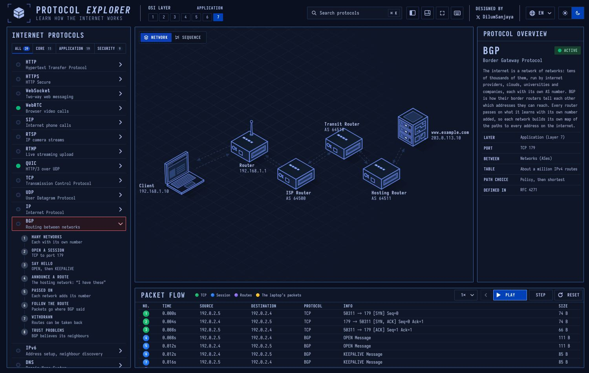

> PROTOCOL OVERVIEW  
> BGP  
> ACTIVE  
> Border Gateway Protocol  
> The internet is a network of networks: tens of thousands of them, run by internet providers, clouds, universities and companies, each with its own AS number. BGP is how their border routers tell each other which addresses they can reach. Every router passes on what it learns with its own number added, so each network builds its own map of the paths to every address on the internet.  
> LAYER  
> Application (Layer 7)  
> PORT  
> TCP 179  
> BETWEEN  
> Networks (ASes)  
> TABLE  
> About a million IPv4 routes  
> PATH CHOICE  
> Policy, then shortest  
> DEFINED IN  
> RFC 4271  

## In-depth explanation of the example (plain-language version)

### The big picture in one minute
The internet is a "network of networks". In this example there are three: the laptop's ISP (**AS 64500**), a middle "transit" provider (**AS 64510**) and the hosting company of `www.example.com` (**AS 64511**). The hosting company owns the address block **`203.0.113.0/24`** and wants the whole world to be able to reach it. The lesson shows **13 messages**: two routers opening a conversation, the route being **announced and passed along**, the laptop's traffic using it, and finally the route being **withdrawn**.

**What BGP does.** The internet is made of more than 75,000 independent networks called **autonomous systems (ASes)**: ISPs, cloud companies, universities, big firms. Each has an **AS number**. Inside a network, other protocols find paths. **BGP is the protocol the networks use to talk to each other.** Their border routers say: *"I can reach these address blocks. Send them through me."*

Think of **airlines sharing route maps**: each one tells the others where it can fly, and every airport builds its own table of how to get anywhere.

> **Words you'll see:** *AS* = one independent network with its own number. *Prefix* = a block of addresses such as `203.0.113.0/24`. *Neighbour* = a router you've agreed to exchange routes with. *Route* = "to reach this prefix, go via that router."

---

### Step 1 – Networks and their numbers
Each network has a number (here 64500–64511, numbers reserved for examples). Their routers have to share **reachability information**. Business deals (customer, provider, peer) decide which routes each is willing to carry.

### Step 2 – Opening a conversation (TCP port 179) – packets 1 to 3
BGP routers **don't find each other automatically.** Engineers configure each other as neighbours. The ISP router opens a **TCP connection to port 179** of the transit router (SYN, SYN-ACK, ACK). These packets have **TTL = 1**, so they can't pass even one extra router. That means BGP only works between **directly connected** neighbours, which is a simple safety measure.

### Step 3 – Introductions: OPEN and KEEPALIVE – packets 4 to 7
- Each side sends an **OPEN** message: "BGP version 4, my AS number is …, I'll wait up to **180 seconds** between messages, my router ID is …, and I support these features."
- Each replies with a tiny **KEEPALIVE**. Once both are exchanged, the session is **ESTABLISHED**.
- Afterwards, a KEEPALIVE goes out every **60 seconds** if there's nothing else to say. If **180 seconds** pass in silence, the session is torn down and **every route learned from that neighbour is deleted.**
- The four BGP message types are: **OPEN, UPDATE, NOTIFICATION, KEEPALIVE.**

### Step 4 – Announcing the route – packets 8, 9
- **Packet 8 (hosting → transit):** an **UPDATE** saying "I can reach `203.0.113.0/24`." It includes the **AS path** `64511` (the route starts in network 64511) and the **next hop** (which router to send traffic to).
- **Packet 9 (transit → ISP):** the transit router accepts it and, when passing it on, **adds its own AS number to the front**: `64510 64511`, with itself as the next hop. Every network does the same, so the path grows by one number for each network crossed.
- **Loop protection:** if a router sees **its own number** in the path, it throws the route away.
- **Choosing between routes:** a router may hear about the same prefix from several neighbours. It decides first by **its own business rules** (for example "prefer routes from paying customers"), and only then the **shortest AS path**. In practice, business policy beats the shortest route.

### Step 5 – Using the route – packets 10, 11
After DNS gives `203.0.113.10`, the laptop's SYN (packet 10) reaches the ISP. The ISP's router has a route for `203.0.113.0/24` via the transit network, which forwards it to the hosting network. The SYN-ACK comes back (packet 11). **BGP only builds the map; ordinary IP forwarding moves the packets.** The way back is chosen separately by the other networks, so **the return path is often different from the outgoing path.**

### Step 6 – Withdrawing the route – packets 12, 13
Later the hosting company takes the prefix away (a link failed, or maintenance). It sends an **UPDATE** listing `203.0.113.0/24` as **withdrawn** (packet 12), and the transit router passes it on (packet 13). Within seconds or minutes, networks everywhere forget the path and traffic to those addresses stops.
**A real example:** in 2021 Facebook accidentally withdrew the routes to its own servers and **disappeared from the internet for about six hours.** A related risk is **hijacking**: BGP largely trusts what neighbours say, so someone announcing a prefix they don't own can attract that traffic. A modern defence is **RPKI** (checking that an announcer really owns the prefix).

---

### The 13 messages at a glance
| Packets | What | Why |
|---|---|---|
| 1–3 | TCP handshake (port 179) | open the session |
| 4–7 | OPEN, KEEPALIVE | introduce, confirm, establish |
| 8–9 | UPDATE (announce) | spread the route, adding AS numbers |
| 10–11 | laptop's traffic | use the route |
| 12–13 | UPDATE (withdraw) | remove the route |

### What to remember
- **BGP runs over TCP port 179** between neighbours that are set up by hand. It is a **path-vector** protocol (the AS path is the "path").
- Message types: **OPEN, UPDATE, KEEPALIVE, NOTIFICATION.** Timers: 180 s hold, 60 s keepalive.
- Key route details: **AS path, next hop, local preference, MED, origin, communities.**
- **eBGP** is between different networks; **iBGP** is inside one network. Selection is **policy first, then path length.**
- BGP is the glue of the internet, and also its biggest trust problem.

## Step-by-step walkthrough (screenshots from the lesson)

### Step 1: MANY NETWORKS – Each with its own number

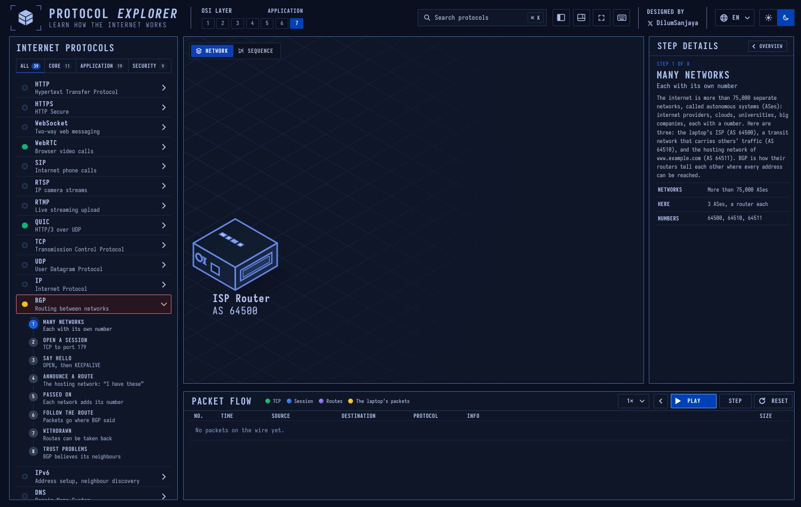

> STEP 1 OF 8  
> MANY NETWORKS  
> Each with its own number  
> The internet is more than 75,000 separate networks, called autonomous systems (ASes): internet providers, clouds, universities, big companies, each with a number. Here are three: the laptop’s ISP (AS 64500), a transit network that carries others’ traffic (AS 64510), and the hosting network of www.example.com (AS 64511). BGP is how their routers tell each other where every address can be reached.  
> NETWORKS  
> More than 75,000 ASes  
> HERE  
> 3 ASes, a router each  
> NUMBERS  
> 64500, 64510, 64511  

### Step 2: OPEN A SESSION – TCP to port 179

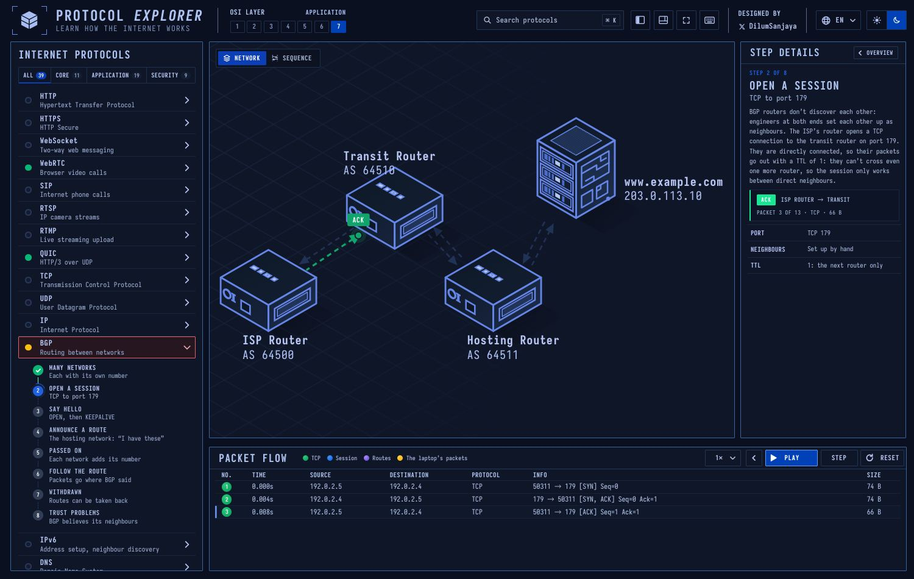

> STEP 2 OF 8  
> OPEN A SESSION  
> TCP to port 179  
> BGP routers don’t discover each other: engineers at both ends set each other up as neighbours. The ISP’s router opens a TCP connection to the transit router on port 179. They are directly connected, so their packets go out with a TTL of 1: they can’t cross even one more router, so the session only works between direct neighbours.  
> ACK  
> ISP ROUTER → TRANSIT  
> PACKET 3 OF 13 · TCP · 66 B  
> PORT  
> TCP 179  
> NEIGHBOURS  
> Set up by hand  
> TTL  
> 1: the next router only  

### Step 3: SAY HELLO – OPEN, then KEEPALIVE

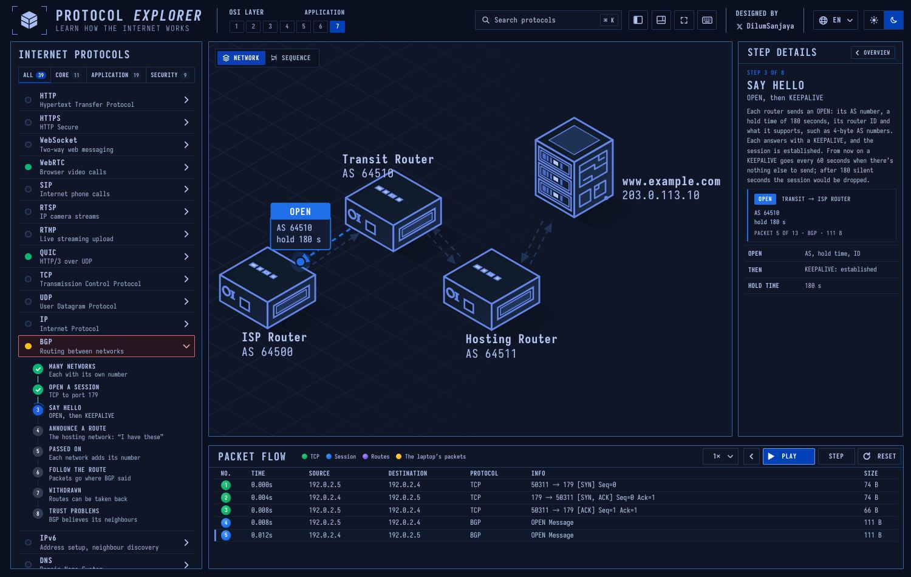

> STEP 3 OF 8  
> SAY HELLO  
> OPEN, then KEEPALIVE  
> Each router sends an OPEN: its AS number, a hold time of 180 seconds, its router ID and what it supports, such as 4-byte AS numbers. Each answers with a KEEPALIVE, and the session is established. From now on a KEEPALIVE goes every 60 seconds when there’s nothing else to send; after 180 silent seconds the session would be dropped.  
> OPEN  
> TRANSIT → ISP ROUTER  
> AS 64510  
> hold 180 s  
> PACKET 5 OF 13 · BGP · 111 B  
> OPEN  
> AS, hold time, ID  
> THEN  
> KEEPALIVE: established  
> HOLD TIME  
> 180 s  

### Step 4: ANNOUNCE A ROUTE – The hosting network: “I have these”

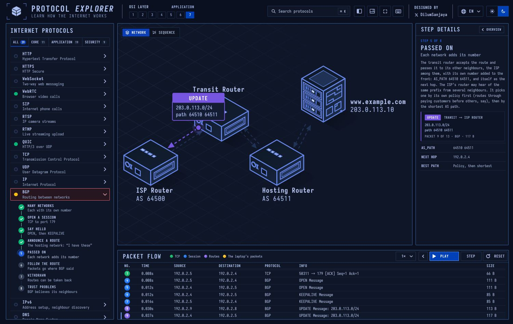

> STEP 5 OF 8  
> PASSED ON  
> Each network adds its number  
> The transit router accepts the route and passes it to its other neighbours, the ISP among them, with its own number added to the front: AS_PATH 64510 64511, and itself as the next hop. The ISP’s router may hear of the same prefix from several neighbours. It picks one by its own policy first (routes through paying customers before others, say), then by the shortest AS path.  
> UPDATE  
> TRANSIT → ISP ROUTER  
> 203.0.113.0/24  
> path 64510 64511  
> PACKET 9 OF 13 · BGP · 117 B  
> AS_PATH  
> 64510 64511  
> NEXT HOP  
> 192.0.2.4  
> BEST PATH  
> Policy, then shortest  

### Step 5: PASSED ON – Each network adds its number


> STEP 5 OF 8  
> PASSED ON  
> Each network adds its number  
> The transit router accepts the route and passes it to its other neighbours, the ISP among them, with its own number added to the front: AS_PATH 64510 64511, and itself as the next hop. The ISP’s router may hear of the same prefix from several neighbours. It picks one by its own policy first (routes through paying customers before others, say), then by the shortest AS path.  
> UPDATE  
> TRANSIT → ISP ROUTER  
> 203.0.113.0/24  
> path 64510 64511  
> PACKET 9 OF 13 · BGP · 117 B  
> AS_PATH  
> 64510 64511  
> NEXT HOP  
> 192.0.2.4  
> BEST PATH  
> Policy, then shortest  

### Step 6: FOLLOW THE ROUTE – Packets go where BGP said

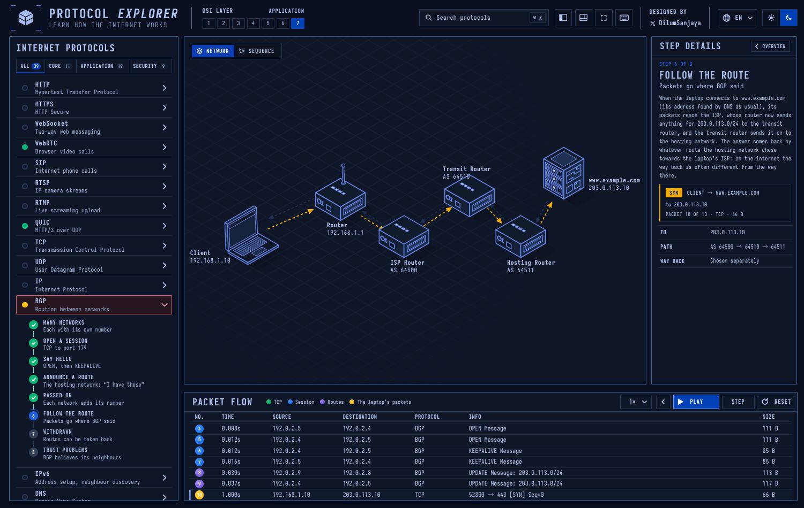

> STEP 6 OF 8  
> FOLLOW THE ROUTE  
> Packets go where BGP said  
> When the laptop connects to www.example.com (its address found by DNS as usual), its packets reach the ISP, whose router now sends anything for 203.0.113.0/24 to the transit router, and the transit router sends it on to the hosting network. The answer comes back by whatever route the hosting network chose towards the laptop’s ISP: on the internet the way back is often different from the way there.  
> SYN  
> CLIENT → WWW.EXAMPLE.COM  
> to 203.0.113.10  
> PACKET 10 OF 13 · TCP · 66 B  
> TO  
> 203.0.113.10  
> PATH  
> AS 64500 → 64510 → 64511  
> WAY BACK  
> Chosen separately  

### Step 7: WITHDRAWN – Routes can be taken back


> STEP 7 OF 8  
> WITHDRAWN  
> Routes can be taken back  
> Later the hosting network takes the prefix back, as it would if a link failed: an UPDATE listing it under withdrawn routes. The transit router passes it on, and within seconds to minutes networks everywhere forget the path. A session that goes quiet past its hold time loses all its routes at once. In 2021 Facebook withdrew the routes to its own DNS servers and vanished from the internet for six hours.  
> WITHDRAW  
> HOSTING → TRANSIT  
> 203.0.113.0/24  
> PACKET 12 OF 13 · BGP · 93 B  
> WITHDRAWN  
> 203.0.113.0/24  
> SPREADS IN  
> Seconds to minutes  
> SESSION LOST  
> All its routes go  

### Step 8: TRUST PROBLEMS – BGP believes its neighbours

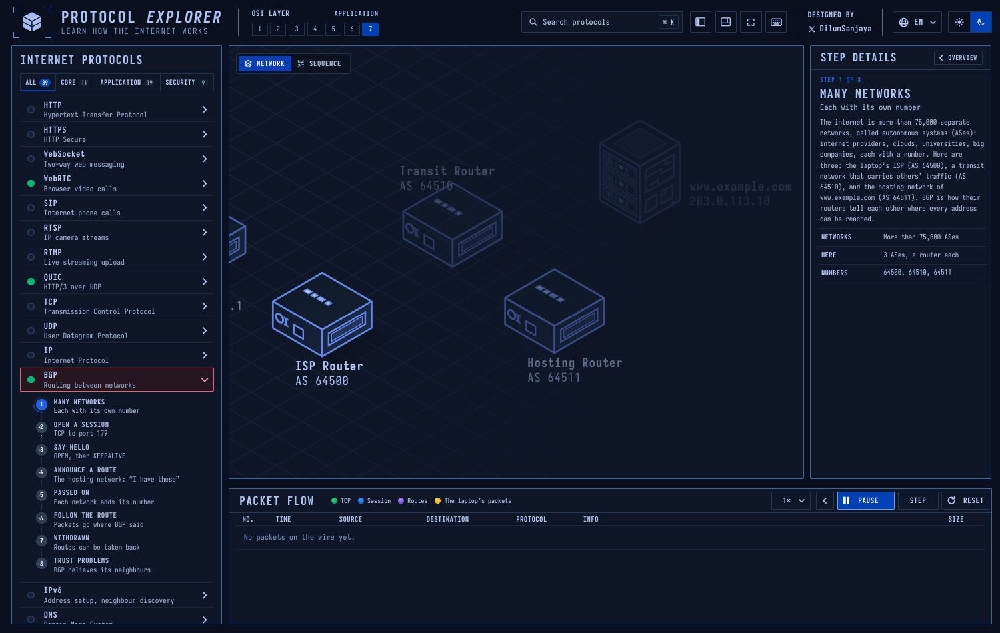

> STEP 1 OF 8  
> MANY NETWORKS  
> Each with its own number  
> The internet is more than 75,000 separate networks, called autonomous systems (ASes): internet providers, clouds, universities, big companies, each with a number. Here are three: the laptop’s ISP (AS 64500), a transit network that carries others’ traffic (AS 64510), and the hosting network of www.example.com (AS 64511). BGP is how their routers tell each other where every address can be reached.  
> WITHDRAW  
> HOSTING → TRANSIT  
> 203.0.113.0/24  
> PACKET 12 OF 13 · BGP · 93 B  
> NETWORKS  
> More than 75,000 ASes  
> HERE  
> 3 ASes, a router each  
> NUMBERS  
> 64500, 64510, 64511  

### Lesson summary

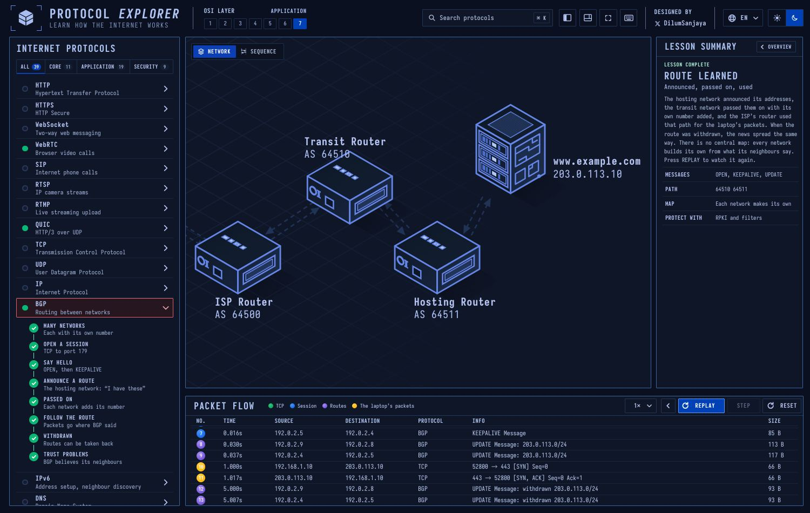

> LESSON SUMMARY  
> LESSON COMPLETE  
> ROUTE LEARNED  
> Announced, passed on, used  
> The hosting network announced its addresses, the transit network passed them on with its own number added, and the ISP’s router used that path for the laptop’s packets. When the route was withdrawn, the news spread the same way. There is no central map: every network builds its own from what its neighbours say. Press REPLAY to watch it again.  
> WITHDRAW  
> TRANSIT → ISP ROUTER  
> 203.0.113.0/24  
> PACKET 13 OF 13 · BGP · 93 B  
> MESSAGES  
> OPEN, KEEPALIVE, UPDATE  
> PATH  
> 64510 64511  
> MAP  
> Each network makes its own  
> PROTECT WITH  
> RPKI and filters  

## Packet flow (whole lesson)

| No. | Time | Source | Destination | Protocol | Info | Size |
|---|---|---|---|---|---|---|
| 1 | 0.000s | 192.0.2.5 | 192.0.2.4 | TCP | 50311 → 179 [SYN] Seq=0 | 74 B |
| 2 | 0.004s | 192.0.2.4 | 192.0.2.5 | TCP | 179 → 50311 [SYN, ACK] Seq=0 Ack=1 | 74 B |
| 3 | 0.008s | 192.0.2.5 | 192.0.2.4 | TCP | 50311 → 179 [ACK] Seq=1 Ack=1 | 66 B |
| 4 | 0.008s | 192.0.2.5 | 192.0.2.4 | BGP | OPEN Message | 111 B |
| 5 | 0.012s | 192.0.2.4 | 192.0.2.5 | BGP | OPEN Message | 111 B |
| 6 | 0.012s | 192.0.2.4 | 192.0.2.5 | BGP | KEEPALIVE Message | 85 B |
| 7 | 0.016s | 192.0.2.5 | 192.0.2.4 | BGP | KEEPALIVE Message | 85 B |
| 8 | 0.030s | 192.0.2.9 | 192.0.2.8 | BGP | UPDATE Message: 203.0.113.0/24 | 113 B |
| 9 | 0.037s | 192.0.2.4 | 192.0.2.5 | BGP | UPDATE Message: 203.0.113.0/24 | 117 B |
| 10 | 1.000s | 192.168.1.10 | 203.0.113.10 | TCP | 52800 → 443 [SYN] Seq=0 | 66 B |
| 11 | 1.017s | 203.0.113.10 | 192.168.1.10 | TCP | 443 → 52800 [SYN, ACK] Seq=0 Ack=1 | 66 B |
| 12 | 5.000s | 192.0.2.9 | 192.0.2.8 | BGP | UPDATE Message: withdrawn 203.0.113.0/24 | 93 B |
| 13 | 5.007s | 192.0.2.4 | 192.0.2.5 | BGP | UPDATE Message: withdrawn 203.0.113.0/24 | 93 B |

### Sequence diagram


## Packets decoded byte by byte

Each packet below is the lesson's own decode (headers, field values and the plain-English meaning of each field). Screenshots show the first, middle and last packet in the lesson's decoder view with the raw hex bytes.

### Packet 1: TCP – 50311 → 179 [SYN] Seq=0

*192.0.2.5 → 192.0.2.4 · 74 B · t = 0.000s*

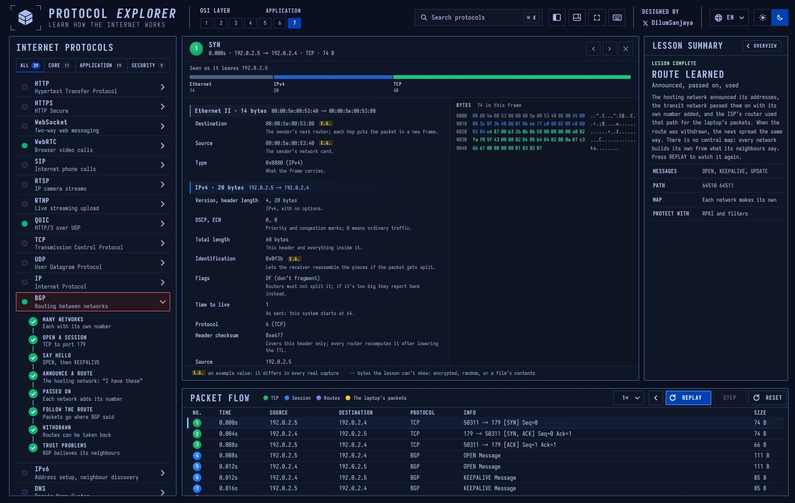

<details><summary>Decoded fields</summary>

```text
1
SYN
0.000s · 192.0.2.5 → 192.0.2.4 · TCP · 74 B
Seen as it leaves 192.0.2.5
Ethernet
14
IPv4
20
TCP
40
Ethernet II · 14 bytes
00:00:5e:00:53:40 → 00:00:5e:00:53:80
Destination
00:00:5e:00:53:80 E.G.

The sender’s next router; each hop puts the packet in a new frame.

Source
00:00:5e:00:53:40 E.G.

The sender’s network card.

Type
0x0800 (IPv4)

What the frame carries.

IPv4 · 20 bytes
192.0.2.5 → 192.0.2.4
Version, header length
4, 20 bytes

IPv4, with no options.

DSCP, ECN
0, 0

Priority and congestion marks; 0 means ordinary traffic.

Total length
60 bytes

This header and everything inside it.

Identification
0x0f3b E.G.

Lets the receiver reassemble the pieces if the packet gets split.

Flags
DF (don’t fragment)

Routers must not split it; if it’s too big they report back instead.

Time to live
1

As sent: this system starts at 64.

Protocol
6 (TCP)
Header checksum
0xe677

Covers this header only; every router recomputes it after lowering the TTL.

Source
192.0.2.5
Destination
192.0.2.4
TCP · 40 bytes
50311 → 179, SYN
Source port
50311
Destination port
179
Sequence number
0 (relative)

This side’s starting number. Shown as 0; the real one is random.

Real sequence number
722142808 E.G.
Acknowledgment
0 (not used yet)

A first SYN has nothing to acknowledge.

Header length
40 bytes

20 bytes, plus 20 of options.

Flags
0x002 (SYN)
Window
64240 E.G.

How much more data this side can take right now.

Checksum
0x5f43

Covers the header, the data and the IP addresses, so damage is caught.

Urgent pointer
0
Options
20 bytes
Maximum segment size
1460 bytes

The most data this side wants in one segment.

SACK permitted
yes

This side understands selective acknowledgements.

Timestamps
value 130247521, echo 0 E.G.

Used to measure round trips; both sides offered them.

No-op
1

Spacing, so the next option lines up.

Window scale
× 128

Window values are multiplied by this, so windows can be larger than 64 KB.

BYTES 74 in this frame
0000
00
00
5e
00
53
80
00
00
5e
00
53
40
08
00
45
00
.
.
^
.
S
.
.
.
^
.
S
@
.
.
E
.
0010
00
3c
0f
3b
40
00
01
06
e6
77
c0
00
02
05
c0
00
.
<
.
;
@
.
.
.
.
w
.
.
.
.
.
.
0020
02
04
c4
87
00
b3
2b
0b
06
58
00
00
00
00
a0
02
.
.
.
.
.
.
+
.
.
X
.
.
.
.
.
.
0030
fa
f0
5f
43
00
00
02
04
05
b4
04
02
08
0a
07
c3
.
.
_
C
.
.
.
.
.
.
.
.
.
.
.
.
0040
6b
61
00
00
00
00
01
03
03
07
k
a
.
.
.
.
.
.
.
.
E.G. an example value: it differs in every real capture
·· bytes the lesson can’t show: encrypted, random, or a file’s contents
```

</details>

### Packet 2: TCP – 179 → 50311 [SYN, ACK] Seq=0 Ack=1

*192.0.2.4 → 192.0.2.5 · 74 B · t = 0.004s*

<details><summary>Decoded fields</summary>

```text
2
SYN-ACK
0.004s · 192.0.2.4 → 192.0.2.5 · TCP · 74 B
Seen as it leaves 192.0.2.4
Ethernet
14
IPv4
20
TCP
40
Ethernet II · 14 bytes
00:00:5e:00:53:41 → 00:00:5e:00:53:81
Destination
00:00:5e:00:53:81 E.G.

The sender’s next router; each hop puts the packet in a new frame.

Source
00:00:5e:00:53:41 E.G.

The sender’s network card.

Type
0x0800 (IPv4)

What the frame carries.

IPv4 · 20 bytes
192.0.2.4 → 192.0.2.5
Version, header length
4, 20 bytes

IPv4, with no options.

DSCP, ECN
0, 0

Priority and congestion marks; 0 means ordinary traffic.

Total length
60 bytes

This header and everything inside it.

Identification
0x0da8 E.G.

Lets the receiver reassemble the pieces if the packet gets split.

Flags
DF (don’t fragment)

Routers must not split it; if it’s too big they report back instead.

Time to live
1

As sent: this system starts at 64.

Protocol
6 (TCP)
Header checksum
0xe80a

Covers this header only; every router recomputes it after lowering the TTL.

Source
192.0.2.4
Destination
192.0.2.5
TCP · 40 bytes
179 → 50311, SYN, ACK
Source port
179
Destination port
50311
Sequence number
0 (relative)

This side’s starting number. Shown as 0; the real one is random.

Real sequence number
1941776240 E.G.
Acknowledgment
1 (relative)

The next byte this side expects: everything before it has arrived.

Header length
40 bytes

20 bytes, plus 20 of options.

Flags
0x012 (SYN, ACK)
Window
65160 E.G.

How much more data this side can take right now.

Checksum
0xc3fd

Covers the header, the data and the IP addresses, so damage is caught.

Urgent pointer
0
Options
20 bytes
Maximum segment size
1460 bytes

The most data this side wants in one segment.

SACK permitted
yes

This side understands selective acknowledgements.

Timestamps
value 3541903697, echo 130247521 E.G.

Used to measure round trips; both sides offered them.

No-op
1

Spacing, so the next option lines up.

Window scale
× 128

Window values are multiplied by this, so windows can be larger than 64 KB.

BYTES 74 in this frame
0000
00
00
5e
00
53
81
00
00
5e
00
53
41
08
00
45
00
.
.
^
.
S
.
.
.
^
.
S
A
.
.
E
.
0010
00
3c
0d
a8
40
00
01
06
e8
0a
c0
00
02
04
c0
00
.
<
.
.
@
.
.
.
.
.
.
.
.
.
.
.
0020
02
05
00
b3
c4
87
73
bd
27
70
2b
0b
06
59
a0
12
.
.
.
.
.
.
s
.
'
p
+
.
.
Y
.
.
0030
fe
88
c3
fd
00
00
02
04
05
b4
04
02
08
0a
d3
1d
.
.
.
.
.
.
.
.
.
.
.
.
.
.
.
.
0040
29
51
07
c3
6b
61
01
03
03
07
)
Q
.
.
k
a
.
.
.
.
E.G. an example value: it differs in every real capture
·· bytes the lesson can’t show: encrypted, random, or a file’s contents
```

</details>

### Packet 3: TCP – 50311 → 179 [ACK] Seq=1 Ack=1

*192.0.2.5 → 192.0.2.4 · 66 B · t = 0.008s*

<details><summary>Decoded fields</summary>

```text
3
ACK
0.008s · 192.0.2.5 → 192.0.2.4 · TCP · 66 B
Seen as it leaves 192.0.2.5
Ethernet
14
IPv4
20
TCP
32
Ethernet II · 14 bytes
00:00:5e:00:53:40 → 00:00:5e:00:53:80
Destination
00:00:5e:00:53:80 E.G.

The sender’s next router; each hop puts the packet in a new frame.

Source
00:00:5e:00:53:40 E.G.

The sender’s network card.

Type
0x0800 (IPv4)

What the frame carries.

IPv4 · 20 bytes
192.0.2.5 → 192.0.2.4
Version, header length
4, 20 bytes

IPv4, with no options.

DSCP, ECN
0, 0

Priority and congestion marks; 0 means ordinary traffic.

Total length
52 bytes

This header and everything inside it.

Identification
0x0f3c E.G.

Lets the receiver reassemble the pieces if the packet gets split.

Flags
DF (don’t fragment)

Routers must not split it; if it’s too big they report back instead.

Time to live
1

As sent: this system starts at 64.

Protocol
6 (TCP)
Header checksum
0xe67e

Covers this header only; every router recomputes it after lowering the TTL.

Source
192.0.2.5
Destination
192.0.2.4
TCP · 32 bytes
50311 → 179, ACK
Source port
50311
Destination port
179
Sequence number
1 (relative)

Position of this segment’s first byte, counted from this side’s SYN.

Real sequence number
722142809 E.G.
Acknowledgment
1 (relative)

The next byte this side expects: everything before it has arrived.

Header length
32 bytes

20 bytes, plus 12 of options.

Flags
0x010 (ACK)
Window
501 (× 128 = 64,128 bytes) E.G.

How much more data this side can take right now.

Checksum
0xef55

Covers the header, the data and the IP addresses, so damage is caught.

Urgent pointer
0
Options
12 bytes
No-op
1

Spacing, so the next option lines up.

No-op
1

Spacing, so the next option lines up.

Timestamps
value 130247529, echo 3541903697 E.G.

Used to measure round trips; both sides offered them.

BYTES 66 in this frame
0000
00
00
5e
00
53
80
00
00
5e
00
53
40
08
00
45
00
.
.
^
.
S
.
.
.
^
.
S
@
.
.
E
.
0010
00
34
0f
3c
40
00
01
06
e6
7e
c0
00
02
05
c0
00
.
4
.
<
@
.
.
.
.
~
.
.
.
.
.
.
0020
02
04
c4
87
00
b3
2b
0b
06
59
73
bd
27
71
80
10
.
.
.
.
.
.
+
.
.
Y
s
.
'
q
.
.
0030
01
f5
ef
55
00
00
01
01
08
0a
07
c3
6b
69
d3
1d
.
.
.
U
.
.
.
.
.
.
.
.
k
i
.
.
0040
29
51
)
Q
E.G. an example value: it differs in every real capture
·· bytes the lesson can’t show: encrypted, random, or a file’s contents
```

</details>

### Packet 4: BGP – OPEN Message

*192.0.2.5 → 192.0.2.4 · 111 B · t = 0.008s*

<details><summary>Decoded fields</summary>

```text
4
OPEN
0.008s · 192.0.2.5 → 192.0.2.4 · BGP · 111 B
Seen as it leaves 192.0.2.5
Ethernet
14
IPv4
20
TCP
32
BGP
45
Ethernet II · 14 bytes
00:00:5e:00:53:40 → 00:00:5e:00:53:80
Destination
00:00:5e:00:53:80 E.G.

The sender’s next router; each hop puts the packet in a new frame.

Source
00:00:5e:00:53:40 E.G.

The sender’s network card.

Type
0x0800 (IPv4)

What the frame carries.

IPv4 · 20 bytes
192.0.2.5 → 192.0.2.4
Version, header length
4, 20 bytes

IPv4, with no options.

DSCP, ECN
0, 0

Priority and congestion marks; 0 means ordinary traffic.

Total length
97 bytes

This header and everything inside it.

Identification
0x0f3d E.G.

Lets the receiver reassemble the pieces if the packet gets split.

Flags
DF (don’t fragment)

Routers must not split it; if it’s too big they report back instead.

Time to live
1

As sent: this system starts at 64.

Protocol
6 (TCP)
Header checksum
0xe650

Covers this header only; every router recomputes it after lowering the TTL.

Source
192.0.2.5
Destination
192.0.2.4
TCP · 32 bytes
50311 → 179, PSH, ACK
Source port
50311
Destination port
179
Sequence number
1 (relative)

Position of this segment’s first byte, counted from this side’s SYN.

Real sequence number
722142809 E.G.
Acknowledgment
1 (relative)

The next byte this side expects: everything before it has arrived.

Header length
32 bytes

20 bytes, plus 12 of options.

Flags
0x018 (PSH, ACK)
Window
501 (× 128 = 64,128 bytes) E.G.

How much more data this side can take right now.

Checksum
0x11ff

Covers the header, the data and the IP addresses, so damage is caught.

Urgent pointer
0
Options
12 bytes
No-op
1

Spacing, so the next option lines up.

No-op
1

Spacing, so the next option lines up.

Timestamps
value 130247529, echo 3541903697 E.G.

Used to measure round trips; both sides offered them.

BGP · OPEN
Marker
16 bytes of 0xFF

All ones: where a message starts.

Length
45 bytes
Type
1 (OPEN)

The first message on a session: who this router is and what it supports.

Version
4
My AS
64500

This router’s network. (A 4-byte AS number goes in the capability below, with 23456 here.)

Hold time
180 s

If nothing at all arrives for this long, the session is dropped. Both sides use the lower offer.

BGP identifier
192.0.2.5

The router’s ID, usually one of its addresses.

Optional parameters
16 bytes
Capabilities
parameter 2, 14 bytes

What this router can do beyond the basics.

Multiprotocol
IPv4 unicast

Which kinds of routes it will exchange on this session.

Route refresh
yes

It can ask the other side to send all its routes again.

4-byte AS numbers
yes, AS 64500

2-byte AS numbers ran short, so newer ones are 4 bytes long.

BYTES 111 in this frame
0000
00
00
5e
00
53
80
00
00
5e
00
53
40
08
00
45
00
.
.
^
.
S
.
.
.
^
.
S
@
.
.
E
.
0010
00
61
0f
3d
40
00
01
06
e6
50
c0
00
02
05
c0
00
.
a
.
=
@
.
.
.
.
P
.
.
.
.
.
.
0020
02
04
c4
87
00
b3
2b
0b
06
59
73
bd
27
71
80
18
.
.
.
.
.
.
+
.
.
Y
s
.
'
q
.
.
0030
01
f5
11
ff
00
00
01
01
08
0a
07
c3
6b
69
d3
1d
.
.
.
.
.
.
.
.
.
.
.
.
k
i
.
.
0040
29
51
ff
ff
ff
ff
ff
ff
ff
ff
ff
ff
ff
ff
ff
ff
)
Q
.
.
.
.
.
.
.
.
.
.
.
.
.
.
0050
ff
ff
00
2d
01
04
fb
f4
00
b4
c0
00
02
05
10
02
.
.
.
-
.
.
.
.
.
.
.
.
.
.
.
.
0060
0e
01
04
00
01
00
01
02
00
41
04
00
00
fb
f4
.
.
.
.
.
.
.
.
.
A
.
.
.
.
.
E.G. an example value: it differs in every real capture
·· bytes the lesson can’t show: encrypted, random, or a file’s contents
```

</details>

### Packet 5: BGP – OPEN Message

*192.0.2.4 → 192.0.2.5 · 111 B · t = 0.012s*

<details><summary>Decoded fields</summary>

```text
5
OPEN
0.012s · 192.0.2.4 → 192.0.2.5 · BGP · 111 B
Seen as it leaves 192.0.2.4
Ethernet
14
IPv4
20
TCP
32
BGP
45
Ethernet II · 14 bytes
00:00:5e:00:53:41 → 00:00:5e:00:53:81
Destination
00:00:5e:00:53:81 E.G.

The sender’s next router; each hop puts the packet in a new frame.

Source
00:00:5e:00:53:41 E.G.

The sender’s network card.

Type
0x0800 (IPv4)

What the frame carries.

IPv4 · 20 bytes
192.0.2.4 → 192.0.2.5
Version, header length
4, 20 bytes

IPv4, with no options.

DSCP, ECN
0, 0

Priority and congestion marks; 0 means ordinary traffic.

Total length
97 bytes

This header and everything inside it.

Identification
0x0da9 E.G.

Lets the receiver reassemble the pieces if the packet gets split.

Flags
DF (don’t fragment)

Routers must not split it; if it’s too big they report back instead.

Time to live
1

As sent: this system starts at 64.

Protocol
6 (TCP)
Header checksum
0xe7e4

Covers this header only; every router recomputes it after lowering the TTL.

Source
192.0.2.4
Destination
192.0.2.5
TCP · 32 bytes
179 → 50311, PSH, ACK
Source port
179
Destination port
50311
Sequence number
1 (relative)

Position of this segment’s first byte, counted from this side’s SYN.

Real sequence number
1941776241 E.G.
Acknowledgment
46 (relative)

The next byte this side expects: everything before it has arrived.

Header length
32 bytes

20 bytes, plus 12 of options.

Flags
0x018 (PSH, ACK)
Window
501 (× 128 = 64,128 bytes) E.G.

How much more data this side can take right now.

Checksum
0x07c1

Covers the header, the data and the IP addresses, so damage is caught.

Urgent pointer
0
Options
12 bytes
No-op
1

Spacing, so the next option lines up.

No-op
1

Spacing, so the next option lines up.

Timestamps
value 3541903705, echo 130247529 E.G.

Used to measure round trips; both sides offered them.

BGP · OPEN
Marker
16 bytes of 0xFF

All ones: where a message starts.

Length
45 bytes
Type
1 (OPEN)

The first message on a session: who this router is and what it supports.

Version
4
My AS
64510

This router’s network. (A 4-byte AS number goes in the capability below, with 23456 here.)

Hold time
180 s

If nothing at all arrives for this long, the session is dropped. Both sides use the lower offer.

BGP identifier
192.0.2.4

The router’s ID, usually one of its addresses.

Optional parameters
16 bytes
Capabilities
parameter 2, 14 bytes

What this router can do beyond the basics.

Multiprotocol
IPv4 unicast

Which kinds of routes it will exchange on this session.

Route refresh
yes

It can ask the other side to send all its routes again.

4-byte AS numbers
yes, AS 64510

2-byte AS numbers ran short, so newer ones are 4 bytes long.

BYTES 111 in this frame
0000
00
00
5e
00
53
81
00
00
5e
00
53
41
08
00
45
00
.
.
^
.
S
.
.
.
^
.
S
A
.
.
E
.
0010
00
61
0d
a9
40
00
01
06
e7
e4
c0
00
02
04
c0
00
.
a
.
.
@
.
.
.
.
.
.
.
.
.
.
.
0020
02
05
00
b3
c4
87
73
bd
27
71
2b
0b
06
86
80
18
.
.
.
.
.
.
s
.
'
q
+
.
.
.
.
.
0030
01
f5
07
c1
00
00
01
01
08
0a
d3
1d
29
59
07
c3
.
.
.
.
.
.
.
.
.
.
.
.
)
Y
.
.
0040
6b
69
ff
ff
ff
ff
ff
ff
ff
ff
ff
ff
ff
ff
ff
ff
k
i
.
.
.
.
.
.
.
.
.
.
.
.
.
.
0050
ff
ff
00
2d
01
04
fb
fe
00
b4
c0
00
02
04
10
02
.
.
.
-
.
.
.
.
.
.
.
.
.
.
.
.
0060
0e
01
04
00
01
00
01
02
00
41
04
00
00
fb
fe
.
.
.
.
.
.
.
.
.
A
.
.
.
.
.
E.G. an example value: it differs in every real capture
·· bytes the lesson can’t show: encrypted, random, or a file’s contents
```

</details>

### Packet 6: BGP – KEEPALIVE Message

*192.0.2.4 → 192.0.2.5 · 85 B · t = 0.012s*

<details><summary>Decoded fields</summary>

```text
6
KEEPALIVE
0.012s · 192.0.2.4 → 192.0.2.5 · BGP · 85 B
Seen as it leaves 192.0.2.4
Ethernet
14
IPv4
20
TCP
32
BGP
19
Ethernet II · 14 bytes
00:00:5e:00:53:41 → 00:00:5e:00:53:81
Destination
00:00:5e:00:53:81 E.G.

The sender’s next router; each hop puts the packet in a new frame.

Source
00:00:5e:00:53:41 E.G.

The sender’s network card.

Type
0x0800 (IPv4)

What the frame carries.

IPv4 · 20 bytes
192.0.2.4 → 192.0.2.5
Version, header length
4, 20 bytes

IPv4, with no options.

DSCP, ECN
0, 0

Priority and congestion marks; 0 means ordinary traffic.

Total length
71 bytes

This header and everything inside it.

Identification
0x0daa E.G.

Lets the receiver reassemble the pieces if the packet gets split.

Flags
DF (don’t fragment)

Routers must not split it; if it’s too big they report back instead.

Time to live
1

As sent: this system starts at 64.

Protocol
6 (TCP)
Header checksum
0xe7fd

Covers this header only; every router recomputes it after lowering the TTL.

Source
192.0.2.4
Destination
192.0.2.5
TCP · 32 bytes
179 → 50311, PSH, ACK
Source port
179
Destination port
50311
Sequence number
46 (relative)

Position of this segment’s first byte, counted from this side’s SYN.

Real sequence number
1941776286 E.G.
Acknowledgment
46 (relative)

The next byte this side expects: everything before it has arrived.

Header length
32 bytes

20 bytes, plus 12 of options.

Flags
0x018 (PSH, ACK)
Window
501 (× 128 = 64,128 bytes) E.G.

How much more data this side can take right now.

Checksum
0xeac5

Covers the header, the data and the IP addresses, so damage is caught.

Urgent pointer
0
Options
12 bytes
No-op
1

Spacing, so the next option lines up.

No-op
1

Spacing, so the next option lines up.

Timestamps
value 3541903705, echo 130247529 E.G.

Used to measure round trips; both sides offered them.

BGP · KEEPALIVE
Marker
16 bytes of 0xFF

All ones: where a message starts.

Length
19 bytes
Type
4 (KEEPALIVE)

Only the header: “still here”. Sent when there’s nothing else to say, every third of the hold time.

BYTES 85 in this frame
0000
00
00
5e
00
53
81
00
00
5e
00
53
41
08
00
45
00
.
.
^
.
S
.
.
.
^
.
S
A
.
.
E
.
0010
00
47
0d
aa
40
00
01
06
e7
fd
c0
00
02
04
c0
00
.
G
.
.
@
.
.
.
.
.
.
.
.
.
.
.
0020
02
05
00
b3
c4
87
73
bd
27
9e
2b
0b
06
86
80
18
.
.
.
.
.
.
s
.
'
.
+
.
.
.
.
.
0030
01
f5
ea
c5
00
00
01
01
08
0a
d3
1d
29
59
07
c3
.
.
.
.
.
.
.
.
.
.
.
.
)
Y
.
.
0040
6b
69
ff
ff
ff
ff
ff
ff
ff
ff
ff
ff
ff
ff
ff
ff
k
i
.
.
.
.
.
.
.
.
.
.
.
.
.
.
0050
ff
ff
00
13
04
.
.
.
.
.
E.G. an example value: it differs in every real capture
·· bytes the lesson can’t show: encrypted, random, or a file’s contents
```

</details>

### Packet 7: BGP – KEEPALIVE Message

*192.0.2.5 → 192.0.2.4 · 85 B · t = 0.016s*

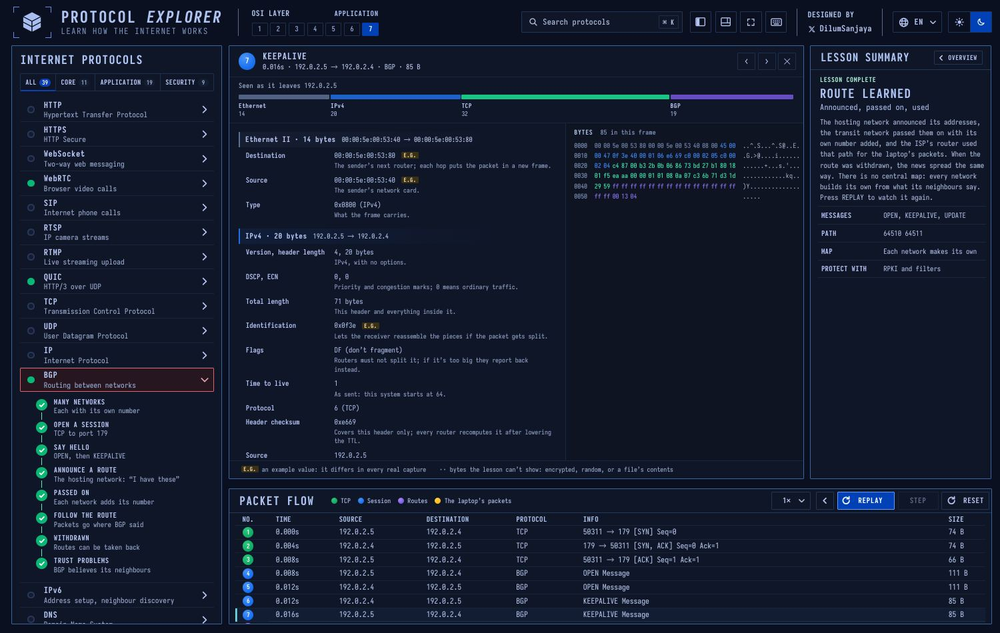

<details><summary>Decoded fields</summary>

```text
7
KEEPALIVE
0.016s · 192.0.2.5 → 192.0.2.4 · BGP · 85 B
Seen as it leaves 192.0.2.5
Ethernet
14
IPv4
20
TCP
32
BGP
19
Ethernet II · 14 bytes
00:00:5e:00:53:40 → 00:00:5e:00:53:80
Destination
00:00:5e:00:53:80 E.G.

The sender’s next router; each hop puts the packet in a new frame.

Source
00:00:5e:00:53:40 E.G.

The sender’s network card.

Type
0x0800 (IPv4)

What the frame carries.

IPv4 · 20 bytes
192.0.2.5 → 192.0.2.4
Version, header length
4, 20 bytes

IPv4, with no options.

DSCP, ECN
0, 0

Priority and congestion marks; 0 means ordinary traffic.

Total length
71 bytes

This header and everything inside it.

Identification
0x0f3e E.G.

Lets the receiver reassemble the pieces if the packet gets split.

Flags
DF (don’t fragment)

Routers must not split it; if it’s too big they report back instead.

Time to live
1

As sent: this system starts at 64.

Protocol
6 (TCP)
Header checksum
0xe669

Covers this header only; every router recomputes it after lowering the TTL.

Source
192.0.2.5
Destination
192.0.2.4
TCP · 32 bytes
50311 → 179, PSH, ACK
Source port
50311
Destination port
179
Sequence number
46 (relative)

Position of this segment’s first byte, counted from this side’s SYN.

Real sequence number
722142854 E.G.
Acknowledgment
65 (relative)

The next byte this side expects: everything before it has arrived.

Header length
32 bytes

20 bytes, plus 12 of options.

Flags
0x018 (PSH, ACK)
Window
501 (× 128 = 64,128 bytes) E.G.

How much more data this side can take right now.

Checksum
0xeaaa

Covers the header, the data and the IP addresses, so damage is caught.

Urgent pointer
0
Options
12 bytes
No-op
1

Spacing, so the next option lines up.

No-op
1

Spacing, so the next option lines up.

Timestamps
value 130247537, echo 3541903705 E.G.

Used to measure round trips; both sides offered them.

BGP · KEEPALIVE
Marker
16 bytes of 0xFF

All ones: where a message starts.

Length
19 bytes
Type
4 (KEEPALIVE)

Only the header: “still here”. Sent when there’s nothing else to say, every third of the hold time.

BYTES 85 in this frame
0000
00
00
5e
00
53
80
00
00
5e
00
53
40
08
00
45
00
.
.
^
.
S
.
.
.
^
.
S
@
.
.
E
.
0010
00
47
0f
3e
40
00
01
06
e6
69
c0
00
02
05
c0
00
.
G
.
>
@
.
.
.
.
i
.
.
.
.
.
.
0020
02
04
c4
87
00
b3
2b
0b
06
86
73
bd
27
b1
80
18
.
.
.
.
.
.
+
.
.
.
s
.
'
.
.
.
0030
01
f5
ea
aa
00
00
01
01
08
0a
07
c3
6b
71
d3
1d
.
.
.
.
.
.
.
.
.
.
.
.
k
q
.
.
0040
29
59
ff
ff
ff
ff
ff
ff
ff
ff
ff
ff
ff
ff
ff
ff
)
Y
.
.
.
.
.
.
.
.
.
.
.
.
.
.
0050
ff
ff
00
13
04
.
.
.
.
.
E.G. an example value: it differs in every real capture
·· bytes the lesson can’t show: encrypted, random, or a file’s contents
```

</details>

### Packet 8: BGP – UPDATE Message: 203.0.113.0/24

*192.0.2.9 → 192.0.2.8 · 113 B · t = 0.030s*

<details><summary>Decoded fields</summary>

```text
8
UPDATE
0.030s · 192.0.2.9 → 192.0.2.8 · BGP · 113 B
Seen as it leaves 192.0.2.9
Ethernet
14
IPv4
20
TCP
32
BGP
47
Ethernet II · 14 bytes
00:00:5e:00:53:42 → 00:00:5e:00:53:82
Destination
00:00:5e:00:53:82 E.G.

The sender’s next router; each hop puts the packet in a new frame.

Source
00:00:5e:00:53:42 E.G.

The sender’s network card.

Type
0x0800 (IPv4)

What the frame carries.

IPv4 · 20 bytes
192.0.2.9 → 192.0.2.8
Version, header length
4, 20 bytes

IPv4, with no options.

DSCP, ECN
0, 0

Priority and congestion marks; 0 means ordinary traffic.

Total length
99 bytes

This header and everything inside it.

Identification
0x08ef E.G.

Lets the receiver reassemble the pieces if the packet gets split.

Flags
DF (don’t fragment)

Routers must not split it; if it’s too big they report back instead.

Time to live
1

As sent: this system starts at 64.

Protocol
6 (TCP)
Header checksum
0xec94

Covers this header only; every router recomputes it after lowering the TTL.

Source
192.0.2.9
Destination
192.0.2.8
TCP · 32 bytes
179 → 41622, PSH, ACK
Source port
179
Destination port
41622
Sequence number
1240 (relative)

Position of this segment’s first byte, counted from this side’s SYN.

Real sequence number
476172848 E.G.
Acknowledgment
1186 (relative)

The next byte this side expects: everything before it has arrived.

Header length
32 bytes

20 bytes, plus 12 of options.

Flags
0x018 (PSH, ACK)
Window
501 (× 128 = 64,128 bytes) E.G.

How much more data this side can take right now.

Checksum
0xd261

Covers the header, the data and the IP addresses, so damage is caught.

Urgent pointer
0
Options
12 bytes
No-op
1

Spacing, so the next option lines up.

No-op
1

Spacing, so the next option lines up.

Timestamps
value 3218964760, echo 2996739085 E.G.

Used to measure round trips; both sides offered them.

BGP · UPDATE
Marker
16 bytes of 0xFF

All ones: where a message starts.

Length
47 bytes
Type
2 (UPDATE)

Routes: paths to new addresses, and ones taken back.

Withdrawn routes
0 bytes
Path attributes
20 bytes
ORIGIN
0 (IGP: from inside the network that announced it)
AS_PATH
64511

Every network the route has passed through, the latest first. Other things being equal, the shorter path wins; a router that finds its own number here drops the route, so routes can’t loop.

NEXT_HOP
192.0.2.9

Send packets for these addresses to this router.

Reachable
203.0.113.0/24

The addresses this route leads to: a prefix, here 256 addresses.

BYTES 113 in this frame
0000
00
00
5e
00
53
82
00
00
5e
00
53
42
08
00
45
00
.
.
^
.
S
.
.
.
^
.
S
B
.
.
E
.
0010
00
63
08
ef
40
00
01
06
ec
94
c0
00
02
09
c0
00
.
c
.
.
@
.
.
.
.
.
.
.
.
.
.
.
0020
02
08
00
b3
a2
96
1c
61
d2
30
be
c4
9c
45
80
18
.
.
.
.
.
.
.
a
.
0
.
.
.
E
.
.
0030
01
f5
d2
61
00
00
01
01
08
0a
bf
dd
81
18
b2
9e
.
.
.
a
.
.
.
.
.
.
.
.
.
.
.
.
0040
9c
0d
ff
ff
ff
ff
ff
ff
ff
ff
ff
ff
ff
ff
ff
ff
.
.
.
.
.
.
.
.
.
.
.
.
.
.
.
.
0050
ff
ff
00
2f
02
00
00
00
14
40
01
01
00
40
02
06
.
.
.
/
.
.
.
.
.
@
.
.
.
@
.
.
0060
02
01
00
00
fb
ff
40
03
04
c0
00
02
09
18
cb
00
.
.
.
.
.
.
@
.
.
.
.
.
.
.
.
.
0070
71
q
E.G. an example value: it differs in every real capture
·· bytes the lesson can’t show: encrypted, random, or a file’s contents
```

</details>

### Packet 9: BGP – UPDATE Message: 203.0.113.0/24

*192.0.2.4 → 192.0.2.5 · 117 B · t = 0.037s*

<details><summary>Decoded fields</summary>

```text
9
UPDATE
0.037s · 192.0.2.4 → 192.0.2.5 · BGP · 117 B
Seen as it leaves 192.0.2.4
Ethernet
14
IPv4
20
TCP
32
BGP
51
Ethernet II · 14 bytes
00:00:5e:00:53:41 → 00:00:5e:00:53:81
Destination
00:00:5e:00:53:81 E.G.

The sender’s next router; each hop puts the packet in a new frame.

Source
00:00:5e:00:53:41 E.G.

The sender’s network card.

Type
0x0800 (IPv4)

What the frame carries.

IPv4 · 20 bytes
192.0.2.4 → 192.0.2.5
Version, header length
4, 20 bytes

IPv4, with no options.

DSCP, ECN
0, 0

Priority and congestion marks; 0 means ordinary traffic.

Total length
103 bytes

This header and everything inside it.

Identification
0x0dab E.G.

Lets the receiver reassemble the pieces if the packet gets split.

Flags
DF (don’t fragment)

Routers must not split it; if it’s too big they report back instead.

Time to live
1

As sent: this system starts at 64.

Protocol
6 (TCP)
Header checksum
0xe7dc

Covers this header only; every router recomputes it after lowering the TTL.

Source
192.0.2.4
Destination
192.0.2.5
TCP · 32 bytes
179 → 50311, PSH, ACK
Source port
179
Destination port
50311
Sequence number
65 (relative)

Position of this segment’s first byte, counted from this side’s SYN.

Real sequence number
1941776305 E.G.
Acknowledgment
65 (relative)

The next byte this side expects: everything before it has arrived.

Header length
32 bytes

20 bytes, plus 12 of options.

Flags
0x018 (PSH, ACK)
Window
501 (× 128 = 64,128 bytes) E.G.

How much more data this side can take right now.

Checksum
0x51d4

Covers the header, the data and the IP addresses, so damage is caught.

Urgent pointer
0
Options
12 bytes
No-op
1

Spacing, so the next option lines up.

No-op
1

Spacing, so the next option lines up.

Timestamps
value 3541903730, echo 130247537 E.G.

Used to measure round trips; both sides offered them.

BGP · UPDATE
Marker
16 bytes of 0xFF

All ones: where a message starts.

Length
51 bytes
Type
2 (UPDATE)

Routes: paths to new addresses, and ones taken back.

Withdrawn routes
0 bytes
Path attributes
24 bytes
ORIGIN
0 (IGP: from inside the network that announced it)
AS_PATH
64510 64511

Every network the route has passed through, the latest first. Other things being equal, the shorter path wins; a router that finds its own number here drops the route, so routes can’t loop.

NEXT_HOP
192.0.2.4

Send packets for these addresses to this router.

Reachable
203.0.113.0/24

The addresses this route leads to: a prefix, here 256 addresses.

BYTES 117 in this frame
0000
00
00
5e
00
53
81
00
00
5e
00
53
41
08
00
45
00
.
.
^
.
S
.
.
.
^
.
S
A
.
.
E
.
0010
00
67
0d
ab
40
00
01
06
e7
dc
c0
00
02
04
c0
00
.
g
.
.
@
.
.
.
.
.
.
.
.
.
.
.
0020
02
05
00
b3
c4
87
73
bd
27
b1
2b
0b
06
99
80
18
.
.
.
.
.
.
s
.
'
.
+
.
.
.
.
.
0030
01
f5
51
d4
00
00
01
01
08
0a
d3
1d
29
72
07
c3
.
.
Q
.
.
.
.
.
.
.
.
.
)
r
.
.
0040
6b
71
ff
ff
ff
ff
ff
ff
ff
ff
ff
ff
ff
ff
ff
ff
k
q
.
.
.
.
.
.
.
.
.
.
.
.
.
.
0050
ff
ff
00
33
02
00
00
00
18
40
01
01
00
40
02
0a
.
.
.
3
.
.
.
.
.
@
.
.
.
@
.
.
0060
02
02
00
00
fb
fe
00
00
fb
ff
40
03
04
c0
00
02
.
.
.
.
.
.
.
.
.
.
@
.
.
.
.
.
0070
04
18
cb
00
71
.
.
.
.
q
E.G. an example value: it differs in every real capture
·· bytes the lesson can’t show: encrypted, random, or a file’s contents
```

</details>

### Packet 10: TCP – 52800 → 443 [SYN] Seq=0

*192.168.1.10 → 203.0.113.10 · 66 B · t = 1.000s*

<details><summary>Decoded fields</summary>

```text
10
SYN
1.000s · 192.168.1.10 → 203.0.113.10 · TCP · 66 B
Seen on the laptop’s home network
Ethernet
14
IPv4
20
TCP
32
Ethernet II · 14 bytes
00:00:5e:00:53:10 → 00:00:5e:00:53:01
Destination
00:00:5e:00:53:01 E.G.

The router: anything beyond the home network goes to it first.

Source
00:00:5e:00:53:10 E.G.

The laptop’s network card.

Type
0x0800 (IPv4)

What the frame carries.

IPv4 · 20 bytes
192.168.1.10 → 203.0.113.10
Version, header length
4, 20 bytes

IPv4, with no options.

DSCP, ECN
0, 0

Priority and congestion marks; 0 means ordinary traffic.

Total length
52 bytes

This header and everything inside it.

Identification
0xd825 E.G.

Lets the receiver reassemble the pieces if the packet gets split.

Flags
DF (don’t fragment)

Routers must not split it; if it’s too big they report back instead.

Time to live
128

Windows starts at 128.

Protocol
6 (TCP)
Header checksum
0x24e1

Covers this header only; every router recomputes it after lowering the TTL.

Source
192.168.1.10
Destination
203.0.113.10
TCP · 32 bytes
52800 → 443, SYN
Source port
52800

Picked by the laptop’s system for this connection.

Destination port
443
Sequence number
0 (relative)

This side’s starting number. Shown as 0; the real one is random.

Real sequence number
1853384707 E.G.
Acknowledgment
0 (not used yet)

A first SYN has nothing to acknowledge.

Header length
32 bytes

20 bytes, plus 12 of options.

Flags
0x002 (SYN)
Window
64240 E.G.

How much more data this side can take right now.

Checksum
0xcfea

Covers the header, the data and the IP addresses, so damage is caught.

Urgent pointer
0
Options
12 bytes
Maximum segment size
1460 bytes

The most data this side wants in one segment.

No-op
1

Spacing, so the next option lines up.

Window scale
× 256

Window values are multiplied by this, so windows can be larger than 64 KB.

No-op
1

Spacing, so the next option lines up.

No-op
1

Spacing, so the next option lines up.

SACK permitted
yes

This side understands selective acknowledgements.

BYTES 66 in this frame
0000
00
00
5e
00
53
01
00
00
5e
00
53
10
08
00
45
00
.
.
^
.
S
.
.
.
^
.
S
.
.
.
E
.
0010
00
34
d8
25
40
00
80
06
24
e1
c0
a8
01
0a
cb
00
.
4
.
%
@
.
.
.
$
.
.
.
.
.
.
.
0020
71
0a
ce
40
01
bb
6e
78
68
03
00
00
00
00
80
02
q
.
.
@
.
.
n
x
h
.
.
.
.
.
.
.
0030
fa
f0
cf
ea
00
00
02
04
05
b4
01
03
03
08
01
01
.
.
.
.
.
.
.
.
.
.
.
.
.
.
.
.
0040
04
02
.
.
E.G. an example value: it differs in every real capture
·· bytes the lesson can’t show: encrypted, random, or a file’s contents
```

</details>

### Packet 11: TCP – 443 → 52800 [SYN, ACK] Seq=0 Ack=1

*203.0.113.10 → 192.168.1.10 · 66 B · t = 1.017s*

<details><summary>Decoded fields</summary>

```text
11
SYN-ACK
1.017s · 203.0.113.10 → 192.168.1.10 · TCP · 66 B
Seen on the laptop’s home network
Ethernet
14
IPv4
20
TCP
32
Ethernet II · 14 bytes
00:00:5e:00:53:01 → 00:00:5e:00:53:10
Destination
00:00:5e:00:53:10 E.G.

The laptop.

Source
00:00:5e:00:53:01 E.G.

The router’s side facing the home network.

Type
0x0800 (IPv4)

What the frame carries.

IPv4 · 20 bytes
203.0.113.10 → 192.168.1.10
Version, header length
4, 20 bytes

IPv4, with no options.

DSCP, ECN
0, 0

Priority and congestion marks; 0 means ordinary traffic.

Total length
52 bytes

This header and everything inside it.

Identification
0x0e03 E.G.

Lets the receiver reassemble the pieces if the packet gets split.

Flags
DF (don’t fragment)

Routers must not split it; if it’s too big they report back instead.

Time to live
52

Started at 64; 12 routers on the way each took 1.

Protocol
6 (TCP)
Header checksum
0x3b04

Covers this header only; every router recomputes it after lowering the TTL.

Source
203.0.113.10
Destination
192.168.1.10
TCP · 32 bytes
443 → 52800, SYN, ACK
Source port
443
Destination port
52800
Sequence number
0 (relative)

This side’s starting number. Shown as 0; the real one is random.

Real sequence number
3074084017 E.G.
Acknowledgment
1 (relative)

The next byte this side expects: everything before it has arrived.

Header length
32 bytes

20 bytes, plus 12 of options.

Flags
0x012 (SYN, ACK)
Window
64240 E.G.

How much more data this side can take right now.

Checksum
0x4bee

Covers the header, the data and the IP addresses, so damage is caught.

Urgent pointer
0
Options
12 bytes
Maximum segment size
1460 bytes

The most data this side wants in one segment.

No-op
1

Spacing, so the next option lines up.

No-op
1

Spacing, so the next option lines up.

SACK permitted
yes

This side understands selective acknowledgements.

No-op
1

Spacing, so the next option lines up.

Window scale
× 128

Window values are multiplied by this, so windows can be larger than 64 KB.

BYTES 66 in this frame
0000
00
00
5e
00
53
10
00
00
5e
00
53
01
08
00
45
00
.
.
^
.
S
.
.
.
^
.
S
.
.
.
E
.
0010
00
34
0e
03
40
00
34
06
3b
04
cb
00
71
0a
c0
a8
.
4
.
.
@
.
4
.
;
.
.
.
q
.
.
.
0020
01
0a
01
bb
ce
40
b7
3a
cc
b1
6e
78
68
04
80
12
.
.
.
.
.
@
.
:
.
.
n
x
h
.
.
.
0030
fa
f0
4b
ee
00
00
02
04
05
b4
01
01
04
02
01
03
.
.
K
.
.
.
.
.
.
.
.
.
.
.
.
.
0040
03
07
.
.
E.G. an example value: it differs in every real capture
·· bytes the lesson can’t show: encrypted, random, or a file’s contents
```

</details>

### Packet 12: BGP – UPDATE Message: withdrawn 203.0.113.0/24

*192.0.2.9 → 192.0.2.8 · 93 B · t = 5.000s*

<details><summary>Decoded fields</summary>

```text
12
WITHDRAW
5.000s · 192.0.2.9 → 192.0.2.8 · BGP · 93 B
Seen as it leaves 192.0.2.9
Ethernet
14
IPv4
20
TCP
32
BGP
27
Ethernet II · 14 bytes
00:00:5e:00:53:42 → 00:00:5e:00:53:82
Destination
00:00:5e:00:53:82 E.G.

The sender’s next router; each hop puts the packet in a new frame.

Source
00:00:5e:00:53:42 E.G.

The sender’s network card.

Type
0x0800 (IPv4)

What the frame carries.

IPv4 · 20 bytes
192.0.2.9 → 192.0.2.8
Version, header length
4, 20 bytes

IPv4, with no options.

DSCP, ECN
0, 0

Priority and congestion marks; 0 means ordinary traffic.

Total length
79 bytes

This header and everything inside it.

Identification
0x08f0 E.G.

Lets the receiver reassemble the pieces if the packet gets split.

Flags
DF (don’t fragment)

Routers must not split it; if it’s too big they report back instead.

Time to live
1

As sent: this system starts at 64.

Protocol
6 (TCP)
Header checksum
0xeca7

Covers this header only; every router recomputes it after lowering the TTL.

Source
192.0.2.9
Destination
192.0.2.8
TCP · 32 bytes
179 → 41622, PSH, ACK
Source port
179
Destination port
41622
Sequence number
1287 (relative)

Position of this segment’s first byte, counted from this side’s SYN.

Real sequence number
476172895 E.G.
Acknowledgment
1186 (relative)

The next byte this side expects: everything before it has arrived.

Header length
32 bytes

20 bytes, plus 12 of options.

Flags
0x018 (PSH, ACK)
Window
501 (× 128 = 64,128 bytes) E.G.

How much more data this side can take right now.

Checksum
0x1e3e

Covers the header, the data and the IP addresses, so damage is caught.

Urgent pointer
0
Options
12 bytes
No-op
1

Spacing, so the next option lines up.

No-op
1

Spacing, so the next option lines up.

Timestamps
value 3218969730, echo 2996739085 E.G.

Used to measure round trips; both sides offered them.

BGP · UPDATE (withdrawal)
Marker
16 bytes of 0xFF

All ones: where a message starts.

Length
27 bytes
Type
2 (UPDATE)

Routes: paths to new addresses, and ones taken back.

Withdrawn routes
4 bytes
Withdrawn
203.0.113.0/24

These addresses can no longer be reached through this router.

Path attributes
0 bytes
BYTES 93 in this frame
0000
00
00
5e
00
53
82
00
00
5e
00
53
42
08
00
45
00
.
.
^
.
S
.
.
.
^
.
S
B
.
.
E
.
0010
00
4f
08
f0
40
00
01
06
ec
a7
c0
00
02
09
c0
00
.
O
.
.
@
.
.
.
.
.
.
.
.
.
.
.
0020
02
08
00
b3
a2
96
1c
61
d2
5f
be
c4
9c
45
80
18
.
.
.
.
.
.
.
a
.
_
.
.
.
E
.
.
0030
01
f5
1e
3e
00
00
01
01
08
0a
bf
dd
94
82
b2
9e
.
.
.
>
.
.
.
.
.
.
.
.
.
.
.
.
0040
9c
0d
ff
ff
ff
ff
ff
ff
ff
ff
ff
ff
ff
ff
ff
ff
.
.
.
.
.
.
.
.
.
.
.
.
.
.
.
.
0050
ff
ff
00
1b
02
00
04
18
cb
00
71
00
00
.
.
.
.
.
.
.
.
.
.
q
.
.
E.G. an example value: it differs in every real capture
·· bytes the lesson can’t show: encrypted, random, or a file’s contents
```

</details>

### Packet 13: BGP – UPDATE Message: withdrawn 203.0.113.0/24

*192.0.2.4 → 192.0.2.5 · 93 B · t = 5.007s*

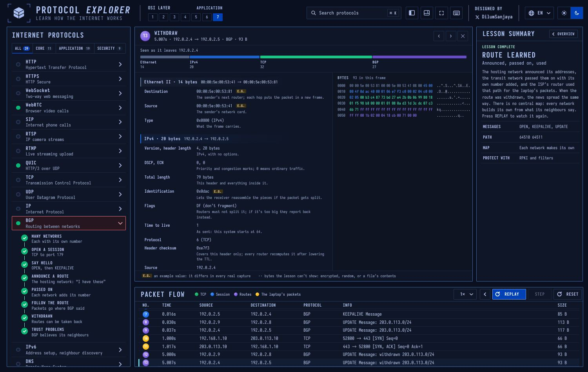

<details><summary>Decoded fields</summary>

```text
13
WITHDRAW
5.007s · 192.0.2.4 → 192.0.2.5 · BGP · 93 B
Seen as it leaves 192.0.2.4
Ethernet
14
IPv4
20
TCP
32
BGP
27
Ethernet II · 14 bytes
00:00:5e:00:53:41 → 00:00:5e:00:53:81
Destination
00:00:5e:00:53:81 E.G.

The sender’s next router; each hop puts the packet in a new frame.

Source
00:00:5e:00:53:41 E.G.

The sender’s network card.

Type
0x0800 (IPv4)

What the frame carries.

IPv4 · 20 bytes
192.0.2.4 → 192.0.2.5
Version, header length
4, 20 bytes

IPv4, with no options.

DSCP, ECN
0, 0

Priority and congestion marks; 0 means ordinary traffic.

Total length
79 bytes

This header and everything inside it.

Identification
0x0dac E.G.

Lets the receiver reassemble the pieces if the packet gets split.

Flags
DF (don’t fragment)

Routers must not split it; if it’s too big they report back instead.

Time to live
1

As sent: this system starts at 64.

Protocol
6 (TCP)
Header checksum
0xe7f3

Covers this header only; every router recomputes it after lowering the TTL.

Source
192.0.2.4
Destination
192.0.2.5
TCP · 32 bytes
179 → 50311, PSH, ACK
Source port
179
Destination port
50311
Sequence number
116 (relative)

Position of this segment’s first byte, counted from this side’s SYN.

Real sequence number
1941776356 E.G.
Acknowledgment
65 (relative)

The next byte this side expects: everything before it has arrived.

Header length
32 bytes

20 bytes, plus 12 of options.

Flags
0x018 (PSH, ACK)
Window
501 (× 128 = 64,128 bytes) E.G.

How much more data this side can take right now.

Checksum
0x98b8

Covers the header, the data and the IP addresses, so damage is caught.

Urgent pointer
0
Options
12 bytes
No-op
1

Spacing, so the next option lines up.

No-op
1

Spacing, so the next option lines up.

Timestamps
value 3541908700, echo 130247537 E.G.

Used to measure round trips; both sides offered them.

BGP · UPDATE (withdrawal)
Marker
16 bytes of 0xFF

All ones: where a message starts.

Length
27 bytes
Type
2 (UPDATE)

Routes: paths to new addresses, and ones taken back.

Withdrawn routes
4 bytes
Withdrawn
203.0.113.0/24

These addresses can no longer be reached through this router.

Path attributes
0 bytes
BYTES 93 in this frame
0000
00
00
5e
00
53
81
00
00
5e
00
53
41
08
00
45
00
.
.
^
.
S
.
.
.
^
.
S
A
.
.
E
.
0010
00
4f
0d
ac
40
00
01
06
e7
f3
c0
00
02
04
c0
00
.
O
.
.
@
.
.
.
.
.
.
.
.
.
.
.
0020
02
05
00
b3
c4
87
73
bd
27
e4
2b
0b
06
99
80
18
.
.
.
.
.
.
s
.
'
.
+
.
.
.
.
.
0030
01
f5
98
b8
00
00
01
01
08
0a
d3
1d
3c
dc
07
c3
.
.
.
.
.
.
.
.
.
.
.
.
<
.
.
.
0040
6b
71
ff
ff
ff
ff
ff
ff
ff
ff
ff
ff
ff
ff
ff
ff
k
q
.
.
.
.
.
.
.
.
.
.
.
.
.
.
0050
ff
ff
00
1b
02
00
04
18
cb
00
71
00
00
.
.
.
.
.
.
.
.
.
.
q
.
.
E.G. an example value: it differs in every real capture
·· bytes the lesson can’t show: encrypted, random, or a file’s contents
```

</details>

---

<!-- nav -->
⬅ [11 IP](11-ip.md) · [Index](00_Protocols_Index.md) · [13 IPv6](13-ipv6.md) ➡
<!-- nav -->
