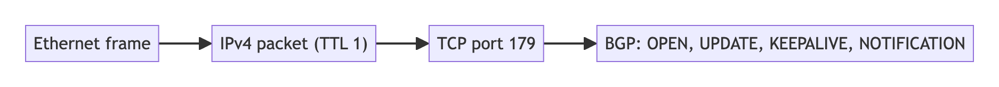
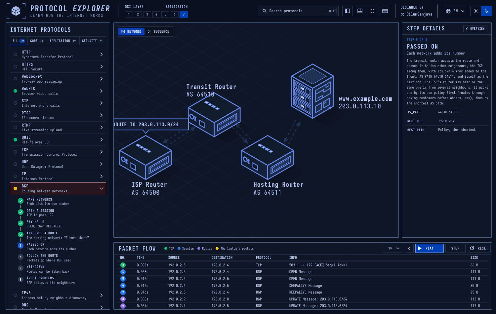
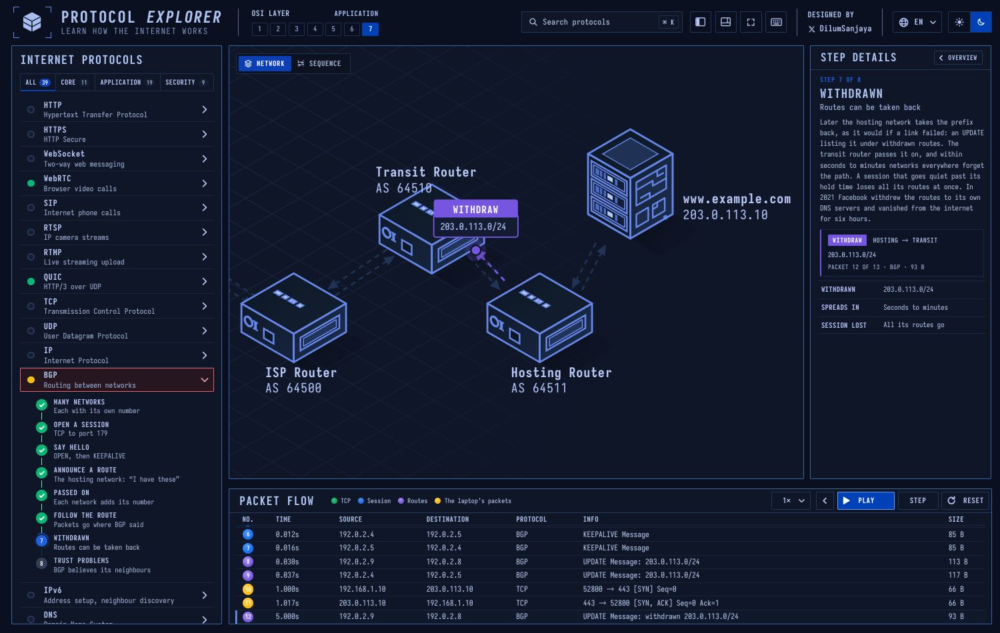
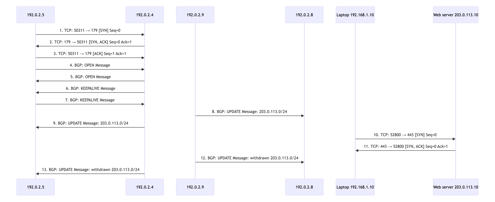
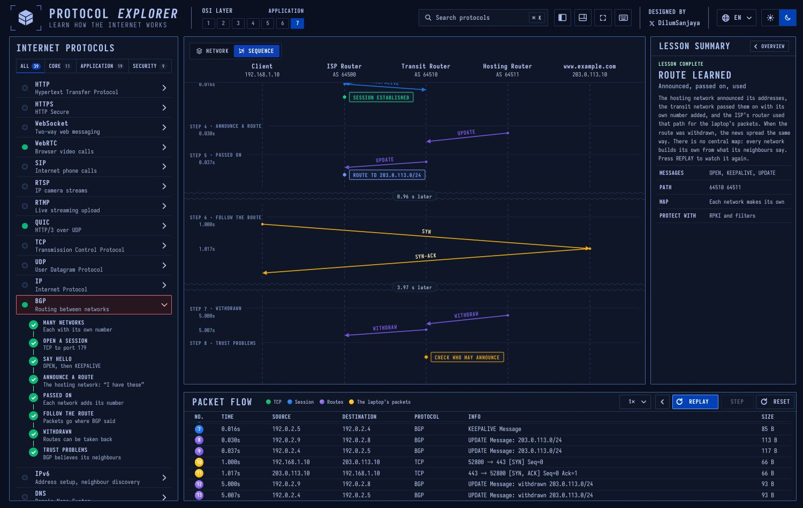

# BGP – Routing between networks

<!-- nav -->
⬅ [11 IP](11-ip.md) · [Index](00_Protocols_Index.md) · [13 IPv6](13-ipv6.md) ➡
<!-- nav -->

*Source: Protocol Explorer – https://protocol-explorer-alpha.vercel.app/ (interactive lesson #12). Screenshots captured from the live lesson; packet decodes are the site's example capture (values marked **E.G.** differ in every real capture).*

## Overview

### How the layers fit together (outer to inner)

## In-depth explanation of the example (plain-language version)

### The big picture in one minute
The internet is a "network of networks". In this example there are three: the laptop's ISP (**AS 64500**), a middle "transit" provider (**AS 64510**) and the hosting company of `www.example.com` (**AS 64511**). The hosting company owns the address block **`203.0.113.0/24`** and wants the whole world to be able to reach it. The lesson shows **13 messages**: two routers opening a conversation, the route being **announced and passed along**, the laptop's traffic using it, and finally the route being **withdrawn**.

**What BGP does.** The internet is made of more than 75,000 independent networks called **autonomous systems (ASes)**: ISPs, cloud companies, universities, big firms. Each has an **AS number**. Inside a network, other protocols find paths. **BGP is the protocol the networks use to talk to each other.** Their border routers say: *"I can reach these address blocks. Send them through me."*

Think of **airlines sharing route maps**: each one tells the others where it can fly, and every airport builds its own table of how to get anywhere.

> **Words you'll see:** *AS* = one independent network with its own number. *Prefix* = a block of addresses such as `203.0.113.0/24`. *Neighbour* = a router you've agreed to exchange routes with. *Route* = "to reach this prefix, go via that router."

---

### Step 1 – Networks and their numbers
Each network has a number (here 64500–64511, numbers reserved for examples). Their routers have to share **reachability information**. Business deals (customer, provider, peer) decide which routes each is willing to carry.

### Step 2 – Opening a conversation (TCP port 179) – packets 1 to 3
BGP routers **don't find each other automatically.** Engineers configure each other as neighbours. The ISP router opens a **TCP connection to port 179** of the transit router (SYN, SYN-ACK, ACK). These packets have **TTL = 1**, so they can't pass even one extra router. That means BGP only works between **directly connected** neighbours, which is a simple safety measure.

### Step 3 – Introductions: OPEN and KEEPALIVE – packets 4 to 7
- Each side sends an **OPEN** message: "BGP version 4, my AS number is …, I'll wait up to **180 seconds** between messages, my router ID is …, and I support these features."
- Each replies with a tiny **KEEPALIVE**. Once both are exchanged, the session is **ESTABLISHED**.
- Afterwards, a KEEPALIVE goes out every **60 seconds** if there's nothing else to say. If **180 seconds** pass in silence, the session is torn down and **every route learned from that neighbour is deleted.**
- The four BGP message types are: **OPEN, UPDATE, NOTIFICATION, KEEPALIVE.**

### Step 4 – Announcing the route – packets 8, 9
- **Packet 8 (hosting → transit):** an **UPDATE** saying "I can reach `203.0.113.0/24`." It includes the **AS path** `64511` (the route starts in network 64511) and the **next hop** (which router to send traffic to).
- **Packet 9 (transit → ISP):** the transit router accepts it and, when passing it on, **adds its own AS number to the front**: `64510 64511`, with itself as the next hop. Every network does the same, so the path grows by one number for each network crossed.
- **Loop protection:** if a router sees **its own number** in the path, it throws the route away.
- **Choosing between routes:** a router may hear about the same prefix from several neighbours. It decides first by **its own business rules** (for example "prefer routes from paying customers"), and only then the **shortest AS path**. In practice, business policy beats the shortest route.

### Step 5 – Using the route – packets 10, 11
After DNS gives `203.0.113.10`, the laptop's SYN (packet 10) reaches the ISP. The ISP's router has a route for `203.0.113.0/24` via the transit network, which forwards it to the hosting network. The SYN-ACK comes back (packet 11). **BGP only builds the map; ordinary IP forwarding moves the packets.** The way back is chosen separately by the other networks, so **the return path is often different from the outgoing path.**

### Step 6 – Withdrawing the route – packets 12, 13
Later the hosting company takes the prefix away (a link failed, or maintenance). It sends an **UPDATE** listing `203.0.113.0/24` as **withdrawn** (packet 12), and the transit router passes it on (packet 13). Within seconds or minutes, networks everywhere forget the path and traffic to those addresses stops.
**A real example:** in 2021 Facebook accidentally withdrew the routes to its own servers and **disappeared from the internet for about six hours.** A related risk is **hijacking**: BGP largely trusts what neighbours say, so someone announcing a prefix they don't own can attract that traffic. A modern defence is **RPKI** (checking that an announcer really owns the prefix).

---

### The 13 messages at a glance
| Packets | What | Why |
|---|---|---|
| 1–3 | TCP handshake (port 179) | open the session |
| 4–7 | OPEN, KEEPALIVE | introduce, confirm, establish |
| 8–9 | UPDATE (announce) | spread the route, adding AS numbers |
| 10–11 | laptop's traffic | use the route |
| 12–13 | UPDATE (withdraw) | remove the route |

### What to remember
- **BGP runs over TCP port 179** between neighbours that are set up by hand. It is a **path-vector** protocol (the AS path is the "path").
- Message types: **OPEN, UPDATE, KEEPALIVE, NOTIFICATION.** Timers: 180 s hold, 60 s keepalive.
- Key route details: **AS path, next hop, local preference, MED, origin, communities.**
- **eBGP** is between different networks; **iBGP** is inside one network. Selection is **policy first, then path length.**
- BGP is the glue of the internet, and also its biggest trust problem.

## Under the hood – technical details

- **Message header.** Every BGP message starts with a 16-byte marker (all ones), a 2-byte length and a 1-byte type: `1` OPEN, `2` UPDATE, `3` NOTIFICATION, `4` KEEPALIVE (just the 19-byte header).
- **OPEN fields.** Version (4), the sender's AS number (4-byte AS numbers are negotiated as a capability), *hold time* (here 180 s), BGP identifier (router ID) and optional capabilities (multiprotocol, route refresh, 4-byte AS).
- **Timers.** If nothing is heard for the hold time, the session is closed and every route learned from that neighbour is withdrawn. Keepalives are sent at one third of the hold time (60 s).
- **Session set-up.** Neighbours are configured manually. The session runs over **TCP port 179**. With `TTL = 1` (the *GTSM* idea) the session works only between directly connected routers.
- **UPDATE contents.** *Withdrawn routes*, *path attributes* and *NLRI* (the prefixes being announced, for example `203.0.113.0/24`).
- **Key path attributes.** `ORIGIN`; `AS_PATH` (the list of AS numbers crossed, with each AS **prepending** its own number when it passes the route on); `NEXT_HOP` (where to send traffic); `LOCAL_PREF` (preference inside one AS, higher wins); `MED` (a hint from a neighbouring AS); `COMMUNITY` (tags used for policy).
- **Loop prevention.** A router that sees its own AS number in the `AS_PATH` of an incoming route rejects it.
- **Best-path selection.** In simplified order: highest `LOCAL_PREF` (business policy first), shortest `AS_PATH`, lowest origin type, lowest `MED`, prefer eBGP over iBGP, lowest IGP cost, lowest router ID. Policy comes first, shortest path second.
- **eBGP vs iBGP.** *eBGP* runs between different ASes. *iBGP* spreads the learned routes inside one AS.
- **Forwarding vs routing.** BGP only builds the table. Packets then move by normal IP forwarding, and the return path is chosen independently, so it is often different (*asymmetric routing*).
- **Scale and security.** The global IPv4 table holds about a million prefixes. BGP trusts what neighbours announce, so mistakes or attacks (*route leaks* and *prefix hijacks*) can redirect traffic. **RPKI** with route-origin validation checks that an AS is allowed to originate a prefix.
- **Famous failure.** In October 2021 Facebook withdrew the routes to its DNS servers and vanished from the internet for roughly six hours.

## Step-by-step walkthrough (screenshots from the lesson)

### Step 1: MANY NETWORKS – Each with its own number

### Step 2: OPEN A SESSION – TCP to port 179

### Step 3: SAY HELLO – OPEN, then KEEPALIVE

### Step 4: ANNOUNCE A ROUTE – The hosting network: “I have these”

### Step 5: PASSED ON – Each network adds its number

### Step 6: FOLLOW THE ROUTE – Packets go where BGP said

### Step 7: WITHDRAWN – Routes can be taken back

### Step 8: TRUST PROBLEMS – BGP believes its neighbours

### Lesson summary

## Packet flow (whole lesson)

| No. | Time | Source | Destination | Protocol | Info | Size |
|---|---|---|---|---|---|---|
| 1 | 0.000s | 192.0.2.5 | 192.0.2.4 | TCP | 50311 → 179 [SYN] Seq=0 | 74 B |
| 2 | 0.004s | 192.0.2.4 | 192.0.2.5 | TCP | 179 → 50311 [SYN, ACK] Seq=0 Ack=1 | 74 B |
| 3 | 0.008s | 192.0.2.5 | 192.0.2.4 | TCP | 50311 → 179 [ACK] Seq=1 Ack=1 | 66 B |
| 4 | 0.008s | 192.0.2.5 | 192.0.2.4 | BGP | OPEN Message | 111 B |
| 5 | 0.012s | 192.0.2.4 | 192.0.2.5 | BGP | OPEN Message | 111 B |
| 6 | 0.012s | 192.0.2.4 | 192.0.2.5 | BGP | KEEPALIVE Message | 85 B |
| 7 | 0.016s | 192.0.2.5 | 192.0.2.4 | BGP | KEEPALIVE Message | 85 B |
| 8 | 0.030s | 192.0.2.9 | 192.0.2.8 | BGP | UPDATE Message: 203.0.113.0/24 | 113 B |
| 9 | 0.037s | 192.0.2.4 | 192.0.2.5 | BGP | UPDATE Message: 203.0.113.0/24 | 117 B |
| 10 | 1.000s | 192.168.1.10 | 203.0.113.10 | TCP | 52800 → 443 [SYN] Seq=0 | 66 B |
| 11 | 1.017s | 203.0.113.10 | 192.168.1.10 | TCP | 443 → 52800 [SYN, ACK] Seq=0 Ack=1 | 66 B |
| 12 | 5.000s | 192.0.2.9 | 192.0.2.8 | BGP | UPDATE Message: withdrawn 203.0.113.0/24 | 93 B |
| 13 | 5.007s | 192.0.2.4 | 192.0.2.5 | BGP | UPDATE Message: withdrawn 203.0.113.0/24 | 93 B |

### Sequence diagram

*The lesson's own sequence diagram:*

## Packet decoder screenshots

The lesson's decoder view for the first, middle and last packet: headers, field values and the raw hex bytes.

### Packet 1: TCP – 50311 → 179 [SYN] Seq=0

*192.0.2.5 → 192.0.2.4 · 74 B · t = 0.000s*

### Packet 7: BGP – KEEPALIVE Message

*192.0.2.5 → 192.0.2.4 · 85 B · t = 0.016s*

### Packet 13: BGP – UPDATE Message: withdrawn 203.0.113.0/24

*192.0.2.4 → 192.0.2.5 · 93 B · t = 5.007s*

---

<!-- nav -->
⬅ [11 IP](11-ip.md) · [Index](00_Protocols_Index.md) · [13 IPv6](13-ipv6.md) ➡
<!-- nav -->
