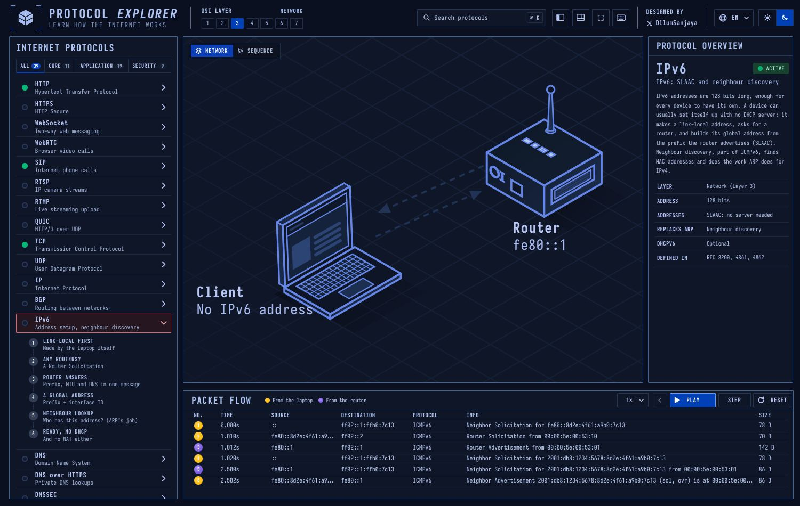
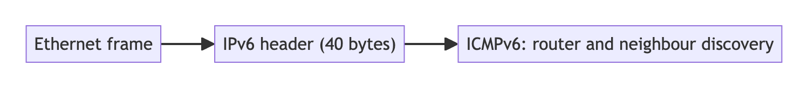
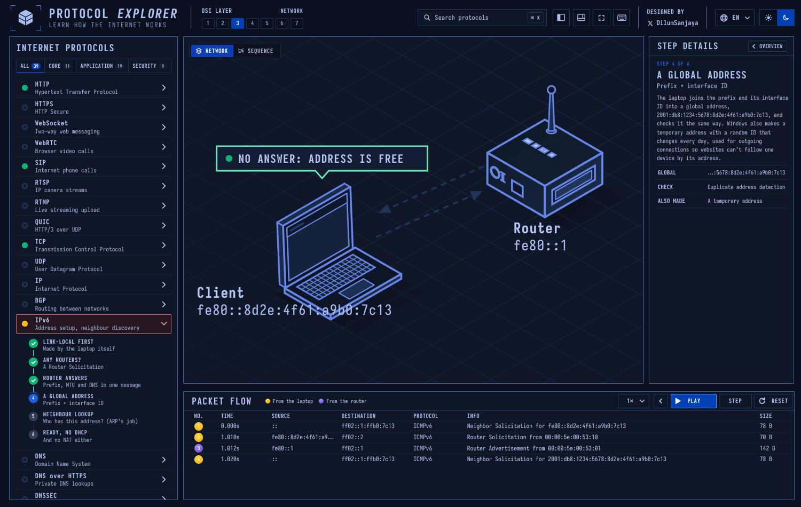
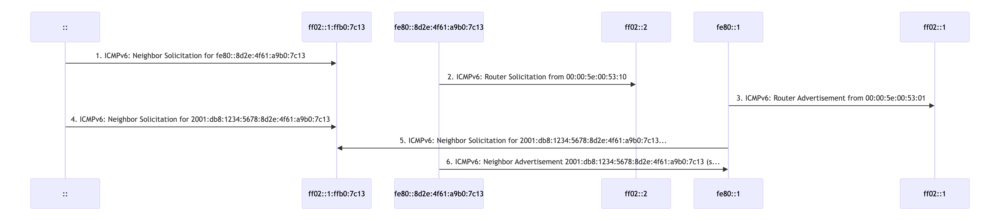
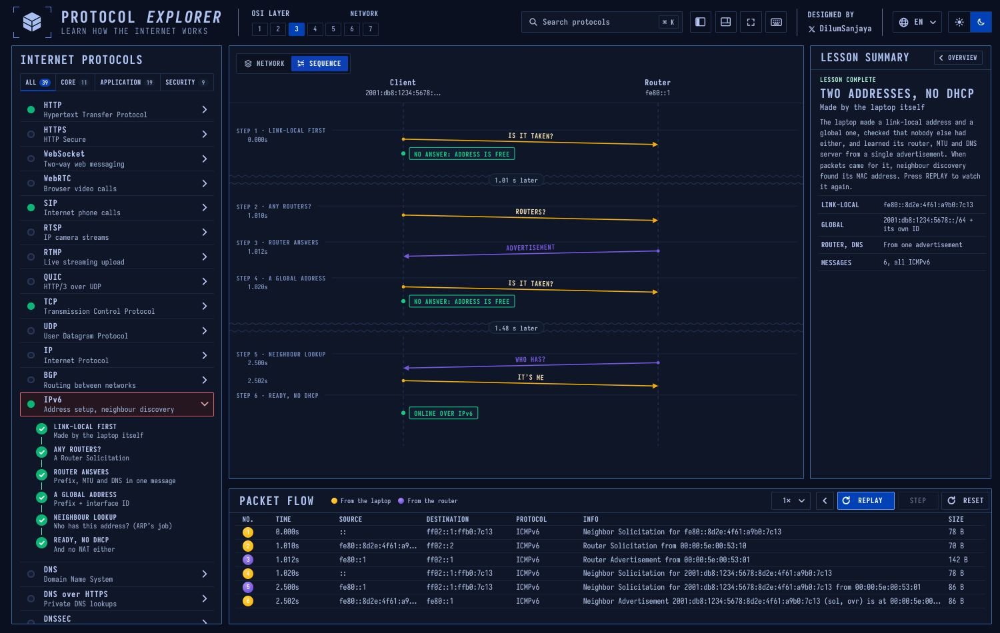
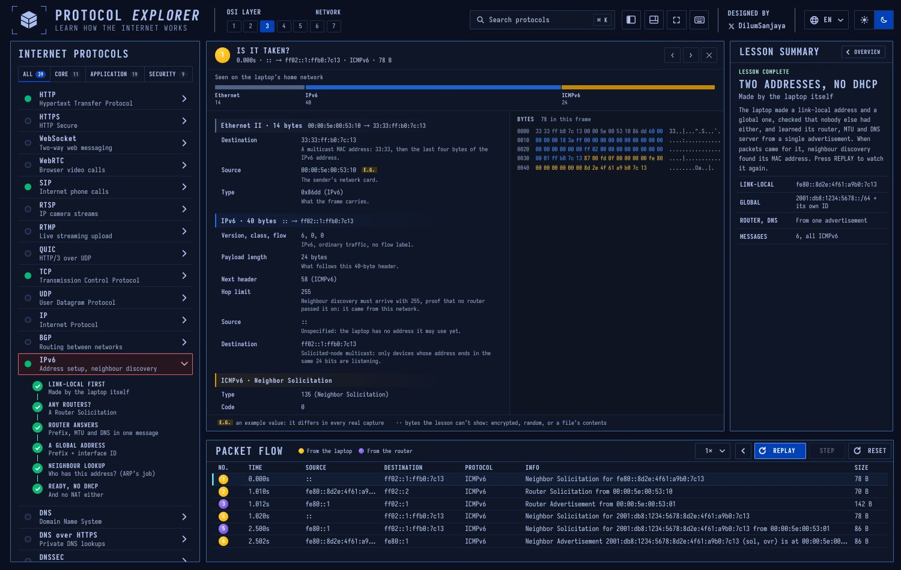
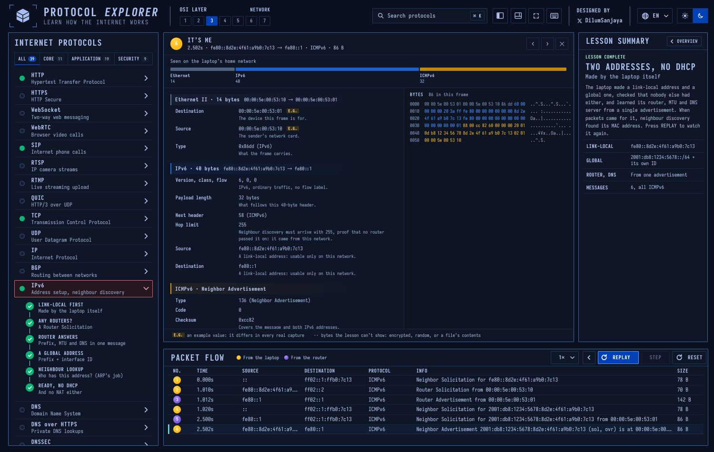

# IPv6 – Address setup, neighbour discovery

<!-- nav -->
⬅ [12 BGP](12-bgp.md) · [Index](00_Protocols_Index.md) · [14 DNS](14-dns.md) ➡
<!-- nav -->

*Source: Protocol Explorer – https://protocol-explorer-alpha.vercel.app/ (interactive lesson #13). Screenshots captured from the live lesson; packet decodes are the site's example capture (values marked **E.G.** differ in every real capture).*

## Overview

### How the layers fit together (outer to inner)

## In-depth explanation of the example (plain-language version)

### The big picture in one minute
A laptop joins a home network whose router offers IPv6. **Without any DHCP server**, the laptop gives itself a local address, learns the network's address block from the router, builds its own internet address, and is later found by the router. **6 messages in 2.5 seconds, all of a type called ICMPv6.**

**Why IPv6 exists.** IPv4 addresses (like `192.168.1.10`) are only 32 bits, and they have run out. IPv6 addresses are **128 bits**, written in hex like `2001:db8:1234:5678::/64`. That's enough for every device to have its **own unique worldwide address**, so NAT isn't needed. IPv6 can also **set itself up** (called **SLAAC**) and replaces ARP with **neighbour discovery**.

Think of moving into a new street: you give yourself a house number that only works on that street, ask "is there a post office here?", the post office tells you the street's postcode and where the information desk is, and you then build your full address.

> **Words you'll see:** *Link-local address* = an address valid only on your own network segment (starts with `fe80`). *Multicast* = sending to a group instead of everyone. *Prefix* = the first part of an address that names the network. *Interface ID* = the second part that names the device.

---

### Step 1 – Make a local address and check it's unique – packet 1
- Every IPv6 device has a **link-local address** starting with `fe80::`. The laptop makes one by adding a 64-bit "interface ID" (random-looking; older systems derived it from the network card's MAC address, which leaked the hardware identity, so modern systems use random ones).
- Before using it, the laptop checks nobody else has it, called **Duplicate Address Detection**. It sends a **Neighbor Solicitation**: "Does anyone have `fe80::8d2e:…`?" It's sent from `::` (the "no address yet" address) to a special **multicast group** made from the last part of the address, so only devices with a similar-ending address even look at it.
- **Nobody answers**, so the address is unique and the laptop keeps it.

### Step 2 – "Is there a router here?" – packet 2
A link-local address can't reach the internet. The laptop sends a **Router Solicitation** to the "all routers" group, including its MAC address so the router can reply directly.

### Step 3 – The router answers – packet 3
The router sends a **Router Advertisement** that carries everything the laptop needs:
- **Router lifetime 1800 s:** "use me as your gateway for 30 minutes."
- The router's own **MAC address.**
- The **MTU 1500** (the biggest packet size).
- The **prefix `2001:db8:1234:5678::/64`**, marked "on this network" and "you may build your own address from it."
- A **DNS server** address.
Routers also send these unasked every few minutes. **One packet gave the laptop its gateway, prefix, packet size and DNS.**

### Step 4 – Build the global address – packet 4
The laptop joins **prefix + interface ID** to make `2001:db8:1234:5678:8d2e:4f61:a9b0:7c13` and runs the uniqueness check again. Modern systems also create a **temporary "privacy" address** that changes every day and is used for outgoing connections, so websites can't track one device by a fixed address.

### Step 5 – Finding the laptop on the local network (ARP's replacement) – packets 5, 6
When a reply from the internet arrives at the router for the laptop's global address, the router needs the laptop's MAC address:
- **Packet 5:** the router sends a **Neighbor Solicitation** to the small multicast group: "Who has `2001:db8:…:7c13`?"
- **Packet 6:** the laptop answers with a **Neighbor Advertisement**: "That's me, at `00:00:5e:00:53:10`." The router remembers it.
Unlike IPv4's ARP, **nobody is shouted at**: the question goes only to a tiny group, so other devices aren't disturbed.

---

### The 6 messages at a glance
| Packet | What | Why |
|---|---|---|
| 1 | Neighbor Solicitation (uniqueness check) | verify the local address |
| 2 | Router Solicitation | ask for a router |
| 3 | Router Advertisement | get the prefix, gateway, DNS |
| 4 | Neighbor Solicitation (uniqueness check) | verify the global address |
| 5 | Neighbor Solicitation from router | find the laptop's MAC |
| 6 | Neighbor Advertisement | answer with the MAC |

### What to remember
- **Three kinds of address:** link-local `fe80::/10`, global `2000::/3`, multicast `ff00::/8`. **There is no broadcast in IPv6.**
- **ICMPv6 message numbers:** 133 Router Solicitation, 134 Router Advertisement, 135 Neighbor Solicitation, 136 Neighbor Advertisement.
- **Automatic set-up (SLAAC):** local address → uniqueness check → ask for router → router advertisement → global address → check. No DHCP needed (DHCPv6 is optional).
- The standard subnet is **/64** (64 bits of network + 64 bits of device).
- The IPv6 header is a simple fixed 40 bytes, has no checksum, and routers never split packets.
- Neighbour discovery isn't authenticated by default, so a rogue router on the LAN can mislead devices. RA-Guard and SEND are defences.

## Under the hood – technical details

- **Address format.** 128 bits written as eight groups of 16-bit hex numbers, `2001:0db8:1234:5678:...`; leading zeros can be dropped and one run of zero groups can be replaced by `::`. The standard subnet is a **/64**: a 64-bit network prefix plus a 64-bit interface ID.
- **Address types.** *Link-local* `fe80::/10` (valid on one segment only), *global unicast* `2000::/3`, *unique local* `fc00::/7`, and *multicast* `ff00::/8`. **There is no broadcast**; multicast takes its place.
- **Header.** A fixed 40 bytes: version, traffic class, flow label, payload length, next header, hop limit (the TTL of IPv6), source and destination. There is no header checksum and routers never fragment; only the sending host does, after Path MTU Discovery.
- **Interface ID.** Older systems derived it from the MAC address (*EUI-64*), which revealed the hardware identity. Modern systems use random, stable-per-network IDs and also create **temporary privacy addresses** that rotate (often daily) for outgoing connections.
- **Neighbour discovery (ICMPv6).** Type `133` Router Solicitation, `134` Router Advertisement, `135` Neighbor Solicitation, `136` Neighbor Advertisement. It replaces ARP, finds routers and detects duplicate addresses.
- **Solicited-node multicast.** The address is `ff02::1:ff` + the last 24 bits of the target address. Only machines whose address ends with the same 24 bits listen, so other hosts are not disturbed (unlike ARP's broadcast to everyone).
- **Duplicate Address Detection.** Before using an address, the host sends a Neighbor Solicitation for it from the unspecified address `::`. If anyone answers, the address is taken.
- **Router Advertisement contents.** Router lifetime (1,800 s), the router's MAC, MTU, one or more *prefix information* options with the **L** flag (on-link) and **A** flag (autonomous, so SLAAC may use it), and the **RDNSS** option with DNS servers. The **M** and **O** flags tell hosts to also use DHCPv6 for addresses or other settings.
- **SLAAC.** Stateless Address Autoconfiguration: prefix + self-made interface ID, no server keeps a list.
- **Security.** Neighbour discovery is unauthenticated by default, so a rogue router advertisement can misdirect hosts. Switches use *RA-Guard*; *SEND* adds cryptographic protection.
- **Transition.** Networks often run dual-stack (IPv4 and IPv6), with NAT64/DNS64 or tunnels for older parts.

## Step-by-step walkthrough

### Step 1: LINK-LOCAL FIRST – Made by the laptop itself

### Step 2: ANY ROUTERS? – A Router Solicitation

### Step 3: ROUTER ANSWERS – Prefix, MTU and DNS in one message

### Step 4: A GLOBAL ADDRESS – Prefix + interface ID

### Step 5: NEIGHBOUR LOOKUP – Who has this address? (ARP’s job)

### Step 6: READY, NO DHCP – And no NAT either

### Lesson summary

## Packet flow (whole lesson)

| No. | Time | Source | Destination | Protocol | Info | Size |
|---|---|---|---|---|---|---|
| 1 | 0.000s | :: | ff02::1:ffb0:7c13 | ICMPv6 | Neighbor Solicitation for fe80::8d2e:4f61:a9b0:7c13 | 78 B |
| 2 | 1.010s | fe80::8d2e:4f61:a9b0:7c13 | ff02::2 | ICMPv6 | Router Solicitation from 00:00:5e:00:53:10 | 70 B |
| 3 | 1.012s | fe80::1 | ff02::1 | ICMPv6 | Router Advertisement from 00:00:5e:00:53:01 | 142 B |
| 4 | 1.020s | :: | ff02::1:ffb0:7c13 | ICMPv6 | Neighbor Solicitation for 2001:db8:1234:5678:8d2e:4f61:a9b0:7c13 | 78 B |
| 5 | 2.500s | fe80::1 | ff02::1:ffb0:7c13 | ICMPv6 | Neighbor Solicitation for 2001:db8:1234:5678:8d2e:4f61:a9b0:7c13 from 00:00:5e:00:53:01 | 86 B |
| 6 | 2.502s | fe80::8d2e:4f61:a9b0:7c13 | fe80::1 | ICMPv6 | Neighbor Advertisement 2001:db8:1234:5678:8d2e:4f61:a9b0:7c13 (sol, ovr) is at 00:00:5e:00:53:10 | 86 B |

### Sequence diagram

*The lesson's own sequence diagram:*

## Packet decoder screenshots

The lesson's decoder view for the first, middle and last packet: headers, field values and the raw hex bytes.

### Packet 1: ICMPv6 – Neighbor Solicitation for fe80::8d2e:4f61:a9b0:7c13

*:: → ff02::1:ffb0:7c13 · 78 B · t = 0.000s*

### Packet 4: ICMPv6 – Neighbor Solicitation for 2001:db8:1234:5678:8d2e:4f61:a9b0:7c13

*:: → ff02::1:ffb0:7c13 · 78 B · t = 1.020s*

### Packet 6: ICMPv6 – Neighbor Advertisement 2001:db8:1234:5678:8d2e:4f61:a9b0:7c13 (sol, ovr) is at 00:00:5e:00:53:10

*fe80::8d2e:4f61:a9b0:7c13 → fe80::1 · 86 B · t = 2.502s*

---

<!-- nav -->
⬅ [12 BGP](12-bgp.md) · [Index](00_Protocols_Index.md) · [14 DNS](14-dns.md) ➡
<!-- nav -->
