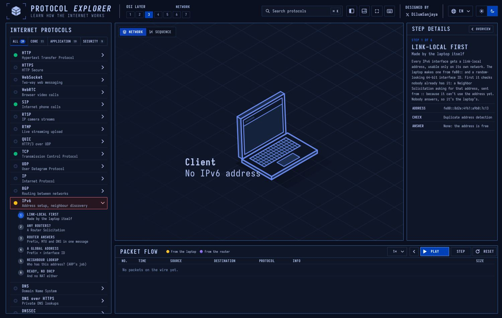
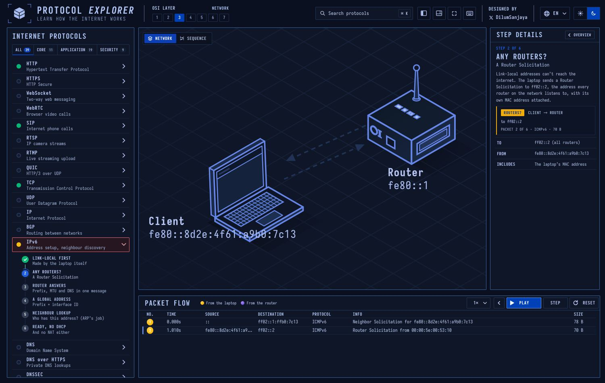
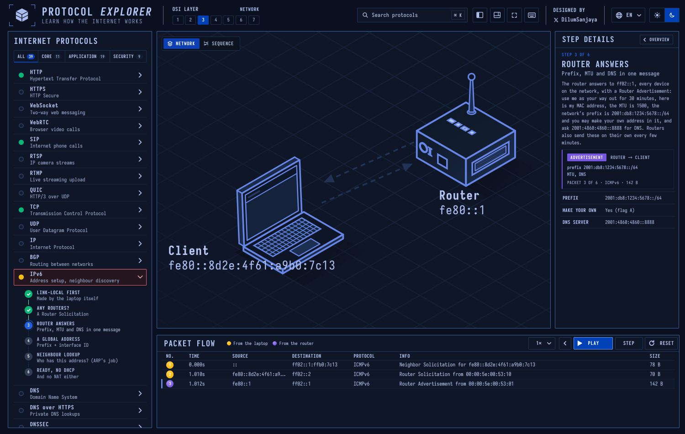
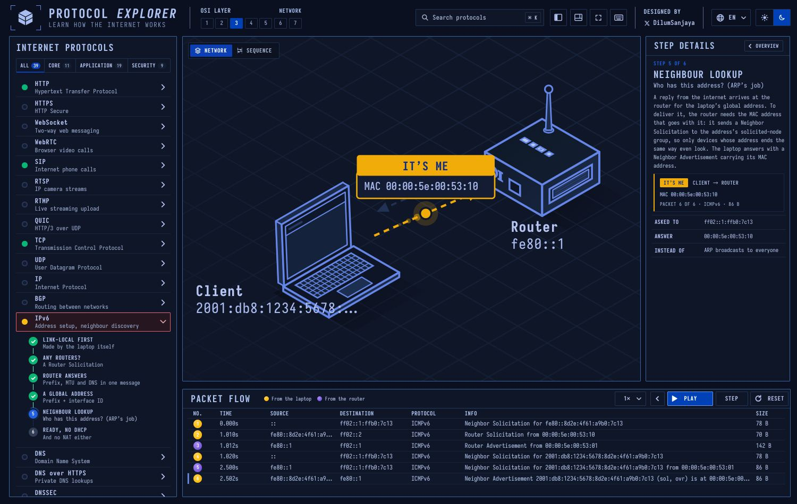
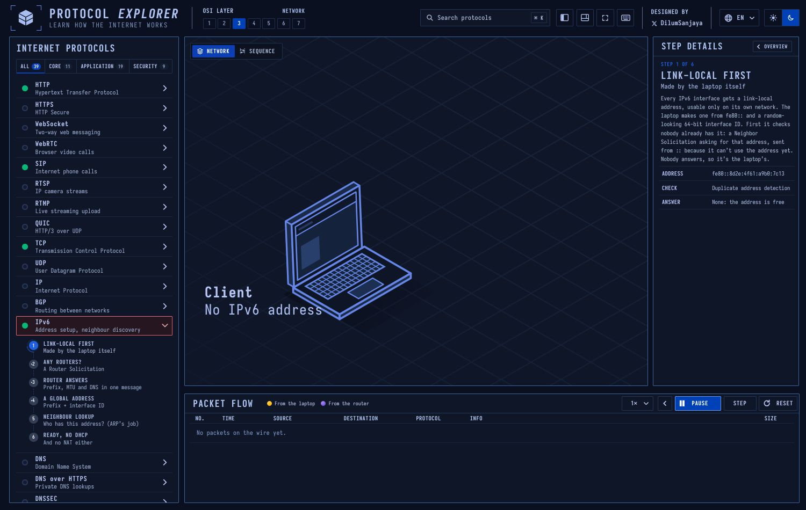
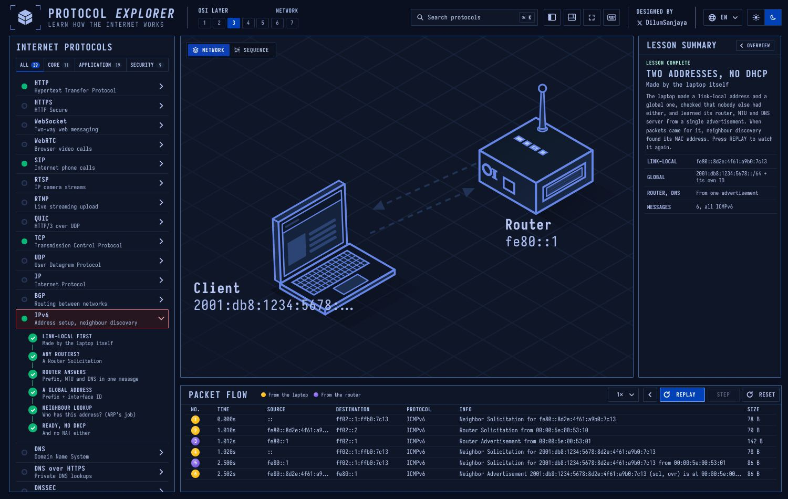
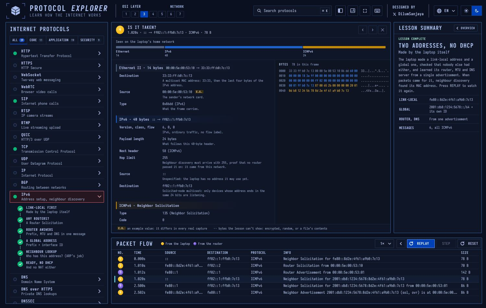

# IPv6 – Address setup, neighbour discovery

<!-- nav -->
⬅ [12 BGP](12-bgp.md) · [Index](00_Protocols_Index.md) · [14 DNS](14-dns.md) ➡
<!-- nav -->

*Source: Protocol Explorer – https://protocol-explorer-alpha.vercel.app/ (interactive lesson #13). Screenshots captured from the live lesson; packet decodes are the site's example capture (values marked **E.G.** differ in every real capture).*

## Overview


> PROTOCOL OVERVIEW  
> IPv6  
> ACTIVE  
> IPv6: SLAAC and neighbour discovery  
> IPv6 addresses are 128 bits long, enough for every device to have its own. A device can usually set itself up with no DHCP server: it makes a link-local address, asks for a router, and builds its global address from the prefix the router advertises (SLAAC). Neighbour discovery, part of ICMPv6, finds MAC addresses and does the work ARP does for IPv4.  
> LAYER  
> Network (Layer 3)  
> ADDRESS  
> 128 bits  
> ADDRESSES  
> SLAAC: no server needed  
> REPLACES ARP  
> Neighbour discovery  
> DHCPV6  
> Optional  
> DEFINED IN  
> RFC 8200, 4861, 4862  

## In-depth explanation of the example (plain-language version)

### The big picture in one minute
A laptop joins a home network whose router offers IPv6. **Without any DHCP server**, the laptop gives itself a local address, learns the network's address block from the router, builds its own internet address, and is later found by the router. **6 messages in 2.5 seconds, all of a type called ICMPv6.**

**Why IPv6 exists.** IPv4 addresses (like `192.168.1.10`) are only 32 bits, and they have run out. IPv6 addresses are **128 bits**, written in hex like `2001:db8:1234:5678::/64`. That's enough for every device to have its **own unique worldwide address**, so NAT isn't needed. IPv6 can also **set itself up** (called **SLAAC**) and replaces ARP with **neighbour discovery**.

Think of moving into a new street: you give yourself a house number that only works on that street, ask "is there a post office here?", the post office tells you the street's postcode and where the information desk is, and you then build your full address.

> **Words you'll see:** *Link-local address* = an address valid only on your own network segment (starts with `fe80`). *Multicast* = sending to a group instead of everyone. *Prefix* = the first part of an address that names the network. *Interface ID* = the second part that names the device.

---

### Step 1 – Make a local address and check it's unique – packet 1
- Every IPv6 device has a **link-local address** starting with `fe80::`. The laptop makes one by adding a 64-bit "interface ID" (random-looking; older systems derived it from the network card's MAC address, which leaked the hardware identity, so modern systems use random ones).
- Before using it, the laptop checks nobody else has it, called **Duplicate Address Detection**. It sends a **Neighbor Solicitation**: "Does anyone have `fe80::8d2e:…`?" It's sent from `::` (the "no address yet" address) to a special **multicast group** made from the last part of the address, so only devices with a similar-ending address even look at it.
- **Nobody answers**, so the address is unique and the laptop keeps it.

### Step 2 – "Is there a router here?" – packet 2
A link-local address can't reach the internet. The laptop sends a **Router Solicitation** to the "all routers" group, including its MAC address so the router can reply directly.

### Step 3 – The router answers – packet 3
The router sends a **Router Advertisement** that carries everything the laptop needs:
- **Router lifetime 1800 s:** "use me as your gateway for 30 minutes."
- The router's own **MAC address.**
- The **MTU 1500** (the biggest packet size).
- The **prefix `2001:db8:1234:5678::/64`**, marked "on this network" and "you may build your own address from it."
- A **DNS server** address.
Routers also send these unasked every few minutes. **One packet gave the laptop its gateway, prefix, packet size and DNS.**

### Step 4 – Build the global address – packet 4
The laptop joins **prefix + interface ID** to make `2001:db8:1234:5678:8d2e:4f61:a9b0:7c13` and runs the uniqueness check again. Modern systems also create a **temporary "privacy" address** that changes every day and is used for outgoing connections, so websites can't track one device by a fixed address.

### Step 5 – Finding the laptop on the local network (ARP's replacement) – packets 5, 6
When a reply from the internet arrives at the router for the laptop's global address, the router needs the laptop's MAC address:
- **Packet 5:** the router sends a **Neighbor Solicitation** to the small multicast group: "Who has `2001:db8:…:7c13`?"
- **Packet 6:** the laptop answers with a **Neighbor Advertisement**: "That's me, at `00:00:5e:00:53:10`." The router remembers it.
Unlike IPv4's ARP, **nobody is shouted at**: the question goes only to a tiny group, so other devices aren't disturbed.

---

### The 6 messages at a glance
| Packet | What | Why |
|---|---|---|
| 1 | Neighbor Solicitation (uniqueness check) | verify the local address |
| 2 | Router Solicitation | ask for a router |
| 3 | Router Advertisement | get the prefix, gateway, DNS |
| 4 | Neighbor Solicitation (uniqueness check) | verify the global address |
| 5 | Neighbor Solicitation from router | find the laptop's MAC |
| 6 | Neighbor Advertisement | answer with the MAC |

### What to remember
- **Three kinds of address:** link-local `fe80::/10`, global `2000::/3`, multicast `ff00::/8`. **There is no broadcast in IPv6.**
- **ICMPv6 message numbers:** 133 Router Solicitation, 134 Router Advertisement, 135 Neighbor Solicitation, 136 Neighbor Advertisement.
- **Automatic set-up (SLAAC):** local address → uniqueness check → ask for router → router advertisement → global address → check. No DHCP needed (DHCPv6 is optional).
- The standard subnet is **/64** (64 bits of network + 64 bits of device).
- The IPv6 header is a simple fixed 40 bytes, has no checksum, and routers never split packets.
- Neighbour discovery isn't authenticated by default, so a rogue router on the LAN can mislead devices. RA-Guard and SEND are defences.

## Step-by-step walkthrough (screenshots from the lesson)

### Step 1: LINK-LOCAL FIRST – Made by the laptop itself



> STEP 1 OF 6  
> LINK-LOCAL FIRST  
> Made by the laptop itself  
> Every IPv6 interface gets a link-local address, usable only on its own network. The laptop makes one from fe80:: and a random-looking 64-bit interface ID. First it checks nobody already has it: a Neighbor Solicitation asking for that address, sent from :: because it can’t use the address yet. Nobody answers, so it’s the laptop’s.  
> ADDRESS  
> fe80::8d2e:4f61:a9b0:7c13  
> CHECK  
> Duplicate address detection  
> ANSWER  
> None: the address is free  

### Step 2: ANY ROUTERS? – A Router Solicitation



> STEP 2 OF 6  
> ANY ROUTERS?  
> A Router Solicitation  
> Link-local addresses can’t reach the internet. The laptop sends a Router Solicitation to ff02::2, the address every router on the network listens to, with its own MAC address attached.  
> ROUTERS?  
> CLIENT → ROUTER  
> to ff02::2  
> PACKET 2 OF 6 · ICMPv6 · 70 B  
> TO  
> ff02::2 (all routers)  
> FROM  
> fe80::8d2e:4f61:a9b0:7c13  
> INCLUDES  
> The laptop’s MAC address  

### Step 3: ROUTER ANSWERS – Prefix, MTU and DNS in one message



> STEP 3 OF 6  
> ROUTER ANSWERS  
> Prefix, MTU and DNS in one message  
> The router answers to ff02::1, every device on the network, with a Router Advertisement: use me as your way out for 30 minutes, here is my MAC address, the MTU is 1500, the network’s prefix is 2001:db8:1234:5678::/64 and you may make your own address in it, and ask 2001:4860:4860::8888 for DNS. Routers also send these on their own every few minutes.  
> ADVERTISEMENT  
> ROUTER → CLIENT  
> prefix 2001:db8:1234:5678::/64  
> MTU, DNS  
> PACKET 3 OF 6 · ICMPv6 · 142 B  
> PREFIX  
> 2001:db8:1234:5678::/64  
> MAKE YOUR OWN  
> Yes (flag A)  
> DNS SERVER  
> 2001:4860:4860::8888  

### Step 4: A GLOBAL ADDRESS – Prefix + interface ID


> STEP 4 OF 6  
> A GLOBAL ADDRESS  
> Prefix + interface ID  
> The laptop joins the prefix and its interface ID into a global address, 2001:db8:1234:5678:8d2e:4f61:a9b0:7c13, and checks it the same way. Windows also makes a temporary address with a random ID that changes every day, used for outgoing connections so websites can’t follow one device by its address.  
> IS IT TAKEN?  
> CLIENT → ROUTER  
> from ::  
> target the global address  
> PACKET 4 OF 6 · ICMPv6 · 78 B  
> GLOBAL  
> …:5678:8d2e:4f61:a9b0:7c13  
> CHECK  
> Duplicate address detection  
> ALSO MADE  
> A temporary address  

### Step 5: NEIGHBOUR LOOKUP – Who has this address? (ARP’s job)



> STEP 5 OF 6  
> NEIGHBOUR LOOKUP  
> Who has this address? (ARP’s job)  
> A reply from the internet arrives at the router for the laptop’s global address. To deliver it, the router needs the MAC address that goes with it: it sends a Neighbor Solicitation to the address’s solicited-node group, so only devices whose address ends the same way even look. The laptop answers with a Neighbor Advertisement carrying its MAC address.  
> IT’S ME  
> CLIENT → ROUTER  
> MAC 00:00:5e:00:53:10  
> PACKET 6 OF 6 · ICMPv6 · 86 B  
> ASKED TO  
> ff02::1:ffb0:7c13  
> ANSWER  
> 00:00:5e:00:53:10  
> INSTEAD OF  
> ARP broadcasts to everyone  

### Step 6: READY, NO DHCP – And no NAT either



> STEP 1 OF 6  
> LINK-LOCAL FIRST  
> Made by the laptop itself  
> Every IPv6 interface gets a link-local address, usable only on its own network. The laptop makes one from fe80:: and a random-looking 64-bit interface ID. First it checks nobody already has it: a Neighbor Solicitation asking for that address, sent from :: because it can’t use the address yet. Nobody answers, so it’s the laptop’s.  
> IT’S ME  
> CLIENT → ROUTER  
> MAC 00:00:5e:00:53:10  
> PACKET 6 OF 6 · ICMPv6 · 86 B  
> ADDRESS  
> fe80::8d2e:4f61:a9b0:7c13  
> CHECK  
> Duplicate address detection  
> ANSWER  
> None: the address is free  

### Lesson summary



> LESSON SUMMARY  
> LESSON COMPLETE  
> TWO ADDRESSES, NO DHCP  
> Made by the laptop itself  
> The laptop made a link-local address and a global one, checked that nobody else had either, and learned its router, MTU and DNS server from a single advertisement. When packets came for it, neighbour discovery found its MAC address. Press REPLAY to watch it again.  
> IT’S ME  
> CLIENT → ROUTER  
> MAC 00:00:5e:00:53:10  
> PACKET 6 OF 6 · ICMPv6 · 86 B  
> LINK-LOCAL  
> fe80::8d2e:4f61:a9b0:7c13  
> GLOBAL  
> 2001:db8:1234:5678::/64 + its own ID  
> ROUTER, DNS  
> From one advertisement  
> MESSAGES  
> 6, all ICMPv6  

## Packet flow (whole lesson)

| No. | Time | Source | Destination | Protocol | Info | Size |
|---|---|---|---|---|---|---|
| 1 | 0.000s | :: | ff02::1:ffb0:7c13 | ICMPv6 | Neighbor Solicitation for fe80::8d2e:4f61:a9b0:7c13 | 78 B |
| 2 | 1.010s | fe80::8d2e:4f61:a9b0:7c13 | ff02::2 | ICMPv6 | Router Solicitation from 00:00:5e:00:53:10 | 70 B |
| 3 | 1.012s | fe80::1 | ff02::1 | ICMPv6 | Router Advertisement from 00:00:5e:00:53:01 | 142 B |
| 4 | 1.020s | :: | ff02::1:ffb0:7c13 | ICMPv6 | Neighbor Solicitation for 2001:db8:1234:5678:8d2e:4f61:a9b0:7c13 | 78 B |
| 5 | 2.500s | fe80::1 | ff02::1:ffb0:7c13 | ICMPv6 | Neighbor Solicitation for 2001:db8:1234:5678:8d2e:4f61:a9b0:7c13 from 00:00:5e:00:53:01 | 86 B |
| 6 | 2.502s | fe80::8d2e:4f61:a9b0:7c13 | fe80::1 | ICMPv6 | Neighbor Advertisement 2001:db8:1234:5678:8d2e:4f61:a9b0:7c13 (sol, ovr) is at 00:00:5e:00:53:10 | 86 B |

### Sequence diagram


## Packets decoded byte by byte

Each packet below is the lesson's own decode (headers, field values and the plain-English meaning of each field). Screenshots show the first, middle and last packet in the lesson's decoder view with the raw hex bytes.

### Packet 1: ICMPv6 – Neighbor Solicitation for fe80::8d2e:4f61:a9b0:7c13

*:: → ff02::1:ffb0:7c13 · 78 B · t = 0.000s*


<details><summary>Decoded fields</summary>

```text
1
IS IT TAKEN?
0.000s · :: → ff02::1:ffb0:7c13 · ICMPv6 · 78 B
Seen on the laptop’s home network
Ethernet
14
IPv6
40
ICMPv6
24
Ethernet II · 14 bytes
00:00:5e:00:53:10 → 33:33:ff:b0:7c:13
Destination
33:33:ff:b0:7c:13

A multicast MAC address: 33:33, then the last four bytes of the IPv6 address.

Source
00:00:5e:00:53:10 E.G.

The sender’s network card.

Type
0x86dd (IPv6)

What the frame carries.

IPv6 · 40 bytes
:: → ff02::1:ffb0:7c13
Version, class, flow
6, 0, 0

IPv6, ordinary traffic, no flow label.

Payload length
24 bytes

What follows this 40-byte header.

Next header
58 (ICMPv6)
Hop limit
255

Neighbour discovery must arrive with 255, proof that no router passed it on: it came from this network.

Source
::

Unspecified: the laptop has no address it may use yet.

Destination
ff02::1:ffb0:7c13

Solicited-node multicast: only devices whose address ends in the same 24 bits are listening.

ICMPv6 · Neighbor Solicitation
Type
135 (Neighbor Solicitation)
Code
0
Checksum
0xfd0f

Covers the message and both IPv6 addresses.

Reserved
0
Target
fe80::8d2e:4f61:a9b0:7c13

The address the laptop wants to use. If anyone answers, it’s taken.

BYTES 78 in this frame
0000
33
33
ff
b0
7c
13
00
00
5e
00
53
10
86
dd
60
00
3
3
.
.
|
.
.
.
^
.
S
.
.
.
`
.
0010
00
00
00
18
3a
ff
00
00
00
00
00
00
00
00
00
00
.
.
.
.
:
.
.
.
.
.
.
.
.
.
.
.
0020
00
00
00
00
00
00
ff
02
00
00
00
00
00
00
00
00
.
.
.
.
.
.
.
.
.
.
.
.
.
.
.
.
0030
00
01
ff
b0
7c
13
87
00
fd
0f
00
00
00
00
fe
80
.
.
.
.
|
.
.
.
.
.
.
.
.
.
.
.
0040
00
00
00
00
00
00
8d
2e
4f
61
a9
b0
7c
13
.
.
.
.
.
.
.
.
O
a
.
.
|
.
E.G. an example value: it differs in every real capture
·· bytes the lesson can’t show: encrypted, random, or a file’s contents
```

</details>

### Packet 2: ICMPv6 – Router Solicitation from 00:00:5e:00:53:10

*fe80::8d2e:4f61:a9b0:7c13 → ff02::2 · 70 B · t = 1.010s*

<details><summary>Decoded fields</summary>

```text
2
ROUTERS?
1.010s · fe80::8d2e:4f61:a9b0:7c13 → ff02::2 · ICMPv6 · 70 B
Seen on the laptop’s home network
Ethernet
14
IPv6
40
ICMPv6
16
Ethernet II · 14 bytes
00:00:5e:00:53:10 → 33:33:00:00:00:02
Destination
33:33:00:00:00:02

A multicast MAC address: 33:33, then the last four bytes of the IPv6 address.

Source
00:00:5e:00:53:10 E.G.

The sender’s network card.

Type
0x86dd (IPv6)

What the frame carries.

IPv6 · 40 bytes
fe80::8d2e:4f61:a9b0:7c13 → ff02::2
Version, class, flow
6, 0, 0

IPv6, ordinary traffic, no flow label.

Payload length
16 bytes

What follows this 40-byte header.

Next header
58 (ICMPv6)
Hop limit
255

Neighbour discovery must arrive with 255, proof that no router passed it on: it came from this network.

Source
fe80::8d2e:4f61:a9b0:7c13

A link-local address: usable only on this network.

Destination
ff02::2

Every router on this network.

ICMPv6 · Router Solicitation
Type
133 (Router Solicitation)
Code
0
Checksum
0xc8c9

Covers the message and both IPv6 addresses.

Reserved
0
Source link-layer address
00:00:5e:00:53:10 E.G.

The sender’s MAC address, so nobody has to ask for it.

BYTES 70 in this frame
0000
33
33
00
00
00
02
00
00
5e
00
53
10
86
dd
60
00
3
3
.
.
.
.
.
.
^
.
S
.
.
.
`
.
0010
00
00
00
10
3a
ff
fe
80
00
00
00
00
00
00
8d
2e
.
.
.
.
:
.
.
.
.
.
.
.
.
.
.
.
0020
4f
61
a9
b0
7c
13
ff
02
00
00
00
00
00
00
00
00
O
a
.
.
|
.
.
.
.
.
.
.
.
.
.
.
0030
00
00
00
00
00
02
85
00
c8
c9
00
00
00
00
01
01
.
.
.
.
.
.
.
.
.
.
.
.
.
.
.
.
0040
00
00
5e
00
53
10
.
.
^
.
S
.
E.G. an example value: it differs in every real capture
·· bytes the lesson can’t show: encrypted, random, or a file’s contents
```

</details>

### Packet 3: ICMPv6 – Router Advertisement from 00:00:5e:00:53:01

*fe80::1 → ff02::1 · 142 B · t = 1.012s*

<details><summary>Decoded fields</summary>

```text
3
ADVERTISEMENT
1.012s · fe80::1 → ff02::1 · ICMPv6 · 142 B
Seen on the laptop’s home network
Ethernet
14
IPv6
40
ICMPv6
88
Ethernet II · 14 bytes
00:00:5e:00:53:01 → 33:33:00:00:00:01
Destination
33:33:00:00:00:01

A multicast MAC address: 33:33, then the last four bytes of the IPv6 address.

Source
00:00:5e:00:53:01 E.G.

The sender’s network card.

Type
0x86dd (IPv6)

What the frame carries.

IPv6 · 40 bytes
fe80::1 → ff02::1
Version, class, flow
6, 0, 0

IPv6, ordinary traffic, no flow label.

Payload length
88 bytes

What follows this 40-byte header.

Next header
58 (ICMPv6)
Hop limit
255

Neighbour discovery must arrive with 255, proof that no router passed it on: it came from this network.

Source
fe80::1

A link-local address: usable only on this network.

Destination
ff02::1

Every device on this network.

ICMPv6 · Router Advertisement
Type
134 (Router Advertisement)
Code
0
Checksum
0xb3b6

Covers the message and both IPv6 addresses.

Hop limit
64

The hop limit devices here should put on their packets.

Flags
0x00: M 0, O 0

M: take addresses from DHCPv6. O: take other settings from DHCPv6. Both off: this advertisement has everything.

Router lifetime
1,800 s

How long the laptop may use this router as its way out.

Reachable time
0 (not set)
Retransmit timer
0 (not set)
Source link-layer address
00:00:5e:00:53:01 E.G.

The sender’s MAC address, so nobody has to ask for it.

MTU
1500 bytes

The largest packet this network carries.

Prefix
2001:db8:1234:5678::/64, valid 86,400 s, preferred 14,400 s

Flags L and A: addresses in this prefix are on this network, and devices may make their own (SLAAC).

DNS server
2001:4860:4860::8888, for 3,600 s

Recursive DNS server: which resolver to ask, so no DHCP is needed for that either.

BYTES 142 in this frame
0000
33
33
00
00
00
01
00
00
5e
00
53
01
86
dd
60
00
3
3
.
.
.
.
.
.
^
.
S
.
.
.
`
.
0010
00
00
00
58
3a
ff
fe
80
00
00
00
00
00
00
00
00
.
.
.
X
:
.
.
.
.
.
.
.
.
.
.
.
0020
00
00
00
00
00
01
ff
02
00
00
00
00
00
00
00
00
.
.
.
.
.
.
.
.
.
.
.
.
.
.
.
.
0030
00
00
00
00
00
01
86
00
b3
b6
40
00
07
08
00
00
.
.
.
.
.
.
.
.
.
.
@
.
.
.
.
.
0040
00
00
00
00
00
00
01
01
00
00
5e
00
53
01
05
01
.
.
.
.
.
.
.
.
.
.
^
.
S
.
.
.
0050
00
00
00
00
05
dc
03
04
40
c0
00
01
51
80
00
00
.
.
.
.
.
.
.
.
@
.
.
.
Q
.
.
.
0060
38
40
00
00
00
00
20
01
0d
b8
12
34
56
78
00
00
8
@
.
.
.
.
.
.
.
.
4
V
x
.
.
0070
00
00
00
00
00
00
19
03
00
00
00
00
0e
10
20
01
.
.
.
.
.
.
.
.
.
.
.
.
.
.
.
0080
48
60
48
60
00
00
00
00
00
00
00
00
88
88
H
`
H
`
.
.
.
.
.
.
.
.
.
.
E.G. an example value: it differs in every real capture
·· bytes the lesson can’t show: encrypted, random, or a file’s contents
```

</details>

### Packet 4: ICMPv6 – Neighbor Solicitation for 2001:db8:1234:5678:8d2e:4f61:a9b0:7c13

*:: → ff02::1:ffb0:7c13 · 78 B · t = 1.020s*



<details><summary>Decoded fields</summary>

```text
4
IS IT TAKEN?
1.020s · :: → ff02::1:ffb0:7c13 · ICMPv6 · 78 B
Seen on the laptop’s home network
Ethernet
14
IPv6
40
ICMPv6
24
Ethernet II · 14 bytes
00:00:5e:00:53:10 → 33:33:ff:b0:7c:13
Destination
33:33:ff:b0:7c:13

A multicast MAC address: 33:33, then the last four bytes of the IPv6 address.

Source
00:00:5e:00:53:10 E.G.

The sender’s network card.

Type
0x86dd (IPv6)

What the frame carries.

IPv6 · 40 bytes
:: → ff02::1:ffb0:7c13
Version, class, flow
6, 0, 0

IPv6, ordinary traffic, no flow label.

Payload length
24 bytes

What follows this 40-byte header.

Next header
58 (ICMPv6)
Hop limit
255

Neighbour discovery must arrive with 255, proof that no router passed it on: it came from this network.

Source
::

Unspecified: the laptop has no address it may use yet.

Destination
ff02::1:ffb0:7c13

Solicited-node multicast: only devices whose address ends in the same 24 bits are listening.

ICMPv6 · Neighbor Solicitation
Type
135 (Neighbor Solicitation)
Code
0
Checksum
0x652b

Covers the message and both IPv6 addresses.

Reserved
0
Target
2001:db8:1234:5678:8d2e:4f61:a9b0:7c13

The address the laptop wants to use. If anyone answers, it’s taken.

BYTES 78 in this frame
0000
33
33
ff
b0
7c
13
00
00
5e
00
53
10
86
dd
60
00
3
3
.
.
|
.
.
.
^
.
S
.
.
.
`
.
0010
00
00
00
18
3a
ff
00
00
00
00
00
00
00
00
00
00
.
.
.
.
:
.
.
.
.
.
.
.
.
.
.
.
0020
00
00
00
00
00
00
ff
02
00
00
00
00
00
00
00
00
.
.
.
.
.
.
.
.
.
.
.
.
.
.
.
.
0030
00
01
ff
b0
7c
13
87
00
65
2b
00
00
00
00
20
01
.
.
.
.
|
.
.
.
e
+
.
.
.
.
.
0040
0d
b8
12
34
56
78
8d
2e
4f
61
a9
b0
7c
13
.
.
.
4
V
x
.
.
O
a
.
.
|
.
E.G. an example value: it differs in every real capture
·· bytes the lesson can’t show: encrypted, random, or a file’s contents
```

</details>

### Packet 5: ICMPv6 – Neighbor Solicitation for 2001:db8:1234:5678:8d2e:4f61:a9b0:7c13 from 00:00:5e:00:53:01

*fe80::1 → ff02::1:ffb0:7c13 · 86 B · t = 2.500s*

<details><summary>Decoded fields</summary>

```text
5
WHO HAS?
2.500s · fe80::1 → ff02::1:ffb0:7c13 · ICMPv6 · 86 B
Seen on the laptop’s home network
Ethernet
14
IPv6
40
ICMPv6
32
Ethernet II · 14 bytes
00:00:5e:00:53:01 → 33:33:ff:b0:7c:13
Destination
33:33:ff:b0:7c:13

A multicast MAC address: 33:33, then the last four bytes of the IPv6 address.

Source
00:00:5e:00:53:01 E.G.

The sender’s network card.

Type
0x86dd (IPv6)

What the frame carries.

IPv6 · 40 bytes
fe80::1 → ff02::1:ffb0:7c13
Version, class, flow
6, 0, 0

IPv6, ordinary traffic, no flow label.

Payload length
32 bytes

What follows this 40-byte header.

Next header
58 (ICMPv6)
Hop limit
255

Neighbour discovery must arrive with 255, proof that no router passed it on: it came from this network.

Source
fe80::1

A link-local address: usable only on this network.

Destination
ff02::1:ffb0:7c13

Solicited-node multicast: only devices whose address ends in the same 24 bits are listening.

ICMPv6 · Neighbor Solicitation
Type
135 (Neighbor Solicitation)
Code
0
Checksum
0xb49e

Covers the message and both IPv6 addresses.

Reserved
0
Target
2001:db8:1234:5678:8d2e:4f61:a9b0:7c13

Whose MAC address is wanted.

Source link-layer address
00:00:5e:00:53:01 E.G.

The sender’s MAC address, so nobody has to ask for it.

BYTES 86 in this frame
0000
33
33
ff
b0
7c
13
00
00
5e
00
53
01
86
dd
60
00
3
3
.
.
|
.
.
.
^
.
S
.
.
.
`
.
0010
00
00
00
20
3a
ff
fe
80
00
00
00
00
00
00
00
00
.
.
.
:
.
.
.
.
.
.
.
.
.
.
.
0020
00
00
00
00
00
01
ff
02
00
00
00
00
00
00
00
00
.
.
.
.
.
.
.
.
.
.
.
.
.
.
.
.
0030
00
01
ff
b0
7c
13
87
00
b4
9e
00
00
00
00
20
01
.
.
.
.
|
.
.
.
.
.
.
.
.
.
.
0040
0d
b8
12
34
56
78
8d
2e
4f
61
a9
b0
7c
13
01
01
.
.
.
4
V
x
.
.
O
a
.
.
|
.
.
.
0050
00
00
5e
00
53
01
.
.
^
.
S
.
E.G. an example value: it differs in every real capture
·· bytes the lesson can’t show: encrypted, random, or a file’s contents
```

</details>

### Packet 6: ICMPv6 – Neighbor Advertisement 2001:db8:1234:5678:8d2e:4f61:a9b0:7c13 (sol, ovr) is at 00:00:5e:00:53:10

*fe80::8d2e:4f61:a9b0:7c13 → fe80::1 · 86 B · t = 2.502s*


<details><summary>Decoded fields</summary>

```text
6
IT’S ME
2.502s · fe80::8d2e:4f61:a9b0:7c13 → fe80::1 · ICMPv6 · 86 B
Seen on the laptop’s home network
Ethernet
14
IPv6
40
ICMPv6
32
Ethernet II · 14 bytes
00:00:5e:00:53:10 → 00:00:5e:00:53:01
Destination
00:00:5e:00:53:01 E.G.

The device this frame is for.

Source
00:00:5e:00:53:10 E.G.

The sender’s network card.

Type
0x86dd (IPv6)

What the frame carries.

IPv6 · 40 bytes
fe80::8d2e:4f61:a9b0:7c13 → fe80::1
Version, class, flow
6, 0, 0

IPv6, ordinary traffic, no flow label.

Payload length
32 bytes

What follows this 40-byte header.

Next header
58 (ICMPv6)
Hop limit
255

Neighbour discovery must arrive with 255, proof that no router passed it on: it came from this network.

Source
fe80::8d2e:4f61:a9b0:7c13

A link-local address: usable only on this network.

Destination
fe80::1

A link-local address: usable only on this network.

ICMPv6 · Neighbor Advertisement
Type
136 (Neighbor Advertisement)
Code
0
Checksum
0xcc82

Covers the message and both IPv6 addresses.

Flags
0x60000000: solicited, override

Solicited: this answers a question. Override: replace any older entry for this address.

Target
2001:db8:1234:5678:8d2e:4f61:a9b0:7c13
Target link-layer address
00:00:5e:00:53:10 E.G.

The answer: the MAC address that goes with the target.

BYTES 86 in this frame
0000
00
00
5e
00
53
01
00
00
5e
00
53
10
86
dd
60
00
.
.
^
.
S
.
.
.
^
.
S
.
.
.
`
.
0010
00
00
00
20
3a
ff
fe
80
00
00
00
00
00
00
8d
2e
.
.
.
:
.
.
.
.
.
.
.
.
.
.
.
0020
4f
61
a9
b0
7c
13
fe
80
00
00
00
00
00
00
00
00
O
a
.
.
|
.
.
.
.
.
.
.
.
.
.
.
0030
00
00
00
00
00
01
88
00
cc
82
60
00
00
00
20
01
.
.
.
.
.
.
.
.
.
.
`
.
.
.
.
0040
0d
b8
12
34
56
78
8d
2e
4f
61
a9
b0
7c
13
02
01
.
.
.
4
V
x
.
.
O
a
.
.
|
.
.
.
0050
00
00
5e
00
53
10
.
.
^
.
S
.
E.G. an example value: it differs in every real capture
·· bytes the lesson can’t show: encrypted, random, or a file’s contents
```

</details>

---

<!-- nav -->
⬅ [12 BGP](12-bgp.md) · [Index](00_Protocols_Index.md) · [14 DNS](14-dns.md) ➡
<!-- nav -->
