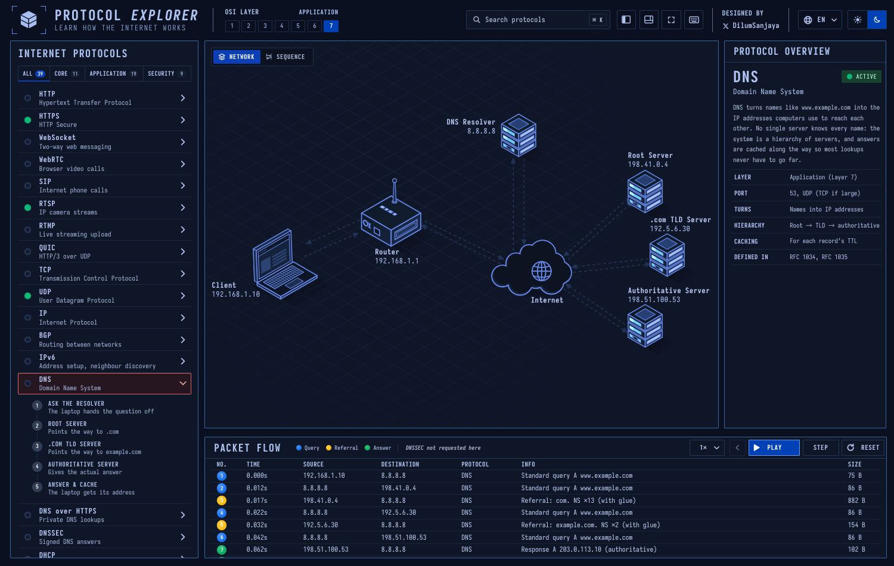
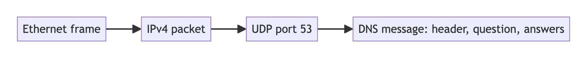
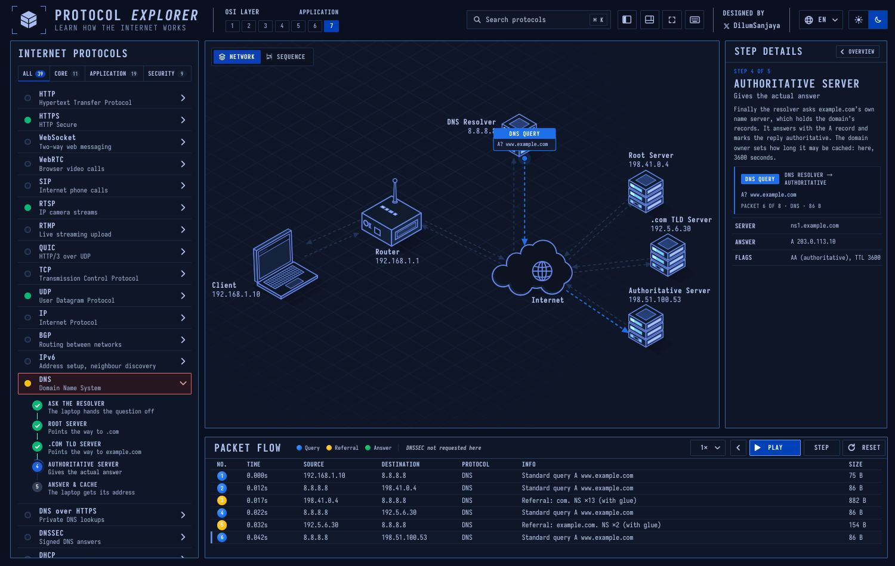
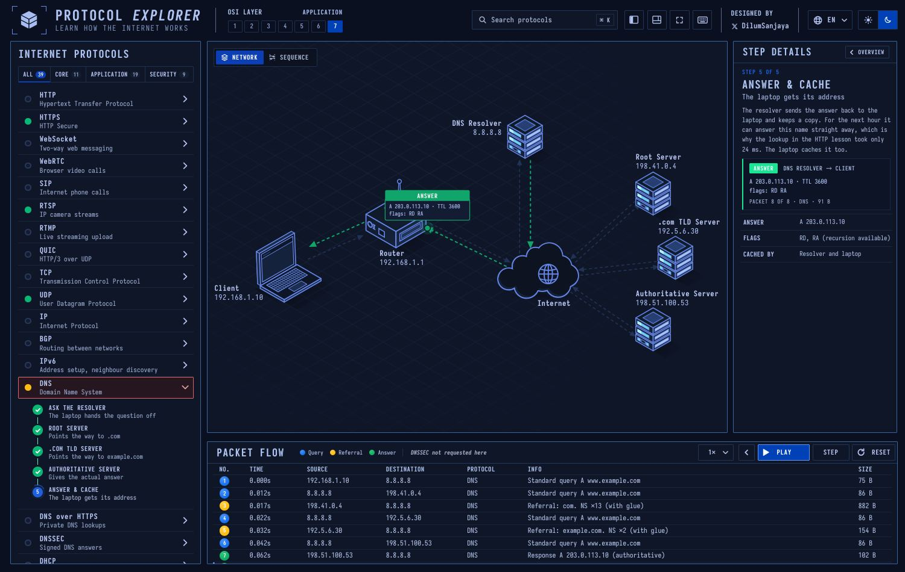
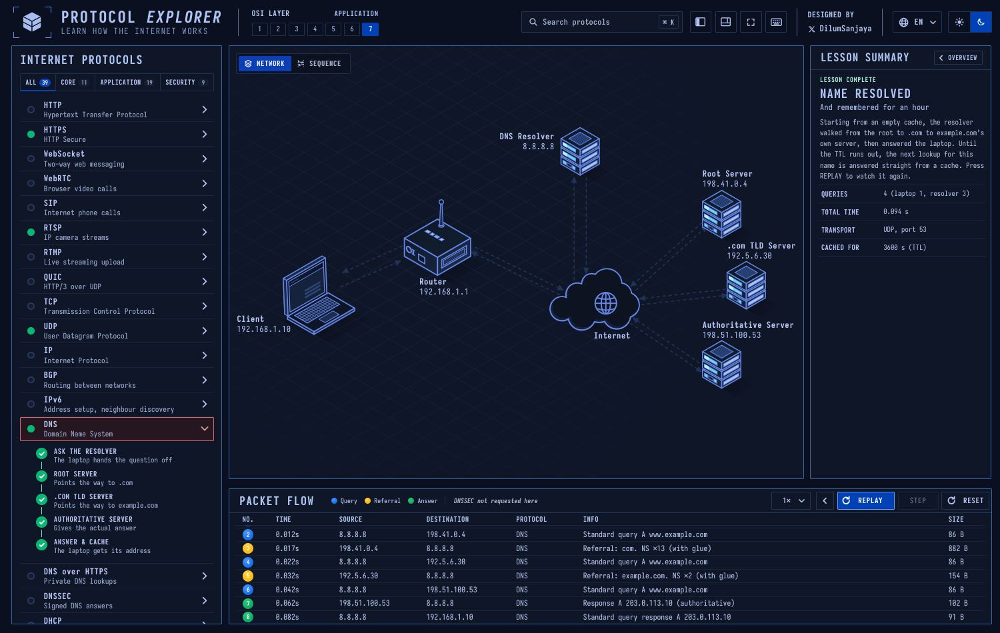
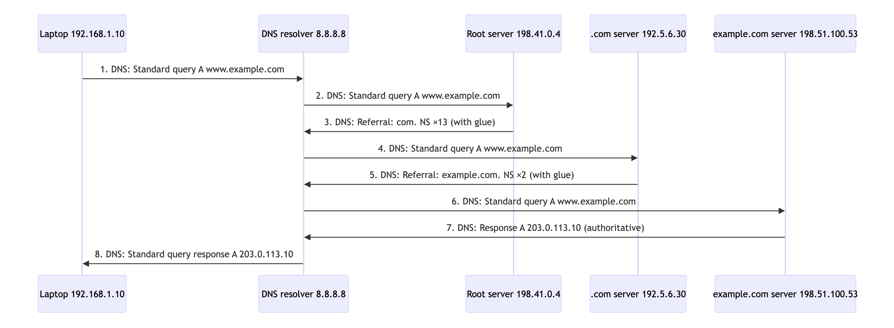
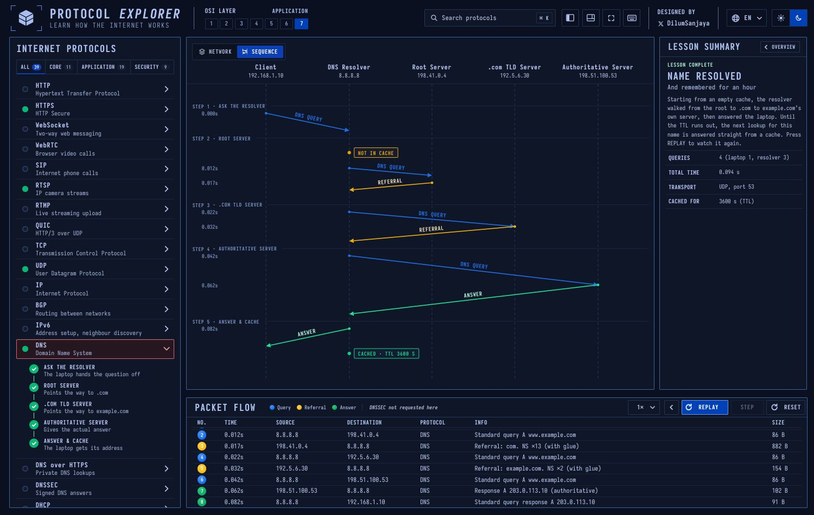
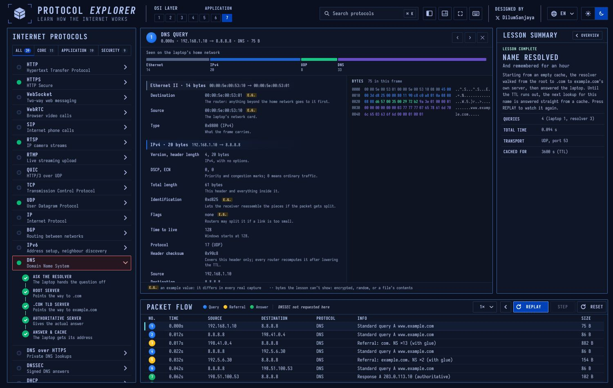
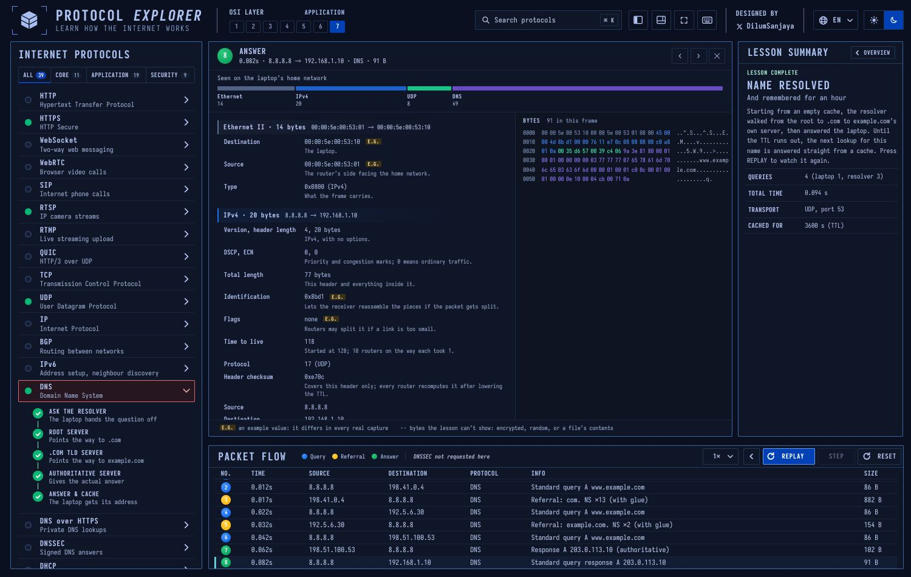

# DNS – Domain Name System

<!-- nav -->
⬅ [13 IPv6](13-ipv6.md) · [Index](00_Protocols_Index.md) · [15 DNS over HTTPS](15-dns-over-https.md) ➡
<!-- nav -->

*Source: Protocol Explorer – https://protocol-explorer-alpha.vercel.app/ (interactive lesson #14). Screenshots captured from the live lesson; packet decodes are the site's example capture (values marked **E.G.** differ in every real capture).*

## Overview

### How the layers fit together (outer to inner)

## In-depth explanation of the example (plain-language version)

### The big picture in one minute
The laptop needs the number (IP address) of `www.example.com`. It asks its **DNS resolver** `8.8.8.8` (Google's public DNS). This time the resolver has **never heard of the name**, so it has to work its way down the DNS "family tree": **root → .com → example.com's own server**, and then hand back the answer. **8 messages in 82 ms.** (In the HTTP lesson the same lookup took only 12 ms because the resolver already had the answer saved.)

**DNS is the internet's phone book.** No single server knows every name. Names form a **tree**: the top (`.`), then `com.`, then `example.com.`, then `www.example.com.`. Each level is run by different servers, and each level only knows **who to ask next** (this is called a **referral**). Answers are **cached** (remembered) for a set time.

Think of asking for directions in a big city: you ask a local, who says "ask at the district office", who says "ask the street office", who finally gives you the exact house.

> **Words you'll see:** *Resolver* = the helper that does the lookup for you. *Authoritative server* = the server that holds the real answer. *TTL* = how long an answer may be remembered. *Record type A* = "name → IPv4 address".

---

### Who is who
| Actor | Role |
|---|---|
| **Laptop** (stub resolver) | asks one question and wants a final answer |
| **Resolver** `8.8.8.8` | does all the legwork and remembers results |
| **Root server** `198.41.0.4` | knows who runs each ending like `.com` |
| **.com server** `192.5.6.30` | knows the servers of every `.com` domain |
| **example.com's server** `198.51.100.53` | holds the real records for `example.com` |

### Step 1 – The question – packet 1
The laptop sends a small UDP packet to port 53: "What is the **A record** (IPv4 address) for `www.example.com`?" It includes a random **transaction ID** (`0x9a3e`); the answer must repeat it, which makes it harder for an imposter to slip in a fake answer. It also says "please do all the work for me" (recursion desired).

### Step 2 – Ask the root – packets 2, 3
- **Packet 2:** the resolver asks a root server the same question. It says "I'm not asking you to do the work, just tell me what you know," and adds that it can accept UDP answers up to 1,232 bytes.
- **Packet 3:** the root doesn't know the address but knows who runs `.com`. Its answer contains **no address**, only a **referral**: a list of 13 `.com` servers, plus their addresses (called **glue**, so the resolver doesn't need another lookup to find them). Translation: "I don't know, but ask them."

### Step 3 – Ask the .com server – packets 4, 5
The resolver asks a `.com` server. Again, no address, but another referral: "`example.com`'s name servers are `ns1.example.com` and `ns2.example.com`, and here are their addresses." The glue is essential here: those servers live *inside* the domain they serve, so without the addresses you'd have a chicken-and-egg problem.

### Step 4 – Ask example.com's own server – packets 6, 7
The resolver asks `198.51.100.53`. This server owns the records, so its reply is marked **authoritative** and contains the real answer: **`www.example.com → 203.0.113.10`, remember it for 3,600 seconds (1 hour).** The domain owner chooses that time.

### Step 5 – Answer and remember – packet 8
The resolver sends the final answer back to the laptop (repeating the original transaction ID). Both the resolver and the laptop **save it for an hour**. That's why the next lookup was so quick in the HTTP lesson, and why a change to a DNS record can take up to the TTL to be seen everywhere.

---

### The 8 messages at a glance
| Packets | Conversation | Result |
|---|---|---|
| 1 | laptop → resolver | the question |
| 2–3 | resolver ↔ root | "ask the .com servers" |
| 4–5 | resolver ↔ .com | "ask example.com's servers" |
| 6–7 | resolver ↔ example.com | the answer: `203.0.113.10` |
| 8 | resolver → laptop | final answer, saved for 1 hour |

### What to remember
- **Two styles of asking:** your laptop asks the resolver **recursively** ("give me the final answer"), while the resolver asks the other servers **step by step** (each gives a referral or the answer).
- **Caching with a TTL** is what makes DNS fast enough for the whole internet.
- Common record types: **A** (IPv4), **AAAA** (IPv6), **CNAME** (alias), **MX** (mail), **NS** (name servers), **TXT**, **PTR** (reverse lookup).
- Uses **UDP port 53**, switching to **TCP** for big answers.
- Plain DNS is **not encrypted and not verified**. See the *DNS over HTTPS* and *DNSSEC* notes for the fixes.

## Under the hood – technical details

- **Message format.** One format for queries and answers: a 12-byte header (ID, flags, counts) followed by the *question*, *answer*, *authority* and *additional* sections. Over UDP the classic limit is 512 bytes; **EDNS(0)** raises it (typically 1,232 bytes).
- **Header flags.** `QR` (query or response), `AA` (authoritative answer), `TC` (truncated, retry over TCP), `RD` (recursion desired), `RA` (recursion available), and a 4-bit response code: `0` NOERROR, `2` SERVFAIL, `3` NXDOMAIN (name does not exist).
- **Transaction ID.** A random 16-bit value the answer must repeat. Together with a random source port, it makes it hard for an attacker to spoof an answer (*cache poisoning*).
- **Recursive vs iterative.** A stub resolver (your laptop) asks the recursive resolver (`8.8.8.8`) with `RD = 1` and gets a final answer. The resolver itself asks root, TLD and authoritative servers *iteratively* with `RD = 0` and follows the *referrals* they return.
- **Referrals and glue.** An `NS` record names the next servers. If the name server is inside the domain it serves (`ns1.example.com` for `example.com`), the parent also supplies its address as a **glue** `A` record, otherwise there would be a chicken-and-egg problem.
- **Records.** `A` (IPv4), `AAAA` (IPv6), `CNAME` (alias), `NS`, `MX` (mail, with priority), `TXT` (SPF, DKIM and verification), `SOA`, `PTR` (reverse lookup), `SRV`, `HTTPS`.
- **TTL and caching.** Every record has a *time to live*. The resolver caches the answer until it expires, which is why DNS changes take time to spread. Negative answers (NXDOMAIN) are cached too.
- **Root servers.** There are 13 root server names (`a` to `m.root-servers.net`) but over a thousand physical instances worldwide using **anycast** (the same IP address announced from many places).
- **Transport.** UDP port 53; TCP port 53 for large or truncated answers and for zone transfers.
- **Weaknesses.** Plain DNS is neither encrypted nor authenticated. DNS over HTTPS/TLS adds privacy; DNSSEC adds authenticity.

## Step-by-step walkthrough (screenshots from the lesson)

### Step 1: ASK THE RESOLVER – The laptop hands the question off

### Step 2: ROOT SERVER – Points the way to .com

### Step 3: .COM TLD SERVER – Points the way to example.com

### Step 4: AUTHORITATIVE SERVER – Gives the actual answer

### Step 5: ANSWER & CACHE – The laptop gets its address

### Lesson summary

## Packet flow (whole lesson)

| No. | Time | Source | Destination | Protocol | Info | Size |
|---|---|---|---|---|---|---|
| 1 | 0.000s | 192.168.1.10 | 8.8.8.8 | DNS | Standard query A www.example.com | 75 B |
| 2 | 0.012s | 8.8.8.8 | 198.41.0.4 | DNS | Standard query A www.example.com | 86 B |
| 3 | 0.017s | 198.41.0.4 | 8.8.8.8 | DNS | Referral: com. NS ×13 (with glue) | 882 B |
| 4 | 0.022s | 8.8.8.8 | 192.5.6.30 | DNS | Standard query A www.example.com | 86 B |
| 5 | 0.032s | 192.5.6.30 | 8.8.8.8 | DNS | Referral: example.com. NS ×2 (with glue) | 154 B |
| 6 | 0.042s | 8.8.8.8 | 198.51.100.53 | DNS | Standard query A www.example.com | 86 B |
| 7 | 0.062s | 198.51.100.53 | 8.8.8.8 | DNS | Response A 203.0.113.10 (authoritative) | 102 B |
| 8 | 0.082s | 8.8.8.8 | 192.168.1.10 | DNS | Standard query response A 203.0.113.10 | 91 B |

### Sequence diagram

*The lesson's own sequence diagram:*

## Packet decoder screenshots

The lesson's decoder view for the first, middle and last packet: headers, field values and the raw hex bytes.

### Packet 1: DNS – Standard query A www.example.com

*192.168.1.10 → 8.8.8.8 · 75 B · t = 0.000s*

### Packet 5: DNS – Referral: example.com. NS ×2 (with glue)

*192.5.6.30 → 8.8.8.8 · 154 B · t = 0.032s*

### Packet 8: DNS – Standard query response A 203.0.113.10

*8.8.8.8 → 192.168.1.10 · 91 B · t = 0.082s*

---

<!-- nav -->
⬅ [13 IPv6](13-ipv6.md) · [Index](00_Protocols_Index.md) · [15 DNS over HTTPS](15-dns-over-https.md) ➡
<!-- nav -->
