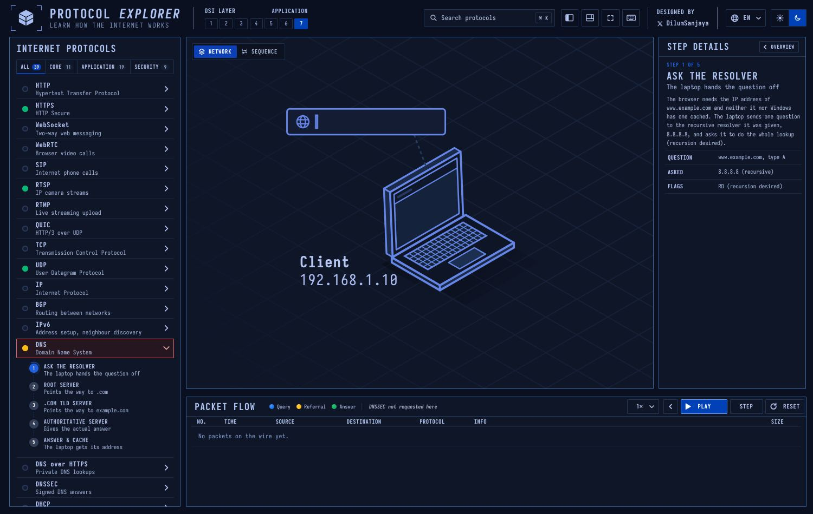
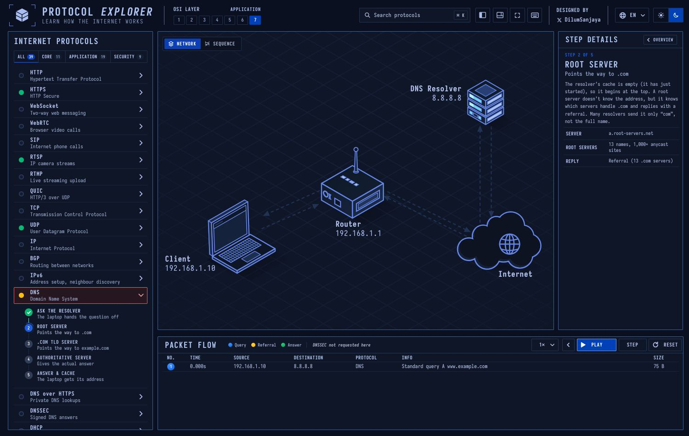
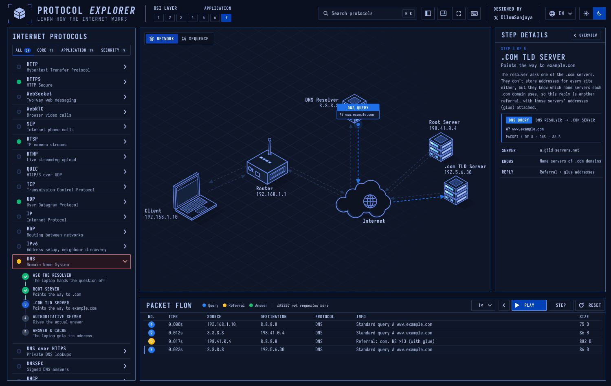
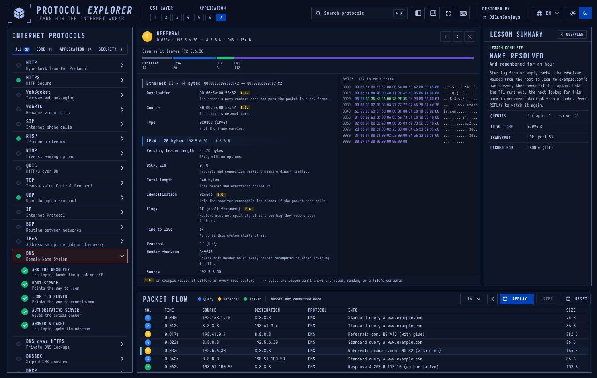

# DNS – Domain Name System

<!-- nav -->
⬅ [13 IPv6](13-ipv6.md) · [Index](00_Protocols_Index.md) · [15 DNS over HTTPS](15-dns-over-https.md) ➡
<!-- nav -->

*Source: Protocol Explorer – https://protocol-explorer-alpha.vercel.app/ (interactive lesson #14). Screenshots captured from the live lesson; packet decodes are the site's example capture (values marked **E.G.** differ in every real capture).*

## Overview


> PROTOCOL OVERVIEW  
> DNS  
> ACTIVE  
> Domain Name System  
> DNS turns names like www.example.com into the IP addresses computers use to reach each other. No single server knows every name: the system is a hierarchy of servers, and answers are cached along the way so most lookups never have to go far.  
> LAYER  
> Application (Layer 7)  
> PORT  
> 53, UDP (TCP if large)  
> TURNS  
> Names into IP addresses  
> HIERARCHY  
> Root → TLD → authoritative  
> CACHING  
> For each record’s TTL  
> DEFINED IN  
> RFC 1034, RFC 1035  

## In-depth explanation of the example (plain-language version)

### The big picture in one minute
The laptop needs the number (IP address) of `www.example.com`. It asks its **DNS resolver** `8.8.8.8` (Google's public DNS). This time the resolver has **never heard of the name**, so it has to work its way down the DNS "family tree": **root → .com → example.com's own server**, and then hand back the answer. **8 messages in 82 ms.** (In the HTTP lesson the same lookup took only 12 ms because the resolver already had the answer saved.)

**DNS is the internet's phone book.** No single server knows every name. Names form a **tree**: the top (`.`), then `com.`, then `example.com.`, then `www.example.com.`. Each level is run by different servers, and each level only knows **who to ask next** (this is called a **referral**). Answers are **cached** (remembered) for a set time.

Think of asking for directions in a big city: you ask a local, who says "ask at the district office", who says "ask the street office", who finally gives you the exact house.

> **Words you'll see:** *Resolver* = the helper that does the lookup for you. *Authoritative server* = the server that holds the real answer. *TTL* = how long an answer may be remembered. *Record type A* = "name → IPv4 address".

---

### Who is who
| Actor | Role |
|---|---|
| **Laptop** (stub resolver) | asks one question and wants a final answer |
| **Resolver** `8.8.8.8` | does all the legwork and remembers results |
| **Root server** `198.41.0.4` | knows who runs each ending like `.com` |
| **.com server** `192.5.6.30` | knows the servers of every `.com` domain |
| **example.com's server** `198.51.100.53` | holds the real records for `example.com` |

### Step 1 – The question – packet 1
The laptop sends a small UDP packet to port 53: "What is the **A record** (IPv4 address) for `www.example.com`?" It includes a random **transaction ID** (`0x9a3e`); the answer must repeat it, which makes it harder for an imposter to slip in a fake answer. It also says "please do all the work for me" (recursion desired).

### Step 2 – Ask the root – packets 2, 3
- **Packet 2:** the resolver asks a root server the same question. It says "I'm not asking you to do the work, just tell me what you know," and adds that it can accept UDP answers up to 1,232 bytes.
- **Packet 3:** the root doesn't know the address but knows who runs `.com`. Its answer contains **no address**, only a **referral**: a list of 13 `.com` servers, plus their addresses (called **glue**, so the resolver doesn't need another lookup to find them). Translation: "I don't know, but ask them."

### Step 3 – Ask the .com server – packets 4, 5
The resolver asks a `.com` server. Again, no address, but another referral: "`example.com`'s name servers are `ns1.example.com` and `ns2.example.com`, and here are their addresses." The glue is essential here: those servers live *inside* the domain they serve, so without the addresses you'd have a chicken-and-egg problem.

### Step 4 – Ask example.com's own server – packets 6, 7
The resolver asks `198.51.100.53`. This server owns the records, so its reply is marked **authoritative** and contains the real answer: **`www.example.com → 203.0.113.10`, remember it for 3,600 seconds (1 hour).** The domain owner chooses that time.

### Step 5 – Answer and remember – packet 8
The resolver sends the final answer back to the laptop (repeating the original transaction ID). Both the resolver and the laptop **save it for an hour**. That's why the next lookup was so quick in the HTTP lesson, and why a change to a DNS record can take up to the TTL to be seen everywhere.

---

### The 8 messages at a glance
| Packets | Conversation | Result |
|---|---|---|
| 1 | laptop → resolver | the question |
| 2–3 | resolver ↔ root | "ask the .com servers" |
| 4–5 | resolver ↔ .com | "ask example.com's servers" |
| 6–7 | resolver ↔ example.com | the answer: `203.0.113.10` |
| 8 | resolver → laptop | final answer, saved for 1 hour |

### What to remember
- **Two styles of asking:** your laptop asks the resolver **recursively** ("give me the final answer"), while the resolver asks the other servers **step by step** (each gives a referral or the answer).
- **Caching with a TTL** is what makes DNS fast enough for the whole internet.
- Common record types: **A** (IPv4), **AAAA** (IPv6), **CNAME** (alias), **MX** (mail), **NS** (name servers), **TXT**, **PTR** (reverse lookup).
- Uses **UDP port 53**, switching to **TCP** for big answers.
- Plain DNS is **not encrypted and not verified**. See the *DNS over HTTPS* and *DNSSEC* notes for the fixes.

## Step-by-step walkthrough (screenshots from the lesson)

### Step 1: ASK THE RESOLVER – The laptop hands the question off



> STEP 1 OF 5  
> ASK THE RESOLVER  
> The laptop hands the question off  
> The browser needs the IP address of www.example.com and neither it nor Windows has one cached. The laptop sends one question to the recursive resolver it was given, 8.8.8.8, and asks it to do the whole lookup (recursion desired).  
> QUESTION  
> www.example.com, type A  
> ASKED  
> 8.8.8.8 (recursive)  
> FLAGS  
> RD (recursion desired)  

### Step 2: ROOT SERVER – Points the way to .com



> STEP 2 OF 5  
> ROOT SERVER  
> Points the way to .com  
> The resolver’s cache is empty (it has just started), so it begins at the top. A root server doesn’t know the address, but it knows which servers handle .com and replies with a referral. Many resolvers send it only “com”, not the full name.  
> SERVER  
> a.root-servers.net  
> ROOT SERVERS  
> 13 names, 1,000+ anycast sites  
> REPLY  
> Referral (13 .com servers)  

### Step 3: .COM TLD SERVER – Points the way to example.com



> STEP 3 OF 5  
> .COM TLD SERVER  
> Points the way to example.com  
> The resolver asks one of the .com servers. They don’t store addresses for every site either, but they know which name servers each .com domain uses, so this reply is another referral, with those servers’ addresses (glue) attached.  
> DNS QUERY  
> DNS RESOLVER → .COM SERVER  
> A? www.example.com  
> PACKET 4 OF 8 · DNS · 86 B  
> SERVER  
> a.gtld-servers.net  
> KNOWS  
> Name servers of .com domains  
> REPLY  
> Referral + glue addresses  

### Step 4: AUTHORITATIVE SERVER – Gives the actual answer


> STEP 4 OF 5  
> AUTHORITATIVE SERVER  
> Gives the actual answer  
> Finally the resolver asks example.com’s own name server, which holds the domain’s records. It answers with the A record and marks the reply authoritative. The domain owner sets how long it may be cached: here, 3600 seconds.  
> DNS QUERY  
> DNS RESOLVER → AUTHORITATIVE  
> A? www.example.com  
> PACKET 6 OF 8 · DNS · 86 B  
> SERVER  
> ns1.example.com  
> ANSWER  
> A 203.0.113.10  
> FLAGS  
> AA (authoritative), TTL 3600  

### Step 5: ANSWER & CACHE – The laptop gets its address


> STEP 5 OF 5  
> ANSWER & CACHE  
> The laptop gets its address  
> The resolver sends the answer back to the laptop and keeps a copy. For the next hour it can answer this name straight away, which is why the lookup in the HTTP lesson took only 24 ms. The laptop caches it too.  
> ANSWER  
> DNS RESOLVER → CLIENT  
> A 203.0.113.10 · TTL 3600  
> flags: RD RA  
> PACKET 8 OF 8 · DNS · 91 B  
> ANSWER  
> A 203.0.113.10  
> FLAGS  
> RD, RA (recursion available)  
> CACHED BY  
> Resolver and laptop  

### Lesson summary


> LESSON SUMMARY  
> LESSON COMPLETE  
> NAME RESOLVED  
> And remembered for an hour  
> Starting from an empty cache, the resolver walked from the root to .com to example.com’s own server, then answered the laptop. Until the TTL runs out, the next lookup for this name is answered straight from a cache. Press REPLAY to watch it again.  
> ANSWER  
> DNS RESOLVER → CLIENT  
> A 203.0.113.10 · TTL 3600  
> flags: RD RA  
> PACKET 8 OF 8 · DNS · 91 B  
> QUERIES  
> 4 (laptop 1, resolver 3)  
> TOTAL TIME  
> 0.094 s  
> TRANSPORT  
> UDP, port 53  
> CACHED FOR  
> 3600 s (TTL)  

## Packet flow (whole lesson)

| No. | Time | Source | Destination | Protocol | Info | Size |
|---|---|---|---|---|---|---|
| 1 | 0.000s | 192.168.1.10 | 8.8.8.8 | DNS | Standard query A www.example.com | 75 B |
| 2 | 0.012s | 8.8.8.8 | 198.41.0.4 | DNS | Standard query A www.example.com | 86 B |
| 3 | 0.017s | 198.41.0.4 | 8.8.8.8 | DNS | Referral: com. NS ×13 (with glue) | 882 B |
| 4 | 0.022s | 8.8.8.8 | 192.5.6.30 | DNS | Standard query A www.example.com | 86 B |
| 5 | 0.032s | 192.5.6.30 | 8.8.8.8 | DNS | Referral: example.com. NS ×2 (with glue) | 154 B |
| 6 | 0.042s | 8.8.8.8 | 198.51.100.53 | DNS | Standard query A www.example.com | 86 B |
| 7 | 0.062s | 198.51.100.53 | 8.8.8.8 | DNS | Response A 203.0.113.10 (authoritative) | 102 B |
| 8 | 0.082s | 8.8.8.8 | 192.168.1.10 | DNS | Standard query response A 203.0.113.10 | 91 B |

### Sequence diagram


## Packets decoded byte by byte

Each packet below is the lesson's own decode (headers, field values and the plain-English meaning of each field). Screenshots show the first, middle and last packet in the lesson's decoder view with the raw hex bytes.

### Packet 1: DNS – Standard query A www.example.com

*192.168.1.10 → 8.8.8.8 · 75 B · t = 0.000s*


<details><summary>Decoded fields</summary>

```text
1
DNS QUERY
0.000s · 192.168.1.10 → 8.8.8.8 · DNS · 75 B
Seen on the laptop’s home network
Ethernet
14
IPv4
20
UDP
8
DNS
33
Ethernet II · 14 bytes
00:00:5e:00:53:10 → 00:00:5e:00:53:01
Destination
00:00:5e:00:53:01 E.G.

The router: anything beyond the home network goes to it first.

Source
00:00:5e:00:53:10 E.G.

The laptop’s network card.

Type
0x0800 (IPv4)

What the frame carries.

IPv4 · 20 bytes
192.168.1.10 → 8.8.8.8
Version, header length
4, 20 bytes

IPv4, with no options.

DSCP, ECN
0, 0

Priority and congestion marks; 0 means ordinary traffic.

Total length
61 bytes

This header and everything inside it.

Identification
0xd825 E.G.

Lets the receiver reassemble the pieces if the packet gets split.

Flags
none E.G.

Routers may split it if a link is too small.

Time to live
128

Windows starts at 128.

Protocol
17 (UDP)
Header checksum
0x90c8

Covers this header only; every router recomputes it after lowering the TTL.

Source
192.168.1.10
Destination
8.8.8.8
UDP · 8 bytes
54871 → 53
Source port
54871
Destination port
53
Length
41 bytes

UDP header and data. That is all of UDP: no numbering, no acknowledgements.

Checksum
0x72b2

Covers the header, the data and the IP addresses.

DNS
Transaction ID
0x9a3e E.G.

Picked at random; the answer must carry the same one.

Flags
0x0100: query, RD (recursion desired)
Questions
1
Answers
0
Authority records
0
Additional records
0
Question
www.example.com, type A, class IN
BYTES 75 in this frame
0000
00
00
5e
00
53
01
00
00
5e
00
53
10
08
00
45
00
.
.
^
.
S
.
.
.
^
.
S
.
.
.
E
.
0010
00
3d
d8
25
00
00
80
11
90
c8
c0
a8
01
0a
08
08
.
=
.
%
.
.
.
.
.
.
.
.
.
.
.
.
0020
08
08
d6
57
00
35
00
29
72
b2
9a
3e
01
00
00
01
.
.
.
W
.
5
.
)
r
.
.
>
.
.
.
.
0030
00
00
00
00
00
00
03
77
77
77
07
65
78
61
6d
70
.
.
.
.
.
.
.
w
w
w
.
e
x
a
m
p
0040
6c
65
03
63
6f
6d
00
00
01
00
01
l
e
.
c
o
m
.
.
.
.
.
E.G. an example value: it differs in every real capture
·· bytes the lesson can’t show: encrypted, random, or a file’s contents
```

</details>

### Packet 2: DNS – Standard query A www.example.com

*8.8.8.8 → 198.41.0.4 · 86 B · t = 0.012s*

<details><summary>Decoded fields</summary>

```text
2
DNS QUERY
0.012s · 8.8.8.8 → 198.41.0.4 · DNS · 86 B
Seen as it leaves 8.8.8.8
Ethernet
14
IPv4
20
UDP
8
DNS
44
Ethernet II · 14 bytes
00:00:5e:00:53:40 → 00:00:5e:00:53:80
Destination
00:00:5e:00:53:80 E.G.

The sender’s next router; each hop puts the packet in a new frame.

Source
00:00:5e:00:53:40 E.G.

The sender’s network card.

Type
0x0800 (IPv4)

What the frame carries.

IPv4 · 20 bytes
8.8.8.8 → 198.41.0.4
Version, header length
4, 20 bytes

IPv4, with no options.

DSCP, ECN
0, 0

Priority and congestion marks; 0 means ordinary traffic.

Total length
72 bytes

This header and everything inside it.

Identification
0x8bce E.G.

Lets the receiver reassemble the pieces if the packet gets split.

Flags
none E.G.

Routers may split it if a link is too small.

Time to live
128

As sent: this system starts at 128.

Protocol
17 (UDP)
Header checksum
0xd899

Covers this header only; every router recomputes it after lowering the TTL.

Source
8.8.8.8
Destination
198.41.0.4
UDP · 8 bytes
38143 → 53
Source port
38143
Destination port
53
Length
52 bytes

UDP header and data. That is all of UDP: no numbering, no acknowledgements.

Checksum
0xf3f6

Covers the header, the data and the IP addresses.

DNS
Transaction ID
0x51c7 E.G.

Picked at random; the answer must carry the same one.

Flags
0x0000: query
Questions
1
Answers
0
Authority records
0
Additional records
1
Question
www.example.com, type A, class IN
EDNS
UDP size 1232, DNSSEC OK = 0

Says how big a UDP answer can be. DNSSEC signatures are not asked for here, to keep the lesson short; a validating resolver like 8.8.8.8 does ask for them.

BYTES 86 in this frame
0000
00
00
5e
00
53
80
00
00
5e
00
53
40
08
00
45
00
.
.
^
.
S
.
.
.
^
.
S
@
.
.
E
.
0010
00
48
8b
ce
00
00
80
11
d8
99
08
08
08
08
c6
29
.
H
.
.
.
.
.
.
.
.
.
.
.
.
.
)
0020
00
04
94
ff
00
35
00
34
f3
f6
51
c7
00
00
00
01
.
.
.
.
.
5
.
4
.
.
Q
.
.
.
.
.
0030
00
00
00
00
00
01
03
77
77
77
07
65
78
61
6d
70
.
.
.
.
.
.
.
w
w
w
.
e
x
a
m
p
0040
6c
65
03
63
6f
6d
00
00
01
00
01
00
00
29
04
d0
l
e
.
c
o
m
.
.
.
.
.
.
.
)
.
.
0050
00
00
00
00
00
00
.
.
.
.
.
.
E.G. an example value: it differs in every real capture
·· bytes the lesson can’t show: encrypted, random, or a file’s contents
```

</details>

### Packet 3: DNS – Referral: com. NS ×13 (with glue)

*198.41.0.4 → 8.8.8.8 · 882 B · t = 0.017s*

<details><summary>Decoded fields</summary>

```text
3
REFERRAL
0.017s · 198.41.0.4 → 8.8.8.8 · DNS · 882 B
Seen as it leaves 198.41.0.4
Ethernet
14
IPv4
20
UDP
8
DNS
840
Ethernet II · 14 bytes
00:00:5e:00:53:41 → 00:00:5e:00:53:81
Destination
00:00:5e:00:53:81 E.G.

The sender’s next router; each hop puts the packet in a new frame.

Source
00:00:5e:00:53:41 E.G.

The sender’s network card.

Type
0x0800 (IPv4)

What the frame carries.

IPv4 · 20 bytes
198.41.0.4 → 8.8.8.8
Version, header length
4, 20 bytes

IPv4, with no options.

DSCP, ECN
0, 0

Priority and congestion marks; 0 means ordinary traffic.

Total length
868 bytes

This header and everything inside it.

Identification
0x588f E.G.

Lets the receiver reassemble the pieces if the packet gets split.

Flags
DF (don’t fragment) E.G.

Routers must not split it; if it’s too big they report back instead.

Time to live
64

As sent: this system starts at 64.

Protocol
17 (UDP)
Header checksum
0x08bd

Covers this header only; every router recomputes it after lowering the TTL.

Source
198.41.0.4
Destination
8.8.8.8
UDP · 8 bytes
53 → 38143
Source port
53
Destination port
38143
Length
848 bytes

UDP header and data. That is all of UDP: no numbering, no acknowledgements.

Checksum
0x0c6d

Covers the header, the data and the IP addresses.

DNS
Transaction ID
0x51c7 E.G.

Picked at random; the answer must carry the same one.

Flags
0x8000: response
Questions
1
Answers
0
Authority records
13
Additional records
27
Question
www.example.com, type A, class IN
Authority
com NS a.gtld-servers.net (TTL 172,800 s)
Authority
com NS b.gtld-servers.net (TTL 172,800 s)
Authority
com NS c.gtld-servers.net (TTL 172,800 s)
Authority
com NS d.gtld-servers.net (TTL 172,800 s)
Authority
com NS e.gtld-servers.net (TTL 172,800 s)
Authority
com NS f.gtld-servers.net (TTL 172,800 s)
Authority
com NS g.gtld-servers.net (TTL 172,800 s)
Authority
com NS h.gtld-servers.net (TTL 172,800 s)
Authority
com NS i.gtld-servers.net (TTL 172,800 s)
Authority
com NS j.gtld-servers.net (TTL 172,800 s)
Authority
com NS k.gtld-servers.net (TTL 172,800 s)
Authority
com NS l.gtld-servers.net (TTL 172,800 s)
Authority
com NS m.gtld-servers.net (TTL 172,800 s)
Additional
a.gtld-servers.net A 192.5.6.30 (TTL 172,800 s)
Additional
b.gtld-servers.net A 192.33.14.30 (TTL 172,800 s)
Additional
c.gtld-servers.net A 192.26.92.30 (TTL 172,800 s)
Additional
d.gtld-servers.net A 192.31.80.30 (TTL 172,800 s)
Additional
e.gtld-servers.net A 192.12.94.30 (TTL 172,800 s)
Additional
f.gtld-servers.net A 192.35.51.30 (TTL 172,800 s)
Additional
g.gtld-servers.net A 192.42.93.30 (TTL 172,800 s)
Additional
h.gtld-servers.net A 192.54.112.30 (TTL 172,800 s)
Additional
i.gtld-servers.net A 192.43.172.30 (TTL 172,800 s)
Additional
j.gtld-servers.net A 192.48.79.30 (TTL 172,800 s)
Additional
k.gtld-servers.net A 192.52.178.30 (TTL 172,800 s)
Additional
l.gtld-servers.net A 192.41.162.30 (TTL 172,800 s)
Additional
m.gtld-servers.net A 192.55.83.30 (TTL 172,800 s)
Additional
a.gtld-servers.net AAAA 2001:503:a83e::2:30 (TTL 172,800 s)
Additional
b.gtld-servers.net AAAA 2001:503:231d::2:30 (TTL 172,800 s)
Additional
c.gtld-servers.net AAAA 2001:503:83eb::30 (TTL 172,800 s)
Additional
d.gtld-servers.net AAAA 2001:500:856e::30 (TTL 172,800 s)
Additional
e.gtld-servers.net AAAA 2001:502:1ca1::30 (TTL 172,800 s)
Additional
f.gtld-servers.net AAAA 2001:503:d414::30 (TTL 172,800 s)
Additional
g.gtld-servers.net AAAA 2001:503:eea3::30 (TTL 172,800 s)
Additional
h.gtld-servers.net AAAA 2001:502:8cc::30 (TTL 172,800 s)
Additional
i.gtld-servers.net AAAA 2001:503:39c1::30 (TTL 172,800 s)
Additional
j.gtld-servers.net AAAA 2001:502:7094::30 (TTL 172,800 s)
Additional
k.gtld-servers.net AAAA 2001:503:d2d::30 (TTL 172,800 s)
Additional
l.gtld-servers.net AAAA 2001:500:d937::30 (TTL 172,800 s)
Additional
m.gtld-servers.net AAAA 2001:501:b1f9::30 (TTL 172,800 s)
EDNS
UDP size 1232, DNSSEC OK = 0

Says how big a UDP answer can be. DNSSEC signatures are not asked for here, to keep the lesson short; a validating resolver like 8.8.8.8 does ask for them.

BYTES 882 in this frame
0000
00
00
5e
00
53
81
00
00
5e
00
53
41
08
00
45
00
.
.
^
.
S
.
.
.
^
.
S
A
.
.
E
.
0010
03
64
58
8f
40
00
40
11
08
bd
c6
29
00
04
08
08
.
d
X
.
@
.
@
.
.
.
.
)
.
.
.
.
0020
08
08
00
35
94
ff
03
50
0c
6d
51
c7
80
00
00
01
.
.
.
5
.
.
.
P
.
m
Q
.
.
.
.
.
0030
00
00
00
0d
00
1b
03
77
77
77
07
65
78
61
6d
70
.
.
.
.
.
.
.
w
w
w
.
e
x
a
m
p
0040
6c
65
03
63
6f
6d
00
00
01
00
01
c0
18
00
02
00
l
e
.
c
o
m
.
.
.
.
.
.
.
.
.
.
0050
01
00
02
a3
00
00
14
01
61
0c
67
74
6c
64
2d
73
.
.
.
.
.
.
.
.
a
.
g
t
l
d
-
s
0060
65
72
76
65
72
73
03
6e
65
74
00
c0
18
00
02
00
e
r
v
e
r
s
.
n
e
t
.
.
.
.
.
.
0070
01
00
02
a3
00
00
04
01
62
c0
2f
c0
18
00
02
00
.
.
.
.
.
.
.
.
b
.
/
.
.
.
.
.
0080
01
00
02
a3
00
00
04
01
63
c0
2f
c0
18
00
02
00
.
.
.
.
.
.
.
.
c
.
/
.
.
.
.
.
0090
01
00
02
a3
00
00
04
01
64
c0
2f
c0
18
00
02
00
.
.
.
.
.
.
.
.
d
.
/
.
.
.
.
.
00a0
01
00
02
a3
00
00
04
01
65
c0
2f
c0
18
00
02
00
.
.
.
.
.
.
.
.
e
.
/
.
.
.
.
.
00b0
01
00
02
a3
00
00
04
01
66
c0
2f
c0
18
00
02
00
.
.
.
.
.
.
.
.
f
.
/
.
.
.
.
.
00c0
01
00
02
a3
00
00
04
01
67
c0
2f
c0
18
00
02
00
.
.
.
.
.
.
.
.
g
.
/
.
.
.
.
.
00d0
01
00
02
a3
00
00
04
01
68
c0
2f
c0
18
00
02
00
.
.
.
.
.
.
.
.
h
.
/
.
.
.
.
.
00e0
01
00
02
a3
00
00
04
01
69
c0
2f
c0
18
00
02
00
.
.
.
.
.
.
.
.
i
.
/
.
.
.
.
.
00f0
01
00
02
a3
00
00
04
01
6a
c0
2f
c0
18
00
02
00
.
.
.
.
.
.
.
.
j
.
/
.
.
.
.
.
0100
01
00
02
a3
00
00
04
01
6b
c0
2f
c0
18
00
02
00
.
.
.
.
.
.
.
.
k
.
/
.
.
.
.
.
0110
01
00
02
a3
00
00
04
01
6c
c0
2f
c0
18
00
02
00
.
.
.
.
.
.
.
.
l
.
/
.
.
.
.
.
0120
01
00
02
a3
00
00
04
01
6d
c0
2f
c0
2d
00
01
00
.
.
.
.
.
.
.
.
m
.
/
.
-
.
.
.
0130
01
00
02
a3
00
00
04
c0
05
06
1e
c0
4d
00
01
00
.
.
.
.
.
.
.
.
.
.
.
.
M
.
.
.
0140
01
00
02
a3
00
00
04
c0
21
0e
1e
c0
5d
00
01
00
.
.
.
.
.
.
.
.
!
.
.
.
]
.
.
.
0150
01
00
02
a3
00
00
04
c0
1a
5c
1e
c0
6d
00
01
00
.
.
.
.
.
.
.
.
.
\
.
.
m
.
.
.
0160
01
00
02
a3
00
00
04
c0
1f
50
1e
c0
7d
00
01
00
.
.
.
.
.
.
.
.
.
P
.
.
}
.
.
.
0170
01
00
02
a3
00
00
04
c0
0c
5e
1e
c0
8d
00
01
00
.
.
.
.
.
.
.
.
.
^
.
.
.
.
.
.
0180
01
00
02
a3
00
00
04
c0
23
33
1e
c0
9d
00
01
00
.
.
.
.
.
.
.
.
#
3
.
.
.
.
.
.
0190
01
00
02
a3
00
00
04
c0
2a
5d
1e
c0
ad
00
01
00
.
.
.
.
.
.
.
.
*
]
.
.
.
.
.
.
01a0
01
00
02
a3
00
00
04
c0
36
70
1e
c0
bd
00
01
00
.
.
.
.
.
.
.
.
6
p
.
.
.
.
.
.
01b0
01
00
02
a3
00
00
04
c0
2b
ac
1e
c0
cd
00
01
00
.
.
.
.
.
.
.
.
+
.
.
.
.
.
.
.
01c0
01
00
02
a3
00
00
04
c0
30
4f
1e
c0
dd
00
01
00
.
.
.
.
.
.
.
.
0
O
.
.
.
.
.
.
01d0
01
00
02
a3
00
00
04
c0
34
b2
1e
c0
ed
00
01
00
.
.
.
.
.
.
.
.
4
.
.
.
.
.
.
.
01e0
01
00
02
a3
00
00
04
c0
29
a2
1e
c0
fd
00
01
00
.
.
.
.
.
.
.
.
)
.
.
.
.
.
.
.
01f0
01
00
02
a3
00
00
04
c0
37
53
1e
c0
2d
00
1c
00
.
.
.
.
.
.
.
.
7
S
.
.
-
.
.
.
0200
01
00
02
a3
00
00
10
20
01
05
03
a8
3e
00
00
00
.
.
.
.
.
.
.
.
.
.
.
>
.
.
.
0210
00
00
00
00
02
00
30
c0
4d
00
1c
00
01
00
02
a3
.
.
.
.
.
.
0
.
M
.
.
.
.
.
.
.
0220
00
00
10
20
01
05
03
23
1d
00
00
00
00
00
00
00
.
.
.
.
.
.
#
.
.
.
.
.
.
.
.
0230
02
00
30
c0
5d
00
1c
00
01
00
02
a3
00
00
10
20
.
.
0
.
]
.
.
.
.
.
.
.
.
.
.
0240
01
05
03
83
eb
00
00
00
00
00
00
00
00
00
30
c0
.
.
.
.
.
.
.
.
.
.
.
.
.
.
0
.
0250
6d
00
1c
00
01
00
02
a3
00
00
10
20
01
05
00
85
m
.
.
.
.
.
.
.
.
.
.
.
.
.
.
0260
6e
00
00
00
00
00
00
00
00
00
30
c0
7d
00
1c
00
n
.
.
.
.
.
.
.
.
.
0
.
}
.
.
.
0270
01
00
02
a3
00
00
10
20
01
05
02
1c
a1
00
00
00
.
.
.
.
.
.
.
.
.
.
.
.
.
.
.
0280
00
00
00
00
00
00
30
c0
8d
00
1c
00
01
00
02
a3
.
.
.
.
.
.
0
.
.
.
.
.
.
.
.
.
0290
00
00
10
20
01
05
03
d4
14
00
00
00
00
00
00
00
.
.
.
.
.
.
.
.
.
.
.
.
.
.
.
02a0
00
00
30
c0
9d
00
1c
00
01
00
02
a3
00
00
10
20
.
.
0
.
.
.
.
.
.
.
.
.
.
.
.
02b0
01
05
03
ee
a3
00
00
00
00
00
00
00
00
00
30
c0
.
.
.
.
.
.
.
.
.
.
.
.
.
.
0
.
02c0
ad
00
1c
00
01
00
02
a3
00
00
10
20
01
05
02
08
.
.
.
.
.
.
.
.
.
.
.
.
.
.
.
02d0
cc
00
00
00
00
00
00
00
00
00
30
c0
bd
00
1c
00
.
.
.
.
.
.
.
.
.
.
0
.
.
.
.
.
02e0
01
00
02
a3
00
00
10
20
01
05
03
39
c1
00
00
00
.
.
.
.
.
.
.
.
.
.
9
.
.
.
.
02f0
00
00
00
00
00
00
30
c0
cd
00
1c
00
01
00
02
a3
.
.
.
.
.
.
0
.
.
.
.
.
.
.
.
.
0300
00
00
10
20
01
05
02
70
94
00
00
00
00
00
00
00
.
.
.
.
.
.
p
.
.
.
.
.
.
.
.
0310
00
00
30
c0
dd
00
1c
00
01
00
02
a3
00
00
10
20
.
.
0
.
.
.
.
.
.
.
.
.
.
.
.
0320
01
05
03
0d
2d
00
00
00
00
00
00
00
00
00
30
c0
.
.
.
.
-
.
.
.
.
.
.
.
.
.
0
.
0330
ed
00
1c
00
01
00
02
a3
00
00
10
20
01
05
00
d9
.
.
.
.
.
.
.
.
.
.
.
.
.
.
.
0340
37
00
00
00
00
00
00
00
00
00
30
c0
fd
00
1c
00
7
.
.
.
.
.
.
.
.
.
0
.
.
.
.
.
0350
01
00
02
a3
00
00
10
20
01
05
01
b1
f9
00
00
00
.
.
.
.
.
.
.
.
.
.
.
.
.
.
.
0360
00
00
00
00
00
00
30
00
00
29
04
d0
00
00
00
00
.
.
.
.
.
.
0
.
.
)
.
.
.
.
.
.
0370
00
00
.
.
E.G. an example value: it differs in every real capture
·· bytes the lesson can’t show: encrypted, random, or a file’s contents
```

</details>

### Packet 4: DNS – Standard query A www.example.com

*8.8.8.8 → 192.5.6.30 · 86 B · t = 0.022s*

<details><summary>Decoded fields</summary>

```text
4
DNS QUERY
0.022s · 8.8.8.8 → 192.5.6.30 · DNS · 86 B
Seen as it leaves 8.8.8.8
Ethernet
14
IPv4
20
UDP
8
DNS
44
Ethernet II · 14 bytes
00:00:5e:00:53:40 → 00:00:5e:00:53:80
Destination
00:00:5e:00:53:80 E.G.

The sender’s next router; each hop puts the packet in a new frame.

Source
00:00:5e:00:53:40 E.G.

The sender’s network card.

Type
0x0800 (IPv4)

What the frame carries.

IPv4 · 20 bytes
8.8.8.8 → 192.5.6.30
Version, header length
4, 20 bytes

IPv4, with no options.

DSCP, ECN
0, 0

Priority and congestion marks; 0 means ordinary traffic.

Total length
72 bytes

This header and everything inside it.

Identification
0x8bcf E.G.

Lets the receiver reassemble the pieces if the packet gets split.

Flags
none E.G.

Routers may split it if a link is too small.

Time to live
128

As sent: this system starts at 128.

Protocol
17 (UDP)
Header checksum
0xd8a2

Covers this header only; every router recomputes it after lowering the TTL.

Source
8.8.8.8
Destination
192.5.6.30
UDP · 8 bytes
41766 → 53
Source port
41766
Destination port
53
Length
52 bytes

UDP header and data. That is all of UDP: no numbering, no acknowledgements.

Checksum
0x0c11

Covers the header, the data and the IP addresses.

DNS
Transaction ID
0x2b90 E.G.

Picked at random; the answer must carry the same one.

Flags
0x0000: query
Questions
1
Answers
0
Authority records
0
Additional records
1
Question
www.example.com, type A, class IN
EDNS
UDP size 1232, DNSSEC OK = 0

Says how big a UDP answer can be. DNSSEC signatures are not asked for here, to keep the lesson short; a validating resolver like 8.8.8.8 does ask for them.

BYTES 86 in this frame
0000
00
00
5e
00
53
80
00
00
5e
00
53
40
08
00
45
00
.
.
^
.
S
.
.
.
^
.
S
@
.
.
E
.
0010
00
48
8b
cf
00
00
80
11
d8
a2
08
08
08
08
c0
05
.
H
.
.
.
.
.
.
.
.
.
.
.
.
.
.
0020
06
1e
a3
26
00
35
00
34
0c
11
2b
90
00
00
00
01
.
.
.
&
.
5
.
4
.
.
+
.
.
.
.
.
0030
00
00
00
00
00
01
03
77
77
77
07
65
78
61
6d
70
.
.
.
.
.
.
.
w
w
w
.
e
x
a
m
p
0040
6c
65
03
63
6f
6d
00
00
01
00
01
00
00
29
04
d0
l
e
.
c
o
m
.
.
.
.
.
.
.
)
.
.
0050
00
00
00
00
00
00
.
.
.
.
.
.
E.G. an example value: it differs in every real capture
·· bytes the lesson can’t show: encrypted, random, or a file’s contents
```

</details>

### Packet 5: DNS – Referral: example.com. NS ×2 (with glue)

*192.5.6.30 → 8.8.8.8 · 154 B · t = 0.032s*



<details><summary>Decoded fields</summary>

```text
5
REFERRAL
0.032s · 192.5.6.30 → 8.8.8.8 · DNS · 154 B
Seen as it leaves 192.5.6.30
Ethernet
14
IPv4
20
UDP
8
DNS
112
Ethernet II · 14 bytes
00:00:5e:00:53:42 → 00:00:5e:00:53:82
Destination
00:00:5e:00:53:82 E.G.

The sender’s next router; each hop puts the packet in a new frame.

Source
00:00:5e:00:53:42 E.G.

The sender’s network card.

Type
0x0800 (IPv4)

What the frame carries.

IPv4 · 20 bytes
192.5.6.30 → 8.8.8.8
Version, header length
4, 20 bytes

IPv4, with no options.

DSCP, ECN
0, 0

Priority and congestion marks; 0 means ordinary traffic.

Total length
140 bytes

This header and everything inside it.

Identification
0xc4de E.G.

Lets the receiver reassemble the pieces if the packet gets split.

Flags
DF (don’t fragment) E.G.

Routers must not split it; if it’s too big they report back instead.

Time to live
64

As sent: this system starts at 64.

Protocol
17 (UDP)
Header checksum
0x9f4f

Covers this header only; every router recomputes it after lowering the TTL.

Source
192.5.6.30
Destination
8.8.8.8
UDP · 8 bytes
53 → 41766
Source port
53
Destination port
41766
Length
120 bytes

UDP header and data. That is all of UDP: no numbering, no acknowledgements.

Checksum
0x9f35

Covers the header, the data and the IP addresses.

DNS
Transaction ID
0x2b90 E.G.

Picked at random; the answer must carry the same one.

Flags
0x8000: response
Questions
1
Answers
0
Authority records
2
Additional records
3
Question
www.example.com, type A, class IN
Authority
example.com NS ns1.example.com (TTL 172,800 s)
Authority
example.com NS ns2.example.com (TTL 172,800 s)
Additional
ns1.example.com A 198.51.100.53 (TTL 172,800 s)
Additional
ns2.example.com A 198.51.100.54 (TTL 172,800 s)
EDNS
UDP size 1232, DNSSEC OK = 0

Says how big a UDP answer can be. DNSSEC signatures are not asked for here, to keep the lesson short; a validating resolver like 8.8.8.8 does ask for them.

BYTES 154 in this frame
0000
00
00
5e
00
53
82
00
00
5e
00
53
42
08
00
45
00
.
.
^
.
S
.
.
.
^
.
S
B
.
.
E
.
0010
00
8c
c4
de
40
00
40
11
9f
4f
c0
05
06
1e
08
08
.
.
.
.
@
.
@
.
.
O
.
.
.
.
.
.
0020
08
08
00
35
a3
26
00
78
9f
35
2b
90
80
00
00
01
.
.
.
5
.
&
.
x
.
5
+
.
.
.
.
.
0030
00
00
00
02
00
03
03
77
77
77
07
65
78
61
6d
70
.
.
.
.
.
.
.
w
w
w
.
e
x
a
m
p
0040
6c
65
03
63
6f
6d
00
00
01
00
01
c0
10
00
02
00
l
e
.
c
o
m
.
.
.
.
.
.
.
.
.
.
0050
01
00
02
a3
00
00
06
03
6e
73
31
c0
10
c0
10
00
.
.
.
.
.
.
.
.
n
s
1
.
.
.
.
.
0060
02
00
01
00
02
a3
00
00
06
03
6e
73
32
c0
10
c0
.
.
.
.
.
.
.
.
.
.
n
s
2
.
.
.
0070
2d
00
01
00
01
00
02
a3
00
00
04
c6
33
64
35
c0
-
.
.
.
.
.
.
.
.
.
.
.
3
d
5
.
0080
3f
00
01
00
01
00
02
a3
00
00
04
c6
33
64
36
00
?
.
.
.
.
.
.
.
.
.
.
.
3
d
6
.
0090
00
29
04
d0
00
00
00
00
00
00
.
)
.
.
.
.
.
.
.
.
E.G. an example value: it differs in every real capture
·· bytes the lesson can’t show: encrypted, random, or a file’s contents
```

</details>

### Packet 6: DNS – Standard query A www.example.com

*8.8.8.8 → 198.51.100.53 · 86 B · t = 0.042s*

<details><summary>Decoded fields</summary>

```text
6
DNS QUERY
0.042s · 8.8.8.8 → 198.51.100.53 · DNS · 86 B
Seen as it leaves 8.8.8.8
Ethernet
14
IPv4
20
UDP
8
DNS
44
Ethernet II · 14 bytes
00:00:5e:00:53:40 → 00:00:5e:00:53:80
Destination
00:00:5e:00:53:80 E.G.

The sender’s next router; each hop puts the packet in a new frame.

Source
00:00:5e:00:53:40 E.G.

The sender’s network card.

Type
0x0800 (IPv4)

What the frame carries.

IPv4 · 20 bytes
8.8.8.8 → 198.51.100.53
Version, header length
4, 20 bytes

IPv4, with no options.

DSCP, ECN
0, 0

Priority and congestion marks; 0 means ordinary traffic.

Total length
72 bytes

This header and everything inside it.

Identification
0x8bd0 E.G.

Lets the receiver reassemble the pieces if the packet gets split.

Flags
none E.G.

Routers may split it if a link is too small.

Time to live
128

As sent: this system starts at 128.

Protocol
17 (UDP)
Header checksum
0x745c

Covers this header only; every router recomputes it after lowering the TTL.

Source
8.8.8.8
Destination
198.51.100.53
UDP · 8 bytes
50911 → 53
Source port
50911
Destination port
53
Length
52 bytes

UDP header and data. That is all of UDP: no numbering, no acknowledgements.

Checksum
0xc99d

Covers the header, the data and the IP addresses.

DNS
Transaction ID
0xe604 E.G.

Picked at random; the answer must carry the same one.

Flags
0x0000: query
Questions
1
Answers
0
Authority records
0
Additional records
1
Question
www.example.com, type A, class IN
EDNS
UDP size 1232, DNSSEC OK = 0

Says how big a UDP answer can be. DNSSEC signatures are not asked for here, to keep the lesson short; a validating resolver like 8.8.8.8 does ask for them.

BYTES 86 in this frame
0000
00
00
5e
00
53
80
00
00
5e
00
53
40
08
00
45
00
.
.
^
.
S
.
.
.
^
.
S
@
.
.
E
.
0010
00
48
8b
d0
00
00
80
11
74
5c
08
08
08
08
c6
33
.
H
.
.
.
.
.
.
t
\
.
.
.
.
.
3
0020
64
35
c6
df
00
35
00
34
c9
9d
e6
04
00
00
00
01
d
5
.
.
.
5
.
4
.
.
.
.
.
.
.
.
0030
00
00
00
00
00
01
03
77
77
77
07
65
78
61
6d
70
.
.
.
.
.
.
.
w
w
w
.
e
x
a
m
p
0040
6c
65
03
63
6f
6d
00
00
01
00
01
00
00
29
04
d0
l
e
.
c
o
m
.
.
.
.
.
.
.
)
.
.
0050
00
00
00
00
00
00
.
.
.
.
.
.
E.G. an example value: it differs in every real capture
·· bytes the lesson can’t show: encrypted, random, or a file’s contents
```

</details>

### Packet 7: DNS – Response A 203.0.113.10 (authoritative)

*198.51.100.53 → 8.8.8.8 · 102 B · t = 0.062s*

<details><summary>Decoded fields</summary>

```text
7
ANSWER
0.062s · 198.51.100.53 → 8.8.8.8 · DNS · 102 B
Seen as it leaves 198.51.100.53
Ethernet
14
IPv4
20
UDP
8
DNS
60
Ethernet II · 14 bytes
00:00:5e:00:53:43 → 00:00:5e:00:53:83
Destination
00:00:5e:00:53:83 E.G.

The sender’s next router; each hop puts the packet in a new frame.

Source
00:00:5e:00:53:43 E.G.

The sender’s network card.

Type
0x0800 (IPv4)

What the frame carries.

IPv4 · 20 bytes
198.51.100.53 → 8.8.8.8
Version, header length
4, 20 bytes

IPv4, with no options.

DSCP, ECN
0, 0

Priority and congestion marks; 0 means ordinary traffic.

Total length
88 bytes

This header and everything inside it.

Identification
0xde3f E.G.

Lets the receiver reassemble the pieces if the packet gets split.

Flags
DF (don’t fragment) E.G.

Routers must not split it; if it’s too big they report back instead.

Time to live
64

As sent: this system starts at 64.

Protocol
17 (UDP)
Header checksum
0x21dd

Covers this header only; every router recomputes it after lowering the TTL.

Source
198.51.100.53
Destination
8.8.8.8
UDP · 8 bytes
53 → 50911
Source port
53
Destination port
50911
Length
68 bytes

UDP header and data. That is all of UDP: no numbering, no acknowledgements.

Checksum
0x1772

Covers the header, the data and the IP addresses.

DNS
Transaction ID
0xe604 E.G.

Picked at random; the answer must carry the same one.

Flags
0x8400: response, AA (authoritative)
Questions
1
Answers
1
Authority records
0
Additional records
1
Question
www.example.com, type A, class IN
Answer
www.example.com A 203.0.113.10 (TTL 3,600 s)
EDNS
UDP size 1232, DNSSEC OK = 0

Says how big a UDP answer can be. DNSSEC signatures are not asked for here, to keep the lesson short; a validating resolver like 8.8.8.8 does ask for them.

BYTES 102 in this frame
0000
00
00
5e
00
53
83
00
00
5e
00
53
43
08
00
45
00
.
.
^
.
S
.
.
.
^
.
S
C
.
.
E
.
0010
00
58
de
3f
40
00
40
11
21
dd
c6
33
64
35
08
08
.
X
.
?
@
.
@
.
!
.
.
3
d
5
.
.
0020
08
08
00
35
c6
df
00
44
17
72
e6
04
84
00
00
01
.
.
.
5
.
.
.
D
.
r
.
.
.
.
.
.
0030
00
01
00
00
00
01
03
77
77
77
07
65
78
61
6d
70
.
.
.
.
.
.
.
w
w
w
.
e
x
a
m
p
0040
6c
65
03
63
6f
6d
00
00
01
00
01
c0
0c
00
01
00
l
e
.
c
o
m
.
.
.
.
.
.
.
.
.
.
0050
01
00
00
0e
10
00
04
cb
00
71
0a
00
00
29
04
d0
.
.
.
.
.
.
.
.
.
q
.
.
.
)
.
.
0060
00
00
00
00
00
00
.
.
.
.
.
.
E.G. an example value: it differs in every real capture
·· bytes the lesson can’t show: encrypted, random, or a file’s contents
```

</details>

### Packet 8: DNS – Standard query response A 203.0.113.10

*8.8.8.8 → 192.168.1.10 · 91 B · t = 0.082s*


<details><summary>Decoded fields</summary>

```text
8
ANSWER
0.082s · 8.8.8.8 → 192.168.1.10 · DNS · 91 B
Seen on the laptop’s home network
Ethernet
14
IPv4
20
UDP
8
DNS
49
Ethernet II · 14 bytes
00:00:5e:00:53:01 → 00:00:5e:00:53:10
Destination
00:00:5e:00:53:10 E.G.

The laptop.

Source
00:00:5e:00:53:01 E.G.

The router’s side facing the home network.

Type
0x0800 (IPv4)

What the frame carries.

IPv4 · 20 bytes
8.8.8.8 → 192.168.1.10
Version, header length
4, 20 bytes

IPv4, with no options.

DSCP, ECN
0, 0

Priority and congestion marks; 0 means ordinary traffic.

Total length
77 bytes

This header and everything inside it.

Identification
0x8bd1 E.G.

Lets the receiver reassemble the pieces if the packet gets split.

Flags
none E.G.

Routers may split it if a link is too small.

Time to live
118

Started at 128; 10 routers on the way each took 1.

Protocol
17 (UDP)
Header checksum
0xe70c

Covers this header only; every router recomputes it after lowering the TTL.

Source
8.8.8.8
Destination
192.168.1.10
UDP · 8 bytes
53 → 54871
Source port
53
Destination port
54871
Length
57 bytes

UDP header and data. That is all of UDP: no numbering, no acknowledgements.

Checksum
0xc406

Covers the header, the data and the IP addresses.

DNS
Transaction ID
0x9a3e E.G.

Picked at random; the answer must carry the same one.

Flags
0x8180: response, RD (recursion desired), RA (recursion available)
Questions
1
Answers
1
Authority records
0
Additional records
0
Question
www.example.com, type A, class IN
Answer
www.example.com A 203.0.113.10 (TTL 3,600 s)
BYTES 91 in this frame
0000
00
00
5e
00
53
10
00
00
5e
00
53
01
08
00
45
00
.
.
^
.
S
.
.
.
^
.
S
.
.
.
E
.
0010
00
4d
8b
d1
00
00
76
11
e7
0c
08
08
08
08
c0
a8
.
M
.
.
.
.
v
.
.
.
.
.
.
.
.
.
0020
01
0a
00
35
d6
57
00
39
c4
06
9a
3e
81
80
00
01
.
.
.
5
.
W
.
9
.
.
.
>
.
.
.
.
0030
00
01
00
00
00
00
03
77
77
77
07
65
78
61
6d
70
.
.
.
.
.
.
.
w
w
w
.
e
x
a
m
p
0040
6c
65
03
63
6f
6d
00
00
01
00
01
c0
0c
00
01
00
l
e
.
c
o
m
.
.
.
.
.
.
.
.
.
.
0050
01
00
00
0e
10
00
04
cb
00
71
0a
.
.
.
.
.
.
.
.
.
q
.
E.G. an example value: it differs in every real capture
·· bytes the lesson can’t show: encrypted, random, or a file’s contents
```

</details>

---

<!-- nav -->
⬅ [13 IPv6](13-ipv6.md) · [Index](00_Protocols_Index.md) · [15 DNS over HTTPS](15-dns-over-https.md) ➡
<!-- nav -->
