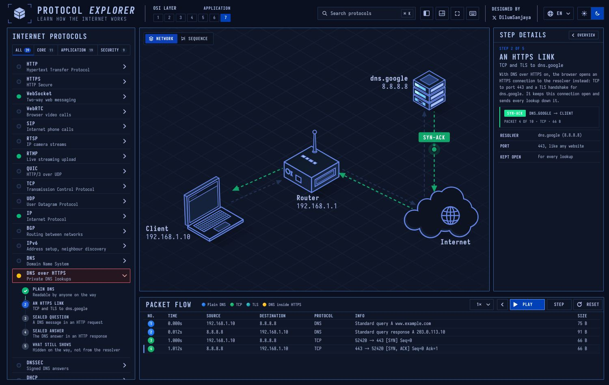
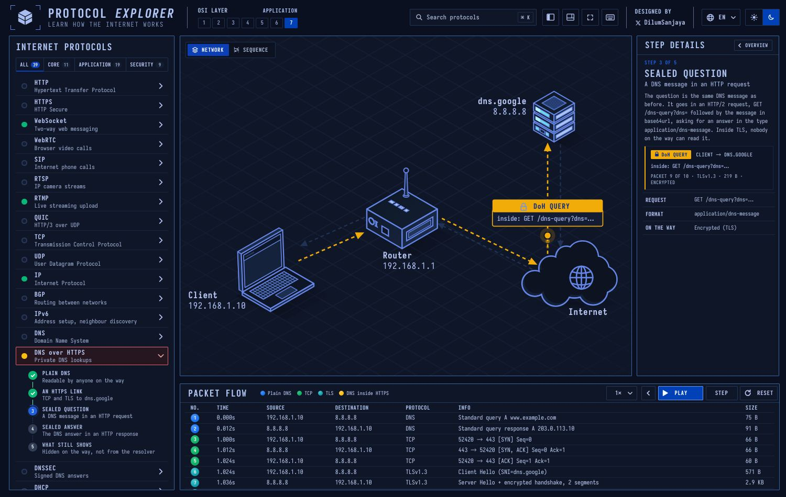
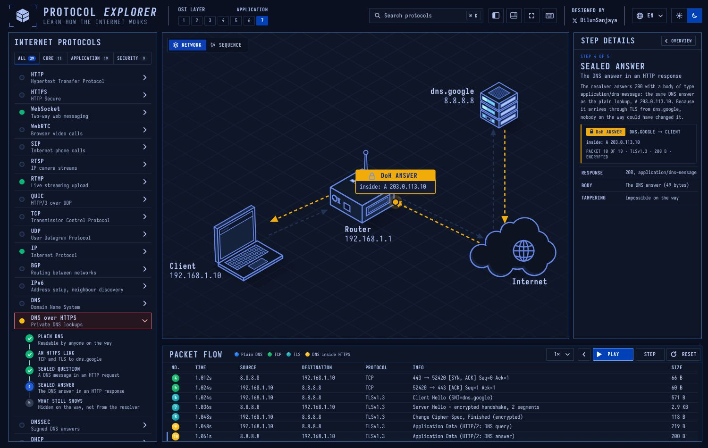
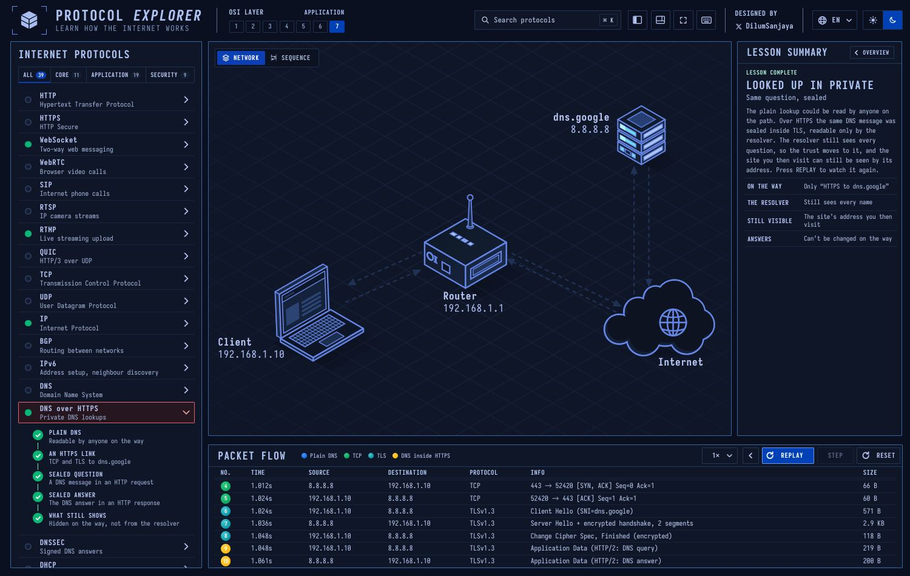
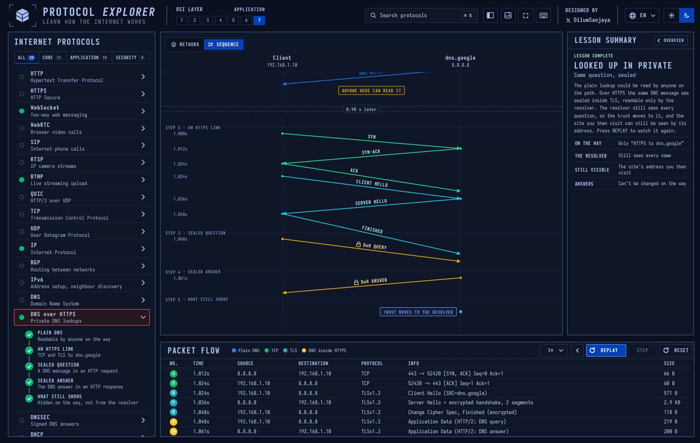
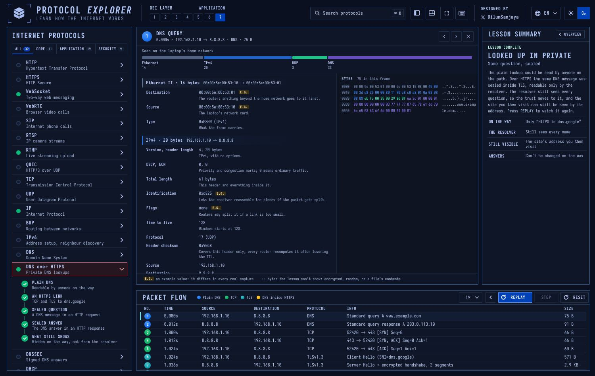

# DNS over HTTPS – Private DNS lookups

<!-- nav -->
⬅ [14 DNS](14-dns.md) · [Index](00_Protocols_Index.md) · [16 DNSSEC](16-dnssec.md) ➡
<!-- nav -->

*Source: Protocol Explorer – https://protocol-explorer-alpha.vercel.app/ (interactive lesson #15). Screenshots captured from the live lesson; packet decodes are the site's example capture (values marked **E.G.** differ in every real capture).*

## Overview


> PROTOCOL OVERVIEW  
> DNS over HTTPS  
> ACTIVE  
> DNS queries inside HTTPS  
> Ordinary DNS travels in the clear: anyone on the same Wi-Fi, and your internet provider, can read every name you look up and even change the answers. DNS over HTTPS (DoH) sends the same DNS messages inside an encrypted HTTPS connection to the resolver, so on the way they look like any other web traffic. Browsers and operating systems can turn it on.  
> LAYER  
> Application (Layer 7)  
> PORT  
> 443 (HTTPS)  
> CARRIES  
> Ordinary DNS messages  
> HIDES  
> Which names you look up  
> SIMILAR  
> DNS over TLS (port 853)  
> DEFINED IN  
> RFC 8484  

## In-depth explanation of the example (plain-language version)

### The big picture in one minute
First the laptop does a normal **plain DNS** lookup of `www.example.com` (packets 1–2). Then it switches on **DNS over HTTPS (DoH)** and does the same lookup through a **secure, encrypted HTTPS connection** to `dns.google` (packets 3–10). The lesson shows that **the question is exactly the same, but in the first case anyone can read it, and in the second it's sealed.**

**The problem with plain DNS.** It travels in plain text. Anyone on your Wi-Fi, your internet provider, or a device in the middle can **see every website name you look up** and can even **change the answer** to send you to a fake site. DoH hides DNS inside ordinary HTTPS traffic.

Think of **a postcard versus a sealed envelope**. The words are the same, but only the envelope keeps them private.

> **Words you'll see:** *TLS* = the encryption used by HTTPS. *SNI* = the server name the browser mentions at the start of a TLS connection. *HTTP/2* = a faster version of HTTP that can carry many requests on one connection.

---

### Step 1 – Plain DNS – packets 1, 2
The laptop sends "What's the address of `www.example.com`?" to `8.8.8.8` on UDP port 53, and gets `203.0.113.10` back (remember it for about 29 minutes). **Every byte, including the website name, is visible to anyone on the path.**

### Step 2 – Building a secure link to the resolver – packets 3 to 8
With DoH on, the browser treats the DNS server like a website:
- **TCP handshake** to port 443 (packets 3–5).
- **TLS handshake** (packets 6–8): the browser says it wants `dns.google`, the server shows its certificate (ID card) and the browser checks it's really `dns.google`. (Watchers can see *which resolver* you use, but not which names you look up.)
- This connection is **kept open and reused** for every later lookup, so the set-up cost is paid only once.

### Step 3 – The sealed question – packet 9
The question is the **same compact DNS message** as before, but sent as an **HTTP request**: `GET /dns-query?dns=<the question, encoded>`. It's all inside the encrypted connection, so on the wire it looks like any other web traffic on port 443 (just scrambled bytes).

### Step 4 – The sealed answer – packet 10
The resolver replies `200 OK` with a tiny 49-byte body: the ordinary DNS answer `203.0.113.10`. Because it arrived through TLS from a server whose certificate was checked, **nobody on the way could read it or change it.**

### Step 5 – What changed and what didn't
| | Plain DNS | DNS over HTTPS |
|---|---|---|
| Door used | UDP (or TCP) 53 | TCP 443 (HTTPS) |
| Can a watcher see the names? | **Yes** | **No** |
| Can someone change the answer on the way? | Yes | No |
| Looks like | "this is DNS" | normal web traffic |
| Extra cost | none | one-time connection set-up, then reused |

---

### The 10 messages at a glance
| Packets | What | Why |
|---|---|---|
| 1–2 | plain DNS question and answer | the "before" picture |
| 3–5 | TCP handshake to port 443 | open the connection |
| 6–8 | TLS handshake | encrypt and verify `dns.google` |
| 9 | sealed DNS question | the lookup, hidden |
| 10 | sealed DNS answer | the result, protected |

### What to remember
- DoH protects the **path between you and your resolver.** The resolver itself (Google, Cloudflare…) still sees your questions. You've *moved* trust, not removed it.
- It does **not check whether the answer itself is genuine.** That's **DNSSEC**'s job (separate note). The two complement each other.
- Close relatives: **DNS over TLS** (the same idea on its own port 853, easier for networks to spot and block) and **DNS over QUIC**.
- Trade-off: company and school networks lose the ability to filter by DNS, so they often prefer to control which resolver is used.
- Still visible to watchers: the resolver's address, the name `dns.google`, and packet sizes and timing.

## Step-by-step walkthrough (screenshots from the lesson)

### Step 1: PLAIN DNS – Readable by anyone on the way


> STEP 1 OF 5  
> PLAIN DNS  
> Readable by anyone on the way  
> This is the lookup from the other lessons: a UDP packet to port 53 asking for www.example.com, and the answer. Neither is encrypted, so everyone on the café’s Wi-Fi, and the internet provider, can see which names the laptop looks up, and could even answer with a false address.  
> TRANSPORT  
> UDP port 53  
> ENCRYPTED  
> No  
> CAN BE CHANGED  
> Yes, on the way  

### Step 2: AN HTTPS LINK – TCP and TLS to dns.google



> STEP 2 OF 5  
> AN HTTPS LINK  
> TCP and TLS to dns.google  
> With DNS over HTTPS on, the browser opens an HTTPS connection to the resolver instead: TCP to port 443 and a TLS handshake for dns.google. It keeps this connection open and sends every lookup down it.  
> SYN-ACK  
> DNS.GOOGLE → CLIENT  
> PACKET 4 OF 10 · TCP · 66 B  
> RESOLVER  
> dns.google (8.8.8.8)  
> PORT  
> 443, like any website  
> KEPT OPEN  
> For every lookup  

### Step 3: SEALED QUESTION – A DNS message in an HTTP request



> STEP 3 OF 5  
> SEALED QUESTION  
> A DNS message in an HTTP request  
> The question is the same DNS message as before. It goes in an HTTP/2 request, GET /dns-query?dns= followed by the message in base64url, asking for an answer in the type application/dns-message. Inside TLS, nobody on the way can read it.  
> DoH QUERY  
> CLIENT → DNS.GOOGLE  
> inside: GET /dns-query?dns=…  
> PACKET 9 OF 10 · TLSv1.3 · 219 B · ENCRYPTED  
> REQUEST  
> GET /dns-query?dns=…  
> FORMAT  
> application/dns-message  
> ON THE WAY  
> Encrypted (TLS)  

### Step 4: SEALED ANSWER – The DNS answer in an HTTP response



> STEP 4 OF 5  
> SEALED ANSWER  
> The DNS answer in an HTTP response  
> The resolver answers 200 with a body of type application/dns-message: the same DNS answer as the plain lookup, A 203.0.113.10. Because it arrives through TLS from dns.google, nobody on the way could have changed it.  
> DoH ANSWER  
> DNS.GOOGLE → CLIENT  
> inside: A 203.0.113.10  
> PACKET 10 OF 10 · TLSv1.3 · 200 B · ENCRYPTED  
> RESPONSE  
> 200, application/dns-message  
> BODY  
> The DNS answer (49 bytes)  
> TAMPERING  
> Impossible on the way  

### Step 5: WHAT STILL SHOWS – Hidden on the way, not from the resolver


> STEP 1 OF 5  
> PLAIN DNS  
> Readable by anyone on the way  
> This is the lookup from the other lessons: a UDP packet to port 53 asking for www.example.com, and the answer. Neither is encrypted, so everyone on the café’s Wi-Fi, and the internet provider, can see which names the laptop looks up, and could even answer with a false address.  
> DoH ANSWER  
> DNS.GOOGLE → CLIENT  
> inside: A 203.0.113.10  
> PACKET 10 OF 10 · TLSv1.3 · 200 B · ENCRYPTED  
> TRANSPORT  
> UDP port 53  
> ENCRYPTED  
> No  
> CAN BE CHANGED  
> Yes, on the way  

### Lesson summary



> LESSON SUMMARY  
> LESSON COMPLETE  
> LOOKED UP IN PRIVATE  
> Same question, sealed  
> The plain lookup could be read by anyone on the path. Over HTTPS the same DNS message was sealed inside TLS, readable only by the resolver. The resolver still sees every question, so the trust moves to it, and the site you then visit can still be seen by its address. Press REPLAY to watch it again.  
> DoH ANSWER  
> DNS.GOOGLE → CLIENT  
> inside: A 203.0.113.10  
> PACKET 10 OF 10 · TLSv1.3 · 200 B · ENCRYPTED  
> ON THE WAY  
> Only “HTTPS to dns.google”  
> THE RESOLVER  
> Still sees every name  
> STILL VISIBLE  
> The site’s address you then visit  
> ANSWERS  
> Can’t be changed on the way  

## Packet flow (whole lesson)

| No. | Time | Source | Destination | Protocol | Info | Size |
|---|---|---|---|---|---|---|
| 1 | 0.000s | 192.168.1.10 | 8.8.8.8 | DNS | Standard query A www.example.com | 75 B |
| 2 | 0.012s | 8.8.8.8 | 192.168.1.10 | DNS | Standard query response A 203.0.113.10 | 91 B |
| 3 | 1.000s | 192.168.1.10 | 8.8.8.8 | TCP | 52420 → 443 [SYN] Seq=0 | 66 B |
| 4 | 1.012s | 8.8.8.8 | 192.168.1.10 | TCP | 443 → 52420 [SYN, ACK] Seq=0 Ack=1 | 66 B |
| 5 | 1.024s | 192.168.1.10 | 8.8.8.8 | TCP | 52420 → 443 [ACK] Seq=1 Ack=1 | 60 B |
| 6 | 1.024s | 192.168.1.10 | 8.8.8.8 | TLSv1.3 | Client Hello (SNI=dns.google) | 571 B |
| 7 | 1.036s | 8.8.8.8 | 192.168.1.10 | TLSv1.3 | Server Hello + encrypted handshake, 2 segments | 2.9 KB |
| 8 | 1.048s | 192.168.1.10 | 8.8.8.8 | TLSv1.3 | Change Cipher Spec, Finished (encrypted) | 118 B |
| 9 | 1.048s | 192.168.1.10 | 8.8.8.8 | TLSv1.3 | Application Data (HTTP/2: DNS query) | 219 B |
| 10 | 1.061s | 8.8.8.8 | 192.168.1.10 | TLSv1.3 | Application Data (HTTP/2: DNS answer) | 200 B |

### Sequence diagram



## Packets decoded byte by byte

Each packet below is the lesson's own decode (headers, field values and the plain-English meaning of each field). Screenshots show the first, middle and last packet in the lesson's decoder view with the raw hex bytes.

### Packet 1: DNS – Standard query A www.example.com

*192.168.1.10 → 8.8.8.8 · 75 B · t = 0.000s*



<details><summary>Decoded fields</summary>

```text
1
DNS QUERY
0.000s · 192.168.1.10 → 8.8.8.8 · DNS · 75 B
Seen on the laptop’s home network
Ethernet
14
IPv4
20
UDP
8
DNS
33
Ethernet II · 14 bytes
00:00:5e:00:53:10 → 00:00:5e:00:53:01
Destination
00:00:5e:00:53:01 E.G.

The router: anything beyond the home network goes to it first.

Source
00:00:5e:00:53:10 E.G.

The laptop’s network card.

Type
0x0800 (IPv4)

What the frame carries.

IPv4 · 20 bytes
192.168.1.10 → 8.8.8.8
Version, header length
4, 20 bytes

IPv4, with no options.

DSCP, ECN
0, 0

Priority and congestion marks; 0 means ordinary traffic.

Total length
61 bytes

This header and everything inside it.

Identification
0xd825 E.G.

Lets the receiver reassemble the pieces if the packet gets split.

Flags
none E.G.

Routers may split it if a link is too small.

Time to live
128

Windows starts at 128.

Protocol
17 (UDP)
Header checksum
0x90c8

Covers this header only; every router recomputes it after lowering the TTL.

Source
192.168.1.10
Destination
8.8.8.8
UDP · 8 bytes
60412 → 53
Source port
60412
Destination port
53
Length
41 bytes

UDP header and data. That is all of UDP: no numbering, no acknowledgements.

Checksum
0x8d0f

Covers the header, the data and the IP addresses.

DNS
Transaction ID
0x6a3c E.G.

Picked at random; the answer must carry the same one.

Flags
0x0100: query, RD (recursion desired)
Questions
1
Answers
0
Authority records
0
Additional records
0
Question
www.example.com, type A, class IN
BYTES 75 in this frame
0000
00
00
5e
00
53
01
00
00
5e
00
53
10
08
00
45
00
.
.
^
.
S
.
.
.
^
.
S
.
.
.
E
.
0010
00
3d
d8
25
00
00
80
11
90
c8
c0
a8
01
0a
08
08
.
=
.
%
.
.
.
.
.
.
.
.
.
.
.
.
0020
08
08
eb
fc
00
35
00
29
8d
0f
6a
3c
01
00
00
01
.
.
.
.
.
5
.
)
.
.
j
<
.
.
.
.
0030
00
00
00
00
00
00
03
77
77
77
07
65
78
61
6d
70
.
.
.
.
.
.
.
w
w
w
.
e
x
a
m
p
0040
6c
65
03
63
6f
6d
00
00
01
00
01
l
e
.
c
o
m
.
.
.
.
.
E.G. an example value: it differs in every real capture
·· bytes the lesson can’t show: encrypted, random, or a file’s contents
```

</details>

### Packet 2: DNS – Standard query response A 203.0.113.10

*8.8.8.8 → 192.168.1.10 · 91 B · t = 0.012s*

<details><summary>Decoded fields</summary>

```text
2
DNS REPLY
0.012s · 8.8.8.8 → 192.168.1.10 · DNS · 91 B
Seen on the laptop’s home network
Ethernet
14
IPv4
20
UDP
8
DNS
49
Ethernet II · 14 bytes
00:00:5e:00:53:01 → 00:00:5e:00:53:10
Destination
00:00:5e:00:53:10 E.G.

The laptop.

Source
00:00:5e:00:53:01 E.G.

The router’s side facing the home network.

Type
0x0800 (IPv4)

What the frame carries.

IPv4 · 20 bytes
8.8.8.8 → 192.168.1.10
Version, header length
4, 20 bytes

IPv4, with no options.

DSCP, ECN
0, 0

Priority and congestion marks; 0 means ordinary traffic.

Total length
77 bytes

This header and everything inside it.

Identification
0x8bce E.G.

Lets the receiver reassemble the pieces if the packet gets split.

Flags
none E.G.

Routers may split it if a link is too small.

Time to live
118

Started at 128; 10 routers on the way each took 1.

Protocol
17 (UDP)
Header checksum
0xe70f

Covers this header only; every router recomputes it after lowering the TTL.

Source
8.8.8.8
Destination
192.168.1.10
UDP · 8 bytes
53 → 60412
Source port
53
Destination port
60412
Length
57 bytes

UDP header and data. That is all of UDP: no numbering, no acknowledgements.

Checksum
0x1d6b

Covers the header, the data and the IP addresses.

DNS
Transaction ID
0x6a3c E.G.

Picked at random; the answer must carry the same one.

Flags
0x8180: response, RD (recursion desired), RA (recursion available)
Questions
1
Answers
1
Authority records
0
Additional records
0
Question
www.example.com, type A, class IN
Answer
www.example.com A 203.0.113.10 (TTL 1,745 s) E.G.
BYTES 91 in this frame
0000
00
00
5e
00
53
10
00
00
5e
00
53
01
08
00
45
00
.
.
^
.
S
.
.
.
^
.
S
.
.
.
E
.
0010
00
4d
8b
ce
00
00
76
11
e7
0f
08
08
08
08
c0
a8
.
M
.
.
.
.
v
.
.
.
.
.
.
.
.
.
0020
01
0a
00
35
eb
fc
00
39
1d
6b
6a
3c
81
80
00
01
.
.
.
5
.
.
.
9
.
k
j
<
.
.
.
.
0030
00
01
00
00
00
00
03
77
77
77
07
65
78
61
6d
70
.
.
.
.
.
.
.
w
w
w
.
e
x
a
m
p
0040
6c
65
03
63
6f
6d
00
00
01
00
01
c0
0c
00
01
00
l
e
.
c
o
m
.
.
.
.
.
.
.
.
.
.
0050
01
00
00
06
d1
00
04
cb
00
71
0a
.
.
.
.
.
.
.
.
.
q
.
E.G. an example value: it differs in every real capture
·· bytes the lesson can’t show: encrypted, random, or a file’s contents
```

</details>

### Packet 3: TCP – 52420 → 443 [SYN] Seq=0

*192.168.1.10 → 8.8.8.8 · 66 B · t = 1.000s*

<details><summary>Decoded fields</summary>

```text
3
SYN
1.000s · 192.168.1.10 → 8.8.8.8 · TCP · 66 B
Seen on the laptop’s home network
Ethernet
14
IPv4
20
TCP
32
Ethernet II · 14 bytes
00:00:5e:00:53:10 → 00:00:5e:00:53:01
Destination
00:00:5e:00:53:01 E.G.

The router: anything beyond the home network goes to it first.

Source
00:00:5e:00:53:10 E.G.

The laptop’s network card.

Type
0x0800 (IPv4)

What the frame carries.

IPv4 · 20 bytes
192.168.1.10 → 8.8.8.8
Version, header length
4, 20 bytes

IPv4, with no options.

DSCP, ECN
0, 0

Priority and congestion marks; 0 means ordinary traffic.

Total length
52 bytes

This header and everything inside it.

Identification
0xd826 E.G.

Lets the receiver reassemble the pieces if the packet gets split.

Flags
DF (don’t fragment)

Routers must not split it; if it’s too big they report back instead.

Time to live
128

Windows starts at 128.

Protocol
6 (TCP)
Header checksum
0x50db

Covers this header only; every router recomputes it after lowering the TTL.

Source
192.168.1.10
Destination
8.8.8.8
TCP · 32 bytes
52420 → 443, SYN
Source port
52420

Picked by the laptop’s system for this connection.

Destination port
443
Sequence number
0 (relative)

This side’s starting number. Shown as 0; the real one is random.

Real sequence number
1477159670 E.G.
Acknowledgment
0 (not used yet)

A first SYN has nothing to acknowledge.

Header length
32 bytes

20 bytes, plus 12 of options.

Flags
0x002 (SYN)
Window
64240 E.G.

How much more data this side can take right now.

Checksum
0xd0db

Covers the header, the data and the IP addresses, so damage is caught.

Urgent pointer
0
Options
12 bytes
Maximum segment size
1460 bytes

The most data this side wants in one segment.

No-op
1

Spacing, so the next option lines up.

Window scale
× 256

Window values are multiplied by this, so windows can be larger than 64 KB.

No-op
1

Spacing, so the next option lines up.

No-op
1

Spacing, so the next option lines up.

SACK permitted
yes

This side understands selective acknowledgements.

BYTES 66 in this frame
0000
00
00
5e
00
53
01
00
00
5e
00
53
10
08
00
45
00
.
.
^
.
S
.
.
.
^
.
S
.
.
.
E
.
0010
00
34
d8
26
40
00
80
06
50
db
c0
a8
01
0a
08
08
.
4
.
&
@
.
.
.
P
.
.
.
.
.
.
.
0020
08
08
cc
c4
01
bb
58
0b
aa
f6
00
00
00
00
80
02
.
.
.
.
.
.
X
.
.
.
.
.
.
.
.
.
0030
fa
f0
d0
db
00
00
02
04
05
b4
01
03
03
08
01
01
.
.
.
.
.
.
.
.
.
.
.
.
.
.
.
.
0040
04
02
.
.
E.G. an example value: it differs in every real capture
·· bytes the lesson can’t show: encrypted, random, or a file’s contents
```

</details>

### Packet 4: TCP – 443 → 52420 [SYN, ACK] Seq=0 Ack=1

*8.8.8.8 → 192.168.1.10 · 66 B · t = 1.012s*

<details><summary>Decoded fields</summary>

```text
4
SYN-ACK
1.012s · 8.8.8.8 → 192.168.1.10 · TCP · 66 B
Seen on the laptop’s home network
Ethernet
14
IPv4
20
TCP
32
Ethernet II · 14 bytes
00:00:5e:00:53:01 → 00:00:5e:00:53:10
Destination
00:00:5e:00:53:10 E.G.

The laptop.

Source
00:00:5e:00:53:01 E.G.

The router’s side facing the home network.

Type
0x0800 (IPv4)

What the frame carries.

IPv4 · 20 bytes
8.8.8.8 → 192.168.1.10
Version, header length
4, 20 bytes

IPv4, with no options.

DSCP, ECN
0, 0

Priority and congestion marks; 0 means ordinary traffic.

Total length
52 bytes

This header and everything inside it.

Identification
0x8bcf E.G.

Lets the receiver reassemble the pieces if the packet gets split.

Flags
DF (don’t fragment)

Routers must not split it; if it’s too big they report back instead.

Time to live
118

Started at 128; 10 routers on the way each took 1.

Protocol
6 (TCP)
Header checksum
0xa732

Covers this header only; every router recomputes it after lowering the TTL.

Source
8.8.8.8
Destination
192.168.1.10
TCP · 32 bytes
443 → 52420, SYN, ACK
Source port
443
Destination port
52420
Sequence number
0 (relative)

This side’s starting number. Shown as 0; the real one is random.

Real sequence number
1289542119 E.G.
Acknowledgment
1 (relative)

The next byte this side expects: everything before it has arrived.

Header length
32 bytes

20 bytes, plus 12 of options.

Flags
0x012 (SYN, ACK)
Window
64240 E.G.

How much more data this side can take right now.

Checksum
0xaa07

Covers the header, the data and the IP addresses, so damage is caught.

Urgent pointer
0
Options
12 bytes
Maximum segment size
1460 bytes

The most data this side wants in one segment.

No-op
1

Spacing, so the next option lines up.

No-op
1

Spacing, so the next option lines up.

SACK permitted
yes

This side understands selective acknowledgements.

No-op
1

Spacing, so the next option lines up.

Window scale
× 128

Window values are multiplied by this, so windows can be larger than 64 KB.

BYTES 66 in this frame
0000
00
00
5e
00
53
10
00
00
5e
00
53
01
08
00
45
00
.
.
^
.
S
.
.
.
^
.
S
.
.
.
E
.
0010
00
34
8b
cf
40
00
76
06
a7
32
08
08
08
08
c0
a8
.
4
.
.
@
.
v
.
.
2
.
.
.
.
.
.
0020
01
0a
01
bb
cc
c4
4c
dc
d9
e7
58
0b
aa
f7
80
12
.
.
.
.
.
.
L
.
.
.
X
.
.
.
.
.
0030
fa
f0
aa
07
00
00
02
04
05
b4
01
01
04
02
01
03
.
.
.
.
.
.
.
.
.
.
.
.
.
.
.
.
0040
03
07
.
.
E.G. an example value: it differs in every real capture
·· bytes the lesson can’t show: encrypted, random, or a file’s contents
```

</details>

### Packet 5: TCP – 52420 → 443 [ACK] Seq=1 Ack=1

*192.168.1.10 → 8.8.8.8 · 60 B · t = 1.024s*

<details><summary>Decoded fields</summary>

```text
5
ACK
1.024s · 192.168.1.10 → 8.8.8.8 · TCP · 60 B
Seen on the laptop’s home network
Ethernet
14
IPv4
20
TCP
20
Padding
6
Ethernet II · 14 bytes
00:00:5e:00:53:10 → 00:00:5e:00:53:01
Destination
00:00:5e:00:53:01 E.G.

The router: anything beyond the home network goes to it first.

Source
00:00:5e:00:53:10 E.G.

The laptop’s network card.

Type
0x0800 (IPv4)

What the frame carries.

IPv4 · 20 bytes
192.168.1.10 → 8.8.8.8
Version, header length
4, 20 bytes

IPv4, with no options.

DSCP, ECN
0, 0

Priority and congestion marks; 0 means ordinary traffic.

Total length
40 bytes

This header and everything inside it.

Identification
0xd827 E.G.

Lets the receiver reassemble the pieces if the packet gets split.

Flags
DF (don’t fragment)

Routers must not split it; if it’s too big they report back instead.

Time to live
128

Windows starts at 128.

Protocol
6 (TCP)
Header checksum
0x50e6

Covers this header only; every router recomputes it after lowering the TTL.

Source
192.168.1.10
Destination
8.8.8.8
TCP · 20 bytes
52420 → 443, ACK
Source port
52420

Picked by the laptop’s system for this connection.

Destination port
443
Sequence number
1 (relative)

Position of this segment’s first byte, counted from this side’s SYN.

Real sequence number
1477159671 E.G.
Acknowledgment
1 (relative)

The next byte this side expects: everything before it has arrived.

Header length
20 bytes
Flags
0x010 (ACK)
Window
1026 (× 256 = 262,656 bytes) E.G.

How much more data this side can take right now.

Checksum
0xe1c8

Covers the header, the data and the IP addresses, so damage is caught.

Urgent pointer
0
Ethernet padding · 6 bytes
Padding
6 zero bytes

Ethernet frames are at least 60 bytes (64 with the checksum the card adds), so short ones are padded.

BYTES 60 in this frame
0000
00
00
5e
00
53
01
00
00
5e
00
53
10
08
00
45
00
.
.
^
.
S
.
.
.
^
.
S
.
.
.
E
.
0010
00
28
d8
27
40
00
80
06
50
e6
c0
a8
01
0a
08
08
.
(
.
'
@
.
.
.
P
.
.
.
.
.
.
.
0020
08
08
cc
c4
01
bb
58
0b
aa
f7
4c
dc
d9
e8
50
10
.
.
.
.
.
.
X
.
.
.
L
.
.
.
P
.
0030
04
02
e1
c8
00
00
00
00
00
00
00
00
.
.
.
.
.
.
.
.
.
.
.
.
E.G. an example value: it differs in every real capture
·· bytes the lesson can’t show: encrypted, random, or a file’s contents
```

</details>

### Packet 6: TLSv1.3 – Client Hello (SNI=dns.google)

*192.168.1.10 → 8.8.8.8 · 571 B · t = 1.024s*


<details><summary>Decoded fields</summary>

```text
6
CLIENT HELLO
1.024s · 192.168.1.10 → 8.8.8.8 · TLSv1.3 · 571 B
Seen on the laptop’s home network
Ethernet
14
IPv4
20
TCP
20
TLS
517
Ethernet II · 14 bytes
00:00:5e:00:53:10 → 00:00:5e:00:53:01
Destination
00:00:5e:00:53:01 E.G.

The router: anything beyond the home network goes to it first.

Source
00:00:5e:00:53:10 E.G.

The laptop’s network card.

Type
0x0800 (IPv4)

What the frame carries.

IPv4 · 20 bytes
192.168.1.10 → 8.8.8.8
Version, header length
4, 20 bytes

IPv4, with no options.

DSCP, ECN
0, 0

Priority and congestion marks; 0 means ordinary traffic.

Total length
557 bytes

This header and everything inside it.

Identification
0xd828 E.G.

Lets the receiver reassemble the pieces if the packet gets split.

Flags
DF (don’t fragment)

Routers must not split it; if it’s too big they report back instead.

Time to live
128

Windows starts at 128.

Protocol
6 (TCP)
Header checksum
0x4ee0

Covers this header only; every router recomputes it after lowering the TTL.

Source
192.168.1.10
Destination
8.8.8.8
TCP · 20 bytes
52420 → 443, PSH, ACK
Source port
52420

Picked by the laptop’s system for this connection.

Destination port
443
Sequence number
1 (relative)

Position of this segment’s first byte, counted from this side’s SYN.

Real sequence number
1477159671 E.G.
Acknowledgment
1 (relative)

The next byte this side expects: everything before it has arrived.

Header length
20 bytes
Flags
0x018 (PSH, ACK)
Window
1026 (× 256 = 262,656 bytes) E.G.

How much more data this side can take right now.

Checksum
covers bytes not shown here

Covers the header, the data and the IP addresses, so damage is caught.

Urgent pointer
0
TLS 1.3 · 1 record
Record
Handshake, 512 bytes
Content type
22 (Handshake)
Version
0x0301 (TLS 1.0)

A Client Hello’s record says TLS 1.0 so old middleboxes let it through; the real versions are offered inside.

Length
512
Handshake type
1 (Client Hello)
Length
508
Contents
508 bytes

What this client supports. Its exact contents vary from client to client; this is an example.

Server name (SNI)
dns.google
Versions offered
TLS 1.3, TLS 1.2
Key share
X25519
Padding
up to 512 bytes
BYTES 571 in this frame
0000
00
00
5e
00
53
01
00
00
5e
00
53
10
08
00
45
00
.
.
^
.
S
.
.
.
^
.
S
.
.
.
E
.
0010
02
2d
d8
28
40
00
80
06
4e
e0
c0
a8
01
0a
08
08
.
-
.
(
@
.
.
.
N
.
.
.
.
.
.
.
0020
08
08
cc
c4
01
bb
58
0b
aa
f7
4c
dc
d9
e8
50
18
.
.
.
.
.
.
X
.
.
.
L
.
.
.
P
.
0030
04
02
··
··
00
00
16
03
01
02
00
01
00
01
fc
··
.
.
·
·
.
.
.
.
.
.
.
.
.
.
.
·
0040
··
··
··
··
··
··
··
··
··
··
··
··
··
··
··
··
·
·
·
·
·
·
·
·
·
·
·
·
·
·
·
·
0050
··
··
··
··
··
··
··
··
··
··
··
··
··
··
··
··
·
·
·
·
·
·
·
·
·
·
·
·
·
·
·
·
0060
··
··
··
··
··
··
··
··
··
··
··
··
··
··
··
··
·
·
·
·
·
·
·
·
·
·
·
·
·
·
·
·
0070
··
··
··
··
··
··
··
··
··
··
··
··
··
··
··
··
·
·
·
·
·
·
·
·
·
·
·
·
·
·
·
·
0080
··
··
··
··
··
··
··
··
··
··
··
··
··
··
··
··
·
·
·
·
·
·
·
·
·
·
·
·
·
·
·
·
0090
··
··
··
··
··
··
··
··
··
··
··
··
··
··
··
··
·
·
·
·
·
·
·
·
·
·
·
·
·
·
·
·
00a0
··
··
··
··
··
··
··
··
··
··
··
··
··
··
··
··
·
·
·
·
·
·
·
·
·
·
·
·
·
·
·
·
00b0
··
··
··
··
··
··
··
··
··
··
··
··
··
··
··
··
·
·
·
·
·
·
·
·
·
·
·
·
·
·
·
·
00c0
··
··
··
··
··
··
··
··
··
··
··
··
··
··
··
··
·
·
·
·
·
·
·
·
·
·
·
·
·
·
·
·
00d0
··
··
··
··
··
··
··
··
··
··
··
··
··
··
··
··
·
·
·
·
·
·
·
·
·
·
·
·
·
·
·
·
00e0
··
··
··
··
··
··
··
··
··
··
··
··
··
··
··
··
·
·
·
·
·
·
·
·
·
·
·
·
·
·
·
·
00f0
··
··
··
··
··
··
··
··
··
··
··
··
··
··
··
··
·
·
·
·
·
·
·
·
·
·
·
·
·
·
·
·
0100
··
··
··
··
··
··
··
··
··
··
··
··
··
··
··
··
·
·
·
·
·
·
·
·
·
·
·
·
·
·
·
·
0110
··
··
··
··
··
··
··
··
··
··
··
··
··
··
··
··
·
·
·
·
·
·
·
·
·
·
·
·
·
·
·
·
0120
··
··
··
··
··
··
··
··
··
··
··
··
··
··
··
··
·
·
·
·
·
·
·
·
·
·
·
·
·
·
·
·
0130
··
··
··
··
··
··
··
··
··
··
··
··
··
··
··
··
·
·
·
·
·
·
·
·
·
·
·
·
·
·
·
·
0140
··
··
··
··
··
··
··
··
··
··
··
··
··
··
··
··
·
·
·
·
·
·
·
·
·
·
·
·
·
·
·
·
0150
··
··
··
··
··
··
··
··
··
··
··
··
··
··
··
··
·
·
·
·
·
·
·
·
·
·
·
·
·
·
·
·
0160
··
··
··
··
··
··
··
··
··
··
··
··
··
··
··
··
·
·
·
·
·
·
·
·
·
·
·
·
·
·
·
·
0170
··
··
··
··
··
··
··
··
··
··
··
··
··
··
··
··
·
·
·
·
·
·
·
·
·
·
·
·
·
·
·
·
0180
··
··
··
··
··
··
··
··
··
··
··
··
··
··
··
··
·
·
·
·
·
·
·
·
·
·
·
·
·
·
·
·
0190
··
··
··
··
··
··
··
··
··
··
··
··
··
··
··
··
·
·
·
·
·
·
·
·
·
·
·
·
·
·
·
·
01a0
··
··
··
··
··
··
··
··
··
··
··
··
··
··
··
··
·
·
·
·
·
·
·
·
·
·
·
·
·
·
·
·
01b0
··
··
··
··
··
··
··
··
··
··
··
··
··
··
··
··
·
·
·
·
·
·
·
·
·
·
·
·
·
·
·
·
01c0
··
··
··
··
··
··
··
··
··
··
··
··
··
··
··
··
·
·
·
·
·
·
·
·
·
·
·
·
·
·
·
·
01d0
··
··
··
··
··
··
··
··
··
··
··
··
··
··
··
··
·
·
·
·
·
·
·
·
·
·
·
·
·
·
·
·
01e0
··
··
··
··
··
··
··
··
··
··
··
··
··
··
··
··
·
·
·
·
·
·
·
·
·
·
·
·
·
·
·
·
01f0
··
··
··
··
··
··
··
··
··
··
··
··
··
··
··
··
·
·
·
·
·
·
·
·
·
·
·
·
·
·
·
·
0200
··
··
··
··
··
··
··
··
··
··
··
··
··
··
··
··
·
·
·
·
·
·
·
·
·
·
·
·
·
·
·
·
0210
··
··
··
··
··
··
··
··
··
··
··
··
··
··
··
··
·
·
·
·
·
·
·
·
·
·
·
·
·
·
·
·
0220
··
··
··
··
··
··
··
··
··
··
··
··
··
··
··
··
·
·
·
·
·
·
·
·
·
·
·
·
·
·
·
·
0230
··
··
··
··
··
··
··
··
··
··
··
·
·
·
·
·
·
·
·
·
·
·
E.G. an example value: it differs in every real capture
·· bytes the lesson can’t show: encrypted, random, or a file’s contents
```

</details>

### Packet 7: TLSv1.3 – Server Hello + encrypted handshake, 2 segments

*8.8.8.8 → 192.168.1.10 · 2.9 KB · t = 1.036s*

<details><summary>Decoded fields</summary>

```text
7
SERVER HELLO
1.036s · 8.8.8.8 → 192.168.1.10 · TLSv1.3 · 2.9 KB
Seen on the laptop’s home network · This row stands for 2 TCP segments carrying a 2,862-byte message; the first segment is shown
Ethernet
14
IPv4
20
TCP
20
TLS
1460
Ethernet II · 14 bytes
00:00:5e:00:53:01 → 00:00:5e:00:53:10
Destination
00:00:5e:00:53:10 E.G.

The laptop.

Source
00:00:5e:00:53:01 E.G.

The router’s side facing the home network.

Type
0x0800 (IPv4)

What the frame carries.

IPv4 · 20 bytes
8.8.8.8 → 192.168.1.10
Version, header length
4, 20 bytes

IPv4, with no options.

DSCP, ECN
0, 0

Priority and congestion marks; 0 means ordinary traffic.

Total length
1500 bytes

This header and everything inside it.

Identification
0x8bd0 E.G.

Lets the receiver reassemble the pieces if the packet gets split.

Flags
DF (don’t fragment)

Routers must not split it; if it’s too big they report back instead.

Time to live
118

Started at 128; 10 routers on the way each took 1.

Protocol
6 (TCP)
Header checksum
0xa189

Covers this header only; every router recomputes it after lowering the TTL.

Source
8.8.8.8
Destination
192.168.1.10
TCP · 20 bytes
443 → 52420, PSH, ACK
Source port
443
Destination port
52420
Sequence number
1 (relative)

Position of this segment’s first byte, counted from this side’s SYN.

Real sequence number
1289542120 E.G.
Acknowledgment
518 (relative)

The next byte this side expects: everything before it has arrived.

Header length
20 bytes
Flags
0x018 (PSH, ACK)
Window
501 (× 128 = 64,128 bytes) E.G.

How much more data this side can take right now.

Checksum
covers bytes not shown here

Covers the header, the data and the IP addresses, so damage is caught.

Urgent pointer
0
TLS 1.3 · 3 records
Record
Handshake, 122 bytes
Content type
22 (Handshake)
Version
0x0303 (TLS 1.2)

TLS 1.3 records say 1.2 on the outside, for compatibility.

Length
122
Handshake type
2 (Server Hello)
Length
118
Contents
118 bytes

The server’s choices and its key share.

Version
TLS 1.3
Cipher suite
TLS_AES_128_GCM_SHA256
Key share
X25519
Record
Change Cipher Spec, 1 byte
Content type
20 (Change Cipher Spec)
Version
0x0303 (TLS 1.2)

TLS 1.3 records say 1.2 on the outside, for compatibility.

Length
1
Change cipher spec
1

Has no job in TLS 1.3; sent so middleboxes see a familiar handshake.

Record
Application Data, 2,724 bytes
Content type
23 (Application Data)

Every encrypted record says Application Data on the outside; the real type is inside.

Version
0x0303 (TLS 1.2)

TLS 1.3 records say 1.2 on the outside, for compatibility.

Length
2,724
Encrypted data
2,724 bytes

Ciphertext, ending in a 16-byte tag that shows any change. Only the two ends can read it.

Inside
Encrypted Extensions, Certificate (the chain), Certificate Verify (the signature), Finished
BYTES 1514 in this frame
0000
00
00
5e
00
53
10
00
00
5e
00
53
01
08
00
45
00
.
.
^
.
S
.
.
.
^
.
S
.
.
.
E
.
0010
05
dc
8b
d0
40
00
76
06
a1
89
08
08
08
08
c0
a8
.
.
.
.
@
.
v
.
.
.
.
.
.
.
.
.
0020
01
0a
01
bb
cc
c4
4c
dc
d9
e8
58
0b
ac
fc
50
18
.
.
.
.
.
.
L
.
.
.
X
.
.
.
P
.
0030
01
f5
··
··
00
00
16
03
03
00
7a
02
00
00
76
··
.
.
·
·
.
.
.
.
.
.
z
.
.
.
v
·
0040
··
··
··
··
··
··
··
··
··
··
··
··
··
··
··
··
·
·
·
·
·
·
·
·
·
·
·
·
·
·
·
·
0050
··
··
··
··
··
··
··
··
··
··
··
··
··
··
··
··
·
·
·
·
·
·
·
·
·
·
·
·
·
·
·
·
0060
··
··
··
··
··
··
··
··
··
··
··
··
··
··
··
··
·
·
·
·
·
·
·
·
·
·
·
·
·
·
·
·
0070
··
··
··
··
··
··
··
··
··
··
··
··
··
··
··
··
·
·
·
·
·
·
·
·
·
·
·
·
·
·
·
·
0080
··
··
··
··
··
··
··
··
··
··
··
··
··
··
··
··
·
·
·
·
·
·
·
·
·
·
·
·
·
·
·
·
0090
··
··
··
··
··
··
··
··
··
··
··
··
··
··
··
··
·
·
·
·
·
·
·
·
·
·
·
·
·
·
·
·
00a0
··
··
··
··
··
··
··
··
··
··
··
··
··
··
··
··
·
·
·
·
·
·
·
·
·
·
·
·
·
·
·
·
00b0
··
··
··
··
··
14
03
03
00
01
01
17
03
03
0a
a4
·
·
·
·
·
.
.
.
.
.
.
.
.
.
.
.
00c0
··
··
··
··
··
··
··
··
··
··
··
··
··
··
··
··
·
·
·
·
·
·
·
·
·
·
·
·
·
·
·
·
00d0
··
··
··
··
··
··
··
··
··
··
··
··
··
··
··
··
·
·
·
·
·
·
·
·
·
·
·
·
·
·
·
·
00e0
··
··
··
··
··
··
··
··
··
··
··
··
··
··
··
··
·
·
·
·
·
·
·
·
·
·
·
·
·
·
·
·
00f0
··
··
··
··
··
··
··
··
··
··
··
··
··
··
··
··
·
·
·
·
·
·
·
·
·
·
·
·
·
·
·
·
0100
··
··
··
··
··
··
··
··
··
··
··
··
··
··
··
··
·
·
·
·
·
·
·
·
·
·
·
·
·
·
·
·
0110
··
··
··
··
··
··
··
··
··
··
··
··
··
··
··
··
·
·
·
·
·
·
·
·
·
·
·
·
·
·
·
·
0120
··
··
··
··
··
··
··
··
··
··
··
··
··
··
··
··
·
·
·
·
·
·
·
·
·
·
·
·
·
·
·
·
0130
··
··
··
··
··
··
··
··
··
··
··
··
··
··
··
··
·
·
·
·
·
·
·
·
·
·
·
·
·
·
·
·
0140
··
··
··
··
··
··
··
··
··
··
··
··
··
··
··
··
·
·
·
·
·
·
·
·
·
·
·
·
·
·
·
·
0150
··
··
··
··
··
··
··
··
··
··
··
··
··
··
··
··
·
·
·
·
·
·
·
·
·
·
·
·
·
·
·
·
0160
··
··
··
··
··
··
··
··
··
··
··
··
··
··
··
··
·
·
·
·
·
·
·
·
·
·
·
·
·
·
·
·
0170
··
··
··
··
··
··
··
··
··
··
··
··
··
··
··
··
·
·
·
·
·
·
·
·
·
·
·
·
·
·
·
·
0180
··
··
··
··
··
··
··
··
··
··
··
··
··
··
··
··
·
·
·
·
·
·
·
·
·
·
·
·
·
·
·
·
0190
··
··
··
··
··
··
··
··
··
··
··
··
··
··
··
··
·
·
·
·
·
·
·
·
·
·
·
·
·
·
·
·
01a0
··
··
··
··
··
··
··
··
··
··
··
··
··
··
··
··
·
·
·
·
·
·
·
·
·
·
·
·
·
·
·
·
01b0
··
··
··
··
··
··
··
··
··
··
··
··
··
··
··
··
·
·
·
·
·
·
·
·
·
·
·
·
·
·
·
·
01c0
··
··
··
··
··
··
··
··
··
··
··
··
··
··
··
··
·
·
·
·
·
·
·
·
·
·
·
·
·
·
·
·
01d0
··
··
··
··
··
··
··
··
··
··
··
··
··
··
··
··
·
·
·
·
·
·
·
·
·
·
·
·
·
·
·
·
01e0
··
··
··
··
··
··
··
··
··
··
··
··
··
··
··
··
·
·
·
·
·
·
·
·
·
·
·
·
·
·
·
·
01f0
··
··
··
··
··
··
··
··
··
··
··
··
··
··
··
··
·
·
·
·
·
·
·
·
·
·
·
·
·
·
·
·
0200
··
··
··
··
··
··
··
··
··
··
··
··
··
··
··
··
·
·
·
·
·
·
·
·
·
·
·
·
·
·
·
·
0210
··
··
··
··
··
··
··
··
··
··
··
··
··
··
··
··
·
·
·
·
·
·
·
·
·
·
·
·
·
·
·
·
0220
··
··
··
··
··
··
··
··
··
··
··
··
··
··
··
··
·
·
·
·
·
·
·
·
·
·
·
·
·
·
·
·
0230
··
··
··
··
··
··
··
··
··
··
··
··
··
··
··
··
·
·
·
·
·
·
·
·
·
·
·
·
·
·
·
·
0240
··
··
··
··
··
··
··
··
··
··
··
··
··
··
··
··
·
·
·
·
·
·
·
·
·
·
·
·
·
·
·
·
0250
··
··
··
··
··
··
··
··
··
··
··
··
··
··
··
··
·
·
·
·
·
·
·
·
·
·
·
·
·
·
·
·
0260
··
··
··
··
··
··
··
··
··
··
··
··
··
··
··
··
·
·
·
·
·
·
·
·
·
·
·
·
·
·
·
·
0270
··
··
··
··
··
··
··
··
··
··
··
··
··
··
··
··
·
·
·
·
·
·
·
·
·
·
·
·
·
·
·
·
0280
··
··
··
··
··
··
··
··
··
··
··
··
··
··
··
··
·
·
·
·
·
·
·
·
·
·
·
·
·
·
·
·
0290
··
··
··
··
··
··
··
··
··
··
··
··
··
··
··
··
·
·
·
·
·
·
·
·
·
·
·
·
·
·
·
·
02a0
··
··
··
··
··
··
··
··
··
··
··
··
··
··
··
··
·
·
·
·
·
·
·
·
·
·
·
·
·
·
·
·
02b0
··
··
··
··
··
··
··
··
··
··
··
··
··
··
··
··
·
·
·
·
·
·
·
·
·
·
·
·
·
·
·
·
02c0
··
··
··
··
··
··
··
··
··
··
··
··
··
··
··
··
·
·
·
·
·
·
·
·
·
·
·
·
·
·
·
·
02d0
··
··
··
··
··
··
··
··
··
··
··
··
··
··
··
··
·
·
·
·
·
·
·
·
·
·
·
·
·
·
·
·
02e0
··
··
··
··
··
··
··
··
··
··
··
··
··
··
··
··
·
·
·
·
·
·
·
·
·
·
·
·
·
·
·
·
02f0
··
··
··
··
··
··
··
··
··
··
··
··
··
··
··
··
·
·
·
·
·
·
·
·
·
·
·
·
·
·
·
·
0300
··
··
··
··
··
··
··
··
··
··
··
··
··
··
··
··
·
·
·
·
·
·
·
·
·
·
·
·
·
·
·
·
0310
··
··
··
··
··
··
··
··
··
··
··
··
··
··
··
··
·
·
·
·
·
·
·
·
·
·
·
·
·
·
·
·
0320
··
··
··
··
··
··
··
··
··
··
··
··
··
··
··
··
·
·
·
·
·
·
·
·
·
·
·
·
·
·
·
·
0330
··
··
··
··
··
··
··
··
··
··
··
··
··
··
··
··
·
·
·
·
·
·
·
·
·
·
·
·
·
·
·
·
0340
··
··
··
··
··
··
··
··
··
··
··
··
··
··
··
··
·
·
·
·
·
·
·
·
·
·
·
·
·
·
·
·
0350
··
··
··
··
··
··
··
··
··
··
··
··
··
··
··
··
·
·
·
·
·
·
·
·
·
·
·
·
·
·
·
·
0360
··
··
··
··
··
··
··
··
··
··
··
··
··
··
··
··
·
·
·
·
·
·
·
·
·
·
·
·
·
·
·
·
0370
··
··
··
··
··
··
··
··
··
··
··
··
··
··
··
··
·
·
·
·
·
·
·
·
·
·
·
·
·
·
·
·
0380
··
··
··
··
··
··
··
··
··
··
··
··
··
··
··
··
·
·
·
·
·
·
·
·
·
·
·
·
·
·
·
·
0390
··
··
··
··
··
··
··
··
··
··
··
··
··
··
··
··
·
·
·
·
·
·
·
·
·
·
·
·
·
·
·
·
03a0
··
··
··
··
··
··
··
··
··
··
··
··
··
··
··
··
·
·
·
·
·
·
·
·
·
·
·
·
·
·
·
·
03b0
··
··
··
··
··
··
··
··
··
··
··
··
··
··
··
··
·
·
·
·
·
·
·
·
·
·
·
·
·
·
·
·
03c0
··
··
··
··
··
··
··
··
··
··
··
··
··
··
··
··
·
·
·
·
·
·
·
·
·
·
·
·
·
·
·
·
03d0
··
··
··
··
··
··
··
··
··
··
··
··
··
··
··
··
·
·
·
·
·
·
·
·
·
·
·
·
·
·
·
·
03e0
··
··
··
··
··
··
··
··
··
··
··
··
··
··
··
··
·
·
·
·
·
·
·
·
·
·
·
·
·
·
·
·
03f0
··
··
··
··
··
··
··
··
··
··
··
··
··
··
··
··
·
·
·
·
·
·
·
·
·
·
·
·
·
·
·
·
0400
··
··
··
··
··
··
··
··
··
··
··
··
··
··
··
··
·
·
·
·
·
·
·
·
·
·
·
·
·
·
·
·
0410
··
··
··
··
··
··
··
··
··
··
··
··
··
··
··
··
·
·
·
·
·
·
·
·
·
·
·
·
·
·
·
·
0420
··
··
··
··
··
··
··
··
··
··
··
··
··
··
··
··
·
·
·
·
·
·
·
·
·
·
·
·
·
·
·
·
0430
··
··
··
··
··
··
··
··
··
··
··
··
··
··
··
··
·
·
·
·
·
·
·
·
·
·
·
·
·
·
·
·
0440
··
··
··
··
··
··
··
··
··
··
··
··
··
··
··
··
·
·
·
·
·
·
·
·
·
·
·
·
·
·
·
·
0450
··
··
··
··
··
··
··
··
··
··
··
··
··
··
··
··
·
·
·
·
·
·
·
·
·
·
·
·
·
·
·
·
0460
··
··
··
··
··
··
··
··
··
··
··
··
··
··
··
··
·
·
·
·
·
·
·
·
·
·
·
·
·
·
·
·
0470
··
··
··
··
··
··
··
··
··
··
··
··
··
··
··
··
·
·
·
·
·
·
·
·
·
·
·
·
·
·
·
·
0480
··
··
··
··
··
··
··
··
··
··
··
··
··
··
··
··
·
·
·
·
·
·
·
·
·
·
·
·
·
·
·
·
0490
··
··
··
··
··
··
··
··
··
··
··
··
··
··
··
··
·
·
·
·
·
·
·
·
·
·
·
·
·
·
·
·
04a0
··
··
··
··
··
··
··
··
··
··
··
··
··
··
··
··
·
·
·
·
·
·
·
·
·
·
·
·
·
·
·
·
04b0
··
··
··
··
··
··
··
··
··
··
··
··
··
··
··
··
·
·
·
·
·
·
·
·
·
·
·
·
·
·
·
·
04c0
··
··
··
··
··
··
··
··
··
··
··
··
··
··
··
··
·
·
·
·
·
·
·
·
·
·
·
·
·
·
·
·
04d0
··
··
··
··
··
··
··
··
··
··
··
··
··
··
··
··
·
·
·
·
·
·
·
·
·
·
·
·
·
·
·
·
04e0
··
··
··
··
··
··
··
··
··
··
··
··
··
··
··
··
·
·
·
·
·
·
·
·
·
·
·
·
·
·
·
·
04f0
··
··
··
··
··
··
··
··
··
··
··
··
··
··
··
··
·
·
·
·
·
·
·
·
·
·
·
·
·
·
·
·
0500
··
··
··
··
··
··
··
··
··
··
··
··
··
··
··
··
·
·
·
·
·
·
·
·
·
·
·
·
·
·
·
·
0510
··
··
··
··
··
··
··
··
··
··
··
··
··
··
··
··
·
·
·
·
·
·
·
·
·
·
·
·
·
·
·
·
0520
··
··
··
··
··
··
··
··
··
··
··
··
··
··
··
··
·
·
·
·
·
·
·
·
·
·
·
·
·
·
·
·
0530
··
··
··
··
··
··
··
··
··
··
··
··
··
··
··
··
·
·
·
·
·
·
·
·
·
·
·
·
·
·
·
·
0540
··
··
··
··
··
··
··
··
··
··
··
··
··
··
··
··
·
·
·
·
·
·
·
·
·
·
·
·
·
·
·
·
0550
··
··
··
··
··
··
··
··
··
··
··
··
··
··
··
··
·
·
·
·
·
·
·
·
·
·
·
·
·
·
·
·
0560
··
··
··
··
··
··
··
··
··
··
··
··
··
··
··
··
·
·
·
·
·
·
·
·
·
·
·
·
·
·
·
·
0570
··
··
··
··
··
··
··
··
··
··
··
··
··
··
··
··
·
·
·
·
·
·
·
·
·
·
·
·
·
·
·
·
0580
··
··
··
··
··
··
··
··
··
··
··
··
··
··
··
··
·
·
·
·
·
·
·
·
·
·
·
·
·
·
·
·
0590
··
··
··
··
··
··
··
··
··
··
··
··
··
··
··
··
·
·
·
·
·
·
·
·
·
·
·
·
·
·
·
·
05a0
··
··
··
··
··
··
··
··
··
··
··
··
··
··
··
··
·
·
·
·
·
·
·
·
·
·
·
·
·
·
·
·
05b0
··
··
··
··
··
··
··
··
··
··
··
··
··
··
··
··
·
·
·
·
·
·
·
·
·
·
·
·
·
·
·
·
05c0
··
··
··
··
··
··
··
··
··
··
··
··
··
··
··
··
·
·
·
·
·
·
·
·
·
·
·
·
·
·
·
·
05d0
··
··
··
··
··
··
··
··
··
··
··
··
··
··
··
··
·
·
·
·
·
·
·
·
·
·
·
·
·
·
·
·
05e0
··
··
··
··
··
··
··
··
··
··
·
·
·
·
·
·
·
·
·
·
E.G. an example value: it differs in every real capture
·· bytes the lesson can’t show: encrypted, random, or a file’s contents
```

</details>

### Packet 8: TLSv1.3 – Change Cipher Spec, Finished (encrypted)

*192.168.1.10 → 8.8.8.8 · 118 B · t = 1.048s*

<details><summary>Decoded fields</summary>

```text
8
FINISHED
1.048s · 192.168.1.10 → 8.8.8.8 · TLSv1.3 · 118 B
Seen on the laptop’s home network
Ethernet
14
IPv4
20
TCP
20
TLS
64
Ethernet II · 14 bytes
00:00:5e:00:53:10 → 00:00:5e:00:53:01
Destination
00:00:5e:00:53:01 E.G.

The router: anything beyond the home network goes to it first.

Source
00:00:5e:00:53:10 E.G.

The laptop’s network card.

Type
0x0800 (IPv4)

What the frame carries.

IPv4 · 20 bytes
192.168.1.10 → 8.8.8.8
Version, header length
4, 20 bytes

IPv4, with no options.

DSCP, ECN
0, 0

Priority and congestion marks; 0 means ordinary traffic.

Total length
104 bytes

This header and everything inside it.

Identification
0xd829 E.G.

Lets the receiver reassemble the pieces if the packet gets split.

Flags
DF (don’t fragment)

Routers must not split it; if it’s too big they report back instead.

Time to live
128

Windows starts at 128.

Protocol
6 (TCP)
Header checksum
0x50a4

Covers this header only; every router recomputes it after lowering the TTL.

Source
192.168.1.10
Destination
8.8.8.8
TCP · 20 bytes
52420 → 443, PSH, ACK
Source port
52420

Picked by the laptop’s system for this connection.

Destination port
443
Sequence number
518 (relative)

Position of this segment’s first byte, counted from this side’s SYN.

Real sequence number
1477160188 E.G.
Acknowledgment
2863 (relative)

The next byte this side expects: everything before it has arrived.

Header length
20 bytes
Flags
0x018 (PSH, ACK)
Window
1026 (× 256 = 262,656 bytes) E.G.

How much more data this side can take right now.

Checksum
covers bytes not shown here

Covers the header, the data and the IP addresses, so damage is caught.

Urgent pointer
0
TLS 1.3 · 2 records
Record
Change Cipher Spec, 1 byte
Content type
20 (Change Cipher Spec)
Version
0x0303 (TLS 1.2)

TLS 1.3 records say 1.2 on the outside, for compatibility.

Length
1
Change cipher spec
1

Has no job in TLS 1.3; sent so middleboxes see a familiar handshake.

Record
Application Data, 53 bytes
Content type
23 (Application Data)

Every encrypted record says Application Data on the outside; the real type is inside.

Version
0x0303 (TLS 1.2)

TLS 1.3 records say 1.2 on the outside, for compatibility.

Length
53
Encrypted data
53 bytes

Ciphertext, ending in a 16-byte tag that shows any change. Only the two ends can read it.

Inside
Finished: a check value over the whole handshake
BYTES 118 in this frame
0000
00
00
5e
00
53
01
00
00
5e
00
53
10
08
00
45
00
.
.
^
.
S
.
.
.
^
.
S
.
.
.
E
.
0010
00
68
d8
29
40
00
80
06
50
a4
c0
a8
01
0a
08
08
.
h
.
)
@
.
.
.
P
.
.
.
.
.
.
.
0020
08
08
cc
c4
01
bb
58
0b
ac
fc
4c
dc
e5
16
50
18
.
.
.
.
.
.
X
.
.
.
L
.
.
.
P
.
0030
04
02
··
··
00
00
14
03
03
00
01
01
17
03
03
00
.
.
·
·
.
.
.
.
.
.
.
.
.
.
.
.
0040
35
··
··
··
··
··
··
··
··
··
··
··
··
··
··
··
5
·
·
·
·
·
·
·
·
·
·
·
·
·
·
·
0050
··
··
··
··
··
··
··
··
··
··
··
··
··
··
··
··
·
·
·
·
·
·
·
·
·
·
·
·
·
·
·
·
0060
··
··
··
··
··
··
··
··
··
··
··
··
··
··
··
··
·
·
·
·
·
·
·
·
·
·
·
·
·
·
·
·
0070
··
··
··
··
··
··
·
·
·
·
·
·
E.G. an example value: it differs in every real capture
·· bytes the lesson can’t show: encrypted, random, or a file’s contents
```

</details>

### Packet 9: TLSv1.3 – Application Data (HTTP/2: DNS query)

*192.168.1.10 → 8.8.8.8 · 219 B · t = 1.048s*

<details><summary>Decoded fields</summary>

```text
9
DoH QUERY
1.048s · 192.168.1.10 → 8.8.8.8 · TLSv1.3 · 219 B
Seen on the laptop’s home network
Ethernet
14
IPv4
20
TCP
20
TLS
165
Ethernet II · 14 bytes
00:00:5e:00:53:10 → 00:00:5e:00:53:01
Destination
00:00:5e:00:53:01 E.G.

The router: anything beyond the home network goes to it first.

Source
00:00:5e:00:53:10 E.G.

The laptop’s network card.

Type
0x0800 (IPv4)

What the frame carries.

IPv4 · 20 bytes
192.168.1.10 → 8.8.8.8
Version, header length
4, 20 bytes

IPv4, with no options.

DSCP, ECN
0, 0

Priority and congestion marks; 0 means ordinary traffic.

Total length
205 bytes

This header and everything inside it.

Identification
0xd82a E.G.

Lets the receiver reassemble the pieces if the packet gets split.

Flags
DF (don’t fragment)

Routers must not split it; if it’s too big they report back instead.

Time to live
128

Windows starts at 128.

Protocol
6 (TCP)
Header checksum
0x503e

Covers this header only; every router recomputes it after lowering the TTL.

Source
192.168.1.10
Destination
8.8.8.8
TCP · 20 bytes
52420 → 443, PSH, ACK
Source port
52420

Picked by the laptop’s system for this connection.

Destination port
443
Sequence number
582 (relative)

Position of this segment’s first byte, counted from this side’s SYN.

Real sequence number
1477160252 E.G.
Acknowledgment
2863 (relative)

The next byte this side expects: everything before it has arrived.

Header length
20 bytes
Flags
0x018 (PSH, ACK)
Window
1026 (× 256 = 262,656 bytes) E.G.

How much more data this side can take right now.

Checksum
covers bytes not shown here

Covers the header, the data and the IP addresses, so damage is caught.

Urgent pointer
0
TLS 1.3 · 1 record
Record
Application Data, 160 bytes
Content type
23 (Application Data)

Every encrypted record says Application Data on the outside; the real type is inside.

Version
0x0303 (TLS 1.2)

TLS 1.3 records say 1.2 on the outside, for compatibility.

Length
160
Encrypted data
160 bytes

Ciphertext, ending in a 16-byte tag that shows any change. Only the two ends can read it.

Inside
HTTP/2: the connection preface and settings, then the request
GET /dns-query?dns=AAABAAABAAAAAAAAA3d3dwdleGFtcGxlA2NvbQAAAQAB␍␊
accept: application/dns-message␍␊
BYTES 219 in this frame
0000
00
00
5e
00
53
01
00
00
5e
00
53
10
08
00
45
00
.
.
^
.
S
.
.
.
^
.
S
.
.
.
E
.
0010
00
cd
d8
2a
40
00
80
06
50
3e
c0
a8
01
0a
08
08
.
.
.
*
@
.
.
.
P
>
.
.
.
.
.
.
0020
08
08
cc
c4
01
bb
58
0b
ad
3c
4c
dc
e5
16
50
18
.
.
.
.
.
.
X
.
.
<
L
.
.
.
P
.
0030
04
02
··
··
00
00
17
03
03
00
a0
··
··
··
··
··
.
.
·
·
.
.
.
.
.
.
.
·
·
·
·
·
0040
··
··
··
··
··
··
··
··
··
··
··
··
··
··
··
··
·
·
·
·
·
·
·
·
·
·
·
·
·
·
·
·
0050
··
··
··
··
··
··
··
··
··
··
··
··
··
··
··
··
·
·
·
·
·
·
·
·
·
·
·
·
·
·
·
·
0060
··
··
··
··
··
··
··
··
··
··
··
··
··
··
··
··
·
·
·
·
·
·
·
·
·
·
·
·
·
·
·
·
0070
··
··
··
··
··
··
··
··
··
··
··
··
··
··
··
··
·
·
·
·
·
·
·
·
·
·
·
·
·
·
·
·
0080
··
··
··
··
··
··
··
··
··
··
··
··
··
··
··
··
·
·
·
·
·
·
·
·
·
·
·
·
·
·
·
·
0090
··
··
··
··
··
··
··
··
··
··
··
··
··
··
··
··
·
·
·
·
·
·
·
·
·
·
·
·
·
·
·
·
00a0
··
··
··
··
··
··
··
··
··
··
··
··
··
··
··
··
·
·
·
·
·
·
·
·
·
·
·
·
·
·
·
·
00b0
··
··
··
··
··
··
··
··
··
··
··
··
··
··
··
··
·
·
·
·
·
·
·
·
·
·
·
·
·
·
·
·
00c0
··
··
··
··
··
··
··
··
··
··
··
··
··
··
··
··
·
·
·
·
·
·
·
·
·
·
·
·
·
·
·
·
00d0
··
··
··
··
··
··
··
··
··
··
··
·
·
·
·
·
·
·
·
·
·
·
E.G. an example value: it differs in every real capture
·· bytes the lesson can’t show: encrypted, random, or a file’s contents
```

</details>

### Packet 10: TLSv1.3 – Application Data (HTTP/2: DNS answer)

*8.8.8.8 → 192.168.1.10 · 200 B · t = 1.061s*


<details><summary>Decoded fields</summary>

```text
10
DoH ANSWER
1.061s · 8.8.8.8 → 192.168.1.10 · TLSv1.3 · 200 B
Seen on the laptop’s home network
Ethernet
14
IPv4
20
TCP
20
TLS
146
Ethernet II · 14 bytes
00:00:5e:00:53:01 → 00:00:5e:00:53:10
Destination
00:00:5e:00:53:10 E.G.

The laptop.

Source
00:00:5e:00:53:01 E.G.

The router’s side facing the home network.

Type
0x0800 (IPv4)

What the frame carries.

IPv4 · 20 bytes
8.8.8.8 → 192.168.1.10
Version, header length
4, 20 bytes

IPv4, with no options.

DSCP, ECN
0, 0

Priority and congestion marks; 0 means ordinary traffic.

Total length
186 bytes

This header and everything inside it.

Identification
0x8bd1 E.G.

Lets the receiver reassemble the pieces if the packet gets split.

Flags
DF (don’t fragment)

Routers must not split it; if it’s too big they report back instead.

Time to live
118

Started at 128; 10 routers on the way each took 1.

Protocol
6 (TCP)
Header checksum
0xa6aa

Covers this header only; every router recomputes it after lowering the TTL.

Source
8.8.8.8
Destination
192.168.1.10
TCP · 20 bytes
443 → 52420, PSH, ACK
Source port
443
Destination port
52420
Sequence number
2863 (relative)

Position of this segment’s first byte, counted from this side’s SYN.

Real sequence number
1289544982 E.G.
Acknowledgment
747 (relative)

The next byte this side expects: everything before it has arrived.

Header length
20 bytes
Flags
0x018 (PSH, ACK)
Window
501 (× 128 = 64,128 bytes) E.G.

How much more data this side can take right now.

Checksum
covers bytes not shown here

Covers the header, the data and the IP addresses, so damage is caught.

Urgent pointer
0
TLS 1.3 · 1 record
Record
Application Data, 141 bytes
Content type
23 (Application Data)

Every encrypted record says Application Data on the outside; the real type is inside.

Version
0x0303 (TLS 1.2)

TLS 1.3 records say 1.2 on the outside, for compatibility.

Length
141
Encrypted data
141 bytes

Ciphertext, ending in a 16-byte tag that shows any change. Only the two ends can read it.

Inside
HTTP/2: settings, the response headers, then the DNS answer
:status: 200␍␊
content-type: application/dns-message␍␊
www.example.com A 203.0.113.10 (49-byte DNS message)␍␊
BYTES 200 in this frame
0000
00
00
5e
00
53
10
00
00
5e
00
53
01
08
00
45
00
.
.
^
.
S
.
.
.
^
.
S
.
.
.
E
.
0010
00
ba
8b
d1
40
00
76
06
a6
aa
08
08
08
08
c0
a8
.
.
.
.
@
.
v
.
.
.
.
.
.
.
.
.
0020
01
0a
01
bb
cc
c4
4c
dc
e5
16
58
0b
ad
e1
50
18
.
.
.
.
.
.
L
.
.
.
X
.
.
.
P
.
0030
01
f5
··
··
00
00
17
03
03
00
8d
··
··
··
··
··
.
.
·
·
.
.
.
.
.
.
.
·
·
·
·
·
0040
··
··
··
··
··
··
··
··
··
··
··
··
··
··
··
··
·
·
·
·
·
·
·
·
·
·
·
·
·
·
·
·
0050
··
··
··
··
··
··
··
··
··
··
··
··
··
··
··
··
·
·
·
·
·
·
·
·
·
·
·
·
·
·
·
·
0060
··
··
··
··
··
··
··
··
··
··
··
··
··
··
··
··
·
·
·
·
·
·
·
·
·
·
·
·
·
·
·
·
0070
··
··
··
··
··
··
··
··
··
··
··
··
··
··
··
··
·
·
·
·
·
·
·
·
·
·
·
·
·
·
·
·
0080
··
··
··
··
··
··
··
··
··
··
··
··
··
··
··
··
·
·
·
·
·
·
·
·
·
·
·
·
·
·
·
·
0090
··
··
··
··
··
··
··
··
··
··
··
··
··
··
··
··
·
·
·
·
·
·
·
·
·
·
·
·
·
·
·
·
00a0
··
··
··
··
··
··
··
··
··
··
··
··
··
··
··
··
·
·
·
·
·
·
·
·
·
·
·
·
·
·
·
·
00b0
··
··
··
··
··
··
··
··
··
··
··
··
··
··
··
··
·
·
·
·
·
·
·
·
·
·
·
·
·
·
·
·
00c0
··
··
··
··
··
··
··
··
·
·
·
·
·
·
·
·
E.G. an example value: it differs in every real capture
·· bytes the lesson can’t show: encrypted, random, or a file’s contents
```

</details>

---

<!-- nav -->
⬅ [14 DNS](14-dns.md) · [Index](00_Protocols_Index.md) · [16 DNSSEC](16-dnssec.md) ➡
<!-- nav -->
