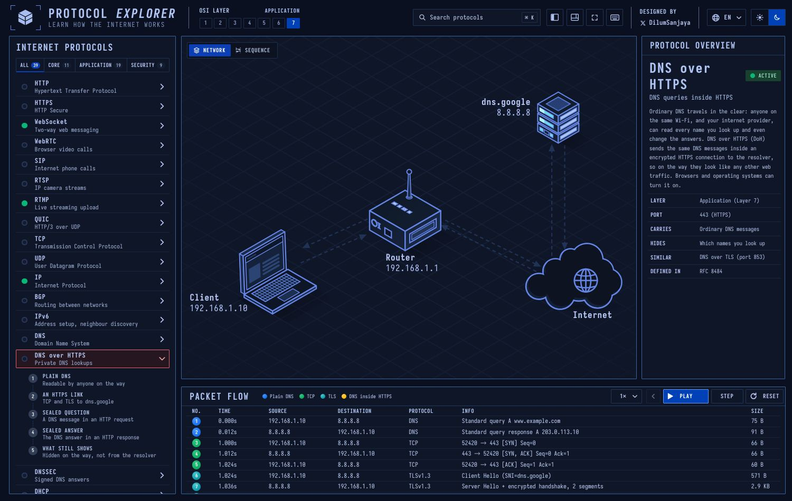
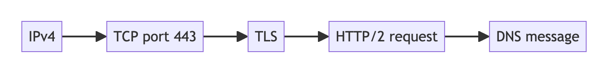
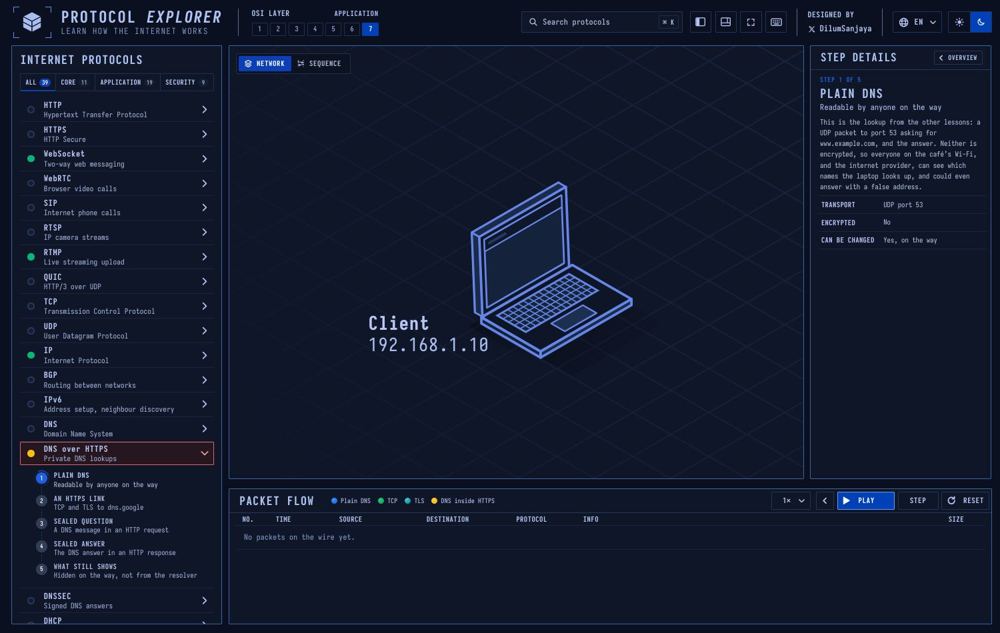
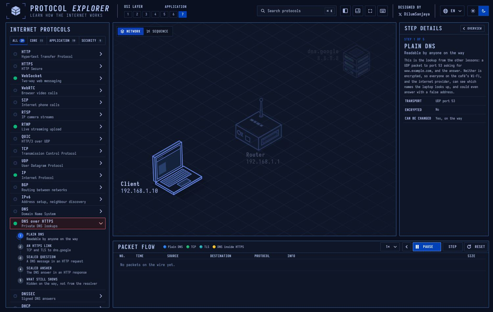
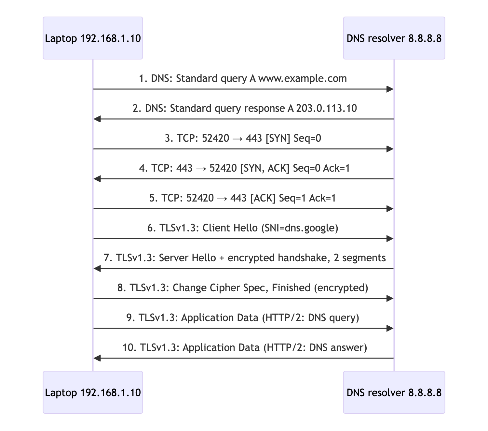
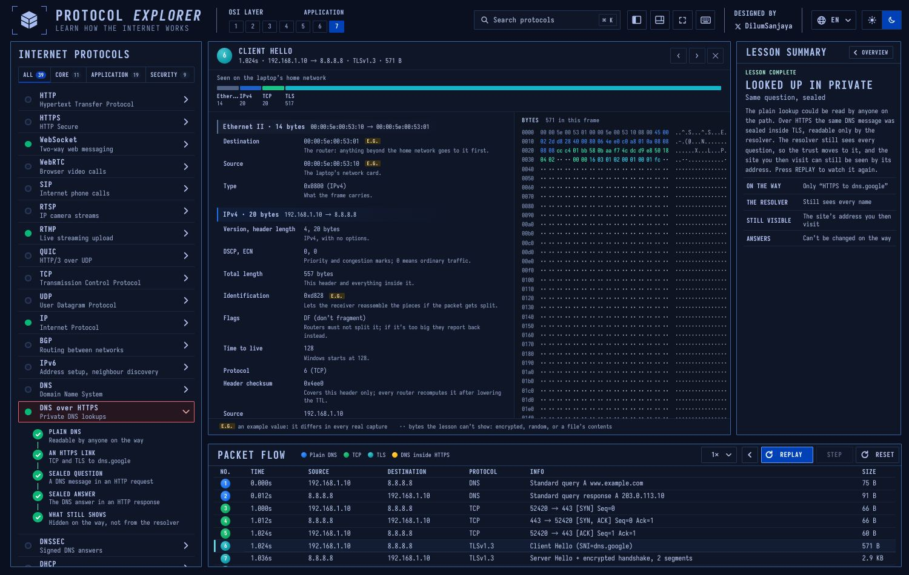
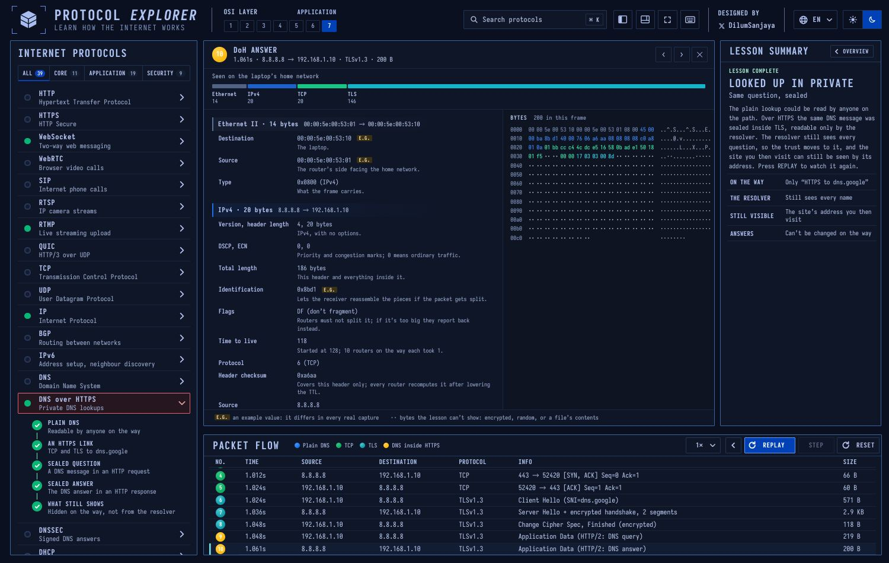

# DNS over HTTPS – Private DNS lookups

<!-- nav -->
⬅ [14 DNS](14-dns.md) · [Index](00_Protocols_Index.md) · [16 DNSSEC](16-dnssec.md) ➡
<!-- nav -->

*Source: Protocol Explorer – https://protocol-explorer-alpha.vercel.app/ (interactive lesson #15). Screenshots captured from the live lesson; packet decodes are the site's example capture (values marked **E.G.** differ in every real capture).*

## Overview

### How the layers fit together (outer to inner)

## In-depth explanation of the example (plain-language version)

### The big picture in one minute
First the laptop does a normal **plain DNS** lookup of `www.example.com` (packets 1–2). Then it switches on **DNS over HTTPS (DoH)** and does the same lookup through a **secure, encrypted HTTPS connection** to `dns.google` (packets 3–10). The lesson shows that **the question is exactly the same, but in the first case anyone can read it, and in the second it's sealed.**

**The problem with plain DNS.** It travels in plain text. Anyone on your Wi-Fi, your internet provider, or a device in the middle can **see every website name you look up** and can even **change the answer** to send you to a fake site. DoH hides DNS inside ordinary HTTPS traffic.

Think of **a postcard versus a sealed envelope**. The words are the same, but only the envelope keeps them private.

> **Words you'll see:** *TLS* = the encryption used by HTTPS. *SNI* = the server name the browser mentions at the start of a TLS connection. *HTTP/2* = a faster version of HTTP that can carry many requests on one connection.

---

### Step 1 – Plain DNS – packets 1, 2
The laptop sends "What's the address of `www.example.com`?" to `8.8.8.8` on UDP port 53, and gets `203.0.113.10` back (remember it for about 29 minutes). **Every byte, including the website name, is visible to anyone on the path.**

### Step 2 – Building a secure link to the resolver – packets 3 to 8
With DoH on, the browser treats the DNS server like a website:
- **TCP handshake** to port 443 (packets 3–5).
- **TLS handshake** (packets 6–8): the browser says it wants `dns.google`, the server shows its certificate (ID card) and the browser checks it's really `dns.google`. (Watchers can see *which resolver* you use, but not which names you look up.)
- This connection is **kept open and reused** for every later lookup, so the set-up cost is paid only once.

### Step 3 – The sealed question – packet 9
The question is the **same compact DNS message** as before, but sent as an **HTTP request**: `GET /dns-query?dns=<the question, encoded>`. It's all inside the encrypted connection, so on the wire it looks like any other web traffic on port 443 (just scrambled bytes).

### Step 4 – The sealed answer – packet 10
The resolver replies `200 OK` with a tiny 49-byte body: the ordinary DNS answer `203.0.113.10`. Because it arrived through TLS from a server whose certificate was checked, **nobody on the way could read it or change it.**

### Step 5 – What changed and what didn't
| | Plain DNS | DNS over HTTPS |
|---|---|---|
| Door used | UDP (or TCP) 53 | TCP 443 (HTTPS) |
| Can a watcher see the names? | **Yes** | **No** |
| Can someone change the answer on the way? | Yes | No |
| Looks like | "this is DNS" | normal web traffic |
| Extra cost | none | one-time connection set-up, then reused |

---

### The 10 messages at a glance
| Packets | What | Why |
|---|---|---|
| 1–2 | plain DNS question and answer | the "before" picture |
| 3–5 | TCP handshake to port 443 | open the connection |
| 6–8 | TLS handshake | encrypt and verify `dns.google` |
| 9 | sealed DNS question | the lookup, hidden |
| 10 | sealed DNS answer | the result, protected |

### What to remember
- DoH protects the **path between you and your resolver.** The resolver itself (Google, Cloudflare…) still sees your questions. You've *moved* trust, not removed it.
- It does **not check whether the answer itself is genuine.** That's **DNSSEC**'s job (separate note). The two complement each other.
- Close relatives: **DNS over TLS** (the same idea on its own port 853, easier for networks to spot and block) and **DNS over QUIC**.
- Trade-off: company and school networks lose the ability to filter by DNS, so they often prefer to control which resolver is used.
- Still visible to watchers: the resolver's address, the name `dns.google`, and packet sizes and timing.

## Under the hood – technical details

- **Standard.** RFC 8484. The DNS message keeps its exact binary format and is carried as an HTTP message with content type `application/dns-message`.
- **Two ways to send it.** `GET /dns-query?dns=<base64url of the DNS message>` (which is cacheable) or `POST /dns-query` with the raw message in the body. The server answers `200 OK` with the DNS reply as the body.
- **Transaction ID.** DoH clients normally set the DNS ID to `0` so the same question always produces the same URL and can be cached by HTTP caches. HTTPS itself already prevents spoofing.
- **HTTP/2 multiplexing.** One TLS connection stays open and many queries share it as separate streams, so the cost of TCP + TLS is paid once, not per lookup.
- **What an observer sees.** The IP of the resolver, the SNI name (`dns.google`), and the size and timing of packets. They cannot see which domain you asked for.
- **Trust moves, it does not vanish.** The resolver you pick (Google, Cloudflare, your ISP) still sees every query. You have moved your trust from your network to that provider.
- **No authentication of content.** DoH protects the link to the resolver. It does not prove the DNS data is genuine; that is DNSSEC's job.
- **Alternatives.** *DNS over TLS* (DoT) uses its own port **853**, which is easy for networks to recognise and block. *DNS over QUIC* (DoQ) uses UDP/QUIC. *DoH over HTTP/3* is also possible.
- **Operational trade-offs.** DoH can bypass local DNS-based filtering (parental controls, malware blocking, split-horizon names), so companies often disable it or point browsers at their own DoH resolver.
- **Discovery.** Browsers use a built-in list of providers, or automatically upgrade to DoH if the configured resolver supports it (*DDR*).
- **Privacy add-ons.** Padding of DNS messages and *Encrypted Client Hello* hide more of what remains visible.

## Step-by-step walkthrough (screenshots from the lesson)

### Step 1: PLAIN DNS – Readable by anyone on the way

### Step 2: AN HTTPS LINK – TCP and TLS to dns.google

### Step 3: SEALED QUESTION – A DNS message in an HTTP request

### Step 4: SEALED ANSWER – The DNS answer in an HTTP response

### Step 5: WHAT STILL SHOWS – Hidden on the way, not from the resolver

### Lesson summary

## Packet flow (whole lesson)

| No. | Time | Source | Destination | Protocol | Info | Size |
|---|---|---|---|---|---|---|
| 1 | 0.000s | 192.168.1.10 | 8.8.8.8 | DNS | Standard query A www.example.com | 75 B |
| 2 | 0.012s | 8.8.8.8 | 192.168.1.10 | DNS | Standard query response A 203.0.113.10 | 91 B |
| 3 | 1.000s | 192.168.1.10 | 8.8.8.8 | TCP | 52420 → 443 [SYN] Seq=0 | 66 B |
| 4 | 1.012s | 8.8.8.8 | 192.168.1.10 | TCP | 443 → 52420 [SYN, ACK] Seq=0 Ack=1 | 66 B |
| 5 | 1.024s | 192.168.1.10 | 8.8.8.8 | TCP | 52420 → 443 [ACK] Seq=1 Ack=1 | 60 B |
| 6 | 1.024s | 192.168.1.10 | 8.8.8.8 | TLSv1.3 | Client Hello (SNI=dns.google) | 571 B |
| 7 | 1.036s | 8.8.8.8 | 192.168.1.10 | TLSv1.3 | Server Hello + encrypted handshake, 2 segments | 2.9 KB |
| 8 | 1.048s | 192.168.1.10 | 8.8.8.8 | TLSv1.3 | Change Cipher Spec, Finished (encrypted) | 118 B |
| 9 | 1.048s | 192.168.1.10 | 8.8.8.8 | TLSv1.3 | Application Data (HTTP/2: DNS query) | 219 B |
| 10 | 1.061s | 8.8.8.8 | 192.168.1.10 | TLSv1.3 | Application Data (HTTP/2: DNS answer) | 200 B |

### Sequence diagram

*The lesson's own sequence diagram:*

## Packet decoder screenshots

The lesson's decoder view for the first, middle and last packet: headers, field values and the raw hex bytes.

### Packet 1: DNS – Standard query A www.example.com

*192.168.1.10 → 8.8.8.8 · 75 B · t = 0.000s*

### Packet 6: TLSv1.3 – Client Hello (SNI=dns.google)

*192.168.1.10 → 8.8.8.8 · 571 B · t = 1.024s*

### Packet 10: TLSv1.3 – Application Data (HTTP/2: DNS answer)

*8.8.8.8 → 192.168.1.10 · 200 B · t = 1.061s*

---

<!-- nav -->
⬅ [14 DNS](14-dns.md) · [Index](00_Protocols_Index.md) · [16 DNSSEC](16-dnssec.md) ➡
<!-- nav -->
