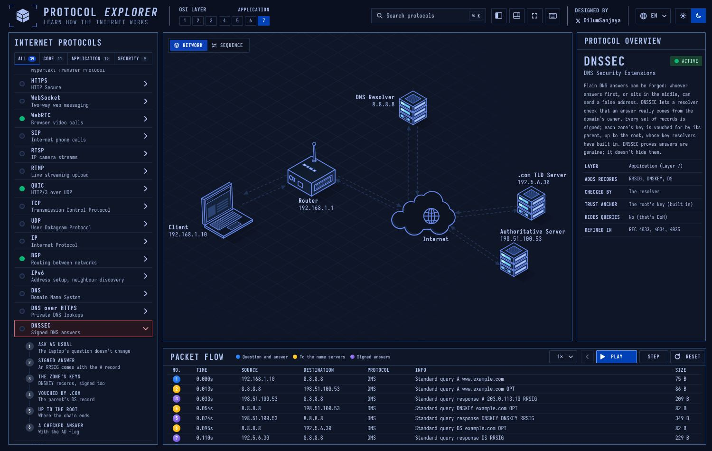
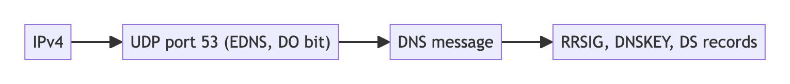
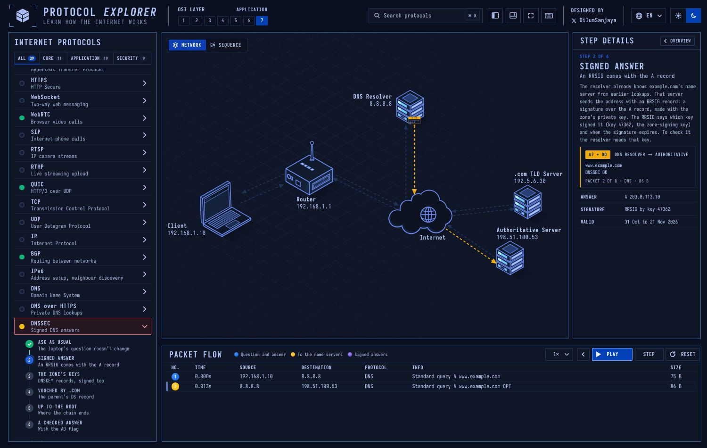
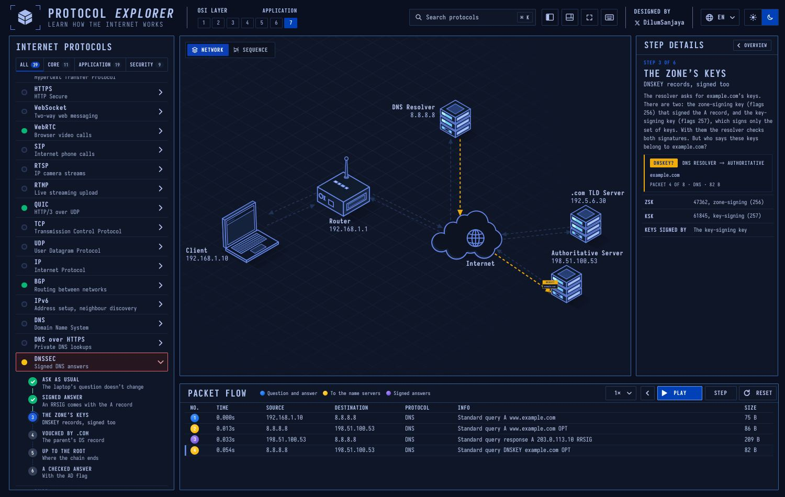
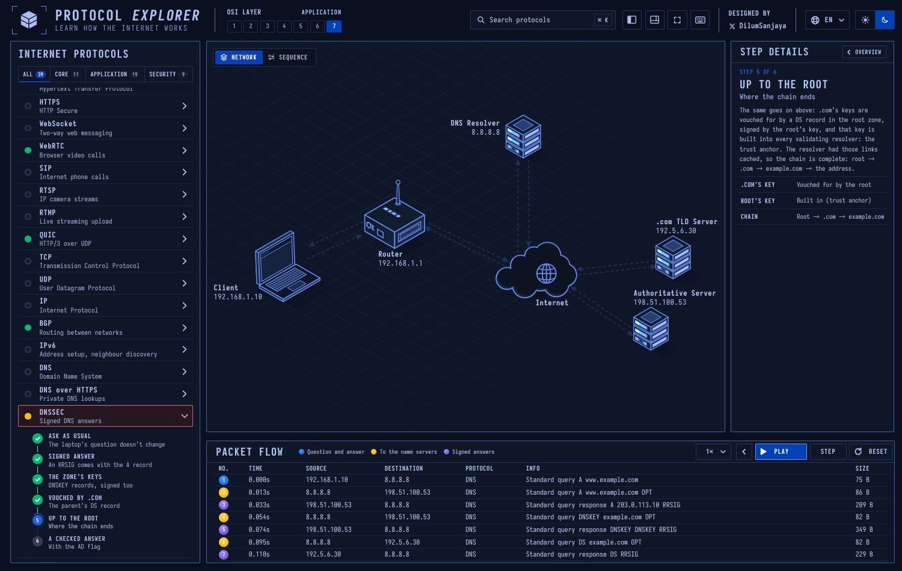
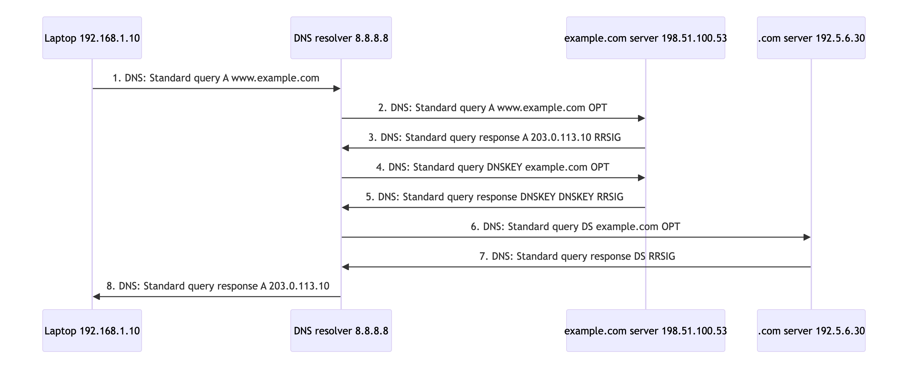
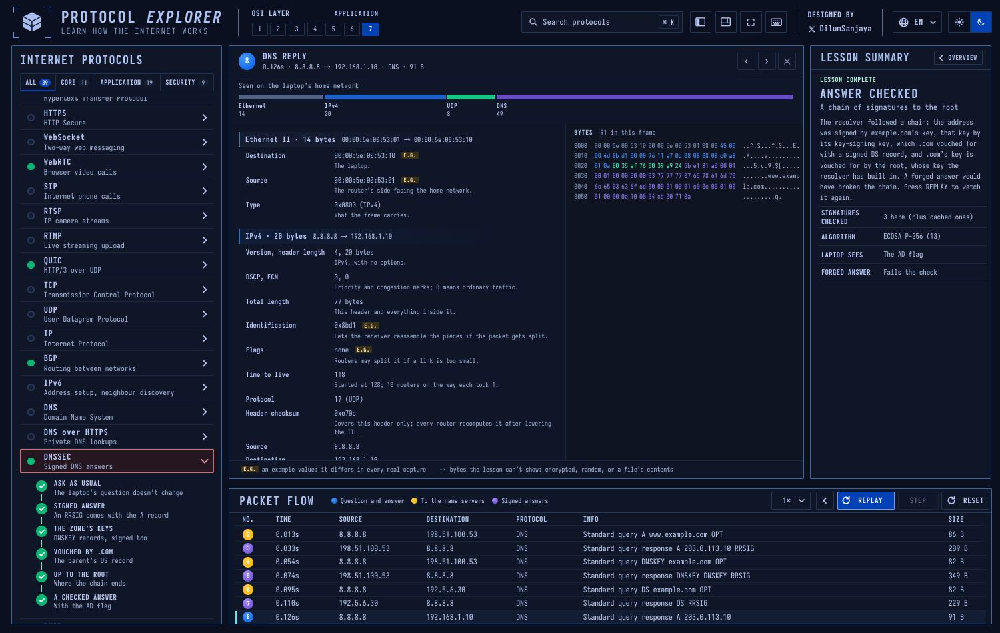

# DNSSEC – Signed DNS answers

<!-- nav -->
⬅ [15 DNS over HTTPS](15-dns-over-https.md) · [Index](00_Protocols_Index.md) · [17 DHCP](17-dhcp.md) ➡
<!-- nav -->

*Source: Protocol Explorer – https://protocol-explorer-alpha.vercel.app/ (interactive lesson #16). Screenshots captured from the live lesson; packet decodes are the site's example capture (values marked **E.G.** differ in every real capture).*

## Overview

### How the layers fit together (outer to inner)

## In-depth explanation of the example (plain-language version)

### The big picture in one minute
The laptop asks `8.8.8.8` for `www.example.com`. This time the resolver **checks digital signatures** to prove the answer really came from the domain's owner before passing it on. **8 messages in 126 ms:** the address with its signature, the domain's public keys, and the parent's "vouching" record.

**The problem DNSSEC solves.** Normal DNS answers aren't verified. Whoever answers first, or sits in the middle, can send a **fake address** and send you to a fraudulent site. **DNSSEC adds signatures to DNS data** so you can prove an answer is **genuine and unchanged.** It does **not** hide or encrypt anything (that's what DoH does).

Think of **a wax seal on a letter, plus a notary who confirms that the seal belongs to the sender**, plus a government office that confirms the notary.

> **Words you'll see:** *Signature* = a mathematical proof that data came from the key's owner and wasn't changed. *Public key* = the half of a key pair that anyone may use to check signatures. *Hash* = a short fingerprint of some data. *Chain of trust* = each level vouches for the next.

---

### The new building blocks
- **RRSIG** – the **signature** over a set of DNS records, made with the domain's private key.
- **DNSKEY** – the domain's **public keys**. There are two kinds: the **ZSK** (zone-signing key, flag 256) that signs the everyday records, and the **KSK** (key-signing key, flag 257) that only signs the set of keys. (They're split so the busy ZSK can be changed easily, while only the KSK's fingerprint has to be shared with the parent.)
- **DS** – a **fingerprint (hash) of the child's KSK**, stored in the **parent** zone and signed by it. This is the **link** between a domain and its parent.
- **Trust anchor** – the root's public key, built into every validating resolver. It's where trust begins.

### Step 1 – The question, asking for signatures – packets 1, 2
The laptop asks the usual question. The resolver forwards it to `example.com`'s server with a flag that means **"DNSSEC OK: please send the signatures too."**

### Step 2 – A signed answer – packet 3
The server replies with the address `203.0.113.10` **and a signature (RRSIG)** over it. The signature says it was made by "key 47362 (the ZSK)", with its validity dates. To check it, the resolver needs that public key.

### Step 3 – Fetching the domain's keys – packets 4, 5
The resolver asks for the domain's **DNSKEY** records. The reply has both keys (ZSK 47362 and KSK 61845) and a signature over them made by the KSK. The resolver can now check the address's signature using the ZSK. But this only proves the keys are consistent with each other. **Who says these keys really belong to example.com?**

### Step 4 – The parent vouches for it – packets 6, 7
The resolver asks the **`.com` servers** for a **DS record** for `example.com`. They return a **fingerprint of KSK 61845**, signed with `.com`'s own key. If the fingerprint of the KSK the resolver received matches, then **`.com` is vouching that this key belongs to example.com.**

### Step 5 – All the way up
The same trick repeats upward: `.com`'s key is vouched for by a DS record in the **root zone**, and the root's key is the **trust anchor** built into the resolver. The resolver already had those top links remembered, so the full **chain of trust** is complete:
`root (trusted) → .com → example.com's KSK → its ZSK → the signature → the address`.

### Step 6 – A verified answer – packet 8
The resolver returns `203.0.113.10` to the laptop with an **AD ("Authenticated Data")** flag set, meaning "I checked it." **If any signature had failed, the resolver would have answered with an error (`SERVFAIL`) and no address at all,** rather than risk handing over a forged one.

---

### The 8 messages at a glance
| Packets | What | Why |
|---|---|---|
| 1–2 | question (asking for signatures) | start |
| 3 | address + signature | the answer and its proof |
| 4–5 | DNSKEY records | the keys to check the signature |
| 6–7 | DS record from `.com` | the parent vouches for the key |
| 8 | answer with the AD flag | "verified" |

### What to remember
- DNSSEC gives **authenticity and integrity** (the answer is real and unaltered) through a **chain of trust** that starts at the root. It gives **no secrecy.**
- Even "this name doesn't exist" answers are signed (**NSEC/NSEC3**), so nobody can forge them either.
- The **resolver** does the checking. Your laptop trusts the AD flag, so combine DNSSEC with DoH/DoT to protect that last step.
- Costs: bigger packets, and operational risk. Expired signatures or botched key changes can take a domain offline.
- Only domains that sign themselves (and have a DS record in their parent) are protected.

## Under the hood – technical details

- **What is signed.** DNSSEC signs *RRsets* (all records of one name and type) and returns the signature as an `RRSIG` record. A signature contains the type covered, algorithm, labels, original TTL, **inception and expiration times**, the key tag and the signer's name.
- **Keys.** `DNSKEY` records hold public keys. Flags `256` mean *ZSK* (zone-signing key, signs the zone's data). Flags `257` mean *KSK* (key-signing key, signs only the DNSKEY set). The split lets the ZSK be rotated often while the KSK, whose fingerprint lives in the parent, changes rarely.
- **Algorithms.** RSA/SHA-256, ECDSA P-256 and Ed25519 are common. ECDSA and Ed25519 give much smaller signatures than RSA.
- **DS record.** Stored in the *parent* zone: key tag, algorithm, digest type (SHA-256) and the **hash of the child's KSK**. The parent signs it with its own key, so a validator can pass trust from parent to child.
- **Chain of trust.** root zone key (the *trust anchor*, built into resolvers) -> DS for `com` -> `com` DNSKEY -> DS for `example.com` -> `example.com` KSK -> ZSK -> `RRSIG` -> the record. Break any link and validation fails.
- **DO and AD bits.** The `DO` bit (DNSSEC OK) in the EDNS(0) record asks the server to include signatures. A validating resolver sets `AD` (Authenticated Data) in its reply when it has checked everything. On failure it returns `SERVFAIL`, so a forged address is never delivered.
- **Proving non-existence.** `NSEC` / `NSEC3` records say "there is no name between A and B", signed, so an attacker cannot fake an `NXDOMAIN`. `NSEC3` hashes the names to make zone walking harder.
- **Time dependence.** Signatures expire. If a zone owner forgets to re-sign or botches a key rollover, validating resolvers treat the whole domain as broken.
- **Bigger packets.** Signatures and keys enlarge DNS responses, which is why EDNS(0) and TCP fallback matter.
- **Limits.** DNSSEC gives authenticity and integrity, not confidentiality. Only signed zones with a DS record in their parent are protected. The last step (resolver to laptop) is unprotected unless you also use DoH or DoT.

## Step-by-step walkthrough

### Step 1: ASK AS USUAL – The laptop’s question doesn’t change

### Step 2: SIGNED ANSWER – An RRSIG comes with the A record

### Step 3: THE ZONE’S KEYS – DNSKEY records, signed too

### Step 4: VOUCHED BY .COM – The parent’s DS record

### Step 5: UP TO THE ROOT – Where the chain ends

### Step 6: A CHECKED ANSWER – With the AD flag

### Lesson summary

## Packet flow (whole lesson)

| No. | Time | Source | Destination | Protocol | Info | Size |
|---|---|---|---|---|---|---|
| 1 | 0.000s | 192.168.1.10 | 8.8.8.8 | DNS | Standard query A www.example.com | 75 B |
| 2 | 0.013s | 8.8.8.8 | 198.51.100.53 | DNS | Standard query A www.example.com OPT | 86 B |
| 3 | 0.033s | 198.51.100.53 | 8.8.8.8 | DNS | Standard query response A 203.0.113.10 RRSIG | 209 B |
| 4 | 0.054s | 8.8.8.8 | 198.51.100.53 | DNS | Standard query DNSKEY example.com OPT | 82 B |
| 5 | 0.074s | 198.51.100.53 | 8.8.8.8 | DNS | Standard query response DNSKEY DNSKEY RRSIG | 349 B |
| 6 | 0.095s | 8.8.8.8 | 192.5.6.30 | DNS | Standard query DS example.com OPT | 82 B |
| 7 | 0.110s | 192.5.6.30 | 8.8.8.8 | DNS | Standard query response DS RRSIG | 229 B |
| 8 | 0.126s | 8.8.8.8 | 192.168.1.10 | DNS | Standard query response A 203.0.113.10 | 91 B |

### Sequence diagram

*The lesson's own sequence diagram:*

## Packet decoder screenshots

The lesson's decoder view for the first, middle and last packet: headers, field values and the raw hex bytes.

### Packet 1: DNS – Standard query A www.example.com

*192.168.1.10 → 8.8.8.8 · 75 B · t = 0.000s*

### Packet 5: DNS – Standard query response DNSKEY DNSKEY RRSIG

*198.51.100.53 → 8.8.8.8 · 349 B · t = 0.074s*

### Packet 8: DNS – Standard query response A 203.0.113.10

*8.8.8.8 → 192.168.1.10 · 91 B · t = 0.126s*

---

<!-- nav -->
⬅ [15 DNS over HTTPS](15-dns-over-https.md) · [Index](00_Protocols_Index.md) · [17 DHCP](17-dhcp.md) ➡
<!-- nav -->
