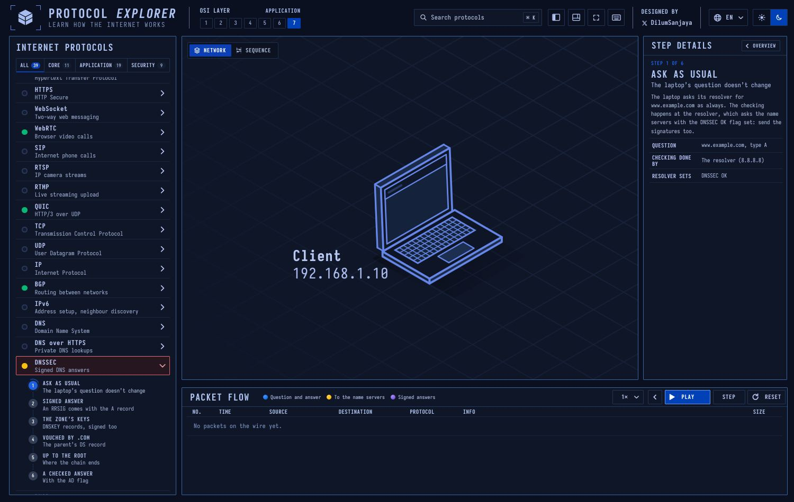
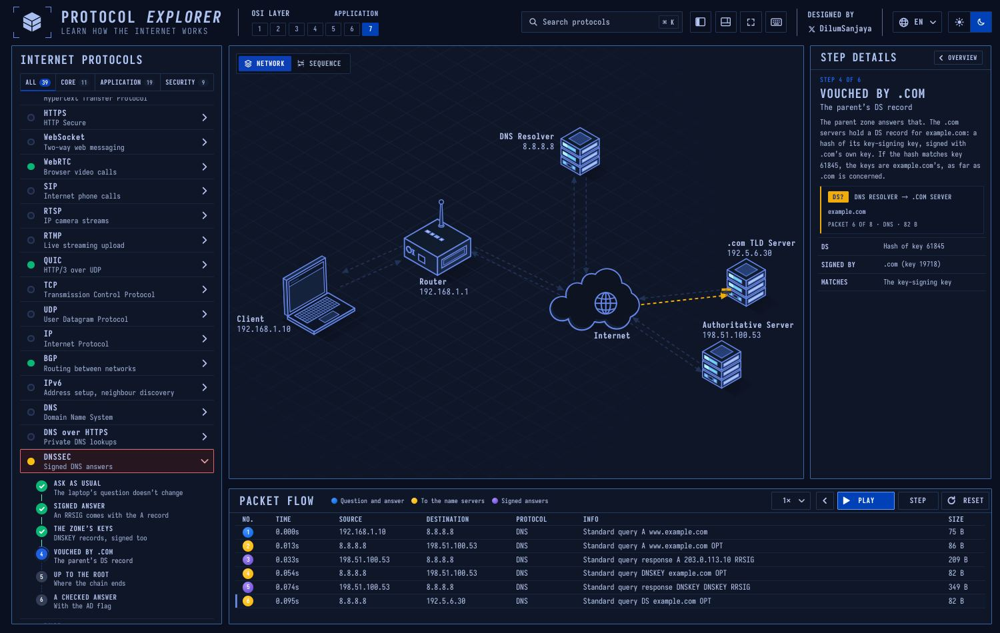
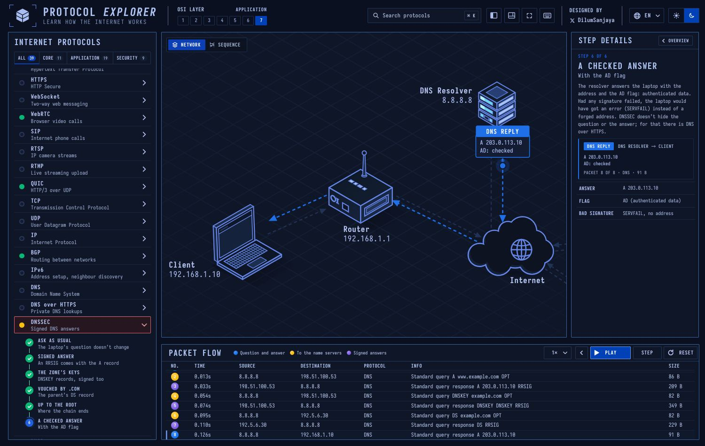
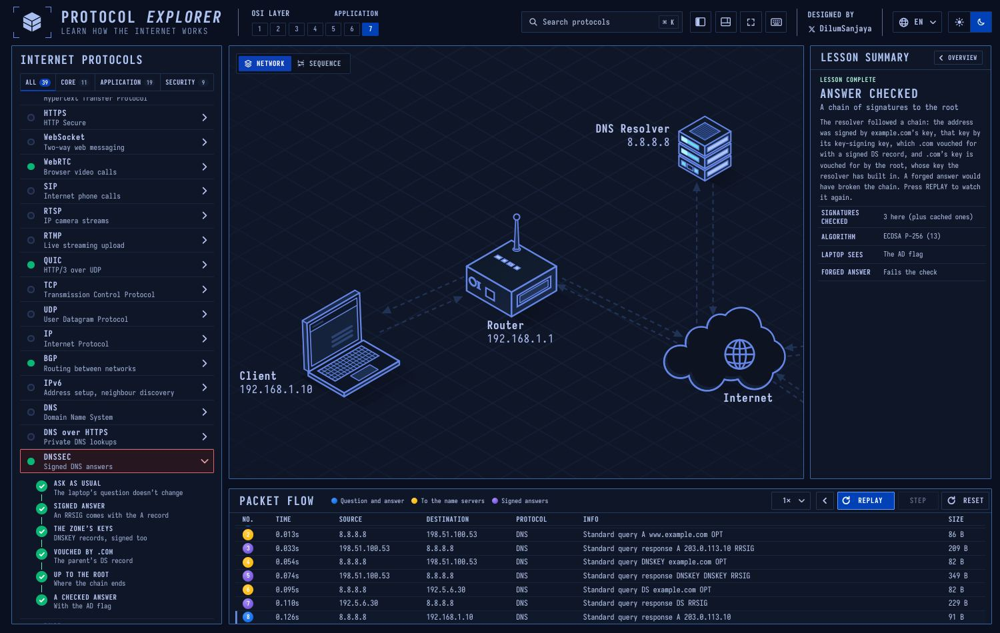
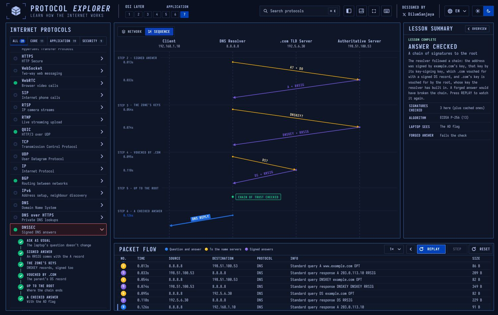
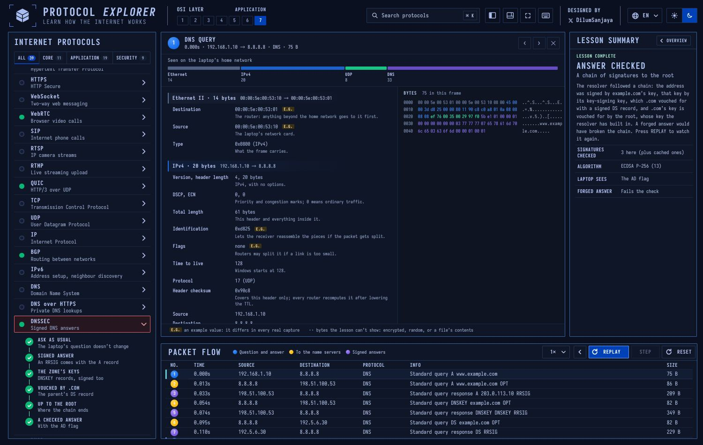
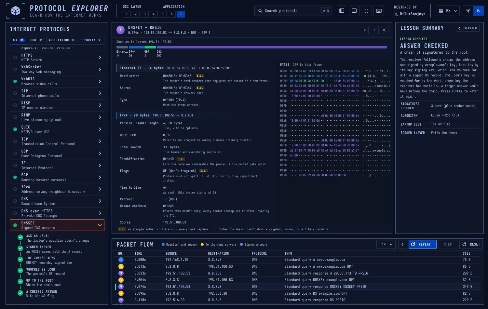

# DNSSEC – Signed DNS answers

<!-- nav -->
⬅ [15 DNS over HTTPS](15-dns-over-https.md) · [Index](00_Protocols_Index.md) · [17 DHCP](17-dhcp.md) ➡
<!-- nav -->

*Source: Protocol Explorer – https://protocol-explorer-alpha.vercel.app/ (interactive lesson #16). Screenshots captured from the live lesson; packet decodes are the site's example capture (values marked **E.G.** differ in every real capture).*

## Overview


> PROTOCOL OVERVIEW  
> DNSSEC  
> ACTIVE  
> DNS Security Extensions  
> Plain DNS answers can be forged: whoever answers first, or sits in the middle, can send a false address. DNSSEC lets a resolver check that an answer really comes from the domain’s owner. Every set of records is signed; each zone’s key is vouched for by its parent, up to the root, whose key resolvers have built in. DNSSEC proves answers are genuine; it doesn’t hide them.  
> LAYER  
> Application (Layer 7)  
> ADDS RECORDS  
> RRSIG, DNSKEY, DS  
> CHECKED BY  
> The resolver  
> TRUST ANCHOR  
> The root’s key (built in)  
> HIDES QUERIES  
> No (that’s DoH)  
> DEFINED IN  
> RFC 4033, 4034, 4035  

## In-depth explanation of the example (plain-language version)

### The big picture in one minute
The laptop asks `8.8.8.8` for `www.example.com`. This time the resolver **checks digital signatures** to prove the answer really came from the domain's owner before passing it on. **8 messages in 126 ms:** the address with its signature, the domain's public keys, and the parent's "vouching" record.

**The problem DNSSEC solves.** Normal DNS answers aren't verified. Whoever answers first, or sits in the middle, can send a **fake address** and send you to a fraudulent site. **DNSSEC adds signatures to DNS data** so you can prove an answer is **genuine and unchanged.** It does **not** hide or encrypt anything (that's what DoH does).

Think of **a wax seal on a letter, plus a notary who confirms that the seal belongs to the sender**, plus a government office that confirms the notary.

> **Words you'll see:** *Signature* = a mathematical proof that data came from the key's owner and wasn't changed. *Public key* = the half of a key pair that anyone may use to check signatures. *Hash* = a short fingerprint of some data. *Chain of trust* = each level vouches for the next.

---

### The new building blocks
- **RRSIG** – the **signature** over a set of DNS records, made with the domain's private key.
- **DNSKEY** – the domain's **public keys**. There are two kinds: the **ZSK** (zone-signing key, flag 256) that signs the everyday records, and the **KSK** (key-signing key, flag 257) that only signs the set of keys. (They're split so the busy ZSK can be changed easily, while only the KSK's fingerprint has to be shared with the parent.)
- **DS** – a **fingerprint (hash) of the child's KSK**, stored in the **parent** zone and signed by it. This is the **link** between a domain and its parent.
- **Trust anchor** – the root's public key, built into every validating resolver. It's where trust begins.

### Step 1 – The question, asking for signatures – packets 1, 2
The laptop asks the usual question. The resolver forwards it to `example.com`'s server with a flag that means **"DNSSEC OK: please send the signatures too."**

### Step 2 – A signed answer – packet 3
The server replies with the address `203.0.113.10` **and a signature (RRSIG)** over it. The signature says it was made by "key 47362 (the ZSK)", with its validity dates. To check it, the resolver needs that public key.

### Step 3 – Fetching the domain's keys – packets 4, 5
The resolver asks for the domain's **DNSKEY** records. The reply has both keys (ZSK 47362 and KSK 61845) and a signature over them made by the KSK. The resolver can now check the address's signature using the ZSK. But this only proves the keys are consistent with each other. **Who says these keys really belong to example.com?**

### Step 4 – The parent vouches for it – packets 6, 7
The resolver asks the **`.com` servers** for a **DS record** for `example.com`. They return a **fingerprint of KSK 61845**, signed with `.com`'s own key. If the fingerprint of the KSK the resolver received matches, then **`.com` is vouching that this key belongs to example.com.**

### Step 5 – All the way up
The same trick repeats upward: `.com`'s key is vouched for by a DS record in the **root zone**, and the root's key is the **trust anchor** built into the resolver. The resolver already had those top links remembered, so the full **chain of trust** is complete:
`root (trusted) → .com → example.com's KSK → its ZSK → the signature → the address`.

### Step 6 – A verified answer – packet 8
The resolver returns `203.0.113.10` to the laptop with an **AD ("Authenticated Data")** flag set, meaning "I checked it." **If any signature had failed, the resolver would have answered with an error (`SERVFAIL`) and no address at all,** rather than risk handing over a forged one.

---

### The 8 messages at a glance
| Packets | What | Why |
|---|---|---|
| 1–2 | question (asking for signatures) | start |
| 3 | address + signature | the answer and its proof |
| 4–5 | DNSKEY records | the keys to check the signature |
| 6–7 | DS record from `.com` | the parent vouches for the key |
| 8 | answer with the AD flag | "verified" |

### What to remember
- DNSSEC gives **authenticity and integrity** (the answer is real and unaltered) through a **chain of trust** that starts at the root. It gives **no secrecy.**
- Even "this name doesn't exist" answers are signed (**NSEC/NSEC3**), so nobody can forge them either.
- The **resolver** does the checking. Your laptop trusts the AD flag, so combine DNSSEC with DoH/DoT to protect that last step.
- Costs: bigger packets, and operational risk. Expired signatures or botched key changes can take a domain offline.
- Only domains that sign themselves (and have a DS record in their parent) are protected.

## Step-by-step walkthrough (screenshots from the lesson)

### Step 1: ASK AS USUAL – The laptop’s question doesn’t change



> STEP 1 OF 6  
> ASK AS USUAL  
> The laptop’s question doesn’t change  
> The laptop asks its resolver for www.example.com as always. The checking happens at the resolver, which asks the name servers with the DNSSEC OK flag set: send the signatures too.  
> QUESTION  
> www.example.com, type A  
> CHECKING DONE BY  
> The resolver (8.8.8.8)  
> RESOLVER SETS  
> DNSSEC OK  

### Step 2: SIGNED ANSWER – An RRSIG comes with the A record


> STEP 2 OF 6  
> SIGNED ANSWER  
> An RRSIG comes with the A record  
> The resolver already knows example.com’s name server from earlier lookups. That server sends the address with an RRSIG record: a signature over the A record, made with the zone’s private key. The RRSIG says which key signed it (key 47362, the zone-signing key) and when the signature expires. To check it the resolver needs that key.  
> A? + DO  
> DNS RESOLVER → AUTHORITATIVE  
> www.example.com  
> DNSSEC OK  
> PACKET 2 OF 8 · DNS · 86 B  
> ANSWER  
> A 203.0.113.10  
> SIGNATURE  
> RRSIG by key 47362  
> VALID  
> 31 Oct to 21 Nov 2026  

### Step 3: THE ZONE’S KEYS – DNSKEY records, signed too


> STEP 3 OF 6  
> THE ZONE’S KEYS  
> DNSKEY records, signed too  
> The resolver asks for example.com’s keys. There are two: the zone-signing key (flags 256) that signed the A record, and the key-signing key (flags 257), which signs only the set of keys. With them the resolver checks both signatures. But who says these keys belong to example.com?  
> DNSKEY?  
> DNS RESOLVER → AUTHORITATIVE  
> example.com  
> PACKET 4 OF 8 · DNS · 82 B  
> ZSK  
> 47362, zone-signing (256)  
> KSK  
> 61845, key-signing (257)  
> KEYS SIGNED BY  
> The key-signing key  

### Step 4: VOUCHED BY .COM – The parent’s DS record



> STEP 4 OF 6  
> VOUCHED BY .COM  
> The parent’s DS record  
> The parent zone answers that. The .com servers hold a DS record for example.com: a hash of its key-signing key, signed with .com’s own key. If the hash matches key 61845, the keys are example.com’s, as far as .com is concerned.  
> DS?  
> DNS RESOLVER → .COM SERVER  
> example.com  
> PACKET 6 OF 8 · DNS · 82 B  
> DS  
> Hash of key 61845  
> SIGNED BY  
> .com (key 19718)  
> MATCHES  
> The key-signing key  

### Step 5: UP TO THE ROOT – Where the chain ends


> STEP 5 OF 6  
> UP TO THE ROOT  
> Where the chain ends  
> The same goes on above: .com’s keys are vouched for by a DS record in the root zone, signed by the root’s key, and that key is built into every validating resolver: the trust anchor. The resolver had those links cached, so the chain is complete: root → .com → example.com → the address.  
> DS?  
> DNS RESOLVER → .COM SERVER  
> example.com  
> PACKET 6 OF 8 · DNS · 82 B  
> .COM’S KEY  
> Vouched for by the root  
> ROOT’S KEY  
> Built in (trust anchor)  
> CHAIN  
> Root → .com → example.com  

### Step 6: A CHECKED ANSWER – With the AD flag



> STEP 6 OF 6  
> A CHECKED ANSWER  
> With the AD flag  
> The resolver answers the laptop with the address and the AD flag: authenticated data. Had any signature failed, the laptop would have got an error (SERVFAIL) instead of a forged address. DNSSEC doesn’t hide the question or the answer; for that there is DNS over HTTPS.  
> DNS REPLY  
> DNS RESOLVER → CLIENT  
> A 203.0.113.10  
> AD: checked  
> PACKET 8 OF 8 · DNS · 91 B  
> ANSWER  
> A 203.0.113.10  
> FLAG  
> AD (authenticated data)  
> BAD SIGNATURE  
> SERVFAIL, no address  

### Lesson summary



> LESSON SUMMARY  
> LESSON COMPLETE  
> ANSWER CHECKED  
> A chain of signatures to the root  
> The resolver followed a chain: the address was signed by example.com’s key, that key by its key-signing key, which .com vouched for with a signed DS record, and .com’s key is vouched for by the root, whose key the resolver has built in. A forged answer would have broken the chain. Press REPLAY to watch it again.  
> DNS REPLY  
> DNS RESOLVER → CLIENT  
> A 203.0.113.10  
> AD: checked  
> PACKET 8 OF 8 · DNS · 91 B  
> SIGNATURES CHECKED  
> 3 here (plus cached ones)  
> ALGORITHM  
> ECDSA P-256 (13)  
> LAPTOP SEES  
> The AD flag  
> FORGED ANSWER  
> Fails the check  

## Packet flow (whole lesson)

| No. | Time | Source | Destination | Protocol | Info | Size |
|---|---|---|---|---|---|---|
| 1 | 0.000s | 192.168.1.10 | 8.8.8.8 | DNS | Standard query A www.example.com | 75 B |
| 2 | 0.013s | 8.8.8.8 | 198.51.100.53 | DNS | Standard query A www.example.com OPT | 86 B |
| 3 | 0.033s | 198.51.100.53 | 8.8.8.8 | DNS | Standard query response A 203.0.113.10 RRSIG | 209 B |
| 4 | 0.054s | 8.8.8.8 | 198.51.100.53 | DNS | Standard query DNSKEY example.com OPT | 82 B |
| 5 | 0.074s | 198.51.100.53 | 8.8.8.8 | DNS | Standard query response DNSKEY DNSKEY RRSIG | 349 B |
| 6 | 0.095s | 8.8.8.8 | 192.5.6.30 | DNS | Standard query DS example.com OPT | 82 B |
| 7 | 0.110s | 192.5.6.30 | 8.8.8.8 | DNS | Standard query response DS RRSIG | 229 B |
| 8 | 0.126s | 8.8.8.8 | 192.168.1.10 | DNS | Standard query response A 203.0.113.10 | 91 B |

### Sequence diagram



## Packets decoded byte by byte

Each packet below is the lesson's own decode (headers, field values and the plain-English meaning of each field). Screenshots show the first, middle and last packet in the lesson's decoder view with the raw hex bytes.

### Packet 1: DNS – Standard query A www.example.com

*192.168.1.10 → 8.8.8.8 · 75 B · t = 0.000s*



<details><summary>Decoded fields</summary>

```text
1
DNS QUERY
0.000s · 192.168.1.10 → 8.8.8.8 · DNS · 75 B
Seen on the laptop’s home network
Ethernet
14
IPv4
20
UDP
8
DNS
33
Ethernet II · 14 bytes
00:00:5e:00:53:10 → 00:00:5e:00:53:01
Destination
00:00:5e:00:53:01 E.G.

The router: anything beyond the home network goes to it first.

Source
00:00:5e:00:53:10 E.G.

The laptop’s network card.

Type
0x0800 (IPv4)

What the frame carries.

IPv4 · 20 bytes
192.168.1.10 → 8.8.8.8
Version, header length
4, 20 bytes

IPv4, with no options.

DSCP, ECN
0, 0

Priority and congestion marks; 0 means ordinary traffic.

Total length
61 bytes

This header and everything inside it.

Identification
0xd825 E.G.

Lets the receiver reassemble the pieces if the packet gets split.

Flags
none E.G.

Routers may split it if a link is too small.

Time to live
128

Windows starts at 128.

Protocol
17 (UDP)
Header checksum
0x90c8

Covers this header only; every router recomputes it after lowering the TTL.

Source
192.168.1.10
Destination
8.8.8.8
UDP · 8 bytes
61302 → 53
Source port
61302
Destination port
53
Length
41 bytes

UDP header and data. That is all of UDP: no numbering, no acknowledgements.

Checksum
0x97f0

Covers the header, the data and the IP addresses.

DNS
Transaction ID
0x5be1 E.G.

Picked at random; the answer must carry the same one.

Flags
0x0100: query, RD (recursion desired)
Questions
1
Answers
0
Authority records
0
Additional records
0
Question
www.example.com, type A, class IN
BYTES 75 in this frame
0000
00
00
5e
00
53
01
00
00
5e
00
53
10
08
00
45
00
.
.
^
.
S
.
.
.
^
.
S
.
.
.
E
.
0010
00
3d
d8
25
00
00
80
11
90
c8
c0
a8
01
0a
08
08
.
=
.
%
.
.
.
.
.
.
.
.
.
.
.
.
0020
08
08
ef
76
00
35
00
29
97
f0
5b
e1
01
00
00
01
.
.
.
v
.
5
.
)
.
.
[
.
.
.
.
.
0030
00
00
00
00
00
00
03
77
77
77
07
65
78
61
6d
70
.
.
.
.
.
.
.
w
w
w
.
e
x
a
m
p
0040
6c
65
03
63
6f
6d
00
00
01
00
01
l
e
.
c
o
m
.
.
.
.
.
E.G. an example value: it differs in every real capture
·· bytes the lesson can’t show: encrypted, random, or a file’s contents
```

</details>

### Packet 2: DNS – Standard query A www.example.com OPT

*8.8.8.8 → 198.51.100.53 · 86 B · t = 0.013s*

<details><summary>Decoded fields</summary>

```text
2
A? + DO
0.013s · 8.8.8.8 → 198.51.100.53 · DNS · 86 B
Seen as it leaves 8.8.8.8
Ethernet
14
IPv4
20
UDP
8
DNS
44
Ethernet II · 14 bytes
00:00:5e:00:53:40 → 00:00:5e:00:53:80
Destination
00:00:5e:00:53:80 E.G.

The sender’s next router; each hop puts the packet in a new frame.

Source
00:00:5e:00:53:40 E.G.

The sender’s network card.

Type
0x0800 (IPv4)

What the frame carries.

IPv4 · 20 bytes
8.8.8.8 → 198.51.100.53
Version, header length
4, 20 bytes

IPv4, with no options.

DSCP, ECN
0, 0

Priority and congestion marks; 0 means ordinary traffic.

Total length
72 bytes

This header and everything inside it.

Identification
0x8bce E.G.

Lets the receiver reassemble the pieces if the packet gets split.

Flags
none E.G.

Routers may split it if a link is too small.

Time to live
128

As sent: this system starts at 128.

Protocol
17 (UDP)
Header checksum
0x745e

Covers this header only; every router recomputes it after lowering the TTL.

Source
8.8.8.8
Destination
198.51.100.53
UDP · 8 bytes
40519 → 53
Source port
40519
Destination port
53
Length
52 bytes

UDP header and data. That is all of UDP: no numbering, no acknowledgements.

Checksum
0x2933

Covers the header, the data and the IP addresses.

DNS
Transaction ID
0x2f07 E.G.

Picked at random; the answer must carry the same one.

Flags
0x0000: query
Questions
1
Answers
0
Authority records
0
Additional records
1
Question
www.example.com, type A, class IN
EDNS
UDP size 1232, DNSSEC OK = 1

Says how big a UDP answer can be, and DNSSEC OK: send the signatures too.

BYTES 86 in this frame
0000
00
00
5e
00
53
80
00
00
5e
00
53
40
08
00
45
00
.
.
^
.
S
.
.
.
^
.
S
@
.
.
E
.
0010
00
48
8b
ce
00
00
80
11
74
5e
08
08
08
08
c6
33
.
H
.
.
.
.
.
.
t
^
.
.
.
.
.
3
0020
64
35
9e
47
00
35
00
34
29
33
2f
07
00
00
00
01
d
5
.
G
.
5
.
4
)
3
/
.
.
.
.
.
0030
00
00
00
00
00
01
03
77
77
77
07
65
78
61
6d
70
.
.
.
.
.
.
.
w
w
w
.
e
x
a
m
p
0040
6c
65
03
63
6f
6d
00
00
01
00
01
00
00
29
04
d0
l
e
.
c
o
m
.
.
.
.
.
.
.
)
.
.
0050
00
00
80
00
00
00
.
.
.
.
.
.
E.G. an example value: it differs in every real capture
·· bytes the lesson can’t show: encrypted, random, or a file’s contents
```

</details>

### Packet 3: DNS – Standard query response A 203.0.113.10 RRSIG

*198.51.100.53 → 8.8.8.8 · 209 B · t = 0.033s*

<details><summary>Decoded fields</summary>

```text
3
A + RRSIG
0.033s · 198.51.100.53 → 8.8.8.8 · DNS · 209 B
Seen as it leaves 198.51.100.53
Ethernet
14
IPv4
20
UDP
8
DNS
167
Ethernet II · 14 bytes
00:00:5e:00:53:41 → 00:00:5e:00:53:81
Destination
00:00:5e:00:53:81 E.G.

The sender’s next router; each hop puts the packet in a new frame.

Source
00:00:5e:00:53:41 E.G.

The sender’s network card.

Type
0x0800 (IPv4)

What the frame carries.

IPv4 · 20 bytes
198.51.100.53 → 8.8.8.8
Version, header length
4, 20 bytes

IPv4, with no options.

DSCP, ECN
0, 0

Priority and congestion marks; 0 means ordinary traffic.

Total length
195 bytes

This header and everything inside it.

Identification
0xde3f E.G.

Lets the receiver reassemble the pieces if the packet gets split.

Flags
DF (don’t fragment) E.G.

Routers must not split it; if it’s too big they report back instead.

Time to live
64

As sent: this system starts at 64.

Protocol
17 (UDP)
Header checksum
0x2172

Covers this header only; every router recomputes it after lowering the TTL.

Source
198.51.100.53
Destination
8.8.8.8
UDP · 8 bytes
53 → 40519
Source port
53
Destination port
40519
Length
175 bytes

UDP header and data. That is all of UDP: no numbering, no acknowledgements.

Checksum
covers bytes not shown here

Covers the header, the data and the IP addresses.

DNS
Transaction ID
0x2f07 E.G.

Picked at random; the answer must carry the same one.

Flags
0x8400: response, AA (authoritative)
Questions
1
Answers
2
Authority records
0
Additional records
1
Question
www.example.com, type A, class IN
Answer
www.example.com A 203.0.113.10 (TTL 3,600 s)
Answer
www.example.com RRSIG A, signed by example.com key 47362, valid 2026-10-31 to 2026-11-21 (TTL 3,600 s)

A signature over the records above it, made with the zone’s private key.

EDNS
UDP size 1232, DNSSEC OK = 1

Says how big a UDP answer can be, and DNSSEC OK: send the signatures too.

BYTES 209 in this frame
0000
00
00
5e
00
53
81
00
00
5e
00
53
41
08
00
45
00
.
.
^
.
S
.
.
.
^
.
S
A
.
.
E
.
0010
00
c3
de
3f
40
00
40
11
21
72
c6
33
64
35
08
08
.
.
.
?
@
.
@
.
!
r
.
3
d
5
.
.
0020
08
08
00
35
9e
47
00
af
··
··
2f
07
84
00
00
01
.
.
.
5
.
G
.
.
·
·
/
.
.
.
.
.
0030
00
02
00
00
00
01
03
77
77
77
07
65
78
61
6d
70
.
.
.
.
.
.
.
w
w
w
.
e
x
a
m
p
0040
6c
65
03
63
6f
6d
00
00
01
00
01
c0
0c
00
01
00
l
e
.
c
o
m
.
.
.
.
.
.
.
.
.
.
0050
01
00
00
0e
10
00
04
cb
00
71
0a
c0
0c
00
2e
00
.
.
.
.
.
.
.
.
.
q
.
.
.
.
.
.
0060
01
00
00
0e
10
00
5f
00
01
0d
03
00
00
0e
10
6b
.
.
.
.
.
.
_
.
.
.
.
.
.
.
.
k
0070
00
df
00
6a
e5
2f
80
b9
02
07
65
78
61
6d
70
6c
.
.
.
j
.
/
.
.
.
.
e
x
a
m
p
l
0080
65
03
63
6f
6d
00
··
··
··
··
··
··
··
··
··
··
e
.
c
o
m
.
·
·
·
·
·
·
·
·
·
·
0090
··
··
··
··
··
··
··
··
··
··
··
··
··
··
··
··
·
·
·
·
·
·
·
·
·
·
·
·
·
·
·
·
00a0
··
··
··
··
··
··
··
··
··
··
··
··
··
··
··
··
·
·
·
·
·
·
·
·
·
·
·
·
·
·
·
·
00b0
··
··
··
··
··
··
··
··
··
··
··
··
··
··
··
··
·
·
·
·
·
·
·
·
·
·
·
·
·
·
·
·
00c0
··
··
··
··
··
··
00
00
29
04
d0
00
00
80
00
00
·
·
·
·
·
·
.
.
)
.
.
.
.
.
.
.
00d0
00
.
E.G. an example value: it differs in every real capture
·· bytes the lesson can’t show: encrypted, random, or a file’s contents
```

</details>

### Packet 4: DNS – Standard query DNSKEY example.com OPT

*8.8.8.8 → 198.51.100.53 · 82 B · t = 0.054s*

<details><summary>Decoded fields</summary>

```text
4
DNSKEY?
0.054s · 8.8.8.8 → 198.51.100.53 · DNS · 82 B
Seen as it leaves 8.8.8.8
Ethernet
14
IPv4
20
UDP
8
DNS
40
Ethernet II · 14 bytes
00:00:5e:00:53:40 → 00:00:5e:00:53:80
Destination
00:00:5e:00:53:80 E.G.

The sender’s next router; each hop puts the packet in a new frame.

Source
00:00:5e:00:53:40 E.G.

The sender’s network card.

Type
0x0800 (IPv4)

What the frame carries.

IPv4 · 20 bytes
8.8.8.8 → 198.51.100.53
Version, header length
4, 20 bytes

IPv4, with no options.

DSCP, ECN
0, 0

Priority and congestion marks; 0 means ordinary traffic.

Total length
68 bytes

This header and everything inside it.

Identification
0x8bcf E.G.

Lets the receiver reassemble the pieces if the packet gets split.

Flags
none E.G.

Routers may split it if a link is too small.

Time to live
128

As sent: this system starts at 128.

Protocol
17 (UDP)
Header checksum
0x7461

Covers this header only; every router recomputes it after lowering the TTL.

Source
8.8.8.8
Destination
198.51.100.53
UDP · 8 bytes
40519 → 53
Source port
40519
Destination port
53
Length
48 bytes

UDP header and data. That is all of UDP: no numbering, no acknowledgements.

Checksum
0x105c

Covers the header, the data and the IP addresses.

DNS
Transaction ID
0x93d4 E.G.

Picked at random; the answer must carry the same one.

Flags
0x0000: query
Questions
1
Answers
0
Authority records
0
Additional records
1
Question
example.com, type DNSKEY, class IN
EDNS
UDP size 1232, DNSSEC OK = 1

Says how big a UDP answer can be, and DNSSEC OK: send the signatures too.

BYTES 82 in this frame
0000
00
00
5e
00
53
80
00
00
5e
00
53
40
08
00
45
00
.
.
^
.
S
.
.
.
^
.
S
@
.
.
E
.
0010
00
44
8b
cf
00
00
80
11
74
61
08
08
08
08
c6
33
.
D
.
.
.
.
.
.
t
a
.
.
.
.
.
3
0020
64
35
9e
47
00
35
00
30
10
5c
93
d4
00
00
00
01
d
5
.
G
.
5
.
0
.
\
.
.
.
.
.
.
0030
00
00
00
00
00
01
07
65
78
61
6d
70
6c
65
03
63
.
.
.
.
.
.
.
e
x
a
m
p
l
e
.
c
0040
6f
6d
00
00
30
00
01
00
00
29
04
d0
00
00
80
00
o
m
.
.
0
.
.
.
.
)
.
.
.
.
.
.
0050
00
00
.
.
E.G. an example value: it differs in every real capture
·· bytes the lesson can’t show: encrypted, random, or a file’s contents
```

</details>

### Packet 5: DNS – Standard query response DNSKEY DNSKEY RRSIG

*198.51.100.53 → 8.8.8.8 · 349 B · t = 0.074s*



<details><summary>Decoded fields</summary>

```text
5
DNSKEY + RRSIG
0.074s · 198.51.100.53 → 8.8.8.8 · DNS · 349 B
Seen as it leaves 198.51.100.53
Ethernet
14
IPv4
20
UDP
8
DNS
307
Ethernet II · 14 bytes
00:00:5e:00:53:41 → 00:00:5e:00:53:81
Destination
00:00:5e:00:53:81 E.G.

The sender’s next router; each hop puts the packet in a new frame.

Source
00:00:5e:00:53:41 E.G.

The sender’s network card.

Type
0x0800 (IPv4)

What the frame carries.

IPv4 · 20 bytes
198.51.100.53 → 8.8.8.8
Version, header length
4, 20 bytes

IPv4, with no options.

DSCP, ECN
0, 0

Priority and congestion marks; 0 means ordinary traffic.

Total length
335 bytes

This header and everything inside it.

Identification
0xde40 E.G.

Lets the receiver reassemble the pieces if the packet gets split.

Flags
DF (don’t fragment) E.G.

Routers must not split it; if it’s too big they report back instead.

Time to live
64

As sent: this system starts at 64.

Protocol
17 (UDP)
Header checksum
0x20e5

Covers this header only; every router recomputes it after lowering the TTL.

Source
198.51.100.53
Destination
8.8.8.8
UDP · 8 bytes
53 → 40519
Source port
53
Destination port
40519
Length
315 bytes

UDP header and data. That is all of UDP: no numbering, no acknowledgements.

Checksum
covers bytes not shown here

Covers the header, the data and the IP addresses.

DNS
Transaction ID
0x93d4 E.G.

Picked at random; the answer must carry the same one.

Flags
0x8400: response, AA (authoritative)
Questions
1
Answers
3
Authority records
0
Additional records
1
Question
example.com, type DNSKEY, class IN
Answer
example.com DNSKEY 256 (zone-signing key 47362), ECDSA P-256 (TTL 3,600 s)

One of the zone’s public keys; whoever checks a signature needs it.

Answer
example.com DNSKEY 257 (key-signing key 61845), ECDSA P-256 (TTL 3,600 s)

One of the zone’s public keys; whoever checks a signature needs it.

Answer
example.com RRSIG DNSKEY, signed by example.com key 61845, valid 2026-10-31 to 2026-11-21 (TTL 3,600 s)

A signature over the records above it, made with the zone’s private key.

EDNS
UDP size 1232, DNSSEC OK = 1

Says how big a UDP answer can be, and DNSSEC OK: send the signatures too.

BYTES 349 in this frame
0000
00
00
5e
00
53
81
00
00
5e
00
53
41
08
00
45
00
.
.
^
.
S
.
.
.
^
.
S
A
.
.
E
.
0010
01
4f
de
40
40
00
40
11
20
e5
c6
33
64
35
08
08
.
O
.
@
@
.
@
.
.
.
3
d
5
.
.
0020
08
08
00
35
9e
47
01
3b
··
··
93
d4
84
00
00
01
.
.
.
5
.
G
.
;
·
·
.
.
.
.
.
.
0030
00
03
00
00
00
01
07
65
78
61
6d
70
6c
65
03
63
.
.
.
.
.
.
.
e
x
a
m
p
l
e
.
c
0040
6f
6d
00
00
30
00
01
c0
0c
00
30
00
01
00
00
0e
o
m
.
.
0
.
.
.
.
.
0
.
.
.
.
.
0050
10
00
44
01
00
03
0d
··
··
··
··
··
··
··
··
··
.
.
D
.
.
.
.
·
·
·
·
·
·
·
·
·
0060
··
··
··
··
··
··
··
··
··
··
··
··
··
··
··
··
·
·
·
·
·
·
·
·
·
·
·
·
·
·
·
·
0070
··
··
··
··
··
··
··
··
··
··
··
··
··
··
··
··
·
·
·
·
·
·
·
·
·
·
·
·
·
·
·
·
0080
··
··
··
··
··
··
··
··
··
··
··
··
··
··
··
··
·
·
·
·
·
·
·
·
·
·
·
·
·
·
·
·
0090
··
··
··
··
··
··
··
c0
0c
00
30
00
01
00
00
0e
·
·
·
·
·
·
·
.
.
.
0
.
.
.
.
.
00a0
10
00
44
01
01
03
0d
··
··
··
··
··
··
··
··
··
.
.
D
.
.
.
.
·
·
·
·
·
·
·
·
·
00b0
··
··
··
··
··
··
··
··
··
··
··
··
··
··
··
··
·
·
·
·
·
·
·
·
·
·
·
·
·
·
·
·
00c0
··
··
··
··
··
··
··
··
··
··
··
··
··
··
··
··
·
·
·
·
·
·
·
·
·
·
·
·
·
·
·
·
00d0
··
··
··
··
··
··
··
··
··
··
··
··
··
··
··
··
·
·
·
·
·
·
·
·
·
·
·
·
·
·
·
·
00e0
··
··
··
··
··
··
··
c0
0c
00
2e
00
01
00
00
0e
·
·
·
·
·
·
·
.
.
.
.
.
.
.
.
.
00f0
10
00
5f
00
30
0d
02
00
00
0e
10
6b
00
df
00
6a
.
.
_
.
0
.
.
.
.
.
.
k
.
.
.
j
0100
e5
2f
80
f1
95
07
65
78
61
6d
70
6c
65
03
63
6f
.
/
.
.
.
.
e
x
a
m
p
l
e
.
c
o
0110
6d
00
··
··
··
··
··
··
··
··
··
··
··
··
··
··
m
.
·
·
·
·
·
·
·
·
·
·
·
·
·
·
0120
··
··
··
··
··
··
··
··
··
··
··
··
··
··
··
··
·
·
·
·
·
·
·
·
·
·
·
·
·
·
·
·
0130
··
··
··
··
··
··
··
··
··
··
··
··
··
··
··
··
·
·
·
·
·
·
·
·
·
·
·
·
·
·
·
·
0140
··
··
··
··
··
··
··
··
··
··
··
··
··
··
··
··
·
·
·
·
·
·
·
·
·
·
·
·
·
·
·
·
0150
··
··
00
00
29
04
d0
00
00
80
00
00
00
·
·
.
.
)
.
.
.
.
.
.
.
.
E.G. an example value: it differs in every real capture
·· bytes the lesson can’t show: encrypted, random, or a file’s contents
```

</details>

### Packet 6: DNS – Standard query DS example.com OPT

*8.8.8.8 → 192.5.6.30 · 82 B · t = 0.095s*

<details><summary>Decoded fields</summary>

```text
6
DS?
0.095s · 8.8.8.8 → 192.5.6.30 · DNS · 82 B
Seen as it leaves 8.8.8.8
Ethernet
14
IPv4
20
UDP
8
DNS
40
Ethernet II · 14 bytes
00:00:5e:00:53:40 → 00:00:5e:00:53:80
Destination
00:00:5e:00:53:80 E.G.

The sender’s next router; each hop puts the packet in a new frame.

Source
00:00:5e:00:53:40 E.G.

The sender’s network card.

Type
0x0800 (IPv4)

What the frame carries.

IPv4 · 20 bytes
8.8.8.8 → 192.5.6.30
Version, header length
4, 20 bytes

IPv4, with no options.

DSCP, ECN
0, 0

Priority and congestion marks; 0 means ordinary traffic.

Total length
68 bytes

This header and everything inside it.

Identification
0x8bd0 E.G.

Lets the receiver reassemble the pieces if the packet gets split.

Flags
none E.G.

Routers may split it if a link is too small.

Time to live
128

As sent: this system starts at 128.

Protocol
17 (UDP)
Header checksum
0xd8a5

Covers this header only; every router recomputes it after lowering the TTL.

Source
8.8.8.8
Destination
192.5.6.30
UDP · 8 bytes
40519 → 53
Source port
40519
Destination port
53
Length
48 bytes

UDP header and data. That is all of UDP: no numbering, no acknowledgements.

Checksum
0xc15d

Covers the header, the data and the IP addresses.

DNS
Transaction ID
0x4c18 E.G.

Picked at random; the answer must carry the same one.

Flags
0x0000: query
Questions
1
Answers
0
Authority records
0
Additional records
1
Question
example.com, type DS, class IN
EDNS
UDP size 1232, DNSSEC OK = 1

Says how big a UDP answer can be, and DNSSEC OK: send the signatures too.

BYTES 82 in this frame
0000
00
00
5e
00
53
80
00
00
5e
00
53
40
08
00
45
00
.
.
^
.
S
.
.
.
^
.
S
@
.
.
E
.
0010
00
44
8b
d0
00
00
80
11
d8
a5
08
08
08
08
c0
05
.
D
.
.
.
.
.
.
.
.
.
.
.
.
.
.
0020
06
1e
9e
47
00
35
00
30
c1
5d
4c
18
00
00
00
01
.
.
.
G
.
5
.
0
.
]
L
.
.
.
.
.
0030
00
00
00
00
00
01
07
65
78
61
6d
70
6c
65
03
63
.
.
.
.
.
.
.
e
x
a
m
p
l
e
.
c
0040
6f
6d
00
00
2b
00
01
00
00
29
04
d0
00
00
80
00
o
m
.
.
+
.
.
.
.
)
.
.
.
.
.
.
0050
00
00
.
.
E.G. an example value: it differs in every real capture
·· bytes the lesson can’t show: encrypted, random, or a file’s contents
```

</details>

### Packet 7: DNS – Standard query response DS RRSIG

*192.5.6.30 → 8.8.8.8 · 229 B · t = 0.110s*

<details><summary>Decoded fields</summary>

```text
7
DS + RRSIG
0.110s · 192.5.6.30 → 8.8.8.8 · DNS · 229 B
Seen as it leaves 192.5.6.30
Ethernet
14
IPv4
20
UDP
8
DNS
187
Ethernet II · 14 bytes
00:00:5e:00:53:42 → 00:00:5e:00:53:82
Destination
00:00:5e:00:53:82 E.G.

The sender’s next router; each hop puts the packet in a new frame.

Source
00:00:5e:00:53:42 E.G.

The sender’s network card.

Type
0x0800 (IPv4)

What the frame carries.

IPv4 · 20 bytes
192.5.6.30 → 8.8.8.8
Version, header length
4, 20 bytes

IPv4, with no options.

DSCP, ECN
0, 0

Priority and congestion marks; 0 means ordinary traffic.

Total length
215 bytes

This header and everything inside it.

Identification
0xc4de E.G.

Lets the receiver reassemble the pieces if the packet gets split.

Flags
DF (don’t fragment) E.G.

Routers must not split it; if it’s too big they report back instead.

Time to live
64

As sent: this system starts at 64.

Protocol
17 (UDP)
Header checksum
0x9f04

Covers this header only; every router recomputes it after lowering the TTL.

Source
192.5.6.30
Destination
8.8.8.8
UDP · 8 bytes
53 → 40519
Source port
53
Destination port
40519
Length
195 bytes

UDP header and data. That is all of UDP: no numbering, no acknowledgements.

Checksum
covers bytes not shown here

Covers the header, the data and the IP addresses.

DNS
Transaction ID
0x4c18 E.G.

Picked at random; the answer must carry the same one.

Flags
0x8400: response, AA (authoritative)
Questions
1
Answers
2
Authority records
0
Additional records
1
Question
example.com, type DS, class IN
Answer
example.com DS key 61845, SHA-256 digest (TTL 86,400 s)

A hash of the child zone’s key-signing key, kept and signed by the parent zone.

Answer
example.com RRSIG DS, signed by com key 19718, valid 2026-10-31 to 2026-11-21 (TTL 86,400 s)

A signature over the records above it, made with the zone’s private key.

EDNS
UDP size 1232, DNSSEC OK = 1

Says how big a UDP answer can be, and DNSSEC OK: send the signatures too.

BYTES 229 in this frame
0000
00
00
5e
00
53
82
00
00
5e
00
53
42
08
00
45
00
.
.
^
.
S
.
.
.
^
.
S
B
.
.
E
.
0010
00
d7
c4
de
40
00
40
11
9f
04
c0
05
06
1e
08
08
.
.
.
.
@
.
@
.
.
.
.
.
.
.
.
.
0020
08
08
00
35
9e
47
00
c3
··
··
4c
18
84
00
00
01
.
.
.
5
.
G
.
.
·
·
L
.
.
.
.
.
0030
00
02
00
00
00
01
07
65
78
61
6d
70
6c
65
03
63
.
.
.
.
.
.
.
e
x
a
m
p
l
e
.
c
0040
6f
6d
00
00
2b
00
01
c0
0c
00
2b
00
01
00
01
51
o
m
.
.
+
.
.
.
.
.
+
.
.
.
.
Q
0050
80
00
24
f1
95
0d
02
··
··
··
··
··
··
··
··
··
.
.
$
.
.
.
.
·
·
·
·
·
·
·
·
·
0060
··
··
··
··
··
··
··
··
··
··
··
··
··
··
··
··
·
·
·
·
·
·
·
·
·
·
·
·
·
·
·
·
0070
··
··
··
··
··
··
··
c0
0c
00
2e
00
01
00
01
51
·
·
·
·
·
·
·
.
.
.
.
.
.
.
.
Q
0080
80
00
57
00
2b
0d
02
00
01
51
80
6b
00
df
00
6a
.
.
W
.
+
.
.
.
.
Q
.
k
.
.
.
j
0090
e5
2f
80
4d
06
03
63
6f
6d
00
··
··
··
··
··
··
.
/
.
M
.
.
c
o
m
.
·
·
·
·
·
·
00a0
··
··
··
··
··
··
··
··
··
··
··
··
··
··
··
··
·
·
·
·
·
·
·
·
·
·
·
·
·
·
·
·
00b0
··
··
··
··
··
··
··
··
··
··
··
··
··
··
··
··
·
·
·
·
·
·
·
·
·
·
·
·
·
·
·
·
00c0
··
··
··
··
··
··
··
··
··
··
··
··
··
··
··
··
·
·
·
·
·
·
·
·
·
·
·
·
·
·
·
·
00d0
··
··
··
··
··
··
··
··
··
··
00
00
29
04
d0
00
·
·
·
·
·
·
·
·
·
·
.
.
)
.
.
.
00e0
00
80
00
00
00
.
.
.
.
.
E.G. an example value: it differs in every real capture
·· bytes the lesson can’t show: encrypted, random, or a file’s contents
```

</details>

### Packet 8: DNS – Standard query response A 203.0.113.10

*8.8.8.8 → 192.168.1.10 · 91 B · t = 0.126s*


<details><summary>Decoded fields</summary>

```text
8
DNS REPLY
0.126s · 8.8.8.8 → 192.168.1.10 · DNS · 91 B
Seen on the laptop’s home network
Ethernet
14
IPv4
20
UDP
8
DNS
49
Ethernet II · 14 bytes
00:00:5e:00:53:01 → 00:00:5e:00:53:10
Destination
00:00:5e:00:53:10 E.G.

The laptop.

Source
00:00:5e:00:53:01 E.G.

The router’s side facing the home network.

Type
0x0800 (IPv4)

What the frame carries.

IPv4 · 20 bytes
8.8.8.8 → 192.168.1.10
Version, header length
4, 20 bytes

IPv4, with no options.

DSCP, ECN
0, 0

Priority and congestion marks; 0 means ordinary traffic.

Total length
77 bytes

This header and everything inside it.

Identification
0x8bd1 E.G.

Lets the receiver reassemble the pieces if the packet gets split.

Flags
none E.G.

Routers may split it if a link is too small.

Time to live
118

Started at 128; 10 routers on the way each took 1.

Protocol
17 (UDP)
Header checksum
0xe70c

Covers this header only; every router recomputes it after lowering the TTL.

Source
8.8.8.8
Destination
192.168.1.10
UDP · 8 bytes
53 → 61302
Source port
53
Destination port
61302
Length
57 bytes

UDP header and data. That is all of UDP: no numbering, no acknowledgements.

Checksum
0xe924

Covers the header, the data and the IP addresses.

DNS
Transaction ID
0x5be1 E.G.

Picked at random; the answer must carry the same one.

Flags
0x81a0: response, RD (recursion desired), RA (recursion available), AD (authenticated data)
Questions
1
Answers
1
Authority records
0
Additional records
0
Question
www.example.com, type A, class IN
Answer
www.example.com A 203.0.113.10 (TTL 3,600 s)
BYTES 91 in this frame
0000
00
00
5e
00
53
10
00
00
5e
00
53
01
08
00
45
00
.
.
^
.
S
.
.
.
^
.
S
.
.
.
E
.
0010
00
4d
8b
d1
00
00
76
11
e7
0c
08
08
08
08
c0
a8
.
M
.
.
.
.
v
.
.
.
.
.
.
.
.
.
0020
01
0a
00
35
ef
76
00
39
e9
24
5b
e1
81
a0
00
01
.
.
.
5
.
v
.
9
.
$
[
.
.
.
.
.
0030
00
01
00
00
00
00
03
77
77
77
07
65
78
61
6d
70
.
.
.
.
.
.
.
w
w
w
.
e
x
a
m
p
0040
6c
65
03
63
6f
6d
00
00
01
00
01
c0
0c
00
01
00
l
e
.
c
o
m
.
.
.
.
.
.
.
.
.
.
0050
01
00
00
0e
10
00
04
cb
00
71
0a
.
.
.
.
.
.
.
.
.
q
.
E.G. an example value: it differs in every real capture
·· bytes the lesson can’t show: encrypted, random, or a file’s contents
```

</details>

---

<!-- nav -->
⬅ [15 DNS over HTTPS](15-dns-over-https.md) · [Index](00_Protocols_Index.md) · [17 DHCP](17-dhcp.md) ➡
<!-- nav -->
