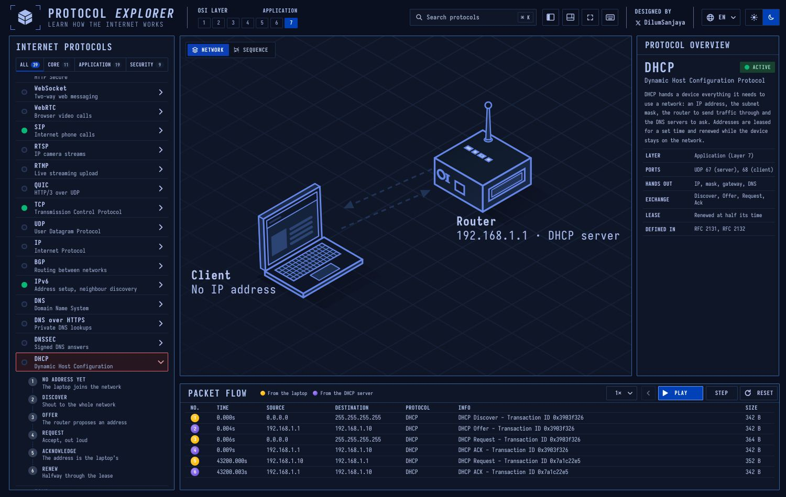
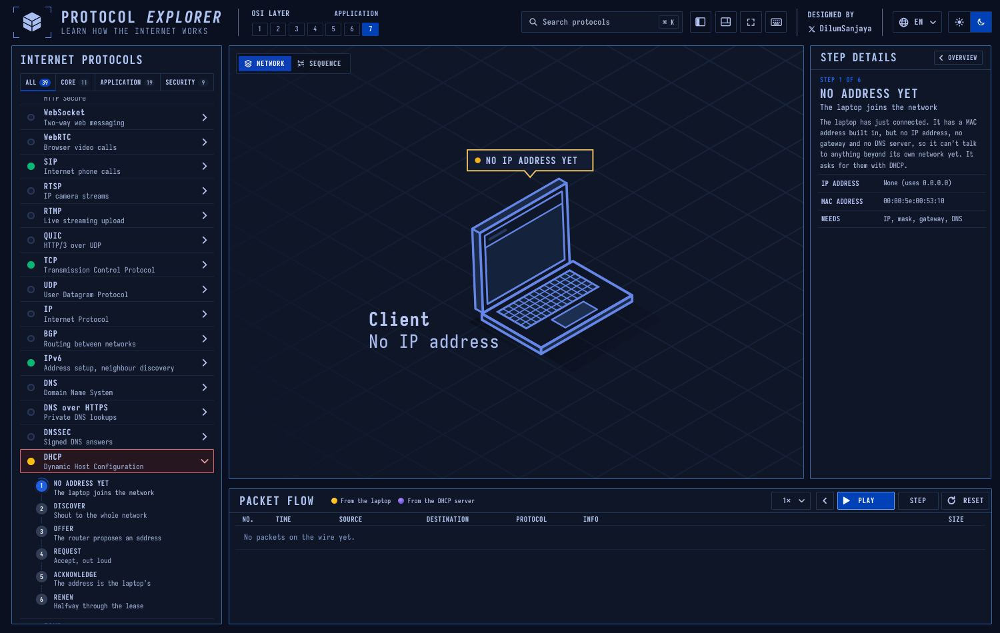
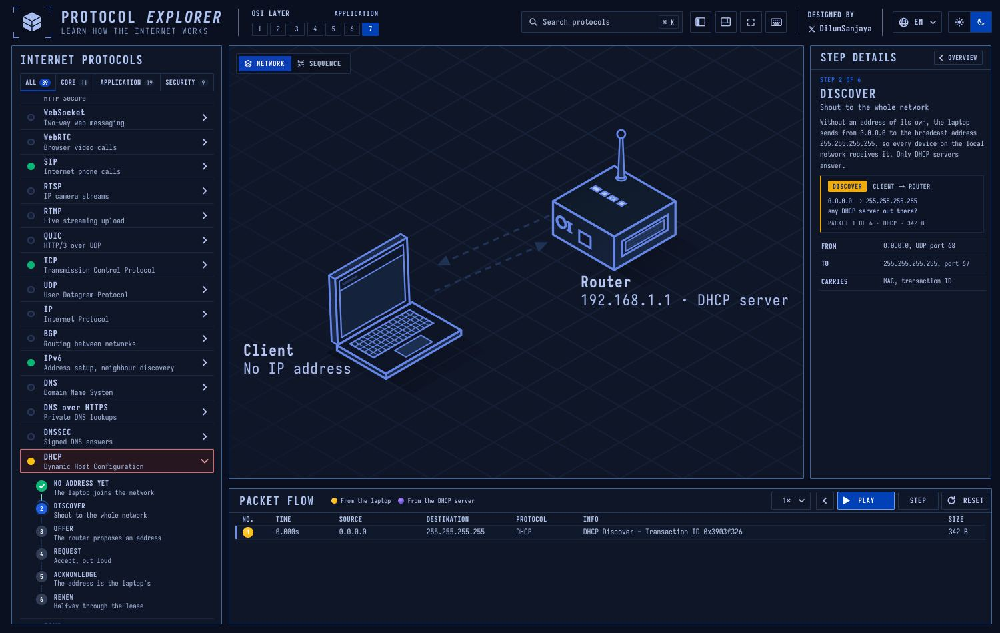
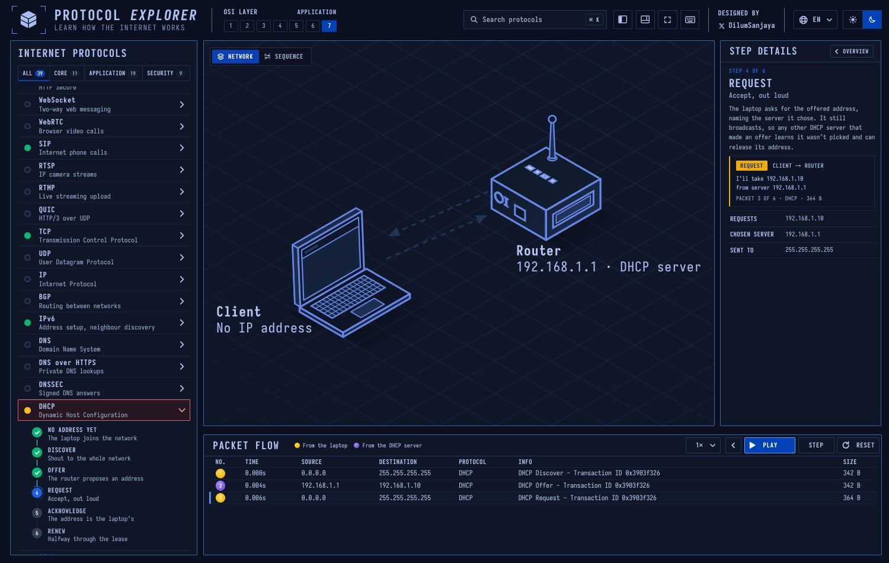
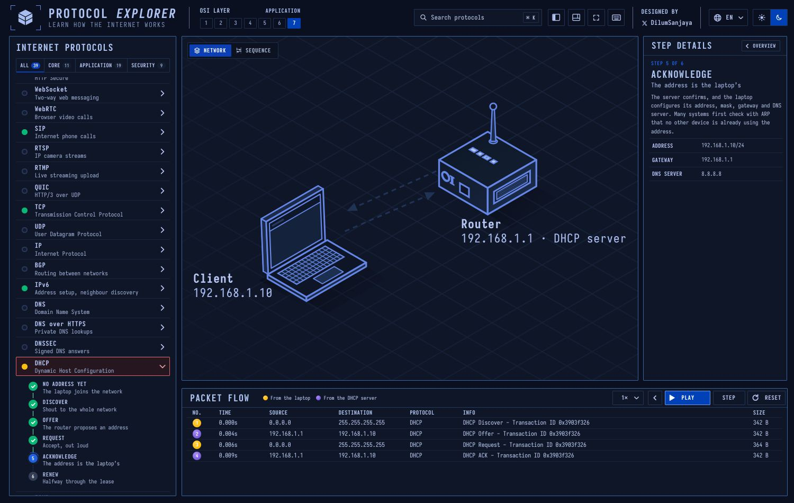
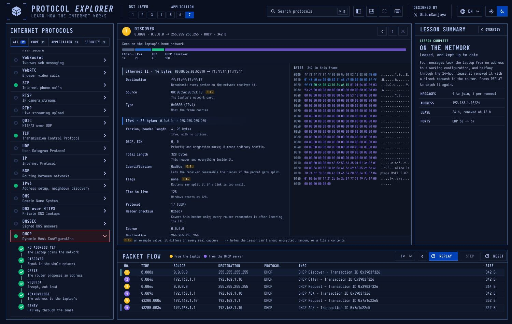
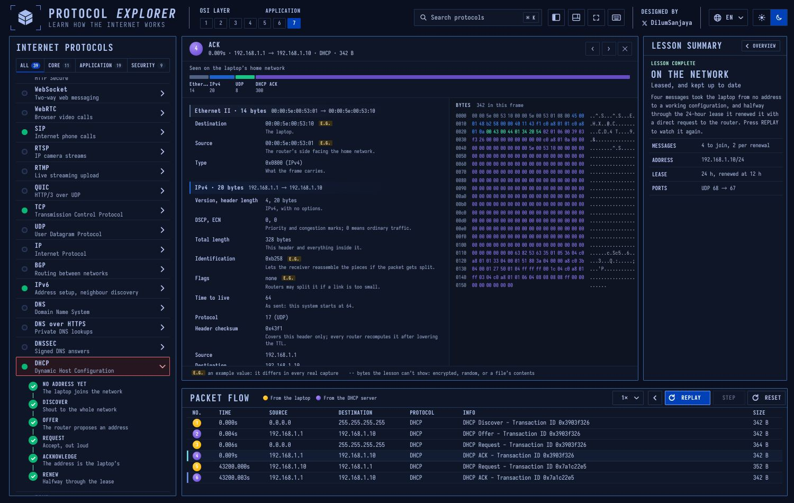

# DHCP – Dynamic Host Configuration

<!-- nav -->
⬅ [16 DNSSEC](16-dnssec.md) · [Index](00_Protocols_Index.md) · [18 ICMP](18-icmp.md) ➡
<!-- nav -->

*Source: Protocol Explorer – https://protocol-explorer-alpha.vercel.app/ (interactive lesson #17). Screenshots captured from the live lesson; packet decodes are the site's example capture (values marked **E.G.** differ in every real capture).*

## Overview



> PROTOCOL OVERVIEW  
> DHCP  
> ACTIVE  
> Dynamic Host Configuration Protocol  
> DHCP hands a device everything it needs to use a network: an IP address, the subnet mask, the router to send traffic through and the DNS servers to ask. Addresses are leased for a set time and renewed while the device stays on the network.  
> LAYER  
> Application (Layer 7)  
> PORTS  
> UDP 67 (server), 68 (client)  
> HANDS OUT  
> IP, mask, gateway, DNS  
> EXCHANGE  
> Discover, Offer, Request, Ack  
> LEASE  
> Renewed at half its time  
> DEFINED IN  
> RFC 2131, RFC 2132  

## In-depth explanation of the example (plain-language version)

### The big picture in one minute
A laptop has just joined the home Wi-Fi. It has **no IP address, doesn't know the router, and doesn't know any DNS server**, yet it needs to talk to the network. **DHCP** solves this by having the laptop ask the router's DHCP server for all the settings. The conversation has four messages, nicknamed **DORA**: **D**iscover, **O**ffer, **R**equest, **A**cknowledge (packets 1–4). Twelve hours later the laptop **renews** its address (packets 5–6).

**Result:** address `192.168.1.10`, router `192.168.1.1`, DNS `8.8.8.8`, valid for 24 hours.

Think of arriving at a hotel: you shout "I need a room!" (Discover), the desk replies "Room 10 is free" (Offer), you say "I'll take room 10" (Request), and the desk confirms "It's yours for 24 hours" (Acknowledge).

> **Words you'll see:** *Broadcast* = a message sent to everyone on the local network. *Lease* = the time you may keep the address. *Gateway* = the router that leads to the internet. DHCP uses UDP, server port **67** and client port **68**.

---

### Step 1 – The link comes up
The laptop's Wi-Fi is connected, but it has no address yet.

### Step 2 – DISCOVER – packet 1
The laptop has no address to send *from*, so it uses `0.0.0.0`, and since it doesn't know who the server is, it **shouts to everyone** (`255.255.255.255`). Only DHCP servers respond. The message includes the laptop's **MAC address** (its hardware ID), a random **transaction number** (to match replies to this request) and a "shopping list" of settings it wants: subnet mask, router, DNS, lease time and so on.

### Step 3 – OFFER – packet 2
The router's DHCP server picks a **free address from its pool** and offers a full package:
- **address** `192.168.1.10`
- **subnet mask** `255.255.255.0`
- **router** `192.168.1.1`
- **DNS** `8.8.8.8`
- **lease time** 24 hours
(If several servers exist, each may make an offer.)

### Step 4 – REQUEST – packet 3
The laptop says "I accept **this** offer" and names the server it chose. It sends this **again as a broadcast on purpose**, so that any *other* server that made an offer hears it and knows it wasn't chosen, and can release the address it was holding.

### Step 5 – ACKNOWLEDGE – packet 4
The server confirms: "That address is yours for 24 hours." The laptop applies the settings. (Many systems first check that nobody else is using the address; if someone is, they decline and start over.) Now it can talk to the network.

### Step 6 – Renewal – packets 5, 6 (12 hours later)
An address is only **leased**. To keep it:
- At **half the lease (12 hours)** the laptop asks the server directly (no shouting needed) to extend it.
- The server answers OK and the lease restarts for a full 24 hours.
- If the server doesn't answer, at **87.5 % of the lease** the laptop shouts to any server. If the lease runs out completely, it must give up the address and start again with Discover.
- When leaving cleanly, a device may send a **release** message.

---

### The 6 messages at a glance
| Packets | What | Why |
|---|---|---|
| 1 | DISCOVER (broadcast) | "I need an address" |
| 2 | OFFER | "here's one, plus settings" |
| 3 | REQUEST (broadcast) | "I'll take that one" |
| 4 | ACK | "it's yours for 24 h" |
| 5–6 | renew request and ACK | extend the lease |

### What to remember
- **DORA** = Discover, Offer, Request, Acknowledge. Early messages are **broadcasts** because the client has no address yet.
- DHCP gives out much more than an address: **mask, gateway, DNS, lease time, domain name, time servers, boot options and more.**
- **Lease timers:** 50 % (renew with the same server), 87.5 % (ask any server), 100 % (expired).
- A **DHCP relay** lets one server serve many separate networks.
- **Security:** DHCP isn't authenticated. A **rogue DHCP server** could hand out a malicious gateway or DNS server. Switches can use **DHCP snooping** to block that.
- IPv6 usually uses **SLAAC** instead (see the IPv6 note), with DHCPv6 as an option.

## Step-by-step walkthrough (screenshots from the lesson)

### Step 1: NO ADDRESS YET – The laptop joins the network



> STEP 1 OF 6  
> NO ADDRESS YET  
> The laptop joins the network  
> The laptop has just connected. It has a MAC address built in, but no IP address, no gateway and no DNS server, so it can’t talk to anything beyond its own network yet. It asks for them with DHCP.  
> IP ADDRESS  
> None (uses 0.0.0.0)  
> MAC ADDRESS  
> 00:00:5e:00:53:10  
> NEEDS  
> IP, mask, gateway, DNS  

### Step 2: DISCOVER – Shout to the whole network



> STEP 2 OF 6  
> DISCOVER  
> Shout to the whole network  
> Without an address of its own, the laptop sends from 0.0.0.0 to the broadcast address 255.255.255.255, so every device on the local network receives it. Only DHCP servers answer.  
> DISCOVER  
> CLIENT → ROUTER  
> 0.0.0.0 → 255.255.255.255  
> any DHCP server out there?  
> PACKET 1 OF 6 · DHCP · 342 B  
> FROM  
> 0.0.0.0, UDP port 68  
> TO  
> 255.255.255.255, port 67  
> CARRIES  
> MAC, transaction ID  

### Step 3: OFFER – The router proposes an address


> STEP 3 OF 6  
> OFFER  
> The router proposes an address  
> The router’s DHCP server picks a free address and offers it with the rest of the settings. The laptop can’t use an IP address yet, so the offer goes straight to its MAC address (some clients ask for a broadcast instead).  
> OFFER  
> ROUTER → CLIENT  
> offer: 192.168.1.10/24  
> gateway, DNS, lease 24 h  
> PACKET 2 OF 6 · DHCP · 342 B  
> OFFERED  
> 192.168.1.10/24  
> GATEWAY, DNS  
> 192.168.1.1, 8.8.8.8  
> LEASE  
> 86,400 s (24 h)  

### Step 4: REQUEST – Accept, out loud



> STEP 4 OF 6  
> REQUEST  
> Accept, out loud  
> The laptop asks for the offered address, naming the server it chose. It still broadcasts, so any other DHCP server that made an offer learns it wasn’t picked and can release its address.  
> REQUEST  
> CLIENT → ROUTER  
> I’ll take 192.168.1.10  
> from server 192.168.1.1  
> PACKET 3 OF 6 · DHCP · 364 B  
> REQUESTS  
> 192.168.1.10  
> CHOSEN SERVER  
> 192.168.1.1  
> SENT TO  
> 255.255.255.255  

### Step 5: ACKNOWLEDGE – The address is the laptop’s



> STEP 5 OF 6  
> ACKNOWLEDGE  
> The address is the laptop’s  
> The server confirms, and the laptop configures its address, mask, gateway and DNS server. Many systems first check with ARP that no other device is already using the address.  
> ACK  
> ROUTER → CLIENT  
> 192.168.1.10 is yours  
> for 24 hours  
> PACKET 4 OF 6 · DHCP · 342 B  
> ADDRESS  
> 192.168.1.10/24  
> GATEWAY  
> 192.168.1.1  
> DNS SERVER  
> 8.8.8.8  

### Step 6: RENEW – Halfway through the lease


> STEP 6 OF 6  
> RENEW  
> Halfway through the lease  
> Twelve hours later, half the lease has passed. The laptop now has an address, so it asks the router directly to extend the lease, and the router resets it to 24 hours. If the router didn’t answer, it would broadcast at 87.5%.  
> ACK  
> ROUTER → CLIENT  
> lease renewed  
> another 24 hours  
> PACKET 6 OF 6 · DHCP · 342 B  
> WHEN  
> 50% of lease (T1 = 12 h)  
> SENT TO  
> The router (unicast)  
> IF UNANSWERED  
> Broadcast at 87.5% (T2)  

### Lesson summary


> LESSON SUMMARY  
> LESSON COMPLETE  
> ON THE NETWORK  
> Leased, and kept up to date  
> Four messages took the laptop from no address to a working configuration, and halfway through the 24-hour lease it renewed it with a direct request to the router. Press REPLAY to watch it again.  
> ACK  
> ROUTER → CLIENT  
> lease renewed  
> another 24 hours  
> PACKET 6 OF 6 · DHCP · 342 B  
> MESSAGES  
> 4 to join, 2 per renewal  
> ADDRESS  
> 192.168.1.10/24  
> LEASE  
> 24 h, renewed at 12 h  
> PORTS  
> UDP 68 → 67  

## Packet flow (whole lesson)

| No. | Time | Source | Destination | Protocol | Info | Size |
|---|---|---|---|---|---|---|
| 1 | 0.000s | 0.0.0.0 | 255.255.255.255 | DHCP | DHCP Discover - Transaction ID 0x3903f326 | 342 B |
| 2 | 0.004s | 192.168.1.1 | 192.168.1.10 | DHCP | DHCP Offer - Transaction ID 0x3903f326 | 342 B |
| 3 | 0.006s | 0.0.0.0 | 255.255.255.255 | DHCP | DHCP Request - Transaction ID 0x3903f326 | 364 B |
| 4 | 0.009s | 192.168.1.1 | 192.168.1.10 | DHCP | DHCP ACK - Transaction ID 0x3903f326 | 342 B |
| 5 | 43200.000s | 192.168.1.10 | 192.168.1.1 | DHCP | DHCP Request - Transaction ID 0x7a1c22e5 | 352 B |
| 6 | 43200.003s | 192.168.1.1 | 192.168.1.10 | DHCP | DHCP ACK - Transaction ID 0x7a1c22e5 | 342 B |

### Sequence diagram


## Packets decoded byte by byte

Each packet below is the lesson's own decode (headers, field values and the plain-English meaning of each field). Screenshots show the first, middle and last packet in the lesson's decoder view with the raw hex bytes.

### Packet 1: DHCP – DHCP Discover - Transaction ID 0x3903f326

*0.0.0.0 → 255.255.255.255 · 342 B · t = 0.000s*



<details><summary>Decoded fields</summary>

```text
1
DISCOVER
0.000s · 0.0.0.0 → 255.255.255.255 · DHCP · 342 B
Seen on the laptop’s home network
Ethernet
14
IPv4
20
UDP
8
DHCP Discover
300
Ethernet II · 14 bytes
00:00:5e:00:53:10 → ff:ff:ff:ff:ff:ff
Destination
ff:ff:ff:ff:ff:ff

Broadcast: every device on the network receives it.

Source
00:00:5e:00:53:10 E.G.

The laptop’s network card.

Type
0x0800 (IPv4)

What the frame carries.

IPv4 · 20 bytes
0.0.0.0 → 255.255.255.255
Version, header length
4, 20 bytes

IPv4, with no options.

DSCP, ECN
0, 0

Priority and congestion marks; 0 means ordinary traffic.

Total length
328 bytes

This header and everything inside it.

Identification
0xd0ce E.G.

Lets the receiver reassemble the pieces if the packet gets split.

Flags
none E.G.

Routers may split it if a link is too small.

Time to live
128

Windows starts at 128.

Protocol
17 (UDP)
Header checksum
0x68d7

Covers this header only; every router recomputes it after lowering the TTL.

Source
0.0.0.0
Destination
255.255.255.255
UDP · 8 bytes
68 → 67
Source port
68
Destination port
67
Length
308 bytes

UDP header and data. That is all of UDP: no numbering, no acknowledgements.

Checksum
0xa615

Covers the header, the data and the IP addresses.

DHCP Discover
Message
1 (request, from a client)
Hardware
Ethernet, 6-byte addresses
Hops
0
Transaction ID
0x3903f326

Chosen by the client; every reply repeats it.

Seconds
0
Flags
0x0000 (unicast replies are fine)

Broadcast flag off: the server may send straight to the client’s MAC address.

Client address
0.0.0.0

Filled in only when the client already has an address (renewing).

Your address
0.0.0.0

The address the server is giving out.

Next server
0.0.0.0
Relay agent
0.0.0.0
Client MAC
00:00:5e:00:53:10 E.G.
Server name, boot file
empty
Magic cookie
99.130.83.99 (DHCP)

Marks the options that follow as DHCP.

Option 53
Message type: 1 (Discover)
Option 61
Client identifier: 01 00:00:5e:00:53:10
Option 12
Host name: alice-laptop E.G.
Option 60
Vendor class: MSFT 5.0 E.G.
Option 55
Parameters wanted: 1, 3, 6, 15, 31, 33, 43, 44, 46, 47, 119, 121, 249, 252 E.G.
End
255
Padding
7 zero bytes, up to the 300-byte minimum
BYTES 342 in this frame
0000
ff
ff
ff
ff
ff
ff
00
00
5e
00
53
10
08
00
45
00
.
.
.
.
.
.
.
.
^
.
S
.
.
.
E
.
0010
01
48
d0
ce
00
00
80
11
68
d7
00
00
00
00
ff
ff
.
H
.
.
.
.
.
.
h
.
.
.
.
.
.
.
0020
ff
ff
00
44
00
43
01
34
a6
15
01
01
06
00
39
03
.
.
.
D
.
C
.
4
.
.
.
.
.
.
9
.
0030
f3
26
00
00
00
00
00
00
00
00
00
00
00
00
00
00
.
&
.
.
.
.
.
.
.
.
.
.
.
.
.
.
0040
00
00
00
00
00
00
00
00
5e
00
53
10
00
00
00
00
.
.
.
.
.
.
.
.
^
.
S
.
.
.
.
.
0050
00
00
00
00
00
00
00
00
00
00
00
00
00
00
00
00
.
.
.
.
.
.
.
.
.
.
.
.
.
.
.
.
0060
00
00
00
00
00
00
00
00
00
00
00
00
00
00
00
00
.
.
.
.
.
.
.
.
.
.
.
.
.
.
.
.
0070
00
00
00
00
00
00
00
00
00
00
00
00
00
00
00
00
.
.
.
.
.
.
.
.
.
.
.
.
.
.
.
.
0080
00
00
00
00
00
00
00
00
00
00
00
00
00
00
00
00
.
.
.
.
.
.
.
.
.
.
.
.
.
.
.
.
0090
00
00
00
00
00
00
00
00
00
00
00
00
00
00
00
00
.
.
.
.
.
.
.
.
.
.
.
.
.
.
.
.
00a0
00
00
00
00
00
00
00
00
00
00
00
00
00
00
00
00
.
.
.
.
.
.
.
.
.
.
.
.
.
.
.
.
00b0
00
00
00
00
00
00
00
00
00
00
00
00
00
00
00
00
.
.
.
.
.
.
.
.
.
.
.
.
.
.
.
.
00c0
00
00
00
00
00
00
00
00
00
00
00
00
00
00
00
00
.
.
.
.
.
.
.
.
.
.
.
.
.
.
.
.
00d0
00
00
00
00
00
00
00
00
00
00
00
00
00
00
00
00
.
.
.
.
.
.
.
.
.
.
.
.
.
.
.
.
00e0
00
00
00
00
00
00
00
00
00
00
00
00
00
00
00
00
.
.
.
.
.
.
.
.
.
.
.
.
.
.
.
.
00f0
00
00
00
00
00
00
00
00
00
00
00
00
00
00
00
00
.
.
.
.
.
.
.
.
.
.
.
.
.
.
.
.
0100
00
00
00
00
00
00
00
00
00
00
00
00
00
00
00
00
.
.
.
.
.
.
.
.
.
.
.
.
.
.
.
.
0110
00
00
00
00
00
00
63
82
53
63
35
01
01
3d
07
01
.
.
.
.
.
.
c
.
S
c
5
.
.
=
.
.
0120
00
00
5e
00
53
10
0c
0c
61
6c
69
63
65
2d
6c
61
.
.
^
.
S
.
.
.
a
l
i
c
e
-
l
a
0130
70
74
6f
70
3c
08
4d
53
46
54
20
35
2e
30
37
0e
p
t
o
p
<
.
M
S
F
T
5
.
0
7
.
0140
01
03
06
0f
1f
21
2b
2c
2e
2f
77
79
f9
fc
ff
00
.
.
.
.
.
!
+
,
.
/
w
y
.
.
.
.
0150
00
00
00
00
00
00
.
.
.
.
.
.
E.G. an example value: it differs in every real capture
·· bytes the lesson can’t show: encrypted, random, or a file’s contents
```

</details>

### Packet 2: DHCP – DHCP Offer - Transaction ID 0x3903f326

*192.168.1.1 → 192.168.1.10 · 342 B · t = 0.004s*

<details><summary>Decoded fields</summary>

```text
2
OFFER
0.004s · 192.168.1.1 → 192.168.1.10 · DHCP · 342 B
Seen on the laptop’s home network
Ethernet
14
IPv4
20
UDP
8
DHCP Offer
300
Ethernet II · 14 bytes
00:00:5e:00:53:01 → 00:00:5e:00:53:10
Destination
00:00:5e:00:53:10 E.G.

The laptop.

Source
00:00:5e:00:53:01 E.G.

The router’s side facing the home network.

Type
0x0800 (IPv4)

What the frame carries.

IPv4 · 20 bytes
192.168.1.1 → 192.168.1.10
Version, header length
4, 20 bytes

IPv4, with no options.

DSCP, ECN
0, 0

Priority and congestion marks; 0 means ordinary traffic.

Total length
328 bytes

This header and everything inside it.

Identification
0xb257 E.G.

Lets the receiver reassemble the pieces if the packet gets split.

Flags
none E.G.

Routers may split it if a link is too small.

Time to live
64

As sent: this system starts at 64.

Protocol
17 (UDP)
Header checksum
0x43f2

Covers this header only; every router recomputes it after lowering the TTL.

Source
192.168.1.1
Destination
192.168.1.10
UDP · 8 bytes
67 → 68
Source port
67
Destination port
68
Length
308 bytes

UDP header and data. That is all of UDP: no numbering, no acknowledgements.

Checksum
0x2354

Covers the header, the data and the IP addresses.

DHCP Offer
Message
2 (reply, from a server)
Hardware
Ethernet, 6-byte addresses
Hops
0
Transaction ID
0x3903f326

Chosen by the client; every reply repeats it.

Seconds
0
Flags
0x0000 (unicast replies are fine)

Broadcast flag off: the server may send straight to the client’s MAC address.

Client address
0.0.0.0

Filled in only when the client already has an address (renewing).

Your address
192.168.1.10

The address the server is giving out.

Next server
0.0.0.0
Relay agent
0.0.0.0
Client MAC
00:00:5e:00:53:10 E.G.
Server name, boot file
empty
Magic cookie
99.130.83.99 (DHCP)

Marks the options that follow as DHCP.

Option 53
Message type: 2 (Offer)
Option 54
Server identifier: 192.168.1.1
Option 51
Lease time: 86,400 s (24 h)
Option 58
Renewal time (T1): 43,200 s (12 h)
Option 59
Rebinding time (T2): 75,600 s (21 h)
Option 1
Subnet mask: 255.255.255.0
Option 28
Broadcast address: 192.168.1.255
Option 3
Router: 192.168.1.1
Option 6
DNS server: 8.8.8.8
End
255
Padding
8 zero bytes, up to the 300-byte minimum
BYTES 342 in this frame
0000
00
00
5e
00
53
10
00
00
5e
00
53
01
08
00
45
00
.
.
^
.
S
.
.
.
^
.
S
.
.
.
E
.
0010
01
48
b2
57
00
00
40
11
43
f2
c0
a8
01
01
c0
a8
.
H
.
W
.
.
@
.
C
.
.
.
.
.
.
.
0020
01
0a
00
43
00
44
01
34
23
54
02
01
06
00
39
03
.
.
.
C
.
D
.
4
#
T
.
.
.
.
9
.
0030
f3
26
00
00
00
00
00
00
00
00
c0
a8
01
0a
00
00
.
&
.
.
.
.
.
.
.
.
.
.
.
.
.
.
0040
00
00
00
00
00
00
00
00
5e
00
53
10
00
00
00
00
.
.
.
.
.
.
.
.
^
.
S
.
.
.
.
.
0050
00
00
00
00
00
00
00
00
00
00
00
00
00
00
00
00
.
.
.
.
.
.
.
.
.
.
.
.
.
.
.
.
0060
00
00
00
00
00
00
00
00
00
00
00
00
00
00
00
00
.
.
.
.
.
.
.
.
.
.
.
.
.
.
.
.
0070
00
00
00
00
00
00
00
00
00
00
00
00
00
00
00
00
.
.
.
.
.
.
.
.
.
.
.
.
.
.
.
.
0080
00
00
00
00
00
00
00
00
00
00
00
00
00
00
00
00
.
.
.
.
.
.
.
.
.
.
.
.
.
.
.
.
0090
00
00
00
00
00
00
00
00
00
00
00
00
00
00
00
00
.
.
.
.
.
.
.
.
.
.
.
.
.
.
.
.
00a0
00
00
00
00
00
00
00
00
00
00
00
00
00
00
00
00
.
.
.
.
.
.
.
.
.
.
.
.
.
.
.
.
00b0
00
00
00
00
00
00
00
00
00
00
00
00
00
00
00
00
.
.
.
.
.
.
.
.
.
.
.
.
.
.
.
.
00c0
00
00
00
00
00
00
00
00
00
00
00
00
00
00
00
00
.
.
.
.
.
.
.
.
.
.
.
.
.
.
.
.
00d0
00
00
00
00
00
00
00
00
00
00
00
00
00
00
00
00
.
.
.
.
.
.
.
.
.
.
.
.
.
.
.
.
00e0
00
00
00
00
00
00
00
00
00
00
00
00
00
00
00
00
.
.
.
.
.
.
.
.
.
.
.
.
.
.
.
.
00f0
00
00
00
00
00
00
00
00
00
00
00
00
00
00
00
00
.
.
.
.
.
.
.
.
.
.
.
.
.
.
.
.
0100
00
00
00
00
00
00
00
00
00
00
00
00
00
00
00
00
.
.
.
.
.
.
.
.
.
.
.
.
.
.
.
.
0110
00
00
00
00
00
00
63
82
53
63
35
01
02
36
04
c0
.
.
.
.
.
.
c
.
S
c
5
.
.
6
.
.
0120
a8
01
01
33
04
00
01
51
80
3a
04
00
00
a8
c0
3b
.
.
.
3
.
.
.
Q
.
:
.
.
.
.
.
;
0130
04
00
01
27
50
01
04
ff
ff
ff
00
1c
04
c0
a8
01
.
.
.
'
P
.
.
.
.
.
.
.
.
.
.
.
0140
ff
03
04
c0
a8
01
01
06
04
08
08
08
08
ff
00
00
.
.
.
.
.
.
.
.
.
.
.
.
.
.
.
.
0150
00
00
00
00
00
00
.
.
.
.
.
.
E.G. an example value: it differs in every real capture
·· bytes the lesson can’t show: encrypted, random, or a file’s contents
```

</details>

### Packet 3: DHCP – DHCP Request - Transaction ID 0x3903f326

*0.0.0.0 → 255.255.255.255 · 364 B · t = 0.006s*

<details><summary>Decoded fields</summary>

```text
3
REQUEST
0.006s · 0.0.0.0 → 255.255.255.255 · DHCP · 364 B
Seen on the laptop’s home network
Ethernet
14
IPv4
20
UDP
8
DHCP Request
322
Ethernet II · 14 bytes
00:00:5e:00:53:10 → ff:ff:ff:ff:ff:ff
Destination
ff:ff:ff:ff:ff:ff

Broadcast: every device on the network receives it.

Source
00:00:5e:00:53:10 E.G.

The laptop’s network card.

Type
0x0800 (IPv4)

What the frame carries.

IPv4 · 20 bytes
0.0.0.0 → 255.255.255.255
Version, header length
4, 20 bytes

IPv4, with no options.

DSCP, ECN
0, 0

Priority and congestion marks; 0 means ordinary traffic.

Total length
350 bytes

This header and everything inside it.

Identification
0xd0cf E.G.

Lets the receiver reassemble the pieces if the packet gets split.

Flags
none E.G.

Routers may split it if a link is too small.

Time to live
128

Windows starts at 128.

Protocol
17 (UDP)
Header checksum
0x68c0

Covers this header only; every router recomputes it after lowering the TTL.

Source
0.0.0.0
Destination
255.255.255.255
UDP · 8 bytes
68 → 67
Source port
68
Destination port
67
Length
330 bytes

UDP header and data. That is all of UDP: no numbering, no acknowledgements.

Checksum
0x3fdd

Covers the header, the data and the IP addresses.

DHCP Request
Message
1 (request, from a client)
Hardware
Ethernet, 6-byte addresses
Hops
0
Transaction ID
0x3903f326

Chosen by the client; every reply repeats it.

Seconds
0
Flags
0x0000 (unicast replies are fine)

Broadcast flag off: the server may send straight to the client’s MAC address.

Client address
0.0.0.0

Filled in only when the client already has an address (renewing).

Your address
0.0.0.0

The address the server is giving out.

Next server
0.0.0.0
Relay agent
0.0.0.0
Client MAC
00:00:5e:00:53:10 E.G.
Server name, boot file
empty
Magic cookie
99.130.83.99 (DHCP)

Marks the options that follow as DHCP.

Option 53
Message type: 3 (Request)
Option 61
Client identifier: 01 00:00:5e:00:53:10
Option 50
Requested address: 192.168.1.10
Option 54
Server identifier: 192.168.1.1
Option 12
Host name: alice-laptop E.G.
Option 81
Client FQDN: alice-laptop E.G.
Option 60
Vendor class: MSFT 5.0 E.G.
Option 55
Parameters wanted: 1, 3, 6, 15, 31, 33, 43, 44, 46, 47, 119, 121, 249, 252 E.G.
End
255
BYTES 364 in this frame
0000
ff
ff
ff
ff
ff
ff
00
00
5e
00
53
10
08
00
45
00
.
.
.
.
.
.
.
.
^
.
S
.
.
.
E
.
0010
01
5e
d0
cf
00
00
80
11
68
c0
00
00
00
00
ff
ff
.
^
.
.
.
.
.
.
h
.
.
.
.
.
.
.
0020
ff
ff
00
44
00
43
01
4a
3f
dd
01
01
06
00
39
03
.
.
.
D
.
C
.
J
?
.
.
.
.
.
9
.
0030
f3
26
00
00
00
00
00
00
00
00
00
00
00
00
00
00
.
&
.
.
.
.
.
.
.
.
.
.
.
.
.
.
0040
00
00
00
00
00
00
00
00
5e
00
53
10
00
00
00
00
.
.
.
.
.
.
.
.
^
.
S
.
.
.
.
.
0050
00
00
00
00
00
00
00
00
00
00
00
00
00
00
00
00
.
.
.
.
.
.
.
.
.
.
.
.
.
.
.
.
0060
00
00
00
00
00
00
00
00
00
00
00
00
00
00
00
00
.
.
.
.
.
.
.
.
.
.
.
.
.
.
.
.
0070
00
00
00
00
00
00
00
00
00
00
00
00
00
00
00
00
.
.
.
.
.
.
.
.
.
.
.
.
.
.
.
.
0080
00
00
00
00
00
00
00
00
00
00
00
00
00
00
00
00
.
.
.
.
.
.
.
.
.
.
.
.
.
.
.
.
0090
00
00
00
00
00
00
00
00
00
00
00
00
00
00
00
00
.
.
.
.
.
.
.
.
.
.
.
.
.
.
.
.
00a0
00
00
00
00
00
00
00
00
00
00
00
00
00
00
00
00
.
.
.
.
.
.
.
.
.
.
.
.
.
.
.
.
00b0
00
00
00
00
00
00
00
00
00
00
00
00
00
00
00
00
.
.
.
.
.
.
.
.
.
.
.
.
.
.
.
.
00c0
00
00
00
00
00
00
00
00
00
00
00
00
00
00
00
00
.
.
.
.
.
.
.
.
.
.
.
.
.
.
.
.
00d0
00
00
00
00
00
00
00
00
00
00
00
00
00
00
00
00
.
.
.
.
.
.
.
.
.
.
.
.
.
.
.
.
00e0
00
00
00
00
00
00
00
00
00
00
00
00
00
00
00
00
.
.
.
.
.
.
.
.
.
.
.
.
.
.
.
.
00f0
00
00
00
00
00
00
00
00
00
00
00
00
00
00
00
00
.
.
.
.
.
.
.
.
.
.
.
.
.
.
.
.
0100
00
00
00
00
00
00
00
00
00
00
00
00
00
00
00
00
.
.
.
.
.
.
.
.
.
.
.
.
.
.
.
.
0110
00
00
00
00
00
00
63
82
53
63
35
01
03
3d
07
01
.
.
.
.
.
.
c
.
S
c
5
.
.
=
.
.
0120
00
00
5e
00
53
10
32
04
c0
a8
01
0a
36
04
c0
a8
.
.
^
.
S
.
2
.
.
.
.
.
6
.
.
.
0130
01
01
0c
0c
61
6c
69
63
65
2d
6c
61
70
74
6f
70
.
.
.
.
a
l
i
c
e
-
l
a
p
t
o
p
0140
51
0f
00
00
00
61
6c
69
63
65
2d
6c
61
70
74
6f
Q
.
.
.
.
a
l
i
c
e
-
l
a
p
t
o
0150
70
3c
08
4d
53
46
54
20
35
2e
30
37
0e
01
03
06
p
<
.
M
S
F
T
5
.
0
7
.
.
.
.
0160
0f
1f
21
2b
2c
2e
2f
77
79
f9
fc
ff
.
.
!
+
,
.
/
w
y
.
.
.
E.G. an example value: it differs in every real capture
·· bytes the lesson can’t show: encrypted, random, or a file’s contents
```

</details>

### Packet 4: DHCP – DHCP ACK - Transaction ID 0x3903f326

*192.168.1.1 → 192.168.1.10 · 342 B · t = 0.009s*



<details><summary>Decoded fields</summary>

```text
4
ACK
0.009s · 192.168.1.1 → 192.168.1.10 · DHCP · 342 B
Seen on the laptop’s home network
Ethernet
14
IPv4
20
UDP
8
DHCP ACK
300
Ethernet II · 14 bytes
00:00:5e:00:53:01 → 00:00:5e:00:53:10
Destination
00:00:5e:00:53:10 E.G.

The laptop.

Source
00:00:5e:00:53:01 E.G.

The router’s side facing the home network.

Type
0x0800 (IPv4)

What the frame carries.

IPv4 · 20 bytes
192.168.1.1 → 192.168.1.10
Version, header length
4, 20 bytes

IPv4, with no options.

DSCP, ECN
0, 0

Priority and congestion marks; 0 means ordinary traffic.

Total length
328 bytes

This header and everything inside it.

Identification
0xb258 E.G.

Lets the receiver reassemble the pieces if the packet gets split.

Flags
none E.G.

Routers may split it if a link is too small.

Time to live
64

As sent: this system starts at 64.

Protocol
17 (UDP)
Header checksum
0x43f1

Covers this header only; every router recomputes it after lowering the TTL.

Source
192.168.1.1
Destination
192.168.1.10
UDP · 8 bytes
67 → 68
Source port
67
Destination port
68
Length
308 bytes

UDP header and data. That is all of UDP: no numbering, no acknowledgements.

Checksum
0x2054

Covers the header, the data and the IP addresses.

DHCP ACK
Message
2 (reply, from a server)
Hardware
Ethernet, 6-byte addresses
Hops
0
Transaction ID
0x3903f326

Chosen by the client; every reply repeats it.

Seconds
0
Flags
0x0000 (unicast replies are fine)

Broadcast flag off: the server may send straight to the client’s MAC address.

Client address
0.0.0.0

Filled in only when the client already has an address (renewing).

Your address
192.168.1.10

The address the server is giving out.

Next server
0.0.0.0
Relay agent
0.0.0.0
Client MAC
00:00:5e:00:53:10 E.G.
Server name, boot file
empty
Magic cookie
99.130.83.99 (DHCP)

Marks the options that follow as DHCP.

Option 53
Message type: 5 (ACK)
Option 54
Server identifier: 192.168.1.1
Option 51
Lease time: 86,400 s (24 h)
Option 58
Renewal time (T1): 43,200 s (12 h)
Option 59
Rebinding time (T2): 75,600 s (21 h)
Option 1
Subnet mask: 255.255.255.0
Option 28
Broadcast address: 192.168.1.255
Option 3
Router: 192.168.1.1
Option 6
DNS server: 8.8.8.8
End
255
Padding
8 zero bytes, up to the 300-byte minimum
BYTES 342 in this frame
0000
00
00
5e
00
53
10
00
00
5e
00
53
01
08
00
45
00
.
.
^
.
S
.
.
.
^
.
S
.
.
.
E
.
0010
01
48
b2
58
00
00
40
11
43
f1
c0
a8
01
01
c0
a8
.
H
.
X
.
.
@
.
C
.
.
.
.
.
.
.
0020
01
0a
00
43
00
44
01
34
20
54
02
01
06
00
39
03
.
.
.
C
.
D
.
4
T
.
.
.
.
9
.
0030
f3
26
00
00
00
00
00
00
00
00
c0
a8
01
0a
00
00
.
&
.
.
.
.
.
.
.
.
.
.
.
.
.
.
0040
00
00
00
00
00
00
00
00
5e
00
53
10
00
00
00
00
.
.
.
.
.
.
.
.
^
.
S
.
.
.
.
.
0050
00
00
00
00
00
00
00
00
00
00
00
00
00
00
00
00
.
.
.
.
.
.
.
.
.
.
.
.
.
.
.
.
0060
00
00
00
00
00
00
00
00
00
00
00
00
00
00
00
00
.
.
.
.
.
.
.
.
.
.
.
.
.
.
.
.
0070
00
00
00
00
00
00
00
00
00
00
00
00
00
00
00
00
.
.
.
.
.
.
.
.
.
.
.
.
.
.
.
.
0080
00
00
00
00
00
00
00
00
00
00
00
00
00
00
00
00
.
.
.
.
.
.
.
.
.
.
.
.
.
.
.
.
0090
00
00
00
00
00
00
00
00
00
00
00
00
00
00
00
00
.
.
.
.
.
.
.
.
.
.
.
.
.
.
.
.
00a0
00
00
00
00
00
00
00
00
00
00
00
00
00
00
00
00
.
.
.
.
.
.
.
.
.
.
.
.
.
.
.
.
00b0
00
00
00
00
00
00
00
00
00
00
00
00
00
00
00
00
.
.
.
.
.
.
.
.
.
.
.
.
.
.
.
.
00c0
00
00
00
00
00
00
00
00
00
00
00
00
00
00
00
00
.
.
.
.
.
.
.
.
.
.
.
.
.
.
.
.
00d0
00
00
00
00
00
00
00
00
00
00
00
00
00
00
00
00
.
.
.
.
.
.
.
.
.
.
.
.
.
.
.
.
00e0
00
00
00
00
00
00
00
00
00
00
00
00
00
00
00
00
.
.
.
.
.
.
.
.
.
.
.
.
.
.
.
.
00f0
00
00
00
00
00
00
00
00
00
00
00
00
00
00
00
00
.
.
.
.
.
.
.
.
.
.
.
.
.
.
.
.
0100
00
00
00
00
00
00
00
00
00
00
00
00
00
00
00
00
.
.
.
.
.
.
.
.
.
.
.
.
.
.
.
.
0110
00
00
00
00
00
00
63
82
53
63
35
01
05
36
04
c0
.
.
.
.
.
.
c
.
S
c
5
.
.
6
.
.
0120
a8
01
01
33
04
00
01
51
80
3a
04
00
00
a8
c0
3b
.
.
.
3
.
.
.
Q
.
:
.
.
.
.
.
;
0130
04
00
01
27
50
01
04
ff
ff
ff
00
1c
04
c0
a8
01
.
.
.
'
P
.
.
.
.
.
.
.
.
.
.
.
0140
ff
03
04
c0
a8
01
01
06
04
08
08
08
08
ff
00
00
.
.
.
.
.
.
.
.
.
.
.
.
.
.
.
.
0150
00
00
00
00
00
00
.
.
.
.
.
.
E.G. an example value: it differs in every real capture
·· bytes the lesson can’t show: encrypted, random, or a file’s contents
```

</details>

### Packet 5: DHCP – DHCP Request - Transaction ID 0x7a1c22e5

*192.168.1.10 → 192.168.1.1 · 352 B · t = 43200.000s*

<details><summary>Decoded fields</summary>

```text
5
REQUEST
43200.000s · 192.168.1.10 → 192.168.1.1 · DHCP · 352 B
Seen on the laptop’s home network
Ethernet
14
IPv4
20
UDP
8
DHCP Request
310
Ethernet II · 14 bytes
00:00:5e:00:53:10 → 00:00:5e:00:53:01
Destination
00:00:5e:00:53:01 E.G.

The router itself.

Source
00:00:5e:00:53:10 E.G.

The laptop’s network card.

Type
0x0800 (IPv4)

What the frame carries.

IPv4 · 20 bytes
192.168.1.10 → 192.168.1.1
Version, header length
4, 20 bytes

IPv4, with no options.

DSCP, ECN
0, 0

Priority and congestion marks; 0 means ordinary traffic.

Total length
338 bytes

This header and everything inside it.

Identification
0xd825 E.G.

Lets the receiver reassemble the pieces if the packet gets split.

Flags
none E.G.

Routers may split it if a link is too small.

Time to live
128

Windows starts at 128.

Protocol
17 (UDP)
Header checksum
0xde19

Covers this header only; every router recomputes it after lowering the TTL.

Source
192.168.1.10
Destination
192.168.1.1
UDP · 8 bytes
68 → 67
Source port
68
Destination port
67
Length
318 bytes

UDP header and data. That is all of UDP: no numbering, no acknowledgements.

Checksum
0x7573

Covers the header, the data and the IP addresses.

DHCP Request
Message
1 (request, from a client)
Hardware
Ethernet, 6-byte addresses
Hops
0
Transaction ID
0x7a1c22e5

Chosen by the client; every reply repeats it.

Seconds
0
Flags
0x0000 (unicast replies are fine)

Broadcast flag off: the server may send straight to the client’s MAC address.

Client address
192.168.1.10

Filled in only when the client already has an address (renewing).

Your address
0.0.0.0

The address the server is giving out.

Next server
0.0.0.0
Relay agent
0.0.0.0
Client MAC
00:00:5e:00:53:10 E.G.
Server name, boot file
empty
Magic cookie
99.130.83.99 (DHCP)

Marks the options that follow as DHCP.

Option 53
Message type: 3 (Request)
Option 61
Client identifier: 01 00:00:5e:00:53:10
Option 12
Host name: alice-laptop E.G.
Option 81
Client FQDN: alice-laptop E.G.
Option 60
Vendor class: MSFT 5.0 E.G.
Option 55
Parameters wanted: 1, 3, 6, 15, 31, 33, 43, 44, 46, 47, 119, 121, 249, 252 E.G.
End
255
BYTES 352 in this frame
0000
00
00
5e
00
53
01
00
00
5e
00
53
10
08
00
45
00
.
.
^
.
S
.
.
.
^
.
S
.
.
.
E
.
0010
01
52
d8
25
00
00
80
11
de
19
c0
a8
01
0a
c0
a8
.
R
.
%
.
.
.
.
.
.
.
.
.
.
.
.
0020
01
01
00
44
00
43
01
3e
75
73
01
01
06
00
7a
1c
.
.
.
D
.
C
.
>
u
s
.
.
.
.
z
.
0030
22
e5
00
00
00
00
c0
a8
01
0a
00
00
00
00
00
00
"
.
.
.
.
.
.
.
.
.
.
.
.
.
.
.
0040
00
00
00
00
00
00
00
00
5e
00
53
10
00
00
00
00
.
.
.
.
.
.
.
.
^
.
S
.
.
.
.
.
0050
00
00
00
00
00
00
00
00
00
00
00
00
00
00
00
00
.
.
.
.
.
.
.
.
.
.
.
.
.
.
.
.
0060
00
00
00
00
00
00
00
00
00
00
00
00
00
00
00
00
.
.
.
.
.
.
.
.
.
.
.
.
.
.
.
.
0070
00
00
00
00
00
00
00
00
00
00
00
00
00
00
00
00
.
.
.
.
.
.
.
.
.
.
.
.
.
.
.
.
0080
00
00
00
00
00
00
00
00
00
00
00
00
00
00
00
00
.
.
.
.
.
.
.
.
.
.
.
.
.
.
.
.
0090
00
00
00
00
00
00
00
00
00
00
00
00
00
00
00
00
.
.
.
.
.
.
.
.
.
.
.
.
.
.
.
.
00a0
00
00
00
00
00
00
00
00
00
00
00
00
00
00
00
00
.
.
.
.
.
.
.
.
.
.
.
.
.
.
.
.
00b0
00
00
00
00
00
00
00
00
00
00
00
00
00
00
00
00
.
.
.
.
.
.
.
.
.
.
.
.
.
.
.
.
00c0
00
00
00
00
00
00
00
00
00
00
00
00
00
00
00
00
.
.
.
.
.
.
.
.
.
.
.
.
.
.
.
.
00d0
00
00
00
00
00
00
00
00
00
00
00
00
00
00
00
00
.
.
.
.
.
.
.
.
.
.
.
.
.
.
.
.
00e0
00
00
00
00
00
00
00
00
00
00
00
00
00
00
00
00
.
.
.
.
.
.
.
.
.
.
.
.
.
.
.
.
00f0
00
00
00
00
00
00
00
00
00
00
00
00
00
00
00
00
.
.
.
.
.
.
.
.
.
.
.
.
.
.
.
.
0100
00
00
00
00
00
00
00
00
00
00
00
00
00
00
00
00
.
.
.
.
.
.
.
.
.
.
.
.
.
.
.
.
0110
00
00
00
00
00
00
63
82
53
63
35
01
03
3d
07
01
.
.
.
.
.
.
c
.
S
c
5
.
.
=
.
.
0120
00
00
5e
00
53
10
0c
0c
61
6c
69
63
65
2d
6c
61
.
.
^
.
S
.
.
.
a
l
i
c
e
-
l
a
0130
70
74
6f
70
51
0f
00
00
00
61
6c
69
63
65
2d
6c
p
t
o
p
Q
.
.
.
.
a
l
i
c
e
-
l
0140
61
70
74
6f
70
3c
08
4d
53
46
54
20
35
2e
30
37
a
p
t
o
p
<
.
M
S
F
T
5
.
0
7
0150
0e
01
03
06
0f
1f
21
2b
2c
2e
2f
77
79
f9
fc
ff
.
.
.
.
.
.
!
+
,
.
/
w
y
.
.
.
E.G. an example value: it differs in every real capture
·· bytes the lesson can’t show: encrypted, random, or a file’s contents
```

</details>

### Packet 6: DHCP – DHCP ACK - Transaction ID 0x7a1c22e5

*192.168.1.1 → 192.168.1.10 · 342 B · t = 43200.003s*


<details><summary>Decoded fields</summary>

```text
6
ACK
43200.003s · 192.168.1.1 → 192.168.1.10 · DHCP · 342 B
Seen on the laptop’s home network
Ethernet
14
IPv4
20
UDP
8
DHCP ACK
300
Ethernet II · 14 bytes
00:00:5e:00:53:01 → 00:00:5e:00:53:10
Destination
00:00:5e:00:53:10 E.G.

The laptop.

Source
00:00:5e:00:53:01 E.G.

The router’s side facing the home network.

Type
0x0800 (IPv4)

What the frame carries.

IPv4 · 20 bytes
192.168.1.1 → 192.168.1.10
Version, header length
4, 20 bytes

IPv4, with no options.

DSCP, ECN
0, 0

Priority and congestion marks; 0 means ordinary traffic.

Total length
328 bytes

This header and everything inside it.

Identification
0xb259 E.G.

Lets the receiver reassemble the pieces if the packet gets split.

Flags
none E.G.

Routers may split it if a link is too small.

Time to live
64

As sent: this system starts at 64.

Protocol
17 (UDP)
Header checksum
0x43f0

Covers this header only; every router recomputes it after lowering the TTL.

Source
192.168.1.1
Destination
192.168.1.10
UDP · 8 bytes
67 → 68
Source port
67
Destination port
68
Length
308 bytes

UDP header and data. That is all of UDP: no numbering, no acknowledgements.

Checksum
0xedc9

Covers the header, the data and the IP addresses.

DHCP ACK
Message
2 (reply, from a server)
Hardware
Ethernet, 6-byte addresses
Hops
0
Transaction ID
0x7a1c22e5

Chosen by the client; every reply repeats it.

Seconds
0
Flags
0x0000 (unicast replies are fine)

Broadcast flag off: the server may send straight to the client’s MAC address.

Client address
192.168.1.10

Filled in only when the client already has an address (renewing).

Your address
192.168.1.10

The address the server is giving out.

Next server
0.0.0.0
Relay agent
0.0.0.0
Client MAC
00:00:5e:00:53:10 E.G.
Server name, boot file
empty
Magic cookie
99.130.83.99 (DHCP)

Marks the options that follow as DHCP.

Option 53
Message type: 5 (ACK)
Option 54
Server identifier: 192.168.1.1
Option 51
Lease time: 86,400 s (24 h)
Option 58
Renewal time (T1): 43,200 s (12 h)
Option 59
Rebinding time (T2): 75,600 s (21 h)
Option 1
Subnet mask: 255.255.255.0
Option 28
Broadcast address: 192.168.1.255
Option 3
Router: 192.168.1.1
Option 6
DNS server: 8.8.8.8
End
255
Padding
8 zero bytes, up to the 300-byte minimum
BYTES 342 in this frame
0000
00
00
5e
00
53
10
00
00
5e
00
53
01
08
00
45
00
.
.
^
.
S
.
.
.
^
.
S
.
.
.
E
.
0010
01
48
b2
59
00
00
40
11
43
f0
c0
a8
01
01
c0
a8
.
H
.
Y
.
.
@
.
C
.
.
.
.
.
.
.
0020
01
0a
00
43
00
44
01
34
ed
c9
02
01
06
00
7a
1c
.
.
.
C
.
D
.
4
.
.
.
.
.
.
z
.
0030
22
e5
00
00
00
00
c0
a8
01
0a
c0
a8
01
0a
00
00
"
.
.
.
.
.
.
.
.
.
.
.
.
.
.
.
0040
00
00
00
00
00
00
00
00
5e
00
53
10
00
00
00
00
.
.
.
.
.
.
.
.
^
.
S
.
.
.
.
.
0050
00
00
00
00
00
00
00
00
00
00
00
00
00
00
00
00
.
.
.
.
.
.
.
.
.
.
.
.
.
.
.
.
0060
00
00
00
00
00
00
00
00
00
00
00
00
00
00
00
00
.
.
.
.
.
.
.
.
.
.
.
.
.
.
.
.
0070
00
00
00
00
00
00
00
00
00
00
00
00
00
00
00
00
.
.
.
.
.
.
.
.
.
.
.
.
.
.
.
.
0080
00
00
00
00
00
00
00
00
00
00
00
00
00
00
00
00
.
.
.
.
.
.
.
.
.
.
.
.
.
.
.
.
0090
00
00
00
00
00
00
00
00
00
00
00
00
00
00
00
00
.
.
.
.
.
.
.
.
.
.
.
.
.
.
.
.
00a0
00
00
00
00
00
00
00
00
00
00
00
00
00
00
00
00
.
.
.
.
.
.
.
.
.
.
.
.
.
.
.
.
00b0
00
00
00
00
00
00
00
00
00
00
00
00
00
00
00
00
.
.
.
.
.
.
.
.
.
.
.
.
.
.
.
.
00c0
00
00
00
00
00
00
00
00
00
00
00
00
00
00
00
00
.
.
.
.
.
.
.
.
.
.
.
.
.
.
.
.
00d0
00
00
00
00
00
00
00
00
00
00
00
00
00
00
00
00
.
.
.
.
.
.
.
.
.
.
.
.
.
.
.
.
00e0
00
00
00
00
00
00
00
00
00
00
00
00
00
00
00
00
.
.
.
.
.
.
.
.
.
.
.
.
.
.
.
.
00f0
00
00
00
00
00
00
00
00
00
00
00
00
00
00
00
00
.
.
.
.
.
.
.
.
.
.
.
.
.
.
.
.
0100
00
00
00
00
00
00
00
00
00
00
00
00
00
00
00
00
.
.
.
.
.
.
.
.
.
.
.
.
.
.
.
.
0110
00
00
00
00
00
00
63
82
53
63
35
01
05
36
04
c0
.
.
.
.
.
.
c
.
S
c
5
.
.
6
.
.
0120
a8
01
01
33
04
00
01
51
80
3a
04
00
00
a8
c0
3b
.
.
.
3
.
.
.
Q
.
:
.
.
.
.
.
;
0130
04
00
01
27
50
01
04
ff
ff
ff
00
1c
04
c0
a8
01
.
.
.
'
P
.
.
.
.
.
.
.
.
.
.
.
0140
ff
03
04
c0
a8
01
01
06
04
08
08
08
08
ff
00
00
.
.
.
.
.
.
.
.
.
.
.
.
.
.
.
.
0150
00
00
00
00
00
00
.
.
.
.
.
.
E.G. an example value: it differs in every real capture
·· bytes the lesson can’t show: encrypted, random, or a file’s contents
```

</details>

---

<!-- nav -->
⬅ [16 DNSSEC](16-dnssec.md) · [Index](00_Protocols_Index.md) · [18 ICMP](18-icmp.md) ➡
<!-- nav -->
