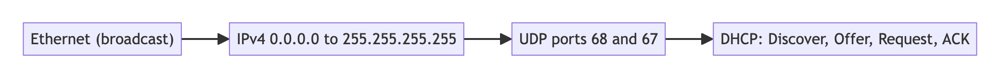
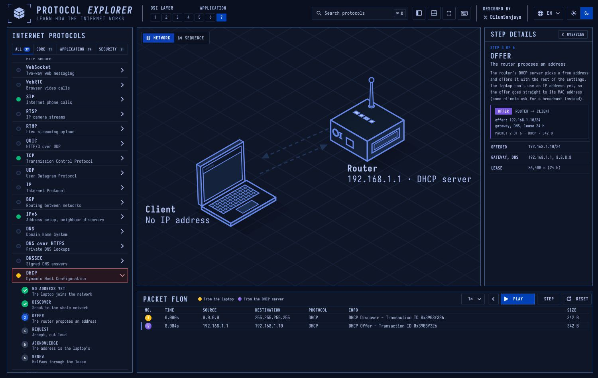
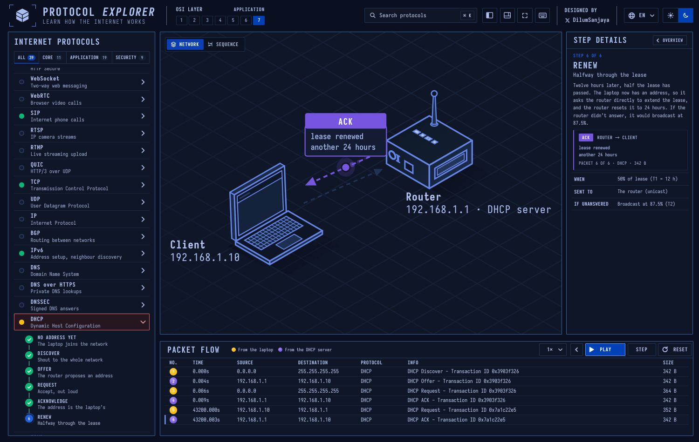
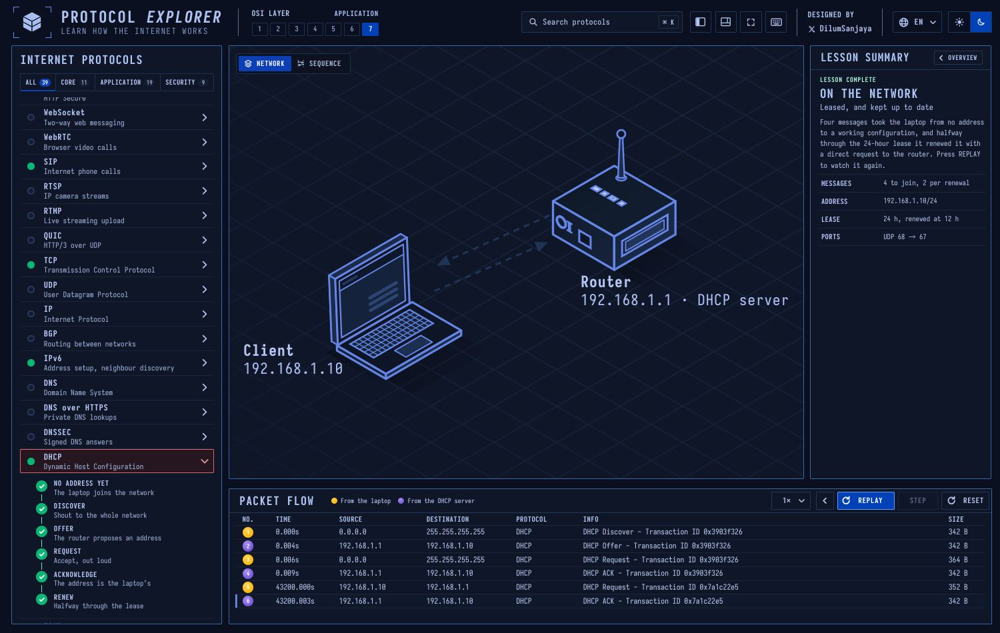
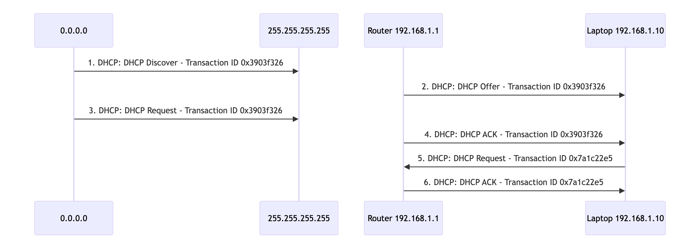
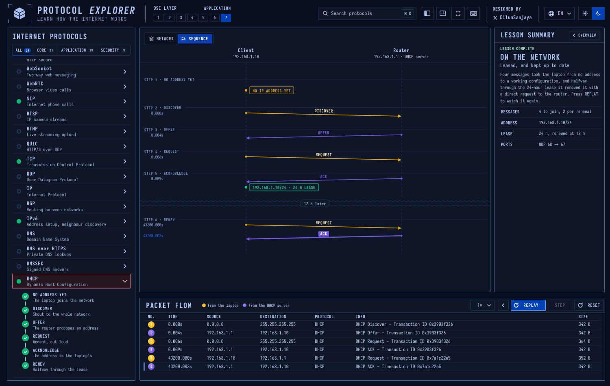
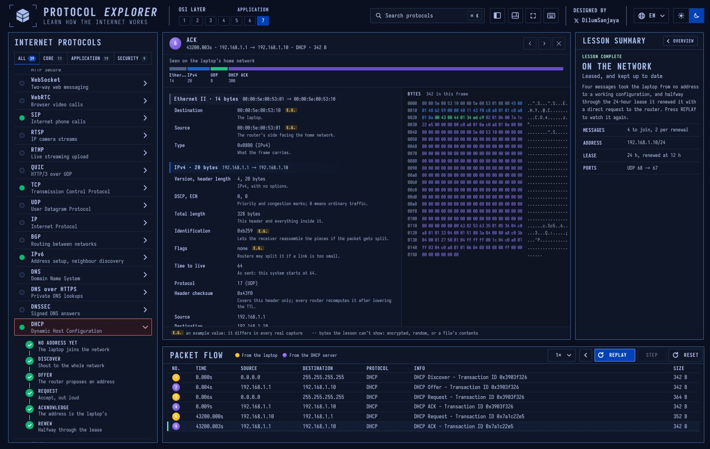

# DHCP – Dynamic Host Configuration

<!-- nav -->
⬅ [16 DNSSEC](16-dnssec.md) · [Index](00_Protocols_Index.md) · [18 ICMP](18-icmp.md) ➡
<!-- nav -->

*Source: Protocol Explorer – https://protocol-explorer-alpha.vercel.app/ (interactive lesson #17). Screenshots captured from the live lesson; packet decodes are the site's example capture (values marked **E.G.** differ in every real capture).*

## Overview

### How the layers fit together (outer to inner)

## In-depth explanation of the example (plain-language version)

### The big picture in one minute
A laptop has just joined the home Wi-Fi. It has **no IP address, doesn't know the router, and doesn't know any DNS server**, yet it needs to talk to the network. **DHCP** solves this by having the laptop ask the router's DHCP server for all the settings. The conversation has four messages, nicknamed **DORA**: **D**iscover, **O**ffer, **R**equest, **A**cknowledge (packets 1–4). Twelve hours later the laptop **renews** its address (packets 5–6).

**Result:** address `192.168.1.10`, router `192.168.1.1`, DNS `8.8.8.8`, valid for 24 hours.

Think of arriving at a hotel: you shout "I need a room!" (Discover), the desk replies "Room 10 is free" (Offer), you say "I'll take room 10" (Request), and the desk confirms "It's yours for 24 hours" (Acknowledge).

> **Words you'll see:** *Broadcast* = a message sent to everyone on the local network. *Lease* = the time you may keep the address. *Gateway* = the router that leads to the internet. DHCP uses UDP, server port **67** and client port **68**.

---

### Step 1 – The link comes up
The laptop's Wi-Fi is connected, but it has no address yet.

### Step 2 – DISCOVER – packet 1
The laptop has no address to send *from*, so it uses `0.0.0.0`, and since it doesn't know who the server is, it **shouts to everyone** (`255.255.255.255`). Only DHCP servers respond. The message includes the laptop's **MAC address** (its hardware ID), a random **transaction number** (to match replies to this request) and a "shopping list" of settings it wants: subnet mask, router, DNS, lease time and so on.

### Step 3 – OFFER – packet 2
The router's DHCP server picks a **free address from its pool** and offers a full package:
- **address** `192.168.1.10`
- **subnet mask** `255.255.255.0`
- **router** `192.168.1.1`
- **DNS** `8.8.8.8`
- **lease time** 24 hours
(If several servers exist, each may make an offer.)

### Step 4 – REQUEST – packet 3
The laptop says "I accept **this** offer" and names the server it chose. It sends this **again as a broadcast on purpose**, so that any *other* server that made an offer hears it and knows it wasn't chosen, and can release the address it was holding.

### Step 5 – ACKNOWLEDGE – packet 4
The server confirms: "That address is yours for 24 hours." The laptop applies the settings. (Many systems first check that nobody else is using the address; if someone is, they decline and start over.) Now it can talk to the network.

### Step 6 – Renewal – packets 5, 6 (12 hours later)
An address is only **leased**. To keep it:
- At **half the lease (12 hours)** the laptop asks the server directly (no shouting needed) to extend it.
- The server answers OK and the lease restarts for a full 24 hours.
- If the server doesn't answer, at **87.5 % of the lease** the laptop shouts to any server. If the lease runs out completely, it must give up the address and start again with Discover.
- When leaving cleanly, a device may send a **release** message.

---

### The 6 messages at a glance
| Packets | What | Why |
|---|---|---|
| 1 | DISCOVER (broadcast) | "I need an address" |
| 2 | OFFER | "here's one, plus settings" |
| 3 | REQUEST (broadcast) | "I'll take that one" |
| 4 | ACK | "it's yours for 24 h" |
| 5–6 | renew request and ACK | extend the lease |

### What to remember
- **DORA** = Discover, Offer, Request, Acknowledge. Early messages are **broadcasts** because the client has no address yet.
- DHCP gives out much more than an address: **mask, gateway, DNS, lease time, domain name, time servers, boot options and more.**
- **Lease timers:** 50 % (renew with the same server), 87.5 % (ask any server), 100 % (expired).
- A **DHCP relay** lets one server serve many separate networks.
- **Security:** DHCP isn't authenticated. A **rogue DHCP server** could hand out a malicious gateway or DNS server. Switches can use **DHCP snooping** to block that.
- IPv6 usually uses **SLAAC** instead (see the IPv6 note), with DHCPv6 as an option.

## Under the hood – technical details

- **Transport.** UDP: server port **67**, client port **68**. DHCP descends from BOOTP and keeps its fixed 236-byte layout followed by *options*.
- **Fixed fields.** `op` (request or reply), hardware type and length, `hops`, **`xid`** (a random transaction ID tying replies to requests), `secs`, `flags` (including the *broadcast* flag), `ciaddr` (client's current address), **`yiaddr`** ("your" address, the one offered), `siaddr`, `giaddr` (relay agent), `chaddr` (client MAC) and the magic cookie `63 82 53 63` before the options.
- **Options (type, length, value).** `53` message type (1 Discover, 2 Offer, 3 Request, 5 ACK, 6 NAK, 4 Decline, 7 Release), `50` requested IP, `54` server identifier, `1` subnet mask, `3` router, `6` DNS servers, `51` lease time, `55` parameter request list, `12` host name, `15` domain name, `42` NTP servers, `66/67` boot server and file.
- **Why the first messages are broadcasts.** The client has no IP address (`0.0.0.0`) and doesn't know the server, so Discover goes to `255.255.255.255` (Ethernet `ff:ff:ff:ff:ff:ff`). The broadcast **Request** also tells other servers that made offers they were not chosen.
- **Offer delivery.** The server may unicast the Offer to the client's MAC address (the client cannot yet use the IP) or broadcast it if the client set the broadcast flag.
- **Address check.** Many clients send an ARP probe for the offered address before accepting it. If someone answers, they send `DHCPDECLINE` and restart.
- **Lease timers.** `T1 = 50 %` of the lease: renew by unicast to the same server. `T2 = 87.5 %`: broadcast to any server. At 100 % the address must be abandoned and the client restarts at Discover. A client may send `DHCPRELEASE` when leaving.
- **Relay agents.** A router can forward broadcasts as unicast to a central server and fill `giaddr`, so one server can serve many subnets. The server picks the address pool using `giaddr`.
- **Security issues.** DHCP is unauthenticated. A *rogue DHCP server* can hand out a malicious gateway or DNS. *DHCP snooping* on switches allows replies only from trusted ports. *Starvation* attacks exhaust the pool; *port security* and rate limits help.
- **IPv6.** Usually uses SLAAC, with DHCPv6 (ports 546/547) as an option.

## Step-by-step walkthrough (screenshots from the lesson)

### Step 1: NO ADDRESS YET – The laptop joins the network

### Step 2: DISCOVER – Shout to the whole network

### Step 3: OFFER – The router proposes an address

### Step 4: REQUEST – Accept, out loud

### Step 5: ACKNOWLEDGE – The address is the laptop’s

### Step 6: RENEW – Halfway through the lease

### Lesson summary

## Packet flow (whole lesson)

| No. | Time | Source | Destination | Protocol | Info | Size |
|---|---|---|---|---|---|---|
| 1 | 0.000s | 0.0.0.0 | 255.255.255.255 | DHCP | DHCP Discover - Transaction ID 0x3903f326 | 342 B |
| 2 | 0.004s | 192.168.1.1 | 192.168.1.10 | DHCP | DHCP Offer - Transaction ID 0x3903f326 | 342 B |
| 3 | 0.006s | 0.0.0.0 | 255.255.255.255 | DHCP | DHCP Request - Transaction ID 0x3903f326 | 364 B |
| 4 | 0.009s | 192.168.1.1 | 192.168.1.10 | DHCP | DHCP ACK - Transaction ID 0x3903f326 | 342 B |
| 5 | 43200.000s | 192.168.1.10 | 192.168.1.1 | DHCP | DHCP Request - Transaction ID 0x7a1c22e5 | 352 B |
| 6 | 43200.003s | 192.168.1.1 | 192.168.1.10 | DHCP | DHCP ACK - Transaction ID 0x7a1c22e5 | 342 B |

### Sequence diagram

*The lesson's own sequence diagram:*

## Packet decoder screenshots

The lesson's decoder view for the first, middle and last packet: headers, field values and the raw hex bytes.

### Packet 1: DHCP – DHCP Discover - Transaction ID 0x3903f326

*0.0.0.0 → 255.255.255.255 · 342 B · t = 0.000s*

### Packet 4: DHCP – DHCP ACK - Transaction ID 0x3903f326

*192.168.1.1 → 192.168.1.10 · 342 B · t = 0.009s*

### Packet 6: DHCP – DHCP ACK - Transaction ID 0x7a1c22e5

*192.168.1.1 → 192.168.1.10 · 342 B · t = 43200.003s*

---

<!-- nav -->
⬅ [16 DNSSEC](16-dnssec.md) · [Index](00_Protocols_Index.md) · [18 ICMP](18-icmp.md) ➡
<!-- nav -->
