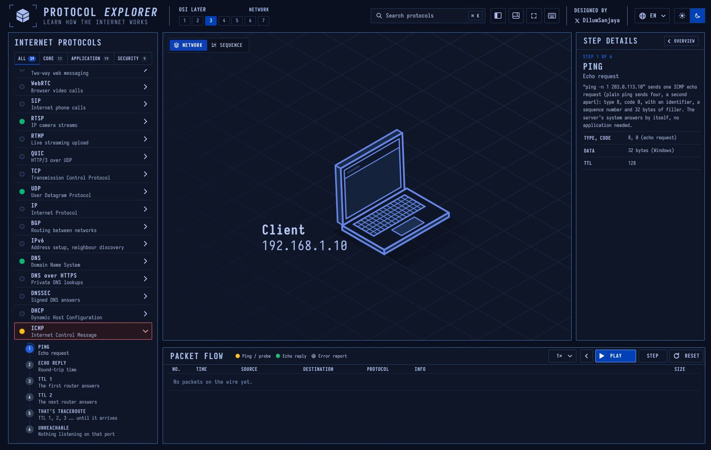
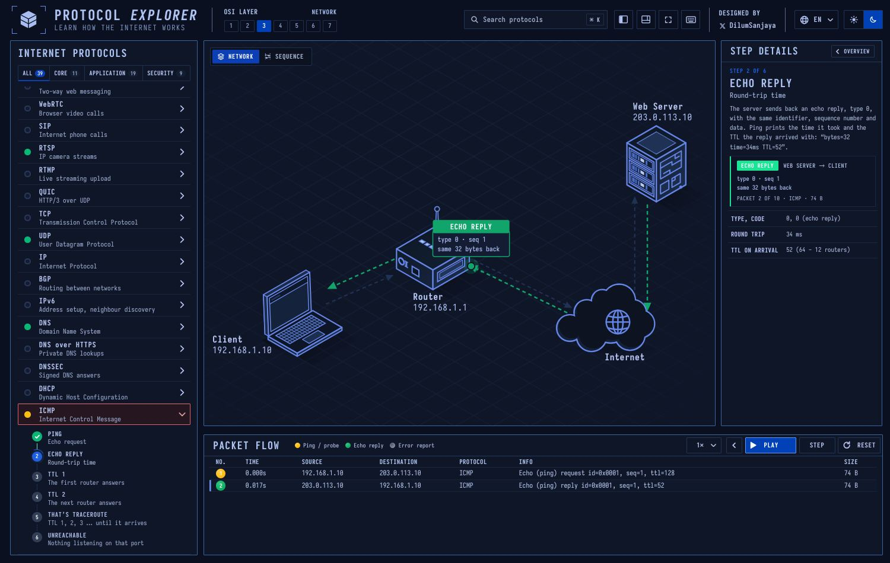
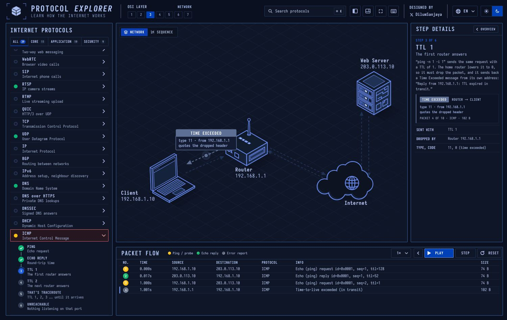
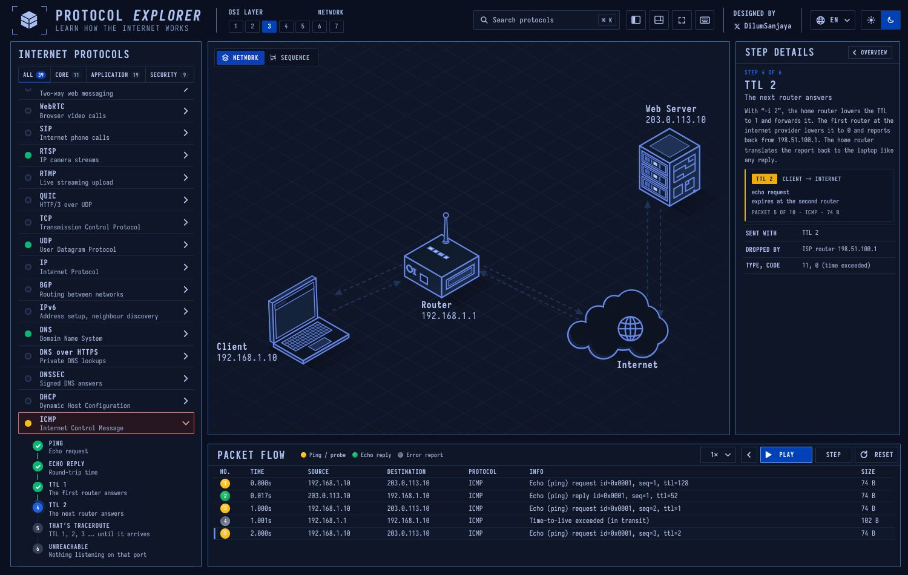
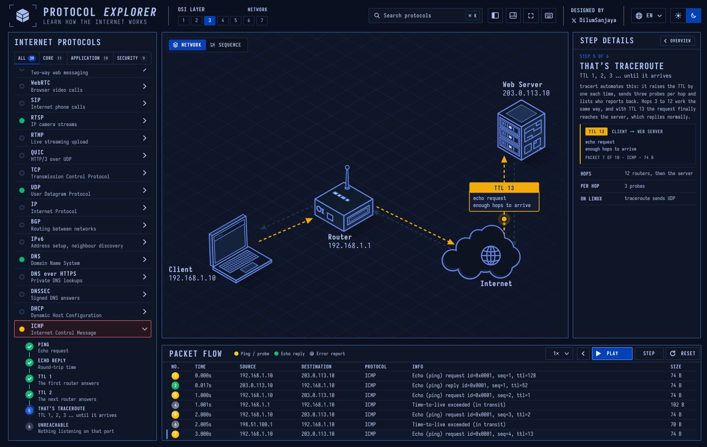
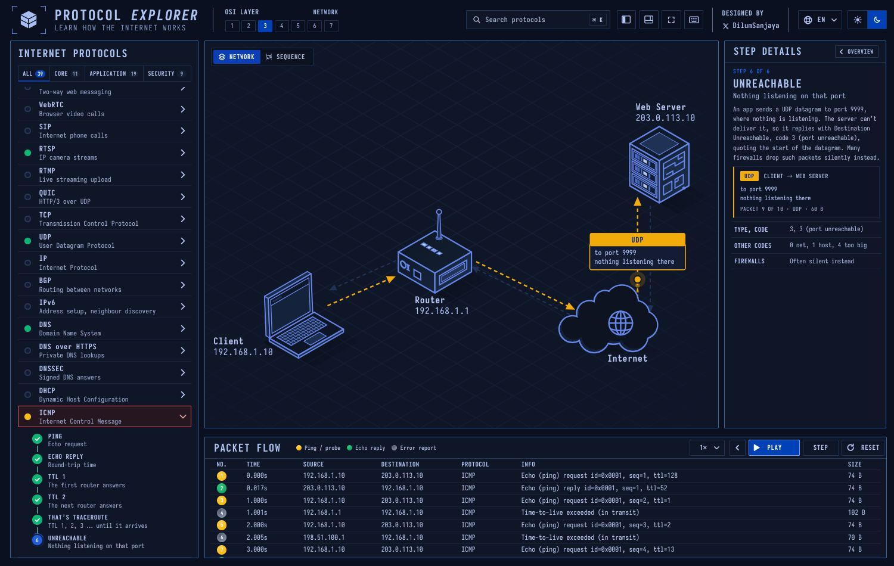
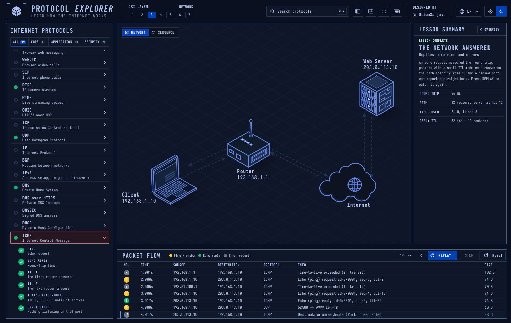
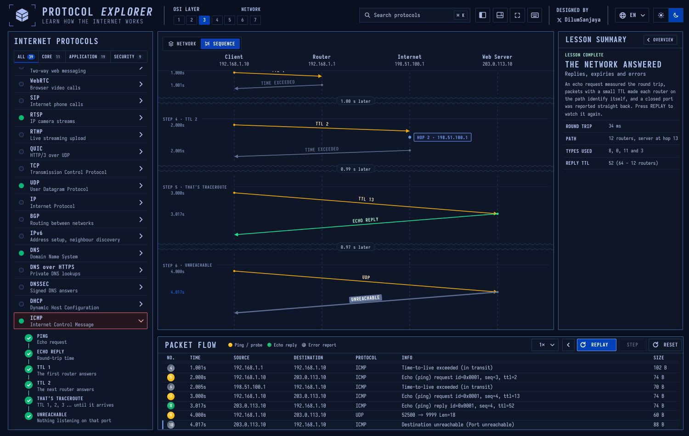

# ICMP – Internet Control Message

<!-- nav -->
⬅ [17 DHCP](17-dhcp.md) · [Index](00_Protocols_Index.md) · [19 IGMP](19-igmp.md) ➡
<!-- nav -->

*Source: Protocol Explorer – https://protocol-explorer-alpha.vercel.app/ (interactive lesson #18). Screenshots captured from the live lesson; packet decodes are the site's example capture (values marked **E.G.** differ in every real capture).*

## Overview


> PROTOCOL OVERVIEW  
> ICMP  
> ACTIVE  
> Internet Control Message Protocol  
> ICMP is how the network reports back: a router says a packet’s time ran out, a server says nothing is listening on a port. Tools like ping and traceroute are built from these messages. It travels inside IP but carries no application data.  
> LAYER  
> Network (Layer 3)  
> CARRIED IN  
> IP (protocol 1)  
> MESSAGES  
> A type and a code  
> TOOLS  
> ping, tracert / traceroute  
> OFTEN  
> Filtered by firewalls  
> DEFINED IN  
> RFC 792 (IPv6: RFC 4443)  

## In-depth explanation of the example (plain-language version)

### The big picture in one minute
The laptop runs the classic network tools against `203.0.113.10`: **`ping`**, then a hand-made **traceroute**, and finally a program that sends data to a **closed door**. **10 messages**, nearly all of them **ICMP**.

**What ICMP is.** It's the network's **messenger for errors and diagnostics.** It carries no web pages or files. Routers and computers use it to say things like "your packet ran out of time" or "nobody is listening at that port." Every message has a **type** and a **code** that say what happened.

Think of **a "return to sender" note from the post office**. It isn't your letter, just a report about what happened to it.

> **Words you'll see:** *TTL (time to live)* = a counter on every packet that drops by 1 at each router and gets the packet thrown away at 0, so packets can't loop forever. *Hop* = one router along the way. *Round-trip time* = how long a message takes to go and come back.

---

### Step 1 – Ping: "are you there?" – packet 1
`ping` sends an **Echo Request** (type 8) with an ID, a sequence number (1) and 32 bytes of filler data. It's addressed to `203.0.113.10`.

### Step 2 – The answer – packet 2
The server returns an **Echo Reply** (type 0) with the same ID, number and data. The lesson's timeline shows about 17 ms each way, so ping prints `time=34ms`: the **round-trip time**. The reply arrived with **TTL 52**: the server started at 64 and the packet crossed **12 routers**. That's why ping shows `TTL=52` (it hints at how far away the host is and what operating system it runs).

### Step 3 – Traceroute idea: TTL 1 – packets 3, 4
Every router lowers TTL by 1 and **discards the packet at 0**. When that happens, the router tells the sender with an ICMP message. That turns TTL into a measuring tool:
- `ping` is sent with **TTL = 1** (packet 3).
- The home router `192.168.1.1` lowers it to 0, drops it, and sends **"Time Exceeded"** (type 11) back **from its own address** (packet 4). The message includes the start of the dropped packet so the laptop can match it up.
The laptop now knows **hop 1 = `192.168.1.1`**.

### Step 4 – TTL 2 – packets 5, 6
With **TTL 2**, the home router passes it on, and the **first internet-provider router `198.51.100.1`** reduces it to 0 and reports back. **Hop 2** found.

### Step 5 – That's traceroute – packets 7, 8
`tracert` (Windows) or `traceroute` (Linux/macOS) does this automatically: **raise the TTL by one, send a few probes, note who answers, repeat.** After 12 routers, **TTL 13** is enough to reach the server, which answers with a normal Echo Reply (packet 8): the trace ends. (Linux's `traceroute` sends UDP packets and relies on a "port unreachable" reply from the destination to know it arrived.)
**Caveats:** some routers ignore or rate-limit these messages (shown as `* * *`), probes may take different paths, and the return path may differ from the outgoing one.

### Step 6 – "Nobody's home" – packets 9, 10
A program sends a UDP packet to port 9999 where **nothing is listening** (packet 9). The server's network stack can't deliver it and replies **Destination Unreachable, code 3 = Port Unreachable**, quoting the start of the packet (packet 10). The program sees "connection refused". Other codes of the same type: network unreachable, host unreachable, and **"fragmentation needed"**, which is how a sender discovers the maximum packet size on a path. Many firewalls silently drop these instead of replying, which makes a port look "filtered" rather than "closed".

---

### The 10 messages at a glance
| Packets | What | Why |
|---|---|---|
| 1–2 | Echo Request / Reply | ping: is the host alive, how long does it take? |
| 3–4 | TTL 1, Time Exceeded from router 1 | discover hop 1 |
| 5–6 | TTL 2, Time Exceeded from router 2 | discover hop 2 |
| 7–8 | TTL 13, Echo Reply | the destination is reached |
| 9–10 | UDP to closed port, Port Unreachable | error report |

### What to remember
| Type | Meaning | Used by |
|---|---|---|
| 8 / 0 | Echo request / reply | `ping` |
| 3 | Destination unreachable | errors, packet-size discovery |
| 11 | Time exceeded | `traceroute` |
| 5 | Redirect | "use a better first router" |
- ICMP travels **inside IP, not TCP or UDP**, so it has **no ports**.
- Error messages never trigger more error messages, and they quote the start of the offending packet.
- **Don't block ICMP completely.** Packet-size discovery and IPv6 neighbour discovery depend on it.
- It can be abused for scans, ping floods and hidden tunnels, so limit it rather than ban it.

## Step-by-step walkthrough (screenshots from the lesson)

### Step 1: PING – Echo request



> STEP 1 OF 6  
> PING  
> Echo request  
> “ping -n 1 203.0.113.10” sends one ICMP echo request (plain ping sends four, a second apart): type 8, code 0, with an identifier, a sequence number and 32 bytes of filler. The server’s system answers by itself, no application needed.  
> TYPE, CODE  
> 8, 0 (echo request)  
> DATA  
> 32 bytes (Windows)  
> TTL  
> 128  

### Step 2: ECHO REPLY – Round-trip time



> STEP 2 OF 6  
> ECHO REPLY  
> Round-trip time  
> The server sends back an echo reply, type 0, with the same identifier, sequence number and data. Ping prints the time it took and the TTL the reply arrived with: “bytes=32 time=34ms TTL=52”.  
> ECHO REPLY  
> WEB SERVER → CLIENT  
> type 0 · seq 1  
> same 32 bytes back  
> PACKET 2 OF 10 · ICMP · 74 B  
> TYPE, CODE  
> 0, 0 (echo reply)  
> ROUND TRIP  
> 34 ms  
> TTL ON ARRIVAL  
> 52 (64 − 12 routers)  

### Step 3: TTL 1 – The first router answers



> STEP 3 OF 6  
> TTL 1  
> The first router answers  
> “ping -n 1 -i 1” sends the same request with a TTL of 1. The home router lowers it to 0, so it must drop the packet, and it sends back a Time Exceeded message from its own address: “Reply from 192.168.1.1: TTL expired in transit.”  
> TIME EXCEEDED  
> ROUTER → CLIENT  
> type 11 · from 192.168.1.1  
> quotes the dropped header  
> PACKET 4 OF 10 · ICMP · 102 B  
> SENT WITH  
> TTL 1  
> DROPPED BY  
> Router 192.168.1.1  
> TYPE, CODE  
> 11, 0 (time exceeded)  

### Step 4: TTL 2 – The next router answers



> STEP 4 OF 6  
> TTL 2  
> The next router answers  
> With “-i 2”, the home router lowers the TTL to 1 and forwards it. The first router at the internet provider lowers it to 0 and reports back from 198.51.100.1. The home router translates the report back to the laptop like any reply.  
> TTL 2  
> CLIENT → INTERNET  
> echo request  
> expires at the second router  
> PACKET 5 OF 10 · ICMP · 74 B  
> SENT WITH  
> TTL 2  
> DROPPED BY  
> ISP router 198.51.100.1  
> TYPE, CODE  
> 11, 0 (time exceeded)  

### Step 5: THAT’S TRACEROUTE – TTL 1, 2, 3 … until it arrives



> STEP 5 OF 6  
> THAT’S TRACEROUTE  
> TTL 1, 2, 3 … until it arrives  
> tracert automates this: it raises the TTL by one each time, sends three probes per hop and lists who reports back. Hops 3 to 12 work the same way, and with TTL 13 the request finally reaches the server, which replies normally.  
> TTL 13  
> CLIENT → WEB SERVER  
> echo request  
> enough hops to arrive  
> PACKET 7 OF 10 · ICMP · 74 B  
> HOPS  
> 12 routers, then the server  
> PER HOP  
> 3 probes  
> ON LINUX  
> traceroute sends UDP  

### Step 6: UNREACHABLE – Nothing listening on that port



> STEP 6 OF 6  
> UNREACHABLE  
> Nothing listening on that port  
> An app sends a UDP datagram to port 9999, where nothing is listening. The server can’t deliver it, so it replies with Destination Unreachable, code 3 (port unreachable), quoting the start of the datagram. Many firewalls drop such packets silently instead.  
> UDP  
> CLIENT → WEB SERVER  
> to port 9999  
> nothing listening there  
> PACKET 9 OF 10 · UDP · 60 B  
> TYPE, CODE  
> 3, 3 (port unreachable)  
> OTHER CODES  
> 0 net, 1 host, 4 too big  
> FIREWALLS  
> Often silent instead  

### Lesson summary



> LESSON SUMMARY  
> LESSON COMPLETE  
> THE NETWORK ANSWERED  
> Replies, expiries and errors  
> An echo request measured the round trip, packets with a small TTL made each router on the path identify itself, and a closed port was reported straight back. Press REPLAY to watch it again.  
> UNREACHABLE  
> WEB SERVER → CLIENT  
> type 3 · code 3  
> port unreachable  
> PACKET 10 OF 10 · ICMP · 88 B  
> ROUND TRIP  
> 34 ms  
> PATH  
> 12 routers, server at hop 13  
> TYPES USED  
> 8, 0, 11 and 3  
> REPLY TTL  
> 52 (64 − 12 routers)  

## Packet flow (whole lesson)

| No. | Time | Source | Destination | Protocol | Info | Size |
|---|---|---|---|---|---|---|
| 1 | 0.000s | 192.168.1.10 | 203.0.113.10 | ICMP | Echo (ping) request id=0x0001, seq=1, ttl=128 | 74 B |
| 2 | 0.017s | 203.0.113.10 | 192.168.1.10 | ICMP | Echo (ping) reply id=0x0001, seq=1, ttl=52 | 74 B |
| 3 | 1.000s | 192.168.1.10 | 203.0.113.10 | ICMP | Echo (ping) request id=0x0001, seq=2, ttl=1 | 74 B |
| 4 | 1.001s | 192.168.1.1 | 192.168.1.10 | ICMP | Time-to-live exceeded (in transit) | 102 B |
| 5 | 2.000s | 192.168.1.10 | 203.0.113.10 | ICMP | Echo (ping) request id=0x0001, seq=3, ttl=2 | 74 B |
| 6 | 2.005s | 198.51.100.1 | 192.168.1.10 | ICMP | Time-to-live exceeded (in transit) | 70 B |
| 7 | 3.000s | 192.168.1.10 | 203.0.113.10 | ICMP | Echo (ping) request id=0x0001, seq=4, ttl=13 | 74 B |
| 8 | 3.017s | 203.0.113.10 | 192.168.1.10 | ICMP | Echo (ping) reply id=0x0001, seq=4, ttl=52 | 74 B |
| 9 | 4.000s | 192.168.1.10 | 203.0.113.10 | UDP | 52500 → 9999 Len=18 | 60 B |
| 10 | 4.017s | 203.0.113.10 | 192.168.1.10 | ICMP | Destination unreachable (Port unreachable) | 88 B |

### Sequence diagram



## Packets decoded byte by byte

Each packet below is the lesson's own decode (headers, field values and the plain-English meaning of each field). Screenshots show the first, middle and last packet in the lesson's decoder view with the raw hex bytes.

### Packet 1: ICMP – Echo (ping) request id=0x0001, seq=1, ttl=128

*192.168.1.10 → 203.0.113.10 · 74 B · t = 0.000s*


<details><summary>Decoded fields</summary>

```text
1
ECHO REQUEST
0.000s · 192.168.1.10 → 203.0.113.10 · ICMP · 74 B
Seen on the laptop’s home network
Ethernet
14
IPv4
20
ICMP
40
Ethernet II · 14 bytes
00:00:5e:00:53:10 → 00:00:5e:00:53:01
Destination
00:00:5e:00:53:01 E.G.

The router: anything beyond the home network goes to it first.

Source
00:00:5e:00:53:10 E.G.

The laptop’s network card.

Type
0x0800 (IPv4)

What the frame carries.

IPv4 · 20 bytes
192.168.1.10 → 203.0.113.10
Version, header length
4, 20 bytes

IPv4, with no options.

DSCP, ECN
0, 0

Priority and congestion marks; 0 means ordinary traffic.

Total length
60 bytes

This header and everything inside it.

Identification
0xd825 E.G.

Lets the receiver reassemble the pieces if the packet gets split.

Flags
none E.G.

Routers may split it if a link is too small.

Time to live
128

Windows starts at 128.

Protocol
1 (ICMP)
Header checksum
0x64de

Covers this header only; every router recomputes it after lowering the TTL.

Source
192.168.1.10
Destination
203.0.113.10
ICMP · Echo request
Type
8

Echo request

Code
0
Checksum
0x4d5a

Covers the whole ICMP message.

Identifier
0x0001

Matches replies to this ping program.

Sequence number
1

Windows counts up across every ping it sends.

Data
"abcdefghijklmnopqrstuvwabcdefghi" (32 bytes)

Windows ping’s filler: the alphabet, a to w, then again.

BYTES 74 in this frame
0000
00
00
5e
00
53
01
00
00
5e
00
53
10
08
00
45
00
.
.
^
.
S
.
.
.
^
.
S
.
.
.
E
.
0010
00
3c
d8
25
00
00
80
01
64
de
c0
a8
01
0a
cb
00
.
<
.
%
.
.
.
.
d
.
.
.
.
.
.
.
0020
71
0a
08
00
4d
5a
00
01
00
01
61
62
63
64
65
66
q
.
.
.
M
Z
.
.
.
.
a
b
c
d
e
f
0030
67
68
69
6a
6b
6c
6d
6e
6f
70
71
72
73
74
75
76
g
h
i
j
k
l
m
n
o
p
q
r
s
t
u
v
0040
77
61
62
63
64
65
66
67
68
69
w
a
b
c
d
e
f
g
h
i
E.G. an example value: it differs in every real capture
·· bytes the lesson can’t show: encrypted, random, or a file’s contents
```

</details>

### Packet 2: ICMP – Echo (ping) reply id=0x0001, seq=1, ttl=52

*203.0.113.10 → 192.168.1.10 · 74 B · t = 0.017s*

<details><summary>Decoded fields</summary>

```text
2
ECHO REPLY
0.017s · 203.0.113.10 → 192.168.1.10 · ICMP · 74 B
Seen on the laptop’s home network
Ethernet
14
IPv4
20
ICMP
40
Ethernet II · 14 bytes
00:00:5e:00:53:01 → 00:00:5e:00:53:10
Destination
00:00:5e:00:53:10 E.G.

The laptop.

Source
00:00:5e:00:53:01 E.G.

The router’s side facing the home network.

Type
0x0800 (IPv4)

What the frame carries.

IPv4 · 20 bytes
203.0.113.10 → 192.168.1.10
Version, header length
4, 20 bytes

IPv4, with no options.

DSCP, ECN
0, 0

Priority and congestion marks; 0 means ordinary traffic.

Total length
60 bytes

This header and everything inside it.

Identification
0x0e03 E.G.

Lets the receiver reassemble the pieces if the packet gets split.

Flags
none E.G.

Routers may split it if a link is too small.

Time to live
52

Started at 64; 12 routers on the way each took 1.

Protocol
1 (ICMP)
Header checksum
0x7b01

Covers this header only; every router recomputes it after lowering the TTL.

Source
203.0.113.10
Destination
192.168.1.10
ICMP · Echo reply
Type
0

Echo reply

Code
0
Checksum
0x555a

Covers the whole ICMP message.

Identifier
0x0001

Matches replies to this ping program.

Sequence number
1

Windows counts up across every ping it sends.

Data
"abcdefghijklmnopqrstuvwabcdefghi" (32 bytes)

Sent back exactly as it came.

BYTES 74 in this frame
0000
00
00
5e
00
53
10
00
00
5e
00
53
01
08
00
45
00
.
.
^
.
S
.
.
.
^
.
S
.
.
.
E
.
0010
00
3c
0e
03
00
00
34
01
7b
01
cb
00
71
0a
c0
a8
.
<
.
.
.
.
4
.
{
.
.
.
q
.
.
.
0020
01
0a
00
00
55
5a
00
01
00
01
61
62
63
64
65
66
.
.
.
.
U
Z
.
.
.
.
a
b
c
d
e
f
0030
67
68
69
6a
6b
6c
6d
6e
6f
70
71
72
73
74
75
76
g
h
i
j
k
l
m
n
o
p
q
r
s
t
u
v
0040
77
61
62
63
64
65
66
67
68
69
w
a
b
c
d
e
f
g
h
i
E.G. an example value: it differs in every real capture
·· bytes the lesson can’t show: encrypted, random, or a file’s contents
```

</details>

### Packet 3: ICMP – Echo (ping) request id=0x0001, seq=2, ttl=1

*192.168.1.10 → 203.0.113.10 · 74 B · t = 1.000s*

<details><summary>Decoded fields</summary>

```text
3
TTL 1
1.000s · 192.168.1.10 → 203.0.113.10 · ICMP · 74 B
Seen on the laptop’s home network
Ethernet
14
IPv4
20
ICMP
40
Ethernet II · 14 bytes
00:00:5e:00:53:10 → 00:00:5e:00:53:01
Destination
00:00:5e:00:53:01 E.G.

The router: anything beyond the home network goes to it first.

Source
00:00:5e:00:53:10 E.G.

The laptop’s network card.

Type
0x0800 (IPv4)

What the frame carries.

IPv4 · 20 bytes
192.168.1.10 → 203.0.113.10
Version, header length
4, 20 bytes

IPv4, with no options.

DSCP, ECN
0, 0

Priority and congestion marks; 0 means ordinary traffic.

Total length
60 bytes

This header and everything inside it.

Identification
0xd826 E.G.

Lets the receiver reassemble the pieces if the packet gets split.

Flags
none E.G.

Routers may split it if a link is too small.

Time to live
1

Windows starts at 128. Set to 1 on purpose here.

Protocol
1 (ICMP)
Header checksum
0xe3dd

Covers this header only; every router recomputes it after lowering the TTL.

Source
192.168.1.10
Destination
203.0.113.10
ICMP · Echo request
Type
8

Echo request

Code
0
Checksum
0x4d59

Covers the whole ICMP message.

Identifier
0x0001

Matches replies to this ping program.

Sequence number
2

Windows counts up across every ping it sends.

Data
"abcdefghijklmnopqrstuvwabcdefghi" (32 bytes)

Windows ping’s filler: the alphabet, a to w, then again.

BYTES 74 in this frame
0000
00
00
5e
00
53
01
00
00
5e
00
53
10
08
00
45
00
.
.
^
.
S
.
.
.
^
.
S
.
.
.
E
.
0010
00
3c
d8
26
00
00
01
01
e3
dd
c0
a8
01
0a
cb
00
.
<
.
&
.
.
.
.
.
.
.
.
.
.
.
.
0020
71
0a
08
00
4d
59
00
01
00
02
61
62
63
64
65
66
q
.
.
.
M
Y
.
.
.
.
a
b
c
d
e
f
0030
67
68
69
6a
6b
6c
6d
6e
6f
70
71
72
73
74
75
76
g
h
i
j
k
l
m
n
o
p
q
r
s
t
u
v
0040
77
61
62
63
64
65
66
67
68
69
w
a
b
c
d
e
f
g
h
i
E.G. an example value: it differs in every real capture
·· bytes the lesson can’t show: encrypted, random, or a file’s contents
```

</details>

### Packet 4: ICMP – Time-to-live exceeded (in transit)

*192.168.1.1 → 192.168.1.10 · 102 B · t = 1.001s*

<details><summary>Decoded fields</summary>

```text
4
TIME EXCEEDED
1.001s · 192.168.1.1 → 192.168.1.10 · ICMP · 102 B
Seen on the laptop’s home network
Ethernet
14
IPv4
20
ICMP
68
Ethernet II · 14 bytes
00:00:5e:00:53:01 → 00:00:5e:00:53:10
Destination
00:00:5e:00:53:10 E.G.

The laptop.

Source
00:00:5e:00:53:01 E.G.

The router’s side facing the home network.

Type
0x0800 (IPv4)

What the frame carries.

IPv4 · 20 bytes
192.168.1.1 → 192.168.1.10
Version, header length
4, 20 bytes

IPv4, with no options.

DSCP, ECN
0, 0

Priority and congestion marks; 0 means ordinary traffic.

Total length
88 bytes

This header and everything inside it.

Identification
0xb257 E.G.

Lets the receiver reassemble the pieces if the packet gets split.

Flags
none E.G.

Routers may split it if a link is too small.

Time to live
64

As sent: this system starts at 64.

Protocol
1 (ICMP)
Header checksum
0x44f2

Covers this header only; every router recomputes it after lowering the TTL.

Source
192.168.1.1
Destination
192.168.1.10
ICMP · Time exceeded (TTL reached 0)
Type
11

Time exceeded (TTL reached 0)

Code
0
Checksum
0xf4ff

Covers the whole ICMP message.

Unused
0
Original packet
all 60 bytes of it

The packet that caused this, as the reporting device received it (TTL 1), so the sender can tell which packet it was.

Its source, destination
192.168.1.10 → 203.0.113.10
BYTES 102 in this frame
0000
00
00
5e
00
53
10
00
00
5e
00
53
01
08
00
45
00
.
.
^
.
S
.
.
.
^
.
S
.
.
.
E
.
0010
00
58
b2
57
00
00
40
01
44
f2
c0
a8
01
01
c0
a8
.
X
.
W
.
.
@
.
D
.
.
.
.
.
.
.
0020
01
0a
0b
00
f4
ff
00
00
00
00
45
00
00
3c
d8
26
.
.
.
.
.
.
.
.
.
.
E
.
.
<
.
&
0030
00
00
01
01
e3
dd
c0
a8
01
0a
cb
00
71
0a
08
00
.
.
.
.
.
.
.
.
.
.
.
.
q
.
.
.
0040
4d
59
00
01
00
02
61
62
63
64
65
66
67
68
69
6a
M
Y
.
.
.
.
a
b
c
d
e
f
g
h
i
j
0050
6b
6c
6d
6e
6f
70
71
72
73
74
75
76
77
61
62
63
k
l
m
n
o
p
q
r
s
t
u
v
w
a
b
c
0060
64
65
66
67
68
69
d
e
f
g
h
i
E.G. an example value: it differs in every real capture
·· bytes the lesson can’t show: encrypted, random, or a file’s contents
```

</details>

### Packet 5: ICMP – Echo (ping) request id=0x0001, seq=3, ttl=2

*192.168.1.10 → 203.0.113.10 · 74 B · t = 2.000s*

<details><summary>Decoded fields</summary>

```text
5
TTL 2
2.000s · 192.168.1.10 → 203.0.113.10 · ICMP · 74 B
Seen on the laptop’s home network
Ethernet
14
IPv4
20
ICMP
40
Ethernet II · 14 bytes
00:00:5e:00:53:10 → 00:00:5e:00:53:01
Destination
00:00:5e:00:53:01 E.G.

The router: anything beyond the home network goes to it first.

Source
00:00:5e:00:53:10 E.G.

The laptop’s network card.

Type
0x0800 (IPv4)

What the frame carries.

IPv4 · 20 bytes
192.168.1.10 → 203.0.113.10
Version, header length
4, 20 bytes

IPv4, with no options.

DSCP, ECN
0, 0

Priority and congestion marks; 0 means ordinary traffic.

Total length
60 bytes

This header and everything inside it.

Identification
0xd827 E.G.

Lets the receiver reassemble the pieces if the packet gets split.

Flags
none E.G.

Routers may split it if a link is too small.

Time to live
2

Windows starts at 128. Set to 2 on purpose here.

Protocol
1 (ICMP)
Header checksum
0xe2dc

Covers this header only; every router recomputes it after lowering the TTL.

Source
192.168.1.10
Destination
203.0.113.10
ICMP · Echo request
Type
8

Echo request

Code
0
Checksum
0x4d58

Covers the whole ICMP message.

Identifier
0x0001

Matches replies to this ping program.

Sequence number
3

Windows counts up across every ping it sends.

Data
"abcdefghijklmnopqrstuvwabcdefghi" (32 bytes)

Windows ping’s filler: the alphabet, a to w, then again.

BYTES 74 in this frame
0000
00
00
5e
00
53
01
00
00
5e
00
53
10
08
00
45
00
.
.
^
.
S
.
.
.
^
.
S
.
.
.
E
.
0010
00
3c
d8
27
00
00
02
01
e2
dc
c0
a8
01
0a
cb
00
.
<
.
'
.
.
.
.
.
.
.
.
.
.
.
.
0020
71
0a
08
00
4d
58
00
01
00
03
61
62
63
64
65
66
q
.
.
.
M
X
.
.
.
.
a
b
c
d
e
f
0030
67
68
69
6a
6b
6c
6d
6e
6f
70
71
72
73
74
75
76
g
h
i
j
k
l
m
n
o
p
q
r
s
t
u
v
0040
77
61
62
63
64
65
66
67
68
69
w
a
b
c
d
e
f
g
h
i
E.G. an example value: it differs in every real capture
·· bytes the lesson can’t show: encrypted, random, or a file’s contents
```

</details>

### Packet 6: ICMP – Time-to-live exceeded (in transit)

*198.51.100.1 → 192.168.1.10 · 70 B · t = 2.005s*


<details><summary>Decoded fields</summary>

```text
6
TIME EXCEEDED
2.005s · 198.51.100.1 → 192.168.1.10 · ICMP · 70 B
Seen on the laptop’s home network
Ethernet
14
IPv4
20
ICMP
36
Ethernet II · 14 bytes
00:00:5e:00:53:01 → 00:00:5e:00:53:10
Destination
00:00:5e:00:53:10 E.G.

The laptop.

Source
00:00:5e:00:53:01 E.G.

The router’s side facing the home network.

Type
0x0800 (IPv4)

What the frame carries.

IPv4 · 20 bytes
198.51.100.1 → 192.168.1.10
Version, header length
4, 20 bytes

IPv4, with no options.

DSCP, ECN
0, 0

Priority and congestion marks; 0 means ordinary traffic.

Total length
56 bytes

This header and everything inside it.

Identification
0x5262 E.G.

Lets the receiver reassemble the pieces if the packet gets split.

Flags
none E.G.

Routers may split it if a link is too small.

Time to live
254 E.G.

Started at 255; 1 router on the way each took 1.

Protocol
1 (ICMP)
Header checksum
0x7e7b

Covers this header only; every router recomputes it after lowering the TTL.

Source
198.51.100.1
Destination
192.168.1.10
ICMP · Time exceeded (TTL reached 0)
Type
11

Time exceeded (TTL reached 0)

Code
0
Checksum
0x9fa3

Covers the whole ICMP message.

Unused
0
Original packet
its IP header and first 8 bytes (28 bytes)

The packet that caused this, as the reporting device received it (TTL 1), so the sender can tell which packet it was.

Its source, destination
192.168.1.10 → 203.0.113.10
BYTES 70 in this frame
0000
00
00
5e
00
53
10
00
00
5e
00
53
01
08
00
45
00
.
.
^
.
S
.
.
.
^
.
S
.
.
.
E
.
0010
00
38
52
62
00
00
fe
01
7e
7b
c6
33
64
01
c0
a8
.
8
R
b
.
.
.
.
~
{
.
3
d
.
.
.
0020
01
0a
0b
00
9f
a3
00
00
00
00
45
00
00
3c
d8
27
.
.
.
.
.
.
.
.
.
.
E
.
.
<
.
'
0030
00
00
01
01
e3
dc
c0
a8
01
0a
cb
00
71
0a
08
00
.
.
.
.
.
.
.
.
.
.
.
.
q
.
.
.
0040
4d
58
00
01
00
03
M
X
.
.
.
.
E.G. an example value: it differs in every real capture
·· bytes the lesson can’t show: encrypted, random, or a file’s contents
```

</details>

### Packet 7: ICMP – Echo (ping) request id=0x0001, seq=4, ttl=13

*192.168.1.10 → 203.0.113.10 · 74 B · t = 3.000s*

<details><summary>Decoded fields</summary>

```text
7
TTL 13
3.000s · 192.168.1.10 → 203.0.113.10 · ICMP · 74 B
Seen on the laptop’s home network
Ethernet
14
IPv4
20
ICMP
40
Ethernet II · 14 bytes
00:00:5e:00:53:10 → 00:00:5e:00:53:01
Destination
00:00:5e:00:53:01 E.G.

The router: anything beyond the home network goes to it first.

Source
00:00:5e:00:53:10 E.G.

The laptop’s network card.

Type
0x0800 (IPv4)

What the frame carries.

IPv4 · 20 bytes
192.168.1.10 → 203.0.113.10
Version, header length
4, 20 bytes

IPv4, with no options.

DSCP, ECN
0, 0

Priority and congestion marks; 0 means ordinary traffic.

Total length
60 bytes

This header and everything inside it.

Identification
0xd828 E.G.

Lets the receiver reassemble the pieces if the packet gets split.

Flags
none E.G.

Routers may split it if a link is too small.

Time to live
13

Windows starts at 128. Set to 13 on purpose here.

Protocol
1 (ICMP)
Header checksum
0xd7db

Covers this header only; every router recomputes it after lowering the TTL.

Source
192.168.1.10
Destination
203.0.113.10
ICMP · Echo request
Type
8

Echo request

Code
0
Checksum
0x4d57

Covers the whole ICMP message.

Identifier
0x0001

Matches replies to this ping program.

Sequence number
4

Windows counts up across every ping it sends.

Data
"abcdefghijklmnopqrstuvwabcdefghi" (32 bytes)

Windows ping’s filler: the alphabet, a to w, then again.

BYTES 74 in this frame
0000
00
00
5e
00
53
01
00
00
5e
00
53
10
08
00
45
00
.
.
^
.
S
.
.
.
^
.
S
.
.
.
E
.
0010
00
3c
d8
28
00
00
0d
01
d7
db
c0
a8
01
0a
cb
00
.
<
.
(
.
.
.
.
.
.
.
.
.
.
.
.
0020
71
0a
08
00
4d
57
00
01
00
04
61
62
63
64
65
66
q
.
.
.
M
W
.
.
.
.
a
b
c
d
e
f
0030
67
68
69
6a
6b
6c
6d
6e
6f
70
71
72
73
74
75
76
g
h
i
j
k
l
m
n
o
p
q
r
s
t
u
v
0040
77
61
62
63
64
65
66
67
68
69
w
a
b
c
d
e
f
g
h
i
E.G. an example value: it differs in every real capture
·· bytes the lesson can’t show: encrypted, random, or a file’s contents
```

</details>

### Packet 8: ICMP – Echo (ping) reply id=0x0001, seq=4, ttl=52

*203.0.113.10 → 192.168.1.10 · 74 B · t = 3.017s*

<details><summary>Decoded fields</summary>

```text
8
ECHO REPLY
3.017s · 203.0.113.10 → 192.168.1.10 · ICMP · 74 B
Seen on the laptop’s home network
Ethernet
14
IPv4
20
ICMP
40
Ethernet II · 14 bytes
00:00:5e:00:53:01 → 00:00:5e:00:53:10
Destination
00:00:5e:00:53:10 E.G.

The laptop.

Source
00:00:5e:00:53:01 E.G.

The router’s side facing the home network.

Type
0x0800 (IPv4)

What the frame carries.

IPv4 · 20 bytes
203.0.113.10 → 192.168.1.10
Version, header length
4, 20 bytes

IPv4, with no options.

DSCP, ECN
0, 0

Priority and congestion marks; 0 means ordinary traffic.

Total length
60 bytes

This header and everything inside it.

Identification
0x0e04 E.G.

Lets the receiver reassemble the pieces if the packet gets split.

Flags
none E.G.

Routers may split it if a link is too small.

Time to live
52

Started at 64; 12 routers on the way each took 1.

Protocol
1 (ICMP)
Header checksum
0x7b00

Covers this header only; every router recomputes it after lowering the TTL.

Source
203.0.113.10
Destination
192.168.1.10
ICMP · Echo reply
Type
0

Echo reply

Code
0
Checksum
0x5557

Covers the whole ICMP message.

Identifier
0x0001

Matches replies to this ping program.

Sequence number
4

Windows counts up across every ping it sends.

Data
"abcdefghijklmnopqrstuvwabcdefghi" (32 bytes)

Sent back exactly as it came.

BYTES 74 in this frame
0000
00
00
5e
00
53
10
00
00
5e
00
53
01
08
00
45
00
.
.
^
.
S
.
.
.
^
.
S
.
.
.
E
.
0010
00
3c
0e
04
00
00
34
01
7b
00
cb
00
71
0a
c0
a8
.
<
.
.
.
.
4
.
{
.
.
.
q
.
.
.
0020
01
0a
00
00
55
57
00
01
00
04
61
62
63
64
65
66
.
.
.
.
U
W
.
.
.
.
a
b
c
d
e
f
0030
67
68
69
6a
6b
6c
6d
6e
6f
70
71
72
73
74
75
76
g
h
i
j
k
l
m
n
o
p
q
r
s
t
u
v
0040
77
61
62
63
64
65
66
67
68
69
w
a
b
c
d
e
f
g
h
i
E.G. an example value: it differs in every real capture
·· bytes the lesson can’t show: encrypted, random, or a file’s contents
```

</details>

### Packet 9: UDP – 52500 → 9999 Len=18

*192.168.1.10 → 203.0.113.10 · 60 B · t = 4.000s*

<details><summary>Decoded fields</summary>

```text
9
UDP
4.000s · 192.168.1.10 → 203.0.113.10 · UDP · 60 B
Seen on the laptop’s home network
Ethernet
14
IPv4
20
UDP
8
App data
18
Ethernet II · 14 bytes
00:00:5e:00:53:10 → 00:00:5e:00:53:01
Destination
00:00:5e:00:53:01 E.G.

The router: anything beyond the home network goes to it first.

Source
00:00:5e:00:53:10 E.G.

The laptop’s network card.

Type
0x0800 (IPv4)

What the frame carries.

IPv4 · 20 bytes
192.168.1.10 → 203.0.113.10
Version, header length
4, 20 bytes

IPv4, with no options.

DSCP, ECN
0, 0

Priority and congestion marks; 0 means ordinary traffic.

Total length
46 bytes

This header and everything inside it.

Identification
0xd829 E.G.

Lets the receiver reassemble the pieces if the packet gets split.

Flags
none E.G.

Routers may split it if a link is too small.

Time to live
128

Windows starts at 128.

Protocol
17 (UDP)
Header checksum
0x64d8

Covers this header only; every router recomputes it after lowering the TTL.

Source
192.168.1.10
Destination
203.0.113.10
UDP · 8 bytes
52500 → 9999
Source port
52500
Destination port
9999
Length
26 bytes

UDP header and data. That is all of UDP: no numbering, no acknowledgements.

Checksum
0x8ba6

Covers the header, the data and the IP addresses.

App data
Data
"hello, anyone here" (18 bytes)

What the app sent; nothing on the server is listening for it.

BYTES 60 in this frame
0000
00
00
5e
00
53
01
00
00
5e
00
53
10
08
00
45
00
.
.
^
.
S
.
.
.
^
.
S
.
.
.
E
.
0010
00
2e
d8
29
00
00
80
11
64
d8
c0
a8
01
0a
cb
00
.
.
.
)
.
.
.
.
d
.
.
.
.
.
.
.
0020
71
0a
cd
14
27
0f
00
1a
8b
a6
68
65
6c
6c
6f
2c
q
.
.
.
'
.
.
.
.
.
h
e
l
l
o
,
0030
20
61
6e
79
6f
6e
65
20
68
65
72
65
a
n
y
o
n
e
h
e
r
e
E.G. an example value: it differs in every real capture
·· bytes the lesson can’t show: encrypted, random, or a file’s contents
```

</details>

### Packet 10: ICMP – Destination unreachable (Port unreachable)

*203.0.113.10 → 192.168.1.10 · 88 B · t = 4.017s*


<details><summary>Decoded fields</summary>

```text
10
UNREACHABLE
4.017s · 203.0.113.10 → 192.168.1.10 · ICMP · 88 B
Seen on the laptop’s home network
Ethernet
14
IPv4
20
ICMP
54
Ethernet II · 14 bytes
00:00:5e:00:53:01 → 00:00:5e:00:53:10
Destination
00:00:5e:00:53:10 E.G.

The laptop.

Source
00:00:5e:00:53:01 E.G.

The router’s side facing the home network.

Type
0x0800 (IPv4)

What the frame carries.

IPv4 · 20 bytes
203.0.113.10 → 192.168.1.10
Version, header length
4, 20 bytes

IPv4, with no options.

DSCP, ECN
0, 0

Priority and congestion marks; 0 means ordinary traffic.

Total length
74 bytes

This header and everything inside it.

Identification
0x0e05 E.G.

Lets the receiver reassemble the pieces if the packet gets split.

Flags
none E.G.

Routers may split it if a link is too small.

Time to live
52

Started at 64; 12 routers on the way each took 1.

Protocol
1 (ICMP)
Header checksum
0x7af1

Covers this header only; every router recomputes it after lowering the TTL.

Source
203.0.113.10
Destination
192.168.1.10
ICMP · Destination unreachable (port unreachable)
Type
3

Destination unreachable (port unreachable)

Code
3
Checksum
0xfae5

Covers the whole ICMP message.

Unused
0
Original packet
all 46 bytes of it

The packet that caused this, as the reporting device received it (TTL 116), so the sender can tell which packet it was.

Its source, destination
192.168.1.10 → 203.0.113.10
BYTES 88 in this frame
0000
00
00
5e
00
53
10
00
00
5e
00
53
01
08
00
45
00
.
.
^
.
S
.
.
.
^
.
S
.
.
.
E
.
0010
00
4a
0e
05
00
00
34
01
7a
f1
cb
00
71
0a
c0
a8
.
J
.
.
.
.
4
.
z
.
.
.
q
.
.
.
0020
01
0a
03
03
fa
e5
00
00
00
00
45
00
00
2e
d8
29
.
.
.
.
.
.
.
.
.
.
E
.
.
.
.
)
0030
00
00
74
11
70
d8
c0
a8
01
0a
cb
00
71
0a
cd
14
.
.
t
.
p
.
.
.
.
.
.
.
q
.
.
.
0040
27
0f
00
1a
8b
a6
68
65
6c
6c
6f
2c
20
61
6e
79
'
.
.
.
.
.
h
e
l
l
o
,
a
n
y
0050
6f
6e
65
20
68
65
72
65
o
n
e
h
e
r
e
E.G. an example value: it differs in every real capture
·· bytes the lesson can’t show: encrypted, random, or a file’s contents
```

</details>

---

<!-- nav -->
⬅ [17 DHCP](17-dhcp.md) · [Index](00_Protocols_Index.md) · [19 IGMP](19-igmp.md) ➡
<!-- nav -->
