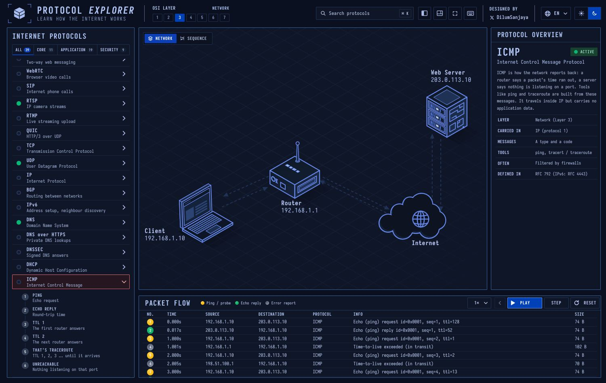
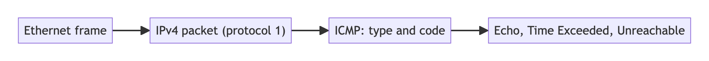
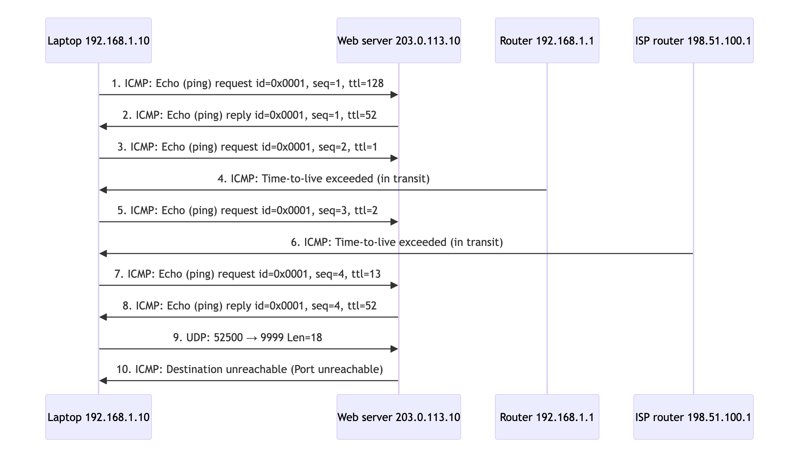
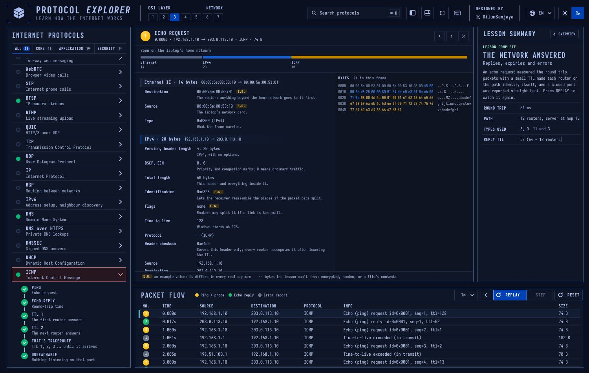
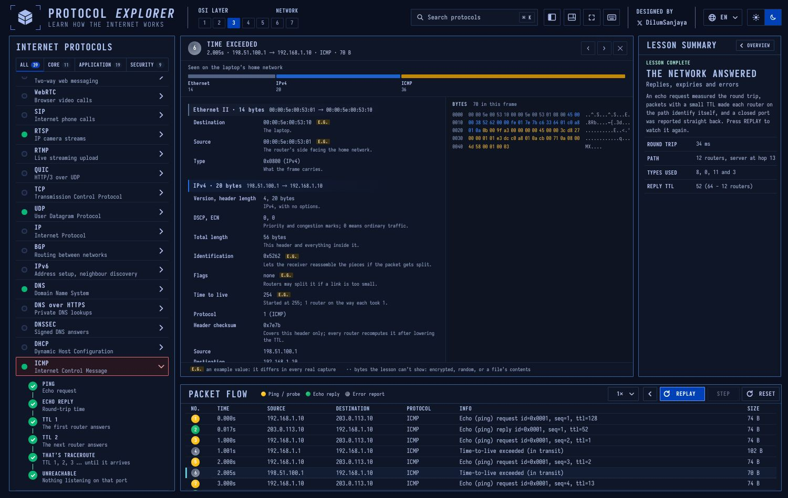
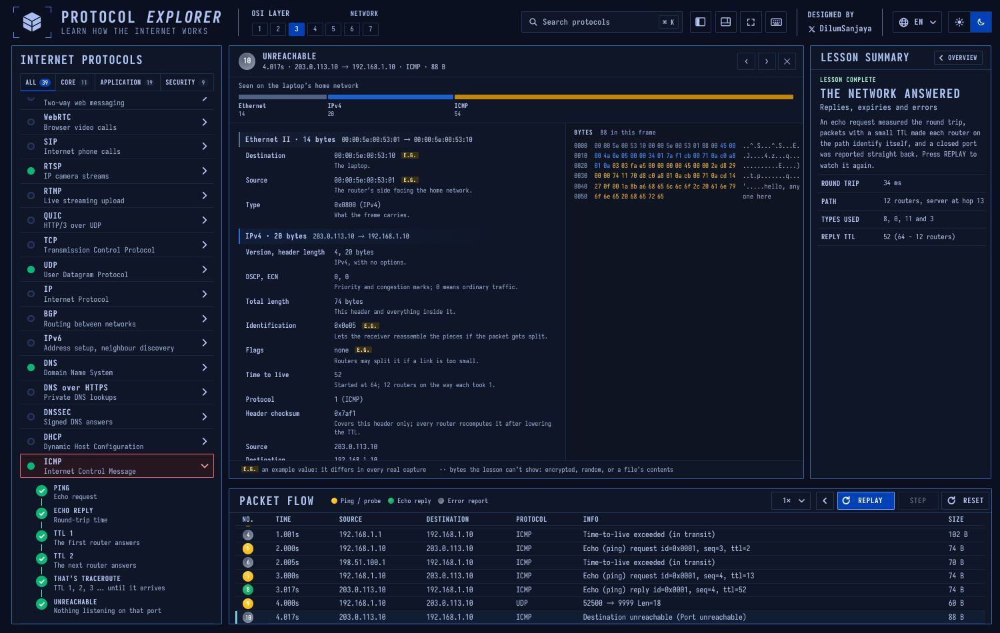

# ICMP – Internet Control Message

<!-- nav -->
⬅ [17 DHCP](17-dhcp.md) · [Index](00_Protocols_Index.md) · [19 IGMP](19-igmp.md) ➡
<!-- nav -->

*Source: Protocol Explorer – https://protocol-explorer-alpha.vercel.app/ (interactive lesson #18). Screenshots captured from the live lesson; packet decodes are the site's example capture (values marked **E.G.** differ in every real capture).*

## Overview

### How the layers fit together (outer to inner)

## In-depth explanation of the example (plain-language version)

### The big picture in one minute
The laptop runs the classic network tools against `203.0.113.10`: **`ping`**, then a hand-made **traceroute**, and finally a program that sends data to a **closed door**. **10 messages**, nearly all of them **ICMP**.

**What ICMP is.** It's the network's **messenger for errors and diagnostics.** It carries no web pages or files. Routers and computers use it to say things like "your packet ran out of time" or "nobody is listening at that port." Every message has a **type** and a **code** that say what happened.

Think of **a "return to sender" note from the post office**. It isn't your letter, just a report about what happened to it.

> **Words you'll see:** *TTL (time to live)* = a counter on every packet that drops by 1 at each router and gets the packet thrown away at 0, so packets can't loop forever. *Hop* = one router along the way. *Round-trip time* = how long a message takes to go and come back.

---

### Step 1 – Ping: "are you there?" – packet 1
`ping` sends an **Echo Request** (type 8) with an ID, a sequence number (1) and 32 bytes of filler data. It's addressed to `203.0.113.10`.

### Step 2 – The answer – packet 2
The server returns an **Echo Reply** (type 0) with the same ID, number and data. The lesson's timeline shows about 17 ms each way, so ping prints `time=34ms`: the **round-trip time**. The reply arrived with **TTL 52**: the server started at 64 and the packet crossed **12 routers**. That's why ping shows `TTL=52` (it hints at how far away the host is and what operating system it runs).

### Step 3 – Traceroute idea: TTL 1 – packets 3, 4
Every router lowers TTL by 1 and **discards the packet at 0**. When that happens, the router tells the sender with an ICMP message. That turns TTL into a measuring tool:
- `ping` is sent with **TTL = 1** (packet 3).
- The home router `192.168.1.1` lowers it to 0, drops it, and sends **"Time Exceeded"** (type 11) back **from its own address** (packet 4). The message includes the start of the dropped packet so the laptop can match it up.
The laptop now knows **hop 1 = `192.168.1.1`**.

### Step 4 – TTL 2 – packets 5, 6
With **TTL 2**, the home router passes it on, and the **first internet-provider router `198.51.100.1`** reduces it to 0 and reports back. **Hop 2** found.

### Step 5 – That's traceroute – packets 7, 8
`tracert` (Windows) or `traceroute` (Linux/macOS) does this automatically: **raise the TTL by one, send a few probes, note who answers, repeat.** After 12 routers, **TTL 13** is enough to reach the server, which answers with a normal Echo Reply (packet 8): the trace ends. (Linux's `traceroute` sends UDP packets and relies on a "port unreachable" reply from the destination to know it arrived.)
**Caveats:** some routers ignore or rate-limit these messages (shown as `* * *`), probes may take different paths, and the return path may differ from the outgoing one.

### Step 6 – "Nobody's home" – packets 9, 10
A program sends a UDP packet to port 9999 where **nothing is listening** (packet 9). The server's network stack can't deliver it and replies **Destination Unreachable, code 3 = Port Unreachable**, quoting the start of the packet (packet 10). The program sees "connection refused". Other codes of the same type: network unreachable, host unreachable, and **"fragmentation needed"**, which is how a sender discovers the maximum packet size on a path. Many firewalls silently drop these instead of replying, which makes a port look "filtered" rather than "closed".

---

### The 10 messages at a glance
| Packets | What | Why |
|---|---|---|
| 1–2 | Echo Request / Reply | ping: is the host alive, how long does it take? |
| 3–4 | TTL 1, Time Exceeded from router 1 | discover hop 1 |
| 5–6 | TTL 2, Time Exceeded from router 2 | discover hop 2 |
| 7–8 | TTL 13, Echo Reply | the destination is reached |
| 9–10 | UDP to closed port, Port Unreachable | error report |

### What to remember
| Type | Meaning | Used by |
|---|---|---|
| 8 / 0 | Echo request / reply | `ping` |
| 3 | Destination unreachable | errors, packet-size discovery |
| 11 | Time exceeded | `traceroute` |
| 5 | Redirect | "use a better first router" |
- ICMP travels **inside IP, not TCP or UDP**, so it has **no ports**.
- Error messages never trigger more error messages, and they quote the start of the offending packet.
- **Don't block ICMP completely.** Packet-size discovery and IPv6 neighbour discovery depend on it.
- It can be abused for scans, ping floods and hidden tunnels, so limit it rather than ban it.

## Under the hood – technical details

- **Where it lives.** ICMP is carried directly inside IP (**protocol number 1**). It has no ports and carries no user data. IPv6 uses ICMPv6 (protocol 58), which also does neighbour discovery.
- **Header.** 8 bytes: `type`, `code`, checksum and 4 bytes whose meaning depends on the type. For echo it is an *identifier* and a *sequence number*.
- **Main types.** `8` Echo Request, `0` Echo Reply, `3` Destination Unreachable, `11` Time Exceeded, `5` Redirect, `12` Parameter Problem. (`4` Source Quench is obsolete.)
- **Ping.** The reply echoes the request's identifier, sequence number and data. The tool computes the round-trip time from its own clock. The TTL printed is the TTL of the *reply* on arrival: starting value minus the number of routers crossed (64 - 52 = 12 hops here).
- **Time Exceeded (type 11, code 0).** A router that cuts TTL to 0 drops the packet and sends this back, **quoting the original IP header and the first 8 bytes of its payload** so the sender can match it to a request.
- **Traceroute.** Send probes with TTL 1, 2, 3 and so on. Each router along the path reveals itself with a Time Exceeded message. Windows `tracert` uses ICMP echo; Linux `traceroute` uses UDP probes to high ports and waits for *Port Unreachable* from the destination.
- **Destination Unreachable codes.** `0` network, `1` host, `3` port (nothing listening on a UDP port), `4` **fragmentation needed and DF set** (the basis of *Path MTU Discovery*), `13` administratively prohibited (a firewall).
- **Rules.** ICMP error messages never trigger further errors, and are rate-limited by routers. Some routers ignore them (shown as `* * *` in traceroute).
- **Do not block everything.** Blocking all ICMP breaks Path MTU Discovery (connections stall on big packets) and IPv6 neighbour discovery.
- **Abuse.** Ping floods, the *Smurf* attack (echo requests to a broadcast address with a forged source), scans and covert tunnels. Rate-limit rather than blindly block.

## Step-by-step walkthrough (screenshots from the lesson)

### Step 1: PING – Echo request

### Step 2: ECHO REPLY – Round-trip time

### Step 3: TTL 1 – The first router answers

### Step 4: TTL 2 – The next router answers

### Step 5: THAT’S TRACEROUTE – TTL 1, 2, 3 … until it arrives

### Step 6: UNREACHABLE – Nothing listening on that port

### Lesson summary

## Packet flow (whole lesson)

| No. | Time | Source | Destination | Protocol | Info | Size |
|---|---|---|---|---|---|---|
| 1 | 0.000s | 192.168.1.10 | 203.0.113.10 | ICMP | Echo (ping) request id=0x0001, seq=1, ttl=128 | 74 B |
| 2 | 0.017s | 203.0.113.10 | 192.168.1.10 | ICMP | Echo (ping) reply id=0x0001, seq=1, ttl=52 | 74 B |
| 3 | 1.000s | 192.168.1.10 | 203.0.113.10 | ICMP | Echo (ping) request id=0x0001, seq=2, ttl=1 | 74 B |
| 4 | 1.001s | 192.168.1.1 | 192.168.1.10 | ICMP | Time-to-live exceeded (in transit) | 102 B |
| 5 | 2.000s | 192.168.1.10 | 203.0.113.10 | ICMP | Echo (ping) request id=0x0001, seq=3, ttl=2 | 74 B |
| 6 | 2.005s | 198.51.100.1 | 192.168.1.10 | ICMP | Time-to-live exceeded (in transit) | 70 B |
| 7 | 3.000s | 192.168.1.10 | 203.0.113.10 | ICMP | Echo (ping) request id=0x0001, seq=4, ttl=13 | 74 B |
| 8 | 3.017s | 203.0.113.10 | 192.168.1.10 | ICMP | Echo (ping) reply id=0x0001, seq=4, ttl=52 | 74 B |
| 9 | 4.000s | 192.168.1.10 | 203.0.113.10 | UDP | 52500 → 9999 Len=18 | 60 B |
| 10 | 4.017s | 203.0.113.10 | 192.168.1.10 | ICMP | Destination unreachable (Port unreachable) | 88 B |

### Sequence diagram

*The lesson's own sequence diagram:*

## Packet decoder screenshots

The lesson's decoder view for the first, middle and last packet: headers, field values and the raw hex bytes.

### Packet 1: ICMP – Echo (ping) request id=0x0001, seq=1, ttl=128

*192.168.1.10 → 203.0.113.10 · 74 B · t = 0.000s*

### Packet 6: ICMP – Time-to-live exceeded (in transit)

*198.51.100.1 → 192.168.1.10 · 70 B · t = 2.005s*

### Packet 10: ICMP – Destination unreachable (Port unreachable)

*203.0.113.10 → 192.168.1.10 · 88 B · t = 4.017s*

---

<!-- nav -->
⬅ [17 DHCP](17-dhcp.md) · [Index](00_Protocols_Index.md) · [19 IGMP](19-igmp.md) ➡
<!-- nav -->
