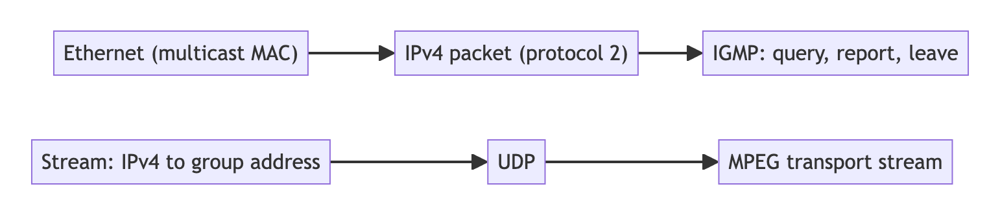
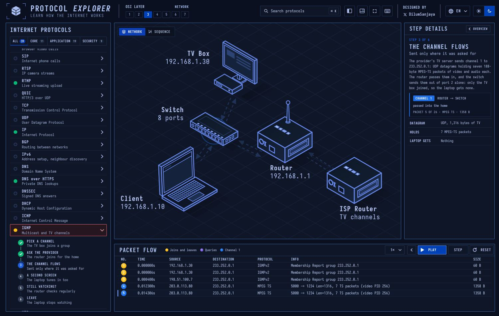
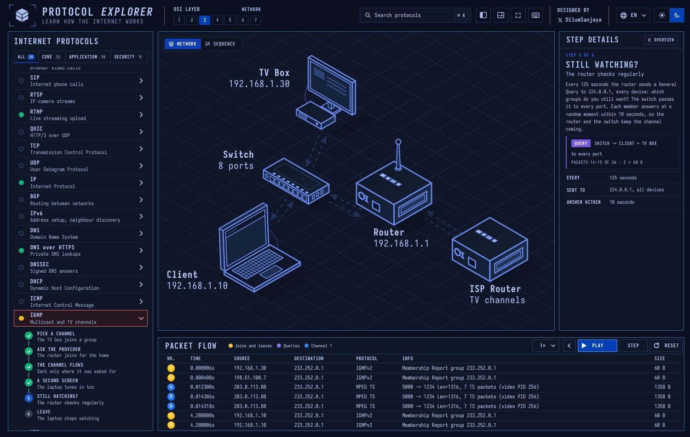
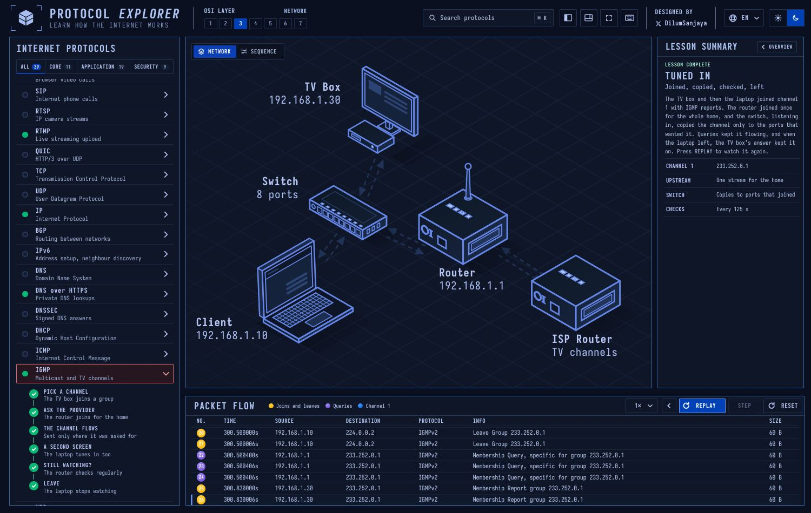
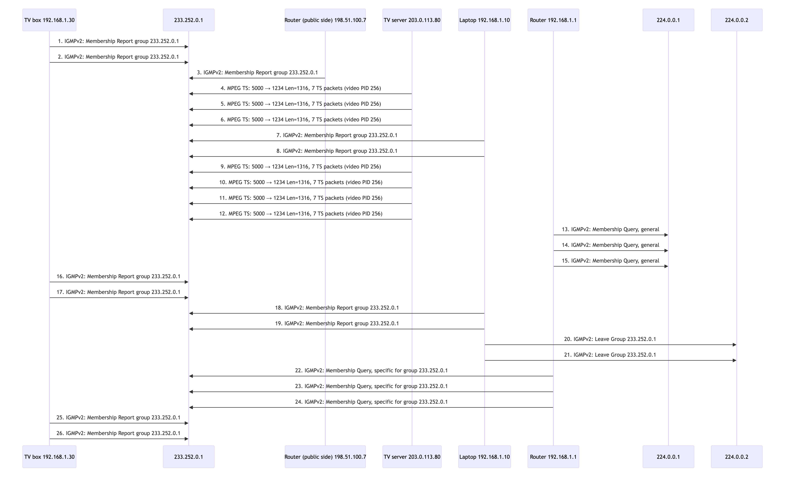
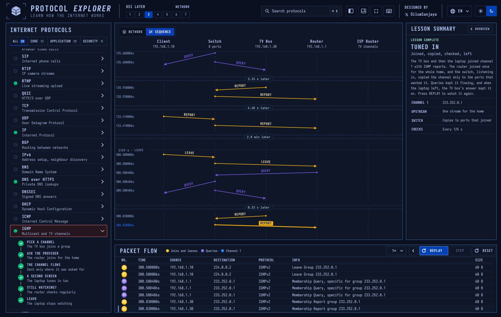
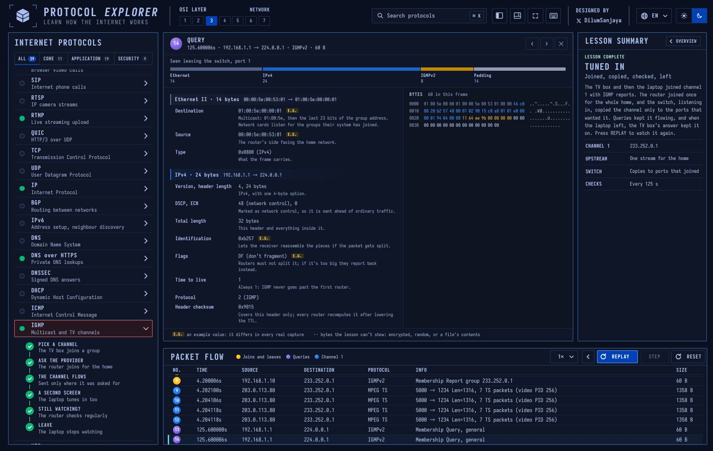
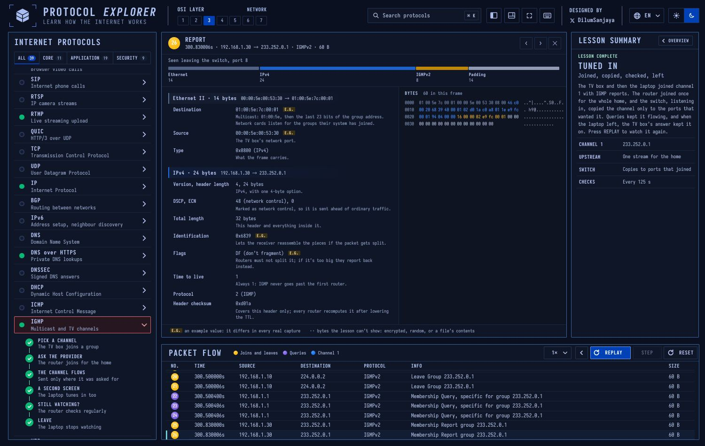

# IGMP – Multicast and TV channels

<!-- nav -->
⬅ [18 ICMP](18-icmp.md) · [Index](00_Protocols_Index.md) · [20 NTP](20-ntp.md) ➡
<!-- nav -->

*Source: Protocol Explorer – https://protocol-explorer-alpha.vercel.app/ (interactive lesson #19). Screenshots captured from the live lesson; packet decodes are the site's example capture (values marked **E.G.** differ in every real capture).*

## Overview

### How the layers fit together (outer to inner)

## In-depth explanation of the example (plain-language version)

### The big picture in one minute
An IPTV company sends **live TV channel 1** to its customers. At home there's a router, a **switch**, a **TV box** (`192.168.1.30`) and a laptop (`192.168.1.10`). The TV box tunes in to channel 1, later the laptop opens the same channel, the router checks "is anyone still watching?", and finally the laptop leaves. **26 messages over about 5 minutes.** Many appear in pairs or triples because the lesson shows the **same packet as seen on different links**.

**Why multicast?** Imagine a million people watching one channel.
- **Unicast** would send a million separate copies (far too heavy).
- **Broadcast** would send it to everyone, even people who don't care.
- **Multicast** sends **one stream to a "group address", and the network makes copies only where someone has asked for them.**

**IGMP** is how a device tells its router "I want to join group X". Group addresses are in the range `224.0.0.0 – 239.255.255.255`; this lesson uses `233.252.0.1` for channel 1. (IPv6 uses a similar protocol called MLD.)

Think of **a radio station**: it transmits once, and only those who tune their radio hear it.

> **Words you'll see:** *Group* = a "channel" address that devices can join. *Switch* = a device connecting your home devices. *Membership report* = "I'm in this group." *IGMP snooping* = a switch listening to those reports.

---

### Step 1 – The TV box joins – packets 1, 2
The TV box sends an IGMP **Membership Report** for `233.252.0.1`. The home **switch listens in** (**IGMP snooping**) and notes: "group `233.252.0.1` → send to port 2 (the TV box)". Without snooping, the switch would flood the stream out of every port like a broadcast.

### Step 2 – The router asks the provider – packet 3
The home router acts as a **go-between**: it sends its own report to the provider's router, so the provider starts sending channel 1 to this home. **However many screens at home tune in, the router joins only once**, so only one stream arrives per home.

### Step 3 – The channel flows – packets 4 to 6
The provider's TV server sends UDP packets to the group address `233.252.0.1`. Each packet holds **seven 188-byte video-stream chunks** (1,316 bytes). The router passes them in and the switch sends them **only out of port 2** (the TV box). The laptop gets nothing, as it never asked.

### Step 4 – A second screen – packets 7 to 12
The laptop opens the channel in VLC and sends its own report. The switch adds **port 1** to the group and now **copies each packet to both ports**. The router already receives the channel, so it asks the provider for **nothing new**: still just one stream coming in.

### Step 5 – "Still watching?" – packets 13 to 19
Every **125 seconds** the router sends a **General Query** to all devices: "who's still in which group?" Each member answers with a report, but at a **random moment within 10 seconds**, to avoid everyone replying at once. If nobody answered, the router and switch would stop forwarding the group after a timeout. This is how a **crash without saying goodbye** is handled.

### Step 6 – Leaving – packets 20 to 26
The laptop closes VLC and sends **Leave Group**. Others might still be watching, so the router doesn't just stop. It asks "**is anyone still in `233.252.0.1`?**" and waits about a second. **The TV box answers**, so the channel **stays**; the switch just stops sending it to the laptop's port. If nobody had answered, the router would have left the group upstream and the provider would have stopped the stream.

---

### The 26 messages at a glance
| Packets | What | Why |
|---|---|---|
| 1–2 | TV box join | start watching, switch learns |
| 3 | router joins upstream | one stream for the home |
| 4–6 | video to the group | only the TV box receives |
| 7–12 | laptop joins, stream to both | second screen, no extra upstream |
| 13–19 | General Query and reports | "still watching?" |
| 20–26 | Leave, specific query, report | laptop leaves, TV box stays |

### What to remember
- **Devices → router:** join (report), leave, and answers to queries. **Router → devices:** a periodic general query and a specific query after a leave.
- **Versions:** v1 (join + query), **v2** (adds an explicit Leave, shown here), **v3** (lets you pick specific sources).
- **IGMP snooping** keeps switches from turning multicast into broadcast. Between networks, routers use **PIM** to build the delivery tree.
- Multicast streams use **UDP** (no connection, no per-viewer re-sending). Typical uses: IPTV, financial market data, device discovery, routing protocols.
- Group ranges: `224.0.0.0/24` link-local control, `239.0.0.0/8` private use, `232.0.0.0/8` source-specific.

## Under the hood – technical details

- **What it is.** IGMP is carried in IP (**protocol 2**) with TTL 1, so it never leaves the local network. It lets a host tell its router which multicast groups it wants. (IPv6 uses MLD.)
- **Group addresses.** `224.0.0.0` to `239.255.255.255`. `224.0.0.1` is all hosts, `224.0.0.2` all routers, `224.0.0.5` OSPF routers. Ranges: `224.0.0.0/24` local control, `232.0.0.0/8` source-specific, `239.0.0.0/8` organisation-private. `233.252.0.0/24` is reserved for documentation.
- **Multicast MAC mapping.** An IPv4 group maps to the Ethernet address `01:00:5e` followed by the **low 23 bits** of the group address, so `233.252.0.1` becomes `01:00:5e:7c:00:01`. Several groups can share one MAC (32 groups per MAC).
- **IGMPv2 messages.** `0x11` Membership Query (general to `224.0.0.1`, or group-specific), `0x16` v2 Membership Report (sent to the group itself), `0x17` Leave Group (sent to `224.0.0.2`).
- **Query timing.** General Query every **125 s** with a maximum response time of 10 s. Members answer at a random time within that interval; with *report suppression* (v1 and v2), hearing another member's report cancels yours, so one report per group is enough.
- **Leave handling.** After a Leave, the router sends a Group-Specific Query and waits the *last member query interval* (about 1 s). If nobody answers, it stops forwarding the group.
- **IGMP snooping.** A switch listens to IGMP and builds a table of group to ports, forwarding multicast only where members exist. Without it, a switch floods multicast out of every port, just like broadcast.
- **IGMP proxy.** A home router joins upstream once for the whole home, however many devices tune in.
- **Versions.** v1 (join and query), v2 (adds explicit Leave), v3 (adds *source-specific* include/exclude lists, `(S,G)`).
- **Between networks.** Routers use **PIM** to build multicast distribution trees; IGMP only handles the last hop to hosts.
- **Payload.** IPTV commonly sends MPEG transport stream packets, 188 bytes each, seven to a UDP datagram (1,316 bytes) so the datagram fits in an Ethernet frame.

## Step-by-step walkthrough

### Step 1: PICK A CHANNEL – The TV box joins a group

### Step 2: ASK THE PROVIDER – The router joins for the home

### Step 3: THE CHANNEL FLOWS – Sent only where it was asked for

### Step 4: A SECOND SCREEN – The laptop tunes in too

### Step 5: STILL WATCHING? – The router checks regularly

### Step 6: LEAVE – The laptop stops watching

### Lesson summary

## Packet flow (whole lesson)

| No. | Time | Source | Destination | Protocol | Info | Size |
|---|---|---|---|---|---|---|
| 1 | 0.000000s | 192.168.1.30 | 233.252.0.1 | IGMPv2 | Membership Report group 233.252.0.1 | 60 B |
| 2 | 0.000006s | 192.168.1.30 | 233.252.0.1 | IGMPv2 | Membership Report group 233.252.0.1 | 60 B |
| 3 | 0.000400s | 198.51.100.7 | 233.252.0.1 | IGMPv2 | Membership Report group 233.252.0.1 | 60 B |
| 4 | 0.012300s | 203.0.113.80 | 233.252.0.1 | MPEG TS | 5000 → 1234 Len=1316, 7 TS packets (video PID 256) | 1358 B |
| 5 | 0.014306s | 203.0.113.80 | 233.252.0.1 | MPEG TS | 5000 → 1234 Len=1316, 7 TS packets (video PID 256) | 1358 B |
| 6 | 0.014318s | 203.0.113.80 | 233.252.0.1 | MPEG TS | 5000 → 1234 Len=1316, 7 TS packets (video PID 256) | 1358 B |
| 7 | 4.200000s | 192.168.1.10 | 233.252.0.1 | IGMPv2 | Membership Report group 233.252.0.1 | 60 B |
| 8 | 4.200006s | 192.168.1.10 | 233.252.0.1 | IGMPv2 | Membership Report group 233.252.0.1 | 60 B |
| 9 | 4.202100s | 203.0.113.80 | 233.252.0.1 | MPEG TS | 5000 → 1234 Len=1316, 7 TS packets (video PID 256) | 1358 B |
| 10 | 4.204106s | 203.0.113.80 | 233.252.0.1 | MPEG TS | 5000 → 1234 Len=1316, 7 TS packets (video PID 256) | 1358 B |
| 11 | 4.204118s | 203.0.113.80 | 233.252.0.1 | MPEG TS | 5000 → 1234 Len=1316, 7 TS packets (video PID 256) | 1358 B |
| 12 | 4.204118s | 203.0.113.80 | 233.252.0.1 | MPEG TS | 5000 → 1234 Len=1316, 7 TS packets (video PID 256) | 1358 B |
| 13 | 125.600000s | 192.168.1.1 | 224.0.0.1 | IGMPv2 | Membership Query, general | 60 B |
| 14 | 125.600006s | 192.168.1.1 | 224.0.0.1 | IGMPv2 | Membership Query, general | 60 B |
| 15 | 125.600006s | 192.168.1.1 | 224.0.0.1 | IGMPv2 | Membership Query, general | 60 B |
| 16 | 128.930000s | 192.168.1.30 | 233.252.0.1 | IGMPv2 | Membership Report group 233.252.0.1 | 60 B |
| 17 | 128.930006s | 192.168.1.30 | 233.252.0.1 | IGMPv2 | Membership Report group 233.252.0.1 | 60 B |
| 18 | 133.410000s | 192.168.1.10 | 233.252.0.1 | IGMPv2 | Membership Report group 233.252.0.1 | 60 B |
| 19 | 133.410006s | 192.168.1.10 | 233.252.0.1 | IGMPv2 | Membership Report group 233.252.0.1 | 60 B |
| 20 | 300.500000s | 192.168.1.10 | 224.0.0.2 | IGMPv2 | Leave Group 233.252.0.1 | 60 B |
| 21 | 300.500006s | 192.168.1.10 | 224.0.0.2 | IGMPv2 | Leave Group 233.252.0.1 | 60 B |
| 22 | 300.500400s | 192.168.1.1 | 233.252.0.1 | IGMPv2 | Membership Query, specific for group 233.252.0.1 | 60 B |
| 23 | 300.500406s | 192.168.1.1 | 233.252.0.1 | IGMPv2 | Membership Query, specific for group 233.252.0.1 | 60 B |
| 24 | 300.500406s | 192.168.1.1 | 233.252.0.1 | IGMPv2 | Membership Query, specific for group 233.252.0.1 | 60 B |
| 25 | 300.830000s | 192.168.1.30 | 233.252.0.1 | IGMPv2 | Membership Report group 233.252.0.1 | 60 B |
| 26 | 300.830006s | 192.168.1.30 | 233.252.0.1 | IGMPv2 | Membership Report group 233.252.0.1 | 60 B |

### Sequence diagram

*The lesson's own sequence diagram:*

## Packet decoder screenshots

The lesson's decoder view for the first, middle and last packet: headers, field values and the raw hex bytes.

### Packet 1: IGMPv2 – Membership Report group 233.252.0.1

*192.168.1.30 → 233.252.0.1 · 60 B · t = 0.000000s*

### Packet 14: IGMPv2 – Membership Query, general

*192.168.1.1 → 224.0.0.1 · 60 B · t = 125.600006s*

### Packet 26: IGMPv2 – Membership Report group 233.252.0.1

*192.168.1.30 → 233.252.0.1 · 60 B · t = 300.830006s*

---

<!-- nav -->
⬅ [18 ICMP](18-icmp.md) · [Index](00_Protocols_Index.md) · [20 NTP](20-ntp.md) ➡
<!-- nav -->
