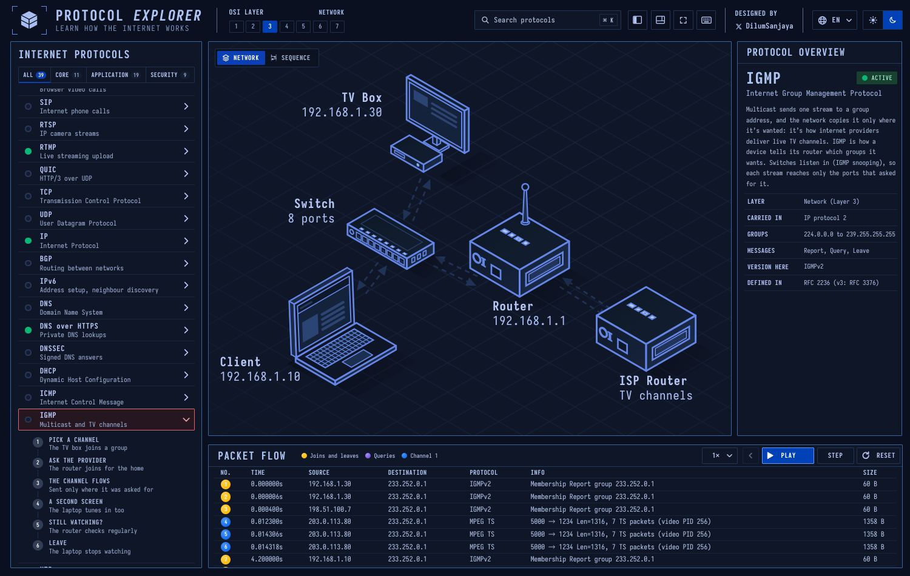
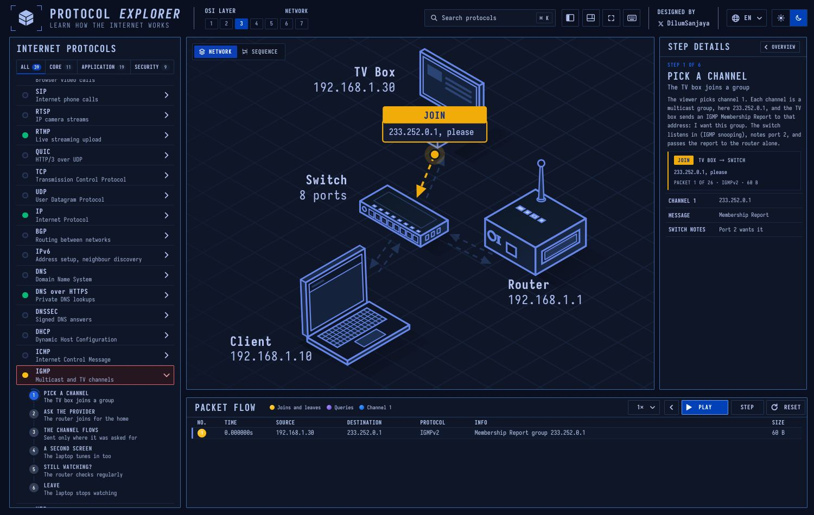
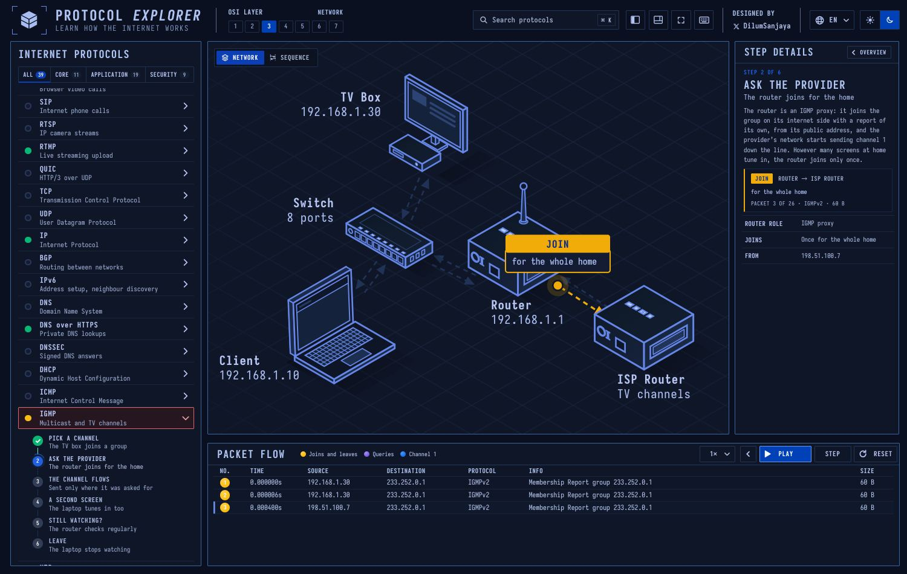
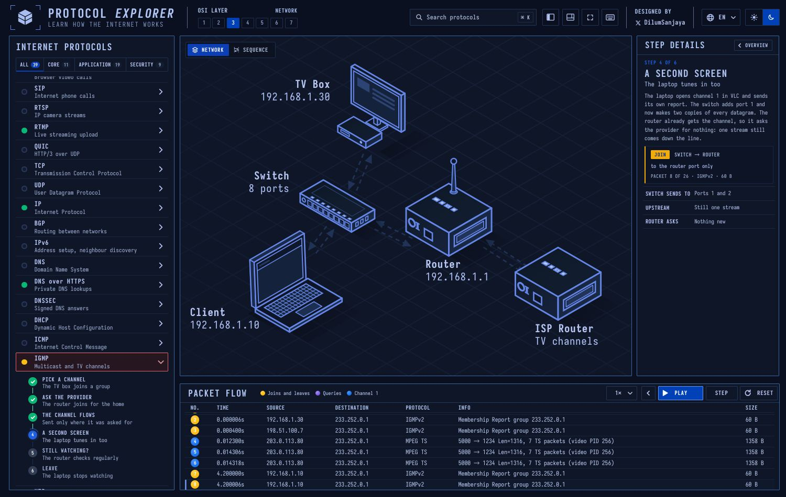
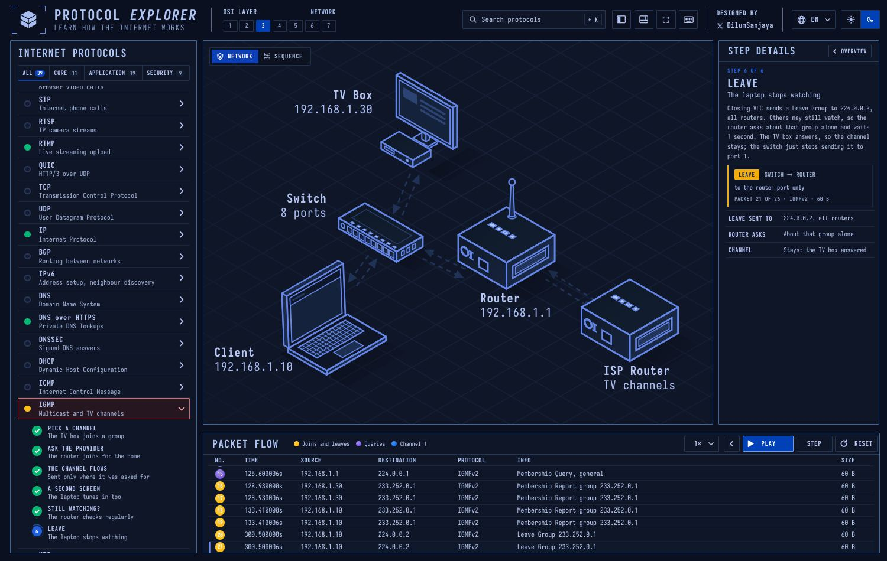
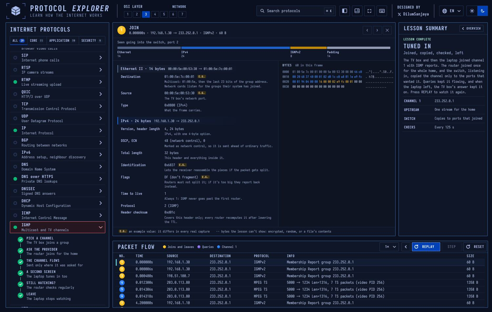

# IGMP – Multicast and TV channels

<!-- nav -->
⬅ [18 ICMP](18-icmp.md) · [Index](00_Protocols_Index.md) · [20 NTP](20-ntp.md) ➡
<!-- nav -->

*Source: Protocol Explorer – https://protocol-explorer-alpha.vercel.app/ (interactive lesson #19). Screenshots captured from the live lesson; packet decodes are the site's example capture (values marked **E.G.** differ in every real capture).*

## Overview



> PROTOCOL OVERVIEW  
> IGMP  
> ACTIVE  
> Internet Group Management Protocol  
> Multicast sends one stream to a group address, and the network copies it only where it’s wanted: it’s how internet providers deliver live TV channels. IGMP is how a device tells its router which groups it wants. Switches listen in (IGMP snooping), so each stream reaches only the ports that asked for it.  
> LAYER  
> Network (Layer 3)  
> CARRIED IN  
> IP protocol 2  
> GROUPS  
> 224.0.0.0 to 239.255.255.255  
> MESSAGES  
> Report, Query, Leave  
> VERSION HERE  
> IGMPv2  
> DEFINED IN  
> RFC 2236 (v3: RFC 3376)  

## In-depth explanation of the example (plain-language version)

### The big picture in one minute
An IPTV company sends **live TV channel 1** to its customers. At home there's a router, a **switch**, a **TV box** (`192.168.1.30`) and a laptop (`192.168.1.10`). The TV box tunes in to channel 1, later the laptop opens the same channel, the router checks "is anyone still watching?", and finally the laptop leaves. **26 messages over about 5 minutes.** Many appear in pairs or triples because the lesson shows the **same packet as seen on different links**.

**Why multicast?** Imagine a million people watching one channel.
- **Unicast** would send a million separate copies (far too heavy).
- **Broadcast** would send it to everyone, even people who don't care.
- **Multicast** sends **one stream to a "group address", and the network makes copies only where someone has asked for them.**

**IGMP** is how a device tells its router "I want to join group X". Group addresses are in the range `224.0.0.0 – 239.255.255.255`; this lesson uses `233.252.0.1` for channel 1. (IPv6 uses a similar protocol called MLD.)

Think of **a radio station**: it transmits once, and only those who tune their radio hear it.

> **Words you'll see:** *Group* = a "channel" address that devices can join. *Switch* = a device connecting your home devices. *Membership report* = "I'm in this group." *IGMP snooping* = a switch listening to those reports.

---

### Step 1 – The TV box joins – packets 1, 2
The TV box sends an IGMP **Membership Report** for `233.252.0.1`. The home **switch listens in** (**IGMP snooping**) and notes: "group `233.252.0.1` → send to port 2 (the TV box)". Without snooping, the switch would flood the stream out of every port like a broadcast.

### Step 2 – The router asks the provider – packet 3
The home router acts as a **go-between**: it sends its own report to the provider's router, so the provider starts sending channel 1 to this home. **However many screens at home tune in, the router joins only once**, so only one stream arrives per home.

### Step 3 – The channel flows – packets 4 to 6
The provider's TV server sends UDP packets to the group address `233.252.0.1`. Each packet holds **seven 188-byte video-stream chunks** (1,316 bytes). The router passes them in and the switch sends them **only out of port 2** (the TV box). The laptop gets nothing, as it never asked.

### Step 4 – A second screen – packets 7 to 12
The laptop opens the channel in VLC and sends its own report. The switch adds **port 1** to the group and now **copies each packet to both ports**. The router already receives the channel, so it asks the provider for **nothing new**: still just one stream coming in.

### Step 5 – "Still watching?" – packets 13 to 19
Every **125 seconds** the router sends a **General Query** to all devices: "who's still in which group?" Each member answers with a report, but at a **random moment within 10 seconds**, to avoid everyone replying at once. If nobody answered, the router and switch would stop forwarding the group after a timeout. This is how a **crash without saying goodbye** is handled.

### Step 6 – Leaving – packets 20 to 26
The laptop closes VLC and sends **Leave Group**. Others might still be watching, so the router doesn't just stop. It asks "**is anyone still in `233.252.0.1`?**" and waits about a second. **The TV box answers**, so the channel **stays**; the switch just stops sending it to the laptop's port. If nobody had answered, the router would have left the group upstream and the provider would have stopped the stream.

---

### The 26 messages at a glance
| Packets | What | Why |
|---|---|---|
| 1–2 | TV box join | start watching, switch learns |
| 3 | router joins upstream | one stream for the home |
| 4–6 | video to the group | only the TV box receives |
| 7–12 | laptop joins, stream to both | second screen, no extra upstream |
| 13–19 | General Query and reports | "still watching?" |
| 20–26 | Leave, specific query, report | laptop leaves, TV box stays |

### What to remember
- **Devices → router:** join (report), leave, and answers to queries. **Router → devices:** a periodic general query and a specific query after a leave.
- **Versions:** v1 (join + query), **v2** (adds an explicit Leave, shown here), **v3** (lets you pick specific sources).
- **IGMP snooping** keeps switches from turning multicast into broadcast. Between networks, routers use **PIM** to build the delivery tree.
- Multicast streams use **UDP** (no connection, no per-viewer re-sending). Typical uses: IPTV, financial market data, device discovery, routing protocols.
- Group ranges: `224.0.0.0/24` link-local control, `239.0.0.0/8` private use, `232.0.0.0/8` source-specific.

## Step-by-step walkthrough (screenshots from the lesson)

### Step 1: PICK A CHANNEL – The TV box joins a group



> STEP 1 OF 6  
> PICK A CHANNEL  
> The TV box joins a group  
> The viewer picks channel 1. Each channel is a multicast group, here 233.252.0.1, and the TV box sends an IGMP Membership Report to that address: I want this group. The switch listens in (IGMP snooping), notes port 2, and passes the report to the router alone.  
> JOIN  
> TV BOX → SWITCH  
> 233.252.0.1, please  
> PACKET 1 OF 26 · IGMPv2 · 60 B  
> CHANNEL 1  
> 233.252.0.1  
> MESSAGE  
> Membership Report  
> SWITCH NOTES  
> Port 2 wants it  

### Step 2: ASK THE PROVIDER – The router joins for the home



> STEP 2 OF 6  
> ASK THE PROVIDER  
> The router joins for the home  
> The router is an IGMP proxy: it joins the group on its internet side with a report of its own, from its public address, and the provider’s network starts sending channel 1 down the line. However many screens at home tune in, the router joins only once.  
> JOIN  
> ROUTER → ISP ROUTER  
> for the whole home  
> PACKET 3 OF 26 · IGMPv2 · 60 B  
> ROUTER ROLE  
> IGMP proxy  
> JOINS  
> Once for the whole home  
> FROM  
> 198.51.100.7  

### Step 3: THE CHANNEL FLOWS – Sent only where it was asked for


> STEP 3 OF 6  
> THE CHANNEL FLOWS  
> Sent only where it was asked for  
> The provider’s TV server sends channel 1 to 233.252.0.1: UDP datagrams holding seven 188-byte MPEG-TS packets of video and audio each. The router passes them in, and the switch sends them out of port 2 alone: only the TV box joined, so the laptop gets none.  
> CHANNEL 1  
> ROUTER → SWITCH  
> passed into the home  
> PACKET 5 OF 26 · MPEG TS · 1358 B  
> DATAGRAM  
> UDP, 1,316 bytes of TV  
> HOLDS  
> 7 MPEG-TS packets  
> LAPTOP GETS  
> Nothing  

### Step 4: A SECOND SCREEN – The laptop tunes in too



> STEP 4 OF 6  
> A SECOND SCREEN  
> The laptop tunes in too  
> The laptop opens channel 1 in VLC and sends its own report. The switch adds port 1 and now makes two copies of every datagram. The router already gets the channel, so it asks the provider for nothing: one stream still comes down the line.  
> JOIN  
> SWITCH → ROUTER  
> to the router port only  
> PACKET 8 OF 26 · IGMPv2 · 60 B  
> SWITCH SENDS TO  
> Ports 1 and 2  
> UPSTREAM  
> Still one stream  
> ROUTER ASKS  
> Nothing new  

### Step 5: STILL WATCHING? – The router checks regularly


> STEP 5 OF 6  
> STILL WATCHING?  
> The router checks regularly  
> Every 125 seconds the router sends a General Query to 224.0.0.1, every device: which groups do you still want? The switch passes it to every port. Each member answers at a random moment within 10 seconds, so the router and the switch keep the channel coming.  
> QUERY  
> SWITCH → CLIENT + TV BOX  
> to every port  
> PACKETS 14–15 OF 26 · 2 × 60 B  
> EVERY  
> 125 seconds  
> SENT TO  
> 224.0.0.1, all devices  
> ANSWER WITHIN  
> 10 seconds  

### Step 6: LEAVE – The laptop stops watching



> STEP 6 OF 6  
> LEAVE  
> The laptop stops watching  
> Closing VLC sends a Leave Group to 224.0.0.2, all routers. Others may still watch, so the router asks about that group alone and waits 1 second. The TV box answers, so the channel stays; the switch just stops sending it to port 1.  
> LEAVE  
> SWITCH → ROUTER  
> to the router port only  
> PACKET 21 OF 26 · IGMPv2 · 60 B  
> LEAVE SENT TO  
> 224.0.0.2, all routers  
> ROUTER ASKS  
> About that group alone  
> CHANNEL  
> Stays: the TV box answered  

### Lesson summary


> LESSON SUMMARY  
> LESSON COMPLETE  
> TUNED IN  
> Joined, copied, checked, left  
> The TV box and then the laptop joined channel 1 with IGMP reports. The router joined once for the whole home, and the switch, listening in, copied the channel only to the ports that wanted it. Queries kept it flowing, and when the laptop left, the TV box’s answer kept it on. Press REPLAY to watch it again.  
> REPORT  
> SWITCH → ROUTER  
> to the router port only  
> PACKET 26 OF 26 · IGMPv2 · 60 B  
> CHANNEL 1  
> 233.252.0.1  
> UPSTREAM  
> One stream for the home  
> SWITCH  
> Copies to ports that joined  
> CHECKS  
> Every 125 s  

## Packet flow (whole lesson)

| No. | Time | Source | Destination | Protocol | Info | Size |
|---|---|---|---|---|---|---|
| 1 | 0.000000s | 192.168.1.30 | 233.252.0.1 | IGMPv2 | Membership Report group 233.252.0.1 | 60 B |
| 2 | 0.000006s | 192.168.1.30 | 233.252.0.1 | IGMPv2 | Membership Report group 233.252.0.1 | 60 B |
| 3 | 0.000400s | 198.51.100.7 | 233.252.0.1 | IGMPv2 | Membership Report group 233.252.0.1 | 60 B |
| 4 | 0.012300s | 203.0.113.80 | 233.252.0.1 | MPEG TS | 5000 → 1234 Len=1316, 7 TS packets (video PID 256) | 1358 B |
| 5 | 0.014306s | 203.0.113.80 | 233.252.0.1 | MPEG TS | 5000 → 1234 Len=1316, 7 TS packets (video PID 256) | 1358 B |
| 6 | 0.014318s | 203.0.113.80 | 233.252.0.1 | MPEG TS | 5000 → 1234 Len=1316, 7 TS packets (video PID 256) | 1358 B |
| 7 | 4.200000s | 192.168.1.10 | 233.252.0.1 | IGMPv2 | Membership Report group 233.252.0.1 | 60 B |
| 8 | 4.200006s | 192.168.1.10 | 233.252.0.1 | IGMPv2 | Membership Report group 233.252.0.1 | 60 B |
| 9 | 4.202100s | 203.0.113.80 | 233.252.0.1 | MPEG TS | 5000 → 1234 Len=1316, 7 TS packets (video PID 256) | 1358 B |
| 10 | 4.204106s | 203.0.113.80 | 233.252.0.1 | MPEG TS | 5000 → 1234 Len=1316, 7 TS packets (video PID 256) | 1358 B |
| 11 | 4.204118s | 203.0.113.80 | 233.252.0.1 | MPEG TS | 5000 → 1234 Len=1316, 7 TS packets (video PID 256) | 1358 B |
| 12 | 4.204118s | 203.0.113.80 | 233.252.0.1 | MPEG TS | 5000 → 1234 Len=1316, 7 TS packets (video PID 256) | 1358 B |
| 13 | 125.600000s | 192.168.1.1 | 224.0.0.1 | IGMPv2 | Membership Query, general | 60 B |
| 14 | 125.600006s | 192.168.1.1 | 224.0.0.1 | IGMPv2 | Membership Query, general | 60 B |
| 15 | 125.600006s | 192.168.1.1 | 224.0.0.1 | IGMPv2 | Membership Query, general | 60 B |
| 16 | 128.930000s | 192.168.1.30 | 233.252.0.1 | IGMPv2 | Membership Report group 233.252.0.1 | 60 B |
| 17 | 128.930006s | 192.168.1.30 | 233.252.0.1 | IGMPv2 | Membership Report group 233.252.0.1 | 60 B |
| 18 | 133.410000s | 192.168.1.10 | 233.252.0.1 | IGMPv2 | Membership Report group 233.252.0.1 | 60 B |
| 19 | 133.410006s | 192.168.1.10 | 233.252.0.1 | IGMPv2 | Membership Report group 233.252.0.1 | 60 B |
| 20 | 300.500000s | 192.168.1.10 | 224.0.0.2 | IGMPv2 | Leave Group 233.252.0.1 | 60 B |
| 21 | 300.500006s | 192.168.1.10 | 224.0.0.2 | IGMPv2 | Leave Group 233.252.0.1 | 60 B |
| 22 | 300.500400s | 192.168.1.1 | 233.252.0.1 | IGMPv2 | Membership Query, specific for group 233.252.0.1 | 60 B |
| 23 | 300.500406s | 192.168.1.1 | 233.252.0.1 | IGMPv2 | Membership Query, specific for group 233.252.0.1 | 60 B |
| 24 | 300.500406s | 192.168.1.1 | 233.252.0.1 | IGMPv2 | Membership Query, specific for group 233.252.0.1 | 60 B |
| 25 | 300.830000s | 192.168.1.30 | 233.252.0.1 | IGMPv2 | Membership Report group 233.252.0.1 | 60 B |
| 26 | 300.830006s | 192.168.1.30 | 233.252.0.1 | IGMPv2 | Membership Report group 233.252.0.1 | 60 B |

### Sequence diagram


## Packets decoded byte by byte

Each packet below is the lesson's own decode (headers, field values and the plain-English meaning of each field). Screenshots show the first, middle and last packet in the lesson's decoder view with the raw hex bytes.

### Packet 1: IGMPv2 – Membership Report group 233.252.0.1

*192.168.1.30 → 233.252.0.1 · 60 B · t = 0.000000s*



<details><summary>Decoded fields</summary>

```text
1
JOIN
0.000000s · 192.168.1.30 → 233.252.0.1 · IGMPv2 · 60 B
Seen going into the switch, port 2
Ethernet
14
IPv4
24
IGMPv2
8
Padding
14
Ethernet II · 14 bytes
00:00:5e:00:53:30 → 01:00:5e:7c:00:01
Destination
01:00:5e:7c:00:01 E.G.

Multicast: 01:00:5e, then the last 23 bits of the group address. Network cards listen for the groups their system has joined.

Source
00:00:5e:00:53:30 E.G.

The TV box’s network port.

Type
0x0800 (IPv4)

What the frame carries.

IPv4 · 24 bytes
192.168.1.30 → 233.252.0.1
Version, header length
4, 24 bytes

IPv4, with one 4-byte option.

DSCP, ECN
48 (network control), 0

Marked as network control, so it is sent ahead of ordinary traffic.

Total length
32 bytes

This header and everything inside it.

Identification
0x6837 E.G.

Lets the receiver reassemble the pieces if the packet gets split.

Flags
DF (don’t fragment) E.G.

Routers must not split it; if it’s too big they report back instead.

Time to live
1

Always 1: IGMP never goes past the first router.

Protocol
2 (IGMP)
Header checksum
0xd01c

Covers this header only; every router recomputes it after lowering the TTL.

Source
192.168.1.30
Destination
233.252.0.1

A multicast group address.

Router Alert option
0x94040000

Asks every router on the way to look inside, though the packet isn’t addressed to it.

IGMPv2 · Membership Report
Membership Report 233.252.0.1
Type
0x16 (Membership Report)

This device wants the group’s traffic.

Max response time
0

Only queries use it.

Checksum
0x0002

Covers the IGMP message.

Group address
233.252.0.1

The multicast group: one TV channel.

Ethernet padding · 14 bytes
Padding
14 zero bytes

Ethernet frames are at least 60 bytes (64 with the checksum the card adds), so short ones are padded.

BYTES 60 in this frame
0000
01
00
5e
7c
00
01
00
00
5e
00
53
30
08
00
46
c0
.
.
^
|
.
.
.
.
^
.
S
0
.
.
F
.
0010
00
20
68
37
40
00
01
02
d0
1c
c0
a8
01
1e
e9
fc
.
h
7
@
.
.
.
.
.
.
.
.
.
.
.
0020
00
01
94
04
00
00
16
00
00
02
e9
fc
00
01
00
00
.
.
.
.
.
.
.
.
.
.
.
.
.
.
.
.
0030
00
00
00
00
00
00
00
00
00
00
00
00
.
.
.
.
.
.
.
.
.
.
.
.
E.G. an example value: it differs in every real capture
·· bytes the lesson can’t show: encrypted, random, or a file’s contents
```

</details>

### Packet 2: IGMPv2 – Membership Report group 233.252.0.1

*192.168.1.30 → 233.252.0.1 · 60 B · t = 0.000006s*

<details><summary>Decoded fields</summary>

```text
2
JOIN
0.000006s · 192.168.1.30 → 233.252.0.1 · IGMPv2 · 60 B
Seen leaving the switch, port 8
Ethernet
14
IPv4
24
IGMPv2
8
Padding
14
Ethernet II · 14 bytes
00:00:5e:00:53:30 → 01:00:5e:7c:00:01
Destination
01:00:5e:7c:00:01 E.G.

Multicast: 01:00:5e, then the last 23 bits of the group address. Network cards listen for the groups their system has joined.

Source
00:00:5e:00:53:30 E.G.

The TV box’s network port.

Type
0x0800 (IPv4)

What the frame carries.

IPv4 · 24 bytes
192.168.1.30 → 233.252.0.1
Version, header length
4, 24 bytes

IPv4, with one 4-byte option.

DSCP, ECN
48 (network control), 0

Marked as network control, so it is sent ahead of ordinary traffic.

Total length
32 bytes

This header and everything inside it.

Identification
0x6837 E.G.

Lets the receiver reassemble the pieces if the packet gets split.

Flags
DF (don’t fragment) E.G.

Routers must not split it; if it’s too big they report back instead.

Time to live
1

Always 1: IGMP never goes past the first router.

Protocol
2 (IGMP)
Header checksum
0xd01c

Covers this header only; every router recomputes it after lowering the TTL.

Source
192.168.1.30
Destination
233.252.0.1

A multicast group address.

Router Alert option
0x94040000

Asks every router on the way to look inside, though the packet isn’t addressed to it.

IGMPv2 · Membership Report
Membership Report 233.252.0.1
Type
0x16 (Membership Report)

This device wants the group’s traffic.

Max response time
0

Only queries use it.

Checksum
0x0002

Covers the IGMP message.

Group address
233.252.0.1

The multicast group: one TV channel.

Ethernet padding · 14 bytes
Padding
14 zero bytes

Ethernet frames are at least 60 bytes (64 with the checksum the card adds), so short ones are padded.

BYTES 60 in this frame
0000
01
00
5e
7c
00
01
00
00
5e
00
53
30
08
00
46
c0
.
.
^
|
.
.
.
.
^
.
S
0
.
.
F
.
0010
00
20
68
37
40
00
01
02
d0
1c
c0
a8
01
1e
e9
fc
.
h
7
@
.
.
.
.
.
.
.
.
.
.
.
0020
00
01
94
04
00
00
16
00
00
02
e9
fc
00
01
00
00
.
.
.
.
.
.
.
.
.
.
.
.
.
.
.
.
0030
00
00
00
00
00
00
00
00
00
00
00
00
.
.
.
.
.
.
.
.
.
.
.
.
E.G. an example value: it differs in every real capture
·· bytes the lesson can’t show: encrypted, random, or a file’s contents
```

</details>

### Packet 3: IGMPv2 – Membership Report group 233.252.0.1

*198.51.100.7 → 233.252.0.1 · 60 B · t = 0.000400s*

<details><summary>Decoded fields</summary>

```text
3
JOIN
0.000400s · 198.51.100.7 → 233.252.0.1 · IGMPv2 · 60 B
Seen as it leaves the router’s internet side
Ethernet
14
IPv4
24
IGMPv2
8
Padding
14
Ethernet II · 14 bytes
00:00:5e:00:53:02 → 01:00:5e:7c:00:01
Destination
01:00:5e:7c:00:01 E.G.

Multicast: 01:00:5e, then the last 23 bits of the group address. Network cards listen for the groups their system has joined.

Source
00:00:5e:00:53:02 E.G.

The router’s internet-facing port.

Type
0x0800 (IPv4)

What the frame carries.

IPv4 · 24 bytes
198.51.100.7 → 233.252.0.1
Version, header length
4, 24 bytes

IPv4, with one 4-byte option.

DSCP, ECN
48 (network control), 0

Marked as network control, so it is sent ahead of ordinary traffic.

Total length
32 bytes

This header and everything inside it.

Identification
0x48f0 E.G.

Lets the receiver reassemble the pieces if the packet gets split.

Flags
DF (don’t fragment) E.G.

Routers must not split it; if it’s too big they report back instead.

Time to live
1

Always 1: IGMP never goes past the first router.

Protocol
2 (IGMP)
Header checksum
0x86ef

Covers this header only; every router recomputes it after lowering the TTL.

Source
198.51.100.7
Destination
233.252.0.1

A multicast group address.

Router Alert option
0x94040000

Asks every router on the way to look inside, though the packet isn’t addressed to it.

IGMPv2 · Membership Report
Membership Report 233.252.0.1
Type
0x16 (Membership Report)

This device wants the group’s traffic.

Max response time
0

Only queries use it.

Checksum
0x0002

Covers the IGMP message.

Group address
233.252.0.1

The multicast group: one TV channel.

Ethernet padding · 14 bytes
Padding
14 zero bytes

Ethernet frames are at least 60 bytes (64 with the checksum the card adds), so short ones are padded.

BYTES 60 in this frame
0000
01
00
5e
7c
00
01
00
00
5e
00
53
02
08
00
46
c0
.
.
^
|
.
.
.
.
^
.
S
.
.
.
F
.
0010
00
20
48
f0
40
00
01
02
86
ef
c6
33
64
07
e9
fc
.
H
.
@
.
.
.
.
.
.
3
d
.
.
.
0020
00
01
94
04
00
00
16
00
00
02
e9
fc
00
01
00
00
.
.
.
.
.
.
.
.
.
.
.
.
.
.
.
.
0030
00
00
00
00
00
00
00
00
00
00
00
00
.
.
.
.
.
.
.
.
.
.
.
.
E.G. an example value: it differs in every real capture
·· bytes the lesson can’t show: encrypted, random, or a file’s contents
```

</details>

### Packet 4: MPEG TS – 5000 → 1234 Len=1316, 7 TS packets (video PID 256)

*203.0.113.80 → 233.252.0.1 · 1358 B · t = 0.012300s*

<details><summary>Decoded fields</summary>

```text
4
CHANNEL 1
0.012300s · 203.0.113.80 → 233.252.0.1 · MPEG TS · 1358 B
Seen arriving on the router’s internet side
Ethernet
14
IPv4
20
UDP
8
MPEG-TS
1316
Ethernet II · 14 bytes
00:00:5e:00:53:fe → 01:00:5e:7c:00:01
Destination
01:00:5e:7c:00:01 E.G.

Multicast: 01:00:5e, then the last 23 bits of the group address. Network cards listen for the groups their system has joined.

Source
00:00:5e:00:53:fe E.G.

The provider’s router, passing the channel on.

Type
0x0800 (IPv4)

What the frame carries.

IPv4 · 20 bytes
203.0.113.80 → 233.252.0.1
Version, header length
4, 20 bytes

IPv4, with no options.

DSCP, ECN
0, 0

Priority and congestion marks; 0 means ordinary traffic.

Total length
1344 bytes

This header and everything inside it.

Identification
0x8df2 E.G.

Lets the receiver reassemble the pieces if the packet gets split.

Flags
none E.G.

Routers may split it if a link is too small.

Time to live
62

Started at 64; 2 routers on the way each took 1.

Protocol
17 (UDP)
Header checksum
0xc36c

Covers this header only; every router recomputes it after lowering the TTL.

Source
203.0.113.80
Destination
233.252.0.1

A multicast group address.

UDP · 8 bytes
5000 → 1234
Source port
5000
Destination port
1234
Length
1324 bytes

UDP header and data. That is all of UDP: no numbering, no acknowledgements.

Checksum
covers bytes not shown here

Covers the header, the data and the IP addresses.

MPEG-TS · 7 packets
Sync byte
0x47

Every transport stream packet starts with 0x47, so the receiver can find where packets begin.

Flags, PID
0x0100 (PID 256: video) E.G.

Which stream the packet belongs to: the channel’s video, its audio, or the tables that list them.

Payload, counter
0x14 (payload only, counter 4) E.G.

Counts 0 to 15 for each PID, so a lost packet shows up as a gap.

Video
184 bytes of the channel’s video
More packets
6 × 188 bytes: video and audio

Six more transport stream packets, each with its own 4-byte header.

BYTES 1358 in this frame
0000
01
00
5e
7c
00
01
00
00
5e
00
53
fe
08
00
45
00
.
.
^
|
.
.
.
.
^
.
S
.
.
.
E
.
0010
05
40
8d
f2
00
00
3e
11
c3
6c
cb
00
71
50
e9
fc
.
@
.
.
.
.
>
.
.
l
.
.
q
P
.
.
0020
00
01
13
88
04
d2
05
2c
··
··
47
01
00
14
··
··
.
.
.
.
.
.
.
,
·
·
G
.
.
.
·
·
0030
··
··
··
··
··
··
··
··
··
··
··
··
··
··
··
··
·
·
·
·
·
·
·
·
·
·
·
·
·
·
·
·
0040
··
··
··
··
··
··
··
··
··
··
··
··
··
··
··
··
·
·
·
·
·
·
·
·
·
·
·
·
·
·
·
·
0050
··
··
··
··
··
··
··
··
··
··
··
··
··
··
··
··
·
·
·
·
·
·
·
·
·
·
·
·
·
·
·
·
0060
··
··
··
··
··
··
··
··
··
··
··
··
··
··
··
··
·
·
·
·
·
·
·
·
·
·
·
·
·
·
·
·
0070
··
··
··
··
··
··
··
··
··
··
··
··
··
··
··
··
·
·
·
·
·
·
·
·
·
·
·
·
·
·
·
·
0080
··
··
··
··
··
··
··
··
··
··
··
··
··
··
··
··
·
·
·
·
·
·
·
·
·
·
·
·
·
·
·
·
0090
··
··
··
··
··
··
··
··
··
··
··
··
··
··
··
··
·
·
·
·
·
·
·
·
·
·
·
·
·
·
·
·
00a0
··
··
··
··
··
··
··
··
··
··
··
··
··
··
··
··
·
·
·
·
·
·
·
·
·
·
·
·
·
·
·
·
00b0
··
··
··
··
··
··
··
··
··
··
··
··
··
··
··
··
·
·
·
·
·
·
·
·
·
·
·
·
·
·
·
·
00c0
··
··
··
··
··
··
··
··
··
··
··
··
··
··
··
··
·
·
·
·
·
·
·
·
·
·
·
·
·
·
·
·
00d0
··
··
··
··
··
··
··
··
··
··
··
··
··
··
··
··
·
·
·
·
·
·
·
·
·
·
·
·
·
·
·
·
00e0
··
··
··
··
··
··
··
··
··
··
··
··
··
··
··
··
·
·
·
·
·
·
·
·
·
·
·
·
·
·
·
·
00f0
··
··
··
··
··
··
··
··
··
··
··
··
··
··
··
··
·
·
·
·
·
·
·
·
·
·
·
·
·
·
·
·
0100
··
··
··
··
··
··
··
··
··
··
··
··
··
··
··
··
·
·
·
·
·
·
·
·
·
·
·
·
·
·
·
·
0110
··
··
··
··
··
··
··
··
··
··
··
··
··
··
··
··
·
·
·
·
·
·
·
·
·
·
·
·
·
·
·
·
0120
··
··
··
··
··
··
··
··
··
··
··
··
··
··
··
··
·
·
·
·
·
·
·
·
·
·
·
·
·
·
·
·
0130
··
··
··
··
··
··
··
··
··
··
··
··
··
··
··
··
·
·
·
·
·
·
·
·
·
·
·
·
·
·
·
·
0140
··
··
··
··
··
··
··
··
··
··
··
··
··
··
··
··
·
·
·
·
·
·
·
·
·
·
·
·
·
·
·
·
0150
··
··
··
··
··
··
··
··
··
··
··
··
··
··
··
··
·
·
·
·
·
·
·
·
·
·
·
·
·
·
·
·
0160
··
··
··
··
··
··
··
··
··
··
··
··
··
··
··
··
·
·
·
·
·
·
·
·
·
·
·
·
·
·
·
·
0170
··
··
··
··
··
··
··
··
··
··
··
··
··
··
··
··
·
·
·
·
·
·
·
·
·
·
·
·
·
·
·
·
0180
··
··
··
··
··
··
··
··
··
··
··
··
··
··
··
··
·
·
·
·
·
·
·
·
·
·
·
·
·
·
·
·
0190
··
··
··
··
··
··
··
··
··
··
··
··
··
··
··
··
·
·
·
·
·
·
·
·
·
·
·
·
·
·
·
·
01a0
··
··
··
··
··
··
··
··
··
··
··
··
··
··
··
··
·
·
·
·
·
·
·
·
·
·
·
·
·
·
·
·
01b0
··
··
··
··
··
··
··
··
··
··
··
··
··
··
··
··
·
·
·
·
·
·
·
·
·
·
·
·
·
·
·
·
01c0
··
··
··
··
··
··
··
··
··
··
··
··
··
··
··
··
·
·
·
·
·
·
·
·
·
·
·
·
·
·
·
·
01d0
··
··
··
··
··
··
··
··
··
··
··
··
··
··
··
··
·
·
·
·
·
·
·
·
·
·
·
·
·
·
·
·
01e0
··
··
··
··
··
··
··
··
··
··
··
··
··
··
··
··
·
·
·
·
·
·
·
·
·
·
·
·
·
·
·
·
01f0
··
··
··
··
··
··
··
··
··
··
··
··
··
··
··
··
·
·
·
·
·
·
·
·
·
·
·
·
·
·
·
·
0200
··
··
··
··
··
··
··
··
··
··
··
··
··
··
··
··
·
·
·
·
·
·
·
·
·
·
·
·
·
·
·
·
0210
··
··
··
··
··
··
··
··
··
··
··
··
··
··
··
··
·
·
·
·
·
·
·
·
·
·
·
·
·
·
·
·
0220
··
··
··
··
··
··
··
··
··
··
··
··
··
··
··
··
·
·
·
·
·
·
·
·
·
·
·
·
·
·
·
·
0230
··
··
··
··
··
··
··
··
··
··
··
··
··
··
··
··
·
·
·
·
·
·
·
·
·
·
·
·
·
·
·
·
0240
··
··
··
··
··
··
··
··
··
··
··
··
··
··
··
··
·
·
·
·
·
·
·
·
·
·
·
·
·
·
·
·
0250
··
··
··
··
··
··
··
··
··
··
··
··
··
··
··
··
·
·
·
·
·
·
·
·
·
·
·
·
·
·
·
·
0260
··
··
··
··
··
··
··
··
··
··
··
··
··
··
··
··
·
·
·
·
·
·
·
·
·
·
·
·
·
·
·
·
0270
··
··
··
··
··
··
··
··
··
··
··
··
··
··
··
··
·
·
·
·
·
·
·
·
·
·
·
·
·
·
·
·
0280
··
··
··
··
··
··
··
··
··
··
··
··
··
··
··
··
·
·
·
·
·
·
·
·
·
·
·
·
·
·
·
·
0290
··
··
··
··
··
··
··
··
··
··
··
··
··
··
··
··
·
·
·
·
·
·
·
·
·
·
·
·
·
·
·
·
02a0
··
··
··
··
··
··
··
··
··
··
··
··
··
··
··
··
·
·
·
·
·
·
·
·
·
·
·
·
·
·
·
·
02b0
··
··
··
··
··
··
··
··
··
··
··
··
··
··
··
··
·
·
·
·
·
·
·
·
·
·
·
·
·
·
·
·
02c0
··
··
··
··
··
··
··
··
··
··
··
··
··
··
··
··
·
·
·
·
·
·
·
·
·
·
·
·
·
·
·
·
02d0
··
··
··
··
··
··
··
··
··
··
··
··
··
··
··
··
·
·
·
·
·
·
·
·
·
·
·
·
·
·
·
·
02e0
··
··
··
··
··
··
··
··
··
··
··
··
··
··
··
··
·
·
·
·
·
·
·
·
·
·
·
·
·
·
·
·
02f0
··
··
··
··
··
··
··
··
··
··
··
··
··
··
··
··
·
·
·
·
·
·
·
·
·
·
·
·
·
·
·
·
0300
··
··
··
··
··
··
··
··
··
··
··
··
··
··
··
··
·
·
·
·
·
·
·
·
·
·
·
·
·
·
·
·
0310
··
··
··
··
··
··
··
··
··
··
··
··
··
··
··
··
·
·
·
·
·
·
·
·
·
·
·
·
·
·
·
·
0320
··
··
··
··
··
··
··
··
··
··
··
··
··
··
··
··
·
·
·
·
·
·
·
·
·
·
·
·
·
·
·
·
0330
··
··
··
··
··
··
··
··
··
··
··
··
··
··
··
··
·
·
·
·
·
·
·
·
·
·
·
·
·
·
·
·
0340
··
··
··
··
··
··
··
··
··
··
··
··
··
··
··
··
·
·
·
·
·
·
·
·
·
·
·
·
·
·
·
·
0350
··
··
··
··
··
··
··
··
··
··
··
··
··
··
··
··
·
·
·
·
·
·
·
·
·
·
·
·
·
·
·
·
0360
··
··
··
··
··
··
··
··
··
··
··
··
··
··
··
··
·
·
·
·
·
·
·
·
·
·
·
·
·
·
·
·
0370
··
··
··
··
··
··
··
··
··
··
··
··
··
··
··
··
·
·
·
·
·
·
·
·
·
·
·
·
·
·
·
·
0380
··
··
··
··
··
··
··
··
··
··
··
··
··
··
··
··
·
·
·
·
·
·
·
·
·
·
·
·
·
·
·
·
0390
··
··
··
··
··
··
··
··
··
··
··
··
··
··
··
··
·
·
·
·
·
·
·
·
·
·
·
·
·
·
·
·
03a0
··
··
··
··
··
··
··
··
··
··
··
··
··
··
··
··
·
·
·
·
·
·
·
·
·
·
·
·
·
·
·
·
03b0
··
··
··
··
··
··
··
··
··
··
··
··
··
··
··
··
·
·
·
·
·
·
·
·
·
·
·
·
·
·
·
·
03c0
··
··
··
··
··
··
··
··
··
··
··
··
··
··
··
··
·
·
·
·
·
·
·
·
·
·
·
·
·
·
·
·
03d0
··
··
··
··
··
··
··
··
··
··
··
··
··
··
··
··
·
·
·
·
·
·
·
·
·
·
·
·
·
·
·
·
03e0
··
··
··
··
··
··
··
··
··
··
··
··
··
··
··
··
·
·
·
·
·
·
·
·
·
·
·
·
·
·
·
·
03f0
··
··
··
··
··
··
··
··
··
··
··
··
··
··
··
··
·
·
·
·
·
·
·
·
·
·
·
·
·
·
·
·
0400
··
··
··
··
··
··
··
··
··
··
··
··
··
··
··
··
·
·
·
·
·
·
·
·
·
·
·
·
·
·
·
·
0410
··
··
··
··
··
··
··
··
··
··
··
··
··
··
··
··
·
·
·
·
·
·
·
·
·
·
·
·
·
·
·
·
0420
··
··
··
··
··
··
··
··
··
··
··
··
··
··
··
··
·
·
·
·
·
·
·
·
·
·
·
·
·
·
·
·
0430
··
··
··
··
··
··
··
··
··
··
··
··
··
··
··
··
·
·
·
·
·
·
·
·
·
·
·
·
·
·
·
·
0440
··
··
··
··
··
··
··
··
··
··
··
··
··
··
··
··
·
·
·
·
·
·
·
·
·
·
·
·
·
·
·
·
0450
··
··
··
··
··
··
··
··
··
··
··
··
··
··
··
··
·
·
·
·
·
·
·
·
·
·
·
·
·
·
·
·
0460
··
··
··
··
··
··
··
··
··
··
··
··
··
··
··
··
·
·
·
·
·
·
·
·
·
·
·
·
·
·
·
·
0470
··
··
··
··
··
··
··
··
··
··
··
··
··
··
··
··
·
·
·
·
·
·
·
·
·
·
·
·
·
·
·
·
0480
··
··
··
··
··
··
··
··
··
··
··
··
··
··
··
··
·
·
·
·
·
·
·
·
·
·
·
·
·
·
·
·
0490
··
··
··
··
··
··
··
··
··
··
··
··
··
··
··
··
·
·
·
·
·
·
·
·
·
·
·
·
·
·
·
·
04a0
··
··
··
··
··
··
··
··
··
··
··
··
··
··
··
··
·
·
·
·
·
·
·
·
·
·
·
·
·
·
·
·
04b0
··
··
··
··
··
··
··
··
··
··
··
··
··
··
··
··
·
·
·
·
·
·
·
·
·
·
·
·
·
·
·
·
04c0
··
··
··
··
··
··
··
··
··
··
··
··
··
··
··
··
·
·
·
·
·
·
·
·
·
·
·
·
·
·
·
·
04d0
··
··
··
··
··
··
··
··
··
··
··
··
··
··
··
··
·
·
·
·
·
·
·
·
·
·
·
·
·
·
·
·
04e0
··
··
··
··
··
··
··
··
··
··
··
··
··
··
··
··
·
·
·
·
·
·
·
·
·
·
·
·
·
·
·
·
04f0
··
··
··
··
··
··
··
··
··
··
··
··
··
··
··
··
·
·
·
·
·
·
·
·
·
·
·
·
·
·
·
·
0500
··
··
··
··
··
··
··
··
··
··
··
··
··
··
··
··
·
·
·
·
·
·
·
·
·
·
·
·
·
·
·
·
0510
··
··
··
··
··
··
··
··
··
··
··
··
··
··
··
··
·
·
·
·
·
·
·
·
·
·
·
·
·
·
·
·
0520
··
··
··
··
··
··
··
··
··
··
··
··
··
··
··
··
·
·
·
·
·
·
·
·
·
·
·
·
·
·
·
·
0530
··
··
··
··
··
··
··
··
··
··
··
··
··
··
··
··
·
·
·
·
·
·
·
·
·
·
·
·
·
·
·
·
0540
··
··
··
··
··
··
··
··
··
··
··
··
··
··
·
·
·
·
·
·
·
·
·
·
·
·
·
·
E.G. an example value: it differs in every real capture
·· bytes the lesson can’t show: encrypted, random, or a file’s contents
```

</details>

### Packet 5: MPEG TS – 5000 → 1234 Len=1316, 7 TS packets (video PID 256)

*203.0.113.80 → 233.252.0.1 · 1358 B · t = 0.014306s*

<details><summary>Decoded fields</summary>

```text
5
CHANNEL 1
0.014306s · 203.0.113.80 → 233.252.0.1 · MPEG TS · 1358 B
Seen going into the switch, port 8
Ethernet
14
IPv4
20
UDP
8
MPEG-TS
1316
Ethernet II · 14 bytes
00:00:5e:00:53:01 → 01:00:5e:7c:00:01
Destination
01:00:5e:7c:00:01 E.G.

Multicast: 01:00:5e, then the last 23 bits of the group address. Network cards listen for the groups their system has joined.

Source
00:00:5e:00:53:01 E.G.

The router, passing the channel into the home.

Type
0x0800 (IPv4)

What the frame carries.

IPv4 · 20 bytes
203.0.113.80 → 233.252.0.1
Version, header length
4, 20 bytes

IPv4, with no options.

DSCP, ECN
0, 0

Priority and congestion marks; 0 means ordinary traffic.

Total length
1344 bytes

This header and everything inside it.

Identification
0x8df2 E.G.

Lets the receiver reassemble the pieces if the packet gets split.

Flags
none E.G.

Routers may split it if a link is too small.

Time to live
61

Started at 64; 3 routers on the way each took 1.

Protocol
17 (UDP)
Header checksum
0xc46c

Covers this header only; every router recomputes it after lowering the TTL.

Source
203.0.113.80
Destination
233.252.0.1

A multicast group address.

UDP · 8 bytes
5000 → 1234
Source port
5000
Destination port
1234
Length
1324 bytes

UDP header and data. That is all of UDP: no numbering, no acknowledgements.

Checksum
covers bytes not shown here

Covers the header, the data and the IP addresses.

MPEG-TS · 7 packets
Sync byte
0x47

Every transport stream packet starts with 0x47, so the receiver can find where packets begin.

Flags, PID
0x0100 (PID 256: video) E.G.

Which stream the packet belongs to: the channel’s video, its audio, or the tables that list them.

Payload, counter
0x14 (payload only, counter 4) E.G.

Counts 0 to 15 for each PID, so a lost packet shows up as a gap.

Video
184 bytes of the channel’s video
More packets
6 × 188 bytes: video and audio

Six more transport stream packets, each with its own 4-byte header.

BYTES 1358 in this frame
0000
01
00
5e
7c
00
01
00
00
5e
00
53
01
08
00
45
00
.
.
^
|
.
.
.
.
^
.
S
.
.
.
E
.
0010
05
40
8d
f2
00
00
3d
11
c4
6c
cb
00
71
50
e9
fc
.
@
.
.
.
.
=
.
.
l
.
.
q
P
.
.
0020
00
01
13
88
04
d2
05
2c
··
··
47
01
00
14
··
··
.
.
.
.
.
.
.
,
·
·
G
.
.
.
·
·
0030
··
··
··
··
··
··
··
··
··
··
··
··
··
··
··
··
·
·
·
·
·
·
·
·
·
·
·
·
·
·
·
·
0040
··
··
··
··
··
··
··
··
··
··
··
··
··
··
··
··
·
·
·
·
·
·
·
·
·
·
·
·
·
·
·
·
0050
··
··
··
··
··
··
··
··
··
··
··
··
··
··
··
··
·
·
·
·
·
·
·
·
·
·
·
·
·
·
·
·
0060
··
··
··
··
··
··
··
··
··
··
··
··
··
··
··
··
·
·
·
·
·
·
·
·
·
·
·
·
·
·
·
·
0070
··
··
··
··
··
··
··
··
··
··
··
··
··
··
··
··
·
·
·
·
·
·
·
·
·
·
·
·
·
·
·
·
0080
··
··
··
··
··
··
··
··
··
··
··
··
··
··
··
··
·
·
·
·
·
·
·
·
·
·
·
·
·
·
·
·
0090
··
··
··
··
··
··
··
··
··
··
··
··
··
··
··
··
·
·
·
·
·
·
·
·
·
·
·
·
·
·
·
·
00a0
··
··
··
··
··
··
··
··
··
··
··
··
··
··
··
··
·
·
·
·
·
·
·
·
·
·
·
·
·
·
·
·
00b0
··
··
··
··
··
··
··
··
··
··
··
··
··
··
··
··
·
·
·
·
·
·
·
·
·
·
·
·
·
·
·
·
00c0
··
··
··
··
··
··
··
··
··
··
··
··
··
··
··
··
·
·
·
·
·
·
·
·
·
·
·
·
·
·
·
·
00d0
··
··
··
··
··
··
··
··
··
··
··
··
··
··
··
··
·
·
·
·
·
·
·
·
·
·
·
·
·
·
·
·
00e0
··
··
··
··
··
··
··
··
··
··
··
··
··
··
··
··
·
·
·
·
·
·
·
·
·
·
·
·
·
·
·
·
00f0
··
··
··
··
··
··
··
··
··
··
··
··
··
··
··
··
·
·
·
·
·
·
·
·
·
·
·
·
·
·
·
·
0100
··
··
··
··
··
··
··
··
··
··
··
··
··
··
··
··
·
·
·
·
·
·
·
·
·
·
·
·
·
·
·
·
0110
··
··
··
··
··
··
··
··
··
··
··
··
··
··
··
··
·
·
·
·
·
·
·
·
·
·
·
·
·
·
·
·
0120
··
··
··
··
··
··
··
··
··
··
··
··
··
··
··
··
·
·
·
·
·
·
·
·
·
·
·
·
·
·
·
·
0130
··
··
··
··
··
··
··
··
··
··
··
··
··
··
··
··
·
·
·
·
·
·
·
·
·
·
·
·
·
·
·
·
0140
··
··
··
··
··
··
··
··
··
··
··
··
··
··
··
··
·
·
·
·
·
·
·
·
·
·
·
·
·
·
·
·
0150
··
··
··
··
··
··
··
··
··
··
··
··
··
··
··
··
·
·
·
·
·
·
·
·
·
·
·
·
·
·
·
·
0160
··
··
··
··
··
··
··
··
··
··
··
··
··
··
··
··
·
·
·
·
·
·
·
·
·
·
·
·
·
·
·
·
0170
··
··
··
··
··
··
··
··
··
··
··
··
··
··
··
··
·
·
·
·
·
·
·
·
·
·
·
·
·
·
·
·
0180
··
··
··
··
··
··
··
··
··
··
··
··
··
··
··
··
·
·
·
·
·
·
·
·
·
·
·
·
·
·
·
·
0190
··
··
··
··
··
··
··
··
··
··
··
··
··
··
··
··
·
·
·
·
·
·
·
·
·
·
·
·
·
·
·
·
01a0
··
··
··
··
··
··
··
··
··
··
··
··
··
··
··
··
·
·
·
·
·
·
·
·
·
·
·
·
·
·
·
·
01b0
··
··
··
··
··
··
··
··
··
··
··
··
··
··
··
··
·
·
·
·
·
·
·
·
·
·
·
·
·
·
·
·
01c0
··
··
··
··
··
··
··
··
··
··
··
··
··
··
··
··
·
·
·
·
·
·
·
·
·
·
·
·
·
·
·
·
01d0
··
··
··
··
··
··
··
··
··
··
··
··
··
··
··
··
·
·
·
·
·
·
·
·
·
·
·
·
·
·
·
·
01e0
··
··
··
··
··
··
··
··
··
··
··
··
··
··
··
··
·
·
·
·
·
·
·
·
·
·
·
·
·
·
·
·
01f0
··
··
··
··
··
··
··
··
··
··
··
··
··
··
··
··
·
·
·
·
·
·
·
·
·
·
·
·
·
·
·
·
0200
··
··
··
··
··
··
··
··
··
··
··
··
··
··
··
··
·
·
·
·
·
·
·
·
·
·
·
·
·
·
·
·
0210
··
··
··
··
··
··
··
··
··
··
··
··
··
··
··
··
·
·
·
·
·
·
·
·
·
·
·
·
·
·
·
·
0220
··
··
··
··
··
··
··
··
··
··
··
··
··
··
··
··
·
·
·
·
·
·
·
·
·
·
·
·
·
·
·
·
0230
··
··
··
··
··
··
··
··
··
··
··
··
··
··
··
··
·
·
·
·
·
·
·
·
·
·
·
·
·
·
·
·
0240
··
··
··
··
··
··
··
··
··
··
··
··
··
··
··
··
·
·
·
·
·
·
·
·
·
·
·
·
·
·
·
·
0250
··
··
··
··
··
··
··
··
··
··
··
··
··
··
··
··
·
·
·
·
·
·
·
·
·
·
·
·
·
·
·
·
0260
··
··
··
··
··
··
··
··
··
··
··
··
··
··
··
··
·
·
·
·
·
·
·
·
·
·
·
·
·
·
·
·
0270
··
··
··
··
··
··
··
··
··
··
··
··
··
··
··
··
·
·
·
·
·
·
·
·
·
·
·
·
·
·
·
·
0280
··
··
··
··
··
··
··
··
··
··
··
··
··
··
··
··
·
·
·
·
·
·
·
·
·
·
·
·
·
·
·
·
0290
··
··
··
··
··
··
··
··
··
··
··
··
··
··
··
··
·
·
·
·
·
·
·
·
·
·
·
·
·
·
·
·
02a0
··
··
··
··
··
··
··
··
··
··
··
··
··
··
··
··
·
·
·
·
·
·
·
·
·
·
·
·
·
·
·
·
02b0
··
··
··
··
··
··
··
··
··
··
··
··
··
··
··
··
·
·
·
·
·
·
·
·
·
·
·
·
·
·
·
·
02c0
··
··
··
··
··
··
··
··
··
··
··
··
··
··
··
··
·
·
·
·
·
·
·
·
·
·
·
·
·
·
·
·
02d0
··
··
··
··
··
··
··
··
··
··
··
··
··
··
··
··
·
·
·
·
·
·
·
·
·
·
·
·
·
·
·
·
02e0
··
··
··
··
··
··
··
··
··
··
··
··
··
··
··
··
·
·
·
·
·
·
·
·
·
·
·
·
·
·
·
·
02f0
··
··
··
··
··
··
··
··
··
··
··
··
··
··
··
··
·
·
·
·
·
·
·
·
·
·
·
·
·
·
·
·
0300
··
··
··
··
··
··
··
··
··
··
··
··
··
··
··
··
·
·
·
·
·
·
·
·
·
·
·
·
·
·
·
·
0310
··
··
··
··
··
··
··
··
··
··
··
··
··
··
··
··
·
·
·
·
·
·
·
·
·
·
·
·
·
·
·
·
0320
··
··
··
··
··
··
··
··
··
··
··
··
··
··
··
··
·
·
·
·
·
·
·
·
·
·
·
·
·
·
·
·
0330
··
··
··
··
··
··
··
··
··
··
··
··
··
··
··
··
·
·
·
·
·
·
·
·
·
·
·
·
·
·
·
·
0340
··
··
··
··
··
··
··
··
··
··
··
··
··
··
··
··
·
·
·
·
·
·
·
·
·
·
·
·
·
·
·
·
0350
··
··
··
··
··
··
··
··
··
··
··
··
··
··
··
··
·
·
·
·
·
·
·
·
·
·
·
·
·
·
·
·
0360
··
··
··
··
··
··
··
··
··
··
··
··
··
··
··
··
·
·
·
·
·
·
·
·
·
·
·
·
·
·
·
·
0370
··
··
··
··
··
··
··
··
··
··
··
··
··
··
··
··
·
·
·
·
·
·
·
·
·
·
·
·
·
·
·
·
0380
··
··
··
··
··
··
··
··
··
··
··
··
··
··
··
··
·
·
·
·
·
·
·
·
·
·
·
·
·
·
·
·
0390
··
··
··
··
··
··
··
··
··
··
··
··
··
··
··
··
·
·
·
·
·
·
·
·
·
·
·
·
·
·
·
·
03a0
··
··
··
··
··
··
··
··
··
··
··
··
··
··
··
··
·
·
·
·
·
·
·
·
·
·
·
·
·
·
·
·
03b0
··
··
··
··
··
··
··
··
··
··
··
··
··
··
··
··
·
·
·
·
·
·
·
·
·
·
·
·
·
·
·
·
03c0
··
··
··
··
··
··
··
··
··
··
··
··
··
··
··
··
·
·
·
·
·
·
·
·
·
·
·
·
·
·
·
·
03d0
··
··
··
··
··
··
··
··
··
··
··
··
··
··
··
··
·
·
·
·
·
·
·
·
·
·
·
·
·
·
·
·
03e0
··
··
··
··
··
··
··
··
··
··
··
··
··
··
··
··
·
·
·
·
·
·
·
·
·
·
·
·
·
·
·
·
03f0
··
··
··
··
··
··
··
··
··
··
··
··
··
··
··
··
·
·
·
·
·
·
·
·
·
·
·
·
·
·
·
·
0400
··
··
··
··
··
··
··
··
··
··
··
··
··
··
··
··
·
·
·
·
·
·
·
·
·
·
·
·
·
·
·
·
0410
··
··
··
··
··
··
··
··
··
··
··
··
··
··
··
··
·
·
·
·
·
·
·
·
·
·
·
·
·
·
·
·
0420
··
··
··
··
··
··
··
··
··
··
··
··
··
··
··
··
·
·
·
·
·
·
·
·
·
·
·
·
·
·
·
·
0430
··
··
··
··
··
··
··
··
··
··
··
··
··
··
··
··
·
·
·
·
·
·
·
·
·
·
·
·
·
·
·
·
0440
··
··
··
··
··
··
··
··
··
··
··
··
··
··
··
··
·
·
·
·
·
·
·
·
·
·
·
·
·
·
·
·
0450
··
··
··
··
··
··
··
··
··
··
··
··
··
··
··
··
·
·
·
·
·
·
·
·
·
·
·
·
·
·
·
·
0460
··
··
··
··
··
··
··
··
··
··
··
··
··
··
··
··
·
·
·
·
·
·
·
·
·
·
·
·
·
·
·
·
0470
··
··
··
··
··
··
··
··
··
··
··
··
··
··
··
··
·
·
·
·
·
·
·
·
·
·
·
·
·
·
·
·
0480
··
··
··
··
··
··
··
··
··
··
··
··
··
··
··
··
·
·
·
·
·
·
·
·
·
·
·
·
·
·
·
·
0490
··
··
··
··
··
··
··
··
··
··
··
··
··
··
··
··
·
·
·
·
·
·
·
·
·
·
·
·
·
·
·
·
04a0
··
··
··
··
··
··
··
··
··
··
··
··
··
··
··
··
·
·
·
·
·
·
·
·
·
·
·
·
·
·
·
·
04b0
··
··
··
··
··
··
··
··
··
··
··
··
··
··
··
··
·
·
·
·
·
·
·
·
·
·
·
·
·
·
·
·
04c0
··
··
··
··
··
··
··
··
··
··
··
··
··
··
··
··
·
·
·
·
·
·
·
·
·
·
·
·
·
·
·
·
04d0
··
··
··
··
··
··
··
··
··
··
··
··
··
··
··
··
·
·
·
·
·
·
·
·
·
·
·
·
·
·
·
·
04e0
··
··
··
··
··
··
··
··
··
··
··
··
··
··
··
··
·
·
·
·
·
·
·
·
·
·
·
·
·
·
·
·
04f0
··
··
··
··
··
··
··
··
··
··
··
··
··
··
··
··
·
·
·
·
·
·
·
·
·
·
·
·
·
·
·
·
0500
··
··
··
··
··
··
··
··
··
··
··
··
··
··
··
··
·
·
·
·
·
·
·
·
·
·
·
·
·
·
·
·
0510
··
··
··
··
··
··
··
··
··
··
··
··
··
··
··
··
·
·
·
·
·
·
·
·
·
·
·
·
·
·
·
·
0520
··
··
··
··
··
··
··
··
··
··
··
··
··
··
··
··
·
·
·
·
·
·
·
·
·
·
·
·
·
·
·
·
0530
··
··
··
··
··
··
··
··
··
··
··
··
··
··
··
··
·
·
·
·
·
·
·
·
·
·
·
·
·
·
·
·
0540
··
··
··
··
··
··
··
··
··
··
··
··
··
··
·
·
·
·
·
·
·
·
·
·
·
·
·
·
E.G. an example value: it differs in every real capture
·· bytes the lesson can’t show: encrypted, random, or a file’s contents
```

</details>

### Packet 6: MPEG TS – 5000 → 1234 Len=1316, 7 TS packets (video PID 256)

*203.0.113.80 → 233.252.0.1 · 1358 B · t = 0.014318s*

<details><summary>Decoded fields</summary>

```text
6
CHANNEL 1
0.014318s · 203.0.113.80 → 233.252.0.1 · MPEG TS · 1358 B
Seen leaving the switch, port 2
Ethernet
14
IPv4
20
UDP
8
MPEG-TS
1316
Ethernet II · 14 bytes
00:00:5e:00:53:01 → 01:00:5e:7c:00:01
Destination
01:00:5e:7c:00:01 E.G.

Multicast: 01:00:5e, then the last 23 bits of the group address. Network cards listen for the groups their system has joined.

Source
00:00:5e:00:53:01 E.G.

The router, passing the channel into the home.

Type
0x0800 (IPv4)

What the frame carries.

IPv4 · 20 bytes
203.0.113.80 → 233.252.0.1
Version, header length
4, 20 bytes

IPv4, with no options.

DSCP, ECN
0, 0

Priority and congestion marks; 0 means ordinary traffic.

Total length
1344 bytes

This header and everything inside it.

Identification
0x8df2 E.G.

Lets the receiver reassemble the pieces if the packet gets split.

Flags
none E.G.

Routers may split it if a link is too small.

Time to live
61

Started at 64; 3 routers on the way each took 1.

Protocol
17 (UDP)
Header checksum
0xc46c

Covers this header only; every router recomputes it after lowering the TTL.

Source
203.0.113.80
Destination
233.252.0.1

A multicast group address.

UDP · 8 bytes
5000 → 1234
Source port
5000
Destination port
1234
Length
1324 bytes

UDP header and data. That is all of UDP: no numbering, no acknowledgements.

Checksum
covers bytes not shown here

Covers the header, the data and the IP addresses.

MPEG-TS · 7 packets
Sync byte
0x47

Every transport stream packet starts with 0x47, so the receiver can find where packets begin.

Flags, PID
0x0100 (PID 256: video) E.G.

Which stream the packet belongs to: the channel’s video, its audio, or the tables that list them.

Payload, counter
0x14 (payload only, counter 4) E.G.

Counts 0 to 15 for each PID, so a lost packet shows up as a gap.

Video
184 bytes of the channel’s video
More packets
6 × 188 bytes: video and audio

Six more transport stream packets, each with its own 4-byte header.

BYTES 1358 in this frame
0000
01
00
5e
7c
00
01
00
00
5e
00
53
01
08
00
45
00
.
.
^
|
.
.
.
.
^
.
S
.
.
.
E
.
0010
05
40
8d
f2
00
00
3d
11
c4
6c
cb
00
71
50
e9
fc
.
@
.
.
.
.
=
.
.
l
.
.
q
P
.
.
0020
00
01
13
88
04
d2
05
2c
··
··
47
01
00
14
··
··
.
.
.
.
.
.
.
,
·
·
G
.
.
.
·
·
0030
··
··
··
··
··
··
··
··
··
··
··
··
··
··
··
··
·
·
·
·
·
·
·
·
·
·
·
·
·
·
·
·
0040
··
··
··
··
··
··
··
··
··
··
··
··
··
··
··
··
·
·
·
·
·
·
·
·
·
·
·
·
·
·
·
·
0050
··
··
··
··
··
··
··
··
··
··
··
··
··
··
··
··
·
·
·
·
·
·
·
·
·
·
·
·
·
·
·
·
0060
··
··
··
··
··
··
··
··
··
··
··
··
··
··
··
··
·
·
·
·
·
·
·
·
·
·
·
·
·
·
·
·
0070
··
··
··
··
··
··
··
··
··
··
··
··
··
··
··
··
·
·
·
·
·
·
·
·
·
·
·
·
·
·
·
·
0080
··
··
··
··
··
··
··
··
··
··
··
··
··
··
··
··
·
·
·
·
·
·
·
·
·
·
·
·
·
·
·
·
0090
··
··
··
··
··
··
··
··
··
··
··
··
··
··
··
··
·
·
·
·
·
·
·
·
·
·
·
·
·
·
·
·
00a0
··
··
··
··
··
··
··
··
··
··
··
··
··
··
··
··
·
·
·
·
·
·
·
·
·
·
·
·
·
·
·
·
00b0
··
··
··
··
··
··
··
··
··
··
··
··
··
··
··
··
·
·
·
·
·
·
·
·
·
·
·
·
·
·
·
·
00c0
··
··
··
··
··
··
··
··
··
··
··
··
··
··
··
··
·
·
·
·
·
·
·
·
·
·
·
·
·
·
·
·
00d0
··
··
··
··
··
··
··
··
··
··
··
··
··
··
··
··
·
·
·
·
·
·
·
·
·
·
·
·
·
·
·
·
00e0
··
··
··
··
··
··
··
··
··
··
··
··
··
··
··
··
·
·
·
·
·
·
·
·
·
·
·
·
·
·
·
·
00f0
··
··
··
··
··
··
··
··
··
··
··
··
··
··
··
··
·
·
·
·
·
·
·
·
·
·
·
·
·
·
·
·
0100
··
··
··
··
··
··
··
··
··
··
··
··
··
··
··
··
·
·
·
·
·
·
·
·
·
·
·
·
·
·
·
·
0110
··
··
··
··
··
··
··
··
··
··
··
··
··
··
··
··
·
·
·
·
·
·
·
·
·
·
·
·
·
·
·
·
0120
··
··
··
··
··
··
··
··
··
··
··
··
··
··
··
··
·
·
·
·
·
·
·
·
·
·
·
·
·
·
·
·
0130
··
··
··
··
··
··
··
··
··
··
··
··
··
··
··
··
·
·
·
·
·
·
·
·
·
·
·
·
·
·
·
·
0140
··
··
··
··
··
··
··
··
··
··
··
··
··
··
··
··
·
·
·
·
·
·
·
·
·
·
·
·
·
·
·
·
0150
··
··
··
··
··
··
··
··
··
··
··
··
··
··
··
··
·
·
·
·
·
·
·
·
·
·
·
·
·
·
·
·
0160
··
··
··
··
··
··
··
··
··
··
··
··
··
··
··
··
·
·
·
·
·
·
·
·
·
·
·
·
·
·
·
·
0170
··
··
··
··
··
··
··
··
··
··
··
··
··
··
··
··
·
·
·
·
·
·
·
·
·
·
·
·
·
·
·
·
0180
··
··
··
··
··
··
··
··
··
··
··
··
··
··
··
··
·
·
·
·
·
·
·
·
·
·
·
·
·
·
·
·
0190
··
··
··
··
··
··
··
··
··
··
··
··
··
··
··
··
·
·
·
·
·
·
·
·
·
·
·
·
·
·
·
·
01a0
··
··
··
··
··
··
··
··
··
··
··
··
··
··
··
··
·
·
·
·
·
·
·
·
·
·
·
·
·
·
·
·
01b0
··
··
··
··
··
··
··
··
··
··
··
··
··
··
··
··
·
·
·
·
·
·
·
·
·
·
·
·
·
·
·
·
01c0
··
··
··
··
··
··
··
··
··
··
··
··
··
··
··
··
·
·
·
·
·
·
·
·
·
·
·
·
·
·
·
·
01d0
··
··
··
··
··
··
··
··
··
··
··
··
··
··
··
··
·
·
·
·
·
·
·
·
·
·
·
·
·
·
·
·
01e0
··
··
··
··
··
··
··
··
··
··
··
··
··
··
··
··
·
·
·
·
·
·
·
·
·
·
·
·
·
·
·
·
01f0
··
··
··
··
··
··
··
··
··
··
··
··
··
··
··
··
·
·
·
·
·
·
·
·
·
·
·
·
·
·
·
·
0200
··
··
··
··
··
··
··
··
··
··
··
··
··
··
··
··
·
·
·
·
·
·
·
·
·
·
·
·
·
·
·
·
0210
··
··
··
··
··
··
··
··
··
··
··
··
··
··
··
··
·
·
·
·
·
·
·
·
·
·
·
·
·
·
·
·
0220
··
··
··
··
··
··
··
··
··
··
··
··
··
··
··
··
·
·
·
·
·
·
·
·
·
·
·
·
·
·
·
·
0230
··
··
··
··
··
··
··
··
··
··
··
··
··
··
··
··
·
·
·
·
·
·
·
·
·
·
·
·
·
·
·
·
0240
··
··
··
··
··
··
··
··
··
··
··
··
··
··
··
··
·
·
·
·
·
·
·
·
·
·
·
·
·
·
·
·
0250
··
··
··
··
··
··
··
··
··
··
··
··
··
··
··
··
·
·
·
·
·
·
·
·
·
·
·
·
·
·
·
·
0260
··
··
··
··
··
··
··
··
··
··
··
··
··
··
··
··
·
·
·
·
·
·
·
·
·
·
·
·
·
·
·
·
0270
··
··
··
··
··
··
··
··
··
··
··
··
··
··
··
··
·
·
·
·
·
·
·
·
·
·
·
·
·
·
·
·
0280
··
··
··
··
··
··
··
··
··
··
··
··
··
··
··
··
·
·
·
·
·
·
·
·
·
·
·
·
·
·
·
·
0290
··
··
··
··
··
··
··
··
··
··
··
··
··
··
··
··
·
·
·
·
·
·
·
·
·
·
·
·
·
·
·
·
02a0
··
··
··
··
··
··
··
··
··
··
··
··
··
··
··
··
·
·
·
·
·
·
·
·
·
·
·
·
·
·
·
·
02b0
··
··
··
··
··
··
··
··
··
··
··
··
··
··
··
··
·
·
·
·
·
·
·
·
·
·
·
·
·
·
·
·
02c0
··
··
··
··
··
··
··
··
··
··
··
··
··
··
··
··
·
·
·
·
·
·
·
·
·
·
·
·
·
·
·
·
02d0
··
··
··
··
··
··
··
··
··
··
··
··
··
··
··
··
·
·
·
·
·
·
·
·
·
·
·
·
·
·
·
·
02e0
··
··
··
··
··
··
··
··
··
··
··
··
··
··
··
··
·
·
·
·
·
·
·
·
·
·
·
·
·
·
·
·
02f0
··
··
··
··
··
··
··
··
··
··
··
··
··
··
··
··
·
·
·
·
·
·
·
·
·
·
·
·
·
·
·
·
0300
··
··
··
··
··
··
··
··
··
··
··
··
··
··
··
··
·
·
·
·
·
·
·
·
·
·
·
·
·
·
·
·
0310
··
··
··
··
··
··
··
··
··
··
··
··
··
··
··
··
·
·
·
·
·
·
·
·
·
·
·
·
·
·
·
·
0320
··
··
··
··
··
··
··
··
··
··
··
··
··
··
··
··
·
·
·
·
·
·
·
·
·
·
·
·
·
·
·
·
0330
··
··
··
··
··
··
··
··
··
··
··
··
··
··
··
··
·
·
·
·
·
·
·
·
·
·
·
·
·
·
·
·
0340
··
··
··
··
··
··
··
··
··
··
··
··
··
··
··
··
·
·
·
·
·
·
·
·
·
·
·
·
·
·
·
·
0350
··
··
··
··
··
··
··
··
··
··
··
··
··
··
··
··
·
·
·
·
·
·
·
·
·
·
·
·
·
·
·
·
0360
··
··
··
··
··
··
··
··
··
··
··
··
··
··
··
··
·
·
·
·
·
·
·
·
·
·
·
·
·
·
·
·
0370
··
··
··
··
··
··
··
··
··
··
··
··
··
··
··
··
·
·
·
·
·
·
·
·
·
·
·
·
·
·
·
·
0380
··
··
··
··
··
··
··
··
··
··
··
··
··
··
··
··
·
·
·
·
·
·
·
·
·
·
·
·
·
·
·
·
0390
··
··
··
··
··
··
··
··
··
··
··
··
··
··
··
··
·
·
·
·
·
·
·
·
·
·
·
·
·
·
·
·
03a0
··
··
··
··
··
··
··
··
··
··
··
··
··
··
··
··
·
·
·
·
·
·
·
·
·
·
·
·
·
·
·
·
03b0
··
··
··
··
··
··
··
··
··
··
··
··
··
··
··
··
·
·
·
·
·
·
·
·
·
·
·
·
·
·
·
·
03c0
··
··
··
··
··
··
··
··
··
··
··
··
··
··
··
··
·
·
·
·
·
·
·
·
·
·
·
·
·
·
·
·
03d0
··
··
··
··
··
··
··
··
··
··
··
··
··
··
··
··
·
·
·
·
·
·
·
·
·
·
·
·
·
·
·
·
03e0
··
··
··
··
··
··
··
··
··
··
··
··
··
··
··
··
·
·
·
·
·
·
·
·
·
·
·
·
·
·
·
·
03f0
··
··
··
··
··
··
··
··
··
··
··
··
··
··
··
··
·
·
·
·
·
·
·
·
·
·
·
·
·
·
·
·
0400
··
··
··
··
··
··
··
··
··
··
··
··
··
··
··
··
·
·
·
·
·
·
·
·
·
·
·
·
·
·
·
·
0410
··
··
··
··
··
··
··
··
··
··
··
··
··
··
··
··
·
·
·
·
·
·
·
·
·
·
·
·
·
·
·
·
0420
··
··
··
··
··
··
··
··
··
··
··
··
··
··
··
··
·
·
·
·
·
·
·
·
·
·
·
·
·
·
·
·
0430
··
··
··
··
··
··
··
··
··
··
··
··
··
··
··
··
·
·
·
·
·
·
·
·
·
·
·
·
·
·
·
·
0440
··
··
··
··
··
··
··
··
··
··
··
··
··
··
··
··
·
·
·
·
·
·
·
·
·
·
·
·
·
·
·
·
0450
··
··
··
··
··
··
··
··
··
··
··
··
··
··
··
··
·
·
·
·
·
·
·
·
·
·
·
·
·
·
·
·
0460
··
··
··
··
··
··
··
··
··
··
··
··
··
··
··
··
·
·
·
·
·
·
·
·
·
·
·
·
·
·
·
·
0470
··
··
··
··
··
··
··
··
··
··
··
··
··
··
··
··
·
·
·
·
·
·
·
·
·
·
·
·
·
·
·
·
0480
··
··
··
··
··
··
··
··
··
··
··
··
··
··
··
··
·
·
·
·
·
·
·
·
·
·
·
·
·
·
·
·
0490
··
··
··
··
··
··
··
··
··
··
··
··
··
··
··
··
·
·
·
·
·
·
·
·
·
·
·
·
·
·
·
·
04a0
··
··
··
··
··
··
··
··
··
··
··
··
··
··
··
··
·
·
·
·
·
·
·
·
·
·
·
·
·
·
·
·
04b0
··
··
··
··
··
··
··
··
··
··
··
··
··
··
··
··
·
·
·
·
·
·
·
·
·
·
·
·
·
·
·
·
04c0
··
··
··
··
··
··
··
··
··
··
··
··
··
··
··
··
·
·
·
·
·
·
·
·
·
·
·
·
·
·
·
·
04d0
··
··
··
··
··
··
··
··
··
··
··
··
··
··
··
··
·
·
·
·
·
·
·
·
·
·
·
·
·
·
·
·
04e0
··
··
··
··
··
··
··
··
··
··
··
··
··
··
··
··
·
·
·
·
·
·
·
·
·
·
·
·
·
·
·
·
04f0
··
··
··
··
··
··
··
··
··
··
··
··
··
··
··
··
·
·
·
·
·
·
·
·
·
·
·
·
·
·
·
·
0500
··
··
··
··
··
··
··
··
··
··
··
··
··
··
··
··
·
·
·
·
·
·
·
·
·
·
·
·
·
·
·
·
0510
··
··
··
··
··
··
··
··
··
··
··
··
··
··
··
··
·
·
·
·
·
·
·
·
·
·
·
·
·
·
·
·
0520
··
··
··
··
··
··
··
··
··
··
··
··
··
··
··
··
·
·
·
·
·
·
·
·
·
·
·
·
·
·
·
·
0530
··
··
··
··
··
··
··
··
··
··
··
··
··
··
··
··
·
·
·
·
·
·
·
·
·
·
·
·
·
·
·
·
0540
··
··
··
··
··
··
··
··
··
··
··
··
··
··
·
·
·
·
·
·
·
·
·
·
·
·
·
·
E.G. an example value: it differs in every real capture
·· bytes the lesson can’t show: encrypted, random, or a file’s contents
```

</details>

### Packet 7: IGMPv2 – Membership Report group 233.252.0.1

*192.168.1.10 → 233.252.0.1 · 60 B · t = 4.200000s*

<details><summary>Decoded fields</summary>

```text
7
JOIN
4.200000s · 192.168.1.10 → 233.252.0.1 · IGMPv2 · 60 B
Seen going into the switch, port 1
Ethernet
14
IPv4
24
IGMPv2
8
Padding
14
Ethernet II · 14 bytes
00:00:5e:00:53:10 → 01:00:5e:7c:00:01
Destination
01:00:5e:7c:00:01 E.G.

Multicast: 01:00:5e, then the last 23 bits of the group address. Network cards listen for the groups their system has joined.

Source
00:00:5e:00:53:10 E.G.

The laptop’s network card.

Type
0x0800 (IPv4)

What the frame carries.

IPv4 · 24 bytes
192.168.1.10 → 233.252.0.1
Version, header length
4, 24 bytes

IPv4, with one 4-byte option.

DSCP, ECN
0, 0

Priority and congestion marks; 0 means ordinary traffic.

Total length
32 bytes

This header and everything inside it.

Identification
0xd825 E.G.

Lets the receiver reassemble the pieces if the packet gets split.

Flags
none E.G.

Routers may split it if a link is too small.

Time to live
1

Always 1: IGMP never goes past the first router.

Protocol
2 (IGMP)
Header checksum
0xa102

Covers this header only; every router recomputes it after lowering the TTL.

Source
192.168.1.10
Destination
233.252.0.1

A multicast group address.

Router Alert option
0x94040000

Asks every router on the way to look inside, though the packet isn’t addressed to it.

IGMPv2 · Membership Report
Membership Report 233.252.0.1
Type
0x16 (Membership Report)

This device wants the group’s traffic.

Max response time
0

Only queries use it.

Checksum
0x0002

Covers the IGMP message.

Group address
233.252.0.1

The multicast group: one TV channel.

Ethernet padding · 14 bytes
Padding
14 zero bytes

Ethernet frames are at least 60 bytes (64 with the checksum the card adds), so short ones are padded.

BYTES 60 in this frame
0000
01
00
5e
7c
00
01
00
00
5e
00
53
10
08
00
46
00
.
.
^
|
.
.
.
.
^
.
S
.
.
.
F
.
0010
00
20
d8
25
00
00
01
02
a1
02
c0
a8
01
0a
e9
fc
.
.
%
.
.
.
.
.
.
.
.
.
.
.
.
0020
00
01
94
04
00
00
16
00
00
02
e9
fc
00
01
00
00
.
.
.
.
.
.
.
.
.
.
.
.
.
.
.
.
0030
00
00
00
00
00
00
00
00
00
00
00
00
.
.
.
.
.
.
.
.
.
.
.
.
E.G. an example value: it differs in every real capture
·· bytes the lesson can’t show: encrypted, random, or a file’s contents
```

</details>

### Packet 8: IGMPv2 – Membership Report group 233.252.0.1

*192.168.1.10 → 233.252.0.1 · 60 B · t = 4.200006s*

<details><summary>Decoded fields</summary>

```text
8
JOIN
4.200006s · 192.168.1.10 → 233.252.0.1 · IGMPv2 · 60 B
Seen leaving the switch, port 8
Ethernet
14
IPv4
24
IGMPv2
8
Padding
14
Ethernet II · 14 bytes
00:00:5e:00:53:10 → 01:00:5e:7c:00:01
Destination
01:00:5e:7c:00:01 E.G.

Multicast: 01:00:5e, then the last 23 bits of the group address. Network cards listen for the groups their system has joined.

Source
00:00:5e:00:53:10 E.G.

The laptop’s network card.

Type
0x0800 (IPv4)

What the frame carries.

IPv4 · 24 bytes
192.168.1.10 → 233.252.0.1
Version, header length
4, 24 bytes

IPv4, with one 4-byte option.

DSCP, ECN
0, 0

Priority and congestion marks; 0 means ordinary traffic.

Total length
32 bytes

This header and everything inside it.

Identification
0xd825 E.G.

Lets the receiver reassemble the pieces if the packet gets split.

Flags
none E.G.

Routers may split it if a link is too small.

Time to live
1

Always 1: IGMP never goes past the first router.

Protocol
2 (IGMP)
Header checksum
0xa102

Covers this header only; every router recomputes it after lowering the TTL.

Source
192.168.1.10
Destination
233.252.0.1

A multicast group address.

Router Alert option
0x94040000

Asks every router on the way to look inside, though the packet isn’t addressed to it.

IGMPv2 · Membership Report
Membership Report 233.252.0.1
Type
0x16 (Membership Report)

This device wants the group’s traffic.

Max response time
0

Only queries use it.

Checksum
0x0002

Covers the IGMP message.

Group address
233.252.0.1

The multicast group: one TV channel.

Ethernet padding · 14 bytes
Padding
14 zero bytes

Ethernet frames are at least 60 bytes (64 with the checksum the card adds), so short ones are padded.

BYTES 60 in this frame
0000
01
00
5e
7c
00
01
00
00
5e
00
53
10
08
00
46
00
.
.
^
|
.
.
.
.
^
.
S
.
.
.
F
.
0010
00
20
d8
25
00
00
01
02
a1
02
c0
a8
01
0a
e9
fc
.
.
%
.
.
.
.
.
.
.
.
.
.
.
.
0020
00
01
94
04
00
00
16
00
00
02
e9
fc
00
01
00
00
.
.
.
.
.
.
.
.
.
.
.
.
.
.
.
.
0030
00
00
00
00
00
00
00
00
00
00
00
00
.
.
.
.
.
.
.
.
.
.
.
.
E.G. an example value: it differs in every real capture
·· bytes the lesson can’t show: encrypted, random, or a file’s contents
```

</details>

### Packet 9: MPEG TS – 5000 → 1234 Len=1316, 7 TS packets (video PID 256)

*203.0.113.80 → 233.252.0.1 · 1358 B · t = 4.202100s*

<details><summary>Decoded fields</summary>

```text
9
CHANNEL 1
4.202100s · 203.0.113.80 → 233.252.0.1 · MPEG TS · 1358 B
Seen arriving on the router’s internet side
Ethernet
14
IPv4
20
UDP
8
MPEG-TS
1316
Ethernet II · 14 bytes
00:00:5e:00:53:fe → 01:00:5e:7c:00:01
Destination
01:00:5e:7c:00:01 E.G.

Multicast: 01:00:5e, then the last 23 bits of the group address. Network cards listen for the groups their system has joined.

Source
00:00:5e:00:53:fe E.G.

The provider’s router, passing the channel on.

Type
0x0800 (IPv4)

What the frame carries.

IPv4 · 20 bytes
203.0.113.80 → 233.252.0.1
Version, header length
4, 20 bytes

IPv4, with no options.

DSCP, ECN
0, 0

Priority and congestion marks; 0 means ordinary traffic.

Total length
1344 bytes

This header and everything inside it.

Identification
0x8df3 E.G.

Lets the receiver reassemble the pieces if the packet gets split.

Flags
none E.G.

Routers may split it if a link is too small.

Time to live
62

Started at 64; 2 routers on the way each took 1.

Protocol
17 (UDP)
Header checksum
0xc36b

Covers this header only; every router recomputes it after lowering the TTL.

Source
203.0.113.80
Destination
233.252.0.1

A multicast group address.

UDP · 8 bytes
5000 → 1234
Source port
5000
Destination port
1234
Length
1324 bytes

UDP header and data. That is all of UDP: no numbering, no acknowledgements.

Checksum
covers bytes not shown here

Covers the header, the data and the IP addresses.

MPEG-TS · 7 packets
Sync byte
0x47

Every transport stream packet starts with 0x47, so the receiver can find where packets begin.

Flags, PID
0x0100 (PID 256: video) E.G.

Which stream the packet belongs to: the channel’s video, its audio, or the tables that list them.

Payload, counter
0x19 (payload only, counter 9) E.G.

Counts 0 to 15 for each PID, so a lost packet shows up as a gap.

Video
184 bytes of the channel’s video
More packets
6 × 188 bytes: video and audio

Six more transport stream packets, each with its own 4-byte header.

BYTES 1358 in this frame
0000
01
00
5e
7c
00
01
00
00
5e
00
53
fe
08
00
45
00
.
.
^
|
.
.
.
.
^
.
S
.
.
.
E
.
0010
05
40
8d
f3
00
00
3e
11
c3
6b
cb
00
71
50
e9
fc
.
@
.
.
.
.
>
.
.
k
.
.
q
P
.
.
0020
00
01
13
88
04
d2
05
2c
··
··
47
01
00
19
··
··
.
.
.
.
.
.
.
,
·
·
G
.
.
.
·
·
0030
··
··
··
··
··
··
··
··
··
··
··
··
··
··
··
··
·
·
·
·
·
·
·
·
·
·
·
·
·
·
·
·
0040
··
··
··
··
··
··
··
··
··
··
··
··
··
··
··
··
·
·
·
·
·
·
·
·
·
·
·
·
·
·
·
·
0050
··
··
··
··
··
··
··
··
··
··
··
··
··
··
··
··
·
·
·
·
·
·
·
·
·
·
·
·
·
·
·
·
0060
··
··
··
··
··
··
··
··
··
··
··
··
··
··
··
··
·
·
·
·
·
·
·
·
·
·
·
·
·
·
·
·
0070
··
··
··
··
··
··
··
··
··
··
··
··
··
··
··
··
·
·
·
·
·
·
·
·
·
·
·
·
·
·
·
·
0080
··
··
··
··
··
··
··
··
··
··
··
··
··
··
··
··
·
·
·
·
·
·
·
·
·
·
·
·
·
·
·
·
0090
··
··
··
··
··
··
··
··
··
··
··
··
··
··
··
··
·
·
·
·
·
·
·
·
·
·
·
·
·
·
·
·
00a0
··
··
··
··
··
··
··
··
··
··
··
··
··
··
··
··
·
·
·
·
·
·
·
·
·
·
·
·
·
·
·
·
00b0
··
··
··
··
··
··
··
··
··
··
··
··
··
··
··
··
·
·
·
·
·
·
·
·
·
·
·
·
·
·
·
·
00c0
··
··
··
··
··
··
··
··
··
··
··
··
··
··
··
··
·
·
·
·
·
·
·
·
·
·
·
·
·
·
·
·
00d0
··
··
··
··
··
··
··
··
··
··
··
··
··
··
··
··
·
·
·
·
·
·
·
·
·
·
·
·
·
·
·
·
00e0
··
··
··
··
··
··
··
··
··
··
··
··
··
··
··
··
·
·
·
·
·
·
·
·
·
·
·
·
·
·
·
·
00f0
··
··
··
··
··
··
··
··
··
··
··
··
··
··
··
··
·
·
·
·
·
·
·
·
·
·
·
·
·
·
·
·
0100
··
··
··
··
··
··
··
··
··
··
··
··
··
··
··
··
·
·
·
·
·
·
·
·
·
·
·
·
·
·
·
·
0110
··
··
··
··
··
··
··
··
··
··
··
··
··
··
··
··
·
·
·
·
·
·
·
·
·
·
·
·
·
·
·
·
0120
··
··
··
··
··
··
··
··
··
··
··
··
··
··
··
··
·
·
·
·
·
·
·
·
·
·
·
·
·
·
·
·
0130
··
··
··
··
··
··
··
··
··
··
··
··
··
··
··
··
·
·
·
·
·
·
·
·
·
·
·
·
·
·
·
·
0140
··
··
··
··
··
··
··
··
··
··
··
··
··
··
··
··
·
·
·
·
·
·
·
·
·
·
·
·
·
·
·
·
0150
··
··
··
··
··
··
··
··
··
··
··
··
··
··
··
··
·
·
·
·
·
·
·
·
·
·
·
·
·
·
·
·
0160
··
··
··
··
··
··
··
··
··
··
··
··
··
··
··
··
·
·
·
·
·
·
·
·
·
·
·
·
·
·
·
·
0170
··
··
··
··
··
··
··
··
··
··
··
··
··
··
··
··
·
·
·
·
·
·
·
·
·
·
·
·
·
·
·
·
0180
··
··
··
··
··
··
··
··
··
··
··
··
··
··
··
··
·
·
·
·
·
·
·
·
·
·
·
·
·
·
·
·
0190
··
··
··
··
··
··
··
··
··
··
··
··
··
··
··
··
·
·
·
·
·
·
·
·
·
·
·
·
·
·
·
·
01a0
··
··
··
··
··
··
··
··
··
··
··
··
··
··
··
··
·
·
·
·
·
·
·
·
·
·
·
·
·
·
·
·
01b0
··
··
··
··
··
··
··
··
··
··
··
··
··
··
··
··
·
·
·
·
·
·
·
·
·
·
·
·
·
·
·
·
01c0
··
··
··
··
··
··
··
··
··
··
··
··
··
··
··
··
·
·
·
·
·
·
·
·
·
·
·
·
·
·
·
·
01d0
··
··
··
··
··
··
··
··
··
··
··
··
··
··
··
··
·
·
·
·
·
·
·
·
·
·
·
·
·
·
·
·
01e0
··
··
··
··
··
··
··
··
··
··
··
··
··
··
··
··
·
·
·
·
·
·
·
·
·
·
·
·
·
·
·
·
01f0
··
··
··
··
··
··
··
··
··
··
··
··
··
··
··
··
·
·
·
·
·
·
·
·
·
·
·
·
·
·
·
·
0200
··
··
··
··
··
··
··
··
··
··
··
··
··
··
··
··
·
·
·
·
·
·
·
·
·
·
·
·
·
·
·
·
0210
··
··
··
··
··
··
··
··
··
··
··
··
··
··
··
··
·
·
·
·
·
·
·
·
·
·
·
·
·
·
·
·
0220
··
··
··
··
··
··
··
··
··
··
··
··
··
··
··
··
·
·
·
·
·
·
·
·
·
·
·
·
·
·
·
·
0230
··
··
··
··
··
··
··
··
··
··
··
··
··
··
··
··
·
·
·
·
·
·
·
·
·
·
·
·
·
·
·
·
0240
··
··
··
··
··
··
··
··
··
··
··
··
··
··
··
··
·
·
·
·
·
·
·
·
·
·
·
·
·
·
·
·
0250
··
··
··
··
··
··
··
··
··
··
··
··
··
··
··
··
·
·
·
·
·
·
·
·
·
·
·
·
·
·
·
·
0260
··
··
··
··
··
··
··
··
··
··
··
··
··
··
··
··
·
·
·
·
·
·
·
·
·
·
·
·
·
·
·
·
0270
··
··
··
··
··
··
··
··
··
··
··
··
··
··
··
··
·
·
·
·
·
·
·
·
·
·
·
·
·
·
·
·
0280
··
··
··
··
··
··
··
··
··
··
··
··
··
··
··
··
·
·
·
·
·
·
·
·
·
·
·
·
·
·
·
·
0290
··
··
··
··
··
··
··
··
··
··
··
··
··
··
··
··
·
·
·
·
·
·
·
·
·
·
·
·
·
·
·
·
02a0
··
··
··
··
··
··
··
··
··
··
··
··
··
··
··
··
·
·
·
·
·
·
·
·
·
·
·
·
·
·
·
·
02b0
··
··
··
··
··
··
··
··
··
··
··
··
··
··
··
··
·
·
·
·
·
·
·
·
·
·
·
·
·
·
·
·
02c0
··
··
··
··
··
··
··
··
··
··
··
··
··
··
··
··
·
·
·
·
·
·
·
·
·
·
·
·
·
·
·
·
02d0
··
··
··
··
··
··
··
··
··
··
··
··
··
··
··
··
·
·
·
·
·
·
·
·
·
·
·
·
·
·
·
·
02e0
··
··
··
··
··
··
··
··
··
··
··
··
··
··
··
··
·
·
·
·
·
·
·
·
·
·
·
·
·
·
·
·
02f0
··
··
··
··
··
··
··
··
··
··
··
··
··
··
··
··
·
·
·
·
·
·
·
·
·
·
·
·
·
·
·
·
0300
··
··
··
··
··
··
··
··
··
··
··
··
··
··
··
··
·
·
·
·
·
·
·
·
·
·
·
·
·
·
·
·
0310
··
··
··
··
··
··
··
··
··
··
··
··
··
··
··
··
·
·
·
·
·
·
·
·
·
·
·
·
·
·
·
·
0320
··
··
··
··
··
··
··
··
··
··
··
··
··
··
··
··
·
·
·
·
·
·
·
·
·
·
·
·
·
·
·
·
0330
··
··
··
··
··
··
··
··
··
··
··
··
··
··
··
··
·
·
·
·
·
·
·
·
·
·
·
·
·
·
·
·
0340
··
··
··
··
··
··
··
··
··
··
··
··
··
··
··
··
·
·
·
·
·
·
·
·
·
·
·
·
·
·
·
·
0350
··
··
··
··
··
··
··
··
··
··
··
··
··
··
··
··
·
·
·
·
·
·
·
·
·
·
·
·
·
·
·
·
0360
··
··
··
··
··
··
··
··
··
··
··
··
··
··
··
··
·
·
·
·
·
·
·
·
·
·
·
·
·
·
·
·
0370
··
··
··
··
··
··
··
··
··
··
··
··
··
··
··
··
·
·
·
·
·
·
·
·
·
·
·
·
·
·
·
·
0380
··
··
··
··
··
··
··
··
··
··
··
··
··
··
··
··
·
·
·
·
·
·
·
·
·
·
·
·
·
·
·
·
0390
··
··
··
··
··
··
··
··
··
··
··
··
··
··
··
··
·
·
·
·
·
·
·
·
·
·
·
·
·
·
·
·
03a0
··
··
··
··
··
··
··
··
··
··
··
··
··
··
··
··
·
·
·
·
·
·
·
·
·
·
·
·
·
·
·
·
03b0
··
··
··
··
··
··
··
··
··
··
··
··
··
··
··
··
·
·
·
·
·
·
·
·
·
·
·
·
·
·
·
·
03c0
··
··
··
··
··
··
··
··
··
··
··
··
··
··
··
··
·
·
·
·
·
·
·
·
·
·
·
·
·
·
·
·
03d0
··
··
··
··
··
··
··
··
··
··
··
··
··
··
··
··
·
·
·
·
·
·
·
·
·
·
·
·
·
·
·
·
03e0
··
··
··
··
··
··
··
··
··
··
··
··
··
··
··
··
·
·
·
·
·
·
·
·
·
·
·
·
·
·
·
·
03f0
··
··
··
··
··
··
··
··
··
··
··
··
··
··
··
··
·
·
·
·
·
·
·
·
·
·
·
·
·
·
·
·
0400
··
··
··
··
··
··
··
··
··
··
··
··
··
··
··
··
·
·
·
·
·
·
·
·
·
·
·
·
·
·
·
·
0410
··
··
··
··
··
··
··
··
··
··
··
··
··
··
··
··
·
·
·
·
·
·
·
·
·
·
·
·
·
·
·
·
0420
··
··
··
··
··
··
··
··
··
··
··
··
··
··
··
··
·
·
·
·
·
·
·
·
·
·
·
·
·
·
·
·
0430
··
··
··
··
··
··
··
··
··
··
··
··
··
··
··
··
·
·
·
·
·
·
·
·
·
·
·
·
·
·
·
·
0440
··
··
··
··
··
··
··
··
··
··
··
··
··
··
··
··
·
·
·
·
·
·
·
·
·
·
·
·
·
·
·
·
0450
··
··
··
··
··
··
··
··
··
··
··
··
··
··
··
··
·
·
·
·
·
·
·
·
·
·
·
·
·
·
·
·
0460
··
··
··
··
··
··
··
··
··
··
··
··
··
··
··
··
·
·
·
·
·
·
·
·
·
·
·
·
·
·
·
·
0470
··
··
··
··
··
··
··
··
··
··
··
··
··
··
··
··
·
·
·
·
·
·
·
·
·
·
·
·
·
·
·
·
0480
··
··
··
··
··
··
··
··
··
··
··
··
··
··
··
··
·
·
·
·
·
·
·
·
·
·
·
·
·
·
·
·
0490
··
··
··
··
··
··
··
··
··
··
··
··
··
··
··
··
·
·
·
·
·
·
·
·
·
·
·
·
·
·
·
·
04a0
··
··
··
··
··
··
··
··
··
··
··
··
··
··
··
··
·
·
·
·
·
·
·
·
·
·
·
·
·
·
·
·
04b0
··
··
··
··
··
··
··
··
··
··
··
··
··
··
··
··
·
·
·
·
·
·
·
·
·
·
·
·
·
·
·
·
04c0
··
··
··
··
··
··
··
··
··
··
··
··
··
··
··
··
·
·
·
·
·
·
·
·
·
·
·
·
·
·
·
·
04d0
··
··
··
··
··
··
··
··
··
··
··
··
··
··
··
··
·
·
·
·
·
·
·
·
·
·
·
·
·
·
·
·
04e0
··
··
··
··
··
··
··
··
··
··
··
··
··
··
··
··
·
·
·
·
·
·
·
·
·
·
·
·
·
·
·
·
04f0
··
··
··
··
··
··
··
··
··
··
··
··
··
··
··
··
·
·
·
·
·
·
·
·
·
·
·
·
·
·
·
·
0500
··
··
··
··
··
··
··
··
··
··
··
··
··
··
··
··
·
·
·
·
·
·
·
·
·
·
·
·
·
·
·
·
0510
··
··
··
··
··
··
··
··
··
··
··
··
··
··
··
··
·
·
·
·
·
·
·
·
·
·
·
·
·
·
·
·
0520
··
··
··
··
··
··
··
··
··
··
··
··
··
··
··
··
·
·
·
·
·
·
·
·
·
·
·
·
·
·
·
·
0530
··
··
··
··
··
··
··
··
··
··
··
··
··
··
··
··
·
·
·
·
·
·
·
·
·
·
·
·
·
·
·
·
0540
··
··
··
··
··
··
··
··
··
··
··
··
··
··
·
·
·
·
·
·
·
·
·
·
·
·
·
·
E.G. an example value: it differs in every real capture
·· bytes the lesson can’t show: encrypted, random, or a file’s contents
```

</details>

### Packet 10: MPEG TS – 5000 → 1234 Len=1316, 7 TS packets (video PID 256)

*203.0.113.80 → 233.252.0.1 · 1358 B · t = 4.204106s*

<details><summary>Decoded fields</summary>

```text
10
CHANNEL 1
4.204106s · 203.0.113.80 → 233.252.0.1 · MPEG TS · 1358 B
Seen going into the switch, port 8
Ethernet
14
IPv4
20
UDP
8
MPEG-TS
1316
Ethernet II · 14 bytes
00:00:5e:00:53:01 → 01:00:5e:7c:00:01
Destination
01:00:5e:7c:00:01 E.G.

Multicast: 01:00:5e, then the last 23 bits of the group address. Network cards listen for the groups their system has joined.

Source
00:00:5e:00:53:01 E.G.

The router, passing the channel into the home.

Type
0x0800 (IPv4)

What the frame carries.

IPv4 · 20 bytes
203.0.113.80 → 233.252.0.1
Version, header length
4, 20 bytes

IPv4, with no options.

DSCP, ECN
0, 0

Priority and congestion marks; 0 means ordinary traffic.

Total length
1344 bytes

This header and everything inside it.

Identification
0x8df3 E.G.

Lets the receiver reassemble the pieces if the packet gets split.

Flags
none E.G.

Routers may split it if a link is too small.

Time to live
61

Started at 64; 3 routers on the way each took 1.

Protocol
17 (UDP)
Header checksum
0xc46b

Covers this header only; every router recomputes it after lowering the TTL.

Source
203.0.113.80
Destination
233.252.0.1

A multicast group address.

UDP · 8 bytes
5000 → 1234
Source port
5000
Destination port
1234
Length
1324 bytes

UDP header and data. That is all of UDP: no numbering, no acknowledgements.

Checksum
covers bytes not shown here

Covers the header, the data and the IP addresses.

MPEG-TS · 7 packets
Sync byte
0x47

Every transport stream packet starts with 0x47, so the receiver can find where packets begin.

Flags, PID
0x0100 (PID 256: video) E.G.

Which stream the packet belongs to: the channel’s video, its audio, or the tables that list them.

Payload, counter
0x19 (payload only, counter 9) E.G.

Counts 0 to 15 for each PID, so a lost packet shows up as a gap.

Video
184 bytes of the channel’s video
More packets
6 × 188 bytes: video and audio

Six more transport stream packets, each with its own 4-byte header.

BYTES 1358 in this frame
0000
01
00
5e
7c
00
01
00
00
5e
00
53
01
08
00
45
00
.
.
^
|
.
.
.
.
^
.
S
.
.
.
E
.
0010
05
40
8d
f3
00
00
3d
11
c4
6b
cb
00
71
50
e9
fc
.
@
.
.
.
.
=
.
.
k
.
.
q
P
.
.
0020
00
01
13
88
04
d2
05
2c
··
··
47
01
00
19
··
··
.
.
.
.
.
.
.
,
·
·
G
.
.
.
·
·
0030
··
··
··
··
··
··
··
··
··
··
··
··
··
··
··
··
·
·
·
·
·
·
·
·
·
·
·
·
·
·
·
·
0040
··
··
··
··
··
··
··
··
··
··
··
··
··
··
··
··
·
·
·
·
·
·
·
·
·
·
·
·
·
·
·
·
0050
··
··
··
··
··
··
··
··
··
··
··
··
··
··
··
··
·
·
·
·
·
·
·
·
·
·
·
·
·
·
·
·
0060
··
··
··
··
··
··
··
··
··
··
··
··
··
··
··
··
·
·
·
·
·
·
·
·
·
·
·
·
·
·
·
·
0070
··
··
··
··
··
··
··
··
··
··
··
··
··
··
··
··
·
·
·
·
·
·
·
·
·
·
·
·
·
·
·
·
0080
··
··
··
··
··
··
··
··
··
··
··
··
··
··
··
··
·
·
·
·
·
·
·
·
·
·
·
·
·
·
·
·
0090
··
··
··
··
··
··
··
··
··
··
··
··
··
··
··
··
·
·
·
·
·
·
·
·
·
·
·
·
·
·
·
·
00a0
··
··
··
··
··
··
··
··
··
··
··
··
··
··
··
··
·
·
·
·
·
·
·
·
·
·
·
·
·
·
·
·
00b0
··
··
··
··
··
··
··
··
··
··
··
··
··
··
··
··
·
·
·
·
·
·
·
·
·
·
·
·
·
·
·
·
00c0
··
··
··
··
··
··
··
··
··
··
··
··
··
··
··
··
·
·
·
·
·
·
·
·
·
·
·
·
·
·
·
·
00d0
··
··
··
··
··
··
··
··
··
··
··
··
··
··
··
··
·
·
·
·
·
·
·
·
·
·
·
·
·
·
·
·
00e0
··
··
··
··
··
··
··
··
··
··
··
··
··
··
··
··
·
·
·
·
·
·
·
·
·
·
·
·
·
·
·
·
00f0
··
··
··
··
··
··
··
··
··
··
··
··
··
··
··
··
·
·
·
·
·
·
·
·
·
·
·
·
·
·
·
·
0100
··
··
··
··
··
··
··
··
··
··
··
··
··
··
··
··
·
·
·
·
·
·
·
·
·
·
·
·
·
·
·
·
0110
··
··
··
··
··
··
··
··
··
··
··
··
··
··
··
··
·
·
·
·
·
·
·
·
·
·
·
·
·
·
·
·
0120
··
··
··
··
··
··
··
··
··
··
··
··
··
··
··
··
·
·
·
·
·
·
·
·
·
·
·
·
·
·
·
·
0130
··
··
··
··
··
··
··
··
··
··
··
··
··
··
··
··
·
·
·
·
·
·
·
·
·
·
·
·
·
·
·
·
0140
··
··
··
··
··
··
··
··
··
··
··
··
··
··
··
··
·
·
·
·
·
·
·
·
·
·
·
·
·
·
·
·
0150
··
··
··
··
··
··
··
··
··
··
··
··
··
··
··
··
·
·
·
·
·
·
·
·
·
·
·
·
·
·
·
·
0160
··
··
··
··
··
··
··
··
··
··
··
··
··
··
··
··
·
·
·
·
·
·
·
·
·
·
·
·
·
·
·
·
0170
··
··
··
··
··
··
··
··
··
··
··
··
··
··
··
··
·
·
·
·
·
·
·
·
·
·
·
·
·
·
·
·
0180
··
··
··
··
··
··
··
··
··
··
··
··
··
··
··
··
·
·
·
·
·
·
·
·
·
·
·
·
·
·
·
·
0190
··
··
··
··
··
··
··
··
··
··
··
··
··
··
··
··
·
·
·
·
·
·
·
·
·
·
·
·
·
·
·
·
01a0
··
··
··
··
··
··
··
··
··
··
··
··
··
··
··
··
·
·
·
·
·
·
·
·
·
·
·
·
·
·
·
·
01b0
··
··
··
··
··
··
··
··
··
··
··
··
··
··
··
··
·
·
·
·
·
·
·
·
·
·
·
·
·
·
·
·
01c0
··
··
··
··
··
··
··
··
··
··
··
··
··
··
··
··
·
·
·
·
·
·
·
·
·
·
·
·
·
·
·
·
01d0
··
··
··
··
··
··
··
··
··
··
··
··
··
··
··
··
·
·
·
·
·
·
·
·
·
·
·
·
·
·
·
·
01e0
··
··
··
··
··
··
··
··
··
··
··
··
··
··
··
··
·
·
·
·
·
·
·
·
·
·
·
·
·
·
·
·
01f0
··
··
··
··
··
··
··
··
··
··
··
··
··
··
··
··
·
·
·
·
·
·
·
·
·
·
·
·
·
·
·
·
0200
··
··
··
··
··
··
··
··
··
··
··
··
··
··
··
··
·
·
·
·
·
·
·
·
·
·
·
·
·
·
·
·
0210
··
··
··
··
··
··
··
··
··
··
··
··
··
··
··
··
·
·
·
·
·
·
·
·
·
·
·
·
·
·
·
·
0220
··
··
··
··
··
··
··
··
··
··
··
··
··
··
··
··
·
·
·
·
·
·
·
·
·
·
·
·
·
·
·
·
0230
··
··
··
··
··
··
··
··
··
··
··
··
··
··
··
··
·
·
·
·
·
·
·
·
·
·
·
·
·
·
·
·
0240
··
··
··
··
··
··
··
··
··
··
··
··
··
··
··
··
·
·
·
·
·
·
·
·
·
·
·
·
·
·
·
·
0250
··
··
··
··
··
··
··
··
··
··
··
··
··
··
··
··
·
·
·
·
·
·
·
·
·
·
·
·
·
·
·
·
0260
··
··
··
··
··
··
··
··
··
··
··
··
··
··
··
··
·
·
·
·
·
·
·
·
·
·
·
·
·
·
·
·
0270
··
··
··
··
··
··
··
··
··
··
··
··
··
··
··
··
·
·
·
·
·
·
·
·
·
·
·
·
·
·
·
·
0280
··
··
··
··
··
··
··
··
··
··
··
··
··
··
··
··
·
·
·
·
·
·
·
·
·
·
·
·
·
·
·
·
0290
··
··
··
··
··
··
··
··
··
··
··
··
··
··
··
··
·
·
·
·
·
·
·
·
·
·
·
·
·
·
·
·
02a0
··
··
··
··
··
··
··
··
··
··
··
··
··
··
··
··
·
·
·
·
·
·
·
·
·
·
·
·
·
·
·
·
02b0
··
··
··
··
··
··
··
··
··
··
··
··
··
··
··
··
·
·
·
·
·
·
·
·
·
·
·
·
·
·
·
·
02c0
··
··
··
··
··
··
··
··
··
··
··
··
··
··
··
··
·
·
·
·
·
·
·
·
·
·
·
·
·
·
·
·
02d0
··
··
··
··
··
··
··
··
··
··
··
··
··
··
··
··
·
·
·
·
·
·
·
·
·
·
·
·
·
·
·
·
02e0
··
··
··
··
··
··
··
··
··
··
··
··
··
··
··
··
·
·
·
·
·
·
·
·
·
·
·
·
·
·
·
·
02f0
··
··
··
··
··
··
··
··
··
··
··
··
··
··
··
··
·
·
·
·
·
·
·
·
·
·
·
·
·
·
·
·
0300
··
··
··
··
··
··
··
··
··
··
··
··
··
··
··
··
·
·
·
·
·
·
·
·
·
·
·
·
·
·
·
·
0310
··
··
··
··
··
··
··
··
··
··
··
··
··
··
··
··
·
·
·
·
·
·
·
·
·
·
·
·
·
·
·
·
0320
··
··
··
··
··
··
··
··
··
··
··
··
··
··
··
··
·
·
·
·
·
·
·
·
·
·
·
·
·
·
·
·
0330
··
··
··
··
··
··
··
··
··
··
··
··
··
··
··
··
·
·
·
·
·
·
·
·
·
·
·
·
·
·
·
·
0340
··
··
··
··
··
··
··
··
··
··
··
··
··
··
··
··
·
·
·
·
·
·
·
·
·
·
·
·
·
·
·
·
0350
··
··
··
··
··
··
··
··
··
··
··
··
··
··
··
··
·
·
·
·
·
·
·
·
·
·
·
·
·
·
·
·
0360
··
··
··
··
··
··
··
··
··
··
··
··
··
··
··
··
·
·
·
·
·
·
·
·
·
·
·
·
·
·
·
·
0370
··
··
··
··
··
··
··
··
··
··
··
··
··
··
··
··
·
·
·
·
·
·
·
·
·
·
·
·
·
·
·
·
0380
··
··
··
··
··
··
··
··
··
··
··
··
··
··
··
··
·
·
·
·
·
·
·
·
·
·
·
·
·
·
·
·
0390
··
··
··
··
··
··
··
··
··
··
··
··
··
··
··
··
·
·
·
·
·
·
·
·
·
·
·
·
·
·
·
·
03a0
··
··
··
··
··
··
··
··
··
··
··
··
··
··
··
··
·
·
·
·
·
·
·
·
·
·
·
·
·
·
·
·
03b0
··
··
··
··
··
··
··
··
··
··
··
··
··
··
··
··
·
·
·
·
·
·
·
·
·
·
·
·
·
·
·
·
03c0
··
··
··
··
··
··
··
··
··
··
··
··
··
··
··
··
·
·
·
·
·
·
·
·
·
·
·
·
·
·
·
·
03d0
··
··
··
··
··
··
··
··
··
··
··
··
··
··
··
··
·
·
·
·
·
·
·
·
·
·
·
·
·
·
·
·
03e0
··
··
··
··
··
··
··
··
··
··
··
··
··
··
··
··
·
·
·
·
·
·
·
·
·
·
·
·
·
·
·
·
03f0
··
··
··
··
··
··
··
··
··
··
··
··
··
··
··
··
·
·
·
·
·
·
·
·
·
·
·
·
·
·
·
·
0400
··
··
··
··
··
··
··
··
··
··
··
··
··
··
··
··
·
·
·
·
·
·
·
·
·
·
·
·
·
·
·
·
0410
··
··
··
··
··
··
··
··
··
··
··
··
··
··
··
··
·
·
·
·
·
·
·
·
·
·
·
·
·
·
·
·
0420
··
··
··
··
··
··
··
··
··
··
··
··
··
··
··
··
·
·
·
·
·
·
·
·
·
·
·
·
·
·
·
·
0430
··
··
··
··
··
··
··
··
··
··
··
··
··
··
··
··
·
·
·
·
·
·
·
·
·
·
·
·
·
·
·
·
0440
··
··
··
··
··
··
··
··
··
··
··
··
··
··
··
··
·
·
·
·
·
·
·
·
·
·
·
·
·
·
·
·
0450
··
··
··
··
··
··
··
··
··
··
··
··
··
··
··
··
·
·
·
·
·
·
·
·
·
·
·
·
·
·
·
·
0460
··
··
··
··
··
··
··
··
··
··
··
··
··
··
··
··
·
·
·
·
·
·
·
·
·
·
·
·
·
·
·
·
0470
··
··
··
··
··
··
··
··
··
··
··
··
··
··
··
··
·
·
·
·
·
·
·
·
·
·
·
·
·
·
·
·
0480
··
··
··
··
··
··
··
··
··
··
··
··
··
··
··
··
·
·
·
·
·
·
·
·
·
·
·
·
·
·
·
·
0490
··
··
··
··
··
··
··
··
··
··
··
··
··
··
··
··
·
·
·
·
·
·
·
·
·
·
·
·
·
·
·
·
04a0
··
··
··
··
··
··
··
··
··
··
··
··
··
··
··
··
·
·
·
·
·
·
·
·
·
·
·
·
·
·
·
·
04b0
··
··
··
··
··
··
··
··
··
··
··
··
··
··
··
··
·
·
·
·
·
·
·
·
·
·
·
·
·
·
·
·
04c0
··
··
··
··
··
··
··
··
··
··
··
··
··
··
··
··
·
·
·
·
·
·
·
·
·
·
·
·
·
·
·
·
04d0
··
··
··
··
··
··
··
··
··
··
··
··
··
··
··
··
·
·
·
·
·
·
·
·
·
·
·
·
·
·
·
·
04e0
··
··
··
··
··
··
··
··
··
··
··
··
··
··
··
··
·
·
·
·
·
·
·
·
·
·
·
·
·
·
·
·
04f0
··
··
··
··
··
··
··
··
··
··
··
··
··
··
··
··
·
·
·
·
·
·
·
·
·
·
·
·
·
·
·
·
0500
··
··
··
··
··
··
··
··
··
··
··
··
··
··
··
··
·
·
·
·
·
·
·
·
·
·
·
·
·
·
·
·
0510
··
··
··
··
··
··
··
··
··
··
··
··
··
··
··
··
·
·
·
·
·
·
·
·
·
·
·
·
·
·
·
·
0520
··
··
··
··
··
··
··
··
··
··
··
··
··
··
··
··
·
·
·
·
·
·
·
·
·
·
·
·
·
·
·
·
0530
··
··
··
··
··
··
··
··
··
··
··
··
··
··
··
··
·
·
·
·
·
·
·
·
·
·
·
·
·
·
·
·
0540
··
··
··
··
··
··
··
··
··
··
··
··
··
··
·
·
·
·
·
·
·
·
·
·
·
·
·
·
E.G. an example value: it differs in every real capture
·· bytes the lesson can’t show: encrypted, random, or a file’s contents
```

</details>

### Packet 11: MPEG TS – 5000 → 1234 Len=1316, 7 TS packets (video PID 256)

*203.0.113.80 → 233.252.0.1 · 1358 B · t = 4.204118s*

<details><summary>Decoded fields</summary>

```text
11
CHANNEL 1
4.204118s · 203.0.113.80 → 233.252.0.1 · MPEG TS · 1358 B
Seen leaving the switch, port 1
Ethernet
14
IPv4
20
UDP
8
MPEG-TS
1316
Ethernet II · 14 bytes
00:00:5e:00:53:01 → 01:00:5e:7c:00:01
Destination
01:00:5e:7c:00:01 E.G.

Multicast: 01:00:5e, then the last 23 bits of the group address. Network cards listen for the groups their system has joined.

Source
00:00:5e:00:53:01 E.G.

The router, passing the channel into the home.

Type
0x0800 (IPv4)

What the frame carries.

IPv4 · 20 bytes
203.0.113.80 → 233.252.0.1
Version, header length
4, 20 bytes

IPv4, with no options.

DSCP, ECN
0, 0

Priority and congestion marks; 0 means ordinary traffic.

Total length
1344 bytes

This header and everything inside it.

Identification
0x8df3 E.G.

Lets the receiver reassemble the pieces if the packet gets split.

Flags
none E.G.

Routers may split it if a link is too small.

Time to live
61

Started at 64; 3 routers on the way each took 1.

Protocol
17 (UDP)
Header checksum
0xc46b

Covers this header only; every router recomputes it after lowering the TTL.

Source
203.0.113.80
Destination
233.252.0.1

A multicast group address.

UDP · 8 bytes
5000 → 1234
Source port
5000
Destination port
1234
Length
1324 bytes

UDP header and data. That is all of UDP: no numbering, no acknowledgements.

Checksum
covers bytes not shown here

Covers the header, the data and the IP addresses.

MPEG-TS · 7 packets
Sync byte
0x47

Every transport stream packet starts with 0x47, so the receiver can find where packets begin.

Flags, PID
0x0100 (PID 256: video) E.G.

Which stream the packet belongs to: the channel’s video, its audio, or the tables that list them.

Payload, counter
0x19 (payload only, counter 9) E.G.

Counts 0 to 15 for each PID, so a lost packet shows up as a gap.

Video
184 bytes of the channel’s video
More packets
6 × 188 bytes: video and audio

Six more transport stream packets, each with its own 4-byte header.

BYTES 1358 in this frame
0000
01
00
5e
7c
00
01
00
00
5e
00
53
01
08
00
45
00
.
.
^
|
.
.
.
.
^
.
S
.
.
.
E
.
0010
05
40
8d
f3
00
00
3d
11
c4
6b
cb
00
71
50
e9
fc
.
@
.
.
.
.
=
.
.
k
.
.
q
P
.
.
0020
00
01
13
88
04
d2
05
2c
··
··
47
01
00
19
··
··
.
.
.
.
.
.
.
,
·
·
G
.
.
.
·
·
0030
··
··
··
··
··
··
··
··
··
··
··
··
··
··
··
··
·
·
·
·
·
·
·
·
·
·
·
·
·
·
·
·
0040
··
··
··
··
··
··
··
··
··
··
··
··
··
··
··
··
·
·
·
·
·
·
·
·
·
·
·
·
·
·
·
·
0050
··
··
··
··
··
··
··
··
··
··
··
··
··
··
··
··
·
·
·
·
·
·
·
·
·
·
·
·
·
·
·
·
0060
··
··
··
··
··
··
··
··
··
··
··
··
··
··
··
··
·
·
·
·
·
·
·
·
·
·
·
·
·
·
·
·
0070
··
··
··
··
··
··
··
··
··
··
··
··
··
··
··
··
·
·
·
·
·
·
·
·
·
·
·
·
·
·
·
·
0080
··
··
··
··
··
··
··
··
··
··
··
··
··
··
··
··
·
·
·
·
·
·
·
·
·
·
·
·
·
·
·
·
0090
··
··
··
··
··
··
··
··
··
··
··
··
··
··
··
··
·
·
·
·
·
·
·
·
·
·
·
·
·
·
·
·
00a0
··
··
··
··
··
··
··
··
··
··
··
··
··
··
··
··
·
·
·
·
·
·
·
·
·
·
·
·
·
·
·
·
00b0
··
··
··
··
··
··
··
··
··
··
··
··
··
··
··
··
·
·
·
·
·
·
·
·
·
·
·
·
·
·
·
·
00c0
··
··
··
··
··
··
··
··
··
··
··
··
··
··
··
··
·
·
·
·
·
·
·
·
·
·
·
·
·
·
·
·
00d0
··
··
··
··
··
··
··
··
··
··
··
··
··
··
··
··
·
·
·
·
·
·
·
·
·
·
·
·
·
·
·
·
00e0
··
··
··
··
··
··
··
··
··
··
··
··
··
··
··
··
·
·
·
·
·
·
·
·
·
·
·
·
·
·
·
·
00f0
··
··
··
··
··
··
··
··
··
··
··
··
··
··
··
··
·
·
·
·
·
·
·
·
·
·
·
·
·
·
·
·
0100
··
··
··
··
··
··
··
··
··
··
··
··
··
··
··
··
·
·
·
·
·
·
·
·
·
·
·
·
·
·
·
·
0110
··
··
··
··
··
··
··
··
··
··
··
··
··
··
··
··
·
·
·
·
·
·
·
·
·
·
·
·
·
·
·
·
0120
··
··
··
··
··
··
··
··
··
··
··
··
··
··
··
··
·
·
·
·
·
·
·
·
·
·
·
·
·
·
·
·
0130
··
··
··
··
··
··
··
··
··
··
··
··
··
··
··
··
·
·
·
·
·
·
·
·
·
·
·
·
·
·
·
·
0140
··
··
··
··
··
··
··
··
··
··
··
··
··
··
··
··
·
·
·
·
·
·
·
·
·
·
·
·
·
·
·
·
0150
··
··
··
··
··
··
··
··
··
··
··
··
··
··
··
··
·
·
·
·
·
·
·
·
·
·
·
·
·
·
·
·
0160
··
··
··
··
··
··
··
··
··
··
··
··
··
··
··
··
·
·
·
·
·
·
·
·
·
·
·
·
·
·
·
·
0170
··
··
··
··
··
··
··
··
··
··
··
··
··
··
··
··
·
·
·
·
·
·
·
·
·
·
·
·
·
·
·
·
0180
··
··
··
··
··
··
··
··
··
··
··
··
··
··
··
··
·
·
·
·
·
·
·
·
·
·
·
·
·
·
·
·
0190
··
··
··
··
··
··
··
··
··
··
··
··
··
··
··
··
·
·
·
·
·
·
·
·
·
·
·
·
·
·
·
·
01a0
··
··
··
··
··
··
··
··
··
··
··
··
··
··
··
··
·
·
·
·
·
·
·
·
·
·
·
·
·
·
·
·
01b0
··
··
··
··
··
··
··
··
··
··
··
··
··
··
··
··
·
·
·
·
·
·
·
·
·
·
·
·
·
·
·
·
01c0
··
··
··
··
··
··
··
··
··
··
··
··
··
··
··
··
·
·
·
·
·
·
·
·
·
·
·
·
·
·
·
·
01d0
··
··
··
··
··
··
··
··
··
··
··
··
··
··
··
··
·
·
·
·
·
·
·
·
·
·
·
·
·
·
·
·
01e0
··
··
··
··
··
··
··
··
··
··
··
··
··
··
··
··
·
·
·
·
·
·
·
·
·
·
·
·
·
·
·
·
01f0
··
··
··
··
··
··
··
··
··
··
··
··
··
··
··
··
·
·
·
·
·
·
·
·
·
·
·
·
·
·
·
·
0200
··
··
··
··
··
··
··
··
··
··
··
··
··
··
··
··
·
·
·
·
·
·
·
·
·
·
·
·
·
·
·
·
0210
··
··
··
··
··
··
··
··
··
··
··
··
··
··
··
··
·
·
·
·
·
·
·
·
·
·
·
·
·
·
·
·
0220
··
··
··
··
··
··
··
··
··
··
··
··
··
··
··
··
·
·
·
·
·
·
·
·
·
·
·
·
·
·
·
·
0230
··
··
··
··
··
··
··
··
··
··
··
··
··
··
··
··
·
·
·
·
·
·
·
·
·
·
·
·
·
·
·
·
0240
··
··
··
··
··
··
··
··
··
··
··
··
··
··
··
··
·
·
·
·
·
·
·
·
·
·
·
·
·
·
·
·
0250
··
··
··
··
··
··
··
··
··
··
··
··
··
··
··
··
·
·
·
·
·
·
·
·
·
·
·
·
·
·
·
·
0260
··
··
··
··
··
··
··
··
··
··
··
··
··
··
··
··
·
·
·
·
·
·
·
·
·
·
·
·
·
·
·
·
0270
··
··
··
··
··
··
··
··
··
··
··
··
··
··
··
··
·
·
·
·
·
·
·
·
·
·
·
·
·
·
·
·
0280
··
··
··
··
··
··
··
··
··
··
··
··
··
··
··
··
·
·
·
·
·
·
·
·
·
·
·
·
·
·
·
·
0290
··
··
··
··
··
··
··
··
··
··
··
··
··
··
··
··
·
·
·
·
·
·
·
·
·
·
·
·
·
·
·
·
02a0
··
··
··
··
··
··
··
··
··
··
··
··
··
··
··
··
·
·
·
·
·
·
·
·
·
·
·
·
·
·
·
·
02b0
··
··
··
··
··
··
··
··
··
··
··
··
··
··
··
··
·
·
·
·
·
·
·
·
·
·
·
·
·
·
·
·
02c0
··
··
··
··
··
··
··
··
··
··
··
··
··
··
··
··
·
·
·
·
·
·
·
·
·
·
·
·
·
·
·
·
02d0
··
··
··
··
··
··
··
··
··
··
··
··
··
··
··
··
·
·
·
·
·
·
·
·
·
·
·
·
·
·
·
·
02e0
··
··
··
··
··
··
··
··
··
··
··
··
··
··
··
··
·
·
·
·
·
·
·
·
·
·
·
·
·
·
·
·
02f0
··
··
··
··
··
··
··
··
··
··
··
··
··
··
··
··
·
·
·
·
·
·
·
·
·
·
·
·
·
·
·
·
0300
··
··
··
··
··
··
··
··
··
··
··
··
··
··
··
··
·
·
·
·
·
·
·
·
·
·
·
·
·
·
·
·
0310
··
··
··
··
··
··
··
··
··
··
··
··
··
··
··
··
·
·
·
·
·
·
·
·
·
·
·
·
·
·
·
·
0320
··
··
··
··
··
··
··
··
··
··
··
··
··
··
··
··
·
·
·
·
·
·
·
·
·
·
·
·
·
·
·
·
0330
··
··
··
··
··
··
··
··
··
··
··
··
··
··
··
··
·
·
·
·
·
·
·
·
·
·
·
·
·
·
·
·
0340
··
··
··
··
··
··
··
··
··
··
··
··
··
··
··
··
·
·
·
·
·
·
·
·
·
·
·
·
·
·
·
·
0350
··
··
··
··
··
··
··
··
··
··
··
··
··
··
··
··
·
·
·
·
·
·
·
·
·
·
·
·
·
·
·
·
0360
··
··
··
··
··
··
··
··
··
··
··
··
··
··
··
··
·
·
·
·
·
·
·
·
·
·
·
·
·
·
·
·
0370
··
··
··
··
··
··
··
··
··
··
··
··
··
··
··
··
·
·
·
·
·
·
·
·
·
·
·
·
·
·
·
·
0380
··
··
··
··
··
··
··
··
··
··
··
··
··
··
··
··
·
·
·
·
·
·
·
·
·
·
·
·
·
·
·
·
0390
··
··
··
··
··
··
··
··
··
··
··
··
··
··
··
··
·
·
·
·
·
·
·
·
·
·
·
·
·
·
·
·
03a0
··
··
··
··
··
··
··
··
··
··
··
··
··
··
··
··
·
·
·
·
·
·
·
·
·
·
·
·
·
·
·
·
03b0
··
··
··
··
··
··
··
··
··
··
··
··
··
··
··
··
·
·
·
·
·
·
·
·
·
·
·
·
·
·
·
·
03c0
··
··
··
··
··
··
··
··
··
··
··
··
··
··
··
··
·
·
·
·
·
·
·
·
·
·
·
·
·
·
·
·
03d0
··
··
··
··
··
··
··
··
··
··
··
··
··
··
··
··
·
·
·
·
·
·
·
·
·
·
·
·
·
·
·
·
03e0
··
··
··
··
··
··
··
··
··
··
··
··
··
··
··
··
·
·
·
·
·
·
·
·
·
·
·
·
·
·
·
·
03f0
··
··
··
··
··
··
··
··
··
··
··
··
··
··
··
··
·
·
·
·
·
·
·
·
·
·
·
·
·
·
·
·
0400
··
··
··
··
··
··
··
··
··
··
··
··
··
··
··
··
·
·
·
·
·
·
·
·
·
·
·
·
·
·
·
·
0410
··
··
··
··
··
··
··
··
··
··
··
··
··
··
··
··
·
·
·
·
·
·
·
·
·
·
·
·
·
·
·
·
0420
··
··
··
··
··
··
··
··
··
··
··
··
··
··
··
··
·
·
·
·
·
·
·
·
·
·
·
·
·
·
·
·
0430
··
··
··
··
··
··
··
··
··
··
··
··
··
··
··
··
·
·
·
·
·
·
·
·
·
·
·
·
·
·
·
·
0440
··
··
··
··
··
··
··
··
··
··
··
··
··
··
··
··
·
·
·
·
·
·
·
·
·
·
·
·
·
·
·
·
0450
··
··
··
··
··
··
··
··
··
··
··
··
··
··
··
··
·
·
·
·
·
·
·
·
·
·
·
·
·
·
·
·
0460
··
··
··
··
··
··
··
··
··
··
··
··
··
··
··
··
·
·
·
·
·
·
·
·
·
·
·
·
·
·
·
·
0470
··
··
··
··
··
··
··
··
··
··
··
··
··
··
··
··
·
·
·
·
·
·
·
·
·
·
·
·
·
·
·
·
0480
··
··
··
··
··
··
··
··
··
··
··
··
··
··
··
··
·
·
·
·
·
·
·
·
·
·
·
·
·
·
·
·
0490
··
··
··
··
··
··
··
··
··
··
··
··
··
··
··
··
·
·
·
·
·
·
·
·
·
·
·
·
·
·
·
·
04a0
··
··
··
··
··
··
··
··
··
··
··
··
··
··
··
··
·
·
·
·
·
·
·
·
·
·
·
·
·
·
·
·
04b0
··
··
··
··
··
··
··
··
··
··
··
··
··
··
··
··
·
·
·
·
·
·
·
·
·
·
·
·
·
·
·
·
04c0
··
··
··
··
··
··
··
··
··
··
··
··
··
··
··
··
·
·
·
·
·
·
·
·
·
·
·
·
·
·
·
·
04d0
··
··
··
··
··
··
··
··
··
··
··
··
··
··
··
··
·
·
·
·
·
·
·
·
·
·
·
·
·
·
·
·
04e0
··
··
··
··
··
··
··
··
··
··
··
··
··
··
··
··
·
·
·
·
·
·
·
·
·
·
·
·
·
·
·
·
04f0
··
··
··
··
··
··
··
··
··
··
··
··
··
··
··
··
·
·
·
·
·
·
·
·
·
·
·
·
·
·
·
·
0500
··
··
··
··
··
··
··
··
··
··
··
··
··
··
··
··
·
·
·
·
·
·
·
·
·
·
·
·
·
·
·
·
0510
··
··
··
··
··
··
··
··
··
··
··
··
··
··
··
··
·
·
·
·
·
·
·
·
·
·
·
·
·
·
·
·
0520
··
··
··
··
··
··
··
··
··
··
··
··
··
··
··
··
·
·
·
·
·
·
·
·
·
·
·
·
·
·
·
·
0530
··
··
··
··
··
··
··
··
··
··
··
··
··
··
··
··
·
·
·
·
·
·
·
·
·
·
·
·
·
·
·
·
0540
··
··
··
··
··
··
··
··
··
··
··
··
··
··
·
·
·
·
·
·
·
·
·
·
·
·
·
·
E.G. an example value: it differs in every real capture
·· bytes the lesson can’t show: encrypted, random, or a file’s contents
```

</details>

### Packet 12: MPEG TS – 5000 → 1234 Len=1316, 7 TS packets (video PID 256)

*203.0.113.80 → 233.252.0.1 · 1358 B · t = 4.204118s*

<details><summary>Decoded fields</summary>

```text
12
CHANNEL 1
4.204118s · 203.0.113.80 → 233.252.0.1 · MPEG TS · 1358 B
Seen leaving the switch, port 2
Ethernet
14
IPv4
20
UDP
8
MPEG-TS
1316
Ethernet II · 14 bytes
00:00:5e:00:53:01 → 01:00:5e:7c:00:01
Destination
01:00:5e:7c:00:01 E.G.

Multicast: 01:00:5e, then the last 23 bits of the group address. Network cards listen for the groups their system has joined.

Source
00:00:5e:00:53:01 E.G.

The router, passing the channel into the home.

Type
0x0800 (IPv4)

What the frame carries.

IPv4 · 20 bytes
203.0.113.80 → 233.252.0.1
Version, header length
4, 20 bytes

IPv4, with no options.

DSCP, ECN
0, 0

Priority and congestion marks; 0 means ordinary traffic.

Total length
1344 bytes

This header and everything inside it.

Identification
0x8df3 E.G.

Lets the receiver reassemble the pieces if the packet gets split.

Flags
none E.G.

Routers may split it if a link is too small.

Time to live
61

Started at 64; 3 routers on the way each took 1.

Protocol
17 (UDP)
Header checksum
0xc46b

Covers this header only; every router recomputes it after lowering the TTL.

Source
203.0.113.80
Destination
233.252.0.1

A multicast group address.

UDP · 8 bytes
5000 → 1234
Source port
5000
Destination port
1234
Length
1324 bytes

UDP header and data. That is all of UDP: no numbering, no acknowledgements.

Checksum
covers bytes not shown here

Covers the header, the data and the IP addresses.

MPEG-TS · 7 packets
Sync byte
0x47

Every transport stream packet starts with 0x47, so the receiver can find where packets begin.

Flags, PID
0x0100 (PID 256: video) E.G.

Which stream the packet belongs to: the channel’s video, its audio, or the tables that list them.

Payload, counter
0x19 (payload only, counter 9) E.G.

Counts 0 to 15 for each PID, so a lost packet shows up as a gap.

Video
184 bytes of the channel’s video
More packets
6 × 188 bytes: video and audio

Six more transport stream packets, each with its own 4-byte header.

BYTES 1358 in this frame
0000
01
00
5e
7c
00
01
00
00
5e
00
53
01
08
00
45
00
.
.
^
|
.
.
.
.
^
.
S
.
.
.
E
.
0010
05
40
8d
f3
00
00
3d
11
c4
6b
cb
00
71
50
e9
fc
.
@
.
.
.
.
=
.
.
k
.
.
q
P
.
.
0020
00
01
13
88
04
d2
05
2c
··
··
47
01
00
19
··
··
.
.
.
.
.
.
.
,
·
·
G
.
.
.
·
·
0030
··
··
··
··
··
··
··
··
··
··
··
··
··
··
··
··
·
·
·
·
·
·
·
·
·
·
·
·
·
·
·
·
0040
··
··
··
··
··
··
··
··
··
··
··
··
··
··
··
··
·
·
·
·
·
·
·
·
·
·
·
·
·
·
·
·
0050
··
··
··
··
··
··
··
··
··
··
··
··
··
··
··
··
·
·
·
·
·
·
·
·
·
·
·
·
·
·
·
·
0060
··
··
··
··
··
··
··
··
··
··
··
··
··
··
··
··
·
·
·
·
·
·
·
·
·
·
·
·
·
·
·
·
0070
··
··
··
··
··
··
··
··
··
··
··
··
··
··
··
··
·
·
·
·
·
·
·
·
·
·
·
·
·
·
·
·
0080
··
··
··
··
··
··
··
··
··
··
··
··
··
··
··
··
·
·
·
·
·
·
·
·
·
·
·
·
·
·
·
·
0090
··
··
··
··
··
··
··
··
··
··
··
··
··
··
··
··
·
·
·
·
·
·
·
·
·
·
·
·
·
·
·
·
00a0
··
··
··
··
··
··
··
··
··
··
··
··
··
··
··
··
·
·
·
·
·
·
·
·
·
·
·
·
·
·
·
·
00b0
··
··
··
··
··
··
··
··
··
··
··
··
··
··
··
··
·
·
·
·
·
·
·
·
·
·
·
·
·
·
·
·
00c0
··
··
··
··
··
··
··
··
··
··
··
··
··
··
··
··
·
·
·
·
·
·
·
·
·
·
·
·
·
·
·
·
00d0
··
··
··
··
··
··
··
··
··
··
··
··
··
··
··
··
·
·
·
·
·
·
·
·
·
·
·
·
·
·
·
·
00e0
··
··
··
··
··
··
··
··
··
··
··
··
··
··
··
··
·
·
·
·
·
·
·
·
·
·
·
·
·
·
·
·
00f0
··
··
··
··
··
··
··
··
··
··
··
··
··
··
··
··
·
·
·
·
·
·
·
·
·
·
·
·
·
·
·
·
0100
··
··
··
··
··
··
··
··
··
··
··
··
··
··
··
··
·
·
·
·
·
·
·
·
·
·
·
·
·
·
·
·
0110
··
··
··
··
··
··
··
··
··
··
··
··
··
··
··
··
·
·
·
·
·
·
·
·
·
·
·
·
·
·
·
·
0120
··
··
··
··
··
··
··
··
··
··
··
··
··
··
··
··
·
·
·
·
·
·
·
·
·
·
·
·
·
·
·
·
0130
··
··
··
··
··
··
··
··
··
··
··
··
··
··
··
··
·
·
·
·
·
·
·
·
·
·
·
·
·
·
·
·
0140
··
··
··
··
··
··
··
··
··
··
··
··
··
··
··
··
·
·
·
·
·
·
·
·
·
·
·
·
·
·
·
·
0150
··
··
··
··
··
··
··
··
··
··
··
··
··
··
··
··
·
·
·
·
·
·
·
·
·
·
·
·
·
·
·
·
0160
··
··
··
··
··
··
··
··
··
··
··
··
··
··
··
··
·
·
·
·
·
·
·
·
·
·
·
·
·
·
·
·
0170
··
··
··
··
··
··
··
··
··
··
··
··
··
··
··
··
·
·
·
·
·
·
·
·
·
·
·
·
·
·
·
·
0180
··
··
··
··
··
··
··
··
··
··
··
··
··
··
··
··
·
·
·
·
·
·
·
·
·
·
·
·
·
·
·
·
0190
··
··
··
··
··
··
··
··
··
··
··
··
··
··
··
··
·
·
·
·
·
·
·
·
·
·
·
·
·
·
·
·
01a0
··
··
··
··
··
··
··
··
··
··
··
··
··
··
··
··
·
·
·
·
·
·
·
·
·
·
·
·
·
·
·
·
01b0
··
··
··
··
··
··
··
··
··
··
··
··
··
··
··
··
·
·
·
·
·
·
·
·
·
·
·
·
·
·
·
·
01c0
··
··
··
··
··
··
··
··
··
··
··
··
··
··
··
··
·
·
·
·
·
·
·
·
·
·
·
·
·
·
·
·
01d0
··
··
··
··
··
··
··
··
··
··
··
··
··
··
··
··
·
·
·
·
·
·
·
·
·
·
·
·
·
·
·
·
01e0
··
··
··
··
··
··
··
··
··
··
··
··
··
··
··
··
·
·
·
·
·
·
·
·
·
·
·
·
·
·
·
·
01f0
··
··
··
··
··
··
··
··
··
··
··
··
··
··
··
··
·
·
·
·
·
·
·
·
·
·
·
·
·
·
·
·
0200
··
··
··
··
··
··
··
··
··
··
··
··
··
··
··
··
·
·
·
·
·
·
·
·
·
·
·
·
·
·
·
·
0210
··
··
··
··
··
··
··
··
··
··
··
··
··
··
··
··
·
·
·
·
·
·
·
·
·
·
·
·
·
·
·
·
0220
··
··
··
··
··
··
··
··
··
··
··
··
··
··
··
··
·
·
·
·
·
·
·
·
·
·
·
·
·
·
·
·
0230
··
··
··
··
··
··
··
··
··
··
··
··
··
··
··
··
·
·
·
·
·
·
·
·
·
·
·
·
·
·
·
·
0240
··
··
··
··
··
··
··
··
··
··
··
··
··
··
··
··
·
·
·
·
·
·
·
·
·
·
·
·
·
·
·
·
0250
··
··
··
··
··
··
··
··
··
··
··
··
··
··
··
··
·
·
·
·
·
·
·
·
·
·
·
·
·
·
·
·
0260
··
··
··
··
··
··
··
··
··
··
··
··
··
··
··
··
·
·
·
·
·
·
·
·
·
·
·
·
·
·
·
·
0270
··
··
··
··
··
··
··
··
··
··
··
··
··
··
··
··
·
·
·
·
·
·
·
·
·
·
·
·
·
·
·
·
0280
··
··
··
··
··
··
··
··
··
··
··
··
··
··
··
··
·
·
·
·
·
·
·
·
·
·
·
·
·
·
·
·
0290
··
··
··
··
··
··
··
··
··
··
··
··
··
··
··
··
·
·
·
·
·
·
·
·
·
·
·
·
·
·
·
·
02a0
··
··
··
··
··
··
··
··
··
··
··
··
··
··
··
··
·
·
·
·
·
·
·
·
·
·
·
·
·
·
·
·
02b0
··
··
··
··
··
··
··
··
··
··
··
··
··
··
··
··
·
·
·
·
·
·
·
·
·
·
·
·
·
·
·
·
02c0
··
··
··
··
··
··
··
··
··
··
··
··
··
··
··
··
·
·
·
·
·
·
·
·
·
·
·
·
·
·
·
·
02d0
··
··
··
··
··
··
··
··
··
··
··
··
··
··
··
··
·
·
·
·
·
·
·
·
·
·
·
·
·
·
·
·
02e0
··
··
··
··
··
··
··
··
··
··
··
··
··
··
··
··
·
·
·
·
·
·
·
·
·
·
·
·
·
·
·
·
02f0
··
··
··
··
··
··
··
··
··
··
··
··
··
··
··
··
·
·
·
·
·
·
·
·
·
·
·
·
·
·
·
·
0300
··
··
··
··
··
··
··
··
··
··
··
··
··
··
··
··
·
·
·
·
·
·
·
·
·
·
·
·
·
·
·
·
0310
··
··
··
··
··
··
··
··
··
··
··
··
··
··
··
··
·
·
·
·
·
·
·
·
·
·
·
·
·
·
·
·
0320
··
··
··
··
··
··
··
··
··
··
··
··
··
··
··
··
·
·
·
·
·
·
·
·
·
·
·
·
·
·
·
·
0330
··
··
··
··
··
··
··
··
··
··
··
··
··
··
··
··
·
·
·
·
·
·
·
·
·
·
·
·
·
·
·
·
0340
··
··
··
··
··
··
··
··
··
··
··
··
··
··
··
··
·
·
·
·
·
·
·
·
·
·
·
·
·
·
·
·
0350
··
··
··
··
··
··
··
··
··
··
··
··
··
··
··
··
·
·
·
·
·
·
·
·
·
·
·
·
·
·
·
·
0360
··
··
··
··
··
··
··
··
··
··
··
··
··
··
··
··
·
·
·
·
·
·
·
·
·
·
·
·
·
·
·
·
0370
··
··
··
··
··
··
··
··
··
··
··
··
··
··
··
··
·
·
·
·
·
·
·
·
·
·
·
·
·
·
·
·
0380
··
··
··
··
··
··
··
··
··
··
··
··
··
··
··
··
·
·
·
·
·
·
·
·
·
·
·
·
·
·
·
·
0390
··
··
··
··
··
··
··
··
··
··
··
··
··
··
··
··
·
·
·
·
·
·
·
·
·
·
·
·
·
·
·
·
03a0
··
··
··
··
··
··
··
··
··
··
··
··
··
··
··
··
·
·
·
·
·
·
·
·
·
·
·
·
·
·
·
·
03b0
··
··
··
··
··
··
··
··
··
··
··
··
··
··
··
··
·
·
·
·
·
·
·
·
·
·
·
·
·
·
·
·
03c0
··
··
··
··
··
··
··
··
··
··
··
··
··
··
··
··
·
·
·
·
·
·
·
·
·
·
·
·
·
·
·
·
03d0
··
··
··
··
··
··
··
··
··
··
··
··
··
··
··
··
·
·
·
·
·
·
·
·
·
·
·
·
·
·
·
·
03e0
··
··
··
··
··
··
··
··
··
··
··
··
··
··
··
··
·
·
·
·
·
·
·
·
·
·
·
·
·
·
·
·
03f0
··
··
··
··
··
··
··
··
··
··
··
··
··
··
··
··
·
·
·
·
·
·
·
·
·
·
·
·
·
·
·
·
0400
··
··
··
··
··
··
··
··
··
··
··
··
··
··
··
··
·
·
·
·
·
·
·
·
·
·
·
·
·
·
·
·
0410
··
··
··
··
··
··
··
··
··
··
··
··
··
··
··
··
·
·
·
·
·
·
·
·
·
·
·
·
·
·
·
·
0420
··
··
··
··
··
··
··
··
··
··
··
··
··
··
··
··
·
·
·
·
·
·
·
·
·
·
·
·
·
·
·
·
0430
··
··
··
··
··
··
··
··
··
··
··
··
··
··
··
··
·
·
·
·
·
·
·
·
·
·
·
·
·
·
·
·
0440
··
··
··
··
··
··
··
··
··
··
··
··
··
··
··
··
·
·
·
·
·
·
·
·
·
·
·
·
·
·
·
·
0450
··
··
··
··
··
··
··
··
··
··
··
··
··
··
··
··
·
·
·
·
·
·
·
·
·
·
·
·
·
·
·
·
0460
··
··
··
··
··
··
··
··
··
··
··
··
··
··
··
··
·
·
·
·
·
·
·
·
·
·
·
·
·
·
·
·
0470
··
··
··
··
··
··
··
··
··
··
··
··
··
··
··
··
·
·
·
·
·
·
·
·
·
·
·
·
·
·
·
·
0480
··
··
··
··
··
··
··
··
··
··
··
··
··
··
··
··
·
·
·
·
·
·
·
·
·
·
·
·
·
·
·
·
0490
··
··
··
··
··
··
··
··
··
··
··
··
··
··
··
··
·
·
·
·
·
·
·
·
·
·
·
·
·
·
·
·
04a0
··
··
··
··
··
··
··
··
··
··
··
··
··
··
··
··
·
·
·
·
·
·
·
·
·
·
·
·
·
·
·
·
04b0
··
··
··
··
··
··
··
··
··
··
··
··
··
··
··
··
·
·
·
·
·
·
·
·
·
·
·
·
·
·
·
·
04c0
··
··
··
··
··
··
··
··
··
··
··
··
··
··
··
··
·
·
·
·
·
·
·
·
·
·
·
·
·
·
·
·
04d0
··
··
··
··
··
··
··
··
··
··
··
··
··
··
··
··
·
·
·
·
·
·
·
·
·
·
·
·
·
·
·
·
04e0
··
··
··
··
··
··
··
··
··
··
··
··
··
··
··
··
·
·
·
·
·
·
·
·
·
·
·
·
·
·
·
·
04f0
··
··
··
··
··
··
··
··
··
··
··
··
··
··
··
··
·
·
·
·
·
·
·
·
·
·
·
·
·
·
·
·
0500
··
··
··
··
··
··
··
··
··
··
··
··
··
··
··
··
·
·
·
·
·
·
·
·
·
·
·
·
·
·
·
·
0510
··
··
··
··
··
··
··
··
··
··
··
··
··
··
··
··
·
·
·
·
·
·
·
·
·
·
·
·
·
·
·
·
0520
··
··
··
··
··
··
··
··
··
··
··
··
··
··
··
··
·
·
·
·
·
·
·
·
·
·
·
·
·
·
·
·
0530
··
··
··
··
··
··
··
··
··
··
··
··
··
··
··
··
·
·
·
·
·
·
·
·
·
·
·
·
·
·
·
·
0540
··
··
··
··
··
··
··
··
··
··
··
··
··
··
·
·
·
·
·
·
·
·
·
·
·
·
·
·
E.G. an example value: it differs in every real capture
·· bytes the lesson can’t show: encrypted, random, or a file’s contents
```

</details>

### Packet 13: IGMPv2 – Membership Query, general

*192.168.1.1 → 224.0.0.1 · 60 B · t = 125.600000s*

<details><summary>Decoded fields</summary>

```text
13
QUERY
125.600000s · 192.168.1.1 → 224.0.0.1 · IGMPv2 · 60 B
Seen going into the switch, port 8
Ethernet
14
IPv4
24
IGMPv2
8
Padding
14
Ethernet II · 14 bytes
00:00:5e:00:53:01 → 01:00:5e:00:00:01
Destination
01:00:5e:00:00:01 E.G.

Multicast: 01:00:5e, then the last 23 bits of the group address. Network cards listen for the groups their system has joined.

Source
00:00:5e:00:53:01 E.G.

The router’s side facing the home network.

Type
0x0800 (IPv4)

What the frame carries.

IPv4 · 24 bytes
192.168.1.1 → 224.0.0.1
Version, header length
4, 24 bytes

IPv4, with one 4-byte option.

DSCP, ECN
48 (network control), 0

Marked as network control, so it is sent ahead of ordinary traffic.

Total length
32 bytes

This header and everything inside it.

Identification
0xb257 E.G.

Lets the receiver reassemble the pieces if the packet gets split.

Flags
DF (don’t fragment) E.G.

Routers must not split it; if it’s too big they report back instead.

Time to live
1

Always 1: IGMP never goes past the first router.

Protocol
2 (IGMP)
Header checksum
0x9015

Covers this header only; every router recomputes it after lowering the TTL.

Source
192.168.1.1
Destination
224.0.0.1

A multicast group address.

Router Alert option
0x94040000

Asks every router on the way to look inside, though the packet isn’t addressed to it.

IGMPv2 · Membership Query
Membership Query
Type
0x11 (Membership Query)

The router asks: which groups does anyone here still want?

Max response time
10 s

Members answer at a random moment within this time, so their answers don’t all arrive at once.

Checksum
0xee9b

Covers the IGMP message.

Group address
0.0.0.0

Zero in a general query: every group.

Ethernet padding · 14 bytes
Padding
14 zero bytes

Ethernet frames are at least 60 bytes (64 with the checksum the card adds), so short ones are padded.

BYTES 60 in this frame
0000
01
00
5e
00
00
01
00
00
5e
00
53
01
08
00
46
c0
.
.
^
.
.
.
.
.
^
.
S
.
.
.
F
.
0010
00
20
b2
57
40
00
01
02
90
15
c0
a8
01
01
e0
00
.
.
W
@
.
.
.
.
.
.
.
.
.
.
.
0020
00
01
94
04
00
00
11
64
ee
9b
00
00
00
00
00
00
.
.
.
.
.
.
.
d
.
.
.
.
.
.
.
.
0030
00
00
00
00
00
00
00
00
00
00
00
00
.
.
.
.
.
.
.
.
.
.
.
.
E.G. an example value: it differs in every real capture
·· bytes the lesson can’t show: encrypted, random, or a file’s contents
```

</details>

### Packet 14: IGMPv2 – Membership Query, general

*192.168.1.1 → 224.0.0.1 · 60 B · t = 125.600006s*


<details><summary>Decoded fields</summary>

```text
14
QUERY
125.600006s · 192.168.1.1 → 224.0.0.1 · IGMPv2 · 60 B
Seen leaving the switch, port 1
Ethernet
14
IPv4
24
IGMPv2
8
Padding
14
Ethernet II · 14 bytes
00:00:5e:00:53:01 → 01:00:5e:00:00:01
Destination
01:00:5e:00:00:01 E.G.

Multicast: 01:00:5e, then the last 23 bits of the group address. Network cards listen for the groups their system has joined.

Source
00:00:5e:00:53:01 E.G.

The router’s side facing the home network.

Type
0x0800 (IPv4)

What the frame carries.

IPv4 · 24 bytes
192.168.1.1 → 224.0.0.1
Version, header length
4, 24 bytes

IPv4, with one 4-byte option.

DSCP, ECN
48 (network control), 0

Marked as network control, so it is sent ahead of ordinary traffic.

Total length
32 bytes

This header and everything inside it.

Identification
0xb257 E.G.

Lets the receiver reassemble the pieces if the packet gets split.

Flags
DF (don’t fragment) E.G.

Routers must not split it; if it’s too big they report back instead.

Time to live
1

Always 1: IGMP never goes past the first router.

Protocol
2 (IGMP)
Header checksum
0x9015

Covers this header only; every router recomputes it after lowering the TTL.

Source
192.168.1.1
Destination
224.0.0.1

A multicast group address.

Router Alert option
0x94040000

Asks every router on the way to look inside, though the packet isn’t addressed to it.

IGMPv2 · Membership Query
Membership Query
Type
0x11 (Membership Query)

The router asks: which groups does anyone here still want?

Max response time
10 s

Members answer at a random moment within this time, so their answers don’t all arrive at once.

Checksum
0xee9b

Covers the IGMP message.

Group address
0.0.0.0

Zero in a general query: every group.

Ethernet padding · 14 bytes
Padding
14 zero bytes

Ethernet frames are at least 60 bytes (64 with the checksum the card adds), so short ones are padded.

BYTES 60 in this frame
0000
01
00
5e
00
00
01
00
00
5e
00
53
01
08
00
46
c0
.
.
^
.
.
.
.
.
^
.
S
.
.
.
F
.
0010
00
20
b2
57
40
00
01
02
90
15
c0
a8
01
01
e0
00
.
.
W
@
.
.
.
.
.
.
.
.
.
.
.
0020
00
01
94
04
00
00
11
64
ee
9b
00
00
00
00
00
00
.
.
.
.
.
.
.
d
.
.
.
.
.
.
.
.
0030
00
00
00
00
00
00
00
00
00
00
00
00
.
.
.
.
.
.
.
.
.
.
.
.
E.G. an example value: it differs in every real capture
·· bytes the lesson can’t show: encrypted, random, or a file’s contents
```

</details>

### Packet 15: IGMPv2 – Membership Query, general

*192.168.1.1 → 224.0.0.1 · 60 B · t = 125.600006s*

<details><summary>Decoded fields</summary>

```text
15
QUERY
125.600006s · 192.168.1.1 → 224.0.0.1 · IGMPv2 · 60 B
Seen leaving the switch, port 2
Ethernet
14
IPv4
24
IGMPv2
8
Padding
14
Ethernet II · 14 bytes
00:00:5e:00:53:01 → 01:00:5e:00:00:01
Destination
01:00:5e:00:00:01 E.G.

Multicast: 01:00:5e, then the last 23 bits of the group address. Network cards listen for the groups their system has joined.

Source
00:00:5e:00:53:01 E.G.

The router’s side facing the home network.

Type
0x0800 (IPv4)

What the frame carries.

IPv4 · 24 bytes
192.168.1.1 → 224.0.0.1
Version, header length
4, 24 bytes

IPv4, with one 4-byte option.

DSCP, ECN
48 (network control), 0

Marked as network control, so it is sent ahead of ordinary traffic.

Total length
32 bytes

This header and everything inside it.

Identification
0xb257 E.G.

Lets the receiver reassemble the pieces if the packet gets split.

Flags
DF (don’t fragment) E.G.

Routers must not split it; if it’s too big they report back instead.

Time to live
1

Always 1: IGMP never goes past the first router.

Protocol
2 (IGMP)
Header checksum
0x9015

Covers this header only; every router recomputes it after lowering the TTL.

Source
192.168.1.1
Destination
224.0.0.1

A multicast group address.

Router Alert option
0x94040000

Asks every router on the way to look inside, though the packet isn’t addressed to it.

IGMPv2 · Membership Query
Membership Query
Type
0x11 (Membership Query)

The router asks: which groups does anyone here still want?

Max response time
10 s

Members answer at a random moment within this time, so their answers don’t all arrive at once.

Checksum
0xee9b

Covers the IGMP message.

Group address
0.0.0.0

Zero in a general query: every group.

Ethernet padding · 14 bytes
Padding
14 zero bytes

Ethernet frames are at least 60 bytes (64 with the checksum the card adds), so short ones are padded.

BYTES 60 in this frame
0000
01
00
5e
00
00
01
00
00
5e
00
53
01
08
00
46
c0
.
.
^
.
.
.
.
.
^
.
S
.
.
.
F
.
0010
00
20
b2
57
40
00
01
02
90
15
c0
a8
01
01
e0
00
.
.
W
@
.
.
.
.
.
.
.
.
.
.
.
0020
00
01
94
04
00
00
11
64
ee
9b
00
00
00
00
00
00
.
.
.
.
.
.
.
d
.
.
.
.
.
.
.
.
0030
00
00
00
00
00
00
00
00
00
00
00
00
.
.
.
.
.
.
.
.
.
.
.
.
E.G. an example value: it differs in every real capture
·· bytes the lesson can’t show: encrypted, random, or a file’s contents
```

</details>

### Packet 16: IGMPv2 – Membership Report group 233.252.0.1

*192.168.1.30 → 233.252.0.1 · 60 B · t = 128.930000s*

<details><summary>Decoded fields</summary>

```text
16
REPORT
128.930000s · 192.168.1.30 → 233.252.0.1 · IGMPv2 · 60 B
Seen going into the switch, port 2
Ethernet
14
IPv4
24
IGMPv2
8
Padding
14
Ethernet II · 14 bytes
00:00:5e:00:53:30 → 01:00:5e:7c:00:01
Destination
01:00:5e:7c:00:01 E.G.

Multicast: 01:00:5e, then the last 23 bits of the group address. Network cards listen for the groups their system has joined.

Source
00:00:5e:00:53:30 E.G.

The TV box’s network port.

Type
0x0800 (IPv4)

What the frame carries.

IPv4 · 24 bytes
192.168.1.30 → 233.252.0.1
Version, header length
4, 24 bytes

IPv4, with one 4-byte option.

DSCP, ECN
48 (network control), 0

Marked as network control, so it is sent ahead of ordinary traffic.

Total length
32 bytes

This header and everything inside it.

Identification
0x6838 E.G.

Lets the receiver reassemble the pieces if the packet gets split.

Flags
DF (don’t fragment) E.G.

Routers must not split it; if it’s too big they report back instead.

Time to live
1

Always 1: IGMP never goes past the first router.

Protocol
2 (IGMP)
Header checksum
0xd01b

Covers this header only; every router recomputes it after lowering the TTL.

Source
192.168.1.30
Destination
233.252.0.1

A multicast group address.

Router Alert option
0x94040000

Asks every router on the way to look inside, though the packet isn’t addressed to it.

IGMPv2 · Membership Report
Membership Report 233.252.0.1
Type
0x16 (Membership Report)

This device wants the group’s traffic.

Max response time
0

Only queries use it.

Checksum
0x0002

Covers the IGMP message.

Group address
233.252.0.1

The multicast group: one TV channel.

Ethernet padding · 14 bytes
Padding
14 zero bytes

Ethernet frames are at least 60 bytes (64 with the checksum the card adds), so short ones are padded.

BYTES 60 in this frame
0000
01
00
5e
7c
00
01
00
00
5e
00
53
30
08
00
46
c0
.
.
^
|
.
.
.
.
^
.
S
0
.
.
F
.
0010
00
20
68
38
40
00
01
02
d0
1b
c0
a8
01
1e
e9
fc
.
h
8
@
.
.
.
.
.
.
.
.
.
.
.
0020
00
01
94
04
00
00
16
00
00
02
e9
fc
00
01
00
00
.
.
.
.
.
.
.
.
.
.
.
.
.
.
.
.
0030
00
00
00
00
00
00
00
00
00
00
00
00
.
.
.
.
.
.
.
.
.
.
.
.
E.G. an example value: it differs in every real capture
·· bytes the lesson can’t show: encrypted, random, or a file’s contents
```

</details>

### Packet 17: IGMPv2 – Membership Report group 233.252.0.1

*192.168.1.30 → 233.252.0.1 · 60 B · t = 128.930006s*

<details><summary>Decoded fields</summary>

```text
17
REPORT
128.930006s · 192.168.1.30 → 233.252.0.1 · IGMPv2 · 60 B
Seen leaving the switch, port 8
Ethernet
14
IPv4
24
IGMPv2
8
Padding
14
Ethernet II · 14 bytes
00:00:5e:00:53:30 → 01:00:5e:7c:00:01
Destination
01:00:5e:7c:00:01 E.G.

Multicast: 01:00:5e, then the last 23 bits of the group address. Network cards listen for the groups their system has joined.

Source
00:00:5e:00:53:30 E.G.

The TV box’s network port.

Type
0x0800 (IPv4)

What the frame carries.

IPv4 · 24 bytes
192.168.1.30 → 233.252.0.1
Version, header length
4, 24 bytes

IPv4, with one 4-byte option.

DSCP, ECN
48 (network control), 0

Marked as network control, so it is sent ahead of ordinary traffic.

Total length
32 bytes

This header and everything inside it.

Identification
0x6838 E.G.

Lets the receiver reassemble the pieces if the packet gets split.

Flags
DF (don’t fragment) E.G.

Routers must not split it; if it’s too big they report back instead.

Time to live
1

Always 1: IGMP never goes past the first router.

Protocol
2 (IGMP)
Header checksum
0xd01b

Covers this header only; every router recomputes it after lowering the TTL.

Source
192.168.1.30
Destination
233.252.0.1

A multicast group address.

Router Alert option
0x94040000

Asks every router on the way to look inside, though the packet isn’t addressed to it.

IGMPv2 · Membership Report
Membership Report 233.252.0.1
Type
0x16 (Membership Report)

This device wants the group’s traffic.

Max response time
0

Only queries use it.

Checksum
0x0002

Covers the IGMP message.

Group address
233.252.0.1

The multicast group: one TV channel.

Ethernet padding · 14 bytes
Padding
14 zero bytes

Ethernet frames are at least 60 bytes (64 with the checksum the card adds), so short ones are padded.

BYTES 60 in this frame
0000
01
00
5e
7c
00
01
00
00
5e
00
53
30
08
00
46
c0
.
.
^
|
.
.
.
.
^
.
S
0
.
.
F
.
0010
00
20
68
38
40
00
01
02
d0
1b
c0
a8
01
1e
e9
fc
.
h
8
@
.
.
.
.
.
.
.
.
.
.
.
0020
00
01
94
04
00
00
16
00
00
02
e9
fc
00
01
00
00
.
.
.
.
.
.
.
.
.
.
.
.
.
.
.
.
0030
00
00
00
00
00
00
00
00
00
00
00
00
.
.
.
.
.
.
.
.
.
.
.
.
E.G. an example value: it differs in every real capture
·· bytes the lesson can’t show: encrypted, random, or a file’s contents
```

</details>

### Packet 18: IGMPv2 – Membership Report group 233.252.0.1

*192.168.1.10 → 233.252.0.1 · 60 B · t = 133.410000s*

<details><summary>Decoded fields</summary>

```text
18
REPORT
133.410000s · 192.168.1.10 → 233.252.0.1 · IGMPv2 · 60 B
Seen going into the switch, port 1
Ethernet
14
IPv4
24
IGMPv2
8
Padding
14
Ethernet II · 14 bytes
00:00:5e:00:53:10 → 01:00:5e:7c:00:01
Destination
01:00:5e:7c:00:01 E.G.

Multicast: 01:00:5e, then the last 23 bits of the group address. Network cards listen for the groups their system has joined.

Source
00:00:5e:00:53:10 E.G.

The laptop’s network card.

Type
0x0800 (IPv4)

What the frame carries.

IPv4 · 24 bytes
192.168.1.10 → 233.252.0.1
Version, header length
4, 24 bytes

IPv4, with one 4-byte option.

DSCP, ECN
0, 0

Priority and congestion marks; 0 means ordinary traffic.

Total length
32 bytes

This header and everything inside it.

Identification
0xd826 E.G.

Lets the receiver reassemble the pieces if the packet gets split.

Flags
none E.G.

Routers may split it if a link is too small.

Time to live
1

Always 1: IGMP never goes past the first router.

Protocol
2 (IGMP)
Header checksum
0xa101

Covers this header only; every router recomputes it after lowering the TTL.

Source
192.168.1.10
Destination
233.252.0.1

A multicast group address.

Router Alert option
0x94040000

Asks every router on the way to look inside, though the packet isn’t addressed to it.

IGMPv2 · Membership Report
Membership Report 233.252.0.1
Type
0x16 (Membership Report)

This device wants the group’s traffic.

Max response time
0

Only queries use it.

Checksum
0x0002

Covers the IGMP message.

Group address
233.252.0.1

The multicast group: one TV channel.

Ethernet padding · 14 bytes
Padding
14 zero bytes

Ethernet frames are at least 60 bytes (64 with the checksum the card adds), so short ones are padded.

BYTES 60 in this frame
0000
01
00
5e
7c
00
01
00
00
5e
00
53
10
08
00
46
00
.
.
^
|
.
.
.
.
^
.
S
.
.
.
F
.
0010
00
20
d8
26
00
00
01
02
a1
01
c0
a8
01
0a
e9
fc
.
.
&
.
.
.
.
.
.
.
.
.
.
.
.
0020
00
01
94
04
00
00
16
00
00
02
e9
fc
00
01
00
00
.
.
.
.
.
.
.
.
.
.
.
.
.
.
.
.
0030
00
00
00
00
00
00
00
00
00
00
00
00
.
.
.
.
.
.
.
.
.
.
.
.
E.G. an example value: it differs in every real capture
·· bytes the lesson can’t show: encrypted, random, or a file’s contents
```

</details>

### Packet 19: IGMPv2 – Membership Report group 233.252.0.1

*192.168.1.10 → 233.252.0.1 · 60 B · t = 133.410006s*

<details><summary>Decoded fields</summary>

```text
19
REPORT
133.410006s · 192.168.1.10 → 233.252.0.1 · IGMPv2 · 60 B
Seen leaving the switch, port 8
Ethernet
14
IPv4
24
IGMPv2
8
Padding
14
Ethernet II · 14 bytes
00:00:5e:00:53:10 → 01:00:5e:7c:00:01
Destination
01:00:5e:7c:00:01 E.G.

Multicast: 01:00:5e, then the last 23 bits of the group address. Network cards listen for the groups their system has joined.

Source
00:00:5e:00:53:10 E.G.

The laptop’s network card.

Type
0x0800 (IPv4)

What the frame carries.

IPv4 · 24 bytes
192.168.1.10 → 233.252.0.1
Version, header length
4, 24 bytes

IPv4, with one 4-byte option.

DSCP, ECN
0, 0

Priority and congestion marks; 0 means ordinary traffic.

Total length
32 bytes

This header and everything inside it.

Identification
0xd826 E.G.

Lets the receiver reassemble the pieces if the packet gets split.

Flags
none E.G.

Routers may split it if a link is too small.

Time to live
1

Always 1: IGMP never goes past the first router.

Protocol
2 (IGMP)
Header checksum
0xa101

Covers this header only; every router recomputes it after lowering the TTL.

Source
192.168.1.10
Destination
233.252.0.1

A multicast group address.

Router Alert option
0x94040000

Asks every router on the way to look inside, though the packet isn’t addressed to it.

IGMPv2 · Membership Report
Membership Report 233.252.0.1
Type
0x16 (Membership Report)

This device wants the group’s traffic.

Max response time
0

Only queries use it.

Checksum
0x0002

Covers the IGMP message.

Group address
233.252.0.1

The multicast group: one TV channel.

Ethernet padding · 14 bytes
Padding
14 zero bytes

Ethernet frames are at least 60 bytes (64 with the checksum the card adds), so short ones are padded.

BYTES 60 in this frame
0000
01
00
5e
7c
00
01
00
00
5e
00
53
10
08
00
46
00
.
.
^
|
.
.
.
.
^
.
S
.
.
.
F
.
0010
00
20
d8
26
00
00
01
02
a1
01
c0
a8
01
0a
e9
fc
.
.
&
.
.
.
.
.
.
.
.
.
.
.
.
0020
00
01
94
04
00
00
16
00
00
02
e9
fc
00
01
00
00
.
.
.
.
.
.
.
.
.
.
.
.
.
.
.
.
0030
00
00
00
00
00
00
00
00
00
00
00
00
.
.
.
.
.
.
.
.
.
.
.
.
E.G. an example value: it differs in every real capture
·· bytes the lesson can’t show: encrypted, random, or a file’s contents
```

</details>

### Packet 20: IGMPv2 – Leave Group 233.252.0.1

*192.168.1.10 → 224.0.0.2 · 60 B · t = 300.500000s*

<details><summary>Decoded fields</summary>

```text
20
LEAVE
300.500000s · 192.168.1.10 → 224.0.0.2 · IGMPv2 · 60 B
Seen going into the switch, port 1
Ethernet
14
IPv4
24
IGMPv2
8
Padding
14
Ethernet II · 14 bytes
00:00:5e:00:53:10 → 01:00:5e:00:00:02
Destination
01:00:5e:00:00:02 E.G.

Multicast: 01:00:5e, then the last 23 bits of the group address. Network cards listen for the groups their system has joined.

Source
00:00:5e:00:53:10 E.G.

The laptop’s network card.

Type
0x0800 (IPv4)

What the frame carries.

IPv4 · 24 bytes
192.168.1.10 → 224.0.0.2
Version, header length
4, 24 bytes

IPv4, with one 4-byte option.

DSCP, ECN
0, 0

Priority and congestion marks; 0 means ordinary traffic.

Total length
32 bytes

This header and everything inside it.

Identification
0xd827 E.G.

Lets the receiver reassemble the pieces if the packet gets split.

Flags
none E.G.

Routers may split it if a link is too small.

Time to live
1

Always 1: IGMP never goes past the first router.

Protocol
2 (IGMP)
Header checksum
0xaafb

Covers this header only; every router recomputes it after lowering the TTL.

Source
192.168.1.10
Destination
224.0.0.2

A multicast group address.

Router Alert option
0x94040000

Asks every router on the way to look inside, though the packet isn’t addressed to it.

IGMPv2 · Leave Group
Leave Group 233.252.0.1
Type
0x17 (Leave Group)

This device no longer wants the group.

Max response time
0

Only queries use it.

Checksum
0xff01

Covers the IGMP message.

Group address
233.252.0.1

The multicast group: one TV channel.

Ethernet padding · 14 bytes
Padding
14 zero bytes

Ethernet frames are at least 60 bytes (64 with the checksum the card adds), so short ones are padded.

BYTES 60 in this frame
0000
01
00
5e
00
00
02
00
00
5e
00
53
10
08
00
46
00
.
.
^
.
.
.
.
.
^
.
S
.
.
.
F
.
0010
00
20
d8
27
00
00
01
02
aa
fb
c0
a8
01
0a
e0
00
.
.
'
.
.
.
.
.
.
.
.
.
.
.
.
0020
00
02
94
04
00
00
17
00
ff
01
e9
fc
00
01
00
00
.
.
.
.
.
.
.
.
.
.
.
.
.
.
.
.
0030
00
00
00
00
00
00
00
00
00
00
00
00
.
.
.
.
.
.
.
.
.
.
.
.
E.G. an example value: it differs in every real capture
·· bytes the lesson can’t show: encrypted, random, or a file’s contents
```

</details>

### Packet 21: IGMPv2 – Leave Group 233.252.0.1

*192.168.1.10 → 224.0.0.2 · 60 B · t = 300.500006s*

<details><summary>Decoded fields</summary>

```text
21
LEAVE
300.500006s · 192.168.1.10 → 224.0.0.2 · IGMPv2 · 60 B
Seen leaving the switch, port 8
Ethernet
14
IPv4
24
IGMPv2
8
Padding
14
Ethernet II · 14 bytes
00:00:5e:00:53:10 → 01:00:5e:00:00:02
Destination
01:00:5e:00:00:02 E.G.

Multicast: 01:00:5e, then the last 23 bits of the group address. Network cards listen for the groups their system has joined.

Source
00:00:5e:00:53:10 E.G.

The laptop’s network card.

Type
0x0800 (IPv4)

What the frame carries.

IPv4 · 24 bytes
192.168.1.10 → 224.0.0.2
Version, header length
4, 24 bytes

IPv4, with one 4-byte option.

DSCP, ECN
0, 0

Priority and congestion marks; 0 means ordinary traffic.

Total length
32 bytes

This header and everything inside it.

Identification
0xd827 E.G.

Lets the receiver reassemble the pieces if the packet gets split.

Flags
none E.G.

Routers may split it if a link is too small.

Time to live
1

Always 1: IGMP never goes past the first router.

Protocol
2 (IGMP)
Header checksum
0xaafb

Covers this header only; every router recomputes it after lowering the TTL.

Source
192.168.1.10
Destination
224.0.0.2

A multicast group address.

Router Alert option
0x94040000

Asks every router on the way to look inside, though the packet isn’t addressed to it.

IGMPv2 · Leave Group
Leave Group 233.252.0.1
Type
0x17 (Leave Group)

This device no longer wants the group.

Max response time
0

Only queries use it.

Checksum
0xff01

Covers the IGMP message.

Group address
233.252.0.1

The multicast group: one TV channel.

Ethernet padding · 14 bytes
Padding
14 zero bytes

Ethernet frames are at least 60 bytes (64 with the checksum the card adds), so short ones are padded.

BYTES 60 in this frame
0000
01
00
5e
00
00
02
00
00
5e
00
53
10
08
00
46
00
.
.
^
.
.
.
.
.
^
.
S
.
.
.
F
.
0010
00
20
d8
27
00
00
01
02
aa
fb
c0
a8
01
0a
e0
00
.
.
'
.
.
.
.
.
.
.
.
.
.
.
.
0020
00
02
94
04
00
00
17
00
ff
01
e9
fc
00
01
00
00
.
.
.
.
.
.
.
.
.
.
.
.
.
.
.
.
0030
00
00
00
00
00
00
00
00
00
00
00
00
.
.
.
.
.
.
.
.
.
.
.
.
E.G. an example value: it differs in every real capture
·· bytes the lesson can’t show: encrypted, random, or a file’s contents
```

</details>

### Packet 22: IGMPv2 – Membership Query, specific for group 233.252.0.1

*192.168.1.1 → 233.252.0.1 · 60 B · t = 300.500400s*

<details><summary>Decoded fields</summary>

```text
22
QUERY
300.500400s · 192.168.1.1 → 233.252.0.1 · IGMPv2 · 60 B
Seen going into the switch, port 8
Ethernet
14
IPv4
24
IGMPv2
8
Padding
14
Ethernet II · 14 bytes
00:00:5e:00:53:01 → 01:00:5e:7c:00:01
Destination
01:00:5e:7c:00:01 E.G.

Multicast: 01:00:5e, then the last 23 bits of the group address. Network cards listen for the groups their system has joined.

Source
00:00:5e:00:53:01 E.G.

The router’s side facing the home network.

Type
0x0800 (IPv4)

What the frame carries.

IPv4 · 24 bytes
192.168.1.1 → 233.252.0.1
Version, header length
4, 24 bytes

IPv4, with one 4-byte option.

DSCP, ECN
48 (network control), 0

Marked as network control, so it is sent ahead of ordinary traffic.

Total length
32 bytes

This header and everything inside it.

Identification
0xb258 E.G.

Lets the receiver reassemble the pieces if the packet gets split.

Flags
DF (don’t fragment) E.G.

Routers must not split it; if it’s too big they report back instead.

Time to live
1

Always 1: IGMP never goes past the first router.

Protocol
2 (IGMP)
Header checksum
0x8618

Covers this header only; every router recomputes it after lowering the TTL.

Source
192.168.1.1
Destination
233.252.0.1

A multicast group address.

Router Alert option
0x94040000

Asks every router on the way to look inside, though the packet isn’t addressed to it.

IGMPv2 · Membership Query
Membership Query 233.252.0.1
Type
0x11 (Membership Query)

The router asks: does anyone still want this group?

Max response time
1 s

Members answer at a random moment within this time, so their answers don’t all arrive at once.

Checksum
0x04f8

Covers the IGMP message.

Group address
233.252.0.1

The multicast group: one TV channel.

Ethernet padding · 14 bytes
Padding
14 zero bytes

Ethernet frames are at least 60 bytes (64 with the checksum the card adds), so short ones are padded.

BYTES 60 in this frame
0000
01
00
5e
7c
00
01
00
00
5e
00
53
01
08
00
46
c0
.
.
^
|
.
.
.
.
^
.
S
.
.
.
F
.
0010
00
20
b2
58
40
00
01
02
86
18
c0
a8
01
01
e9
fc
.
.
X
@
.
.
.
.
.
.
.
.
.
.
.
0020
00
01
94
04
00
00
11
0a
04
f8
e9
fc
00
01
00
00
.
.
.
.
.
.
.
.
.
.
.
.
.
.
.
.
0030
00
00
00
00
00
00
00
00
00
00
00
00
.
.
.
.
.
.
.
.
.
.
.
.
E.G. an example value: it differs in every real capture
·· bytes the lesson can’t show: encrypted, random, or a file’s contents
```

</details>

### Packet 23: IGMPv2 – Membership Query, specific for group 233.252.0.1

*192.168.1.1 → 233.252.0.1 · 60 B · t = 300.500406s*

<details><summary>Decoded fields</summary>

```text
23
QUERY
300.500406s · 192.168.1.1 → 233.252.0.1 · IGMPv2 · 60 B
Seen leaving the switch, port 1
Ethernet
14
IPv4
24
IGMPv2
8
Padding
14
Ethernet II · 14 bytes
00:00:5e:00:53:01 → 01:00:5e:7c:00:01
Destination
01:00:5e:7c:00:01 E.G.

Multicast: 01:00:5e, then the last 23 bits of the group address. Network cards listen for the groups their system has joined.

Source
00:00:5e:00:53:01 E.G.

The router’s side facing the home network.

Type
0x0800 (IPv4)

What the frame carries.

IPv4 · 24 bytes
192.168.1.1 → 233.252.0.1
Version, header length
4, 24 bytes

IPv4, with one 4-byte option.

DSCP, ECN
48 (network control), 0

Marked as network control, so it is sent ahead of ordinary traffic.

Total length
32 bytes

This header and everything inside it.

Identification
0xb258 E.G.

Lets the receiver reassemble the pieces if the packet gets split.

Flags
DF (don’t fragment) E.G.

Routers must not split it; if it’s too big they report back instead.

Time to live
1

Always 1: IGMP never goes past the first router.

Protocol
2 (IGMP)
Header checksum
0x8618

Covers this header only; every router recomputes it after lowering the TTL.

Source
192.168.1.1
Destination
233.252.0.1

A multicast group address.

Router Alert option
0x94040000

Asks every router on the way to look inside, though the packet isn’t addressed to it.

IGMPv2 · Membership Query
Membership Query 233.252.0.1
Type
0x11 (Membership Query)

The router asks: does anyone still want this group?

Max response time
1 s

Members answer at a random moment within this time, so their answers don’t all arrive at once.

Checksum
0x04f8

Covers the IGMP message.

Group address
233.252.0.1

The multicast group: one TV channel.

Ethernet padding · 14 bytes
Padding
14 zero bytes

Ethernet frames are at least 60 bytes (64 with the checksum the card adds), so short ones are padded.

BYTES 60 in this frame
0000
01
00
5e
7c
00
01
00
00
5e
00
53
01
08
00
46
c0
.
.
^
|
.
.
.
.
^
.
S
.
.
.
F
.
0010
00
20
b2
58
40
00
01
02
86
18
c0
a8
01
01
e9
fc
.
.
X
@
.
.
.
.
.
.
.
.
.
.
.
0020
00
01
94
04
00
00
11
0a
04
f8
e9
fc
00
01
00
00
.
.
.
.
.
.
.
.
.
.
.
.
.
.
.
.
0030
00
00
00
00
00
00
00
00
00
00
00
00
.
.
.
.
.
.
.
.
.
.
.
.
E.G. an example value: it differs in every real capture
·· bytes the lesson can’t show: encrypted, random, or a file’s contents
```

</details>

### Packet 24: IGMPv2 – Membership Query, specific for group 233.252.0.1

*192.168.1.1 → 233.252.0.1 · 60 B · t = 300.500406s*

<details><summary>Decoded fields</summary>

```text
24
QUERY
300.500406s · 192.168.1.1 → 233.252.0.1 · IGMPv2 · 60 B
Seen leaving the switch, port 2
Ethernet
14
IPv4
24
IGMPv2
8
Padding
14
Ethernet II · 14 bytes
00:00:5e:00:53:01 → 01:00:5e:7c:00:01
Destination
01:00:5e:7c:00:01 E.G.

Multicast: 01:00:5e, then the last 23 bits of the group address. Network cards listen for the groups their system has joined.

Source
00:00:5e:00:53:01 E.G.

The router’s side facing the home network.

Type
0x0800 (IPv4)

What the frame carries.

IPv4 · 24 bytes
192.168.1.1 → 233.252.0.1
Version, header length
4, 24 bytes

IPv4, with one 4-byte option.

DSCP, ECN
48 (network control), 0

Marked as network control, so it is sent ahead of ordinary traffic.

Total length
32 bytes

This header and everything inside it.

Identification
0xb258 E.G.

Lets the receiver reassemble the pieces if the packet gets split.

Flags
DF (don’t fragment) E.G.

Routers must not split it; if it’s too big they report back instead.

Time to live
1

Always 1: IGMP never goes past the first router.

Protocol
2 (IGMP)
Header checksum
0x8618

Covers this header only; every router recomputes it after lowering the TTL.

Source
192.168.1.1
Destination
233.252.0.1

A multicast group address.

Router Alert option
0x94040000

Asks every router on the way to look inside, though the packet isn’t addressed to it.

IGMPv2 · Membership Query
Membership Query 233.252.0.1
Type
0x11 (Membership Query)

The router asks: does anyone still want this group?

Max response time
1 s

Members answer at a random moment within this time, so their answers don’t all arrive at once.

Checksum
0x04f8

Covers the IGMP message.

Group address
233.252.0.1

The multicast group: one TV channel.

Ethernet padding · 14 bytes
Padding
14 zero bytes

Ethernet frames are at least 60 bytes (64 with the checksum the card adds), so short ones are padded.

BYTES 60 in this frame
0000
01
00
5e
7c
00
01
00
00
5e
00
53
01
08
00
46
c0
.
.
^
|
.
.
.
.
^
.
S
.
.
.
F
.
0010
00
20
b2
58
40
00
01
02
86
18
c0
a8
01
01
e9
fc
.
.
X
@
.
.
.
.
.
.
.
.
.
.
.
0020
00
01
94
04
00
00
11
0a
04
f8
e9
fc
00
01
00
00
.
.
.
.
.
.
.
.
.
.
.
.
.
.
.
.
0030
00
00
00
00
00
00
00
00
00
00
00
00
.
.
.
.
.
.
.
.
.
.
.
.
E.G. an example value: it differs in every real capture
·· bytes the lesson can’t show: encrypted, random, or a file’s contents
```

</details>

### Packet 25: IGMPv2 – Membership Report group 233.252.0.1

*192.168.1.30 → 233.252.0.1 · 60 B · t = 300.830000s*

<details><summary>Decoded fields</summary>

```text
25
REPORT
300.830000s · 192.168.1.30 → 233.252.0.1 · IGMPv2 · 60 B
Seen going into the switch, port 2
Ethernet
14
IPv4
24
IGMPv2
8
Padding
14
Ethernet II · 14 bytes
00:00:5e:00:53:30 → 01:00:5e:7c:00:01
Destination
01:00:5e:7c:00:01 E.G.

Multicast: 01:00:5e, then the last 23 bits of the group address. Network cards listen for the groups their system has joined.

Source
00:00:5e:00:53:30 E.G.

The TV box’s network port.

Type
0x0800 (IPv4)

What the frame carries.

IPv4 · 24 bytes
192.168.1.30 → 233.252.0.1
Version, header length
4, 24 bytes

IPv4, with one 4-byte option.

DSCP, ECN
48 (network control), 0

Marked as network control, so it is sent ahead of ordinary traffic.

Total length
32 bytes

This header and everything inside it.

Identification
0x6839 E.G.

Lets the receiver reassemble the pieces if the packet gets split.

Flags
DF (don’t fragment) E.G.

Routers must not split it; if it’s too big they report back instead.

Time to live
1

Always 1: IGMP never goes past the first router.

Protocol
2 (IGMP)
Header checksum
0xd01a

Covers this header only; every router recomputes it after lowering the TTL.

Source
192.168.1.30
Destination
233.252.0.1

A multicast group address.

Router Alert option
0x94040000

Asks every router on the way to look inside, though the packet isn’t addressed to it.

IGMPv2 · Membership Report
Membership Report 233.252.0.1
Type
0x16 (Membership Report)

This device wants the group’s traffic.

Max response time
0

Only queries use it.

Checksum
0x0002

Covers the IGMP message.

Group address
233.252.0.1

The multicast group: one TV channel.

Ethernet padding · 14 bytes
Padding
14 zero bytes

Ethernet frames are at least 60 bytes (64 with the checksum the card adds), so short ones are padded.

BYTES 60 in this frame
0000
01
00
5e
7c
00
01
00
00
5e
00
53
30
08
00
46
c0
.
.
^
|
.
.
.
.
^
.
S
0
.
.
F
.
0010
00
20
68
39
40
00
01
02
d0
1a
c0
a8
01
1e
e9
fc
.
h
9
@
.
.
.
.
.
.
.
.
.
.
.
0020
00
01
94
04
00
00
16
00
00
02
e9
fc
00
01
00
00
.
.
.
.
.
.
.
.
.
.
.
.
.
.
.
.
0030
00
00
00
00
00
00
00
00
00
00
00
00
.
.
.
.
.
.
.
.
.
.
.
.
E.G. an example value: it differs in every real capture
·· bytes the lesson can’t show: encrypted, random, or a file’s contents
```

</details>

### Packet 26: IGMPv2 – Membership Report group 233.252.0.1

*192.168.1.30 → 233.252.0.1 · 60 B · t = 300.830006s*


<details><summary>Decoded fields</summary>

```text
26
REPORT
300.830006s · 192.168.1.30 → 233.252.0.1 · IGMPv2 · 60 B
Seen leaving the switch, port 8
Ethernet
14
IPv4
24
IGMPv2
8
Padding
14
Ethernet II · 14 bytes
00:00:5e:00:53:30 → 01:00:5e:7c:00:01
Destination
01:00:5e:7c:00:01 E.G.

Multicast: 01:00:5e, then the last 23 bits of the group address. Network cards listen for the groups their system has joined.

Source
00:00:5e:00:53:30 E.G.

The TV box’s network port.

Type
0x0800 (IPv4)

What the frame carries.

IPv4 · 24 bytes
192.168.1.30 → 233.252.0.1
Version, header length
4, 24 bytes

IPv4, with one 4-byte option.

DSCP, ECN
48 (network control), 0

Marked as network control, so it is sent ahead of ordinary traffic.

Total length
32 bytes

This header and everything inside it.

Identification
0x6839 E.G.

Lets the receiver reassemble the pieces if the packet gets split.

Flags
DF (don’t fragment) E.G.

Routers must not split it; if it’s too big they report back instead.

Time to live
1

Always 1: IGMP never goes past the first router.

Protocol
2 (IGMP)
Header checksum
0xd01a

Covers this header only; every router recomputes it after lowering the TTL.

Source
192.168.1.30
Destination
233.252.0.1

A multicast group address.

Router Alert option
0x94040000

Asks every router on the way to look inside, though the packet isn’t addressed to it.

IGMPv2 · Membership Report
Membership Report 233.252.0.1
Type
0x16 (Membership Report)

This device wants the group’s traffic.

Max response time
0

Only queries use it.

Checksum
0x0002

Covers the IGMP message.

Group address
233.252.0.1

The multicast group: one TV channel.

Ethernet padding · 14 bytes
Padding
14 zero bytes

Ethernet frames are at least 60 bytes (64 with the checksum the card adds), so short ones are padded.

BYTES 60 in this frame
0000
01
00
5e
7c
00
01
00
00
5e
00
53
30
08
00
46
c0
.
.
^
|
.
.
.
.
^
.
S
0
.
.
F
.
0010
00
20
68
39
40
00
01
02
d0
1a
c0
a8
01
1e
e9
fc
.
h
9
@
.
.
.
.
.
.
.
.
.
.
.
0020
00
01
94
04
00
00
16
00
00
02
e9
fc
00
01
00
00
.
.
.
.
.
.
.
.
.
.
.
.
.
.
.
.
0030
00
00
00
00
00
00
00
00
00
00
00
00
.
.
.
.
.
.
.
.
.
.
.
.
E.G. an example value: it differs in every real capture
·· bytes the lesson can’t show: encrypted, random, or a file’s contents
```

</details>

---

<!-- nav -->
⬅ [18 ICMP](18-icmp.md) · [Index](00_Protocols_Index.md) · [20 NTP](20-ntp.md) ➡
<!-- nav -->
