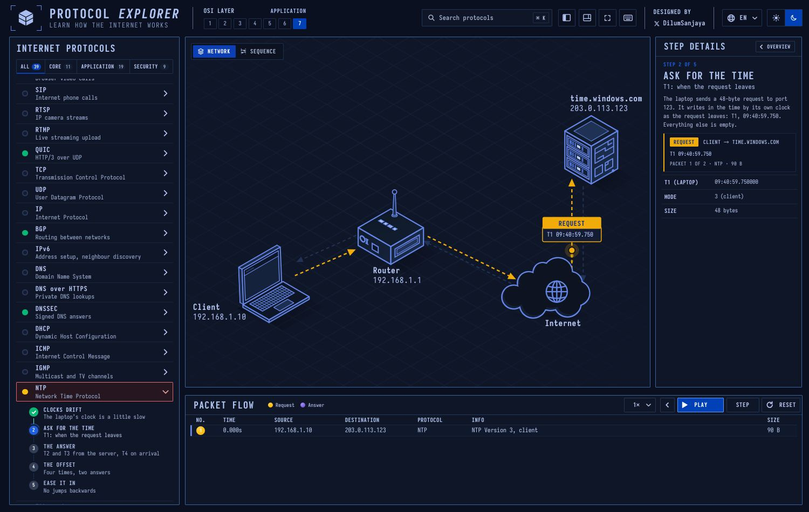
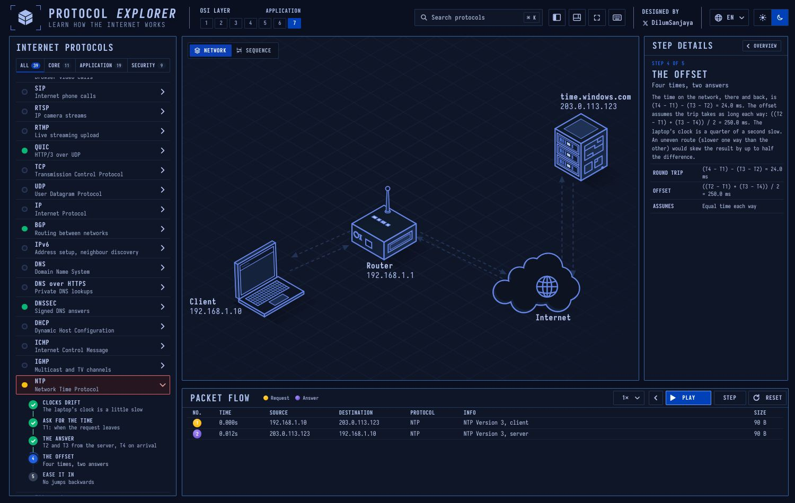
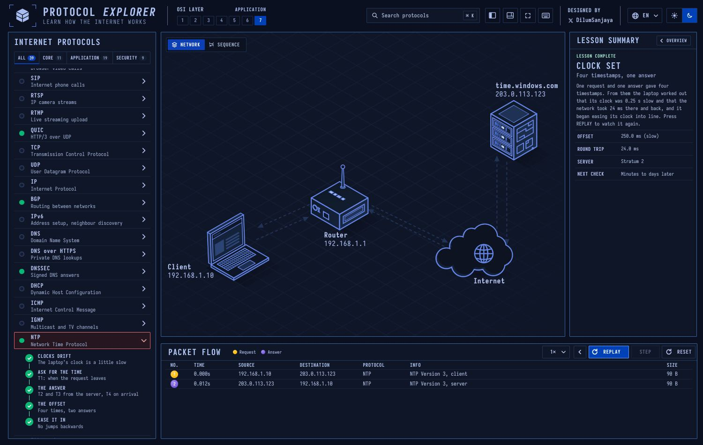
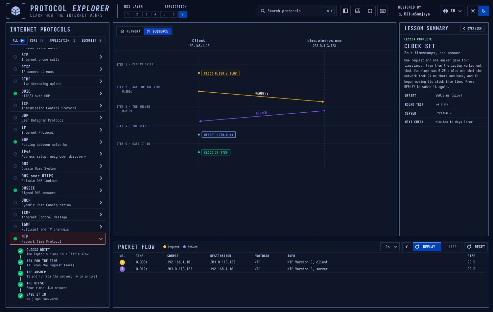
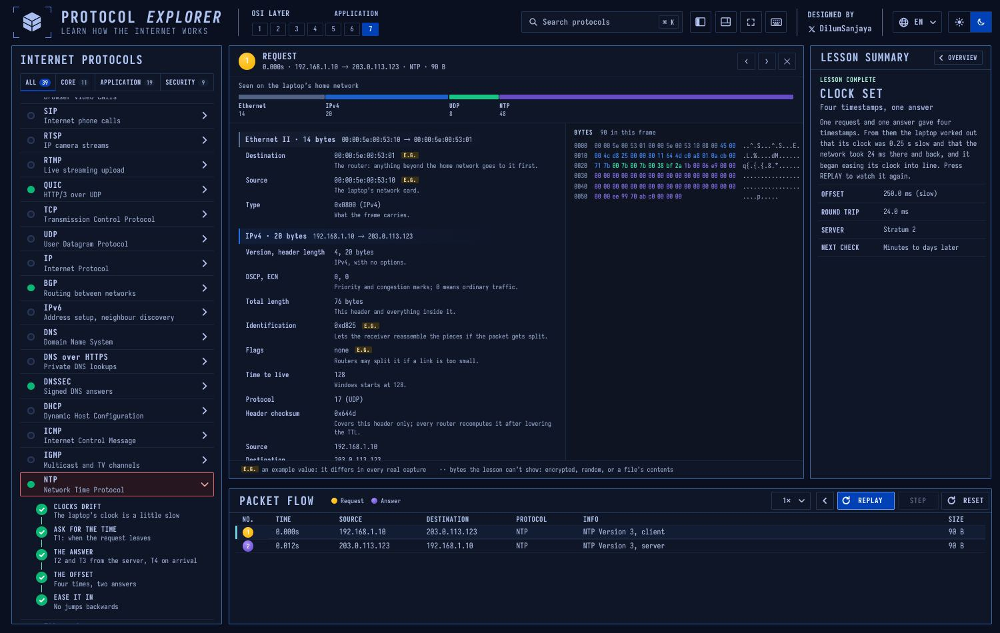

# NTP – Network Time Protocol

<!-- nav -->
⬅ [19 IGMP](19-igmp.md) · [Index](00_Protocols_Index.md) · [21 Ethernet](21-ethernet.md) ➡
<!-- nav -->

*Source: Protocol Explorer – https://protocol-explorer-alpha.vercel.app/ (interactive lesson #20). Screenshots captured from the live lesson; packet decodes are the site's example capture (values marked **E.G.** differ in every real capture).*

## Overview


> PROTOCOL OVERVIEW  
> NTP  
> ACTIVE  
> Network Time Protocol  
> Computer clocks drift by seconds a week, and a lot depends on them: certificates have dates, logins and payments expire, logs from different machines must line up. NTP sets a clock from a time server over the internet. One small request and answer carry four timestamps, enough to work out how far off the clock is and how long the network took.  
> LAYER  
> Application (Layer 7)  
> PORT  
> UDP 123  
> MESSAGE  
> 48 bytes  
> TIMESTAMPS  
> 4: T1 to T4  
> ACCURACY  
> A few milliseconds online  
> DEFINED IN  
> RFC 5905  

## In-depth explanation of the example (plain-language version)

### The big picture in one minute
The laptop's clock is **a quarter of a second slow**. It asks `time.windows.com` for the time using **one small request and one reply** (just 2 messages, 12 ms apart). From **four timestamps** in those messages, it works out **how wrong its clock is** and **how long the network took.**

**Why accurate time matters.** Computer clocks drift by seconds every week, but a lot depends on correct time: **security certificates have start and end dates**, login tokens expire, payments and logs from different computers must line up, and Kerberos logins refuse clocks more than 5 minutes apart. **NTP** (on UDP port **123**) keeps clocks accurate to within milliseconds.

Think of **comparing your watch with a friend's over the phone**: you note when you asked, they note when they heard you and when they answered, and you note when you heard the reply. Together those four times tell you who is ahead, and by how much.

> **Words you'll see:** *Timestamp* = a recorded time. *Offset* = how far your clock is off. *Delay* = how long the round trip took. *Stratum* = how many steps a server is from a perfect clock.

---

### Step 1 – The clock has drifted
The laptop thinks it's `09:40:59.750`; the true time is about `09:41:00.000`. If left alone, the error would keep growing.

### Step 2 – The request: time T1 – packet 1
The laptop sends a small 48-byte packet and fills in one thing: **T1 = `09:40:59.750`**, the moment it sent it, by its own clock.

### Step 3 – The reply: times T2 and T3 – packet 2
The server (a **stratum 2** server, meaning it gets its time from a stratum 1 server, which has a GPS receiver or atomic clock attached directly) fills in:
- a **copy of T1** (so the laptop can match the reply to its request);
- **T2 = `09:41:00.012`**: when the request *arrived*, by the server's clock;
- **T3 = `09:41:00.0121`**: when the reply *left* (0.1 ms later).
It also adds its stratum and an estimate of its own error. When the reply reaches the laptop, the laptop notes **T4 = `09:40:59.774`**, by its own clock.

### Step 4 – The maths
- **Round-trip delay** = (T4 − T1) − (T3 − T2) = total time minus the server's thinking time = **24 ms**.
- **Clock offset** = [(T2 − T1) + (T3 − T4)] ÷ 2 = **+250 ms**. *The laptop's clock is 250 ms slow.*
**One assumption:** the offset formula assumes the trip takes the same time each way. If the network is faster in one direction, the result is off by up to half the difference. This is the main limit on accuracy over the internet.

### Step 5 – Fixing the clock
A small error is fixed by **slewing**: running the clock slightly faster or slower for a while, so time never jumps backwards. A big error (more than about 128 ms, or at start-up) is simply **stepped** to the right time. A real client talks to several servers, ignores the odd ones out, and checks less often (from every 64 s to every 1,024 s) as the clock settles.

---

### The 2 messages at a glance
| Packet | Carries | Why |
|---|---|---|
| 1 | T1 (send time) | start the measurement |
| 2 | T1 copy, T2, T3 | server's receive and send times |
| (laptop notes T4) | | gives the four times needed |

### What to remember
- **One request and one reply, four timestamps** → both the **delay** and the **offset**. Accuracy: a few milliseconds over the internet, microseconds on a local network.
- **Stratum** = distance from a true reference clock (1 = has an atomic/GPS clock; up to 15; 16 = not synced).
- Uses **UDP port 123** with a 48-byte packet.
- Security: plain NTP isn't authenticated, so attackers can send false times or abuse servers for attacks. **NTS** (Network Time Security) adds authentication.
- Good to know: `pool.ntp.org` (a public server pool) and `chrony` (a common modern Linux client).

## Step-by-step walkthrough (screenshots from the lesson)

### Step 1: CLOCKS DRIFT – The laptop’s clock is a little slow


> STEP 1 OF 5  
> CLOCKS DRIFT  
> The laptop’s clock is a little slow  
> A computer keeps time with a quartz crystal that runs a little fast or slow, so clocks drift apart by seconds a week. This laptop’s clock is a quarter of a second behind. Windows sets it from time.windows.com, whose address it has already looked up by DNS.  
> LAPTOP CLOCK  
> 0.25 s slow  
> TIME SERVER  
> time.windows.com  
> WHY IT MATTERS  
> Certificates, logins, logs  

### Step 2: ASK FOR THE TIME – T1: when the request leaves



> STEP 2 OF 5  
> ASK FOR THE TIME  
> T1: when the request leaves  
> The laptop sends a 48-byte request to port 123. It writes in the time by its own clock as the request leaves: T1, 09:40:59.750. Everything else is empty.  
> REQUEST  
> CLIENT → TIME.WINDOWS.COM  
> T1 09:40:59.750  
> PACKET 1 OF 2 · NTP · 90 B  
> T1 (LAPTOP)  
> 09:40:59.750000  
> MODE  
> 3 (client)  
> SIZE  
> 48 bytes  

### Step 3: THE ANSWER – T2 and T3 from the server, T4 on arrival


> STEP 3 OF 5  
> THE ANSWER  
> T2 and T3 from the server, T4 on arrival  
> The server copies T1 back, adds T2, when the request arrived, and T3, when its answer leaves, both by its own accurate clock. When the answer arrives, the laptop notes T4 by its own clock. The server is stratum 2: it sets its clock from a stratum 1 server, which has a GPS receiver or an atomic clock.  
> ANSWER  
> TIME.WINDOWS.COM → CLIENT  
> T2 09:41:00.012000  
> T3 09:41:00.012100  
> PACKET 2 OF 2 · NTP · 90 B  
> T2, T3  
> 09:41:00.012000, .012100  
> T4 (LAPTOP)  
> 09:40:59.774100  
> STRATUM  
> 2  

### Step 4: THE OFFSET – Four times, two answers



> STEP 4 OF 5  
> THE OFFSET  
> Four times, two answers  
> The time on the network, there and back, is (T4 − T1) − (T3 − T2) = 24.0 ms. The offset assumes the trip takes as long each way: ((T2 − T1) + (T3 − T4)) / 2 = 250.0 ms. The laptop’s clock is a quarter of a second slow. An uneven route (slower one way than the other) would skew the result by up to half the difference.  
> ANSWER  
> TIME.WINDOWS.COM → CLIENT  
> T2 09:41:00.012000  
> T3 09:41:00.012100  
> PACKET 2 OF 2 · NTP · 90 B  
> ROUND TRIP  
> (T4 − T1) − (T3 − T2) = 24.0 ms  
> OFFSET  
> ((T2 − T1) + (T3 − T4)) / 2 = 250.0 ms  
> ASSUMES  
> Equal time each way  

### Step 5: EASE IT IN – No jumps backwards


> STEP 1 OF 5  
> CLOCKS DRIFT  
> The laptop’s clock is a little slow  
> A computer keeps time with a quartz crystal that runs a little fast or slow, so clocks drift apart by seconds a week. This laptop’s clock is a quarter of a second behind. Windows sets it from time.windows.com, whose address it has already looked up by DNS.  
> ANSWER  
> TIME.WINDOWS.COM → CLIENT  
> T2 09:41:00.012000  
> T3 09:41:00.012100  
> PACKET 2 OF 2 · NTP · 90 B  
> LAPTOP CLOCK  
> 0.25 s slow  
> TIME SERVER  
> time.windows.com  
> WHY IT MATTERS  
> Certificates, logins, logs  

### Lesson summary



> LESSON SUMMARY  
> LESSON COMPLETE  
> CLOCK SET  
> Four timestamps, one answer  
> One request and one answer gave four timestamps. From them the laptop worked out that its clock was 0.25 s slow and that the network took 24 ms there and back, and it began easing its clock into line. Press REPLAY to watch it again.  
> ANSWER  
> TIME.WINDOWS.COM → CLIENT  
> T2 09:41:00.012000  
> T3 09:41:00.012100  
> PACKET 2 OF 2 · NTP · 90 B  
> OFFSET  
> 250.0 ms (slow)  
> ROUND TRIP  
> 24.0 ms  
> SERVER  
> Stratum 2  
> NEXT CHECK  
> Minutes to days later  

## Packet flow (whole lesson)

| No. | Time | Source | Destination | Protocol | Info | Size |
|---|---|---|---|---|---|---|
| 1 | 0.000s | 192.168.1.10 | 203.0.113.123 | NTP | NTP Version 3, client | 90 B |
| 2 | 0.012s | 203.0.113.123 | 192.168.1.10 | NTP | NTP Version 3, server | 90 B |

### Sequence diagram



## Packets decoded byte by byte

Each packet below is the lesson's own decode (headers, field values and the plain-English meaning of each field). Screenshots show the first, middle and last packet in the lesson's decoder view with the raw hex bytes.

### Packet 1: NTP – NTP Version 3, client

*192.168.1.10 → 203.0.113.123 · 90 B · t = 0.000s*



<details><summary>Decoded fields</summary>

```text
1
REQUEST
0.000s · 192.168.1.10 → 203.0.113.123 · NTP · 90 B
Seen on the laptop’s home network
Ethernet
14
IPv4
20
UDP
8
NTP
48
Ethernet II · 14 bytes
00:00:5e:00:53:10 → 00:00:5e:00:53:01
Destination
00:00:5e:00:53:01 E.G.

The router: anything beyond the home network goes to it first.

Source
00:00:5e:00:53:10 E.G.

The laptop’s network card.

Type
0x0800 (IPv4)

What the frame carries.

IPv4 · 20 bytes
192.168.1.10 → 203.0.113.123
Version, header length
4, 20 bytes

IPv4, with no options.

DSCP, ECN
0, 0

Priority and congestion marks; 0 means ordinary traffic.

Total length
76 bytes

This header and everything inside it.

Identification
0xd825 E.G.

Lets the receiver reassemble the pieces if the packet gets split.

Flags
none E.G.

Routers may split it if a link is too small.

Time to live
128

Windows starts at 128.

Protocol
17 (UDP)
Header checksum
0x644d

Covers this header only; every router recomputes it after lowering the TTL.

Source
192.168.1.10
Destination
203.0.113.123
UDP · 8 bytes
123 → 123
Source port
123
Destination port
123
Length
56 bytes

UDP header and data. That is all of UDP: no numbering, no acknowledgements.

Checksum
0xbf2a

Covers the header, the data and the IP addresses.

NTP · client
Leap, version, mode
0, 3, 3 (client)

Mode 3: a client asking for the time.

Stratum
0 (not set)
Poll
64 s

How often the client means to ask (2 to the power 6 seconds). It grows as the clock settles.

Precision
2^-23 s (0.12 µs) E.G.

How finely this clock can be read.

Root delay
0
Root dispersion
0
Reference ID
0
Reference time
0
Origin time
0
Receive time
0
Transmit time
09:40:59.750000 UTC

T1: when the request left, by the laptop’s own (wrong) clock.

BYTES 90 in this frame
0000
00
00
5e
00
53
01
00
00
5e
00
53
10
08
00
45
00
.
.
^
.
S
.
.
.
^
.
S
.
.
.
E
.
0010
00
4c
d8
25
00
00
80
11
64
4d
c0
a8
01
0a
cb
00
.
L
.
%
.
.
.
.
d
M
.
.
.
.
.
.
0020
71
7b
00
7b
00
7b
00
38
bf
2a
1b
00
06
e9
00
00
q
{
.
{
.
{
.
8
.
*
.
.
.
.
.
.
0030
00
00
00
00
00
00
00
00
00
00
00
00
00
00
00
00
.
.
.
.
.
.
.
.
.
.
.
.
.
.
.
.
0040
00
00
00
00
00
00
00
00
00
00
00
00
00
00
00
00
.
.
.
.
.
.
.
.
.
.
.
.
.
.
.
.
0050
00
00
ee
99
70
ab
c0
00
00
00
.
.
.
.
p
.
.
.
.
.
E.G. an example value: it differs in every real capture
·· bytes the lesson can’t show: encrypted, random, or a file’s contents
```

</details>

### Packet 2: NTP – NTP Version 3, server

*203.0.113.123 → 192.168.1.10 · 90 B · t = 0.012s*


<details><summary>Decoded fields</summary>

```text
2
ANSWER
0.012s · 203.0.113.123 → 192.168.1.10 · NTP · 90 B
Seen on the laptop’s home network
Ethernet
14
IPv4
20
UDP
8
NTP
48
Ethernet II · 14 bytes
00:00:5e:00:53:01 → 00:00:5e:00:53:10
Destination
00:00:5e:00:53:10 E.G.

The laptop.

Source
00:00:5e:00:53:01 E.G.

The router’s side facing the home network.

Type
0x0800 (IPv4)

What the frame carries.

IPv4 · 20 bytes
203.0.113.123 → 192.168.1.10
Version, header length
4, 20 bytes

IPv4, with no options.

DSCP, ECN
0, 0

Priority and congestion marks; 0 means ordinary traffic.

Total length
76 bytes

This header and everything inside it.

Identification
0xebee E.G.

Lets the receiver reassemble the pieces if the packet gets split.

Flags
DF (don’t fragment) E.G.

Routers must not split it; if it’s too big they report back instead.

Time to live
52

Started at 64; 12 routers on the way each took 1.

Protocol
17 (UDP)
Header checksum
0x5c84

Covers this header only; every router recomputes it after lowering the TTL.

Source
203.0.113.123
Destination
192.168.1.10
UDP · 8 bytes
123 → 123
Source port
123
Destination port
123
Length
56 bytes

UDP header and data. That is all of UDP: no numbering, no acknowledgements.

Checksum
0xdd00

Covers the header, the data and the IP addresses.

NTP · server
Leap, version, mode
0, 3, 4 (server)

Mode 4: an answer from a server.

Stratum
2

Two steps from a reference clock: it follows a stratum 1 server, which has its own GPS or atomic clock.

Poll
64 s

How often the client means to ask (2 to the power 6 seconds). It grows as the clock settles.

Precision
2^-23 s (0.12 µs) E.G.

How finely this clock can be read.

Root delay
8.9 ms E.G.

Round-trip time from this server to the reference clock.

Root dispersion
21.3 ms E.G.

How far off this server could be, at most.

Reference ID
192.0.2.123 (its own time source) E.G.
Reference time
09:32:16.582000 UTC

When this server last set its own clock.

Origin time
09:40:59.750000 UTC

T1, copied from the request: the client can match the answer to its question.

Receive time
09:41:00.012000 UTC

T2: when the request arrived, by the server’s clock.

Transmit time
09:41:00.012100 UTC

T3: when this answer left.

BYTES 90 in this frame
0000
00
00
5e
00
53
10
00
00
5e
00
53
01
08
00
45
00
.
.
^
.
S
.
.
.
^
.
S
.
.
.
E
.
0010
00
4c
eb
ee
40
00
34
11
5c
84
cb
00
71
7b
c0
a8
.
L
.
.
@
.
4
.
\
.
.
.
q
{
.
.
0020
01
0a
00
7b
00
7b
00
38
dd
00
1c
02
06
e9
00
00
.
.
.
{
.
{
.
8
.
.
.
.
.
.
.
.
0030
02
47
00
00
05
74
c0
00
02
7b
ee
99
6e
a0
94
fd
.
G
.
.
.
t
.
.
.
{
.
.
n
.
.
.
0040
f4
00
ee
99
70
ab
c0
00
00
00
ee
99
70
ac
03
12
.
.
.
.
p
.
.
.
.
.
.
.
p
.
.
.
0050
70
00
ee
99
70
ac
03
18
fc
00
p
.
.
.
p
.
.
.
.
.
E.G. an example value: it differs in every real capture
·· bytes the lesson can’t show: encrypted, random, or a file’s contents
```

</details>

---

<!-- nav -->
⬅ [19 IGMP](19-igmp.md) · [Index](00_Protocols_Index.md) · [21 Ethernet](21-ethernet.md) ➡
<!-- nav -->
