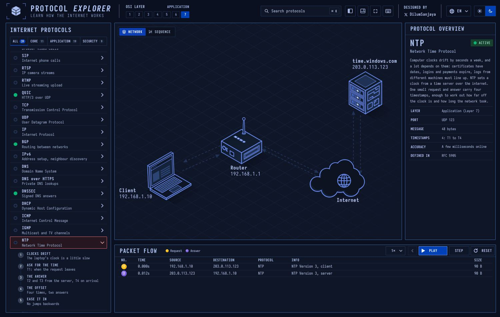
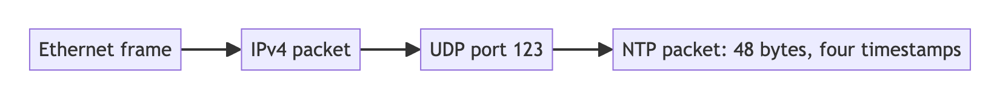
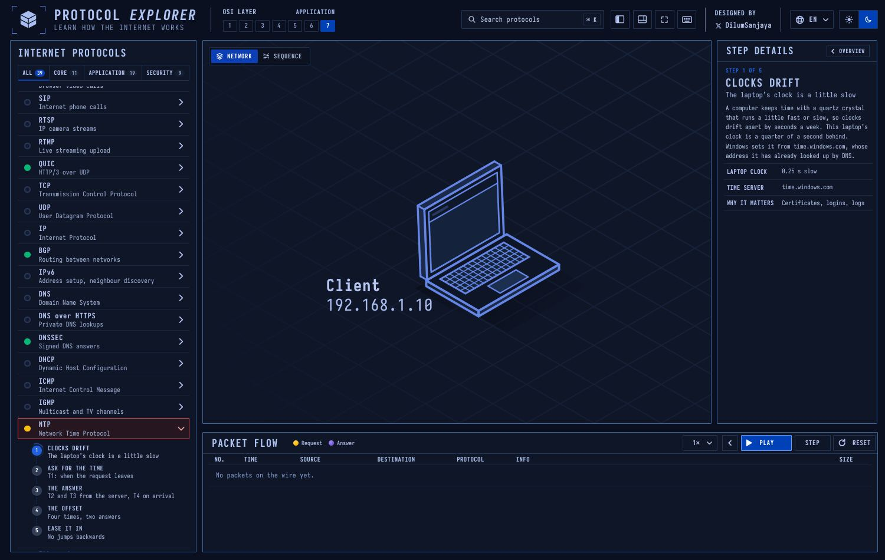
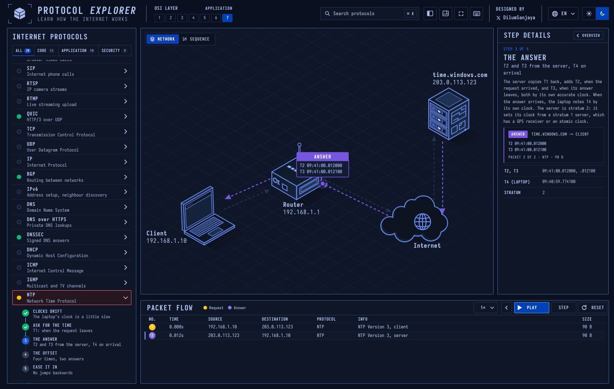
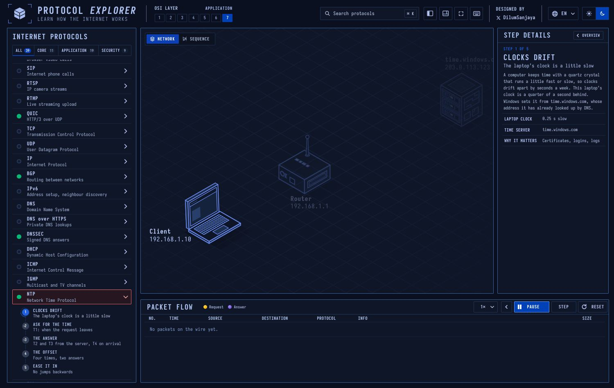
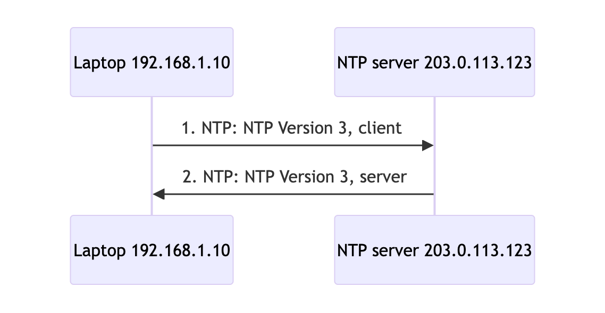
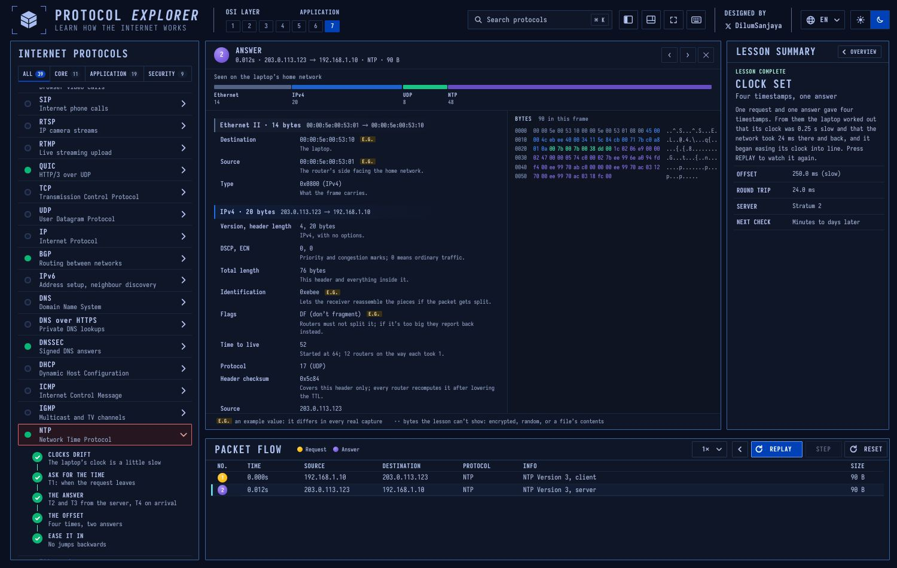

# NTP – Network Time Protocol

<!-- nav -->
⬅ [19 IGMP](19-igmp.md) · [Index](00_Protocols_Index.md) · [21 Ethernet](21-ethernet.md) ➡
<!-- nav -->

*Source: Protocol Explorer – https://protocol-explorer-alpha.vercel.app/ (interactive lesson #20). Screenshots captured from the live lesson; packet decodes are the site's example capture (values marked **E.G.** differ in every real capture).*

## Overview

### How the layers fit together (outer to inner)

## In-depth explanation of the example (plain-language version)

### The big picture in one minute
The laptop's clock is **a quarter of a second slow**. It asks `time.windows.com` for the time using **one small request and one reply** (just 2 messages, 12 ms apart). From **four timestamps** in those messages, it works out **how wrong its clock is** and **how long the network took.**

**Why accurate time matters.** Computer clocks drift by seconds every week, but a lot depends on correct time: **security certificates have start and end dates**, login tokens expire, payments and logs from different computers must line up, and Kerberos logins refuse clocks more than 5 minutes apart. **NTP** (on UDP port **123**) keeps clocks accurate to within milliseconds.

Think of **comparing your watch with a friend's over the phone**: you note when you asked, they note when they heard you and when they answered, and you note when you heard the reply. Together those four times tell you who is ahead, and by how much.

> **Words you'll see:** *Timestamp* = a recorded time. *Offset* = how far your clock is off. *Delay* = how long the round trip took. *Stratum* = how many steps a server is from a perfect clock.

---

### Step 1 – The clock has drifted
The laptop thinks it's `09:40:59.750`; the true time is about `09:41:00.000`. If left alone, the error would keep growing.

### Step 2 – The request: time T1 – packet 1
The laptop sends a small 48-byte packet and fills in one thing: **T1 = `09:40:59.750`**, the moment it sent it, by its own clock.

### Step 3 – The reply: times T2 and T3 – packet 2
The server (a **stratum 2** server, meaning it gets its time from a stratum 1 server, which has a GPS receiver or atomic clock attached directly) fills in:
- a **copy of T1** (so the laptop can match the reply to its request);
- **T2 = `09:41:00.012`**: when the request *arrived*, by the server's clock;
- **T3 = `09:41:00.0121`**: when the reply *left* (0.1 ms later).
It also adds its stratum and an estimate of its own error. When the reply reaches the laptop, the laptop notes **T4 = `09:40:59.774`**, by its own clock.

### Step 4 – The maths
- **Round-trip delay** = (T4 − T1) − (T3 − T2) = total time minus the server's thinking time = **24 ms**.
- **Clock offset** = [(T2 − T1) + (T3 − T4)] ÷ 2 = **+250 ms**. *The laptop's clock is 250 ms slow.*
**One assumption:** the offset formula assumes the trip takes the same time each way. If the network is faster in one direction, the result is off by up to half the difference. This is the main limit on accuracy over the internet.

### Step 5 – Fixing the clock
A small error is fixed by **slewing**: running the clock slightly faster or slower for a while, so time never jumps backwards. A big error (more than about 128 ms, or at start-up) is simply **stepped** to the right time. A real client talks to several servers, ignores the odd ones out, and checks less often (from every 64 s to every 1,024 s) as the clock settles.

---

### The 2 messages at a glance
| Packet | Carries | Why |
|---|---|---|
| 1 | T1 (send time) | start the measurement |
| 2 | T1 copy, T2, T3 | server's receive and send times |
| (laptop notes T4) | | gives the four times needed |

### What to remember
- **One request and one reply, four timestamps** → both the **delay** and the **offset**. Accuracy: a few milliseconds over the internet, microseconds on a local network.
- **Stratum** = distance from a true reference clock (1 = has an atomic/GPS clock; up to 15; 16 = not synced).
- Uses **UDP port 123** with a 48-byte packet.
- Security: plain NTP isn't authenticated, so attackers can send false times or abuse servers for attacks. **NTS** (Network Time Security) adds authentication.
- Good to know: `pool.ntp.org` (a public server pool) and `chrony` (a common modern Linux client).

## Under the hood – technical details

- **Packet.** A 48-byte UDP packet on port **123**: leap indicator, version, mode, **stratum**, poll interval, precision, *root delay*, *root dispersion*, *reference ID*, and four 64-bit timestamps: reference, originate, receive and transmit.
- **Timestamp format.** 32 bits of seconds since 1 January 1900 plus 32 bits of fraction, giving a resolution of about 233 picoseconds.
- **The four timestamps.** `T1` client send, `T2` server receive, `T3` server send, `T4` client receive. T1 and T4 are read from the client's clock; T2 and T3 from the server's.
- **Formulas.** Round-trip **delay** = (T4 - T1) - (T3 - T2). Clock **offset** = ((T2 - T1) + (T3 - T4)) / 2. With the example numbers the delay is 24 ms and the offset +250 ms: the laptop is a quarter second slow.
- **Key assumption.** The path takes equal time in each direction. If it doesn't, the offset error is up to half the difference between the two directions. That is the main accuracy limit over the internet.
- **Stratum.** Stratum 0 is the reference clock (GPS, atomic). Stratum 1 servers are attached to one directly. Each step away adds 1; the maximum is 15 and 16 means unsynchronised.
- **Applying the correction.** Small errors are *slewed*: the clock is run slightly faster or slower (up to about 500 ppm) so time never moves backwards. Large errors (over about 128 ms) or errors at start-up are *stepped*.
- **Selection.** A real client queries several servers, filters out *falsetickers* and combines the good ones, then adjusts the poll interval between 64 s and 1,024 s as the clock stabilises.
- **Modes.** client (3), server (4), symmetric active/passive (1/2), broadcast (5).
- **Why it matters.** Certificates have validity dates, tokens and logs depend on time, Kerberos fails if clocks differ by more than 5 minutes, and distributed systems order events by time.
- **Security.** Plain NTP is unauthenticated, so time can be spoofed, and old servers could be abused for amplification. **NTS** (RFC 8915) adds authentication. Accuracy: milliseconds over the internet, microseconds on a LAN; PTP is better still.

## Step-by-step walkthrough (screenshots from the lesson)

### Step 1: CLOCKS DRIFT – The laptop’s clock is a little slow

### Step 2: ASK FOR THE TIME – T1: when the request leaves

### Step 3: THE ANSWER – T2 and T3 from the server, T4 on arrival

### Step 4: THE OFFSET – Four times, two answers

### Step 5: EASE IT IN – No jumps backwards

### Lesson summary

## Packet flow (whole lesson)

| No. | Time | Source | Destination | Protocol | Info | Size |
|---|---|---|---|---|---|---|
| 1 | 0.000s | 192.168.1.10 | 203.0.113.123 | NTP | NTP Version 3, client | 90 B |
| 2 | 0.012s | 203.0.113.123 | 192.168.1.10 | NTP | NTP Version 3, server | 90 B |

### Sequence diagram

*The lesson's own sequence diagram:*

## Packet decoder screenshots

The lesson's decoder view for the first, middle and last packet: headers, field values and the raw hex bytes.

### Packet 1: NTP – NTP Version 3, client

*192.168.1.10 → 203.0.113.123 · 90 B · t = 0.000s*

### Packet 2: NTP – NTP Version 3, server

*203.0.113.123 → 192.168.1.10 · 90 B · t = 0.012s*

---

<!-- nav -->
⬅ [19 IGMP](19-igmp.md) · [Index](00_Protocols_Index.md) · [21 Ethernet](21-ethernet.md) ➡
<!-- nav -->
