# Ethernet – Frames and switches

<!-- nav -->
⬅ [20 NTP](20-ntp.md) · [Index](00_Protocols_Index.md) · [22 PPPoE](22-pppoe.md) ➡
<!-- nav -->

*Source: Protocol Explorer – https://protocol-explorer-alpha.vercel.app/ (interactive lesson #21). Screenshots captured from the live lesson; packet decodes are the site's example capture (values marked **E.G.** differ in every real capture).*

## Overview

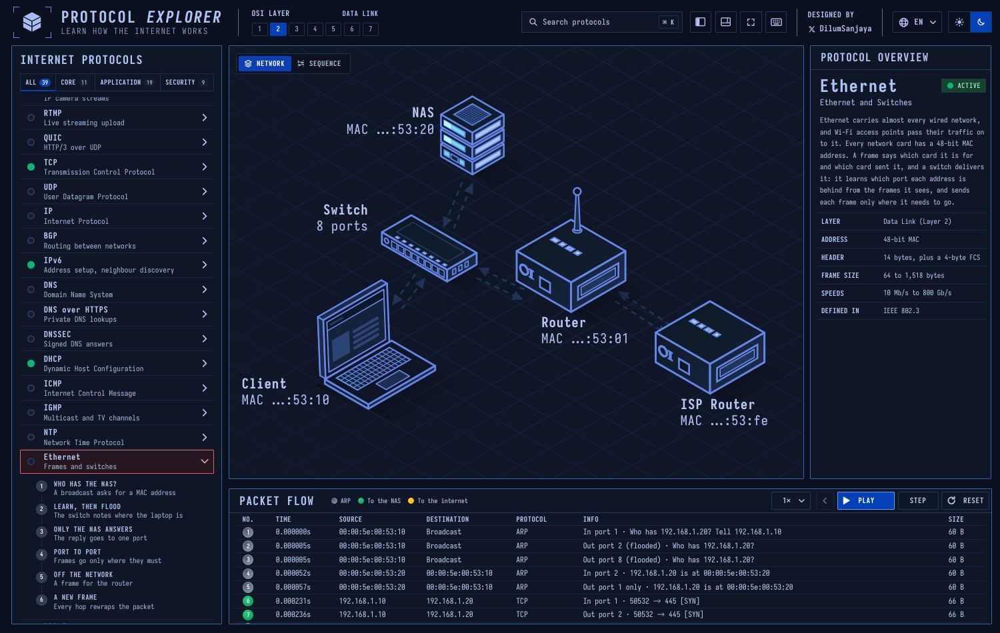

### How the layers fit together (outer to inner)

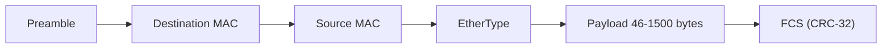

## In-depth explanation of the example (plain-language version)

### The big picture in one minute
A small wired network: a **switch** (the box all cables plug into) with the laptop on **port 1**, a **NAS** (a file-storage box) on **port 2**, and the **router** on **port 8**. The lesson follows the data frames: the laptop finds the NAS using **ARP**, opens a connection to it, then connects to a website through the router. **12 frames in about 4 milliseconds.** (The table lists the same frame twice when it enters and leaves the switch, e.g. "In port 1", "Out port 2".)

**Ethernet** moves data between devices on the **same local network**, using **MAC addresses**, a unique 48-bit hardware ID burned into every network card. A **switch** is the smart box that delivers each frame only where it needs to go.

Think of an **office mail room**: each desk has a name tag (MAC address), and the mail clerk (switch) learns who sits where and delivers envelopes to the right desk instead of shouting them to the whole office.

> **Words you'll see:** *Frame* = one Ethernet message. *MAC address* = a card's hardware ID, like `00:00:5e:00:53:10`. *Broadcast* = a message for everyone (`ff:ff:ff:ff:ff:ff`). *Flood* = a switch copying a frame to all ports because it doesn't know where to send it.

---

### What an Ethernet frame looks like
`| Destination MAC | Source MAC | Type | Data | Checksum |`
- **Type** says what's inside: `0x0800` = IPv4, `0x0806` = ARP, `0x86DD` = IPv6, `0x8100` = a VLAN tag.
- The header is **14 bytes**. A 4-byte checksum (FCS) is added by the network card. Frames must be at least 64 bytes (short ones are padded) and normally at most 1,518 bytes (data up to **1,500**).
- The first 3 bytes of a MAC identify the manufacturer.

### Step 1 – The laptop asks "who is 192.168.1.20?" – packet 1
The laptop wants to talk to the NAS (`192.168.1.20`) but only knows its IP. Delivery on a local network needs a MAC. So it **shouts** an ARP request to everyone: "Who has 192.168.1.20? Tell 192.168.1.10."

### Step 2 – The switch learns, then floods – packets 2, 3
A switch keeps a **MAC address table** (which MAC is on which port). For every frame it:
1. **Learns:** reads the sender's MAC and writes down "`…53:10` is on port 1."
2. **Forwards:** looks up the destination. A **broadcast** or an **unknown** address is **flooded**: copied out of every port except the one it arrived on. Here, to the NAS (port 2) and the router (port 8).
An old **hub** repeated everything everywhere forever; a switch stops flooding once it has learned where everyone is.

### Step 3 – Only the NAS answers – packets 4, 5
Everyone receives the question, but only the NAS owns that address, so only it replies, **directly to the laptop**: "`192.168.1.20` is at `00:00:5e:00:53:20`." The switch learns "`…53:20` is on port 2" and, since it already knows where the laptop is, sends the reply out **port 1 only.**

### Step 4 – Port to port – packets 6 to 9
The laptop opens a connection to the NAS's file-sharing service (port 445). Every frame begins with the NAS's MAC, so the switch sends it **only out port 2**, and the reply comes back **only out port 1**. **The router never sees this traffic.** This saves bandwidth and adds some privacy.

### Step 5 – A frame for the router – packets 10, 11
Next the laptop connects to a website at `203.0.113.10`. That address isn't local, so the frame is addressed to the **router's MAC**, while the **IP address inside still names `203.0.113.10`**. The switch sends it out **port 8**.

### Step 6 – A new frame at every hop – packet 12
The router **removes the Ethernet frame**, lowers the TTL (128 → 127), applies **NAT** (swaps the private address for its public one), and puts the packet into a **brand-new frame** addressed to the internet provider's router. **MAC addresses only travel one link; IP addresses go end to end** (except where NAT changes them).

---

### The 12 frames at a glance
| Packets | What | Why |
|---|---|---|
| 1–3 | ARP broadcast, flooded by the switch | find the NAS's MAC |
| 4–5 | ARP reply | tell the laptop; the switch learns |
| 6–9 | TCP set-up laptop ↔ NAS | direct, port-to-port delivery |
| 10–11 | frame to the router | going outside the local network |
| 12 | router's new frame | next hop towards the internet |

### What to remember
- **Frame = destination MAC, source MAC, type, data, checksum.** 14-byte header, 1,500-byte data limit.
- **Switch rules:** learn the sender's MAC and port → forward by destination → **flood** broadcasts and unknown addresses → never send a frame back out the port it came in on.
- **ARP** (IPv4) and **NDP** (IPv6) turn an IP address into a MAC address. A broadcast reaches only the local network.
- Related topics: **VLANs** (splitting one switch into separate networks), **STP** (prevents loops), **PoE** (power over cable), and attacks that flood a switch's table until it acts like a hub.
- Wi-Fi access points connect into this same Ethernet network.

## Under the hood – technical details

- **Frame layout.** Preamble (7 bytes) and start delimiter, then **destination MAC** (6), **source MAC** (6), **EtherType** (2), **payload** (46 to 1,500 bytes) and the **FCS** (4-byte CRC-32). The header is 14 bytes. A frame is at least 64 bytes (short payloads are *padded*) and normally at most 1,518.
- **EtherType values.** `0x0800` IPv4, `0x0806` ARP, `0x86DD` IPv6, `0x8100` 802.1Q VLAN tag, `0x8863` and `0x8864` PPPoE, `0x888E` EAPOL.
- **MAC addresses.** 48 bits in hex. The first 3 bytes are the manufacturer (OUI). `ff:ff:ff:ff:ff:ff` is broadcast. A set lowest bit in the first byte means multicast.
- **Switch table.** A switch keeps a **MAC address table** (MAC to port). For each incoming frame it *learns* (source MAC to the arrival port, aged out after a few minutes) and *forwards* (looks up the destination). Broadcast, multicast and unknown unicast are **flooded** out of every port except the one they arrived on. A known unicast goes out of one port only.
- **Hub vs switch.** A hub repeats every bit to every port, so all devices share one *collision domain*. Each switch port is its own collision domain, and full-duplex links have no collisions at all.
- **Broadcast domain.** Everything that receives a broadcast: one VLAN or one subnet. A router (or a VLAN boundary) stops it.
- **ARP.** To send to `192.168.1.20` the host broadcasts "who has it?". The owner replies by unicast, and both sides cache the answer.
- **Hop by hop.** A router strips the incoming Ethernet header, decrements the IP TTL, may apply NAT, and builds a new frame with new MAC addresses for the next link. MAC addresses only cross one link; IP addresses go end to end.
- **VLANs.** An 802.1Q tag (4 extra bytes) splits one physical switch into several logical networks. *Trunk* ports carry several VLANs.
- **Other features.** *STP* (spanning tree) blocks redundant links to prevent loops; link aggregation joins several cables; PoE powers devices over the cable.
- **Attacks.** *MAC flooding* fills the switch table so it acts like a hub (sniffing becomes possible); *ARP spoofing* poisons caches. Port security and dynamic ARP inspection help.

## Step-by-step walkthrough (screenshots from the lesson)

### Step 1: WHO HAS THE NAS? – A broadcast asks for a MAC address

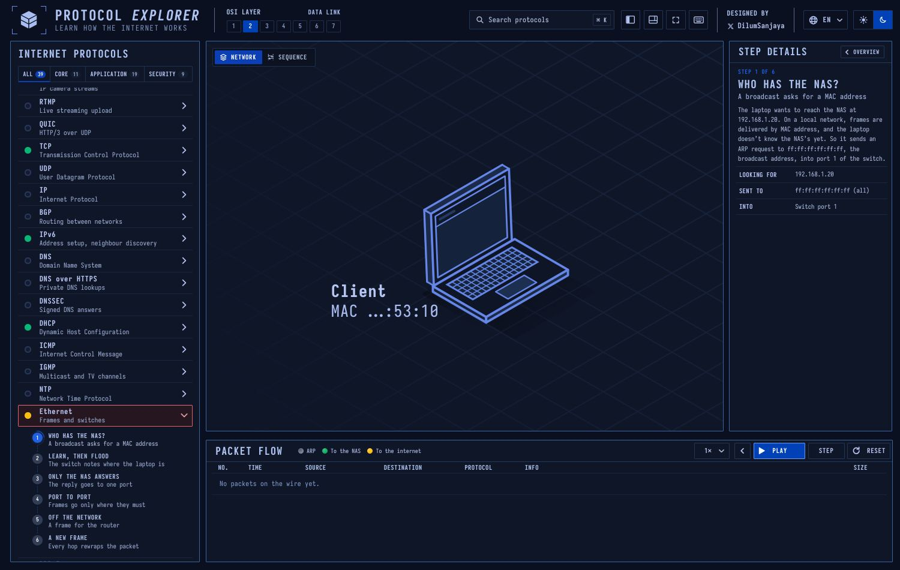

### Step 2: LEARN, THEN FLOOD – The switch notes where the laptop is

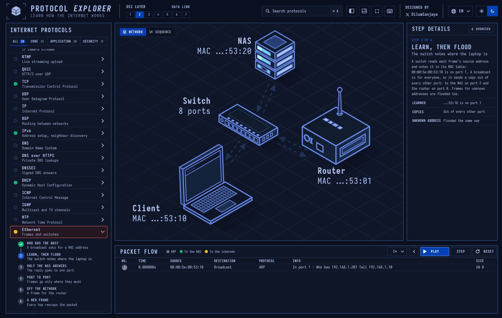

### Step 3: ONLY THE NAS ANSWERS – The reply goes to one port

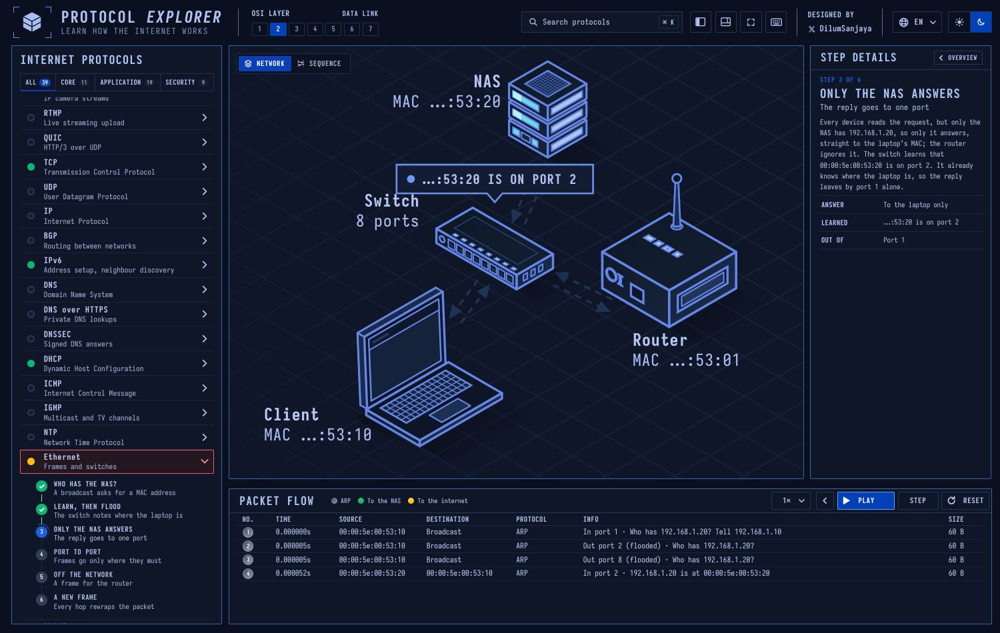

### Step 4: PORT TO PORT – Frames go only where they must

### Step 5: OFF THE NETWORK – A frame for the router

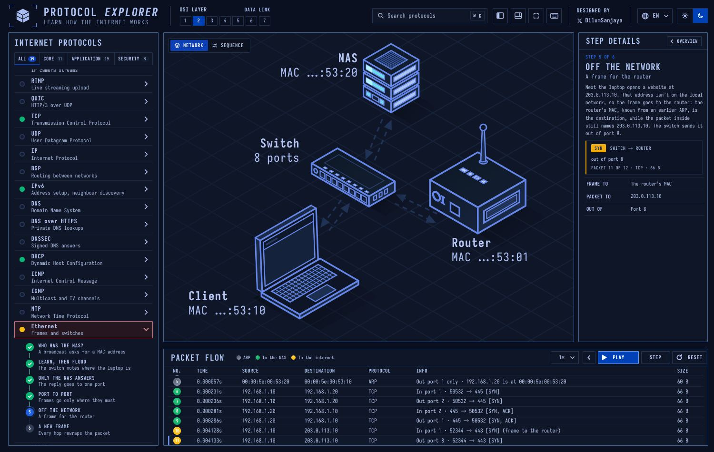

### Step 6: A NEW FRAME – Every hop rewraps the packet

### Lesson summary

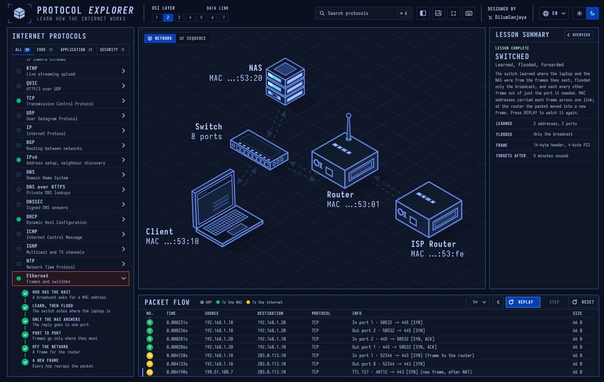

## Packet flow (whole lesson)

| No. | Time | Source | Destination | Protocol | Info | Size |
|---|---|---|---|---|---|---|
| 1 | 0.000000s | 00:00:5e:00:53:10 | Broadcast | ARP | In port 1 · Who has 192.168.1.20? Tell 192.168.1.10 | 60 B |
| 2 | 0.000005s | 00:00:5e:00:53:10 | Broadcast | ARP | Out port 2 (flooded) · Who has 192.168.1.20? | 60 B |
| 3 | 0.000005s | 00:00:5e:00:53:10 | Broadcast | ARP | Out port 8 (flooded) · Who has 192.168.1.20? | 60 B |
| 4 | 0.000052s | 00:00:5e:00:53:20 | 00:00:5e:00:53:10 | ARP | In port 2 · 192.168.1.20 is at 00:00:5e:00:53:20 | 60 B |
| 5 | 0.000057s | 00:00:5e:00:53:20 | 00:00:5e:00:53:10 | ARP | Out port 1 only · 192.168.1.20 is at 00:00:5e:00:53:20 | 60 B |
| 6 | 0.000231s | 192.168.1.10 | 192.168.1.20 | TCP | In port 1 · 50532 → 445 [SYN] | 66 B |
| 7 | 0.000236s | 192.168.1.10 | 192.168.1.20 | TCP | Out port 2 · 50532 → 445 [SYN] | 66 B |
| 8 | 0.000281s | 192.168.1.20 | 192.168.1.10 | TCP | In port 2 · 445 → 50532 [SYN, ACK] | 66 B |
| 9 | 0.000286s | 192.168.1.20 | 192.168.1.10 | TCP | Out port 1 · 445 → 50532 [SYN, ACK] | 66 B |
| 10 | 0.004128s | 192.168.1.10 | 203.0.113.10 | TCP | In port 1 · 52344 → 443 [SYN] (frame to the router) | 66 B |
| 11 | 0.004133s | 192.168.1.10 | 203.0.113.10 | TCP | Out port 8 · 52344 → 443 [SYN] | 66 B |
| 12 | 0.004190s | 198.51.100.7 | 203.0.113.10 | TCP | TTL 127 · 40112 → 443 [SYN] (new frame, after NAT) | 66 B |

### Sequence diagram

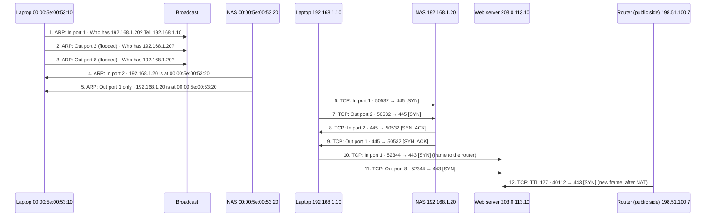

*The lesson's own sequence diagram:*

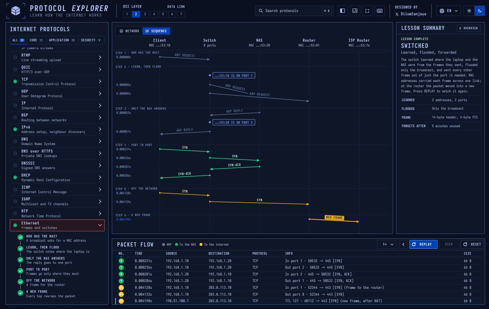

## Packet decoder screenshots

The lesson's decoder view for the first, middle and last packet: headers, field values and the raw hex bytes.

### Packet 1: ARP – In port 1 · Who has 192.168.1.20? Tell 192.168.1.10

*00:00:5e:00:53:10 → Broadcast · 60 B · t = 0.000000s*

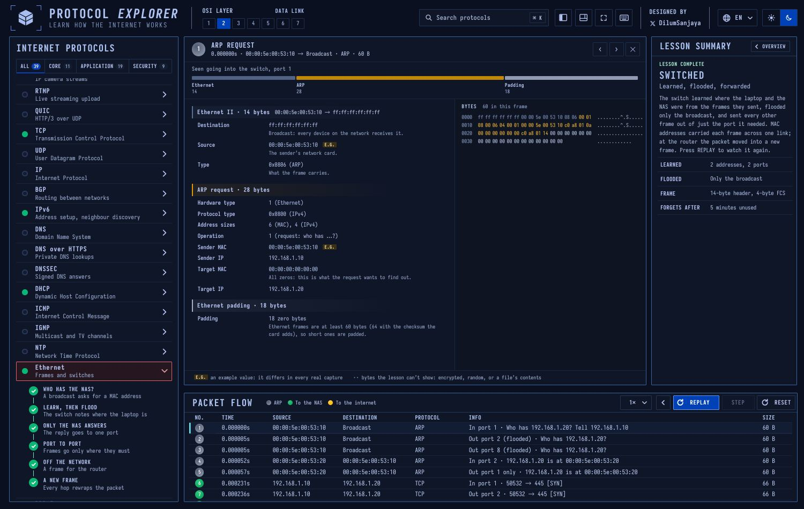

### Packet 7: TCP – Out port 2 · 50532 → 445 [SYN]

*192.168.1.10 → 192.168.1.20 · 66 B · t = 0.000236s*

### Packet 12: TCP – TTL 127 · 40112 → 443 [SYN] (new frame, after NAT)

*198.51.100.7 → 203.0.113.10 · 66 B · t = 0.004190s*

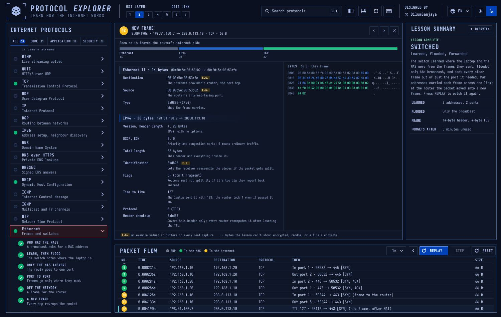

---

<!-- nav -->
⬅ [20 NTP](20-ntp.md) · [Index](00_Protocols_Index.md) · [22 PPPoE](22-pppoe.md) ➡
<!-- nav -->
