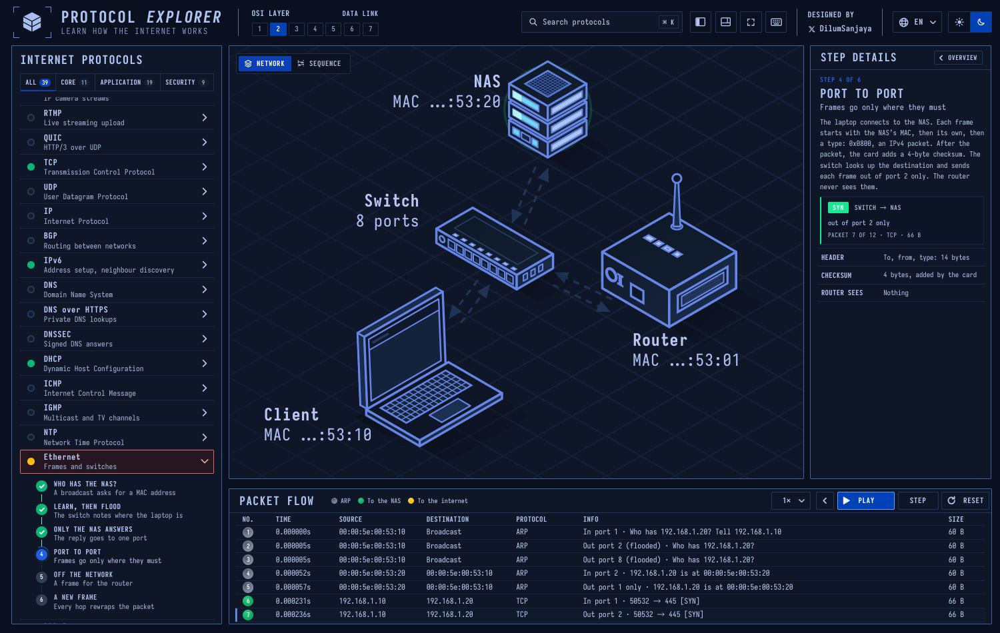
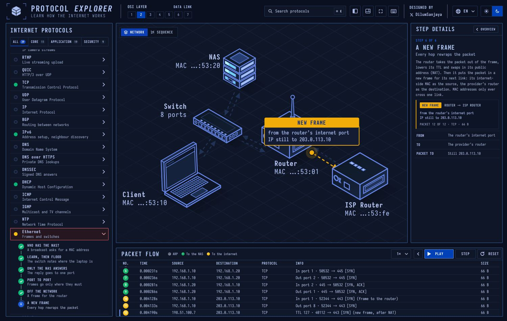
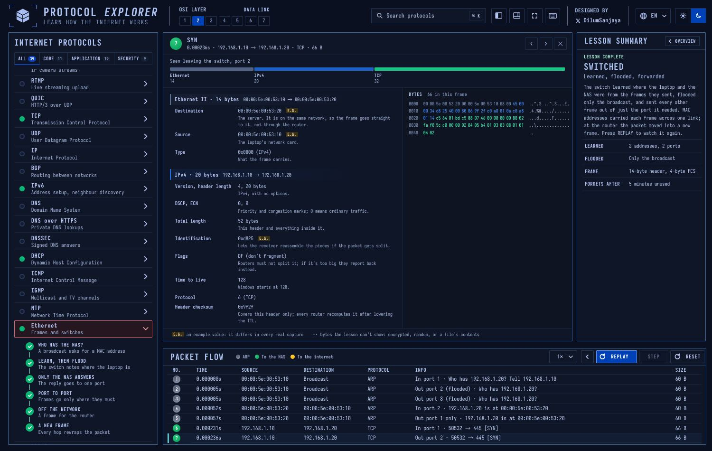

# Ethernet – Frames and switches

<!-- nav -->
⬅ [20 NTP](20-ntp.md) · [Index](00_Protocols_Index.md) · [22 PPPoE](22-pppoe.md) ➡
<!-- nav -->

*Source: Protocol Explorer – https://protocol-explorer-alpha.vercel.app/ (interactive lesson #21). Screenshots captured from the live lesson; packet decodes are the site's example capture (values marked **E.G.** differ in every real capture).*

## Overview


> PROTOCOL OVERVIEW  
> Ethernet  
> ACTIVE  
> Ethernet and Switches  
> Ethernet carries almost every wired network, and Wi-Fi access points pass their traffic on to it. Every network card has a 48-bit MAC address. A frame says which card it is for and which card sent it, and a switch delivers it: it learns which port each address is behind from the frames it sees, and sends each frame only where it needs to go.  
> LAYER  
> Data Link (Layer 2)  
> ADDRESS  
> 48-bit MAC  
> HEADER  
> 14 bytes, plus a 4-byte FCS  
> FRAME SIZE  
> 64 to 1,518 bytes  
> SPEEDS  
> 10 Mb/s to 800 Gb/s  
> DEFINED IN  
> IEEE 802.3  

## In-depth explanation of the example (plain-language version)

### The big picture in one minute
A small wired network: a **switch** (the box all cables plug into) with the laptop on **port 1**, a **NAS** (a file-storage box) on **port 2**, and the **router** on **port 8**. The lesson follows the data frames: the laptop finds the NAS using **ARP**, opens a connection to it, then connects to a website through the router. **12 frames in about 4 milliseconds.** (The table lists the same frame twice when it enters and leaves the switch, e.g. "In port 1", "Out port 2".)

**Ethernet** moves data between devices on the **same local network**, using **MAC addresses**, a unique 48-bit hardware ID burned into every network card. A **switch** is the smart box that delivers each frame only where it needs to go.

Think of an **office mail room**: each desk has a name tag (MAC address), and the mail clerk (switch) learns who sits where and delivers envelopes to the right desk instead of shouting them to the whole office.

> **Words you'll see:** *Frame* = one Ethernet message. *MAC address* = a card's hardware ID, like `00:00:5e:00:53:10`. *Broadcast* = a message for everyone (`ff:ff:ff:ff:ff:ff`). *Flood* = a switch copying a frame to all ports because it doesn't know where to send it.

---

### What an Ethernet frame looks like
`| Destination MAC | Source MAC | Type | Data | Checksum |`
- **Type** says what's inside: `0x0800` = IPv4, `0x0806` = ARP, `0x86DD` = IPv6, `0x8100` = a VLAN tag.
- The header is **14 bytes**. A 4-byte checksum (FCS) is added by the network card. Frames must be at least 64 bytes (short ones are padded) and normally at most 1,518 bytes (data up to **1,500**).
- The first 3 bytes of a MAC identify the manufacturer.

### Step 1 – The laptop asks "who is 192.168.1.20?" – packet 1
The laptop wants to talk to the NAS (`192.168.1.20`) but only knows its IP. Delivery on a local network needs a MAC. So it **shouts** an ARP request to everyone: "Who has 192.168.1.20? Tell 192.168.1.10."

### Step 2 – The switch learns, then floods – packets 2, 3
A switch keeps a **MAC address table** (which MAC is on which port). For every frame it:
1. **Learns:** reads the sender's MAC and writes down "`…53:10` is on port 1."
2. **Forwards:** looks up the destination. A **broadcast** or an **unknown** address is **flooded**: copied out of every port except the one it arrived on. Here, to the NAS (port 2) and the router (port 8).
An old **hub** repeated everything everywhere forever; a switch stops flooding once it has learned where everyone is.

### Step 3 – Only the NAS answers – packets 4, 5
Everyone receives the question, but only the NAS owns that address, so only it replies, **directly to the laptop**: "`192.168.1.20` is at `00:00:5e:00:53:20`." The switch learns "`…53:20` is on port 2" and, since it already knows where the laptop is, sends the reply out **port 1 only.**

### Step 4 – Port to port – packets 6 to 9
The laptop opens a connection to the NAS's file-sharing service (port 445). Every frame begins with the NAS's MAC, so the switch sends it **only out port 2**, and the reply comes back **only out port 1**. **The router never sees this traffic.** This saves bandwidth and adds some privacy.

### Step 5 – A frame for the router – packets 10, 11
Next the laptop connects to a website at `203.0.113.10`. That address isn't local, so the frame is addressed to the **router's MAC**, while the **IP address inside still names `203.0.113.10`**. The switch sends it out **port 8**.

### Step 6 – A new frame at every hop – packet 12
The router **removes the Ethernet frame**, lowers the TTL (128 → 127), applies **NAT** (swaps the private address for its public one), and puts the packet into a **brand-new frame** addressed to the internet provider's router. **MAC addresses only travel one link; IP addresses go end to end** (except where NAT changes them).

---

### The 12 frames at a glance
| Packets | What | Why |
|---|---|---|
| 1–3 | ARP broadcast, flooded by the switch | find the NAS's MAC |
| 4–5 | ARP reply | tell the laptop; the switch learns |
| 6–9 | TCP set-up laptop ↔ NAS | direct, port-to-port delivery |
| 10–11 | frame to the router | going outside the local network |
| 12 | router's new frame | next hop towards the internet |

### What to remember
- **Frame = destination MAC, source MAC, type, data, checksum.** 14-byte header, 1,500-byte data limit.
- **Switch rules:** learn the sender's MAC and port → forward by destination → **flood** broadcasts and unknown addresses → never send a frame back out the port it came in on.
- **ARP** (IPv4) and **NDP** (IPv6) turn an IP address into a MAC address. A broadcast reaches only the local network.
- Related topics: **VLANs** (splitting one switch into separate networks), **STP** (prevents loops), **PoE** (power over cable), and attacks that flood a switch's table until it acts like a hub.
- Wi-Fi access points connect into this same Ethernet network.

## Step-by-step walkthrough (screenshots from the lesson)

### Step 1: WHO HAS THE NAS? – A broadcast asks for a MAC address


> STEP 1 OF 6  
> WHO HAS THE NAS?  
> A broadcast asks for a MAC address  
> The laptop wants to reach the NAS at 192.168.1.20. On a local network, frames are delivered by MAC address, and the laptop doesn’t know the NAS’s yet. So it sends an ARP request to ff:ff:ff:ff:ff:ff, the broadcast address, into port 1 of the switch.  
> LOOKING FOR  
> 192.168.1.20  
> SENT TO  
> ff:ff:ff:ff:ff:ff (all)  
> INTO  
> Switch port 1  

### Step 2: LEARN, THEN FLOOD – The switch notes where the laptop is


> STEP 2 OF 6  
> LEARN, THEN FLOOD  
> The switch notes where the laptop is  
> A switch reads each frame’s source address and notes it in its MAC table: 00:00:5e:00:53:10 is on port 1. A broadcast is for everyone, so it sends a copy out of every other port: to the NAS on port 2 and the router on port 8. Frames for unknown addresses are flooded too.  
> LEARNED  
> …:53:10 is on port 1  
> COPIES  
> Out of every other port  
> UNKNOWN ADDRESS  
> Flooded the same way  

### Step 3: ONLY THE NAS ANSWERS – The reply goes to one port


> STEP 3 OF 6  
> ONLY THE NAS ANSWERS  
> The reply goes to one port  
> Every device reads the request, but only the NAS has 192.168.1.20, so only it answers, straight to the laptop’s MAC; the router ignores it. The switch learns that 00:00:5e:00:53:20 is on port 2. It already knows where the laptop is, so the reply leaves by port 1 alone.  
> ARP REPLY  
> NAS → SWITCH  
> 192.168.1.20 is at  
> 00:00:5e:00:53:20  
> PACKET 4 OF 12 · ARP · 60 B  
> ANSWER  
> To the laptop only  
> LEARNED  
> …:53:20 is on port 2  
> OUT OF  
> Port 1  

### Step 4: PORT TO PORT – Frames go only where they must



> STEP 4 OF 6  
> PORT TO PORT  
> Frames go only where they must  
> The laptop connects to the NAS. Each frame starts with the NAS’s MAC, then its own, then a type: 0x0800, an IPv4 packet. After the packet, the card adds a 4-byte checksum. The switch looks up the destination and sends each frame out of port 2 only. The router never sees them.  
> SYN  
> SWITCH → NAS  
> out of port 2 only  
> PACKET 7 OF 12 · TCP · 66 B  
> HEADER  
> To, from, type: 14 bytes  
> CHECKSUM  
> 4 bytes, added by the card  
> ROUTER SEES  
> Nothing  

### Step 5: OFF THE NETWORK – A frame for the router


> STEP 5 OF 6  
> OFF THE NETWORK  
> A frame for the router  
> Next the laptop opens a website at 203.0.113.10. That address isn’t on the local network, so the frame goes to the router: the router’s MAC, known from an earlier ARP, is the destination, while the packet inside still names 203.0.113.10. The switch sends it out of port 8.  
> SYN  
> SWITCH → ROUTER  
> out of port 8  
> PACKET 11 OF 12 · TCP · 66 B  
> FRAME TO  
> The router’s MAC  
> PACKET TO  
> 203.0.113.10  
> OUT OF  
> Port 8  

### Step 6: A NEW FRAME – Every hop rewraps the packet



> STEP 6 OF 6  
> A NEW FRAME  
> Every hop rewraps the packet  
> The router takes the packet out of the frame, lowers its TTL and swaps in its public address (NAT). Then it puts the packet in a new frame for its next link: its internet-side MAC as the source, the provider’s router as the destination. MAC addresses only ever cross one link.  
> NEW FRAME  
> ROUTER → ISP ROUTER  
> from the router’s internet port  
> IP still to 203.0.113.10  
> PACKET 12 OF 12 · TCP · 66 B  
> FROM  
> The router’s internet port  
> TO  
> The provider’s router  
> PACKET TO  
> Still 203.0.113.10  

### Lesson summary


> LESSON SUMMARY  
> LESSON COMPLETE  
> SWITCHED  
> Learned, flooded, forwarded  
> The switch learned where the laptop and the NAS were from the frames they sent, flooded only the broadcast, and sent every other frame out of just the port it needed. MAC addresses carried each frame across one link; at the router the packet moved into a new frame. Press REPLAY to watch it again.  
> NEW FRAME  
> ROUTER → ISP ROUTER  
> from the router’s internet port  
> IP still to 203.0.113.10  
> PACKET 12 OF 12 · TCP · 66 B  
> LEARNED  
> 2 addresses, 2 ports  
> FLOODED  
> Only the broadcast  
> FRAME  
> 14-byte header, 4-byte FCS  
> FORGETS AFTER  
> 5 minutes unused  

## Packet flow (whole lesson)

| No. | Time | Source | Destination | Protocol | Info | Size |
|---|---|---|---|---|---|---|
| 1 | 0.000000s | 00:00:5e:00:53:10 | Broadcast | ARP | In port 1 · Who has 192.168.1.20? Tell 192.168.1.10 | 60 B |
| 2 | 0.000005s | 00:00:5e:00:53:10 | Broadcast | ARP | Out port 2 (flooded) · Who has 192.168.1.20? | 60 B |
| 3 | 0.000005s | 00:00:5e:00:53:10 | Broadcast | ARP | Out port 8 (flooded) · Who has 192.168.1.20? | 60 B |
| 4 | 0.000052s | 00:00:5e:00:53:20 | 00:00:5e:00:53:10 | ARP | In port 2 · 192.168.1.20 is at 00:00:5e:00:53:20 | 60 B |
| 5 | 0.000057s | 00:00:5e:00:53:20 | 00:00:5e:00:53:10 | ARP | Out port 1 only · 192.168.1.20 is at 00:00:5e:00:53:20 | 60 B |
| 6 | 0.000231s | 192.168.1.10 | 192.168.1.20 | TCP | In port 1 · 50532 → 445 [SYN] | 66 B |
| 7 | 0.000236s | 192.168.1.10 | 192.168.1.20 | TCP | Out port 2 · 50532 → 445 [SYN] | 66 B |
| 8 | 0.000281s | 192.168.1.20 | 192.168.1.10 | TCP | In port 2 · 445 → 50532 [SYN, ACK] | 66 B |
| 9 | 0.000286s | 192.168.1.20 | 192.168.1.10 | TCP | Out port 1 · 445 → 50532 [SYN, ACK] | 66 B |
| 10 | 0.004128s | 192.168.1.10 | 203.0.113.10 | TCP | In port 1 · 52344 → 443 [SYN] (frame to the router) | 66 B |
| 11 | 0.004133s | 192.168.1.10 | 203.0.113.10 | TCP | Out port 8 · 52344 → 443 [SYN] | 66 B |
| 12 | 0.004190s | 198.51.100.7 | 203.0.113.10 | TCP | TTL 127 · 40112 → 443 [SYN] (new frame, after NAT) | 66 B |

### Sequence diagram


## Packets decoded byte by byte

Each packet below is the lesson's own decode (headers, field values and the plain-English meaning of each field). Screenshots show the first, middle and last packet in the lesson's decoder view with the raw hex bytes.

### Packet 1: ARP – In port 1 · Who has 192.168.1.20? Tell 192.168.1.10

*00:00:5e:00:53:10 → Broadcast · 60 B · t = 0.000000s*


<details><summary>Decoded fields</summary>

```text
1
ARP REQUEST
0.000000s · 00:00:5e:00:53:10 → Broadcast · ARP · 60 B
Seen going into the switch, port 1
Ethernet
14
ARP
28
Padding
18
Ethernet II · 14 bytes
00:00:5e:00:53:10 → ff:ff:ff:ff:ff:ff
Destination
ff:ff:ff:ff:ff:ff

Broadcast: every device on the network receives it.

Source
00:00:5e:00:53:10 E.G.

The sender’s network card.

Type
0x0806 (ARP)

What the frame carries.

ARP request · 28 bytes
Hardware type
1 (Ethernet)
Protocol type
0x0800 (IPv4)
Address sizes
6 (MAC), 4 (IPv4)
Operation
1 (request: who has …?)
Sender MAC
00:00:5e:00:53:10 E.G.
Sender IP
192.168.1.10
Target MAC
00:00:00:00:00:00

All zeros: this is what the request wants to find out.

Target IP
192.168.1.20
Ethernet padding · 18 bytes
Padding
18 zero bytes

Ethernet frames are at least 60 bytes (64 with the checksum the card adds), so short ones are padded.

BYTES 60 in this frame
0000
ff
ff
ff
ff
ff
ff
00
00
5e
00
53
10
08
06
00
01
.
.
.
.
.
.
.
.
^
.
S
.
.
.
.
.
0010
08
00
06
04
00
01
00
00
5e
00
53
10
c0
a8
01
0a
.
.
.
.
.
.
.
.
^
.
S
.
.
.
.
.
0020
00
00
00
00
00
00
c0
a8
01
14
00
00
00
00
00
00
.
.
.
.
.
.
.
.
.
.
.
.
.
.
.
.
0030
00
00
00
00
00
00
00
00
00
00
00
00
.
.
.
.
.
.
.
.
.
.
.
.
E.G. an example value: it differs in every real capture
·· bytes the lesson can’t show: encrypted, random, or a file’s contents
```

</details>

### Packet 2: ARP – Out port 2 (flooded) · Who has 192.168.1.20?

*00:00:5e:00:53:10 → Broadcast · 60 B · t = 0.000005s*

<details><summary>Decoded fields</summary>

```text
2
ARP REQUEST
0.000005s · 00:00:5e:00:53:10 → Broadcast · ARP · 60 B
Seen leaving the switch, port 2
Ethernet
14
ARP
28
Padding
18
Ethernet II · 14 bytes
00:00:5e:00:53:10 → ff:ff:ff:ff:ff:ff
Destination
ff:ff:ff:ff:ff:ff

Broadcast: every device on the network receives it.

Source
00:00:5e:00:53:10 E.G.

The sender’s network card.

Type
0x0806 (ARP)

What the frame carries.

ARP request · 28 bytes
Hardware type
1 (Ethernet)
Protocol type
0x0800 (IPv4)
Address sizes
6 (MAC), 4 (IPv4)
Operation
1 (request: who has …?)
Sender MAC
00:00:5e:00:53:10 E.G.
Sender IP
192.168.1.10
Target MAC
00:00:00:00:00:00

All zeros: this is what the request wants to find out.

Target IP
192.168.1.20
Ethernet padding · 18 bytes
Padding
18 zero bytes

Ethernet frames are at least 60 bytes (64 with the checksum the card adds), so short ones are padded.

BYTES 60 in this frame
0000
ff
ff
ff
ff
ff
ff
00
00
5e
00
53
10
08
06
00
01
.
.
.
.
.
.
.
.
^
.
S
.
.
.
.
.
0010
08
00
06
04
00
01
00
00
5e
00
53
10
c0
a8
01
0a
.
.
.
.
.
.
.
.
^
.
S
.
.
.
.
.
0020
00
00
00
00
00
00
c0
a8
01
14
00
00
00
00
00
00
.
.
.
.
.
.
.
.
.
.
.
.
.
.
.
.
0030
00
00
00
00
00
00
00
00
00
00
00
00
.
.
.
.
.
.
.
.
.
.
.
.
E.G. an example value: it differs in every real capture
·· bytes the lesson can’t show: encrypted, random, or a file’s contents
```

</details>

### Packet 3: ARP – Out port 8 (flooded) · Who has 192.168.1.20?

*00:00:5e:00:53:10 → Broadcast · 60 B · t = 0.000005s*

<details><summary>Decoded fields</summary>

```text
3
ARP REQUEST
0.000005s · 00:00:5e:00:53:10 → Broadcast · ARP · 60 B
Seen leaving the switch, port 8
Ethernet
14
ARP
28
Padding
18
Ethernet II · 14 bytes
00:00:5e:00:53:10 → ff:ff:ff:ff:ff:ff
Destination
ff:ff:ff:ff:ff:ff

Broadcast: every device on the network receives it.

Source
00:00:5e:00:53:10 E.G.

The sender’s network card.

Type
0x0806 (ARP)

What the frame carries.

ARP request · 28 bytes
Hardware type
1 (Ethernet)
Protocol type
0x0800 (IPv4)
Address sizes
6 (MAC), 4 (IPv4)
Operation
1 (request: who has …?)
Sender MAC
00:00:5e:00:53:10 E.G.
Sender IP
192.168.1.10
Target MAC
00:00:00:00:00:00

All zeros: this is what the request wants to find out.

Target IP
192.168.1.20
Ethernet padding · 18 bytes
Padding
18 zero bytes

Ethernet frames are at least 60 bytes (64 with the checksum the card adds), so short ones are padded.

BYTES 60 in this frame
0000
ff
ff
ff
ff
ff
ff
00
00
5e
00
53
10
08
06
00
01
.
.
.
.
.
.
.
.
^
.
S
.
.
.
.
.
0010
08
00
06
04
00
01
00
00
5e
00
53
10
c0
a8
01
0a
.
.
.
.
.
.
.
.
^
.
S
.
.
.
.
.
0020
00
00
00
00
00
00
c0
a8
01
14
00
00
00
00
00
00
.
.
.
.
.
.
.
.
.
.
.
.
.
.
.
.
0030
00
00
00
00
00
00
00
00
00
00
00
00
.
.
.
.
.
.
.
.
.
.
.
.
E.G. an example value: it differs in every real capture
·· bytes the lesson can’t show: encrypted, random, or a file’s contents
```

</details>

### Packet 4: ARP – In port 2 · 192.168.1.20 is at 00:00:5e:00:53:20

*00:00:5e:00:53:20 → 00:00:5e:00:53:10 · 60 B · t = 0.000052s*

<details><summary>Decoded fields</summary>

```text
4
ARP REPLY
0.000052s · 00:00:5e:00:53:20 → 00:00:5e:00:53:10 · ARP · 60 B
Seen going into the switch, port 2
Ethernet
14
ARP
28
Padding
18
Ethernet II · 14 bytes
00:00:5e:00:53:20 → 00:00:5e:00:53:10
Destination
00:00:5e:00:53:10 E.G.

Straight back to the device that asked.

Source
00:00:5e:00:53:20 E.G.

The sender’s network card.

Type
0x0806 (ARP)

What the frame carries.

ARP reply · 28 bytes
Hardware type
1 (Ethernet)
Protocol type
0x0800 (IPv4)
Address sizes
6 (MAC), 4 (IPv4)
Operation
2 (reply: … is at …)
Sender MAC
00:00:5e:00:53:20 E.G.
Sender IP
192.168.1.20
Target MAC
00:00:5e:00:53:10 E.G.
Target IP
192.168.1.10
Ethernet padding · 18 bytes
Padding
18 zero bytes

Ethernet frames are at least 60 bytes (64 with the checksum the card adds), so short ones are padded.

BYTES 60 in this frame
0000
00
00
5e
00
53
10
00
00
5e
00
53
20
08
06
00
01
.
.
^
.
S
.
.
.
^
.
S
.
.
.
.
0010
08
00
06
04
00
02
00
00
5e
00
53
20
c0
a8
01
14
.
.
.
.
.
.
.
.
^
.
S
.
.
.
.
0020
00
00
5e
00
53
10
c0
a8
01
0a
00
00
00
00
00
00
.
.
^
.
S
.
.
.
.
.
.
.
.
.
.
.
0030
00
00
00
00
00
00
00
00
00
00
00
00
.
.
.
.
.
.
.
.
.
.
.
.
E.G. an example value: it differs in every real capture
·· bytes the lesson can’t show: encrypted, random, or a file’s contents
```

</details>

### Packet 5: ARP – Out port 1 only · 192.168.1.20 is at 00:00:5e:00:53:20

*00:00:5e:00:53:20 → 00:00:5e:00:53:10 · 60 B · t = 0.000057s*

<details><summary>Decoded fields</summary>

```text
5
ARP REPLY
0.000057s · 00:00:5e:00:53:20 → 00:00:5e:00:53:10 · ARP · 60 B
Seen leaving the switch, port 1
Ethernet
14
ARP
28
Padding
18
Ethernet II · 14 bytes
00:00:5e:00:53:20 → 00:00:5e:00:53:10
Destination
00:00:5e:00:53:10 E.G.

Straight back to the device that asked.

Source
00:00:5e:00:53:20 E.G.

The sender’s network card.

Type
0x0806 (ARP)

What the frame carries.

ARP reply · 28 bytes
Hardware type
1 (Ethernet)
Protocol type
0x0800 (IPv4)
Address sizes
6 (MAC), 4 (IPv4)
Operation
2 (reply: … is at …)
Sender MAC
00:00:5e:00:53:20 E.G.
Sender IP
192.168.1.20
Target MAC
00:00:5e:00:53:10 E.G.
Target IP
192.168.1.10
Ethernet padding · 18 bytes
Padding
18 zero bytes

Ethernet frames are at least 60 bytes (64 with the checksum the card adds), so short ones are padded.

BYTES 60 in this frame
0000
00
00
5e
00
53
10
00
00
5e
00
53
20
08
06
00
01
.
.
^
.
S
.
.
.
^
.
S
.
.
.
.
0010
08
00
06
04
00
02
00
00
5e
00
53
20
c0
a8
01
14
.
.
.
.
.
.
.
.
^
.
S
.
.
.
.
0020
00
00
5e
00
53
10
c0
a8
01
0a
00
00
00
00
00
00
.
.
^
.
S
.
.
.
.
.
.
.
.
.
.
.
0030
00
00
00
00
00
00
00
00
00
00
00
00
.
.
.
.
.
.
.
.
.
.
.
.
E.G. an example value: it differs in every real capture
·· bytes the lesson can’t show: encrypted, random, or a file’s contents
```

</details>

### Packet 6: TCP – In port 1 · 50532 → 445 [SYN]

*192.168.1.10 → 192.168.1.20 · 66 B · t = 0.000231s*

<details><summary>Decoded fields</summary>

```text
6
SYN
0.000231s · 192.168.1.10 → 192.168.1.20 · TCP · 66 B
Seen going into the switch, port 1
Ethernet
14
IPv4
20
TCP
32
Ethernet II · 14 bytes
00:00:5e:00:53:10 → 00:00:5e:00:53:20
Destination
00:00:5e:00:53:20 E.G.

The server. It is on the same network, so the frame goes straight to it, not through the router.

Source
00:00:5e:00:53:10 E.G.

The laptop’s network card.

Type
0x0800 (IPv4)

What the frame carries.

IPv4 · 20 bytes
192.168.1.10 → 192.168.1.20
Version, header length
4, 20 bytes

IPv4, with no options.

DSCP, ECN
0, 0

Priority and congestion marks; 0 means ordinary traffic.

Total length
52 bytes

This header and everything inside it.

Identification
0xd825 E.G.

Lets the receiver reassemble the pieces if the packet gets split.

Flags
DF (don’t fragment)

Routers must not split it; if it’s too big they report back instead.

Time to live
128

Windows starts at 128.

Protocol
6 (TCP)
Header checksum
0x9f2f

Covers this header only; every router recomputes it after lowering the TTL.

Source
192.168.1.10
Destination
192.168.1.20
TCP · 32 bytes
50532 → 445, SYN
Source port
50532

Picked by the laptop’s system for this connection.

Destination port
445
Sequence number
0 (relative)

This side’s starting number. Shown as 0; the real one is random.

Real sequence number
3314026310 E.G.
Acknowledgment
0 (not used yet)

A first SYN has nothing to acknowledge.

Header length
32 bytes

20 bytes, plus 12 of options.

Flags
0x002 (SYN)
Window
64240 E.G.

How much more data this side can take right now.

Checksum
0x5cc0

Covers the header, the data and the IP addresses, so damage is caught.

Urgent pointer
0
Options
12 bytes
Maximum segment size
1460 bytes

The most data this side wants in one segment.

No-op
1

Spacing, so the next option lines up.

Window scale
× 256

Window values are multiplied by this, so windows can be larger than 64 KB.

No-op
1

Spacing, so the next option lines up.

No-op
1

Spacing, so the next option lines up.

SACK permitted
yes

This side understands selective acknowledgements.

BYTES 66 in this frame
0000
00
00
5e
00
53
20
00
00
5e
00
53
10
08
00
45
00
.
.
^
.
S
.
.
^
.
S
.
.
.
E
.
0010
00
34
d8
25
40
00
80
06
9f
2f
c0
a8
01
0a
c0
a8
.
4
.
%
@
.
.
.
.
/
.
.
.
.
.
.
0020
01
14
c5
64
01
bd
c5
88
07
46
00
00
00
00
80
02
.
.
.
d
.
.
.
.
.
F
.
.
.
.
.
.
0030
fa
f0
5c
c0
00
00
02
04
05
b4
01
03
03
08
01
01
.
.
\
.
.
.
.
.
.
.
.
.
.
.
.
.
0040
04
02
.
.
E.G. an example value: it differs in every real capture
·· bytes the lesson can’t show: encrypted, random, or a file’s contents
```

</details>

### Packet 7: TCP – Out port 2 · 50532 → 445 [SYN]

*192.168.1.10 → 192.168.1.20 · 66 B · t = 0.000236s*



<details><summary>Decoded fields</summary>

```text
7
SYN
0.000236s · 192.168.1.10 → 192.168.1.20 · TCP · 66 B
Seen leaving the switch, port 2
Ethernet
14
IPv4
20
TCP
32
Ethernet II · 14 bytes
00:00:5e:00:53:10 → 00:00:5e:00:53:20
Destination
00:00:5e:00:53:20 E.G.

The server. It is on the same network, so the frame goes straight to it, not through the router.

Source
00:00:5e:00:53:10 E.G.

The laptop’s network card.

Type
0x0800 (IPv4)

What the frame carries.

IPv4 · 20 bytes
192.168.1.10 → 192.168.1.20
Version, header length
4, 20 bytes

IPv4, with no options.

DSCP, ECN
0, 0

Priority and congestion marks; 0 means ordinary traffic.

Total length
52 bytes

This header and everything inside it.

Identification
0xd825 E.G.

Lets the receiver reassemble the pieces if the packet gets split.

Flags
DF (don’t fragment)

Routers must not split it; if it’s too big they report back instead.

Time to live
128

Windows starts at 128.

Protocol
6 (TCP)
Header checksum
0x9f2f

Covers this header only; every router recomputes it after lowering the TTL.

Source
192.168.1.10
Destination
192.168.1.20
TCP · 32 bytes
50532 → 445, SYN
Source port
50532

Picked by the laptop’s system for this connection.

Destination port
445
Sequence number
0 (relative)

This side’s starting number. Shown as 0; the real one is random.

Real sequence number
3314026310 E.G.
Acknowledgment
0 (not used yet)

A first SYN has nothing to acknowledge.

Header length
32 bytes

20 bytes, plus 12 of options.

Flags
0x002 (SYN)
Window
64240 E.G.

How much more data this side can take right now.

Checksum
0x5cc0

Covers the header, the data and the IP addresses, so damage is caught.

Urgent pointer
0
Options
12 bytes
Maximum segment size
1460 bytes

The most data this side wants in one segment.

No-op
1

Spacing, so the next option lines up.

Window scale
× 256

Window values are multiplied by this, so windows can be larger than 64 KB.

No-op
1

Spacing, so the next option lines up.

No-op
1

Spacing, so the next option lines up.

SACK permitted
yes

This side understands selective acknowledgements.

BYTES 66 in this frame
0000
00
00
5e
00
53
20
00
00
5e
00
53
10
08
00
45
00
.
.
^
.
S
.
.
^
.
S
.
.
.
E
.
0010
00
34
d8
25
40
00
80
06
9f
2f
c0
a8
01
0a
c0
a8
.
4
.
%
@
.
.
.
.
/
.
.
.
.
.
.
0020
01
14
c5
64
01
bd
c5
88
07
46
00
00
00
00
80
02
.
.
.
d
.
.
.
.
.
F
.
.
.
.
.
.
0030
fa
f0
5c
c0
00
00
02
04
05
b4
01
03
03
08
01
01
.
.
\
.
.
.
.
.
.
.
.
.
.
.
.
.
0040
04
02
.
.
E.G. an example value: it differs in every real capture
·· bytes the lesson can’t show: encrypted, random, or a file’s contents
```

</details>

### Packet 8: TCP – In port 2 · 445 → 50532 [SYN, ACK]

*192.168.1.20 → 192.168.1.10 · 66 B · t = 0.000281s*

<details><summary>Decoded fields</summary>

```text
8
SYN-ACK
0.000281s · 192.168.1.20 → 192.168.1.10 · TCP · 66 B
Seen going into the switch, port 2
Ethernet
14
IPv4
20
TCP
32
Ethernet II · 14 bytes
00:00:5e:00:53:20 → 00:00:5e:00:53:10
Destination
00:00:5e:00:53:10 E.G.

The laptop.

Source
00:00:5e:00:53:20 E.G.

The server’s network card.

Type
0x0800 (IPv4)

What the frame carries.

IPv4 · 20 bytes
192.168.1.20 → 192.168.1.10
Version, header length
4, 20 bytes

IPv4, with no options.

DSCP, ECN
0, 0

Priority and congestion marks; 0 means ordinary traffic.

Total length
52 bytes

This header and everything inside it.

Identification
0x202e E.G.

Lets the receiver reassemble the pieces if the packet gets split.

Flags
DF (don’t fragment)

Routers must not split it; if it’s too big they report back instead.

Time to live
64

As sent: this system starts at 64.

Protocol
6 (TCP)
Header checksum
0x9727

Covers this header only; every router recomputes it after lowering the TTL.

Source
192.168.1.20
Destination
192.168.1.10
TCP · 32 bytes
445 → 50532, SYN, ACK
Source port
445
Destination port
50532
Sequence number
0 (relative)

This side’s starting number. Shown as 0; the real one is random.

Real sequence number
3500988679 E.G.
Acknowledgment
1 (relative)

The next byte this side expects: everything before it has arrived.

Header length
32 bytes

20 bytes, plus 12 of options.

Flags
0x012 (SYN, ACK)
Window
64240 E.G.

How much more data this side can take right now.

Checksum
0xb2fb

Covers the header, the data and the IP addresses, so damage is caught.

Urgent pointer
0
Options
12 bytes
Maximum segment size
1460 bytes

The most data this side wants in one segment.

No-op
1

Spacing, so the next option lines up.

No-op
1

Spacing, so the next option lines up.

SACK permitted
yes

This side understands selective acknowledgements.

No-op
1

Spacing, so the next option lines up.

Window scale
× 128

Window values are multiplied by this, so windows can be larger than 64 KB.

BYTES 66 in this frame
0000
00
00
5e
00
53
10
00
00
5e
00
53
20
08
00
45
00
.
.
^
.
S
.
.
.
^
.
S
.
.
E
.
0010
00
34
20
2e
40
00
40
06
97
27
c0
a8
01
14
c0
a8
.
4
.
@
.
@
.
.
'
.
.
.
.
.
.
0020
01
0a
01
bd
c5
64
d0
ac
d9
07
c5
88
07
47
80
12
.
.
.
.
.
d
.
.
.
.
.
.
.
G
.
.
0030
fa
f0
b2
fb
00
00
02
04
05
b4
01
01
04
02
01
03
.
.
.
.
.
.
.
.
.
.
.
.
.
.
.
.
0040
03
07
.
.
E.G. an example value: it differs in every real capture
·· bytes the lesson can’t show: encrypted, random, or a file’s contents
```

</details>

### Packet 9: TCP – Out port 1 · 445 → 50532 [SYN, ACK]

*192.168.1.20 → 192.168.1.10 · 66 B · t = 0.000286s*

<details><summary>Decoded fields</summary>

```text
9
SYN-ACK
0.000286s · 192.168.1.20 → 192.168.1.10 · TCP · 66 B
Seen leaving the switch, port 1
Ethernet
14
IPv4
20
TCP
32
Ethernet II · 14 bytes
00:00:5e:00:53:20 → 00:00:5e:00:53:10
Destination
00:00:5e:00:53:10 E.G.

The laptop.

Source
00:00:5e:00:53:20 E.G.

The server’s network card.

Type
0x0800 (IPv4)

What the frame carries.

IPv4 · 20 bytes
192.168.1.20 → 192.168.1.10
Version, header length
4, 20 bytes

IPv4, with no options.

DSCP, ECN
0, 0

Priority and congestion marks; 0 means ordinary traffic.

Total length
52 bytes

This header and everything inside it.

Identification
0x202e E.G.

Lets the receiver reassemble the pieces if the packet gets split.

Flags
DF (don’t fragment)

Routers must not split it; if it’s too big they report back instead.

Time to live
64

As sent: this system starts at 64.

Protocol
6 (TCP)
Header checksum
0x9727

Covers this header only; every router recomputes it after lowering the TTL.

Source
192.168.1.20
Destination
192.168.1.10
TCP · 32 bytes
445 → 50532, SYN, ACK
Source port
445
Destination port
50532
Sequence number
0 (relative)

This side’s starting number. Shown as 0; the real one is random.

Real sequence number
3500988679 E.G.
Acknowledgment
1 (relative)

The next byte this side expects: everything before it has arrived.

Header length
32 bytes

20 bytes, plus 12 of options.

Flags
0x012 (SYN, ACK)
Window
64240 E.G.

How much more data this side can take right now.

Checksum
0xb2fb

Covers the header, the data and the IP addresses, so damage is caught.

Urgent pointer
0
Options
12 bytes
Maximum segment size
1460 bytes

The most data this side wants in one segment.

No-op
1

Spacing, so the next option lines up.

No-op
1

Spacing, so the next option lines up.

SACK permitted
yes

This side understands selective acknowledgements.

No-op
1

Spacing, so the next option lines up.

Window scale
× 128

Window values are multiplied by this, so windows can be larger than 64 KB.

BYTES 66 in this frame
0000
00
00
5e
00
53
10
00
00
5e
00
53
20
08
00
45
00
.
.
^
.
S
.
.
.
^
.
S
.
.
E
.
0010
00
34
20
2e
40
00
40
06
97
27
c0
a8
01
14
c0
a8
.
4
.
@
.
@
.
.
'
.
.
.
.
.
.
0020
01
0a
01
bd
c5
64
d0
ac
d9
07
c5
88
07
47
80
12
.
.
.
.
.
d
.
.
.
.
.
.
.
G
.
.
0030
fa
f0
b2
fb
00
00
02
04
05
b4
01
01
04
02
01
03
.
.
.
.
.
.
.
.
.
.
.
.
.
.
.
.
0040
03
07
.
.
E.G. an example value: it differs in every real capture
·· bytes the lesson can’t show: encrypted, random, or a file’s contents
```

</details>

### Packet 10: TCP – In port 1 · 52344 → 443 [SYN] (frame to the router)

*192.168.1.10 → 203.0.113.10 · 66 B · t = 0.004128s*

<details><summary>Decoded fields</summary>

```text
10
SYN
0.004128s · 192.168.1.10 → 203.0.113.10 · TCP · 66 B
Seen going into the switch, port 1
Ethernet
14
IPv4
20
TCP
32
Ethernet II · 14 bytes
00:00:5e:00:53:10 → 00:00:5e:00:53:01
Destination
00:00:5e:00:53:01 E.G.

The router: anything beyond the home network goes to it first.

Source
00:00:5e:00:53:10 E.G.

The laptop’s network card.

Type
0x0800 (IPv4)

What the frame carries.

IPv4 · 20 bytes
192.168.1.10 → 203.0.113.10
Version, header length
4, 20 bytes

IPv4, with no options.

DSCP, ECN
0, 0

Priority and congestion marks; 0 means ordinary traffic.

Total length
52 bytes

This header and everything inside it.

Identification
0xd826 E.G.

Lets the receiver reassemble the pieces if the packet gets split.

Flags
DF (don’t fragment)

Routers must not split it; if it’s too big they report back instead.

Time to live
128

Windows starts at 128.

Protocol
6 (TCP)
Header checksum
0x24e0

Covers this header only; every router recomputes it after lowering the TTL.

Source
192.168.1.10
Destination
203.0.113.10
TCP · 32 bytes
52344 → 443, SYN
Source port
52344

Picked by the laptop’s system for this connection.

Destination port
443
Sequence number
0 (relative)

This side’s starting number. Shown as 0; the real one is random.

Real sequence number
3050056031 E.G.
Acknowledgment
0 (not used yet)

A first SYN has nothing to acknowledge.

Header length
32 bytes

20 bytes, plus 12 of options.

Flags
0x002 (SYN)
Window
64240 E.G.

How much more data this side can take right now.

Checksum
0xc902

Covers the header, the data and the IP addresses, so damage is caught.

Urgent pointer
0
Options
12 bytes
Maximum segment size
1460 bytes

The most data this side wants in one segment.

No-op
1

Spacing, so the next option lines up.

Window scale
× 256

Window values are multiplied by this, so windows can be larger than 64 KB.

No-op
1

Spacing, so the next option lines up.

No-op
1

Spacing, so the next option lines up.

SACK permitted
yes

This side understands selective acknowledgements.

BYTES 66 in this frame
0000
00
00
5e
00
53
01
00
00
5e
00
53
10
08
00
45
00
.
.
^
.
S
.
.
.
^
.
S
.
.
.
E
.
0010
00
34
d8
26
40
00
80
06
24
e0
c0
a8
01
0a
cb
00
.
4
.
&
@
.
.
.
$
.
.
.
.
.
.
.
0020
71
0a
cc
78
01
bb
b5
cc
29
5f
00
00
00
00
80
02
q
.
.
x
.
.
.
.
)
_
.
.
.
.
.
.
0030
fa
f0
c9
02
00
00
02
04
05
b4
01
03
03
08
01
01
.
.
.
.
.
.
.
.
.
.
.
.
.
.
.
.
0040
04
02
.
.
E.G. an example value: it differs in every real capture
·· bytes the lesson can’t show: encrypted, random, or a file’s contents
```

</details>

### Packet 11: TCP – Out port 8 · 52344 → 443 [SYN]

*192.168.1.10 → 203.0.113.10 · 66 B · t = 0.004133s*

<details><summary>Decoded fields</summary>

```text
11
SYN
0.004133s · 192.168.1.10 → 203.0.113.10 · TCP · 66 B
Seen leaving the switch, port 8
Ethernet
14
IPv4
20
TCP
32
Ethernet II · 14 bytes
00:00:5e:00:53:10 → 00:00:5e:00:53:01
Destination
00:00:5e:00:53:01 E.G.

The router: anything beyond the home network goes to it first.

Source
00:00:5e:00:53:10 E.G.

The laptop’s network card.

Type
0x0800 (IPv4)

What the frame carries.

IPv4 · 20 bytes
192.168.1.10 → 203.0.113.10
Version, header length
4, 20 bytes

IPv4, with no options.

DSCP, ECN
0, 0

Priority and congestion marks; 0 means ordinary traffic.

Total length
52 bytes

This header and everything inside it.

Identification
0xd826 E.G.

Lets the receiver reassemble the pieces if the packet gets split.

Flags
DF (don’t fragment)

Routers must not split it; if it’s too big they report back instead.

Time to live
128

Windows starts at 128.

Protocol
6 (TCP)
Header checksum
0x24e0

Covers this header only; every router recomputes it after lowering the TTL.

Source
192.168.1.10
Destination
203.0.113.10
TCP · 32 bytes
52344 → 443, SYN
Source port
52344

Picked by the laptop’s system for this connection.

Destination port
443
Sequence number
0 (relative)

This side’s starting number. Shown as 0; the real one is random.

Real sequence number
3050056031 E.G.
Acknowledgment
0 (not used yet)

A first SYN has nothing to acknowledge.

Header length
32 bytes

20 bytes, plus 12 of options.

Flags
0x002 (SYN)
Window
64240 E.G.

How much more data this side can take right now.

Checksum
0xc902

Covers the header, the data and the IP addresses, so damage is caught.

Urgent pointer
0
Options
12 bytes
Maximum segment size
1460 bytes

The most data this side wants in one segment.

No-op
1

Spacing, so the next option lines up.

Window scale
× 256

Window values are multiplied by this, so windows can be larger than 64 KB.

No-op
1

Spacing, so the next option lines up.

No-op
1

Spacing, so the next option lines up.

SACK permitted
yes

This side understands selective acknowledgements.

BYTES 66 in this frame
0000
00
00
5e
00
53
01
00
00
5e
00
53
10
08
00
45
00
.
.
^
.
S
.
.
.
^
.
S
.
.
.
E
.
0010
00
34
d8
26
40
00
80
06
24
e0
c0
a8
01
0a
cb
00
.
4
.
&
@
.
.
.
$
.
.
.
.
.
.
.
0020
71
0a
cc
78
01
bb
b5
cc
29
5f
00
00
00
00
80
02
q
.
.
x
.
.
.
.
)
_
.
.
.
.
.
.
0030
fa
f0
c9
02
00
00
02
04
05
b4
01
03
03
08
01
01
.
.
.
.
.
.
.
.
.
.
.
.
.
.
.
.
0040
04
02
.
.
E.G. an example value: it differs in every real capture
·· bytes the lesson can’t show: encrypted, random, or a file’s contents
```

</details>

### Packet 12: TCP – TTL 127 · 40112 → 443 [SYN] (new frame, after NAT)

*198.51.100.7 → 203.0.113.10 · 66 B · t = 0.004190s*


<details><summary>Decoded fields</summary>

```text
12
NEW FRAME
0.004190s · 198.51.100.7 → 203.0.113.10 · TCP · 66 B
Seen as it leaves the router’s internet side
Ethernet
14
IPv4
20
TCP
32
Ethernet II · 14 bytes
00:00:5e:00:53:02 → 00:00:5e:00:53:fe
Destination
00:00:5e:00:53:fe E.G.

The internet provider’s router, the next hop.

Source
00:00:5e:00:53:02 E.G.

The router’s internet-facing port.

Type
0x0800 (IPv4)

What the frame carries.

IPv4 · 20 bytes
198.51.100.7 → 203.0.113.10
Version, header length
4, 20 bytes

IPv4, with no options.

DSCP, ECN
0, 0

Priority and congestion marks; 0 means ordinary traffic.

Total length
52 bytes

This header and everything inside it.

Identification
0xd826 E.G.

Lets the receiver reassemble the pieces if the packet gets split.

Flags
DF (don’t fragment)

Routers must not split it; if it’s too big they report back instead.

Time to live
127

The laptop sent it with 128; the router took 1 when it passed it on.

Protocol
6 (TCP)
Header checksum
0xbd57

Covers this header only; every router recomputes it after lowering the TTL.

Source
198.51.100.7
Destination
203.0.113.10
TCP · 32 bytes
40112 → 443, SYN
Source port
40112

The router’s NAT swapped in its own port for the laptop’s.

Destination port
443
Sequence number
0 (relative)

This side’s starting number. Shown as 0; the real one is random.

Real sequence number
3050056031 E.G.
Acknowledgment
0 (not used yet)

A first SYN has nothing to acknowledge.

Header length
32 bytes

20 bytes, plus 12 of options.

Flags
0x002 (SYN)
Window
64240 E.G.

How much more data this side can take right now.

Checksum
0x9042

Covers the header, the data and the IP addresses, so damage is caught.

Urgent pointer
0
Options
12 bytes
Maximum segment size
1460 bytes

The most data this side wants in one segment.

No-op
1

Spacing, so the next option lines up.

Window scale
× 256

Window values are multiplied by this, so windows can be larger than 64 KB.

No-op
1

Spacing, so the next option lines up.

No-op
1

Spacing, so the next option lines up.

SACK permitted
yes

This side understands selective acknowledgements.

BYTES 66 in this frame
0000
00
00
5e
00
53
fe
00
00
5e
00
53
02
08
00
45
00
.
.
^
.
S
.
.
.
^
.
S
.
.
.
E
.
0010
00
34
d8
26
40
00
7f
06
bd
57
c6
33
64
07
cb
00
.
4
.
&
@
.
.
.
.
W
.
3
d
.
.
.
0020
71
0a
9c
b0
01
bb
b5
cc
29
5f
00
00
00
00
80
02
q
.
.
.
.
.
.
.
)
_
.
.
.
.
.
.
0030
fa
f0
90
42
00
00
02
04
05
b4
01
03
03
08
01
01
.
.
.
B
.
.
.
.
.
.
.
.
.
.
.
.
0040
04
02
.
.
E.G. an example value: it differs in every real capture
·· bytes the lesson can’t show: encrypted, random, or a file’s contents
```

</details>

---

<!-- nav -->
⬅ [20 NTP](20-ntp.md) · [Index](00_Protocols_Index.md) · [22 PPPoE](22-pppoe.md) ➡
<!-- nav -->
