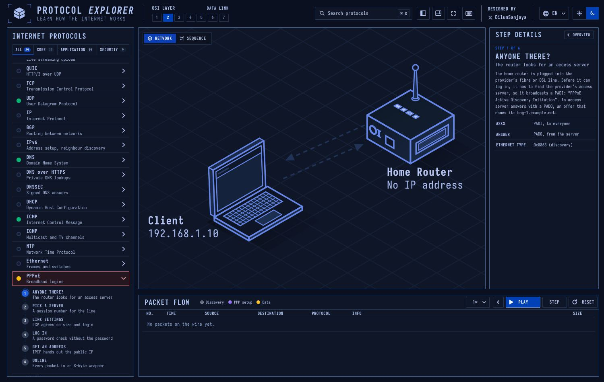
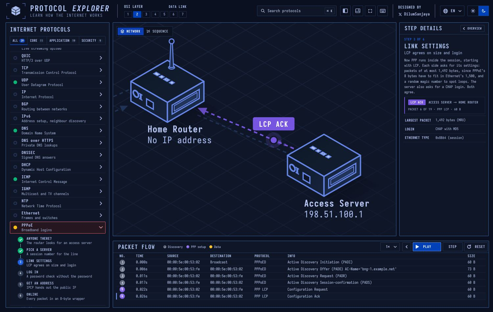
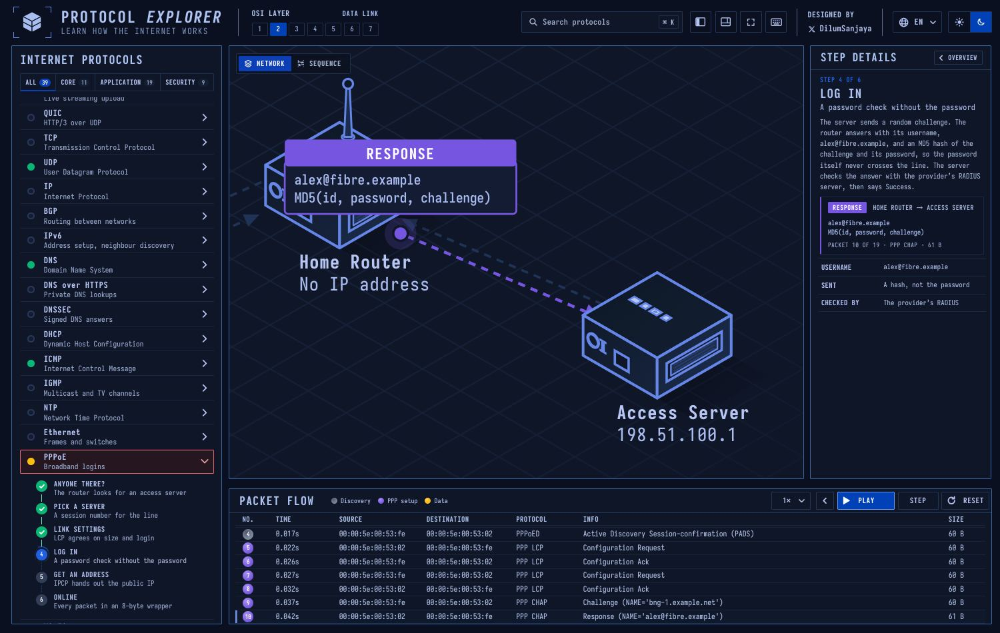
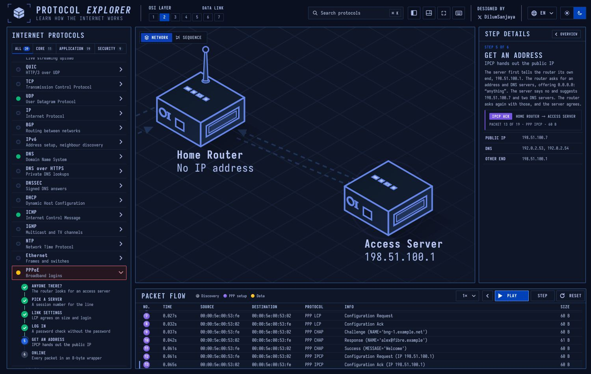
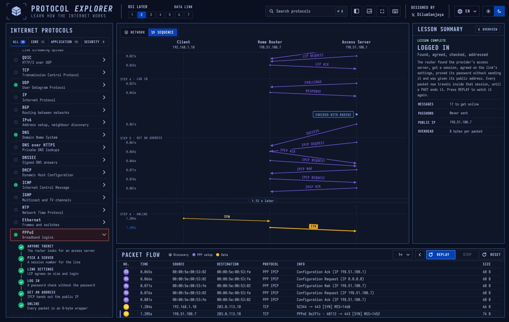
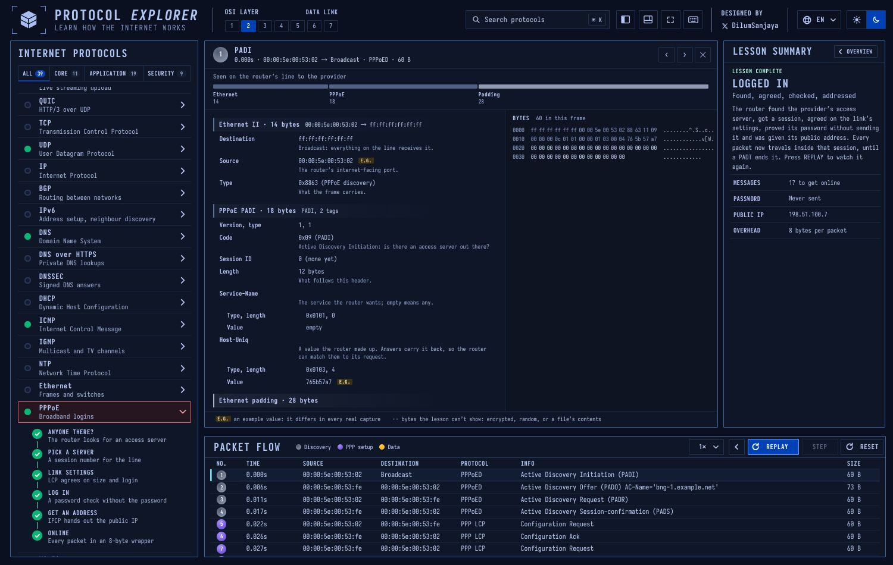
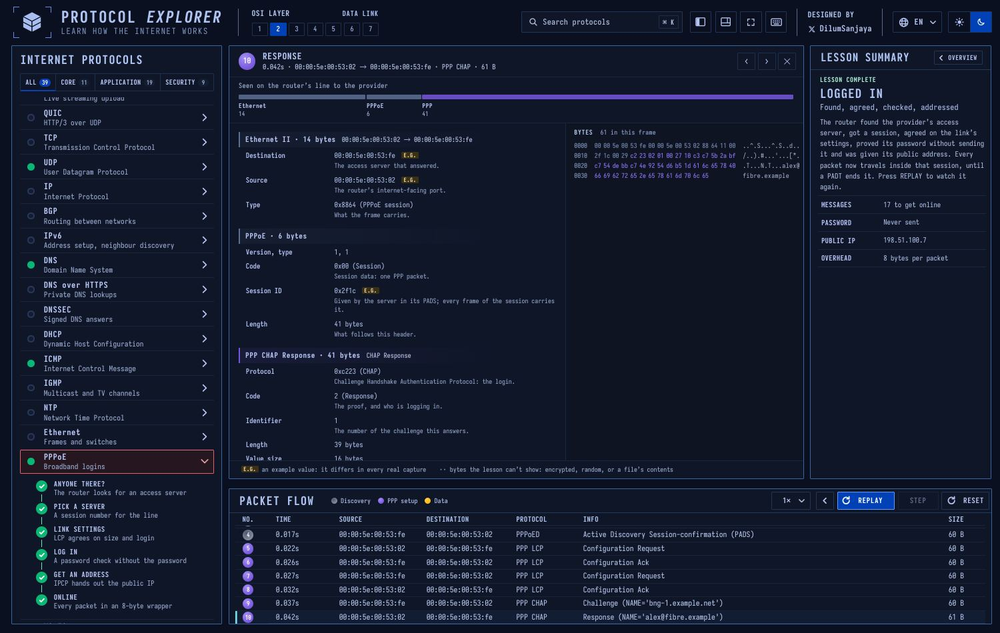

# PPPoE – Broadband logins

<!-- nav -->
⬅ [21 Ethernet](21-ethernet.md) · [Index](00_Protocols_Index.md) · [23 Wi-Fi](23-wi-fi.md) ➡
<!-- nav -->

*Source: Protocol Explorer – https://protocol-explorer-alpha.vercel.app/ (interactive lesson #22). Screenshots captured from the live lesson; packet decodes are the site's example capture (values marked **E.G.** differ in every real capture).*

## Overview


> PROTOCOL OVERVIEW  
> PPPoE  
> ACTIVE  
> Point-to-Point Protocol over Ethernet  
> Many DSL and fibre providers make the home router log in before it gets online. PPPoE is how: the router finds the provider’s access server and opens a session with it, then runs PPP inside, agreeing on the link’s settings, logging in with the username and password from the provider and receiving its public IP address. Every packet then carries an 8-byte PPPoE header.  
> LAYER  
> Data Link (Layer 2)  
> DISCOVERY  
> PADI, PADO, PADR, PADS  
> LOGIN  
> CHAP or PAP  
> ADDRESS  
> From IPCP  
> OVERHEAD  
> 8 bytes (MTU 1,492)  
> DEFINED IN  
> RFC 2516, RFC 1661  

## In-depth explanation of the example (plain-language version)

### The big picture in one minute
A home router is plugged into a DSL or fibre line. Many internet providers require the router to **log in** before it gets internet access. The lesson shows the whole sequence: **find** the provider's access server, **open a session**, **agree on link settings**, **log in** as `alex@fibre.example`, **receive a public IP address** (`198.51.100.7`), and finally **send the first web packet.** 19 frames in about 1.2 seconds.

**What PPPoE is.** Plain Ethernet has no idea of "log in" or "one account per customer". **PPP**, the old dial-up protocol, does. **PPPoE** puts **PPP inside Ethernet frames**, so a broadband line behaves like a dial-up connection: an account, a password check, an address given to each customer, and usage records.

Think of it as **a dial-up modem call inside your broadband cable**. Two stages: **Discovery** (find the server and get a session number) and **Session** (the PPP conversation that runs inside).

> **Words you'll see:** *BNG/BRAS* = the provider's access server that customers log in to. *Session ID* = a number identifying your session. *CHAP* = a password check that never sends the password. *MTU* = the biggest packet size on a link.

---

### Step 1 – "Is there a server out there?" – packets 1, 2
- **PADI** (a broadcast): the router shouts "Is there a PPPoE server?"
- **PADO** (offer): the provider's access server `bng-1.example.net` replies, adding a **cookie** (an anti-spoofing token). If several servers answer, the router picks one.

### Step 2 – Choose a server and get a session number – packets 3, 4
- **PADR** (request): the router asks the chosen server and repeats the cookie.
- **PADS** (confirmation): the server returns a **Session ID `0x2f1c`**. From now on every frame carries this number. PPPoE adds an **8-byte wrapper** around each packet.

### Step 3 – Agree on link settings (LCP) – packets 5 to 8
Each side lists its wishes and the other approves:
- **MRU 1,492 bytes**: the biggest packet size. It's 1,492 and not 1,500 because the 8-byte wrapper has to fit inside Ethernet's 1,500.
- A random **magic number** to detect a line looped back on itself.
- The server also says: "you must log in using **CHAP**."

### Step 4 – Logging in (CHAP) – packets 9 to 11
- **Challenge** (9): the server sends a random value.
- **Response** (10): the router sends its **username** and a **scrambled fingerprint** of (password + challenge). **The password itself never travels.**
- The server checks it, usually by asking the provider's **RADIUS** server (see the RADIUS note), and replies **Success** (11). (The older alternative, PAP, sends the password in plain text.)

### Step 5 – Getting an IP address (IPCP) – packets 12 to 17
- The server says: "My end of the link is `198.51.100.1`," and the router agrees.
- The router asks for "any address" (`0.0.0.0`), and the server answers with what it will give: **`198.51.100.7`** plus two DNS servers.
- The router asks for exactly those, and the server approves. The router's internet address is now **`198.51.100.7`**.

### Step 6 – Online – packets 18, 19
The laptop opens a website. The router **translates** the private address to its public one (NAT) and sends the packet **inside the PPPoE session**. It also **lowers a TCP setting called MSS from 1,460 to 1,452** so that replies fit the smaller 1,492 packet size. Forgetting this is a classic PPPoE problem.

---

### The 19 frames at a glance
| Packets | What | Why |
|---|---|---|
| 1–2 | PADI, PADO | find a server |
| 3–4 | PADR, PADS | get a session ID |
| 5–8 | LCP | agree on link settings |
| 9–11 | CHAP | log in |
| 12–17 | IPCP | receive the public IP and DNS |
| 18–19 | first web packet | go online |

### What to remember
- **Two phases:** *Discovery* (PADI, PADO, PADR, PADS; later PADT to hang up) and the *PPP session* (link settings → login → address).
- **MTU 1,492 and MSS 1,452** because of the 8-byte wrapper. A wrong setting makes some websites hang while others work.
- It gives providers **login, one address per customer, usage records and session control.**
- Today many fibre networks use **IPoE with DHCP** instead; PPPoE is still common on DSL.
- **Security:** CHAP protects the password, but PPPoE does **not** encrypt your data. It is not a VPN.

## Step-by-step walkthrough (screenshots from the lesson)

### Step 1: ANYONE THERE? – The router looks for an access server



> STEP 1 OF 6  
> ANYONE THERE?  
> The router looks for an access server  
> The home router is plugged into the provider’s fibre or DSL line. Before it can log in, it has to find the provider’s access server, so it broadcasts a PADI: “PPPoE Active Discovery Initiation”. An access server answers with a PADO, an offer that names it: bng-1.example.net.  
> ASKS  
> PADI, to everyone  
> ANSWER  
> PADO, from the server  
> ETHERNET TYPE  
> 0x8863 (discovery)  

### Step 2: PICK A SERVER – A session number for the line


> STEP 2 OF 6  
> PICK A SERVER  
> A session number for the line  
> If several servers answered, the router picks one and asks it directly with a PADR, sending back the cookie it was given. The server replies with a PADS carrying a session ID, 0x2f1c. From now on every frame between the two of them carries that number.  
> PADS  
> ACCESS SERVER → HOME ROUTER  
> session ID 0x2f1c  
> PACKET 4 OF 19 · PPPoED · 60 B  
> REQUEST  
> PADR  
> CONFIRMED  
> PADS  
> SESSION ID  
> 0x2f1c  

### Step 3: LINK SETTINGS – LCP agrees on size and login



> STEP 3 OF 6  
> LINK SETTINGS  
> LCP agrees on size and login  
> Now PPP runs inside the session, starting with LCP. Each side asks for its settings: packets of at most 1,492 bytes, since PPPoE’s 8 bytes have to fit in Ethernet’s 1,500, and a random magic number to spot loops. The server also asks for a CHAP login. Both agree.  
> LCP ACK  
> ACCESS SERVER → HOME ROUTER  
> PACKET 6 OF 19 · PPP LCP · 60 B  
> LARGEST PACKET  
> 1,492 bytes (MRU)  
> LOGIN  
> CHAP with MD5  
> ETHERNET TYPE  
> 0x8864 (session)  

### Step 4: LOG IN – A password check without the password



> STEP 4 OF 6  
> LOG IN  
> A password check without the password  
> The server sends a random challenge. The router answers with its username, alex@fibre.example, and an MD5 hash of the challenge and its password, so the password itself never crosses the line. The server checks the answer with the provider’s RADIUS server, then says Success.  
> RESPONSE  
> HOME ROUTER → ACCESS SERVER  
> alex@fibre.example  
> MD5(id, password, challenge)  
> PACKET 10 OF 19 · PPP CHAP · 61 B  
> USERNAME  
> alex@fibre.example  
> SENT  
> A hash, not the password  
> CHECKED BY  
> The provider’s RADIUS  

### Step 5: GET AN ADDRESS – IPCP hands out the public IP



> STEP 5 OF 6  
> GET AN ADDRESS  
> IPCP hands out the public IP  
> The server first tells the router its own end, 198.51.100.1. The router asks for an address and DNS servers, offering 0.0.0.0: “anything”. The server says no and suggests 198.51.100.7 and two DNS servers. The router asks again with those, and the server agrees.  
> IPCP ACK  
> HOME ROUTER → ACCESS SERVER  
> PACKET 13 OF 19 · PPP IPCP · 60 B  
> PUBLIC IP  
> 198.51.100.7  
> DNS  
> 192.0.2.53, 192.0.2.54  
> OTHER END  
> 198.51.100.1  

### Step 6: ONLINE – Every packet in an 8-byte wrapper


> STEP 6 OF 6  
> ONLINE  
> Every packet in an 8-byte wrapper  
> The laptop opens a website. The router swaps in its public address (NAT) and sends the packet inside the session: a 6-byte PPPoE header, then 2 bytes saying “IPv4”. It also lowers the MSS the laptop offered from 1460 to 1452, so the replies fit in 1,492 bytes.  
> SYN  
> CLIENT → HOME ROUTER  
> to 203.0.113.10:443  
> MSS 1460  
> PACKET 18 OF 19 · TCP · 66 B  
> WRAPPER  
> 6 + 2 bytes  
> LARGEST PACKET  
> 1,492 bytes  
> MSS  
> 1460 → 1452 (clamped)  

### Lesson summary


> LESSON SUMMARY  
> LESSON COMPLETE  
> LOGGED IN  
> Found, agreed, checked, addressed  
> The router found the provider’s access server, got a session, agreed on the link’s settings, proved its password without sending it and was given its public address. Every packet now travels inside that session, until a PADT ends it. Press REPLAY to watch it again.  
> SYN  
> HOME ROUTER → ACCESS SERVER  
> in session 0x2f1c  
> MSS now 1452  
> PACKET 19 OF 19 · TCP · 74 B  
> MESSAGES  
> 17 to get online  
> PASSWORD  
> Never sent  
> PUBLIC IP  
> 198.51.100.7  
> OVERHEAD  
> 8 bytes per packet  

## Packet flow (whole lesson)

| No. | Time | Source | Destination | Protocol | Info | Size |
|---|---|---|---|---|---|---|
| 1 | 0.000s | 00:00:5e:00:53:02 | Broadcast | PPPoED | Active Discovery Initiation (PADI) | 60 B |
| 2 | 0.006s | 00:00:5e:00:53:fe | 00:00:5e:00:53:02 | PPPoED | Active Discovery Offer (PADO) AC-Name='bng-1.example.net' | 73 B |
| 3 | 0.011s | 00:00:5e:00:53:02 | 00:00:5e:00:53:fe | PPPoED | Active Discovery Request (PADR) | 60 B |
| 4 | 0.017s | 00:00:5e:00:53:fe | 00:00:5e:00:53:02 | PPPoED | Active Discovery Session-confirmation (PADS) | 60 B |
| 5 | 0.022s | 00:00:5e:00:53:02 | 00:00:5e:00:53:fe | PPP LCP | Configuration Request | 60 B |
| 6 | 0.026s | 00:00:5e:00:53:fe | 00:00:5e:00:53:02 | PPP LCP | Configuration Ack | 60 B |
| 7 | 0.027s | 00:00:5e:00:53:fe | 00:00:5e:00:53:02 | PPP LCP | Configuration Request | 60 B |
| 8 | 0.032s | 00:00:5e:00:53:02 | 00:00:5e:00:53:fe | PPP LCP | Configuration Ack | 60 B |
| 9 | 0.037s | 00:00:5e:00:53:fe | 00:00:5e:00:53:02 | PPP CHAP | Challenge (NAME='bng-1.example.net') | 60 B |
| 10 | 0.042s | 00:00:5e:00:53:02 | 00:00:5e:00:53:fe | PPP CHAP | Response (NAME='alex@fibre.example') | 61 B |
| 11 | 0.061s | 00:00:5e:00:53:fe | 00:00:5e:00:53:02 | PPP CHAP | Success (MESSAGE='Welcome') | 60 B |
| 12 | 0.061s | 00:00:5e:00:53:fe | 00:00:5e:00:53:02 | PPP IPCP | Configuration Request (IP 198.51.100.1) | 60 B |
| 13 | 0.065s | 00:00:5e:00:53:02 | 00:00:5e:00:53:fe | PPP IPCP | Configuration Ack (IP 198.51.100.1) | 60 B |
| 14 | 0.066s | 00:00:5e:00:53:02 | 00:00:5e:00:53:fe | PPP IPCP | Configuration Request (IP 0.0.0.0) | 60 B |
| 15 | 0.071s | 00:00:5e:00:53:fe | 00:00:5e:00:53:02 | PPP IPCP | Configuration Nak (IP 198.51.100.7) | 60 B |
| 16 | 0.076s | 00:00:5e:00:53:02 | 00:00:5e:00:53:fe | PPP IPCP | Configuration Request (IP 198.51.100.7) | 60 B |
| 17 | 0.081s | 00:00:5e:00:53:fe | 00:00:5e:00:53:02 | PPP IPCP | Configuration Ack (IP 198.51.100.7) | 60 B |
| 18 | 1.204s | 192.168.1.10 | 203.0.113.10 | TCP | 52344 → 443 [SYN] MSS=1460 | 66 B |
| 19 | 1.205s | 198.51.100.7 | 203.0.113.10 | TCP | PPPoE 0x2f1c · 40112 → 443 [SYN] MSS=1452 | 74 B |

### Sequence diagram



## Packets decoded byte by byte

Each packet below is the lesson's own decode (headers, field values and the plain-English meaning of each field). Screenshots show the first, middle and last packet in the lesson's decoder view with the raw hex bytes.

### Packet 1: PPPoED – Active Discovery Initiation (PADI)

*00:00:5e:00:53:02 → Broadcast · 60 B · t = 0.000s*



<details><summary>Decoded fields</summary>

```text
1
PADI
0.000s · 00:00:5e:00:53:02 → Broadcast · PPPoED · 60 B
Seen on the router’s line to the provider
Ethernet
14
PPPoE
18
Padding
28
Ethernet II · 14 bytes
00:00:5e:00:53:02 → ff:ff:ff:ff:ff:ff
Destination
ff:ff:ff:ff:ff:ff

Broadcast: everything on the line receives it.

Source
00:00:5e:00:53:02 E.G.

The router’s internet-facing port.

Type
0x8863 (PPPoE discovery)

What the frame carries.

PPPoE PADI · 18 bytes
PADI, 2 tags
Version, type
1, 1
Code
0x09 (PADI)

Active Discovery Initiation: is there an access server out there?

Session ID
0 (none yet)
Length
12 bytes

What follows this header.

Service-Name

The service the router wants; empty means any.

Type, length
0x0101, 0
Value
empty
Host-Uniq

A value the router made up. Answers carry it back, so the router can match them to its request.

Type, length
0x0103, 4
Value
765b57a7 E.G.
Ethernet padding · 28 bytes
Padding
28 zero bytes

Ethernet frames are at least 60 bytes (64 with the checksum the card adds), so short ones are padded.

BYTES 60 in this frame
0000
ff
ff
ff
ff
ff
ff
00
00
5e
00
53
02
88
63
11
09
.
.
.
.
.
.
.
.
^
.
S
.
.
c
.
.
0010
00
00
00
0c
01
01
00
00
01
03
00
04
76
5b
57
a7
.
.
.
.
.
.
.
.
.
.
.
.
v
[
W
.
0020
00
00
00
00
00
00
00
00
00
00
00
00
00
00
00
00
.
.
.
.
.
.
.
.
.
.
.
.
.
.
.
.
0030
00
00
00
00
00
00
00
00
00
00
00
00
.
.
.
.
.
.
.
.
.
.
.
.
E.G. an example value: it differs in every real capture
·· bytes the lesson can’t show: encrypted, random, or a file’s contents
```

</details>

### Packet 2: PPPoED – Active Discovery Offer (PADO) AC-Name='bng-1.example.net'

*00:00:5e:00:53:fe → 00:00:5e:00:53:02 · 73 B · t = 0.006s*

<details><summary>Decoded fields</summary>

```text
2
PADO
0.006s · 00:00:5e:00:53:fe → 00:00:5e:00:53:02 · PPPoED · 73 B
Seen on the router’s line to the provider
Ethernet
14
PPPoE
59
Ethernet II · 14 bytes
00:00:5e:00:53:fe → 00:00:5e:00:53:02
Destination
00:00:5e:00:53:02 E.G.

The router’s internet-facing port.

Source
00:00:5e:00:53:fe E.G.

The access server’s port.

Type
0x8863 (PPPoE discovery)

What the frame carries.

PPPoE PADO · 59 bytes
PADO, 4 tags
Version, type
1, 1
Code
0x07 (PADO)

Active Discovery Offer: an access server answers.

Session ID
0 (none yet)
Length
53 bytes

What follows this header.

AC-Name

The access server’s name.

Type, length
0x0102, 17
Value
"bng-1.example.net"
Service-Name

The service the router wants; empty means any.

Type, length
0x0101, 0
Value
empty
AC-Cookie

A value the server will recognise when the router asks for it again, so floods of fake requests cost it nothing.

Type, length
0x0104, 16
Value
24f0043720effdeb1ceff79f28d41222 E.G.
Host-Uniq

A value the router made up. Answers carry it back, so the router can match them to its request.

Type, length
0x0103, 4
Value
765b57a7 E.G.
BYTES 73 in this frame
0000
00
00
5e
00
53
02
00
00
5e
00
53
fe
88
63
11
07
.
.
^
.
S
.
.
.
^
.
S
.
.
c
.
.
0010
00
00
00
35
01
02
00
11
62
6e
67
2d
31
2e
65
78
.
.
.
5
.
.
.
.
b
n
g
-
1
.
e
x
0020
61
6d
70
6c
65
2e
6e
65
74
01
01
00
00
01
04
00
a
m
p
l
e
.
n
e
t
.
.
.
.
.
.
.
0030
10
24
f0
04
37
20
ef
fd
eb
1c
ef
f7
9f
28
d4
12
.
$
.
.
7
.
.
.
.
.
.
.
(
.
.
0040
22
01
03
00
04
76
5b
57
a7
"
.
.
.
.
v
[
W
.
E.G. an example value: it differs in every real capture
·· bytes the lesson can’t show: encrypted, random, or a file’s contents
```

</details>

### Packet 3: PPPoED – Active Discovery Request (PADR)

*00:00:5e:00:53:02 → 00:00:5e:00:53:fe · 60 B · t = 0.011s*

<details><summary>Decoded fields</summary>

```text
3
PADR
0.011s · 00:00:5e:00:53:02 → 00:00:5e:00:53:fe · PPPoED · 60 B
Seen on the router’s line to the provider
Ethernet
14
PPPoE
38
Padding
8
Ethernet II · 14 bytes
00:00:5e:00:53:02 → 00:00:5e:00:53:fe
Destination
00:00:5e:00:53:fe E.G.

The access server that answered.

Source
00:00:5e:00:53:02 E.G.

The router’s internet-facing port.

Type
0x8863 (PPPoE discovery)

What the frame carries.

PPPoE PADR · 38 bytes
PADR, 3 tags
Version, type
1, 1
Code
0x19 (PADR)

Active Discovery Request: the router picks this server.

Session ID
0 (none yet)
Length
32 bytes

What follows this header.

Service-Name

The service the router wants; empty means any.

Type, length
0x0101, 0
Value
empty
Host-Uniq

A value the router made up. Answers carry it back, so the router can match them to its request.

Type, length
0x0103, 4
Value
765b57a7 E.G.
AC-Cookie

A value the server will recognise when the router asks for it again, so floods of fake requests cost it nothing.

Type, length
0x0104, 16
Value
24f0043720effdeb1ceff79f28d41222 E.G.
Ethernet padding · 8 bytes
Padding
8 zero bytes

Ethernet frames are at least 60 bytes (64 with the checksum the card adds), so short ones are padded.

BYTES 60 in this frame
0000
00
00
5e
00
53
fe
00
00
5e
00
53
02
88
63
11
19
.
.
^
.
S
.
.
.
^
.
S
.
.
c
.
.
0010
00
00
00
20
01
01
00
00
01
03
00
04
76
5b
57
a7
.
.
.
.
.
.
.
.
.
.
.
v
[
W
.
0020
01
04
00
10
24
f0
04
37
20
ef
fd
eb
1c
ef
f7
9f
.
.
.
.
$
.
.
7
.
.
.
.
.
.
.
0030
28
d4
12
22
00
00
00
00
00
00
00
00
(
.
.
"
.
.
.
.
.
.
.
.
E.G. an example value: it differs in every real capture
·· bytes the lesson can’t show: encrypted, random, or a file’s contents
```

</details>

### Packet 4: PPPoED – Active Discovery Session-confirmation (PADS)

*00:00:5e:00:53:fe → 00:00:5e:00:53:02 · 60 B · t = 0.017s*

<details><summary>Decoded fields</summary>

```text
4
PADS
0.017s · 00:00:5e:00:53:fe → 00:00:5e:00:53:02 · PPPoED · 60 B
Seen on the router’s line to the provider
Ethernet
14
PPPoE
18
Padding
28
Ethernet II · 14 bytes
00:00:5e:00:53:fe → 00:00:5e:00:53:02
Destination
00:00:5e:00:53:02 E.G.

The router’s internet-facing port.

Source
00:00:5e:00:53:fe E.G.

The access server’s port.

Type
0x8863 (PPPoE discovery)

What the frame carries.

PPPoE PADS · 18 bytes
PADS, 2 tags
Version, type
1, 1
Code
0x65 (PADS)

Active Discovery Session-confirmation: here is the session ID.

Session ID
0x2f1c E.G.

Given by the server in its PADS; every frame of the session carries it.

Length
12 bytes

What follows this header.

Service-Name

The service the router wants; empty means any.

Type, length
0x0101, 0
Value
empty
Host-Uniq

A value the router made up. Answers carry it back, so the router can match them to its request.

Type, length
0x0103, 4
Value
765b57a7 E.G.
Ethernet padding · 28 bytes
Padding
28 zero bytes

Ethernet frames are at least 60 bytes (64 with the checksum the card adds), so short ones are padded.

BYTES 60 in this frame
0000
00
00
5e
00
53
02
00
00
5e
00
53
fe
88
63
11
65
.
.
^
.
S
.
.
.
^
.
S
.
.
c
.
e
0010
2f
1c
00
0c
01
01
00
00
01
03
00
04
76
5b
57
a7
/
.
.
.
.
.
.
.
.
.
.
.
v
[
W
.
0020
00
00
00
00
00
00
00
00
00
00
00
00
00
00
00
00
.
.
.
.
.
.
.
.
.
.
.
.
.
.
.
.
0030
00
00
00
00
00
00
00
00
00
00
00
00
.
.
.
.
.
.
.
.
.
.
.
.
E.G. an example value: it differs in every real capture
·· bytes the lesson can’t show: encrypted, random, or a file’s contents
```

</details>

### Packet 5: PPP LCP – Configuration Request

*00:00:5e:00:53:02 → 00:00:5e:00:53:fe · 60 B · t = 0.022s*

<details><summary>Decoded fields</summary>

```text
5
LCP REQUEST
0.022s · 00:00:5e:00:53:02 → 00:00:5e:00:53:fe · PPP LCP · 60 B
Seen on the router’s line to the provider
Ethernet
14
PPPoE
6
PPP
16
Padding
24
Ethernet II · 14 bytes
00:00:5e:00:53:02 → 00:00:5e:00:53:fe
Destination
00:00:5e:00:53:fe E.G.

The access server that answered.

Source
00:00:5e:00:53:02 E.G.

The router’s internet-facing port.

Type
0x8864 (PPPoE session)

What the frame carries.

PPPoE · 6 bytes
Version, type
1, 1
Code
0x00 (Session)

Session data: one PPP packet.

Session ID
0x2f1c E.G.

Given by the server in its PADS; every frame of the session carries it.

Length
16 bytes

What follows this header.

PPP LCP Configure-Request · 16 bytes
LCP Configure-Request
Protocol
0xc021 (LCP)

Link Control Protocol: the link’s settings.

Code
1 (Configure-Request)

The settings this side wants.

Identifier
1

The answer carries the same number.

Length
14 bytes
Options
10 bytes
Maximum-Receive-Unit
1492 bytes

The largest packet this side will take: 1,500 bytes of Ethernet minus PPPoE’s 8.

Magic-Number
0x5a3c91e7 E.G.

Random. Seeing its own number come back would mean the line loops back on itself.

Ethernet padding · 24 bytes
Padding
24 zero bytes

Ethernet frames are at least 60 bytes (64 with the checksum the card adds), so short ones are padded.

BYTES 60 in this frame
0000
00
00
5e
00
53
fe
00
00
5e
00
53
02
88
64
11
00
.
.
^
.
S
.
.
.
^
.
S
.
.
d
.
.
0010
2f
1c
00
10
c0
21
01
01
00
0e
01
04
05
d4
05
06
/
.
.
.
.
!
.
.
.
.
.
.
.
.
.
.
0020
5a
3c
91
e7
00
00
00
00
00
00
00
00
00
00
00
00
Z
<
.
.
.
.
.
.
.
.
.
.
.
.
.
.
0030
00
00
00
00
00
00
00
00
00
00
00
00
.
.
.
.
.
.
.
.
.
.
.
.
E.G. an example value: it differs in every real capture
·· bytes the lesson can’t show: encrypted, random, or a file’s contents
```

</details>

### Packet 6: PPP LCP – Configuration Ack

*00:00:5e:00:53:fe → 00:00:5e:00:53:02 · 60 B · t = 0.026s*

<details><summary>Decoded fields</summary>

```text
6
LCP ACK
0.026s · 00:00:5e:00:53:fe → 00:00:5e:00:53:02 · PPP LCP · 60 B
Seen on the router’s line to the provider
Ethernet
14
PPPoE
6
PPP
16
Padding
24
Ethernet II · 14 bytes
00:00:5e:00:53:fe → 00:00:5e:00:53:02
Destination
00:00:5e:00:53:02 E.G.

The router’s internet-facing port.

Source
00:00:5e:00:53:fe E.G.

The access server’s port.

Type
0x8864 (PPPoE session)

What the frame carries.

PPPoE · 6 bytes
Version, type
1, 1
Code
0x00 (Session)

Session data: one PPP packet.

Session ID
0x2f1c E.G.

Given by the server in its PADS; every frame of the session carries it.

Length
16 bytes

What follows this header.

PPP LCP Configure-Ack · 16 bytes
LCP Configure-Ack
Protocol
0xc021 (LCP)

Link Control Protocol: the link’s settings.

Code
2 (Configure-Ack)

Every setting accepted, exactly as asked.

Identifier
1

The number of the request this answers.

Length
14 bytes
Options
10 bytes
Maximum-Receive-Unit
1492 bytes

The largest packet this side will take: 1,500 bytes of Ethernet minus PPPoE’s 8.

Magic-Number
0x5a3c91e7 E.G.

Random. Seeing its own number come back would mean the line loops back on itself.

Ethernet padding · 24 bytes
Padding
24 zero bytes

Ethernet frames are at least 60 bytes (64 with the checksum the card adds), so short ones are padded.

BYTES 60 in this frame
0000
00
00
5e
00
53
02
00
00
5e
00
53
fe
88
64
11
00
.
.
^
.
S
.
.
.
^
.
S
.
.
d
.
.
0010
2f
1c
00
10
c0
21
02
01
00
0e
01
04
05
d4
05
06
/
.
.
.
.
!
.
.
.
.
.
.
.
.
.
.
0020
5a
3c
91
e7
00
00
00
00
00
00
00
00
00
00
00
00
Z
<
.
.
.
.
.
.
.
.
.
.
.
.
.
.
0030
00
00
00
00
00
00
00
00
00
00
00
00
.
.
.
.
.
.
.
.
.
.
.
.
E.G. an example value: it differs in every real capture
·· bytes the lesson can’t show: encrypted, random, or a file’s contents
```

</details>

### Packet 7: PPP LCP – Configuration Request

*00:00:5e:00:53:fe → 00:00:5e:00:53:02 · 60 B · t = 0.027s*

<details><summary>Decoded fields</summary>

```text
7
LCP REQUEST
0.027s · 00:00:5e:00:53:fe → 00:00:5e:00:53:02 · PPP LCP · 60 B
Seen on the router’s line to the provider
Ethernet
14
PPPoE
6
PPP
21
Padding
19
Ethernet II · 14 bytes
00:00:5e:00:53:fe → 00:00:5e:00:53:02
Destination
00:00:5e:00:53:02 E.G.

The router’s internet-facing port.

Source
00:00:5e:00:53:fe E.G.

The access server’s port.

Type
0x8864 (PPPoE session)

What the frame carries.

PPPoE · 6 bytes
Version, type
1, 1
Code
0x00 (Session)

Session data: one PPP packet.

Session ID
0x2f1c E.G.

Given by the server in its PADS; every frame of the session carries it.

Length
21 bytes

What follows this header.

PPP LCP Configure-Request · 21 bytes
LCP Configure-Request
Protocol
0xc021 (LCP)

Link Control Protocol: the link’s settings.

Code
1 (Configure-Request)

The settings this side wants.

Identifier
1

The answer carries the same number.

Length
19 bytes
Options
15 bytes
Maximum-Receive-Unit
1492 bytes

The largest packet this side will take: 1,500 bytes of Ethernet minus PPPoE’s 8.

Authentication-Protocol
CHAP with MD5

How the server wants the router to log in.

Magic-Number
0x1d84b02c E.G.

Random. Seeing its own number come back would mean the line loops back on itself.

Ethernet padding · 19 bytes
Padding
19 zero bytes

Ethernet frames are at least 60 bytes (64 with the checksum the card adds), so short ones are padded.

BYTES 60 in this frame
0000
00
00
5e
00
53
02
00
00
5e
00
53
fe
88
64
11
00
.
.
^
.
S
.
.
.
^
.
S
.
.
d
.
.
0010
2f
1c
00
15
c0
21
01
01
00
13
01
04
05
d4
03
05
/
.
.
.
.
!
.
.
.
.
.
.
.
.
.
.
0020
c2
23
05
05
06
1d
84
b0
2c
00
00
00
00
00
00
00
.
#
.
.
.
.
.
.
,
.
.
.
.
.
.
.
0030
00
00
00
00
00
00
00
00
00
00
00
00
.
.
.
.
.
.
.
.
.
.
.
.
E.G. an example value: it differs in every real capture
·· bytes the lesson can’t show: encrypted, random, or a file’s contents
```

</details>

### Packet 8: PPP LCP – Configuration Ack

*00:00:5e:00:53:02 → 00:00:5e:00:53:fe · 60 B · t = 0.032s*

<details><summary>Decoded fields</summary>

```text
8
LCP ACK
0.032s · 00:00:5e:00:53:02 → 00:00:5e:00:53:fe · PPP LCP · 60 B
Seen on the router’s line to the provider
Ethernet
14
PPPoE
6
PPP
21
Padding
19
Ethernet II · 14 bytes
00:00:5e:00:53:02 → 00:00:5e:00:53:fe
Destination
00:00:5e:00:53:fe E.G.

The access server that answered.

Source
00:00:5e:00:53:02 E.G.

The router’s internet-facing port.

Type
0x8864 (PPPoE session)

What the frame carries.

PPPoE · 6 bytes
Version, type
1, 1
Code
0x00 (Session)

Session data: one PPP packet.

Session ID
0x2f1c E.G.

Given by the server in its PADS; every frame of the session carries it.

Length
21 bytes

What follows this header.

PPP LCP Configure-Ack · 21 bytes
LCP Configure-Ack
Protocol
0xc021 (LCP)

Link Control Protocol: the link’s settings.

Code
2 (Configure-Ack)

Every setting accepted, exactly as asked.

Identifier
1

The number of the request this answers.

Length
19 bytes
Options
15 bytes
Maximum-Receive-Unit
1492 bytes

The largest packet this side will take: 1,500 bytes of Ethernet minus PPPoE’s 8.

Authentication-Protocol
CHAP with MD5

How the server wants the router to log in.

Magic-Number
0x1d84b02c E.G.

Random. Seeing its own number come back would mean the line loops back on itself.

Ethernet padding · 19 bytes
Padding
19 zero bytes

Ethernet frames are at least 60 bytes (64 with the checksum the card adds), so short ones are padded.

BYTES 60 in this frame
0000
00
00
5e
00
53
fe
00
00
5e
00
53
02
88
64
11
00
.
.
^
.
S
.
.
.
^
.
S
.
.
d
.
.
0010
2f
1c
00
15
c0
21
02
01
00
13
01
04
05
d4
03
05
/
.
.
.
.
!
.
.
.
.
.
.
.
.
.
.
0020
c2
23
05
05
06
1d
84
b0
2c
00
00
00
00
00
00
00
.
#
.
.
.
.
.
.
,
.
.
.
.
.
.
.
0030
00
00
00
00
00
00
00
00
00
00
00
00
.
.
.
.
.
.
.
.
.
.
.
.
E.G. an example value: it differs in every real capture
·· bytes the lesson can’t show: encrypted, random, or a file’s contents
```

</details>

### Packet 9: PPP CHAP – Challenge (NAME='bng-1.example.net')

*00:00:5e:00:53:fe → 00:00:5e:00:53:02 · 60 B · t = 0.037s*

<details><summary>Decoded fields</summary>

```text
9
CHALLENGE
0.037s · 00:00:5e:00:53:fe → 00:00:5e:00:53:02 · PPP CHAP · 60 B
Seen on the router’s line to the provider
Ethernet
14
PPPoE
6
PPP
40
Ethernet II · 14 bytes
00:00:5e:00:53:fe → 00:00:5e:00:53:02
Destination
00:00:5e:00:53:02 E.G.

The router’s internet-facing port.

Source
00:00:5e:00:53:fe E.G.

The access server’s port.

Type
0x8864 (PPPoE session)

What the frame carries.

PPPoE · 6 bytes
Version, type
1, 1
Code
0x00 (Session)

Session data: one PPP packet.

Session ID
0x2f1c E.G.

Given by the server in its PADS; every frame of the session carries it.

Length
40 bytes

What follows this header.

PPP CHAP Challenge · 40 bytes
CHAP Challenge
Protocol
0xc223 (CHAP)

Challenge Handshake Authentication Protocol: the login.

Code
1 (Challenge)

A random value for the router to prove its password with.

Identifier
1

The response must carry the same number.

Length
38 bytes
Value size
16 bytes
Value
83838c577f83860b7b837fbf6b13c142 E.G.

Random, new for every login.

Name
"bng-1.example.net"

The server’s name.

BYTES 60 in this frame
0000
00
00
5e
00
53
02
00
00
5e
00
53
fe
88
64
11
00
.
.
^
.
S
.
.
.
^
.
S
.
.
d
.
.
0010
2f
1c
00
28
c2
23
01
01
00
26
10
83
83
8c
57
7f
/
.
.
(
.
#
.
.
.
&
.
.
.
.
W
.
0020
83
86
0b
7b
83
7f
bf
6b
13
c1
42
62
6e
67
2d
31
.
.
.
{
.
.
.
k
.
.
B
b
n
g
-
1
0030
2e
65
78
61
6d
70
6c
65
2e
6e
65
74
.
e
x
a
m
p
l
e
.
n
e
t
E.G. an example value: it differs in every real capture
·· bytes the lesson can’t show: encrypted, random, or a file’s contents
```

</details>

### Packet 10: PPP CHAP – Response (NAME='alex@fibre.example')

*00:00:5e:00:53:02 → 00:00:5e:00:53:fe · 61 B · t = 0.042s*



<details><summary>Decoded fields</summary>

```text
10
RESPONSE
0.042s · 00:00:5e:00:53:02 → 00:00:5e:00:53:fe · PPP CHAP · 61 B
Seen on the router’s line to the provider
Ethernet
14
PPPoE
6
PPP
41
Ethernet II · 14 bytes
00:00:5e:00:53:02 → 00:00:5e:00:53:fe
Destination
00:00:5e:00:53:fe E.G.

The access server that answered.

Source
00:00:5e:00:53:02 E.G.

The router’s internet-facing port.

Type
0x8864 (PPPoE session)

What the frame carries.

PPPoE · 6 bytes
Version, type
1, 1
Code
0x00 (Session)

Session data: one PPP packet.

Session ID
0x2f1c E.G.

Given by the server in its PADS; every frame of the session carries it.

Length
41 bytes

What follows this header.

PPP CHAP Response · 41 bytes
CHAP Response
Protocol
0xc223 (CHAP)

Challenge Handshake Authentication Protocol: the login.

Code
2 (Response)

The proof, and who is logging in.

Identifier
1

The number of the challenge this answers.

Length
39 bytes
Value size
16 bytes
Value
c3c75b2abfc754debbc74e9254d6b51d E.G.

MD5 of the identifier, the password and the challenge: it proves the password without sending it.

Name
"alex@fibre.example"

The username the provider gave.

BYTES 61 in this frame
0000
00
00
5e
00
53
fe
00
00
5e
00
53
02
88
64
11
00
.
.
^
.
S
.
.
.
^
.
S
.
.
d
.
.
0010
2f
1c
00
29
c2
23
02
01
00
27
10
c3
c7
5b
2a
bf
/
.
.
)
.
#
.
.
.
'
.
.
.
[
*
.
0020
c7
54
de
bb
c7
4e
92
54
d6
b5
1d
61
6c
65
78
40
.
T
.
.
.
N
.
T
.
.
.
a
l
e
x
@
0030
66
69
62
72
65
2e
65
78
61
6d
70
6c
65
f
i
b
r
e
.
e
x
a
m
p
l
e
E.G. an example value: it differs in every real capture
·· bytes the lesson can’t show: encrypted, random, or a file’s contents
```

</details>

### Packet 11: PPP CHAP – Success (MESSAGE='Welcome')

*00:00:5e:00:53:fe → 00:00:5e:00:53:02 · 60 B · t = 0.061s*

<details><summary>Decoded fields</summary>

```text
11
SUCCESS
0.061s · 00:00:5e:00:53:fe → 00:00:5e:00:53:02 · PPP CHAP · 60 B
Seen on the router’s line to the provider
Ethernet
14
PPPoE
6
PPP
13
Padding
27
Ethernet II · 14 bytes
00:00:5e:00:53:fe → 00:00:5e:00:53:02
Destination
00:00:5e:00:53:02 E.G.

The router’s internet-facing port.

Source
00:00:5e:00:53:fe E.G.

The access server’s port.

Type
0x8864 (PPPoE session)

What the frame carries.

PPPoE · 6 bytes
Version, type
1, 1
Code
0x00 (Session)

Session data: one PPP packet.

Session ID
0x2f1c E.G.

Given by the server in its PADS; every frame of the session carries it.

Length
13 bytes

What follows this header.

PPP CHAP Success · 13 bytes
CHAP Success
Protocol
0xc223 (CHAP)

Challenge Handshake Authentication Protocol: the login.

Code
3 (Success)

The login worked.

Identifier
1

The number of the challenge this answers.

Length
11 bytes
Message
"Welcome"

Text for people to read; any words will do.

Ethernet padding · 27 bytes
Padding
27 zero bytes

Ethernet frames are at least 60 bytes (64 with the checksum the card adds), so short ones are padded.

BYTES 60 in this frame
0000
00
00
5e
00
53
02
00
00
5e
00
53
fe
88
64
11
00
.
.
^
.
S
.
.
.
^
.
S
.
.
d
.
.
0010
2f
1c
00
0d
c2
23
03
01
00
0b
57
65
6c
63
6f
6d
/
.
.
.
.
#
.
.
.
.
W
e
l
c
o
m
0020
65
00
00
00
00
00
00
00
00
00
00
00
00
00
00
00
e
.
.
.
.
.
.
.
.
.
.
.
.
.
.
.
0030
00
00
00
00
00
00
00
00
00
00
00
00
.
.
.
.
.
.
.
.
.
.
.
.
E.G. an example value: it differs in every real capture
·· bytes the lesson can’t show: encrypted, random, or a file’s contents
```

</details>

### Packet 12: PPP IPCP – Configuration Request (IP 198.51.100.1)

*00:00:5e:00:53:fe → 00:00:5e:00:53:02 · 60 B · t = 0.061s*

<details><summary>Decoded fields</summary>

```text
12
IPCP REQUEST
0.061s · 00:00:5e:00:53:fe → 00:00:5e:00:53:02 · PPP IPCP · 60 B
Seen on the router’s line to the provider
Ethernet
14
PPPoE
6
PPP
12
Padding
28
Ethernet II · 14 bytes
00:00:5e:00:53:fe → 00:00:5e:00:53:02
Destination
00:00:5e:00:53:02 E.G.

The router’s internet-facing port.

Source
00:00:5e:00:53:fe E.G.

The access server’s port.

Type
0x8864 (PPPoE session)

What the frame carries.

PPPoE · 6 bytes
Version, type
1, 1
Code
0x00 (Session)

Session data: one PPP packet.

Session ID
0x2f1c E.G.

Given by the server in its PADS; every frame of the session carries it.

Length
12 bytes

What follows this header.

PPP IPCP Configure-Request · 12 bytes
IPCP Configure-Request
Protocol
0x8021 (IPCP)

IP Control Protocol: the IP address and DNS servers.

Code
1 (Configure-Request)

The settings this side wants.

Identifier
1

The answer carries the same number.

Length
10 bytes
Options
6 bytes
IP-Address
198.51.100.1

The address of the server’s end of the link.

Ethernet padding · 28 bytes
Padding
28 zero bytes

Ethernet frames are at least 60 bytes (64 with the checksum the card adds), so short ones are padded.

BYTES 60 in this frame
0000
00
00
5e
00
53
02
00
00
5e
00
53
fe
88
64
11
00
.
.
^
.
S
.
.
.
^
.
S
.
.
d
.
.
0010
2f
1c
00
0c
80
21
01
01
00
0a
03
06
c6
33
64
01
/
.
.
.
.
!
.
.
.
.
.
.
.
3
d
.
0020
00
00
00
00
00
00
00
00
00
00
00
00
00
00
00
00
.
.
.
.
.
.
.
.
.
.
.
.
.
.
.
.
0030
00
00
00
00
00
00
00
00
00
00
00
00
.
.
.
.
.
.
.
.
.
.
.
.
E.G. an example value: it differs in every real capture
·· bytes the lesson can’t show: encrypted, random, or a file’s contents
```

</details>

### Packet 13: PPP IPCP – Configuration Ack (IP 198.51.100.1)

*00:00:5e:00:53:02 → 00:00:5e:00:53:fe · 60 B · t = 0.065s*

<details><summary>Decoded fields</summary>

```text
13
IPCP ACK
0.065s · 00:00:5e:00:53:02 → 00:00:5e:00:53:fe · PPP IPCP · 60 B
Seen on the router’s line to the provider
Ethernet
14
PPPoE
6
PPP
12
Padding
28
Ethernet II · 14 bytes
00:00:5e:00:53:02 → 00:00:5e:00:53:fe
Destination
00:00:5e:00:53:fe E.G.

The access server that answered.

Source
00:00:5e:00:53:02 E.G.

The router’s internet-facing port.

Type
0x8864 (PPPoE session)

What the frame carries.

PPPoE · 6 bytes
Version, type
1, 1
Code
0x00 (Session)

Session data: one PPP packet.

Session ID
0x2f1c E.G.

Given by the server in its PADS; every frame of the session carries it.

Length
12 bytes

What follows this header.

PPP IPCP Configure-Ack · 12 bytes
IPCP Configure-Ack
Protocol
0x8021 (IPCP)

IP Control Protocol: the IP address and DNS servers.

Code
2 (Configure-Ack)

Every setting accepted, exactly as asked.

Identifier
1

The number of the request this answers.

Length
10 bytes
Options
6 bytes
IP-Address
198.51.100.1

The address of the server’s end of the link.

Ethernet padding · 28 bytes
Padding
28 zero bytes

Ethernet frames are at least 60 bytes (64 with the checksum the card adds), so short ones are padded.

BYTES 60 in this frame
0000
00
00
5e
00
53
fe
00
00
5e
00
53
02
88
64
11
00
.
.
^
.
S
.
.
.
^
.
S
.
.
d
.
.
0010
2f
1c
00
0c
80
21
02
01
00
0a
03
06
c6
33
64
01
/
.
.
.
.
!
.
.
.
.
.
.
.
3
d
.
0020
00
00
00
00
00
00
00
00
00
00
00
00
00
00
00
00
.
.
.
.
.
.
.
.
.
.
.
.
.
.
.
.
0030
00
00
00
00
00
00
00
00
00
00
00
00
.
.
.
.
.
.
.
.
.
.
.
.
E.G. an example value: it differs in every real capture
·· bytes the lesson can’t show: encrypted, random, or a file’s contents
```

</details>

### Packet 14: PPP IPCP – Configuration Request (IP 0.0.0.0)

*00:00:5e:00:53:02 → 00:00:5e:00:53:fe · 60 B · t = 0.066s*

<details><summary>Decoded fields</summary>

```text
14
IPCP REQUEST
0.066s · 00:00:5e:00:53:02 → 00:00:5e:00:53:fe · PPP IPCP · 60 B
Seen on the router’s line to the provider
Ethernet
14
PPPoE
6
PPP
24
Padding
16
Ethernet II · 14 bytes
00:00:5e:00:53:02 → 00:00:5e:00:53:fe
Destination
00:00:5e:00:53:fe E.G.

The access server that answered.

Source
00:00:5e:00:53:02 E.G.

The router’s internet-facing port.

Type
0x8864 (PPPoE session)

What the frame carries.

PPPoE · 6 bytes
Version, type
1, 1
Code
0x00 (Session)

Session data: one PPP packet.

Session ID
0x2f1c E.G.

Given by the server in its PADS; every frame of the session carries it.

Length
24 bytes

What follows this header.

PPP IPCP Configure-Request · 24 bytes
IPCP Configure-Request
Protocol
0x8021 (IPCP)

IP Control Protocol: the IP address and DNS servers.

Code
1 (Configure-Request)

The settings this side wants.

Identifier
1

The answer carries the same number.

Length
22 bytes
Options
18 bytes
IP-Address
0.0.0.0

Zero: “please give me an address”.

Primary-DNS-Address
0.0.0.0

Zero: “which DNS server should I use?”

Secondary-DNS-Address
0.0.0.0
Ethernet padding · 16 bytes
Padding
16 zero bytes

Ethernet frames are at least 60 bytes (64 with the checksum the card adds), so short ones are padded.

BYTES 60 in this frame
0000
00
00
5e
00
53
fe
00
00
5e
00
53
02
88
64
11
00
.
.
^
.
S
.
.
.
^
.
S
.
.
d
.
.
0010
2f
1c
00
18
80
21
01
01
00
16
03
06
00
00
00
00
/
.
.
.
.
!
.
.
.
.
.
.
.
.
.
.
0020
81
06
00
00
00
00
83
06
00
00
00
00
00
00
00
00
.
.
.
.
.
.
.
.
.
.
.
.
.
.
.
.
0030
00
00
00
00
00
00
00
00
00
00
00
00
.
.
.
.
.
.
.
.
.
.
.
.
E.G. an example value: it differs in every real capture
·· bytes the lesson can’t show: encrypted, random, or a file’s contents
```

</details>

### Packet 15: PPP IPCP – Configuration Nak (IP 198.51.100.7)

*00:00:5e:00:53:fe → 00:00:5e:00:53:02 · 60 B · t = 0.071s*

<details><summary>Decoded fields</summary>

```text
15
IPCP NAK
0.071s · 00:00:5e:00:53:fe → 00:00:5e:00:53:02 · PPP IPCP · 60 B
Seen on the router’s line to the provider
Ethernet
14
PPPoE
6
PPP
24
Padding
16
Ethernet II · 14 bytes
00:00:5e:00:53:fe → 00:00:5e:00:53:02
Destination
00:00:5e:00:53:02 E.G.

The router’s internet-facing port.

Source
00:00:5e:00:53:fe E.G.

The access server’s port.

Type
0x8864 (PPPoE session)

What the frame carries.

PPPoE · 6 bytes
Version, type
1, 1
Code
0x00 (Session)

Session data: one PPP packet.

Session ID
0x2f1c E.G.

Given by the server in its PADS; every frame of the session carries it.

Length
24 bytes

What follows this header.

PPP IPCP Configure-Nak · 24 bytes
IPCP Configure-Nak
Protocol
0x8021 (IPCP)

IP Control Protocol: the IP address and DNS servers.

Code
3 (Configure-Nak)

Not these values: here are ones that would be accepted.

Identifier
1

The number of the request this answers.

Length
22 bytes
Options
18 bytes
IP-Address
198.51.100.7

The address for the router.

Primary-DNS-Address
192.0.2.53
Secondary-DNS-Address
192.0.2.54
Ethernet padding · 16 bytes
Padding
16 zero bytes

Ethernet frames are at least 60 bytes (64 with the checksum the card adds), so short ones are padded.

BYTES 60 in this frame
0000
00
00
5e
00
53
02
00
00
5e
00
53
fe
88
64
11
00
.
.
^
.
S
.
.
.
^
.
S
.
.
d
.
.
0010
2f
1c
00
18
80
21
03
01
00
16
03
06
c6
33
64
07
/
.
.
.
.
!
.
.
.
.
.
.
.
3
d
.
0020
81
06
c0
00
02
35
83
06
c0
00
02
36
00
00
00
00
.
.
.
.
.
5
.
.
.
.
.
6
.
.
.
.
0030
00
00
00
00
00
00
00
00
00
00
00
00
.
.
.
.
.
.
.
.
.
.
.
.
E.G. an example value: it differs in every real capture
·· bytes the lesson can’t show: encrypted, random, or a file’s contents
```

</details>

### Packet 16: PPP IPCP – Configuration Request (IP 198.51.100.7)

*00:00:5e:00:53:02 → 00:00:5e:00:53:fe · 60 B · t = 0.076s*

<details><summary>Decoded fields</summary>

```text
16
IPCP REQUEST
0.076s · 00:00:5e:00:53:02 → 00:00:5e:00:53:fe · PPP IPCP · 60 B
Seen on the router’s line to the provider
Ethernet
14
PPPoE
6
PPP
24
Padding
16
Ethernet II · 14 bytes
00:00:5e:00:53:02 → 00:00:5e:00:53:fe
Destination
00:00:5e:00:53:fe E.G.

The access server that answered.

Source
00:00:5e:00:53:02 E.G.

The router’s internet-facing port.

Type
0x8864 (PPPoE session)

What the frame carries.

PPPoE · 6 bytes
Version, type
1, 1
Code
0x00 (Session)

Session data: one PPP packet.

Session ID
0x2f1c E.G.

Given by the server in its PADS; every frame of the session carries it.

Length
24 bytes

What follows this header.

PPP IPCP Configure-Request · 24 bytes
IPCP Configure-Request
Protocol
0x8021 (IPCP)

IP Control Protocol: the IP address and DNS servers.

Code
1 (Configure-Request)

The settings this side wants.

Identifier
2

The answer carries the same number.

Length
22 bytes
Options
18 bytes
IP-Address
198.51.100.7

The address for the router.

Primary-DNS-Address
192.0.2.53
Secondary-DNS-Address
192.0.2.54
Ethernet padding · 16 bytes
Padding
16 zero bytes

Ethernet frames are at least 60 bytes (64 with the checksum the card adds), so short ones are padded.

BYTES 60 in this frame
0000
00
00
5e
00
53
fe
00
00
5e
00
53
02
88
64
11
00
.
.
^
.
S
.
.
.
^
.
S
.
.
d
.
.
0010
2f
1c
00
18
80
21
01
02
00
16
03
06
c6
33
64
07
/
.
.
.
.
!
.
.
.
.
.
.
.
3
d
.
0020
81
06
c0
00
02
35
83
06
c0
00
02
36
00
00
00
00
.
.
.
.
.
5
.
.
.
.
.
6
.
.
.
.
0030
00
00
00
00
00
00
00
00
00
00
00
00
.
.
.
.
.
.
.
.
.
.
.
.
E.G. an example value: it differs in every real capture
·· bytes the lesson can’t show: encrypted, random, or a file’s contents
```

</details>

### Packet 17: PPP IPCP – Configuration Ack (IP 198.51.100.7)

*00:00:5e:00:53:fe → 00:00:5e:00:53:02 · 60 B · t = 0.081s*

<details><summary>Decoded fields</summary>

```text
17
IPCP ACK
0.081s · 00:00:5e:00:53:fe → 00:00:5e:00:53:02 · PPP IPCP · 60 B
Seen on the router’s line to the provider
Ethernet
14
PPPoE
6
PPP
24
Padding
16
Ethernet II · 14 bytes
00:00:5e:00:53:fe → 00:00:5e:00:53:02
Destination
00:00:5e:00:53:02 E.G.

The router’s internet-facing port.

Source
00:00:5e:00:53:fe E.G.

The access server’s port.

Type
0x8864 (PPPoE session)

What the frame carries.

PPPoE · 6 bytes
Version, type
1, 1
Code
0x00 (Session)

Session data: one PPP packet.

Session ID
0x2f1c E.G.

Given by the server in its PADS; every frame of the session carries it.

Length
24 bytes

What follows this header.

PPP IPCP Configure-Ack · 24 bytes
IPCP Configure-Ack
Protocol
0x8021 (IPCP)

IP Control Protocol: the IP address and DNS servers.

Code
2 (Configure-Ack)

Every setting accepted, exactly as asked.

Identifier
2

The number of the request this answers.

Length
22 bytes
Options
18 bytes
IP-Address
198.51.100.7

The address for the router.

Primary-DNS-Address
192.0.2.53
Secondary-DNS-Address
192.0.2.54
Ethernet padding · 16 bytes
Padding
16 zero bytes

Ethernet frames are at least 60 bytes (64 with the checksum the card adds), so short ones are padded.

BYTES 60 in this frame
0000
00
00
5e
00
53
02
00
00
5e
00
53
fe
88
64
11
00
.
.
^
.
S
.
.
.
^
.
S
.
.
d
.
.
0010
2f
1c
00
18
80
21
02
02
00
16
03
06
c6
33
64
07
/
.
.
.
.
!
.
.
.
.
.
.
.
3
d
.
0020
81
06
c0
00
02
35
83
06
c0
00
02
36
00
00
00
00
.
.
.
.
.
5
.
.
.
.
.
6
.
.
.
.
0030
00
00
00
00
00
00
00
00
00
00
00
00
.
.
.
.
.
.
.
.
.
.
.
.
E.G. an example value: it differs in every real capture
·· bytes the lesson can’t show: encrypted, random, or a file’s contents
```

</details>

### Packet 18: TCP – 52344 → 443 [SYN] MSS=1460

*192.168.1.10 → 203.0.113.10 · 66 B · t = 1.204s*

<details><summary>Decoded fields</summary>

```text
18
SYN
1.204s · 192.168.1.10 → 203.0.113.10 · TCP · 66 B
Seen on the laptop’s home network
Ethernet
14
IPv4
20
TCP
32
Ethernet II · 14 bytes
00:00:5e:00:53:10 → 00:00:5e:00:53:01
Destination
00:00:5e:00:53:01 E.G.

The router: anything beyond the home network goes to it first.

Source
00:00:5e:00:53:10 E.G.

The laptop’s network card.

Type
0x0800 (IPv4)

What the frame carries.

IPv4 · 20 bytes
192.168.1.10 → 203.0.113.10
Version, header length
4, 20 bytes

IPv4, with no options.

DSCP, ECN
0, 0

Priority and congestion marks; 0 means ordinary traffic.

Total length
52 bytes

This header and everything inside it.

Identification
0xd825 E.G.

Lets the receiver reassemble the pieces if the packet gets split.

Flags
DF (don’t fragment)

Routers must not split it; if it’s too big they report back instead.

Time to live
128

Windows starts at 128.

Protocol
6 (TCP)
Header checksum
0x24e1

Covers this header only; every router recomputes it after lowering the TTL.

Source
192.168.1.10
Destination
203.0.113.10
TCP · 32 bytes
52344 → 443, SYN
Source port
52344

Picked by the laptop’s system for this connection.

Destination port
443
Sequence number
0 (relative)

This side’s starting number. Shown as 0; the real one is random.

Real sequence number
3050056031 E.G.
Acknowledgment
0 (not used yet)

A first SYN has nothing to acknowledge.

Header length
32 bytes

20 bytes, plus 12 of options.

Flags
0x002 (SYN)
Window
64240 E.G.

How much more data this side can take right now.

Checksum
0xc902

Covers the header, the data and the IP addresses, so damage is caught.

Urgent pointer
0
Options
12 bytes
Maximum segment size
1460 bytes

The most data this side wants in one segment.

No-op
1

Spacing, so the next option lines up.

Window scale
× 256

Window values are multiplied by this, so windows can be larger than 64 KB.

No-op
1

Spacing, so the next option lines up.

No-op
1

Spacing, so the next option lines up.

SACK permitted
yes

This side understands selective acknowledgements.

BYTES 66 in this frame
0000
00
00
5e
00
53
01
00
00
5e
00
53
10
08
00
45
00
.
.
^
.
S
.
.
.
^
.
S
.
.
.
E
.
0010
00
34
d8
25
40
00
80
06
24
e1
c0
a8
01
0a
cb
00
.
4
.
%
@
.
.
.
$
.
.
.
.
.
.
.
0020
71
0a
cc
78
01
bb
b5
cc
29
5f
00
00
00
00
80
02
q
.
.
x
.
.
.
.
)
_
.
.
.
.
.
.
0030
fa
f0
c9
02
00
00
02
04
05
b4
01
03
03
08
01
01
.
.
.
.
.
.
.
.
.
.
.
.
.
.
.
.
0040
04
02
.
.
E.G. an example value: it differs in every real capture
·· bytes the lesson can’t show: encrypted, random, or a file’s contents
```

</details>

### Packet 19: TCP – PPPoE 0x2f1c · 40112 → 443 [SYN] MSS=1452

*198.51.100.7 → 203.0.113.10 · 74 B · t = 1.205s*


<details><summary>Decoded fields</summary>

```text
19
SYN
1.205s · 198.51.100.7 → 203.0.113.10 · TCP · 74 B
Seen as it leaves the router’s internet side
Ethernet
14
PPPoE
6
PPP
2
IPv4
20
TCP
32
Ethernet II · 14 bytes
00:00:5e:00:53:02 → 00:00:5e:00:53:fe
Destination
00:00:5e:00:53:fe E.G.

The internet provider’s router, the next hop.

Source
00:00:5e:00:53:02 E.G.

The router’s internet-facing port.

Type
0x8864 (PPPoE session)

What the frame carries.

PPPoE · 6 bytes
Version, type
1, 1
Code
0x00 (Session)

Session data: one PPP packet.

Session ID
0x2f1c E.G.

Given by the server in its PADS; every frame of the session carries it.

Length
54 bytes

What follows this header.

PPP · 2 bytes
Protocol
0x0021 (IPv4)

An IPv4 packet follows.

IPv4 · 20 bytes
198.51.100.7 → 203.0.113.10
Version, header length
4, 20 bytes

IPv4, with no options.

DSCP, ECN
0, 0

Priority and congestion marks; 0 means ordinary traffic.

Total length
52 bytes

This header and everything inside it.

Identification
0xd825 E.G.

Lets the receiver reassemble the pieces if the packet gets split.

Flags
DF (don’t fragment)

Routers must not split it; if it’s too big they report back instead.

Time to live
127

The laptop sent it with 128; the router took 1 when it passed it on.

Protocol
6 (TCP)
Header checksum
0xbd58

Covers this header only; every router recomputes it after lowering the TTL.

Source
198.51.100.7
Destination
203.0.113.10
TCP · 32 bytes
40112 → 443, SYN
Source port
40112

The router’s NAT swapped in its own port for the laptop’s.

Destination port
443
Sequence number
0 (relative)

This side’s starting number. Shown as 0; the real one is random.

Real sequence number
3050056031 E.G.
Acknowledgment
0 (not used yet)

A first SYN has nothing to acknowledge.

Header length
32 bytes

20 bytes, plus 12 of options.

Flags
0x002 (SYN)
Window
64240 E.G.

How much more data this side can take right now.

Checksum
0x904a

Covers the header, the data and the IP addresses, so damage is caught.

Urgent pointer
0
Options
12 bytes
Maximum segment size
1452 bytes

Lowered from 1460 by the router, so packets back fit in the 1,492 bytes PPPoE leaves.

No-op
1

Spacing, so the next option lines up.

Window scale
× 256

Window values are multiplied by this, so windows can be larger than 64 KB.

No-op
1

Spacing, so the next option lines up.

No-op
1

Spacing, so the next option lines up.

SACK permitted
yes

This side understands selective acknowledgements.

BYTES 74 in this frame
0000
00
00
5e
00
53
fe
00
00
5e
00
53
02
88
64
11
00
.
.
^
.
S
.
.
.
^
.
S
.
.
d
.
.
0010
2f
1c
00
36
00
21
45
00
00
34
d8
25
40
00
7f
06
/
.
.
6
.
!
E
.
.
4
.
%
@
.
.
.
0020
bd
58
c6
33
64
07
cb
00
71
0a
9c
b0
01
bb
b5
cc
.
X
.
3
d
.
.
.
q
.
.
.
.
.
.
.
0030
29
5f
00
00
00
00
80
02
fa
f0
90
4a
00
00
02
04
)
_
.
.
.
.
.
.
.
.
.
J
.
.
.
.
0040
05
ac
01
03
03
08
01
01
04
02
.
.
.
.
.
.
.
.
.
.
E.G. an example value: it differs in every real capture
·· bytes the lesson can’t show: encrypted, random, or a file’s contents
```

</details>

---

<!-- nav -->
⬅ [21 Ethernet](21-ethernet.md) · [Index](00_Protocols_Index.md) · [23 Wi-Fi](23-wi-fi.md) ➡
<!-- nav -->
