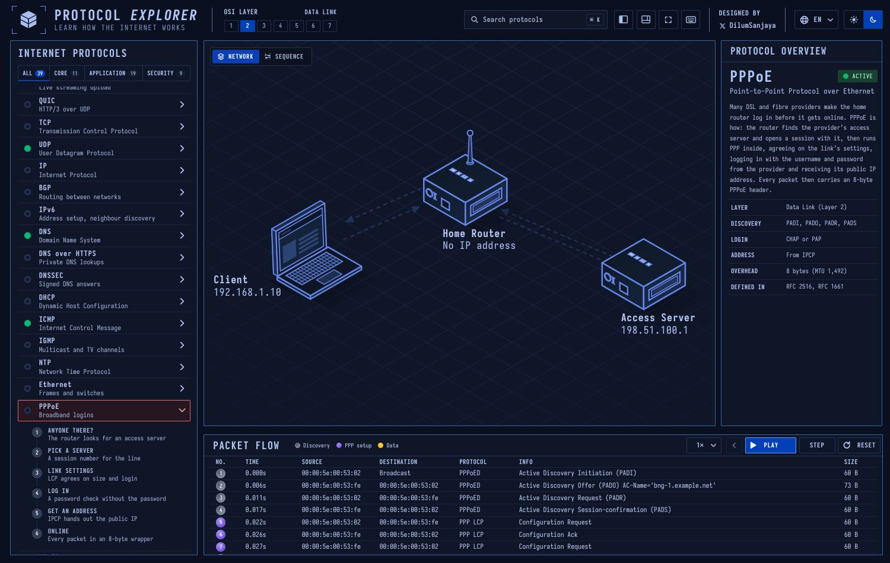
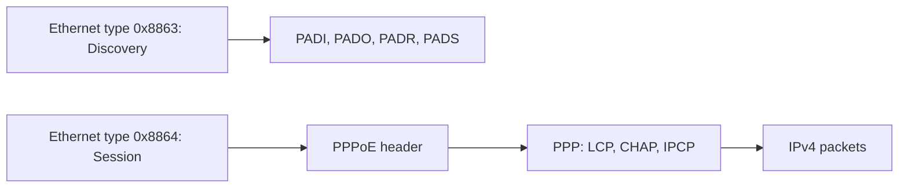
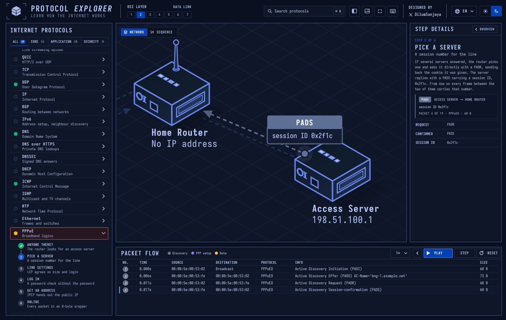
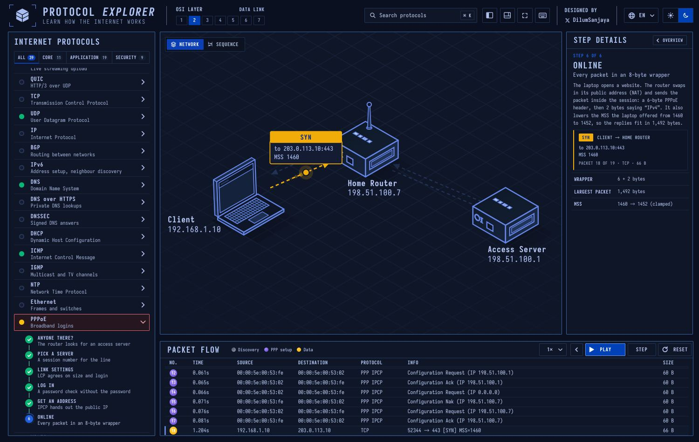
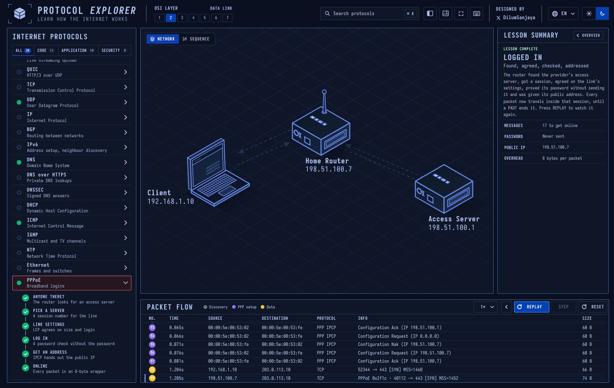
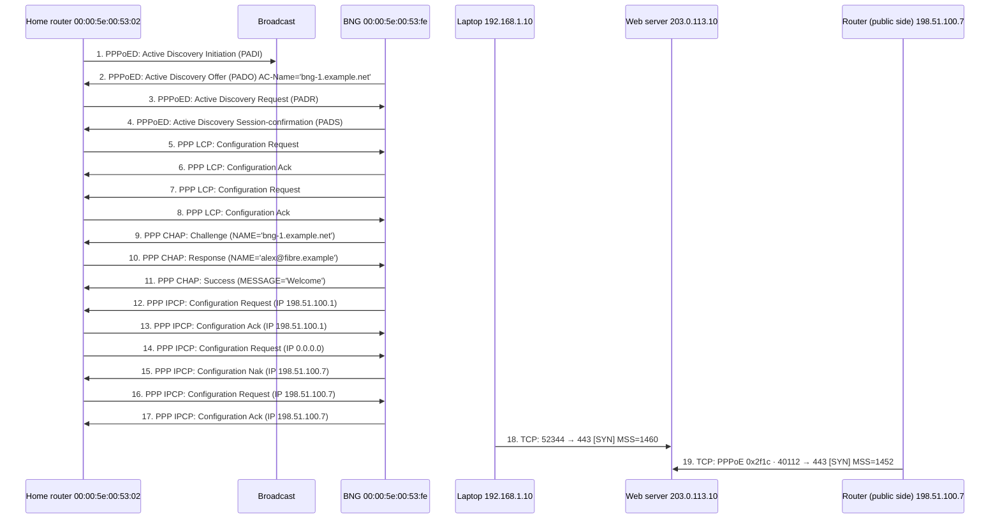
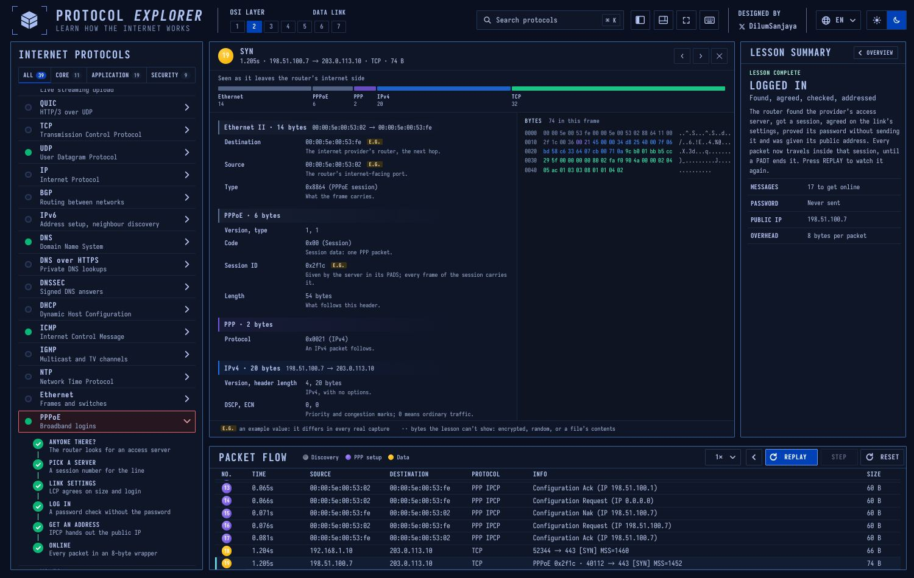

# PPPoE – Broadband logins

<!-- nav -->
⬅ [21 Ethernet](21-ethernet.md) · [Index](00_Protocols_Index.md) · [23 Wi-Fi](23-wi-fi.md) ➡
<!-- nav -->

*Source: Protocol Explorer – https://protocol-explorer-alpha.vercel.app/ (interactive lesson #22). Screenshots captured from the live lesson; packet decodes are the site's example capture (values marked **E.G.** differ in every real capture).*

## Overview

### How the layers fit together (outer to inner)

## In-depth explanation of the example (plain-language version)

### The big picture in one minute
A home router is plugged into a DSL or fibre line. Many internet providers require the router to **log in** before it gets internet access. The lesson shows the whole sequence: **find** the provider's access server, **open a session**, **agree on link settings**, **log in** as `alex@fibre.example`, **receive a public IP address** (`198.51.100.7`), and finally **send the first web packet.** 19 frames in about 1.2 seconds.

**What PPPoE is.** Plain Ethernet has no idea of "log in" or "one account per customer". **PPP**, the old dial-up protocol, does. **PPPoE** puts **PPP inside Ethernet frames**, so a broadband line behaves like a dial-up connection: an account, a password check, an address given to each customer, and usage records.

Think of it as **a dial-up modem call inside your broadband cable**. Two stages: **Discovery** (find the server and get a session number) and **Session** (the PPP conversation that runs inside).

> **Words you'll see:** *BNG/BRAS* = the provider's access server that customers log in to. *Session ID* = a number identifying your session. *CHAP* = a password check that never sends the password. *MTU* = the biggest packet size on a link.

---

### Step 1 – "Is there a server out there?" – packets 1, 2
- **PADI** (a broadcast): the router shouts "Is there a PPPoE server?"
- **PADO** (offer): the provider's access server `bng-1.example.net` replies, adding a **cookie** (an anti-spoofing token). If several servers answer, the router picks one.

### Step 2 – Choose a server and get a session number – packets 3, 4
- **PADR** (request): the router asks the chosen server and repeats the cookie.
- **PADS** (confirmation): the server returns a **Session ID `0x2f1c`**. From now on every frame carries this number. PPPoE adds an **8-byte wrapper** around each packet.

### Step 3 – Agree on link settings (LCP) – packets 5 to 8
Each side lists its wishes and the other approves:
- **MRU 1,492 bytes**: the biggest packet size. It's 1,492 and not 1,500 because the 8-byte wrapper has to fit inside Ethernet's 1,500.
- A random **magic number** to detect a line looped back on itself.
- The server also says: "you must log in using **CHAP**."

### Step 4 – Logging in (CHAP) – packets 9 to 11
- **Challenge** (9): the server sends a random value.
- **Response** (10): the router sends its **username** and a **scrambled fingerprint** of (password + challenge). **The password itself never travels.**
- The server checks it, usually by asking the provider's **RADIUS** server (see the RADIUS note), and replies **Success** (11). (The older alternative, PAP, sends the password in plain text.)

### Step 5 – Getting an IP address (IPCP) – packets 12 to 17
- The server says: "My end of the link is `198.51.100.1`," and the router agrees.
- The router asks for "any address" (`0.0.0.0`), and the server answers with what it will give: **`198.51.100.7`** plus two DNS servers.
- The router asks for exactly those, and the server approves. The router's internet address is now **`198.51.100.7`**.

### Step 6 – Online – packets 18, 19
The laptop opens a website. The router **translates** the private address to its public one (NAT) and sends the packet **inside the PPPoE session**. It also **lowers a TCP setting called MSS from 1,460 to 1,452** so that replies fit the smaller 1,492 packet size. Forgetting this is a classic PPPoE problem.

---

### The 19 frames at a glance
| Packets | What | Why |
|---|---|---|
| 1–2 | PADI, PADO | find a server |
| 3–4 | PADR, PADS | get a session ID |
| 5–8 | LCP | agree on link settings |
| 9–11 | CHAP | log in |
| 12–17 | IPCP | receive the public IP and DNS |
| 18–19 | first web packet | go online |

### What to remember
- **Two phases:** *Discovery* (PADI, PADO, PADR, PADS; later PADT to hang up) and the *PPP session* (link settings → login → address).
- **MTU 1,492 and MSS 1,452** because of the 8-byte wrapper. A wrong setting makes some websites hang while others work.
- It gives providers **login, one address per customer, usage records and session control.**
- Today many fibre networks use **IPoE with DHCP** instead; PPPoE is still common on DSL.
- **Security:** CHAP protects the password, but PPPoE does **not** encrypt your data. It is not a VPN.

## Under the hood – technical details

- **Two EtherTypes.** `0x8863` for the Discovery stage and `0x8864` for the Session stage.
- **PPPoE header (6 bytes).** Version/type (`0x11`), *code*, **session ID** (16 bits) and length. The PPP protocol field adds 2 more bytes (the "8-byte wrapper").
- **Discovery codes.** `0x09` PADI (broadcast, "any servers?"), `0x07` PADO (offer, with AC-Name and a cookie), `0x19` PADR (request), `0x65` PADS (confirmation, assigns the session ID), `0xA7` PADT (terminate).
- **Why MTU 1,492.** The 8 wrapper bytes must fit inside Ethernet's 1,500-byte payload: 1,500 - 8 = 1,492. TCP MSS then becomes 1,492 - 20 (IP) - 20 (TCP) = **1,452**. Routers *clamp* the MSS in SYN packets so large replies don't need fragmenting. A wrong value makes some websites hang while others work.
- **PPP protocol numbers.** `0xC021` LCP, `0xC223` CHAP, `0xC023` PAP, `0x8021` IPCP, `0x8057` IPv6CP, `0x0021` IPv4 data, `0x0057` IPv6 data.
- **LCP.** Each side sends a *Configure-Request* listing options (MRU, authentication protocol, magic number) and the other replies *Configure-Ack* (accept), *Nak* (suggest other values) or *Reject*. The **magic number** detects links looped back on themselves.
- **CHAP.** The server sends a random *challenge* with an identifier. The client replies with `MD5( identifier + password + challenge )` and its username. The password never crosses the line. PAP, in contrast, sends the password in clear text.
- **RADIUS behind the scenes.** The access server (BNG) usually checks the login against the provider's RADIUS server and may also fetch the address, speed limits and session timers from it.
- **IPCP.** The client asks for address `0.0.0.0`; the server replies with a *Configure-Nak* containing the address it wants to assign (and DNS servers). The client re-requests exactly those values and the server acknowledges.
- **Accounting.** Because every customer has a session, the provider can count usage and enforce limits.
- **Security.** CHAP protects the password only. The session is not encrypted, so PPPoE is not a VPN.
- **Alternatives.** IPoE with DHCP (often with DHCP option 82 or 802.1X) on many fibre networks.

## Step-by-step walkthrough (screenshots from the lesson)

### Step 1: ANYONE THERE? – The router looks for an access server

### Step 2: PICK A SERVER – A session number for the line

### Step 3: LINK SETTINGS – LCP agrees on size and login

### Step 4: LOG IN – A password check without the password

### Step 5: GET AN ADDRESS – IPCP hands out the public IP

### Step 6: ONLINE – Every packet in an 8-byte wrapper

### Lesson summary

## Packet flow (whole lesson)

| No. | Time | Source | Destination | Protocol | Info | Size |
|---|---|---|---|---|---|---|
| 1 | 0.000s | 00:00:5e:00:53:02 | Broadcast | PPPoED | Active Discovery Initiation (PADI) | 60 B |
| 2 | 0.006s | 00:00:5e:00:53:fe | 00:00:5e:00:53:02 | PPPoED | Active Discovery Offer (PADO) AC-Name='bng-1.example.net' | 73 B |
| 3 | 0.011s | 00:00:5e:00:53:02 | 00:00:5e:00:53:fe | PPPoED | Active Discovery Request (PADR) | 60 B |
| 4 | 0.017s | 00:00:5e:00:53:fe | 00:00:5e:00:53:02 | PPPoED | Active Discovery Session-confirmation (PADS) | 60 B |
| 5 | 0.022s | 00:00:5e:00:53:02 | 00:00:5e:00:53:fe | PPP LCP | Configuration Request | 60 B |
| 6 | 0.026s | 00:00:5e:00:53:fe | 00:00:5e:00:53:02 | PPP LCP | Configuration Ack | 60 B |
| 7 | 0.027s | 00:00:5e:00:53:fe | 00:00:5e:00:53:02 | PPP LCP | Configuration Request | 60 B |
| 8 | 0.032s | 00:00:5e:00:53:02 | 00:00:5e:00:53:fe | PPP LCP | Configuration Ack | 60 B |
| 9 | 0.037s | 00:00:5e:00:53:fe | 00:00:5e:00:53:02 | PPP CHAP | Challenge (NAME='bng-1.example.net') | 60 B |
| 10 | 0.042s | 00:00:5e:00:53:02 | 00:00:5e:00:53:fe | PPP CHAP | Response (NAME='alex@fibre.example') | 61 B |
| 11 | 0.061s | 00:00:5e:00:53:fe | 00:00:5e:00:53:02 | PPP CHAP | Success (MESSAGE='Welcome') | 60 B |
| 12 | 0.061s | 00:00:5e:00:53:fe | 00:00:5e:00:53:02 | PPP IPCP | Configuration Request (IP 198.51.100.1) | 60 B |
| 13 | 0.065s | 00:00:5e:00:53:02 | 00:00:5e:00:53:fe | PPP IPCP | Configuration Ack (IP 198.51.100.1) | 60 B |
| 14 | 0.066s | 00:00:5e:00:53:02 | 00:00:5e:00:53:fe | PPP IPCP | Configuration Request (IP 0.0.0.0) | 60 B |
| 15 | 0.071s | 00:00:5e:00:53:fe | 00:00:5e:00:53:02 | PPP IPCP | Configuration Nak (IP 198.51.100.7) | 60 B |
| 16 | 0.076s | 00:00:5e:00:53:02 | 00:00:5e:00:53:fe | PPP IPCP | Configuration Request (IP 198.51.100.7) | 60 B |
| 17 | 0.081s | 00:00:5e:00:53:fe | 00:00:5e:00:53:02 | PPP IPCP | Configuration Ack (IP 198.51.100.7) | 60 B |
| 18 | 1.204s | 192.168.1.10 | 203.0.113.10 | TCP | 52344 → 443 [SYN] MSS=1460 | 66 B |
| 19 | 1.205s | 198.51.100.7 | 203.0.113.10 | TCP | PPPoE 0x2f1c · 40112 → 443 [SYN] MSS=1452 | 74 B |

### Sequence diagram

*The lesson's own sequence diagram:*

## Packet decoder screenshots

The lesson's decoder view for the first, middle and last packet: headers, field values and the raw hex bytes.

### Packet 1: PPPoED – Active Discovery Initiation (PADI)

*00:00:5e:00:53:02 → Broadcast · 60 B · t = 0.000s*

### Packet 10: PPP CHAP – Response (NAME='alex@fibre.example')

*00:00:5e:00:53:02 → 00:00:5e:00:53:fe · 61 B · t = 0.042s*

### Packet 19: TCP – PPPoE 0x2f1c · 40112 → 443 [SYN] MSS=1452

*198.51.100.7 → 203.0.113.10 · 74 B · t = 1.205s*

---

<!-- nav -->
⬅ [21 Ethernet](21-ethernet.md) · [Index](00_Protocols_Index.md) · [23 Wi-Fi](23-wi-fi.md) ➡
<!-- nav -->
