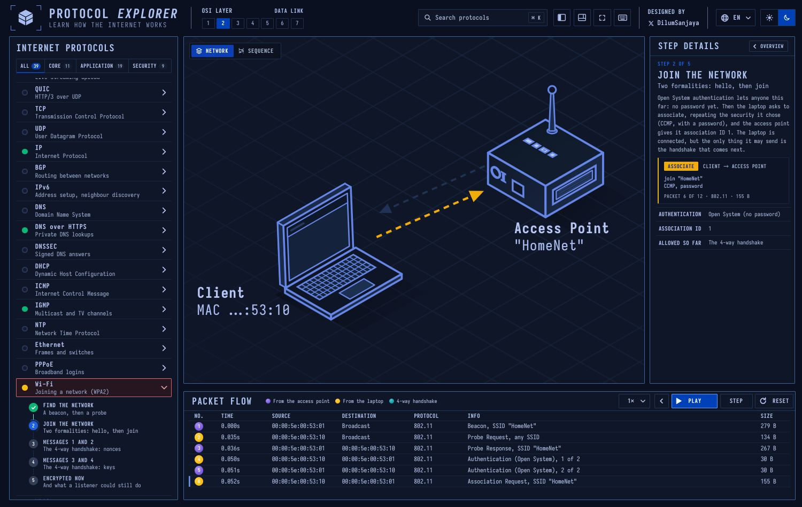
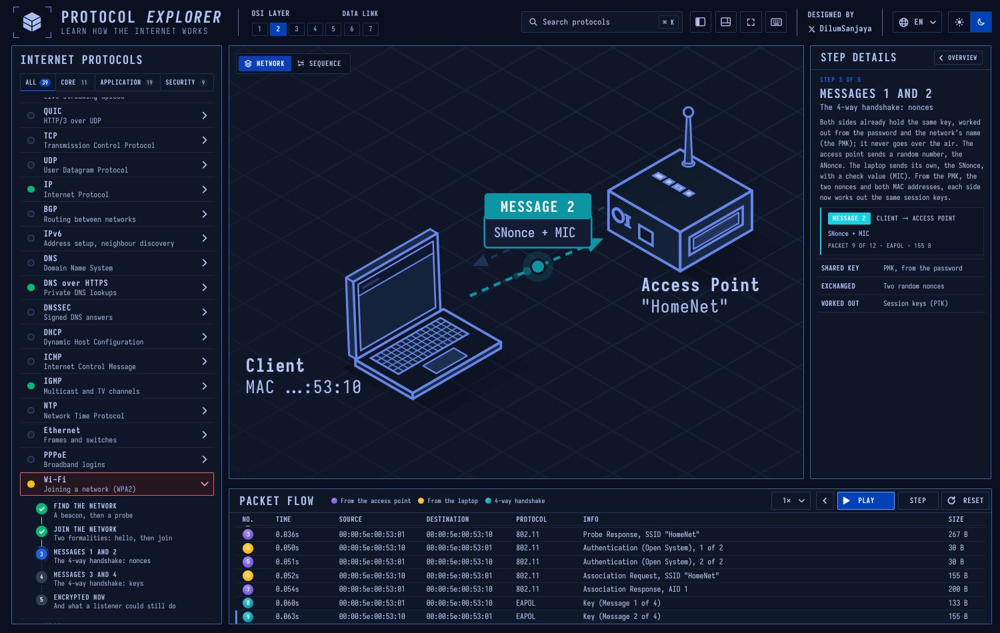
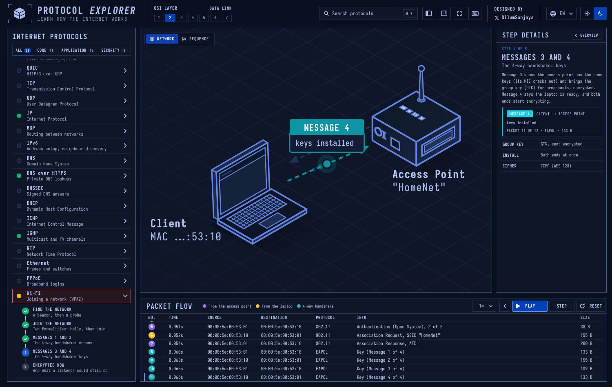
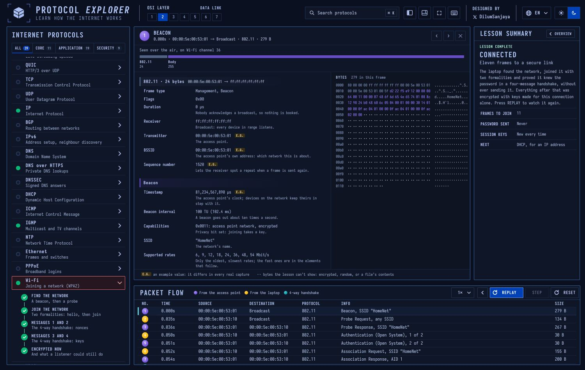
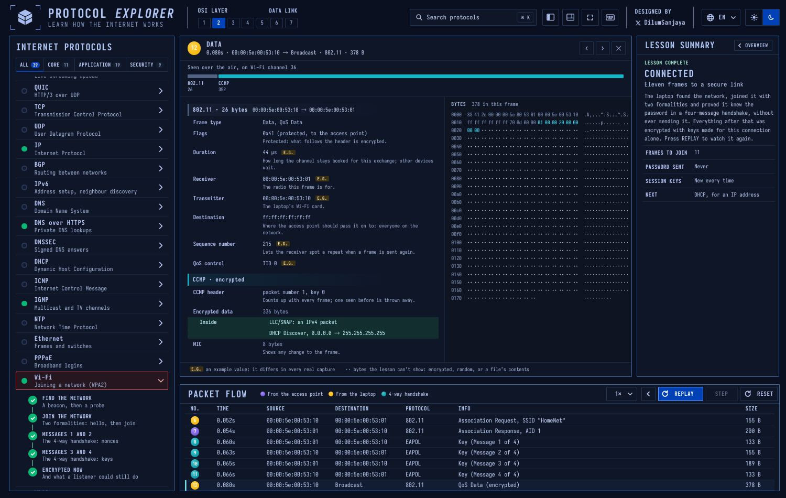

# Wi-Fi – Joining a network (WPA2)

<!-- nav -->
⬅ [22 PPPoE](22-pppoe.md) · [Index](00_Protocols_Index.md) · [24 WPA3](24-wpa3.md) ➡
<!-- nav -->

*Source: Protocol Explorer – https://protocol-explorer-alpha.vercel.app/ (interactive lesson #23). Screenshots captured from the live lesson; packet decodes are the site's example capture (values marked **E.G.** differ in every real capture).*

## Overview


> PROTOCOL OVERVIEW  
> Wi-Fi  
> ACTIVE  
> Wi-Fi (802.11) with WPA2  
> Wi-Fi carries a network over radio. Before a device can send anything, it has to find the network, join it and prove it knows the password. With WPA2-Personal that proof is the 4-way handshake: four short messages that turn the password into fresh encryption keys, without the password ever going over the air.  
> LAYER  
> Data Link (Layer 2)  
> STANDARD  
> IEEE 802.11  
> SECURITY  
> WPA2: CCMP (AES)  
> JOINING  
> Probe, authenticate, associate  
> KEYS FROM  
> The 4-way handshake  
> DEFINED IN  
> IEEE 802.11-2020  

## In-depth explanation of the example (plain-language version)

### The big picture in one minute
A laptop joins a home Wi-Fi network called **"HomeNet"**, run by an access point (AP) using **WPA2 with a password**. **12 frames in 80 ms:** find the network, join it, run the **4-way handshake** that creates the encryption keys, and send the first **encrypted** data frame (a request for an IP address). The next note covers the newer WPA3.

**Why such a special join procedure?** Radio waves reach everyone nearby, so three things are needed:
1. The device must **discover** which networks exist.
2. It must **prove it knows the password without sending it** through the air.
3. Everything after that must be **encrypted with keys unique to this session.**

Think of a **club with a secret handshake**: first you spot the club, then you ask to come in, then you and the doorman prove you both know the password without saying it, and finally you speak in a private code.

> **Words you'll see:** *SSID* = the network's name. *AP (access point)* = the Wi-Fi box. *Nonce* = a random number used once. *Key* = a secret number used to scramble data. *MIC* = a checksum that proves a message wasn't altered.

---

### Step 1 – Find the network – packets 1 to 3
- **Beacon** (1): the AP announces itself about **10 times a second**: its name "HomeNet", speeds, channel and security type (**AES encryption with a password**).
- **Probe Request** (2): the laptop asks actively, "Any network out there?"
- **Probe Response** (3): the AP replies with the same information.

### Step 2 – Join the network – packets 4 to 7
- **Authentication (open)** (4–5): a leftover formality from the first Wi-Fi standard. It does **not** check any password; it just moves the laptop to the next stage.
- **Association Request** (6): "I want to join HomeNet," repeating its chosen security settings.
- **Association Response** (7): "Success. Your ID is 1." The laptop is now **joined**, but the AP **still blocks all normal traffic**. Only the key handshake is allowed.

### Step 3 – The 4-way handshake, part 1 – packets 8, 9
Both sides already hold the same **master key**, calculated from the password and the network name (it was never sent). The handshake proves both know it and creates **fresh session keys**:
1. **AP → laptop:** a random number (the **ANonce**).
2. **Laptop → AP:** its own random number (the **SNonce**) plus a **MIC** (a checksum made with the key).
Now both sides mix the master key with the two random numbers and the two MAC addresses to get the **session key**. The AP checks the laptop's MIC. **If the password were wrong, the MIC would be wrong and the join would fail ("incorrect password").**

### Step 4 – The 4-way handshake, part 2 – packets 10, 11
3. **AP → laptop:** proves the AP also has the correct key, and delivers the **group key** (for broadcast messages), encrypted.
4. **Laptop → AP:** "Keys installed."
Both ends now **start using the keys at the same moment** and open the network for real traffic.

### Step 5 – Encrypted data – packet 12
The first real frame is a **DHCP Discover** (the laptop asking for an address; see the DHCP note), **encrypted with AES**. A bystander can still see the MAC addresses, frame sizes and timing, but not the content or the IP addresses.

---

### The weakness of WPA2 with a password
Anyone nearby can **record the four handshake messages** (they can even force a reconnect to catch them) and then **guess passwords offline**: for each guess, work out the keys and check whether the checksum matches. A **long, random password** makes this hopeless, but short or common ones fall quickly. **WPA3** (next note) removes this weakness.

### The 12 frames at a glance
| Packets | What | Why |
|---|---|---|
| 1–3 | Beacon, probe request, probe response | discover the network |
| 4–5 | Open authentication | formality |
| 6–7 | Association | join the network |
| 8–11 | 4-way handshake | prove the password and create session keys |
| 12 | Encrypted data | first real traffic |

### What to remember
- **Join sequence:** discover → authenticate (open) → associate → 4-way handshake → encrypted data.
- **Keys:** master key (from password + name) → session key (from the master key + both random numbers + both MACs) → group key (sent encrypted).
- **Frame families:** management (beacon, probe, join, leave), control (ack, RTS/CTS) and data. Management frames are **not protected** unless the 802.11w feature is on.
- **WPA2 uses AES.** WEP and WPA/TKIP are obsolete. Company networks use **WPA2/3-Enterprise** with a RADIUS server (see the RADIUS note).
- The AP also bridges Wi-Fi into the wired Ethernet network (see the Ethernet note).

## Step-by-step walkthrough (screenshots from the lesson)

### Step 1: FIND THE NETWORK – A beacon, then a probe


> STEP 1 OF 5  
> FIND THE NETWORK  
> A beacon, then a probe  
> About ten times a second the router’s Wi-Fi sends a beacon: here is "HomeNet", protected with WPA2, on channel 36. The laptop could simply wait to hear one; to be quicker it also asks out loud with a probe request, and the access point answers with a probe response.  
> NETWORK  
> "HomeNet"  
> CHANNEL  
> 36 (5 GHz)  
> SECURITY  
> WPA2-Personal (password)  

### Step 2: JOIN THE NETWORK – Two formalities: hello, then join



> STEP 2 OF 5  
> JOIN THE NETWORK  
> Two formalities: hello, then join  
> Open System authentication lets anyone this far: no password yet. Then the laptop asks to associate, repeating the security it chose (CCMP, with a password), and the access point gives it association ID 1. The laptop is connected, but the only thing it may send is the handshake that comes next.  
> ASSOCIATE  
> CLIENT → ACCESS POINT  
> join "HomeNet"  
> CCMP, password  
> PACKET 6 OF 12 · 802.11 · 155 B  
> AUTHENTICATION  
> Open System (no password)  
> ASSOCIATION ID  
> 1  
> ALLOWED SO FAR  
> The 4-way handshake  

### Step 3: MESSAGES 1 AND 2 – The 4-way handshake: nonces



> STEP 3 OF 5  
> MESSAGES 1 AND 2  
> The 4-way handshake: nonces  
> Both sides already hold the same key, worked out from the password and the network’s name (the PMK); it never goes over the air. The access point sends a random number, the ANonce. The laptop sends its own, the SNonce, with a check value (MIC). From the PMK, the two nonces and both MAC addresses, each side now works out the same session keys.  
> MESSAGE 2  
> CLIENT → ACCESS POINT  
> SNonce + MIC  
> PACKET 9 OF 12 · EAPOL · 155 B  
> SHARED KEY  
> PMK, from the password  
> EXCHANGED  
> Two random nonces  
> WORKED OUT  
> Session keys (PTK)  

### Step 4: MESSAGES 3 AND 4 – The 4-way handshake: keys



> STEP 4 OF 5  
> MESSAGES 3 AND 4  
> The 4-way handshake: keys  
> Message 3 shows the access point has the same keys (its MIC checks out) and brings the group key (GTK) for broadcasts, encrypted. Message 4 says the laptop is ready, and both ends start encrypting.  
> MESSAGE 4  
> CLIENT → ACCESS POINT  
> keys installed  
> PACKET 11 OF 12 · EAPOL · 133 B  
> GROUP KEY  
> GTK, sent encrypted  
> INSTALL  
> Both ends at once  
> CIPHER  
> CCMP (AES-128)  

### Step 5: ENCRYPTED NOW – And what a listener could still do


> STEP 5 OF 5  
> ENCRYPTED NOW  
> And what a listener could still do  
> Every data frame is encrypted now, like this first one carrying a DHCP Discover: anyone nearby sees only the MAC addresses and the size. But someone who recorded the four handshake messages can try password guesses at home, as fast as their computer allows: a guess is right when it gives the same MIC. A long, random password makes that hopeless; WPA3 removes the weakness.  
> DATA  
> CLIENT → ACCESS POINT  
> DHCP Discover inside  
> PACKET 12 OF 12 · 802.11 · 378 B · ENCRYPTED  
> OTHERS SEE  
> MAC addresses, sizes, timing  
> WEAK POINT  
> Offline password guessing  
> DEFENCE  
> A long password, or WPA3  

### Lesson summary


> LESSON SUMMARY  
> LESSON COMPLETE  
> CONNECTED  
> Eleven frames to a secure link  
> The laptop found the network, joined it with two formalities and proved it knew the password in a four-message handshake, without ever sending it. Everything after that was encrypted with keys made for this connection alone. Press REPLAY to watch it again.  
> DATA  
> CLIENT → ACCESS POINT  
> DHCP Discover inside  
> PACKET 12 OF 12 · 802.11 · 378 B · ENCRYPTED  
> FRAMES TO JOIN  
> 11  
> PASSWORD SENT  
> Never  
> SESSION KEYS  
> New every time  
> NEXT  
> DHCP, for an IP address  

## Packet flow (whole lesson)

| No. | Time | Source | Destination | Protocol | Info | Size |
|---|---|---|---|---|---|---|
| 1 | 0.000s | 00:00:5e:00:53:01 | Broadcast | 802.11 | Beacon, SSID "HomeNet" | 279 B |
| 2 | 0.035s | 00:00:5e:00:53:10 | Broadcast | 802.11 | Probe Request, any SSID | 134 B |
| 3 | 0.036s | 00:00:5e:00:53:01 | 00:00:5e:00:53:10 | 802.11 | Probe Response, SSID "HomeNet" | 267 B |
| 4 | 0.050s | 00:00:5e:00:53:10 | 00:00:5e:00:53:01 | 802.11 | Authentication (Open System), 1 of 2 | 30 B |
| 5 | 0.051s | 00:00:5e:00:53:01 | 00:00:5e:00:53:10 | 802.11 | Authentication (Open System), 2 of 2 | 30 B |
| 6 | 0.052s | 00:00:5e:00:53:10 | 00:00:5e:00:53:01 | 802.11 | Association Request, SSID "HomeNet" | 155 B |
| 7 | 0.054s | 00:00:5e:00:53:01 | 00:00:5e:00:53:10 | 802.11 | Association Response, AID 1 | 200 B |
| 8 | 0.060s | 00:00:5e:00:53:01 | 00:00:5e:00:53:10 | EAPOL | Key (Message 1 of 4) | 133 B |
| 9 | 0.063s | 00:00:5e:00:53:10 | 00:00:5e:00:53:01 | EAPOL | Key (Message 2 of 4) | 155 B |
| 10 | 0.065s | 00:00:5e:00:53:01 | 00:00:5e:00:53:10 | EAPOL | Key (Message 3 of 4) | 189 B |
| 11 | 0.066s | 00:00:5e:00:53:10 | 00:00:5e:00:53:01 | EAPOL | Key (Message 4 of 4) | 133 B |
| 12 | 0.080s | 00:00:5e:00:53:10 | Broadcast | 802.11 | QoS Data (encrypted) | 378 B |

### Sequence diagram


## Packets decoded byte by byte

Each packet below is the lesson's own decode (headers, field values and the plain-English meaning of each field). Screenshots show the first, middle and last packet in the lesson's decoder view with the raw hex bytes.

### Packet 1: 802.11 – Beacon, SSID "HomeNet"

*00:00:5e:00:53:01 → Broadcast · 279 B · t = 0.000s*



<details><summary>Decoded fields</summary>

```text
1
BEACON
0.000s · 00:00:5e:00:53:01 → Broadcast · 802.11 · 279 B
Seen over the air, on Wi-Fi channel 36
802.11
24
Body
255
802.11 · 24 bytes
00:00:5e:00:53:01 → ff:ff:ff:ff:ff:ff
Frame type
Management, Beacon
Flags
0x00
Duration
0 µs

Nobody acknowledges a broadcast, so nothing is booked.

Receiver
ff:ff:ff:ff:ff:ff

Broadcast: every device in range listens.

Transmitter
00:00:5e:00:53:01 E.G.

The access point.

BSSID
00:00:5e:00:53:01 E.G.

The access point’s own address: which network this is about.

Sequence number
1520 E.G.

Lets the receiver spot a repeat when a frame is sent again.

Beacon
Timestamp
81,234,567,890 µs E.G.

The access point’s clock; devices on the network keep theirs in step with it.

Beacon interval
100 TU (102.4 ms)

A beacon goes out about ten times a second.

Capabilities
0x0011: access point network, encrypted

Privacy bit set: joining takes a key.

SSID
"HomeNet"

The network’s name.

Supported rates
6, 9, 12, 18, 24, 36, 48, 54 Mbit/s

Only the oldest, slowest rates; the fast ones are in the elements that follow.

TIM
DTIM count 0, period 1

Tells sleeping devices whether frames are waiting for them.

RSN
WPA2: CCMP, PSK

Robust Security Network: how this network is protected.

Element ID, length
48, 20 bytes
Version
1
Group cipher
CCMP (AES)

Encrypts broadcasts, which every device on the network can read.

Pairwise cipher
1: CCMP (AES)

Encrypts each device’s own traffic, with keys only it and the access point have.

Key management
1: PSK (a shared password)
Capabilities
0x0000
More elements
196 bytes

Wi-Fi 4, 5 and 6 capabilities and settings (HT, VHT, HE: channel 36, 80 MHz wide), and vendor extras.

BYTES 279 in this frame
0000
80
00
00
00
ff
ff
ff
ff
ff
ff
00
00
5e
00
53
01
.
.
.
.
.
.
.
.
.
.
.
.
^
.
S
.
0010
00
00
5e
00
53
01
00
5f
d2
22
f5
e9
12
00
00
00
.
.
^
.
S
.
.
_
.
"
.
.
.
.
.
.
0020
64
00
11
00
00
07
48
6f
6d
65
4e
65
74
01
08
8c
d
.
.
.
.
.
H
o
m
e
N
e
t
.
.
.
0030
12
98
24
b0
48
60
6c
05
04
00
01
00
00
30
14
01
.
.
$
.
H
`
l
.
.
.
.
.
.
0
.
.
0040
00
00
0f
ac
04
01
00
00
0f
ac
04
01
00
00
0f
ac
.
.
.
.
.
.
.
.
.
.
.
.
.
.
.
.
0050
02
00
00
··
··
··
··
··
··
··
··
··
··
··
··
··
.
.
.
·
·
·
·
·
·
·
·
·
·
·
·
·
0060
··
··
··
··
··
··
··
··
··
··
··
··
··
··
··
··
·
·
·
·
·
·
·
·
·
·
·
·
·
·
·
·
0070
··
··
··
··
··
··
··
··
··
··
··
··
··
··
··
··
·
·
·
·
·
·
·
·
·
·
·
·
·
·
·
·
0080
··
··
··
··
··
··
··
··
··
··
··
··
··
··
··
··
·
·
·
·
·
·
·
·
·
·
·
·
·
·
·
·
0090
··
··
··
··
··
··
··
··
··
··
··
··
··
··
··
··
·
·
·
·
·
·
·
·
·
·
·
·
·
·
·
·
00a0
··
··
··
··
··
··
··
··
··
··
··
··
··
··
··
··
·
·
·
·
·
·
·
·
·
·
·
·
·
·
·
·
00b0
··
··
··
··
··
··
··
··
··
··
··
··
··
··
··
··
·
·
·
·
·
·
·
·
·
·
·
·
·
·
·
·
00c0
··
··
··
··
··
··
··
··
··
··
··
··
··
··
··
··
·
·
·
·
·
·
·
·
·
·
·
·
·
·
·
·
00d0
··
··
··
··
··
··
··
··
··
··
··
··
··
··
··
··
·
·
·
·
·
·
·
·
·
·
·
·
·
·
·
·
00e0
··
··
··
··
··
··
··
··
··
··
··
··
··
··
··
··
·
·
·
·
·
·
·
·
·
·
·
·
·
·
·
·
00f0
··
··
··
··
··
··
··
··
··
··
··
··
··
··
··
··
·
·
·
·
·
·
·
·
·
·
·
·
·
·
·
·
0100
··
··
··
··
··
··
··
··
··
··
··
··
··
··
··
··
·
·
·
·
·
·
·
·
·
·
·
·
·
·
·
·
0110
··
··
··
··
··
··
··
·
·
·
·
·
·
·
E.G. an example value: it differs in every real capture
·· bytes the lesson can’t show: encrypted, random, or a file’s contents
```

</details>

### Packet 2: 802.11 – Probe Request, any SSID

*00:00:5e:00:53:10 → Broadcast · 134 B · t = 0.035s*

<details><summary>Decoded fields</summary>

```text
2
PROBE
0.035s · 00:00:5e:00:53:10 → Broadcast · 802.11 · 134 B
Seen over the air, on Wi-Fi channel 36
802.11
24
Body
110
802.11 · 24 bytes
00:00:5e:00:53:10 → ff:ff:ff:ff:ff:ff
Frame type
Management, Probe Request
Flags
0x00
Duration
0 µs

Nobody acknowledges a broadcast, so nothing is booked.

Receiver
ff:ff:ff:ff:ff:ff

Broadcast: every device in range listens.

Transmitter
00:00:5e:00:53:10 E.G.

The laptop’s Wi-Fi card.

BSSID
00:00:5e:00:53:01 E.G.

The access point’s own address: which network this is about.

Sequence number
210 E.G.

Lets the receiver spot a repeat when a frame is sent again.

Probe Request
SSID
empty (any network)

Any access point may answer. (Devices used to ask for every network they had joined by name, telling anyone listening where they had been.)

Supported rates
6, 9, 12, 18, 24, 36, 48, 54 Mbit/s

Only the oldest, slowest rates; the fast ones are in the elements that follow.

More elements
98 bytes

What the laptop’s radio can do: Wi-Fi 4, 5 and 6 capabilities, and vendor extras.

BYTES 134 in this frame
0000
40
00
00
00
ff
ff
ff
ff
ff
ff
00
00
5e
00
53
10
@
.
.
.
.
.
.
.
.
.
.
.
^
.
S
.
0010
00
00
5e
00
53
01
20
0d
00
00
01
08
8c
12
98
24
.
.
^
.
S
.
.
.
.
.
.
.
.
.
$
0020
b0
48
60
6c
··
··
··
··
··
··
··
··
··
··
··
··
.
H
`
l
·
·
·
·
·
·
·
·
·
·
·
·
0030
··
··
··
··
··
··
··
··
··
··
··
··
··
··
··
··
·
·
·
·
·
·
·
·
·
·
·
·
·
·
·
·
0040
··
··
··
··
··
··
··
··
··
··
··
··
··
··
··
··
·
·
·
·
·
·
·
·
·
·
·
·
·
·
·
·
0050
··
··
··
··
··
··
··
··
··
··
··
··
··
··
··
··
·
·
·
·
·
·
·
·
·
·
·
·
·
·
·
·
0060
··
··
··
··
··
··
··
··
··
··
··
··
··
··
··
··
·
·
·
·
·
·
·
·
·
·
·
·
·
·
·
·
0070
··
··
··
··
··
··
··
··
··
··
··
··
··
··
··
··
·
·
·
·
·
·
·
·
·
·
·
·
·
·
·
·
0080
··
··
··
··
··
··
·
·
·
·
·
·
E.G. an example value: it differs in every real capture
·· bytes the lesson can’t show: encrypted, random, or a file’s contents
```

</details>

### Packet 3: 802.11 – Probe Response, SSID "HomeNet"

*00:00:5e:00:53:01 → 00:00:5e:00:53:10 · 267 B · t = 0.036s*

<details><summary>Decoded fields</summary>

```text
3
PROBE RESPONSE
0.036s · 00:00:5e:00:53:01 → 00:00:5e:00:53:10 · 802.11 · 267 B
Seen over the air, on Wi-Fi channel 36
802.11
24
Body
243
802.11 · 24 bytes
00:00:5e:00:53:01 → 00:00:5e:00:53:10
Frame type
Management, Probe Response
Flags
0x00
Duration
44 µs E.G.

How long the channel stays booked for this exchange; other devices wait.

Receiver
00:00:5e:00:53:10 E.G.

The radio this frame is for.

Transmitter
00:00:5e:00:53:01 E.G.

The access point.

BSSID
00:00:5e:00:53:01 E.G.

The access point’s own address: which network this is about.

Sequence number
1521 E.G.

Lets the receiver spot a repeat when a frame is sent again.

Probe Response
Timestamp
81,234,603,910 µs E.G.

The access point’s clock; devices on the network keep theirs in step with it.

Beacon interval
100 TU (102.4 ms)

A beacon goes out about ten times a second.

Capabilities
0x0011: access point network, encrypted

Privacy bit set: joining takes a key.

SSID
"HomeNet"

The network’s name.

Supported rates
6, 9, 12, 18, 24, 36, 48, 54 Mbit/s

Only the oldest, slowest rates; the fast ones are in the elements that follow.

RSN
WPA2: CCMP, PSK

Robust Security Network: how this network is protected.

Element ID, length
48, 20 bytes
Version
1
Group cipher
CCMP (AES)

Encrypts broadcasts, which every device on the network can read.

Pairwise cipher
1: CCMP (AES)

Encrypts each device’s own traffic, with keys only it and the access point have.

Key management
1: PSK (a shared password)
Capabilities
0x0000
More elements
190 bytes

Wi-Fi 4, 5 and 6 capabilities and settings (HT, VHT, HE: channel 36, 80 MHz wide), and vendor extras.

BYTES 267 in this frame
0000
50
00
2c
00
00
00
5e
00
53
10
00
00
5e
00
53
01
P
.
,
.
.
.
^
.
S
.
.
.
^
.
S
.
0010
00
00
5e
00
53
01
10
5f
86
af
f5
e9
12
00
00
00
.
.
^
.
S
.
.
_
.
.
.
.
.
.
.
.
0020
64
00
11
00
00
07
48
6f
6d
65
4e
65
74
01
08
8c
d
.
.
.
.
.
H
o
m
e
N
e
t
.
.
.
0030
12
98
24
b0
48
60
6c
30
14
01
00
00
0f
ac
04
01
.
.
$
.
H
`
l
0
.
.
.
.
.
.
.
.
0040
00
00
0f
ac
04
01
00
00
0f
ac
02
00
00
··
··
··
.
.
.
.
.
.
.
.
.
.
.
.
.
·
·
·
0050
··
··
··
··
··
··
··
··
··
··
··
··
··
··
··
··
·
·
·
·
·
·
·
·
·
·
·
·
·
·
·
·
0060
··
··
··
··
··
··
··
··
··
··
··
··
··
··
··
··
·
·
·
·
·
·
·
·
·
·
·
·
·
·
·
·
0070
··
··
··
··
··
··
··
··
··
··
··
··
··
··
··
··
·
·
·
·
·
·
·
·
·
·
·
·
·
·
·
·
0080
··
··
··
··
··
··
··
··
··
··
··
··
··
··
··
··
·
·
·
·
·
·
·
·
·
·
·
·
·
·
·
·
0090
··
··
··
··
··
··
··
··
··
··
··
··
··
··
··
··
·
·
·
·
·
·
·
·
·
·
·
·
·
·
·
·
00a0
··
··
··
··
··
··
··
··
··
··
··
··
··
··
··
··
·
·
·
·
·
·
·
·
·
·
·
·
·
·
·
·
00b0
··
··
··
··
··
··
··
··
··
··
··
··
··
··
··
··
·
·
·
·
·
·
·
·
·
·
·
·
·
·
·
·
00c0
··
··
··
··
··
··
··
··
··
··
··
··
··
··
··
··
·
·
·
·
·
·
·
·
·
·
·
·
·
·
·
·
00d0
··
··
··
··
··
··
··
··
··
··
··
··
··
··
··
··
·
·
·
·
·
·
·
·
·
·
·
·
·
·
·
·
00e0
··
··
··
··
··
··
··
··
··
··
··
··
··
··
··
··
·
·
·
·
·
·
·
·
·
·
·
·
·
·
·
·
00f0
··
··
··
··
··
··
··
··
··
··
··
··
··
··
··
··
·
·
·
·
·
·
·
·
·
·
·
·
·
·
·
·
0100
··
··
··
··
··
··
··
··
··
··
··
·
·
·
·
·
·
·
·
·
·
·
E.G. an example value: it differs in every real capture
·· bytes the lesson can’t show: encrypted, random, or a file’s contents
```

</details>

### Packet 4: 802.11 – Authentication (Open System), 1 of 2

*00:00:5e:00:53:10 → 00:00:5e:00:53:01 · 30 B · t = 0.050s*

<details><summary>Decoded fields</summary>

```text
4
AUTH
0.050s · 00:00:5e:00:53:10 → 00:00:5e:00:53:01 · 802.11 · 30 B
Seen over the air, on Wi-Fi channel 36
802.11
24
Body
6
802.11 · 24 bytes
00:00:5e:00:53:10 → 00:00:5e:00:53:01
Frame type
Management, Authentication
Flags
0x00
Duration
44 µs E.G.

How long the channel stays booked for this exchange; other devices wait.

Receiver
00:00:5e:00:53:01 E.G.

The radio this frame is for.

Transmitter
00:00:5e:00:53:10 E.G.

The laptop’s Wi-Fi card.

BSSID
00:00:5e:00:53:01 E.G.

The access point’s own address: which network this is about.

Sequence number
211 E.G.

Lets the receiver spot a repeat when a frame is sent again.

Authentication · Open System
Algorithm
0 (Open System)

Open: anyone may get this far. The password is checked later, in the 4-way handshake.

Transaction
1
Status
0 (success)
BYTES 30 in this frame
0000
b0
00
2c
00
00
00
5e
00
53
01
00
00
5e
00
53
10
.
.
,
.
.
.
^
.
S
.
.
.
^
.
S
.
0010
00
00
5e
00
53
01
30
0d
00
00
01
00
00
00
.
.
^
.
S
.
0
.
.
.
.
.
.
.
E.G. an example value: it differs in every real capture
·· bytes the lesson can’t show: encrypted, random, or a file’s contents
```

</details>

### Packet 5: 802.11 – Authentication (Open System), 2 of 2

*00:00:5e:00:53:01 → 00:00:5e:00:53:10 · 30 B · t = 0.051s*

<details><summary>Decoded fields</summary>

```text
5
AUTH
0.051s · 00:00:5e:00:53:01 → 00:00:5e:00:53:10 · 802.11 · 30 B
Seen over the air, on Wi-Fi channel 36
802.11
24
Body
6
802.11 · 24 bytes
00:00:5e:00:53:01 → 00:00:5e:00:53:10
Frame type
Management, Authentication
Flags
0x00
Duration
44 µs E.G.

How long the channel stays booked for this exchange; other devices wait.

Receiver
00:00:5e:00:53:10 E.G.

The radio this frame is for.

Transmitter
00:00:5e:00:53:01 E.G.

The access point.

BSSID
00:00:5e:00:53:01 E.G.

The access point’s own address: which network this is about.

Sequence number
1522 E.G.

Lets the receiver spot a repeat when a frame is sent again.

Authentication · Open System
Algorithm
0 (Open System)

Open: anyone may get this far. The password is checked later, in the 4-way handshake.

Transaction
2
Status
0 (success)
BYTES 30 in this frame
0000
b0
00
2c
00
00
00
5e
00
53
10
00
00
5e
00
53
01
.
.
,
.
.
.
^
.
S
.
.
.
^
.
S
.
0010
00
00
5e
00
53
01
20
5f
00
00
02
00
00
00
.
.
^
.
S
.
_
.
.
.
.
.
.
E.G. an example value: it differs in every real capture
·· bytes the lesson can’t show: encrypted, random, or a file’s contents
```

</details>

### Packet 6: 802.11 – Association Request, SSID "HomeNet"

*00:00:5e:00:53:10 → 00:00:5e:00:53:01 · 155 B · t = 0.052s*

<details><summary>Decoded fields</summary>

```text
6
ASSOCIATE
0.052s · 00:00:5e:00:53:10 → 00:00:5e:00:53:01 · 802.11 · 155 B
Seen over the air, on Wi-Fi channel 36
802.11
24
Body
131
802.11 · 24 bytes
00:00:5e:00:53:10 → 00:00:5e:00:53:01
Frame type
Management, Association Request
Flags
0x00
Duration
44 µs E.G.

How long the channel stays booked for this exchange; other devices wait.

Receiver
00:00:5e:00:53:01 E.G.

The radio this frame is for.

Transmitter
00:00:5e:00:53:10 E.G.

The laptop’s Wi-Fi card.

BSSID
00:00:5e:00:53:01 E.G.

The access point’s own address: which network this is about.

Sequence number
212 E.G.

Lets the receiver spot a repeat when a frame is sent again.

Association Request
Capabilities
0x0011: access point network, encrypted E.G.

Privacy bit set: joining takes a key.

Listen interval
10 beacons E.G.

How often the laptop wakes to check for waiting frames when saving power.

SSID
"HomeNet"

The network’s name.

Supported rates
6, 9, 12, 18, 24, 36, 48, 54 Mbit/s

Only the oldest, slowest rates; the fast ones are in the elements that follow.

RSN
WPA2: CCMP, PSK

Robust Security Network: how this network is protected.

Element ID, length
48, 20 bytes
Version
1
Group cipher
CCMP (AES)

Encrypts broadcasts, which every device on the network can read.

Pairwise cipher
1: CCMP (AES)

Encrypts each device’s own traffic, with keys only it and the access point have.

Key management
1: PSK (a shared password)
Capabilities
0x0000
More elements
86 bytes

What the laptop’s radio can do (Wi-Fi 4, 5 and 6), and vendor extras.

BYTES 155 in this frame
0000
00
00
2c
00
00
00
5e
00
53
01
00
00
5e
00
53
10
.
.
,
.
.
.
^
.
S
.
.
.
^
.
S
.
0010
00
00
5e
00
53
01
40
0d
11
00
0a
00
00
07
48
6f
.
.
^
.
S
.
@
.
.
.
.
.
.
.
H
o
0020
6d
65
4e
65
74
01
08
8c
12
98
24
b0
48
60
6c
30
m
e
N
e
t
.
.
.
.
.
$
.
H
`
l
0
0030
14
01
00
00
0f
ac
04
01
00
00
0f
ac
04
01
00
00
.
.
.
.
.
.
.
.
.
.
.
.
.
.
.
.
0040
0f
ac
02
00
00
··
··
··
··
··
··
··
··
··
··
··
.
.
.
.
.
·
·
·
·
·
·
·
·
·
·
·
0050
··
··
··
··
··
··
··
··
··
··
··
··
··
··
··
··
·
·
·
·
·
·
·
·
·
·
·
·
·
·
·
·
0060
··
··
··
··
··
··
··
··
··
··
··
··
··
··
··
··
·
·
·
·
·
·
·
·
·
·
·
·
·
·
·
·
0070
··
··
··
··
··
··
··
··
··
··
··
··
··
··
··
··
·
·
·
·
·
·
·
·
·
·
·
·
·
·
·
·
0080
··
··
··
··
··
··
··
··
··
··
··
··
··
··
··
··
·
·
·
·
·
·
·
·
·
·
·
·
·
·
·
·
0090
··
··
··
··
··
··
··
··
··
··
··
·
·
·
·
·
·
·
·
·
·
·
E.G. an example value: it differs in every real capture
·· bytes the lesson can’t show: encrypted, random, or a file’s contents
```

</details>

### Packet 7: 802.11 – Association Response, AID 1

*00:00:5e:00:53:01 → 00:00:5e:00:53:10 · 200 B · t = 0.054s*


<details><summary>Decoded fields</summary>

```text
7
ASSOCIATED
0.054s · 00:00:5e:00:53:01 → 00:00:5e:00:53:10 · 802.11 · 200 B
Seen over the air, on Wi-Fi channel 36
802.11
24
Body
176
802.11 · 24 bytes
00:00:5e:00:53:01 → 00:00:5e:00:53:10
Frame type
Management, Association Response
Flags
0x00
Duration
44 µs E.G.

How long the channel stays booked for this exchange; other devices wait.

Receiver
00:00:5e:00:53:10 E.G.

The radio this frame is for.

Transmitter
00:00:5e:00:53:01 E.G.

The access point.

BSSID
00:00:5e:00:53:01 E.G.

The access point’s own address: which network this is about.

Sequence number
1523 E.G.

Lets the receiver spot a repeat when a frame is sent again.

Association Response
Capabilities
0x0011: access point network, encrypted

Privacy bit set: joining takes a key.

Status
0 (success)
Association ID
1 E.G.

The laptop’s number at this access point (the top two bits are always set).

Supported rates
6, 9, 12, 18, 24, 36, 48, 54 Mbit/s

Only the oldest, slowest rates; the fast ones are in the elements that follow.

More elements
160 bytes

The settings the access point uses (Wi-Fi 4, 5 and 6), and vendor extras.

BYTES 200 in this frame
0000
10
00
2c
00
00
00
5e
00
53
10
00
00
5e
00
53
01
.
.
,
.
.
.
^
.
S
.
.
.
^
.
S
.
0010
00
00
5e
00
53
01
30
5f
11
00
00
00
01
c0
01
08
.
.
^
.
S
.
0
_
.
.
.
.
.
.
.
.
0020
8c
12
98
24
b0
48
60
6c
··
··
··
··
··
··
··
··
.
.
.
$
.
H
`
l
·
·
·
·
·
·
·
·
0030
··
··
··
··
··
··
··
··
··
··
··
··
··
··
··
··
·
·
·
·
·
·
·
·
·
·
·
·
·
·
·
·
0040
··
··
··
··
··
··
··
··
··
··
··
··
··
··
··
··
·
·
·
·
·
·
·
·
·
·
·
·
·
·
·
·
0050
··
··
··
··
··
··
··
··
··
··
··
··
··
··
··
··
·
·
·
·
·
·
·
·
·
·
·
·
·
·
·
·
0060
··
··
··
··
··
··
··
··
··
··
··
··
··
··
··
··
·
·
·
·
·
·
·
·
·
·
·
·
·
·
·
·
0070
··
··
··
··
··
··
··
··
··
··
··
··
··
··
··
··
·
·
·
·
·
·
·
·
·
·
·
·
·
·
·
·
0080
··
··
··
··
··
··
··
··
··
··
··
··
··
··
··
··
·
·
·
·
·
·
·
·
·
·
·
·
·
·
·
·
0090
··
··
··
··
··
··
··
··
··
··
··
··
··
··
··
··
·
·
·
·
·
·
·
·
·
·
·
·
·
·
·
·
00a0
··
··
··
··
··
··
··
··
··
··
··
··
··
··
··
··
·
·
·
·
·
·
·
·
·
·
·
·
·
·
·
·
00b0
··
··
··
··
··
··
··
··
··
··
··
··
··
··
··
··
·
·
·
·
·
·
·
·
·
·
·
·
·
·
·
·
00c0
··
··
··
··
··
··
··
··
·
·
·
·
·
·
·
·
E.G. an example value: it differs in every real capture
·· bytes the lesson can’t show: encrypted, random, or a file’s contents
```

</details>

### Packet 8: EAPOL – Key (Message 1 of 4)

*00:00:5e:00:53:01 → 00:00:5e:00:53:10 · 133 B · t = 0.060s*

<details><summary>Decoded fields</summary>

```text
8
MESSAGE 1
0.060s · 00:00:5e:00:53:01 → 00:00:5e:00:53:10 · EAPOL · 133 B
Seen over the air, on Wi-Fi channel 36
802.11
26
LLC
8
EAPOL
99
802.11 · 26 bytes
00:00:5e:00:53:01 → 00:00:5e:00:53:10
Frame type
Data, QoS Data
Flags
0x02 (from the access point)
Duration
44 µs E.G.

How long the channel stays booked for this exchange; other devices wait.

Receiver
00:00:5e:00:53:10 E.G.

The radio this frame is for.

Transmitter
00:00:5e:00:53:01 E.G.

The access point.

Source
00:00:5e:00:53:01 E.G.

Sent by the access point itself.

Sequence number
1524 E.G.

Lets the receiver spot a repeat when a frame is sent again.

QoS control
TID 7 E.G.

Priority 7, the highest: the handshake goes first.

LLC/SNAP · 8 bytes
LLC
AA AA 03 (SNAP)
Organization
00 00 00
Type
0x888e (802.1X authentication)

What follows: plays the part an Ethernet type field does on a cable.

EAPOL-Key · message 1 of 4
Version
2 E.G.
Type
3 (Key)
Length
95 bytes
Descriptor type
2 (RSN)
Key information
0x008a: pairwise, ACK

ACK: the laptop must answer.

Key length
16 bytes

The pairwise key is 16 bytes (AES-128).

Replay counter
1

Counts up with each message from the access point; an old one sent again is ignored.

ANonce
32 random bytes

A random number from the access point.

Key IV
zeros
Key RSC
zeros
Reserved
zeros
MIC
zeros

No keys yet, so nothing to check with.

Key data length
0 bytes
BYTES 133 in this frame
0000
88
02
2c
00
00
00
5e
00
53
10
00
00
5e
00
53
01
.
.
,
.
.
.
^
.
S
.
.
.
^
.
S
.
0010
00
00
5e
00
53
01
40
5f
07
00
aa
aa
03
00
00
00
.
.
^
.
S
.
@
_
.
.
.
.
.
.
.
.
0020
88
8e
02
03
00
5f
02
00
8a
00
10
00
00
00
00
00
.
.
.
.
.
_
.
.
.
.
.
.
.
.
.
.
0030
00
00
01
··
··
··
··
··
··
··
··
··
··
··
··
··
.
.
.
·
·
·
·
·
·
·
·
·
·
·
·
·
0040
··
··
··
··
··
··
··
··
··
··
··
··
··
··
··
··
·
·
·
·
·
·
·
·
·
·
·
·
·
·
·
·
0050
··
··
··
00
00
00
00
00
00
00
00
00
00
00
00
00
·
·
·
.
.
.
.
.
.
.
.
.
.
.
.
.
0060
00
00
00
00
00
00
00
00
00
00
00
00
00
00
00
00
.
.
.
.
.
.
.
.
.
.
.
.
.
.
.
.
0070
00
00
00
00
00
00
00
00
00
00
00
00
00
00
00
00
.
.
.
.
.
.
.
.
.
.
.
.
.
.
.
.
0080
00
00
00
00
00
.
.
.
.
.
E.G. an example value: it differs in every real capture
·· bytes the lesson can’t show: encrypted, random, or a file’s contents
```

</details>

### Packet 9: EAPOL – Key (Message 2 of 4)

*00:00:5e:00:53:10 → 00:00:5e:00:53:01 · 155 B · t = 0.063s*

<details><summary>Decoded fields</summary>

```text
9
MESSAGE 2
0.063s · 00:00:5e:00:53:10 → 00:00:5e:00:53:01 · EAPOL · 155 B
Seen over the air, on Wi-Fi channel 36
802.11
26
LLC
8
EAPOL
121
802.11 · 26 bytes
00:00:5e:00:53:10 → 00:00:5e:00:53:01
Frame type
Data, QoS Data
Flags
0x01 (to the access point)
Duration
44 µs E.G.

How long the channel stays booked for this exchange; other devices wait.

Receiver
00:00:5e:00:53:01 E.G.

The radio this frame is for.

Transmitter
00:00:5e:00:53:10 E.G.

The laptop’s Wi-Fi card.

Destination
00:00:5e:00:53:01 E.G.

The access point itself.

Sequence number
213 E.G.

Lets the receiver spot a repeat when a frame is sent again.

QoS control
TID 7 E.G.

Priority 7, the highest: the handshake goes first.

LLC/SNAP · 8 bytes
LLC
AA AA 03 (SNAP)
Organization
00 00 00
Type
0x888e (802.1X authentication)

What follows: plays the part an Ethernet type field does on a cable.

EAPOL-Key · message 2 of 4
Version
1 E.G.
Type
3 (Key)
Length
117 bytes
Descriptor type
2 (RSN)
Key information
0x010a: pairwise, MIC

MIC: this message carries a check value.

Key length
0
Replay counter
1

Counts up with each message from the access point; an old one sent again is ignored.

SNonce
32 random bytes

A random number from the laptop. From both numbers, both MAC addresses and the key that comes from the password, each side works out the same session keys.

Key IV
zeros
Key RSC
zeros
Reserved
zeros
MIC
16 bytes

Worked out with the new keys: it proves the sender knows the password, and that the message wasn’t changed.

Key data length
22 bytes
RSN
WPA2: CCMP, PSK

Robust Security Network: how this network is protected.

Element ID, length
48, 20 bytes
Version
1
Group cipher
CCMP (AES)

Encrypts broadcasts, which every device on the network can read.

Pairwise cipher
1: CCMP (AES)

Encrypts each device’s own traffic, with keys only it and the access point have.

Key management
1: PSK (a shared password)
Capabilities
0x0000
BYTES 155 in this frame
0000
88
01
2c
00
00
00
5e
00
53
01
00
00
5e
00
53
10
.
.
,
.
.
.
^
.
S
.
.
.
^
.
S
.
0010
00
00
5e
00
53
01
50
0d
07
00
aa
aa
03
00
00
00
.
.
^
.
S
.
P
.
.
.
.
.
.
.
.
.
0020
88
8e
01
03
00
75
02
01
0a
00
00
00
00
00
00
00
.
.
.
.
.
u
.
.
.
.
.
.
.
.
.
.
0030
00
00
01
··
··
··
··
··
··
··
··
··
··
··
··
··
.
.
.
·
·
·
·
·
·
·
·
·
·
·
·
·
0040
··
··
··
··
··
··
··
··
··
··
··
··
··
··
··
··
·
·
·
·
·
·
·
·
·
·
·
·
·
·
·
·
0050
··
··
··
00
00
00
00
00
00
00
00
00
00
00
00
00
·
·
·
.
.
.
.
.
.
.
.
.
.
.
.
.
0060
00
00
00
00
00
00
00
00
00
00
00
00
00
00
00
00
.
.
.
.
.
.
.
.
.
.
.
.
.
.
.
.
0070
00
00
00
··
··
··
··
··
··
··
··
··
··
··
··
··
.
.
.
·
·
·
·
·
·
·
·
·
·
·
·
·
0080
··
··
··
00
16
30
14
01
00
00
0f
ac
04
01
00
00
·
·
·
.
.
0
.
.
.
.
.
.
.
.
.
.
0090
0f
ac
04
01
00
00
0f
ac
02
00
00
.
.
.
.
.
.
.
.
.
.
.
E.G. an example value: it differs in every real capture
·· bytes the lesson can’t show: encrypted, random, or a file’s contents
```

</details>

### Packet 10: EAPOL – Key (Message 3 of 4)

*00:00:5e:00:53:01 → 00:00:5e:00:53:10 · 189 B · t = 0.065s*

<details><summary>Decoded fields</summary>

```text
10
MESSAGE 3
0.065s · 00:00:5e:00:53:01 → 00:00:5e:00:53:10 · EAPOL · 189 B
Seen over the air, on Wi-Fi channel 36
802.11
26
LLC
8
EAPOL
155
802.11 · 26 bytes
00:00:5e:00:53:01 → 00:00:5e:00:53:10
Frame type
Data, QoS Data
Flags
0x02 (from the access point)
Duration
44 µs E.G.

How long the channel stays booked for this exchange; other devices wait.

Receiver
00:00:5e:00:53:10 E.G.

The radio this frame is for.

Transmitter
00:00:5e:00:53:01 E.G.

The access point.

Source
00:00:5e:00:53:01 E.G.

Sent by the access point itself.

Sequence number
1525 E.G.

Lets the receiver spot a repeat when a frame is sent again.

QoS control
TID 7 E.G.

Priority 7, the highest: the handshake goes first.

LLC/SNAP · 8 bytes
LLC
AA AA 03 (SNAP)
Organization
00 00 00
Type
0x888e (802.1X authentication)

What follows: plays the part an Ethernet type field does on a cable.

EAPOL-Key · message 3 of 4
Version
2 E.G.
Type
3 (Key)
Length
151 bytes
Descriptor type
2 (RSN)
Key information
0x13ca: pairwise, install, ACK, MIC, secure, key data encrypted

Install: start using the keys. The group key comes encrypted.

Key length
16 bytes

The pairwise key is 16 bytes (AES-128).

Replay counter
2

Counts up with each message from the access point; an old one sent again is ignored.

ANonce
32 random bytes

A random number from the access point.

Key IV
zeros
Key RSC
zeros

Where the group key’s packet numbers start.

Reserved
zeros
MIC
16 bytes

Worked out with the new keys: it proves the sender knows the password, and that the message wasn’t changed.

Key data length
56 bytes
Key data
56 bytes

Encrypted with a key from the handshake.

Inside
The access point’s RSN element
GTK: the group key, for broadcasts
BYTES 189 in this frame
0000
88
02
2c
00
00
00
5e
00
53
10
00
00
5e
00
53
01
.
.
,
.
.
.
^
.
S
.
.
.
^
.
S
.
0010
00
00
5e
00
53
01
50
5f
07
00
aa
aa
03
00
00
00
.
.
^
.
S
.
P
_
.
.
.
.
.
.
.
.
0020
88
8e
02
03
00
97
02
13
ca
00
10
00
00
00
00
00
.
.
.
.
.
.
.
.
.
.
.
.
.
.
.
.
0030
00
00
02
··
··
··
··
··
··
··
··
··
··
··
··
··
.
.
.
·
·
·
·
·
·
·
·
·
·
·
·
·
0040
··
··
··
··
··
··
··
··
··
··
··
··
··
··
··
··
·
·
·
·
·
·
·
·
·
·
·
·
·
·
·
·
0050
··
··
··
00
00
00
00
00
00
00
00
00
00
00
00
00
·
·
·
.
.
.
.
.
.
.
.
.
.
.
.
.
0060
00
00
00
00
00
00
00
00
00
00
00
00
00
00
00
00
.
.
.
.
.
.
.
.
.
.
.
.
.
.
.
.
0070
00
00
00
··
··
··
··
··
··
··
··
··
··
··
··
··
.
.
.
·
·
·
·
·
·
·
·
·
·
·
·
·
0080
··
··
··
00
38
··
··
··
··
··
··
··
··
··
··
··
·
·
·
.
8
·
·
·
·
·
·
·
·
·
·
·
0090
··
··
··
··
··
··
··
··
··
··
··
··
··
··
··
··
·
·
·
·
·
·
·
·
·
·
·
·
·
·
·
·
00a0
··
··
··
··
··
··
··
··
··
··
··
··
··
··
··
··
·
·
·
·
·
·
·
·
·
·
·
·
·
·
·
·
00b0
··
··
··
··
··
··
··
··
··
··
··
··
··
·
·
·
·
·
·
·
·
·
·
·
·
·
E.G. an example value: it differs in every real capture
·· bytes the lesson can’t show: encrypted, random, or a file’s contents
```

</details>

### Packet 11: EAPOL – Key (Message 4 of 4)

*00:00:5e:00:53:10 → 00:00:5e:00:53:01 · 133 B · t = 0.066s*

<details><summary>Decoded fields</summary>

```text
11
MESSAGE 4
0.066s · 00:00:5e:00:53:10 → 00:00:5e:00:53:01 · EAPOL · 133 B
Seen over the air, on Wi-Fi channel 36
802.11
26
LLC
8
EAPOL
99
802.11 · 26 bytes
00:00:5e:00:53:10 → 00:00:5e:00:53:01
Frame type
Data, QoS Data
Flags
0x01 (to the access point)
Duration
44 µs E.G.

How long the channel stays booked for this exchange; other devices wait.

Receiver
00:00:5e:00:53:01 E.G.

The radio this frame is for.

Transmitter
00:00:5e:00:53:10 E.G.

The laptop’s Wi-Fi card.

Destination
00:00:5e:00:53:01 E.G.

The access point itself.

Sequence number
214 E.G.

Lets the receiver spot a repeat when a frame is sent again.

QoS control
TID 7 E.G.

Priority 7, the highest: the handshake goes first.

LLC/SNAP · 8 bytes
LLC
AA AA 03 (SNAP)
Organization
00 00 00
Type
0x888e (802.1X authentication)

What follows: plays the part an Ethernet type field does on a cable.

EAPOL-Key · message 4 of 4
Version
1 E.G.
Type
3 (Key)
Length
95 bytes
Descriptor type
2 (RSN)
Key information
0x030a: pairwise, MIC, secure

Secure: the keys are in place.

Key length
0
Replay counter
2

Counts up with each message from the access point; an old one sent again is ignored.

Nonce
zeros
Key IV
zeros
Key RSC
zeros
Reserved
zeros
MIC
16 bytes

Worked out with the new keys: it proves the sender knows the password, and that the message wasn’t changed.

Key data length
0 bytes
BYTES 133 in this frame
0000
88
01
2c
00
00
00
5e
00
53
01
00
00
5e
00
53
10
.
.
,
.
.
.
^
.
S
.
.
.
^
.
S
.
0010
00
00
5e
00
53
01
60
0d
07
00
aa
aa
03
00
00
00
.
.
^
.
S
.
`
.
.
.
.
.
.
.
.
.
0020
88
8e
01
03
00
5f
02
03
0a
00
00
00
00
00
00
00
.
.
.
.
.
_
.
.
.
.
.
.
.
.
.
.
0030
00
00
02
00
00
00
00
00
00
00
00
00
00
00
00
00
.
.
.
.
.
.
.
.
.
.
.
.
.
.
.
.
0040
00
00
00
00
00
00
00
00
00
00
00
00
00
00
00
00
.
.
.
.
.
.
.
.
.
.
.
.
.
.
.
.
0050
00
00
00
00
00
00
00
00
00
00
00
00
00
00
00
00
.
.
.
.
.
.
.
.
.
.
.
.
.
.
.
.
0060
00
00
00
00
00
00
00
00
00
00
00
00
00
00
00
00
.
.
.
.
.
.
.
.
.
.
.
.
.
.
.
.
0070
00
00
00
··
··
··
··
··
··
··
··
··
··
··
··
··
.
.
.
·
·
·
·
·
·
·
·
·
·
·
·
·
0080
··
··
··
00
00
·
·
·
.
.
E.G. an example value: it differs in every real capture
·· bytes the lesson can’t show: encrypted, random, or a file’s contents
```

</details>

### Packet 12: 802.11 – QoS Data (encrypted)

*00:00:5e:00:53:10 → Broadcast · 378 B · t = 0.080s*



<details><summary>Decoded fields</summary>

```text
12
DATA
0.080s · 00:00:5e:00:53:10 → Broadcast · 802.11 · 378 B
Seen over the air, on Wi-Fi channel 36
802.11
26
CCMP
352
802.11 · 26 bytes
00:00:5e:00:53:10 → 00:00:5e:00:53:01
Frame type
Data, QoS Data
Flags
0x41 (protected, to the access point)

Protected: what follows the header is encrypted.

Duration
44 µs E.G.

How long the channel stays booked for this exchange; other devices wait.

Receiver
00:00:5e:00:53:01 E.G.

The radio this frame is for.

Transmitter
00:00:5e:00:53:10 E.G.

The laptop’s Wi-Fi card.

Destination
ff:ff:ff:ff:ff:ff

Where the access point should pass it on to: everyone on the network.

Sequence number
215 E.G.

Lets the receiver spot a repeat when a frame is sent again.

QoS control
TID 0 E.G.
CCMP · encrypted
CCMP header
packet number 1, key 0

Counts up with every frame; one seen before is thrown away.

Encrypted data
336 bytes
Inside
LLC/SNAP: an IPv4 packet
DHCP Discover, 0.0.0.0 → 255.255.255.255
MIC
8 bytes

Shows any change to the frame.

BYTES 378 in this frame
0000
88
41
2c
00
00
00
5e
00
53
01
00
00
5e
00
53
10
.
A
,
.
.
.
^
.
S
.
.
.
^
.
S
.
0010
ff
ff
ff
ff
ff
ff
70
0d
00
00
01
00
00
20
00
00
.
.
.
.
.
.
p
.
.
.
.
.
.
.
.
0020
00
00
··
··
··
··
··
··
··
··
··
··
··
··
··
··
.
.
·
·
·
·
·
·
·
·
·
·
·
·
·
·
0030
··
··
··
··
··
··
··
··
··
··
··
··
··
··
··
··
·
·
·
·
·
·
·
·
·
·
·
·
·
·
·
·
0040
··
··
··
··
··
··
··
··
··
··
··
··
··
··
··
··
·
·
·
·
·
·
·
·
·
·
·
·
·
·
·
·
0050
··
··
··
··
··
··
··
··
··
··
··
··
··
··
··
··
·
·
·
·
·
·
·
·
·
·
·
·
·
·
·
·
0060
··
··
··
··
··
··
··
··
··
··
··
··
··
··
··
··
·
·
·
·
·
·
·
·
·
·
·
·
·
·
·
·
0070
··
··
··
··
··
··
··
··
··
··
··
··
··
··
··
··
·
·
·
·
·
·
·
·
·
·
·
·
·
·
·
·
0080
··
··
··
··
··
··
··
··
··
··
··
··
··
··
··
··
·
·
·
·
·
·
·
·
·
·
·
·
·
·
·
·
0090
··
··
··
··
··
··
··
··
··
··
··
··
··
··
··
··
·
·
·
·
·
·
·
·
·
·
·
·
·
·
·
·
00a0
··
··
··
··
··
··
··
··
··
··
··
··
··
··
··
··
·
·
·
·
·
·
·
·
·
·
·
·
·
·
·
·
00b0
··
··
··
··
··
··
··
··
··
··
··
··
··
··
··
··
·
·
·
·
·
·
·
·
·
·
·
·
·
·
·
·
00c0
··
··
··
··
··
··
··
··
··
··
··
··
··
··
··
··
·
·
·
·
·
·
·
·
·
·
·
·
·
·
·
·
00d0
··
··
··
··
··
··
··
··
··
··
··
··
··
··
··
··
·
·
·
·
·
·
·
·
·
·
·
·
·
·
·
·
00e0
··
··
··
··
··
··
··
··
··
··
··
··
··
··
··
··
·
·
·
·
·
·
·
·
·
·
·
·
·
·
·
·
00f0
··
··
··
··
··
··
··
··
··
··
··
··
··
··
··
··
·
·
·
·
·
·
·
·
·
·
·
·
·
·
·
·
0100
··
··
··
··
··
··
··
··
··
··
··
··
··
··
··
··
·
·
·
·
·
·
·
·
·
·
·
·
·
·
·
·
0110
··
··
··
··
··
··
··
··
··
··
··
··
··
··
··
··
·
·
·
·
·
·
·
·
·
·
·
·
·
·
·
·
0120
··
··
··
··
··
··
··
··
··
··
··
··
··
··
··
··
·
·
·
·
·
·
·
·
·
·
·
·
·
·
·
·
0130
··
··
··
··
··
··
··
··
··
··
··
··
··
··
··
··
·
·
·
·
·
·
·
·
·
·
·
·
·
·
·
·
0140
··
··
··
··
··
··
··
··
··
··
··
··
··
··
··
··
·
·
·
·
·
·
·
·
·
·
·
·
·
·
·
·
0150
··
··
··
··
··
··
··
··
··
··
··
··
··
··
··
··
·
·
·
·
·
·
·
·
·
·
·
·
·
·
·
·
0160
··
··
··
··
··
··
··
··
··
··
··
··
··
··
··
··
·
·
·
·
·
·
·
·
·
·
·
·
·
·
·
·
0170
··
··
··
··
··
··
··
··
··
··
·
·
·
·
·
·
·
·
·
·
E.G. an example value: it differs in every real capture
·· bytes the lesson can’t show: encrypted, random, or a file’s contents
```

</details>

---

<!-- nav -->
⬅ [22 PPPoE](22-pppoe.md) · [Index](00_Protocols_Index.md) · [24 WPA3](24-wpa3.md) ➡
<!-- nav -->
