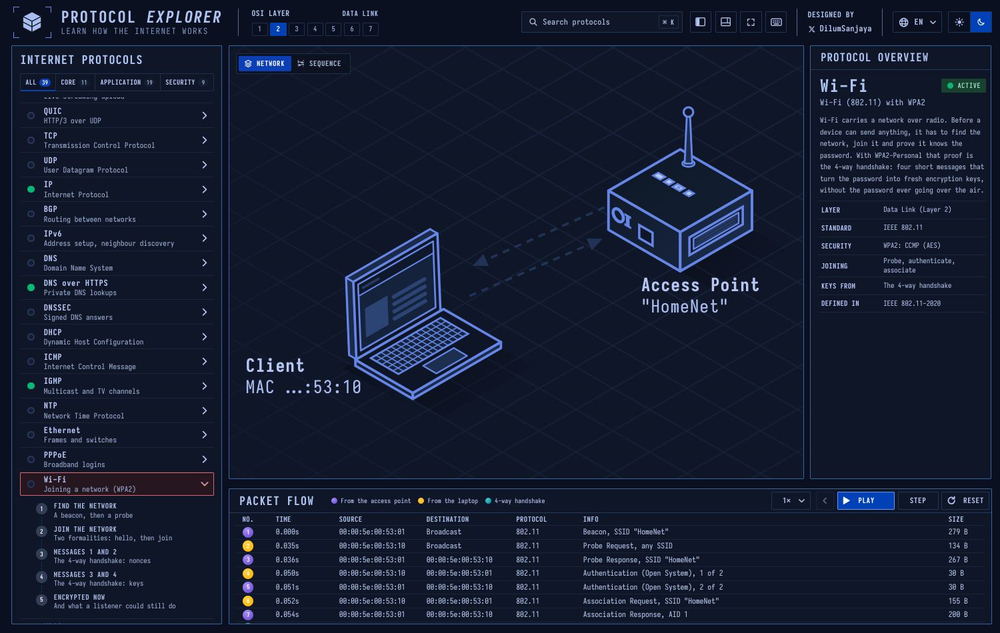
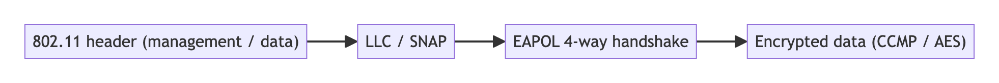
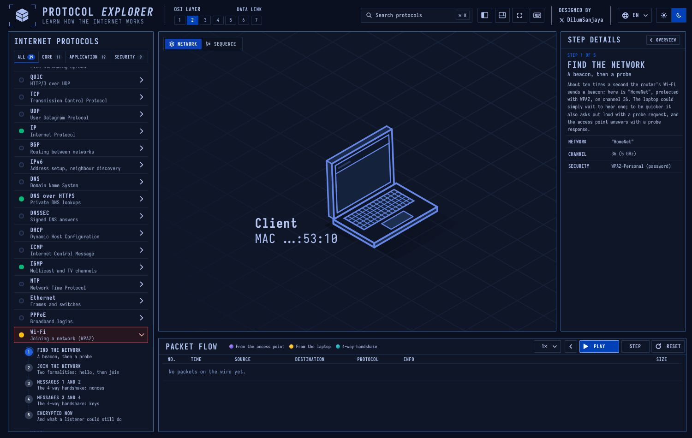
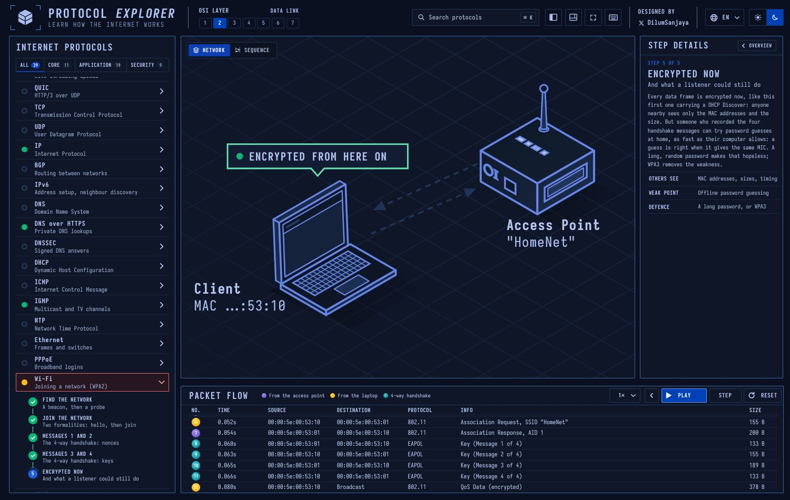
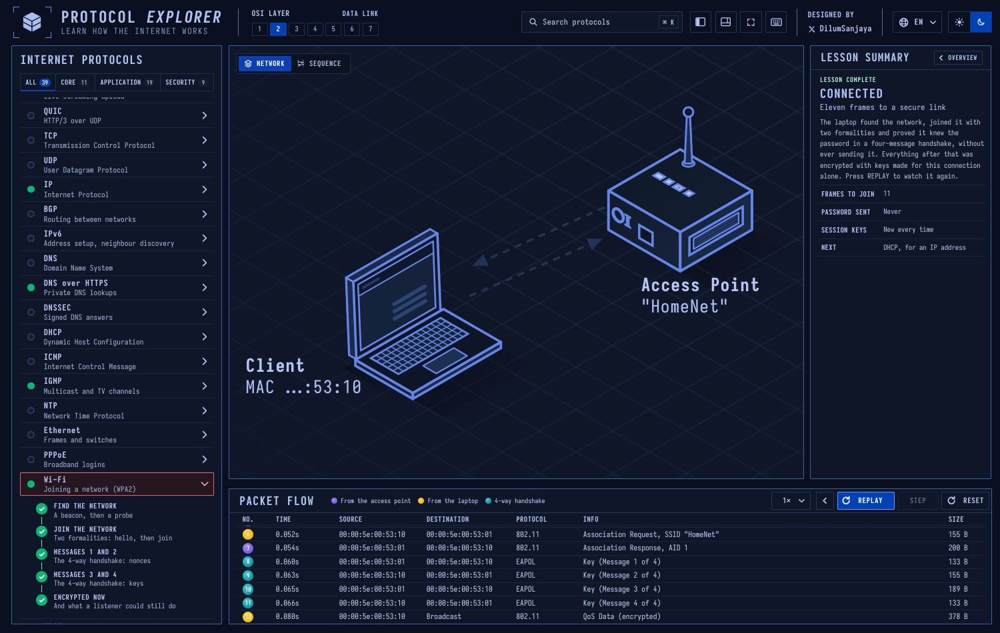
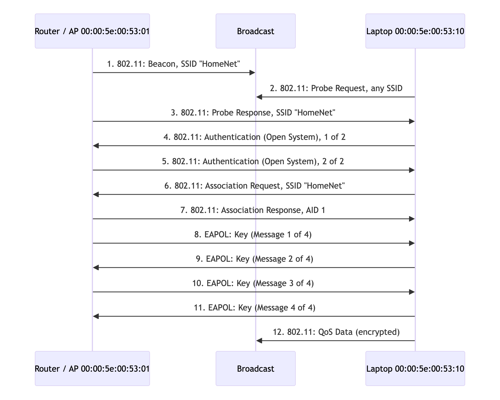
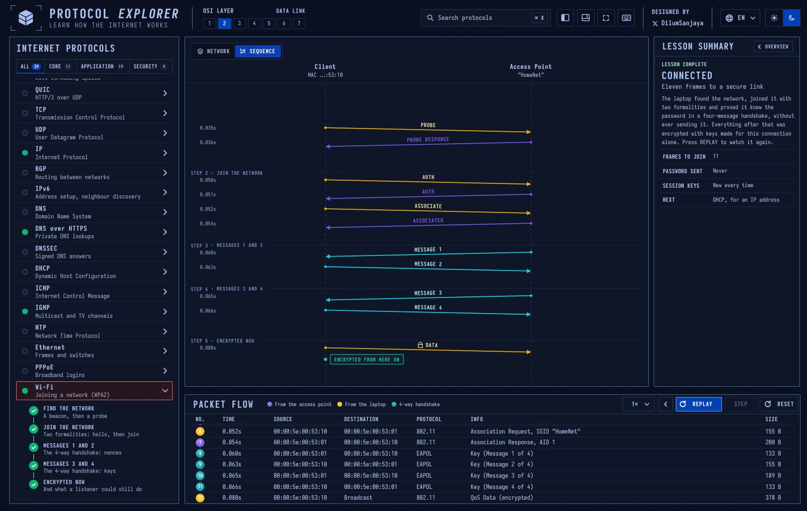
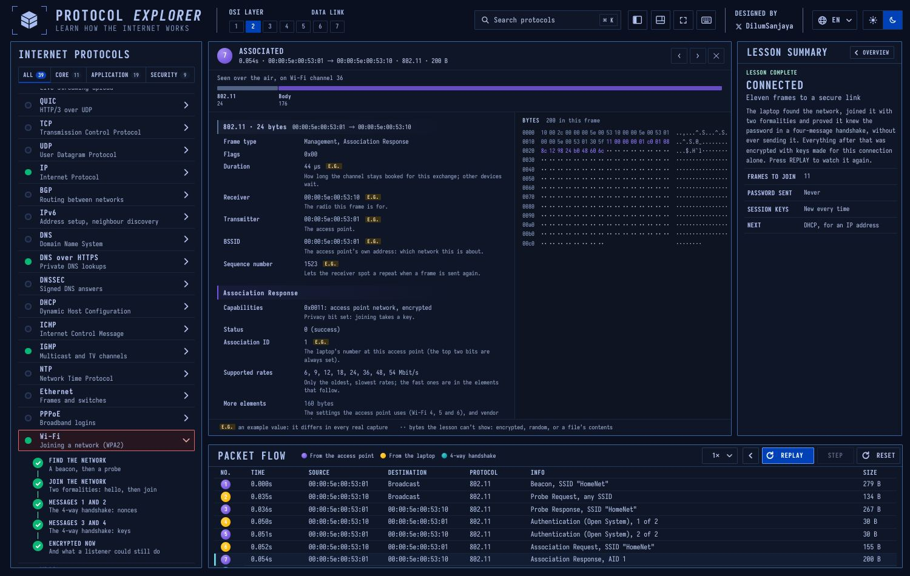

# Wi-Fi – Joining a network (WPA2)

<!-- nav -->
⬅ [22 PPPoE](22-pppoe.md) · [Index](00_Protocols_Index.md) · [24 WPA3](24-wpa3.md) ➡
<!-- nav -->

*Source: Protocol Explorer – https://protocol-explorer-alpha.vercel.app/ (interactive lesson #23). Screenshots captured from the live lesson; packet decodes are the site's example capture (values marked **E.G.** differ in every real capture).*

## Overview

### How the layers fit together (outer to inner)

## In-depth explanation of the example (plain-language version)

### The big picture in one minute
A laptop joins a home Wi-Fi network called **"HomeNet"**, run by an access point (AP) using **WPA2 with a password**. **12 frames in 80 ms:** find the network, join it, run the **4-way handshake** that creates the encryption keys, and send the first **encrypted** data frame (a request for an IP address). The next note covers the newer WPA3.

**Why such a special join procedure?** Radio waves reach everyone nearby, so three things are needed:
1. The device must **discover** which networks exist.
2. It must **prove it knows the password without sending it** through the air.
3. Everything after that must be **encrypted with keys unique to this session.**

Think of a **club with a secret handshake**: first you spot the club, then you ask to come in, then you and the doorman prove you both know the password without saying it, and finally you speak in a private code.

> **Words you'll see:** *SSID* = the network's name. *AP (access point)* = the Wi-Fi box. *Nonce* = a random number used once. *Key* = a secret number used to scramble data. *MIC* = a checksum that proves a message wasn't altered.

---

### Step 1 – Find the network – packets 1 to 3
- **Beacon** (1): the AP announces itself about **10 times a second**: its name "HomeNet", speeds, channel and security type (**AES encryption with a password**).
- **Probe Request** (2): the laptop asks actively, "Any network out there?"
- **Probe Response** (3): the AP replies with the same information.

### Step 2 – Join the network – packets 4 to 7
- **Authentication (open)** (4–5): a leftover formality from the first Wi-Fi standard. It does **not** check any password; it just moves the laptop to the next stage.
- **Association Request** (6): "I want to join HomeNet," repeating its chosen security settings.
- **Association Response** (7): "Success. Your ID is 1." The laptop is now **joined**, but the AP **still blocks all normal traffic**. Only the key handshake is allowed.

### Step 3 – The 4-way handshake, part 1 – packets 8, 9
Both sides already hold the same **master key**, calculated from the password and the network name (it was never sent). The handshake proves both know it and creates **fresh session keys**:
1. **AP → laptop:** a random number (the **ANonce**).
2. **Laptop → AP:** its own random number (the **SNonce**) plus a **MIC** (a checksum made with the key).
Now both sides mix the master key with the two random numbers and the two MAC addresses to get the **session key**. The AP checks the laptop's MIC. **If the password were wrong, the MIC would be wrong and the join would fail ("incorrect password").**

### Step 4 – The 4-way handshake, part 2 – packets 10, 11
3. **AP → laptop:** proves the AP also has the correct key, and delivers the **group key** (for broadcast messages), encrypted.
4. **Laptop → AP:** "Keys installed."
Both ends now **start using the keys at the same moment** and open the network for real traffic.

### Step 5 – Encrypted data – packet 12
The first real frame is a **DHCP Discover** (the laptop asking for an address; see the DHCP note), **encrypted with AES**. A bystander can still see the MAC addresses, frame sizes and timing, but not the content or the IP addresses.

---

### The weakness of WPA2 with a password
Anyone nearby can **record the four handshake messages** (they can even force a reconnect to catch them) and then **guess passwords offline**: for each guess, work out the keys and check whether the checksum matches. A **long, random password** makes this hopeless, but short or common ones fall quickly. **WPA3** (next note) removes this weakness.

### The 12 frames at a glance
| Packets | What | Why |
|---|---|---|
| 1–3 | Beacon, probe request, probe response | discover the network |
| 4–5 | Open authentication | formality |
| 6–7 | Association | join the network |
| 8–11 | 4-way handshake | prove the password and create session keys |
| 12 | Encrypted data | first real traffic |

### What to remember
- **Join sequence:** discover → authenticate (open) → associate → 4-way handshake → encrypted data.
- **Keys:** master key (from password + name) → session key (from the master key + both random numbers + both MACs) → group key (sent encrypted).
- **Frame families:** management (beacon, probe, join, leave), control (ack, RTS/CTS) and data. Management frames are **not protected** unless the 802.11w feature is on.
- **WPA2 uses AES.** WEP and WPA/TKIP are obsolete. Company networks use **WPA2/3-Enterprise** with a RADIUS server (see the RADIUS note).
- The AP also bridges Wi-Fi into the wired Ethernet network (see the Ethernet note).

## Under the hood – technical details

- **Frame types.** *Management* (beacon, probe request/response, authentication, association, deauthentication), *control* (ACK, RTS/CTS) and *data*. The 802.11 header has up to four addresses and carries frame control, duration and a sequence number.
- **Beacon.** Sent about every 102.4 ms. It carries the SSID, supported rates, channel and the **RSN information element** that lists the cipher (CCMP/AES) and the key management (PSK).
- **Open System authentication.** A leftover of the first standard. It doesn't check a password; it only moves the client into the *authenticated* state. The real security comes from the 4-way handshake.
- **Association ID.** The AP assigns an AID to each client, used for power-saving notifications. After association the AP's *controlled port* stays blocked until the keys are installed; only EAPOL handshake frames pass.
- **Pairwise Master Key (PMK).** `PMK = PBKDF2( HMAC-SHA1, passphrase, SSID, 4096 iterations, 256 bits )`. Both sides compute it from the password; it is never transmitted.
- **4-way handshake.** `1` AP sends **ANonce**. `2` Client sends **SNonce** plus a **MIC**. Both compute the **PTK** = PRF( PMK, ANonce, SNonce, AP MAC, client MAC ), split into KCK (to compute MICs), KEK (to encrypt keys) and TK (to encrypt data). `3` AP sends the **GTK** (group key) encrypted with the KEK and a MIC. `4` Client confirms. Both then install the keys.
- **Why a wrong password fails.** Message 2's MIC is computed with a key derived from the password. If it differs, the AP's check fails and the join is refused ("incorrect password").
- **Encryption.** **CCMP** (AES-128 in CCM mode) gives confidentiality and integrity per frame, with a 48-bit packet number to prevent replay. WEP and TKIP are obsolete.
- **What a bystander sees.** MAC addresses, frame sizes and timing; the 802.11 header is not encrypted. IP addresses and payload are protected.
- **Offline-guess weakness.** Someone who captures the 4-way handshake (or forces a reconnect with a *deauthentication* frame) can test guesses offline: compute PMK to PTK to MIC for each guess. Use a long random passphrase. WPA3 removes this weakness.
- **Management frame protection.** Management frames (such as deauthentication) are unprotected unless **802.11w (PMF)** is enabled; WPA3 requires it.

## Step-by-step walkthrough (screenshots from the lesson)

### Step 1: FIND THE NETWORK – A beacon, then a probe

### Step 2: JOIN THE NETWORK – Two formalities: hello, then join

### Step 3: MESSAGES 1 AND 2 – The 4-way handshake: nonces

### Step 4: MESSAGES 3 AND 4 – The 4-way handshake: keys

### Step 5: ENCRYPTED NOW – And what a listener could still do

### Lesson summary

## Packet flow (whole lesson)

| No. | Time | Source | Destination | Protocol | Info | Size |
|---|---|---|---|---|---|---|
| 1 | 0.000s | 00:00:5e:00:53:01 | Broadcast | 802.11 | Beacon, SSID "HomeNet" | 279 B |
| 2 | 0.035s | 00:00:5e:00:53:10 | Broadcast | 802.11 | Probe Request, any SSID | 134 B |
| 3 | 0.036s | 00:00:5e:00:53:01 | 00:00:5e:00:53:10 | 802.11 | Probe Response, SSID "HomeNet" | 267 B |
| 4 | 0.050s | 00:00:5e:00:53:10 | 00:00:5e:00:53:01 | 802.11 | Authentication (Open System), 1 of 2 | 30 B |
| 5 | 0.051s | 00:00:5e:00:53:01 | 00:00:5e:00:53:10 | 802.11 | Authentication (Open System), 2 of 2 | 30 B |
| 6 | 0.052s | 00:00:5e:00:53:10 | 00:00:5e:00:53:01 | 802.11 | Association Request, SSID "HomeNet" | 155 B |
| 7 | 0.054s | 00:00:5e:00:53:01 | 00:00:5e:00:53:10 | 802.11 | Association Response, AID 1 | 200 B |
| 8 | 0.060s | 00:00:5e:00:53:01 | 00:00:5e:00:53:10 | EAPOL | Key (Message 1 of 4) | 133 B |
| 9 | 0.063s | 00:00:5e:00:53:10 | 00:00:5e:00:53:01 | EAPOL | Key (Message 2 of 4) | 155 B |
| 10 | 0.065s | 00:00:5e:00:53:01 | 00:00:5e:00:53:10 | EAPOL | Key (Message 3 of 4) | 189 B |
| 11 | 0.066s | 00:00:5e:00:53:10 | 00:00:5e:00:53:01 | EAPOL | Key (Message 4 of 4) | 133 B |
| 12 | 0.080s | 00:00:5e:00:53:10 | Broadcast | 802.11 | QoS Data (encrypted) | 378 B |

### Sequence diagram

*The lesson's own sequence diagram:*

## Packet decoder screenshots

The lesson's decoder view for the first, middle and last packet: headers, field values and the raw hex bytes.

### Packet 1: 802.11 – Beacon, SSID "HomeNet"

*00:00:5e:00:53:01 → Broadcast · 279 B · t = 0.000s*

### Packet 7: 802.11 – Association Response, AID 1

*00:00:5e:00:53:01 → 00:00:5e:00:53:10 · 200 B · t = 0.054s*

### Packet 12: 802.11 – QoS Data (encrypted)

*00:00:5e:00:53:10 → Broadcast · 378 B · t = 0.080s*

---

<!-- nav -->
⬅ [22 PPPoE](22-pppoe.md) · [Index](00_Protocols_Index.md) · [24 WPA3](24-wpa3.md) ➡
<!-- nav -->
