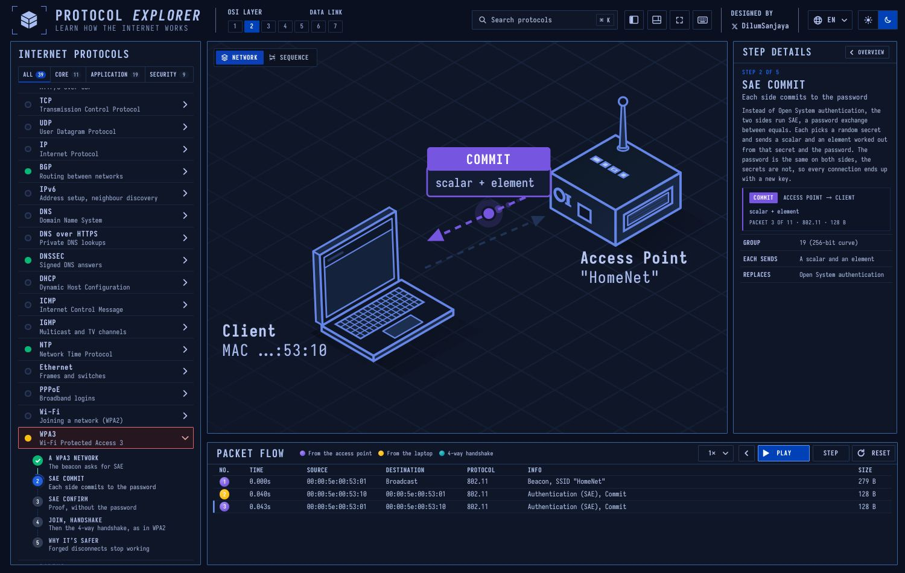
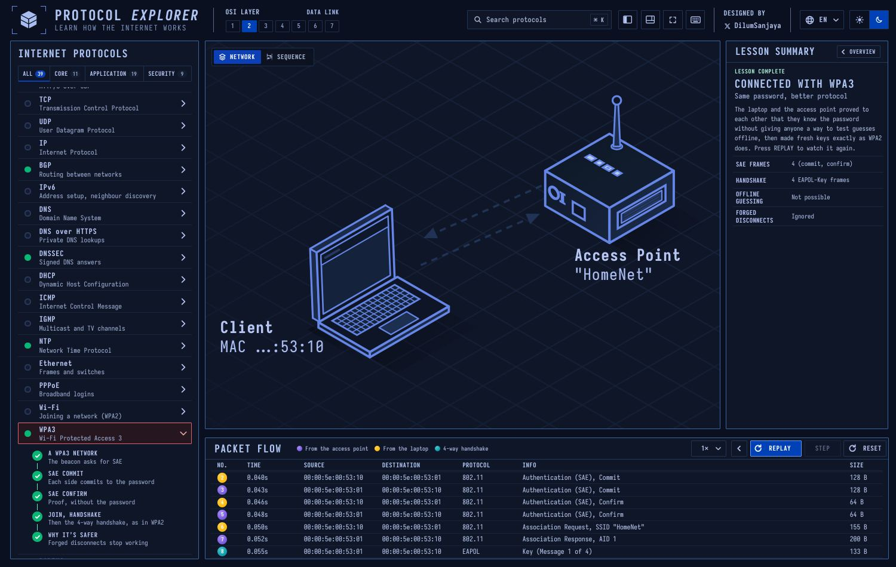
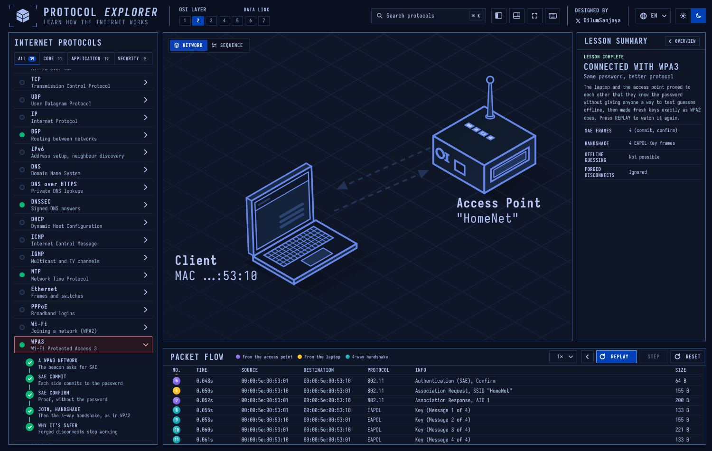
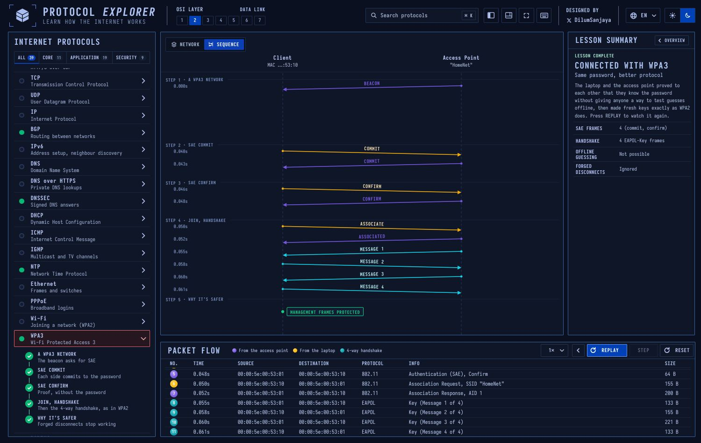
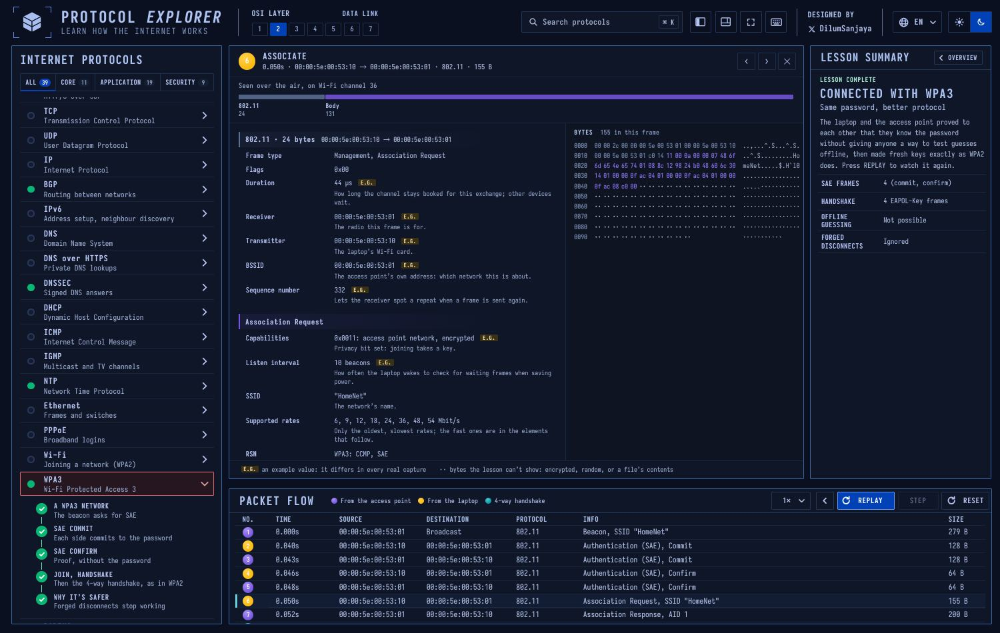
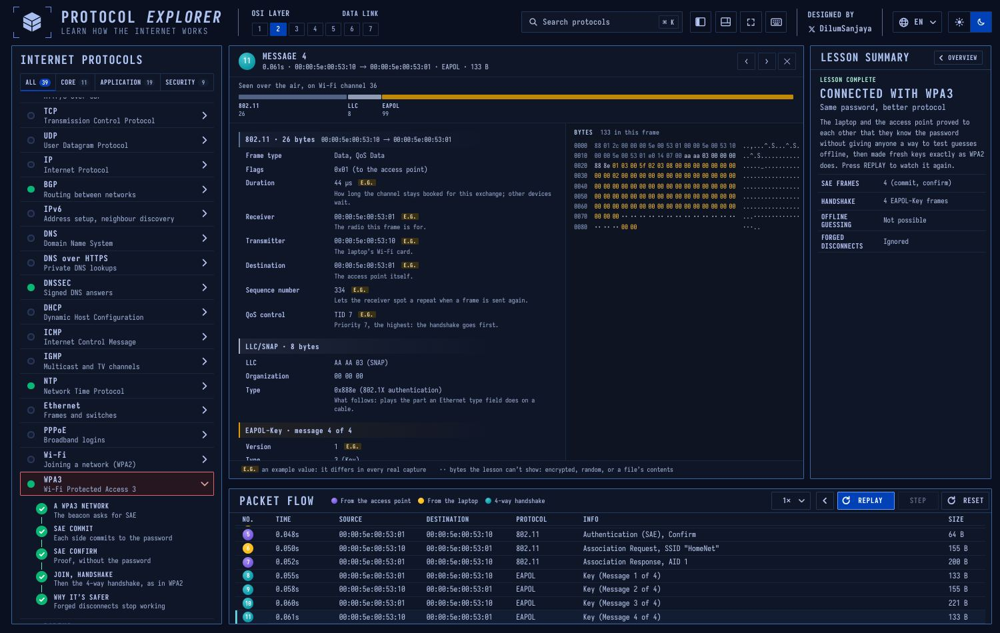

# WPA3 – Wi-Fi Protected Access 3

<!-- nav -->
⬅ [23 Wi-Fi](23-wi-fi.md) · [Index](00_Protocols_Index.md) · [25 RADIUS](25-radius.md) ➡
<!-- nav -->

*Source: Protocol Explorer – https://protocol-explorer-alpha.vercel.app/ (interactive lesson #24). Screenshots captured from the live lesson; packet decodes are the site's example capture (values marked **E.G.** differ in every real capture).*

## Overview


> PROTOCOL OVERVIEW  
> WPA3  
> ACTIVE  
> Wi-Fi Protected Access 3  
> WPA3 is the current Wi-Fi security standard. Its Personal mode keeps the simple shared password but changes how it is checked: SAE, a password exchange that no recording can attack offline, gives every connection a fresh key. It also makes protected management frames compulsory.  
> LAYER  
> Data Link (Layer 2)  
> PASSWORD CHECK  
> SAE (Dragonfly)  
> THEN  
> The 4-way handshake  
> REQUIRED  
> Protected management frames  
> SINCE  
> 2018  
> DEFINED IN  
> IEEE 802.11-2020, RFC 7664  

## In-depth explanation of the example (plain-language version)

### The big picture in one minute
The same laptop joins the same "HomeNet" access point, but now using **WPA3 with a password**. The password is still a simple shared password. What changes is **how it's checked.** **11 frames in 61 ms:** beacon, four **SAE** authentication frames, association, then the familiar **4-way handshake**.

**What was wrong with WPA2.** In WPA2 the keys come straight from the password, so anyone who records the handshake can **try millions of passwords per second offline.** WPA3 replaces the password check with **SAE** (Simultaneous Authentication of Equals, also called "Dragonfly"). With SAE, a recording gives an attacker **nothing to test guesses against.**

Think of **two people who each secretly know a password and prove it to each other** using a clever maths trick, so that a listener learns nothing, and each new conversation produces a brand-new key.

> **Words you'll see:** *SAE* = the new password-based key exchange. *PMF* = protected management frames (the network's control messages are signed). *Forward secrecy* = learning the password later doesn't unlock past recordings. *Offline attack* = guessing passwords on your own computer using recorded data.

---

### Step 1 – The beacon – packet 1
The AP announces **WPA3 (SAE)** and says protected management frames are **required**.

### Step 2 – Both sides commit – packets 2, 3
In WPA2 this stage was a meaningless formality. Now the authentication frames carry real **SAE** messages, and the two sides act as **equals** (either can start):
1. Each side turns **the password, the network name and both MAC addresses** into a special point on a mathematical curve.
2. Each side picks **two fresh random numbers** and sends a **Commit message** built from them and that point.
Both sides know the same password, but the random numbers are different every time, so **each connection creates a new key**, and the commit messages reveal nothing about the password.

### Step 3 – Both sides confirm – packets 4, 5
Each side combines its own secrets with the other side's commit to calculate the **same shared secret**, derives the **master key** from it, and sends a **Confirm** message. Only someone who knew the password could have produced it. When both confirms check out, each side knows the other has the right password.
**Why offline guessing fails:** an attacker who records all four SAE frames still can't test a guess. Testing needs a **live exchange with the AP**, which can be rate-limited, blocked or logged. **Forward secrecy:** because fresh random numbers go into every key, learning the password later doesn't unlock earlier recordings.

### Step 4 – Join and the 4-way handshake – packets 6 to 11
- **Association** (6–7) repeats the choice of SAE.
- The **4-way handshake** (8–11) is **exactly the same as in WPA2** (random numbers, checksum, group key, confirmation), except it starts from the SAE-derived key. Message 3 also delivers an **extra key** used to sign broadcast management frames so attackers can't forge them. Data is still encrypted with AES.

### Step 5 – Connected with WPA3
Same kind of password, better protocol: proof of knowledge without giving anyone a way to test guesses offline, fresh keys for every connection, and **mandatory protected management frames**, which defeats the cheap trick of forging "disconnect" messages to kick devices off.

---

### The 11 frames at a glance
| Packets | What | Why |
|---|---|---|
| 1 | Beacon (WPA3, PMF required) | announce the network |
| 2–3 | SAE Commit | exchange password-based values |
| 4–5 | SAE Confirm | prove the password |
| 6–7 | Association | join |
| 8–11 | 4-way handshake | session keys |

### WPA2 vs WPA3 (personal)
| | WPA2 | WPA3 |
|---|---|---|
| Password check | keys come directly from the password | **SAE** key exchange |
| Offline guessing on a recording | **Possible** | **Not possible** |
| Forward secrecy | No | **Yes** |
| Protected management frames | Optional | **Required** |
| Authentication frames | formality | **SAE Commit / Confirm** |

### What to remember
- Related WPA3 features: **OWE** (encryption for open networks), **Easy Connect (DPP)**, and a **192-bit mode** for enterprises.
- Caveats: early flaws called **Dragonblood** (patched), and **"transition mode"** (WPA2 and WPA3 together) lets an attacker push devices down to WPA2.
- A strong, unique password is still best practice. SAE just removes the cheap offline attack.

## Step-by-step walkthrough (screenshots from the lesson)

### Step 1: A WPA3 NETWORK – The beacon asks for SAE


> STEP 1 OF 5  
> A WPA3 NETWORK  
> The beacon asks for SAE  
> The beacon looks like WPA2’s with two changes in its RSN element: the key management is SAE instead of PSK, and protected management frames are required. Everyone still uses one shared password.  
> KEY MANAGEMENT  
> SAE  
> MANAGEMENT FRAMES  
> Protected (required)  
> PASSWORD  
> Still one for everyone  

### Step 2: SAE COMMIT – Each side commits to the password



> STEP 2 OF 5  
> SAE COMMIT  
> Each side commits to the password  
> Instead of Open System authentication, the two sides run SAE, a password exchange between equals. Each picks a random secret and sends a scalar and an element worked out from that secret and the password. The password is the same on both sides, the secrets are not, so every connection ends up with a new key.  
> COMMIT  
> ACCESS POINT → CLIENT  
> scalar + element  
> PACKET 3 OF 11 · 802.11 · 128 B  
> GROUP  
> 19 (256-bit curve)  
> EACH SENDS  
> A scalar and an element  
> REPLACES  
> Open System authentication  

### Step 3: SAE CONFIRM – Proof, without the password


> STEP 3 OF 5  
> SAE CONFIRM  
> Proof, without the password  
> Each side now works out the shared key and sends a confirm, a value only someone with the right password could produce. Recording all four SAE frames doesn’t let an attacker test guesses at home: every guess takes a live exchange with the access point, which can slow them down or shut them out.  
> CONFIRM  
> ACCESS POINT → CLIENT  
> proof of the key  
> PACKET 5 OF 11 · 802.11 · 64 B  
> RESULT  
> A new key (PMK) each time  
> GUESSING  
> Live only, never offline  
> PASSWORD LEAKS  
> Past traffic stays safe  

### Step 4: JOIN, HANDSHAKE – Then the 4-way handshake, as in WPA2


> STEP 4 OF 5  
> JOIN, HANDSHAKE  
> Then the 4-way handshake, as in WPA2  
> Association works as before, repeating the choice of SAE. The 4-way handshake that follows is WPA2’s, starting from the key SAE just made, except that message 3 also brings the IGTK, a key that signs broadcast management frames.  
> MESSAGE 1  
> ACCESS POINT → CLIENT  
> PACKET 8 OF 11 · EAPOL · 133 B  
> ASSOCIATION ID  
> 1  
> MESSAGE 3 ADDS  
> IGTK  
> CIPHER  
> CCMP (AES)  

### Step 5: WHY IT’S SAFER – Forged disconnects stop working



> LESSON SUMMARY  
> LESSON COMPLETE  
> CONNECTED WITH WPA3  
> Same password, better protocol  
> The laptop and the access point proved to each other that they know the password without giving anyone a way to test guesses offline, then made fresh keys exactly as WPA2 does. Press REPLAY to watch it again.  
> MESSAGE 1  
> ACCESS POINT → CLIENT  
> PACKET 8 OF 11 · EAPOL · 133 B  
> SAE FRAMES  
> 4 (commit, confirm)  
> HANDSHAKE  
> 4 EAPOL-Key frames  
> OFFLINE GUESSING  
> Not possible  
> FORGED DISCONNECTS  
> Ignored  

### Lesson summary



> LESSON SUMMARY  
> LESSON COMPLETE  
> CONNECTED WITH WPA3  
> Same password, better protocol  
> The laptop and the access point proved to each other that they know the password without giving anyone a way to test guesses offline, then made fresh keys exactly as WPA2 does. Press REPLAY to watch it again.  
> MESSAGE 4  
> CLIENT → ACCESS POINT  
> PACKET 11 OF 11 · EAPOL · 133 B  
> SAE FRAMES  
> 4 (commit, confirm)  
> HANDSHAKE  
> 4 EAPOL-Key frames  
> OFFLINE GUESSING  
> Not possible  
> FORGED DISCONNECTS  
> Ignored  

## Packet flow (whole lesson)

| No. | Time | Source | Destination | Protocol | Info | Size |
|---|---|---|---|---|---|---|
| 1 | 0.000s | 00:00:5e:00:53:01 | Broadcast | 802.11 | Beacon, SSID "HomeNet" | 279 B |
| 2 | 0.040s | 00:00:5e:00:53:10 | 00:00:5e:00:53:01 | 802.11 | Authentication (SAE), Commit | 128 B |
| 3 | 0.043s | 00:00:5e:00:53:01 | 00:00:5e:00:53:10 | 802.11 | Authentication (SAE), Commit | 128 B |
| 4 | 0.046s | 00:00:5e:00:53:10 | 00:00:5e:00:53:01 | 802.11 | Authentication (SAE), Confirm | 64 B |
| 5 | 0.048s | 00:00:5e:00:53:01 | 00:00:5e:00:53:10 | 802.11 | Authentication (SAE), Confirm | 64 B |
| 6 | 0.050s | 00:00:5e:00:53:10 | 00:00:5e:00:53:01 | 802.11 | Association Request, SSID "HomeNet" | 155 B |
| 7 | 0.052s | 00:00:5e:00:53:01 | 00:00:5e:00:53:10 | 802.11 | Association Response, AID 1 | 200 B |
| 8 | 0.055s | 00:00:5e:00:53:01 | 00:00:5e:00:53:10 | EAPOL | Key (Message 1 of 4) | 133 B |
| 9 | 0.058s | 00:00:5e:00:53:10 | 00:00:5e:00:53:01 | EAPOL | Key (Message 2 of 4) | 155 B |
| 10 | 0.060s | 00:00:5e:00:53:01 | 00:00:5e:00:53:10 | EAPOL | Key (Message 3 of 4) | 221 B |
| 11 | 0.061s | 00:00:5e:00:53:10 | 00:00:5e:00:53:01 | EAPOL | Key (Message 4 of 4) | 133 B |

### Sequence diagram



## Packets decoded byte by byte

Each packet below is the lesson's own decode (headers, field values and the plain-English meaning of each field). Screenshots show the first, middle and last packet in the lesson's decoder view with the raw hex bytes.

### Packet 1: 802.11 – Beacon, SSID "HomeNet"

*00:00:5e:00:53:01 → Broadcast · 279 B · t = 0.000s*


<details><summary>Decoded fields</summary>

```text
1
BEACON
0.000s · 00:00:5e:00:53:01 → Broadcast · 802.11 · 279 B
Seen over the air, on Wi-Fi channel 36
802.11
24
Body
255
802.11 · 24 bytes
00:00:5e:00:53:01 → ff:ff:ff:ff:ff:ff
Frame type
Management, Beacon
Flags
0x00
Duration
0 µs

Nobody acknowledges a broadcast, so nothing is booked.

Receiver
ff:ff:ff:ff:ff:ff

Broadcast: every device in range listens.

Transmitter
00:00:5e:00:53:01 E.G.

The access point.

BSSID
00:00:5e:00:53:01 E.G.

The access point’s own address: which network this is about.

Sequence number
2040 E.G.

Lets the receiver spot a repeat when a frame is sent again.

Beacon
Timestamp
92,418,866,310 µs E.G.

The access point’s clock; devices on the network keep theirs in step with it.

Beacon interval
100 TU (102.4 ms)

A beacon goes out about ten times a second.

Capabilities
0x0011: access point network, encrypted

Privacy bit set: joining takes a key.

SSID
"HomeNet"

The network’s name.

Supported rates
6, 9, 12, 18, 24, 36, 48, 54 Mbit/s

Only the oldest, slowest rates; the fast ones are in the elements that follow.

TIM
DTIM count 0, period 1

Tells sleeping devices whether frames are waiting for them.

RSN
WPA3: CCMP, SAE

Robust Security Network: how this network is protected.

Element ID, length
48, 20 bytes
Version
1
Group cipher
CCMP (AES)

Encrypts broadcasts, which every device on the network can read.

Pairwise cipher
1: CCMP (AES)

Encrypts each device’s own traffic, with keys only it and the access point have.

Key management
1: SAE (WPA3)
Capabilities
0x00c0: management frame protection required

Disconnect messages and other management frames are signed, so they can’t be forged.

More elements
196 bytes

Wi-Fi 4, 5 and 6 capabilities and settings (HT, VHT, HE: channel 36, 80 MHz wide), and vendor extras.

BYTES 279 in this frame
0000
80
00
00
00
ff
ff
ff
ff
ff
ff
00
00
5e
00
53
01
.
.
.
.
.
.
.
.
.
.
.
.
^
.
S
.
0010
00
00
5e
00
53
01
80
7f
86
fc
97
84
15
00
00
00
.
.
^
.
S
.
.
.
.
.
.
.
.
.
.
.
0020
64
00
11
00
00
07
48
6f
6d
65
4e
65
74
01
08
8c
d
.
.
.
.
.
H
o
m
e
N
e
t
.
.
.
0030
12
98
24
b0
48
60
6c
05
04
00
01
00
00
30
14
01
.
.
$
.
H
`
l
.
.
.
.
.
.
0
.
.
0040
00
00
0f
ac
04
01
00
00
0f
ac
04
01
00
00
0f
ac
.
.
.
.
.
.
.
.
.
.
.
.
.
.
.
.
0050
08
c0
00
··
··
··
··
··
··
··
··
··
··
··
··
··
.
.
.
·
·
·
·
·
·
·
·
·
·
·
·
·
0060
··
··
··
··
··
··
··
··
··
··
··
··
··
··
··
··
·
·
·
·
·
·
·
·
·
·
·
·
·
·
·
·
0070
··
··
··
··
··
··
··
··
··
··
··
··
··
··
··
··
·
·
·
·
·
·
·
·
·
·
·
·
·
·
·
·
0080
··
··
··
··
··
··
··
··
··
··
··
··
··
··
··
··
·
·
·
·
·
·
·
·
·
·
·
·
·
·
·
·
0090
··
··
··
··
··
··
··
··
··
··
··
··
··
··
··
··
·
·
·
·
·
·
·
·
·
·
·
·
·
·
·
·
00a0
··
··
··
··
··
··
··
··
··
··
··
··
··
··
··
··
·
·
·
·
·
·
·
·
·
·
·
·
·
·
·
·
00b0
··
··
··
··
··
··
··
··
··
··
··
··
··
··
··
··
·
·
·
·
·
·
·
·
·
·
·
·
·
·
·
·
00c0
··
··
··
··
··
··
··
··
··
··
··
··
··
··
··
··
·
·
·
·
·
·
·
·
·
·
·
·
·
·
·
·
00d0
··
··
··
··
··
··
··
··
··
··
··
··
··
··
··
··
·
·
·
·
·
·
·
·
·
·
·
·
·
·
·
·
00e0
··
··
··
··
··
··
··
··
··
··
··
··
··
··
··
··
·
·
·
·
·
·
·
·
·
·
·
·
·
·
·
·
00f0
··
··
··
··
··
··
··
··
··
··
··
··
··
··
··
··
·
·
·
·
·
·
·
·
·
·
·
·
·
·
·
·
0100
··
··
··
··
··
··
··
··
··
··
··
··
··
··
··
··
·
·
·
·
·
·
·
·
·
·
·
·
·
·
·
·
0110
··
··
··
··
··
··
··
·
·
·
·
·
·
·
E.G. an example value: it differs in every real capture
·· bytes the lesson can’t show: encrypted, random, or a file’s contents
```

</details>

### Packet 2: 802.11 – Authentication (SAE), Commit

*00:00:5e:00:53:10 → 00:00:5e:00:53:01 · 128 B · t = 0.040s*

<details><summary>Decoded fields</summary>

```text
2
COMMIT
0.040s · 00:00:5e:00:53:10 → 00:00:5e:00:53:01 · 802.11 · 128 B
Seen over the air, on Wi-Fi channel 36
802.11
24
Body
104
802.11 · 24 bytes
00:00:5e:00:53:10 → 00:00:5e:00:53:01
Frame type
Management, Authentication
Flags
0x00
Duration
44 µs E.G.

How long the channel stays booked for this exchange; other devices wait.

Receiver
00:00:5e:00:53:01 E.G.

The radio this frame is for.

Transmitter
00:00:5e:00:53:10 E.G.

The laptop’s Wi-Fi card.

BSSID
00:00:5e:00:53:01 E.G.

The access point’s own address: which network this is about.

Sequence number
330 E.G.

Lets the receiver spot a repeat when a frame is sent again.

Authentication · SAE Commit
Algorithm
3 (SAE)

Simultaneous Authentication of Equals: WPA3’s password exchange.

Transaction
1 (Commit)
Status
0 (success)
Group
19 (256-bit elliptic curve)
Scalar
32 bytes

Worked out from a random secret and the password.

Element
64 bytes

A point on the curve, also tied to the password. Recording the scalar and element doesn’t let anyone test password guesses afterwards.

BYTES 128 in this frame
0000
b0
00
2c
00
00
00
5e
00
53
01
00
00
5e
00
53
10
.
.
,
.
.
.
^
.
S
.
.
.
^
.
S
.
0010
00
00
5e
00
53
01
a0
14
03
00
01
00
00
00
13
00
.
.
^
.
S
.
.
.
.
.
.
.
.
.
.
.
0020
··
··
··
··
··
··
··
··
··
··
··
··
··
··
··
··
·
·
·
·
·
·
·
·
·
·
·
·
·
·
·
·
0030
··
··
··
··
··
··
··
··
··
··
··
··
··
··
··
··
·
·
·
·
·
·
·
·
·
·
·
·
·
·
·
·
0040
··
··
··
··
··
··
··
··
··
··
··
··
··
··
··
··
·
·
·
·
·
·
·
·
·
·
·
·
·
·
·
·
0050
··
··
··
··
··
··
··
··
··
··
··
··
··
··
··
··
·
·
·
·
·
·
·
·
·
·
·
·
·
·
·
·
0060
··
··
··
··
··
··
··
··
··
··
··
··
··
··
··
··
·
·
·
·
·
·
·
·
·
·
·
·
·
·
·
·
0070
··
··
··
··
··
··
··
··
··
··
··
··
··
··
··
··
·
·
·
·
·
·
·
·
·
·
·
·
·
·
·
·
E.G. an example value: it differs in every real capture
·· bytes the lesson can’t show: encrypted, random, or a file’s contents
```

</details>

### Packet 3: 802.11 – Authentication (SAE), Commit

*00:00:5e:00:53:01 → 00:00:5e:00:53:10 · 128 B · t = 0.043s*

<details><summary>Decoded fields</summary>

```text
3
COMMIT
0.043s · 00:00:5e:00:53:01 → 00:00:5e:00:53:10 · 802.11 · 128 B
Seen over the air, on Wi-Fi channel 36
802.11
24
Body
104
802.11 · 24 bytes
00:00:5e:00:53:01 → 00:00:5e:00:53:10
Frame type
Management, Authentication
Flags
0x00
Duration
44 µs E.G.

How long the channel stays booked for this exchange; other devices wait.

Receiver
00:00:5e:00:53:10 E.G.

The radio this frame is for.

Transmitter
00:00:5e:00:53:01 E.G.

The access point.

BSSID
00:00:5e:00:53:01 E.G.

The access point’s own address: which network this is about.

Sequence number
2041 E.G.

Lets the receiver spot a repeat when a frame is sent again.

Authentication · SAE Commit
Algorithm
3 (SAE)

Simultaneous Authentication of Equals: WPA3’s password exchange.

Transaction
1 (Commit)
Status
0 (success)
Group
19 (256-bit elliptic curve)
Scalar
32 bytes

Worked out from a random secret and the password.

Element
64 bytes

A point on the curve, also tied to the password. Recording the scalar and element doesn’t let anyone test password guesses afterwards.

BYTES 128 in this frame
0000
b0
00
2c
00
00
00
5e
00
53
10
00
00
5e
00
53
01
.
.
,
.
.
.
^
.
S
.
.
.
^
.
S
.
0010
00
00
5e
00
53
01
90
7f
03
00
01
00
00
00
13
00
.
.
^
.
S
.
.
.
.
.
.
.
.
.
.
.
0020
··
··
··
··
··
··
··
··
··
··
··
··
··
··
··
··
·
·
·
·
·
·
·
·
·
·
·
·
·
·
·
·
0030
··
··
··
··
··
··
··
··
··
··
··
··
··
··
··
··
·
·
·
·
·
·
·
·
·
·
·
·
·
·
·
·
0040
··
··
··
··
··
··
··
··
··
··
··
··
··
··
··
··
·
·
·
·
·
·
·
·
·
·
·
·
·
·
·
·
0050
··
··
··
··
··
··
··
··
··
··
··
··
··
··
··
··
·
·
·
·
·
·
·
·
·
·
·
·
·
·
·
·
0060
··
··
··
··
··
··
··
··
··
··
··
··
··
··
··
··
·
·
·
·
·
·
·
·
·
·
·
·
·
·
·
·
0070
··
··
··
··
··
··
··
··
··
··
··
··
··
··
··
··
·
·
·
·
·
·
·
·
·
·
·
·
·
·
·
·
E.G. an example value: it differs in every real capture
·· bytes the lesson can’t show: encrypted, random, or a file’s contents
```

</details>

### Packet 4: 802.11 – Authentication (SAE), Confirm

*00:00:5e:00:53:10 → 00:00:5e:00:53:01 · 64 B · t = 0.046s*

<details><summary>Decoded fields</summary>

```text
4
CONFIRM
0.046s · 00:00:5e:00:53:10 → 00:00:5e:00:53:01 · 802.11 · 64 B
Seen over the air, on Wi-Fi channel 36
802.11
24
Body
40
802.11 · 24 bytes
00:00:5e:00:53:10 → 00:00:5e:00:53:01
Frame type
Management, Authentication
Flags
0x00
Duration
44 µs E.G.

How long the channel stays booked for this exchange; other devices wait.

Receiver
00:00:5e:00:53:01 E.G.

The radio this frame is for.

Transmitter
00:00:5e:00:53:10 E.G.

The laptop’s Wi-Fi card.

BSSID
00:00:5e:00:53:01 E.G.

The access point’s own address: which network this is about.

Sequence number
331 E.G.

Lets the receiver spot a repeat when a frame is sent again.

Authentication · SAE Confirm
Algorithm
3 (SAE)

Simultaneous Authentication of Equals: WPA3’s password exchange.

Transaction
2 (Confirm)
Status
0 (success)
Send-confirm
1
Confirm
32 bytes

Proves this side worked out the same key, without giving it away.

BYTES 64 in this frame
0000
b0
00
2c
00
00
00
5e
00
53
01
00
00
5e
00
53
10
.
.
,
.
.
.
^
.
S
.
.
.
^
.
S
.
0010
00
00
5e
00
53
01
b0
14
03
00
02
00
00
00
01
00
.
.
^
.
S
.
.
.
.
.
.
.
.
.
.
.
0020
··
··
··
··
··
··
··
··
··
··
··
··
··
··
··
··
·
·
·
·
·
·
·
·
·
·
·
·
·
·
·
·
0030
··
··
··
··
··
··
··
··
··
··
··
··
··
··
··
··
·
·
·
·
·
·
·
·
·
·
·
·
·
·
·
·
E.G. an example value: it differs in every real capture
·· bytes the lesson can’t show: encrypted, random, or a file’s contents
```

</details>

### Packet 5: 802.11 – Authentication (SAE), Confirm

*00:00:5e:00:53:01 → 00:00:5e:00:53:10 · 64 B · t = 0.048s*

<details><summary>Decoded fields</summary>

```text
5
CONFIRM
0.048s · 00:00:5e:00:53:01 → 00:00:5e:00:53:10 · 802.11 · 64 B
Seen over the air, on Wi-Fi channel 36
802.11
24
Body
40
802.11 · 24 bytes
00:00:5e:00:53:01 → 00:00:5e:00:53:10
Frame type
Management, Authentication
Flags
0x00
Duration
44 µs E.G.

How long the channel stays booked for this exchange; other devices wait.

Receiver
00:00:5e:00:53:10 E.G.

The radio this frame is for.

Transmitter
00:00:5e:00:53:01 E.G.

The access point.

BSSID
00:00:5e:00:53:01 E.G.

The access point’s own address: which network this is about.

Sequence number
2042 E.G.

Lets the receiver spot a repeat when a frame is sent again.

Authentication · SAE Confirm
Algorithm
3 (SAE)

Simultaneous Authentication of Equals: WPA3’s password exchange.

Transaction
2 (Confirm)
Status
0 (success)
Send-confirm
1
Confirm
32 bytes

Proves this side worked out the same key, without giving it away.

BYTES 64 in this frame
0000
b0
00
2c
00
00
00
5e
00
53
10
00
00
5e
00
53
01
.
.
,
.
.
.
^
.
S
.
.
.
^
.
S
.
0010
00
00
5e
00
53
01
a0
7f
03
00
02
00
00
00
01
00
.
.
^
.
S
.
.
.
.
.
.
.
.
.
.
.
0020
··
··
··
··
··
··
··
··
··
··
··
··
··
··
··
··
·
·
·
·
·
·
·
·
·
·
·
·
·
·
·
·
0030
··
··
··
··
··
··
··
··
··
··
··
··
··
··
··
··
·
·
·
·
·
·
·
·
·
·
·
·
·
·
·
·
E.G. an example value: it differs in every real capture
·· bytes the lesson can’t show: encrypted, random, or a file’s contents
```

</details>

### Packet 6: 802.11 – Association Request, SSID "HomeNet"

*00:00:5e:00:53:10 → 00:00:5e:00:53:01 · 155 B · t = 0.050s*



<details><summary>Decoded fields</summary>

```text
6
ASSOCIATE
0.050s · 00:00:5e:00:53:10 → 00:00:5e:00:53:01 · 802.11 · 155 B
Seen over the air, on Wi-Fi channel 36
802.11
24
Body
131
802.11 · 24 bytes
00:00:5e:00:53:10 → 00:00:5e:00:53:01
Frame type
Management, Association Request
Flags
0x00
Duration
44 µs E.G.

How long the channel stays booked for this exchange; other devices wait.

Receiver
00:00:5e:00:53:01 E.G.

The radio this frame is for.

Transmitter
00:00:5e:00:53:10 E.G.

The laptop’s Wi-Fi card.

BSSID
00:00:5e:00:53:01 E.G.

The access point’s own address: which network this is about.

Sequence number
332 E.G.

Lets the receiver spot a repeat when a frame is sent again.

Association Request
Capabilities
0x0011: access point network, encrypted E.G.

Privacy bit set: joining takes a key.

Listen interval
10 beacons E.G.

How often the laptop wakes to check for waiting frames when saving power.

SSID
"HomeNet"

The network’s name.

Supported rates
6, 9, 12, 18, 24, 36, 48, 54 Mbit/s

Only the oldest, slowest rates; the fast ones are in the elements that follow.

RSN
WPA3: CCMP, SAE

Robust Security Network: how this network is protected.

Element ID, length
48, 20 bytes
Version
1
Group cipher
CCMP (AES)

Encrypts broadcasts, which every device on the network can read.

Pairwise cipher
1: CCMP (AES)

Encrypts each device’s own traffic, with keys only it and the access point have.

Key management
1: SAE (WPA3)
Capabilities
0x00c0: management frame protection required

Disconnect messages and other management frames are signed, so they can’t be forged.

More elements
86 bytes

What the laptop’s radio can do (Wi-Fi 4, 5 and 6), and vendor extras.

BYTES 155 in this frame
0000
00
00
2c
00
00
00
5e
00
53
01
00
00
5e
00
53
10
.
.
,
.
.
.
^
.
S
.
.
.
^
.
S
.
0010
00
00
5e
00
53
01
c0
14
11
00
0a
00
00
07
48
6f
.
.
^
.
S
.
.
.
.
.
.
.
.
.
H
o
0020
6d
65
4e
65
74
01
08
8c
12
98
24
b0
48
60
6c
30
m
e
N
e
t
.
.
.
.
.
$
.
H
`
l
0
0030
14
01
00
00
0f
ac
04
01
00
00
0f
ac
04
01
00
00
.
.
.
.
.
.
.
.
.
.
.
.
.
.
.
.
0040
0f
ac
08
c0
00
··
··
··
··
··
··
··
··
··
··
··
.
.
.
.
.
·
·
·
·
·
·
·
·
·
·
·
0050
··
··
··
··
··
··
··
··
··
··
··
··
··
··
··
··
·
·
·
·
·
·
·
·
·
·
·
·
·
·
·
·
0060
··
··
··
··
··
··
··
··
··
··
··
··
··
··
··
··
·
·
·
·
·
·
·
·
·
·
·
·
·
·
·
·
0070
··
··
··
··
··
··
··
··
··
··
··
··
··
··
··
··
·
·
·
·
·
·
·
·
·
·
·
·
·
·
·
·
0080
··
··
··
··
··
··
··
··
··
··
··
··
··
··
··
··
·
·
·
·
·
·
·
·
·
·
·
·
·
·
·
·
0090
··
··
··
··
··
··
··
··
··
··
··
·
·
·
·
·
·
·
·
·
·
·
E.G. an example value: it differs in every real capture
·· bytes the lesson can’t show: encrypted, random, or a file’s contents
```

</details>

### Packet 7: 802.11 – Association Response, AID 1

*00:00:5e:00:53:01 → 00:00:5e:00:53:10 · 200 B · t = 0.052s*

<details><summary>Decoded fields</summary>

```text
7
ASSOCIATED
0.052s · 00:00:5e:00:53:01 → 00:00:5e:00:53:10 · 802.11 · 200 B
Seen over the air, on Wi-Fi channel 36
802.11
24
Body
176
802.11 · 24 bytes
00:00:5e:00:53:01 → 00:00:5e:00:53:10
Frame type
Management, Association Response
Flags
0x00
Duration
44 µs E.G.

How long the channel stays booked for this exchange; other devices wait.

Receiver
00:00:5e:00:53:10 E.G.

The radio this frame is for.

Transmitter
00:00:5e:00:53:01 E.G.

The access point.

BSSID
00:00:5e:00:53:01 E.G.

The access point’s own address: which network this is about.

Sequence number
2043 E.G.

Lets the receiver spot a repeat when a frame is sent again.

Association Response
Capabilities
0x0011: access point network, encrypted

Privacy bit set: joining takes a key.

Status
0 (success)
Association ID
1 E.G.

The laptop’s number at this access point (the top two bits are always set).

Supported rates
6, 9, 12, 18, 24, 36, 48, 54 Mbit/s

Only the oldest, slowest rates; the fast ones are in the elements that follow.

More elements
160 bytes

The settings the access point uses (Wi-Fi 4, 5 and 6), and vendor extras.

BYTES 200 in this frame
0000
10
00
2c
00
00
00
5e
00
53
10
00
00
5e
00
53
01
.
.
,
.
.
.
^
.
S
.
.
.
^
.
S
.
0010
00
00
5e
00
53
01
b0
7f
11
00
00
00
01
c0
01
08
.
.
^
.
S
.
.
.
.
.
.
.
.
.
.
.
0020
8c
12
98
24
b0
48
60
6c
··
··
··
··
··
··
··
··
.
.
.
$
.
H
`
l
·
·
·
·
·
·
·
·
0030
··
··
··
··
··
··
··
··
··
··
··
··
··
··
··
··
·
·
·
·
·
·
·
·
·
·
·
·
·
·
·
·
0040
··
··
··
··
··
··
··
··
··
··
··
··
··
··
··
··
·
·
·
·
·
·
·
·
·
·
·
·
·
·
·
·
0050
··
··
··
··
··
··
··
··
··
··
··
··
··
··
··
··
·
·
·
·
·
·
·
·
·
·
·
·
·
·
·
·
0060
··
··
··
··
··
··
··
··
··
··
··
··
··
··
··
··
·
·
·
·
·
·
·
·
·
·
·
·
·
·
·
·
0070
··
··
··
··
··
··
··
··
··
··
··
··
··
··
··
··
·
·
·
·
·
·
·
·
·
·
·
·
·
·
·
·
0080
··
··
··
··
··
··
··
··
··
··
··
··
··
··
··
··
·
·
·
·
·
·
·
·
·
·
·
·
·
·
·
·
0090
··
··
··
··
··
··
··
··
··
··
··
··
··
··
··
··
·
·
·
·
·
·
·
·
·
·
·
·
·
·
·
·
00a0
··
··
··
··
··
··
··
··
··
··
··
··
··
··
··
··
·
·
·
·
·
·
·
·
·
·
·
·
·
·
·
·
00b0
··
··
··
··
··
··
··
··
··
··
··
··
··
··
··
··
·
·
·
·
·
·
·
·
·
·
·
·
·
·
·
·
00c0
··
··
··
··
··
··
··
··
·
·
·
·
·
·
·
·
E.G. an example value: it differs in every real capture
·· bytes the lesson can’t show: encrypted, random, or a file’s contents
```

</details>

### Packet 8: EAPOL – Key (Message 1 of 4)

*00:00:5e:00:53:01 → 00:00:5e:00:53:10 · 133 B · t = 0.055s*

<details><summary>Decoded fields</summary>

```text
8
MESSAGE 1
0.055s · 00:00:5e:00:53:01 → 00:00:5e:00:53:10 · EAPOL · 133 B
Seen over the air, on Wi-Fi channel 36
802.11
26
LLC
8
EAPOL
99
802.11 · 26 bytes
00:00:5e:00:53:01 → 00:00:5e:00:53:10
Frame type
Data, QoS Data
Flags
0x02 (from the access point)
Duration
44 µs E.G.

How long the channel stays booked for this exchange; other devices wait.

Receiver
00:00:5e:00:53:10 E.G.

The radio this frame is for.

Transmitter
00:00:5e:00:53:01 E.G.

The access point.

Source
00:00:5e:00:53:01 E.G.

Sent by the access point itself.

Sequence number
2044 E.G.

Lets the receiver spot a repeat when a frame is sent again.

QoS control
TID 7 E.G.

Priority 7, the highest: the handshake goes first.

LLC/SNAP · 8 bytes
LLC
AA AA 03 (SNAP)
Organization
00 00 00
Type
0x888e (802.1X authentication)

What follows: plays the part an Ethernet type field does on a cable.

EAPOL-Key · message 1 of 4
Version
2 E.G.
Type
3 (Key)
Length
95 bytes
Descriptor type
2 (RSN)
Key information
0x0088: pairwise, ACK

ACK: the laptop must answer.

Key length
16 bytes

The pairwise key is 16 bytes (AES-128).

Replay counter
1

Counts up with each message from the access point; an old one sent again is ignored.

ANonce
32 random bytes

A random number from the access point.

Key IV
zeros
Key RSC
zeros
Reserved
zeros
MIC
zeros

No keys yet, so nothing to check with.

Key data length
0 bytes
BYTES 133 in this frame
0000
88
02
2c
00
00
00
5e
00
53
10
00
00
5e
00
53
01
.
.
,
.
.
.
^
.
S
.
.
.
^
.
S
.
0010
00
00
5e
00
53
01
c0
7f
07
00
aa
aa
03
00
00
00
.
.
^
.
S
.
.
.
.
.
.
.
.
.
.
.
0020
88
8e
02
03
00
5f
02
00
88
00
10
00
00
00
00
00
.
.
.
.
.
_
.
.
.
.
.
.
.
.
.
.
0030
00
00
01
··
··
··
··
··
··
··
··
··
··
··
··
··
.
.
.
·
·
·
·
·
·
·
·
·
·
·
·
·
0040
··
··
··
··
··
··
··
··
··
··
··
··
··
··
··
··
·
·
·
·
·
·
·
·
·
·
·
·
·
·
·
·
0050
··
··
··
00
00
00
00
00
00
00
00
00
00
00
00
00
·
·
·
.
.
.
.
.
.
.
.
.
.
.
.
.
0060
00
00
00
00
00
00
00
00
00
00
00
00
00
00
00
00
.
.
.
.
.
.
.
.
.
.
.
.
.
.
.
.
0070
00
00
00
00
00
00
00
00
00
00
00
00
00
00
00
00
.
.
.
.
.
.
.
.
.
.
.
.
.
.
.
.
0080
00
00
00
00
00
.
.
.
.
.
E.G. an example value: it differs in every real capture
·· bytes the lesson can’t show: encrypted, random, or a file’s contents
```

</details>

### Packet 9: EAPOL – Key (Message 2 of 4)

*00:00:5e:00:53:10 → 00:00:5e:00:53:01 · 155 B · t = 0.058s*

<details><summary>Decoded fields</summary>

```text
9
MESSAGE 2
0.058s · 00:00:5e:00:53:10 → 00:00:5e:00:53:01 · EAPOL · 155 B
Seen over the air, on Wi-Fi channel 36
802.11
26
LLC
8
EAPOL
121
802.11 · 26 bytes
00:00:5e:00:53:10 → 00:00:5e:00:53:01
Frame type
Data, QoS Data
Flags
0x01 (to the access point)
Duration
44 µs E.G.

How long the channel stays booked for this exchange; other devices wait.

Receiver
00:00:5e:00:53:01 E.G.

The radio this frame is for.

Transmitter
00:00:5e:00:53:10 E.G.

The laptop’s Wi-Fi card.

Destination
00:00:5e:00:53:01 E.G.

The access point itself.

Sequence number
333 E.G.

Lets the receiver spot a repeat when a frame is sent again.

QoS control
TID 7 E.G.

Priority 7, the highest: the handshake goes first.

LLC/SNAP · 8 bytes
LLC
AA AA 03 (SNAP)
Organization
00 00 00
Type
0x888e (802.1X authentication)

What follows: plays the part an Ethernet type field does on a cable.

EAPOL-Key · message 2 of 4
Version
1 E.G.
Type
3 (Key)
Length
117 bytes
Descriptor type
2 (RSN)
Key information
0x0108: pairwise, MIC

MIC: this message carries a check value.

Key length
0
Replay counter
1

Counts up with each message from the access point; an old one sent again is ignored.

SNonce
32 random bytes

A random number from the laptop. From both numbers, both MAC addresses and the key that comes from the password, each side works out the same session keys.

Key IV
zeros
Key RSC
zeros
Reserved
zeros
MIC
16 bytes

Worked out with the new keys: it proves the sender knows the password, and that the message wasn’t changed.

Key data length
22 bytes
RSN
WPA3: CCMP, SAE

Robust Security Network: how this network is protected.

Element ID, length
48, 20 bytes
Version
1
Group cipher
CCMP (AES)

Encrypts broadcasts, which every device on the network can read.

Pairwise cipher
1: CCMP (AES)

Encrypts each device’s own traffic, with keys only it and the access point have.

Key management
1: SAE (WPA3)
Capabilities
0x00c0: management frame protection required

Disconnect messages and other management frames are signed, so they can’t be forged.

BYTES 155 in this frame
0000
88
01
2c
00
00
00
5e
00
53
01
00
00
5e
00
53
10
.
.
,
.
.
.
^
.
S
.
.
.
^
.
S
.
0010
00
00
5e
00
53
01
d0
14
07
00
aa
aa
03
00
00
00
.
.
^
.
S
.
.
.
.
.
.
.
.
.
.
.
0020
88
8e
01
03
00
75
02
01
08
00
00
00
00
00
00
00
.
.
.
.
.
u
.
.
.
.
.
.
.
.
.
.
0030
00
00
01
··
··
··
··
··
··
··
··
··
··
··
··
··
.
.
.
·
·
·
·
·
·
·
·
·
·
·
·
·
0040
··
··
··
··
··
··
··
··
··
··
··
··
··
··
··
··
·
·
·
·
·
·
·
·
·
·
·
·
·
·
·
·
0050
··
··
··
00
00
00
00
00
00
00
00
00
00
00
00
00
·
·
·
.
.
.
.
.
.
.
.
.
.
.
.
.
0060
00
00
00
00
00
00
00
00
00
00
00
00
00
00
00
00
.
.
.
.
.
.
.
.
.
.
.
.
.
.
.
.
0070
00
00
00
··
··
··
··
··
··
··
··
··
··
··
··
··
.
.
.
·
·
·
·
·
·
·
·
·
·
·
·
·
0080
··
··
··
00
16
30
14
01
00
00
0f
ac
04
01
00
00
·
·
·
.
.
0
.
.
.
.
.
.
.
.
.
.
0090
0f
ac
04
01
00
00
0f
ac
08
c0
00
.
.
.
.
.
.
.
.
.
.
.
E.G. an example value: it differs in every real capture
·· bytes the lesson can’t show: encrypted, random, or a file’s contents
```

</details>

### Packet 10: EAPOL – Key (Message 3 of 4)

*00:00:5e:00:53:01 → 00:00:5e:00:53:10 · 221 B · t = 0.060s*

<details><summary>Decoded fields</summary>

```text
10
MESSAGE 3
0.060s · 00:00:5e:00:53:01 → 00:00:5e:00:53:10 · EAPOL · 221 B
Seen over the air, on Wi-Fi channel 36
802.11
26
LLC
8
EAPOL
187
802.11 · 26 bytes
00:00:5e:00:53:01 → 00:00:5e:00:53:10
Frame type
Data, QoS Data
Flags
0x02 (from the access point)
Duration
44 µs E.G.

How long the channel stays booked for this exchange; other devices wait.

Receiver
00:00:5e:00:53:10 E.G.

The radio this frame is for.

Transmitter
00:00:5e:00:53:01 E.G.

The access point.

Source
00:00:5e:00:53:01 E.G.

Sent by the access point itself.

Sequence number
2045 E.G.

Lets the receiver spot a repeat when a frame is sent again.

QoS control
TID 7 E.G.

Priority 7, the highest: the handshake goes first.

LLC/SNAP · 8 bytes
LLC
AA AA 03 (SNAP)
Organization
00 00 00
Type
0x888e (802.1X authentication)

What follows: plays the part an Ethernet type field does on a cable.

EAPOL-Key · message 3 of 4
Version
2 E.G.
Type
3 (Key)
Length
183 bytes
Descriptor type
2 (RSN)
Key information
0x13c8: pairwise, install, ACK, MIC, secure, key data encrypted

Install: start using the keys. The group key comes encrypted.

Key length
16 bytes

The pairwise key is 16 bytes (AES-128).

Replay counter
2

Counts up with each message from the access point; an old one sent again is ignored.

ANonce
32 random bytes

A random number from the access point.

Key IV
zeros
Key RSC
zeros

Where the group key’s packet numbers start.

Reserved
zeros
MIC
16 bytes

Worked out with the new keys: it proves the sender knows the password, and that the message wasn’t changed.

Key data length
88 bytes
Key data
88 bytes

Encrypted with a key from the handshake.

Inside
The access point’s RSN element
GTK: the group key, for broadcasts
IGTK: the key that signs broadcast management frames
BYTES 221 in this frame
0000
88
02
2c
00
00
00
5e
00
53
10
00
00
5e
00
53
01
.
.
,
.
.
.
^
.
S
.
.
.
^
.
S
.
0010
00
00
5e
00
53
01
d0
7f
07
00
aa
aa
03
00
00
00
.
.
^
.
S
.
.
.
.
.
.
.
.
.
.
.
0020
88
8e
02
03
00
b7
02
13
c8
00
10
00
00
00
00
00
.
.
.
.
.
.
.
.
.
.
.
.
.
.
.
.
0030
00
00
02
··
··
··
··
··
··
··
··
··
··
··
··
··
.
.
.
·
·
·
·
·
·
·
·
·
·
·
·
·
0040
··
··
··
··
··
··
··
··
··
··
··
··
··
··
··
··
·
·
·
·
·
·
·
·
·
·
·
·
·
·
·
·
0050
··
··
··
00
00
00
00
00
00
00
00
00
00
00
00
00
·
·
·
.
.
.
.
.
.
.
.
.
.
.
.
.
0060
00
00
00
00
00
00
00
00
00
00
00
00
00
00
00
00
.
.
.
.
.
.
.
.
.
.
.
.
.
.
.
.
0070
00
00
00
··
··
··
··
··
··
··
··
··
··
··
··
··
.
.
.
·
·
·
·
·
·
·
·
·
·
·
·
·
0080
··
··
··
00
58
··
··
··
··
··
··
··
··
··
··
··
·
·
·
.
X
·
·
·
·
·
·
·
·
·
·
·
0090
··
··
··
··
··
··
··
··
··
··
··
··
··
··
··
··
·
·
·
·
·
·
·
·
·
·
·
·
·
·
·
·
00a0
··
··
··
··
··
··
··
··
··
··
··
··
··
··
··
··
·
·
·
·
·
·
·
·
·
·
·
·
·
·
·
·
00b0
··
··
··
··
··
··
··
··
··
··
··
··
··
··
··
··
·
·
·
·
·
·
·
·
·
·
·
·
·
·
·
·
00c0
··
··
··
··
··
··
··
··
··
··
··
··
··
··
··
··
·
·
·
·
·
·
·
·
·
·
·
·
·
·
·
·
00d0
··
··
··
··
··
··
··
··
··
··
··
··
··
·
·
·
·
·
·
·
·
·
·
·
·
·
E.G. an example value: it differs in every real capture
·· bytes the lesson can’t show: encrypted, random, or a file’s contents
```

</details>

### Packet 11: EAPOL – Key (Message 4 of 4)

*00:00:5e:00:53:10 → 00:00:5e:00:53:01 · 133 B · t = 0.061s*



<details><summary>Decoded fields</summary>

```text
11
MESSAGE 4
0.061s · 00:00:5e:00:53:10 → 00:00:5e:00:53:01 · EAPOL · 133 B
Seen over the air, on Wi-Fi channel 36
802.11
26
LLC
8
EAPOL
99
802.11 · 26 bytes
00:00:5e:00:53:10 → 00:00:5e:00:53:01
Frame type
Data, QoS Data
Flags
0x01 (to the access point)
Duration
44 µs E.G.

How long the channel stays booked for this exchange; other devices wait.

Receiver
00:00:5e:00:53:01 E.G.

The radio this frame is for.

Transmitter
00:00:5e:00:53:10 E.G.

The laptop’s Wi-Fi card.

Destination
00:00:5e:00:53:01 E.G.

The access point itself.

Sequence number
334 E.G.

Lets the receiver spot a repeat when a frame is sent again.

QoS control
TID 7 E.G.

Priority 7, the highest: the handshake goes first.

LLC/SNAP · 8 bytes
LLC
AA AA 03 (SNAP)
Organization
00 00 00
Type
0x888e (802.1X authentication)

What follows: plays the part an Ethernet type field does on a cable.

EAPOL-Key · message 4 of 4
Version
1 E.G.
Type
3 (Key)
Length
95 bytes
Descriptor type
2 (RSN)
Key information
0x0308: pairwise, MIC, secure

Secure: the keys are in place.

Key length
0
Replay counter
2

Counts up with each message from the access point; an old one sent again is ignored.

Nonce
zeros
Key IV
zeros
Key RSC
zeros
Reserved
zeros
MIC
16 bytes

Worked out with the new keys: it proves the sender knows the password, and that the message wasn’t changed.

Key data length
0 bytes
BYTES 133 in this frame
0000
88
01
2c
00
00
00
5e
00
53
01
00
00
5e
00
53
10
.
.
,
.
.
.
^
.
S
.
.
.
^
.
S
.
0010
00
00
5e
00
53
01
e0
14
07
00
aa
aa
03
00
00
00
.
.
^
.
S
.
.
.
.
.
.
.
.
.
.
.
0020
88
8e
01
03
00
5f
02
03
08
00
00
00
00
00
00
00
.
.
.
.
.
_
.
.
.
.
.
.
.
.
.
.
0030
00
00
02
00
00
00
00
00
00
00
00
00
00
00
00
00
.
.
.
.
.
.
.
.
.
.
.
.
.
.
.
.
0040
00
00
00
00
00
00
00
00
00
00
00
00
00
00
00
00
.
.
.
.
.
.
.
.
.
.
.
.
.
.
.
.
0050
00
00
00
00
00
00
00
00
00
00
00
00
00
00
00
00
.
.
.
.
.
.
.
.
.
.
.
.
.
.
.
.
0060
00
00
00
00
00
00
00
00
00
00
00
00
00
00
00
00
.
.
.
.
.
.
.
.
.
.
.
.
.
.
.
.
0070
00
00
00
··
··
··
··
··
··
··
··
··
··
··
··
··
.
.
.
·
·
·
·
·
·
·
·
·
·
·
·
·
0080
··
··
··
00
00
·
·
·
.
.
E.G. an example value: it differs in every real capture
·· bytes the lesson can’t show: encrypted, random, or a file’s contents
```

</details>

---

<!-- nav -->
⬅ [23 Wi-Fi](23-wi-fi.md) · [Index](00_Protocols_Index.md) · [25 RADIUS](25-radius.md) ➡
<!-- nav -->
