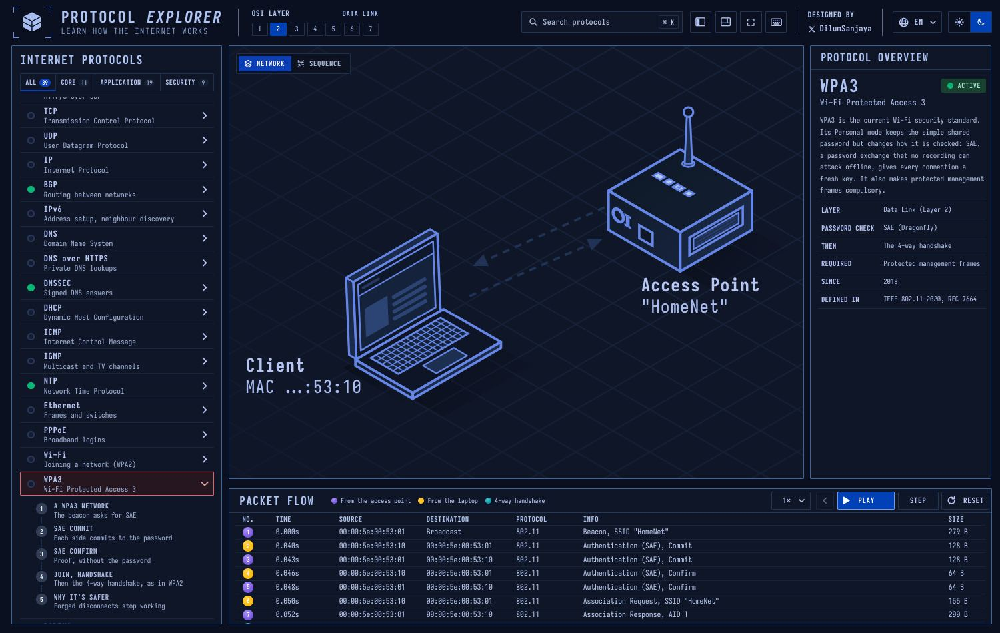
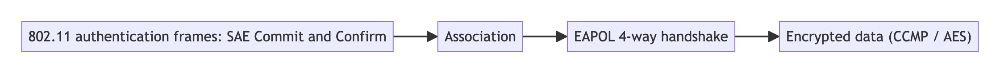
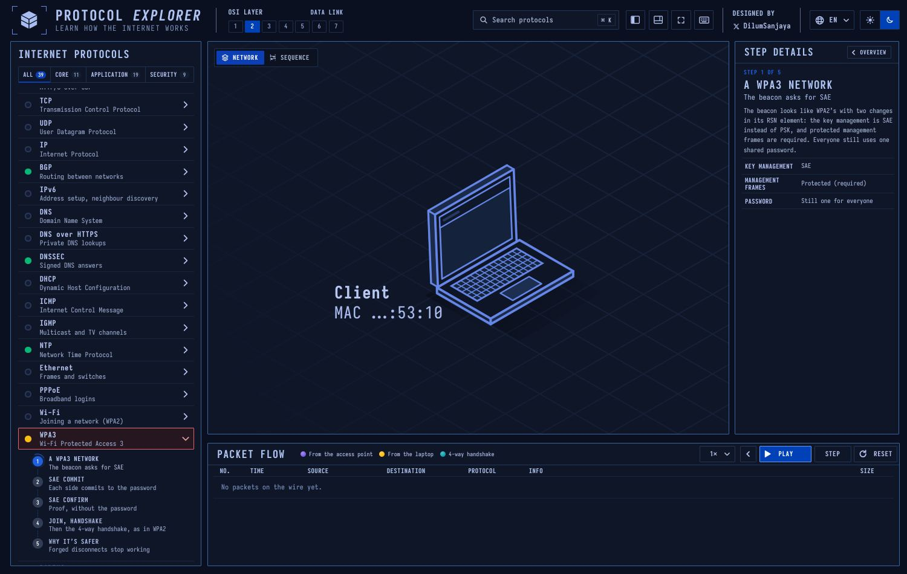
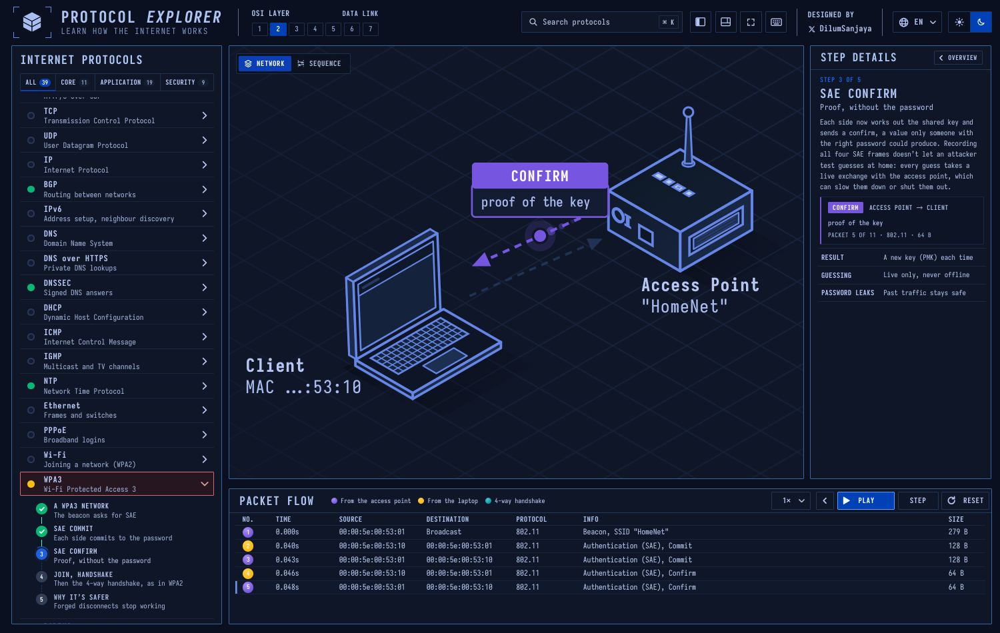
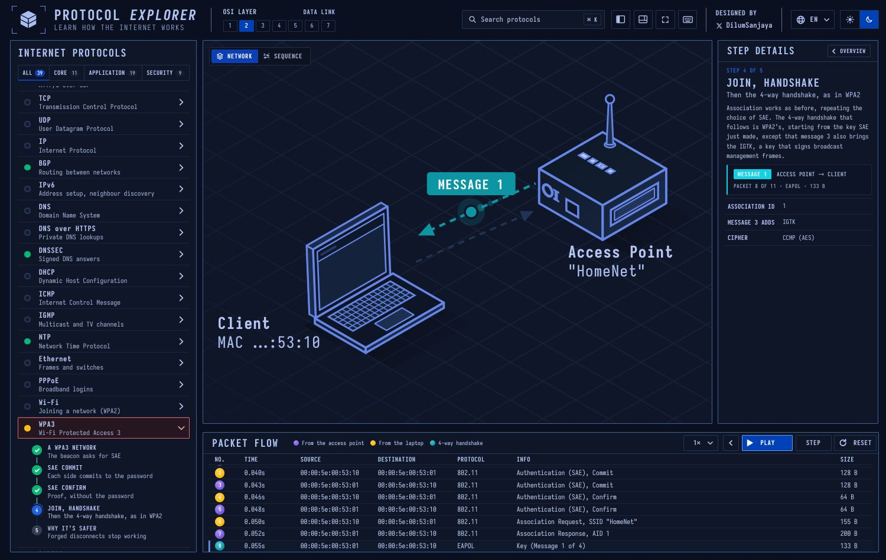
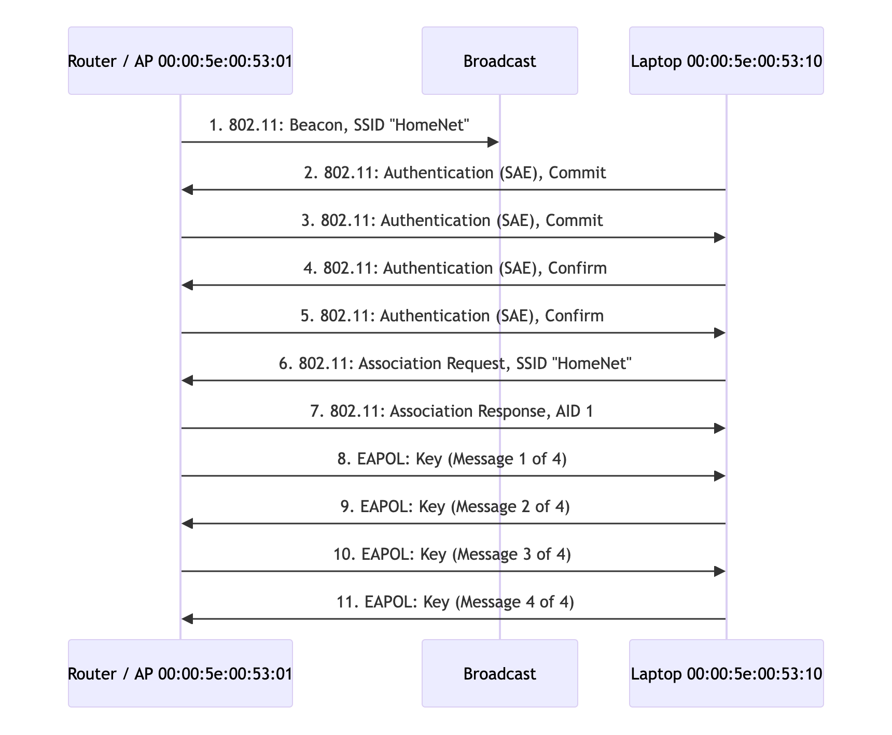
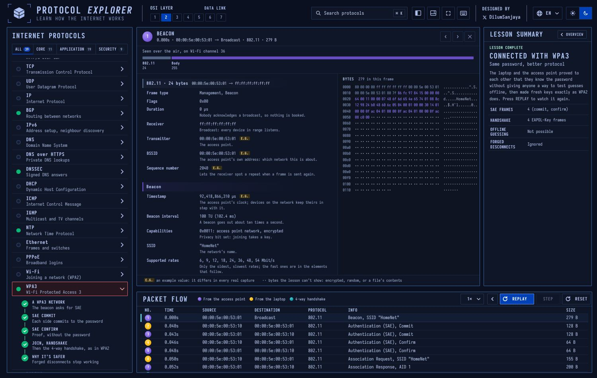

# WPA3 – Wi-Fi Protected Access 3

<!-- nav -->
⬅ [23 Wi-Fi](23-wi-fi.md) · [Index](00_Protocols_Index.md) · [25 RADIUS](25-radius.md) ➡
<!-- nav -->

*Source: Protocol Explorer – https://protocol-explorer-alpha.vercel.app/ (interactive lesson #24). Screenshots captured from the live lesson; packet decodes are the site's example capture (values marked **E.G.** differ in every real capture).*

## Overview

### How the layers fit together (outer to inner)

## In-depth explanation of the example (plain-language version)

### The big picture in one minute
The same laptop joins the same "HomeNet" access point, but now using **WPA3 with a password**. The password is still a simple shared password. What changes is **how it's checked.** **11 frames in 61 ms:** beacon, four **SAE** authentication frames, association, then the familiar **4-way handshake**.

**What was wrong with WPA2.** In WPA2 the keys come straight from the password, so anyone who records the handshake can **try millions of passwords per second offline.** WPA3 replaces the password check with **SAE** (Simultaneous Authentication of Equals, also called "Dragonfly"). With SAE, a recording gives an attacker **nothing to test guesses against.**

Think of **two people who each secretly know a password and prove it to each other** using a clever maths trick, so that a listener learns nothing, and each new conversation produces a brand-new key.

> **Words you'll see:** *SAE* = the new password-based key exchange. *PMF* = protected management frames (the network's control messages are signed). *Forward secrecy* = learning the password later doesn't unlock past recordings. *Offline attack* = guessing passwords on your own computer using recorded data.

---

### Step 1 – The beacon – packet 1
The AP announces **WPA3 (SAE)** and says protected management frames are **required**.

### Step 2 – Both sides commit – packets 2, 3
In WPA2 this stage was a meaningless formality. Now the authentication frames carry real **SAE** messages, and the two sides act as **equals** (either can start):
1. Each side turns **the password, the network name and both MAC addresses** into a special point on a mathematical curve.
2. Each side picks **two fresh random numbers** and sends a **Commit message** built from them and that point.
Both sides know the same password, but the random numbers are different every time, so **each connection creates a new key**, and the commit messages reveal nothing about the password.

### Step 3 – Both sides confirm – packets 4, 5
Each side combines its own secrets with the other side's commit to calculate the **same shared secret**, derives the **master key** from it, and sends a **Confirm** message. Only someone who knew the password could have produced it. When both confirms check out, each side knows the other has the right password.
**Why offline guessing fails:** an attacker who records all four SAE frames still can't test a guess. Testing needs a **live exchange with the AP**, which can be rate-limited, blocked or logged. **Forward secrecy:** because fresh random numbers go into every key, learning the password later doesn't unlock earlier recordings.

### Step 4 – Join and the 4-way handshake – packets 6 to 11
- **Association** (6–7) repeats the choice of SAE.
- The **4-way handshake** (8–11) is **exactly the same as in WPA2** (random numbers, checksum, group key, confirmation), except it starts from the SAE-derived key. Message 3 also delivers an **extra key** used to sign broadcast management frames so attackers can't forge them. Data is still encrypted with AES.

### Step 5 – Connected with WPA3
Same kind of password, better protocol: proof of knowledge without giving anyone a way to test guesses offline, fresh keys for every connection, and **mandatory protected management frames**, which defeats the cheap trick of forging "disconnect" messages to kick devices off.

---

### The 11 frames at a glance
| Packets | What | Why |
|---|---|---|
| 1 | Beacon (WPA3, PMF required) | announce the network |
| 2–3 | SAE Commit | exchange password-based values |
| 4–5 | SAE Confirm | prove the password |
| 6–7 | Association | join |
| 8–11 | 4-way handshake | session keys |

### WPA2 vs WPA3 (personal)
| | WPA2 | WPA3 |
|---|---|---|
| Password check | keys come directly from the password | **SAE** key exchange |
| Offline guessing on a recording | **Possible** | **Not possible** |
| Forward secrecy | No | **Yes** |
| Protected management frames | Optional | **Required** |
| Authentication frames | formality | **SAE Commit / Confirm** |

### What to remember
- Related WPA3 features: **OWE** (encryption for open networks), **Easy Connect (DPP)**, and a **192-bit mode** for enterprises.
- Caveats: early flaws called **Dragonblood** (patched), and **"transition mode"** (WPA2 and WPA3 together) lets an attacker push devices down to WPA2.
- A strong, unique password is still best practice. SAE just removes the cheap offline attack.

## Under the hood – technical details

- **SAE (Dragonfly).** A *password-authenticated key exchange* (RFC 7664, with the *hunt-and-peck* or hash-to-curve method for turning the password into a curve point). Both sides act as equals; there is no client/server role.
- **Password element.** Each side derives a point **PWE** on an elliptic curve (group 19, NIST P-256) from the password, the SSID and both MAC addresses. Same password gives the same point.
- **Commit.** Each side picks two random numbers (`rand` and `mask`) and sends a **scalar** (`rand + mask`) and an **element** (`-mask x PWE`). Because the numbers are fresh, a commit message reveals nothing about the password.
- **Shared secret.** Each side combines its own secret with the other's commit to compute the same value `K`, and derives the **PMK** and a confirmation key from it.
- **Confirm.** Each side sends an HMAC over both commits using the confirmation key. Only someone who knew the password can produce it. A mismatch means a wrong password.
- **No offline dictionary attack.** The recorded frames give an attacker nothing to test a guess against. Every guess needs a live exchange with the AP or the client, which can be rate-limited and logged.
- **Forward secrecy.** The PMK depends on fresh random values, so learning the password later doesn't decrypt old recordings.
- **Frames.** SAE uses *Authentication* frames with algorithm number 3 (instead of Open System). The association and 4-way handshake are afterwards the same as in WPA2, but message 3 also delivers an **IGTK** to protect broadcast management frames.
- **PMF.** Protected management frames (802.11w) are **mandatory**, which stops forged deauthentication attacks.
- **Ciphers.** CCMP (AES-128) in WPA3-Personal; GCMP-256 and 192-bit security in WPA3-Enterprise.
- **Related features.** **OWE** (Opportunistic Wireless Encryption) encrypts open networks without a password; **Wi-Fi Easy Connect (DPP)** onboards devices with QR codes.
- **Caveats.** Early *Dragonblood* side-channel flaws were patched. *Transition mode* (WPA2 and WPA3 together) can let an attacker push devices down to WPA2.

## Step-by-step walkthrough (screenshots from the lesson)

### Step 1: A WPA3 NETWORK – The beacon asks for SAE

### Step 2: SAE COMMIT – Each side commits to the password

### Step 3: SAE CONFIRM – Proof, without the password

### Step 4: JOIN, HANDSHAKE – Then the 4-way handshake, as in WPA2

### Step 5: WHY IT’S SAFER – Forged disconnects stop working

### Lesson summary

## Packet flow (whole lesson)

| No. | Time | Source | Destination | Protocol | Info | Size |
|---|---|---|---|---|---|---|
| 1 | 0.000s | 00:00:5e:00:53:01 | Broadcast | 802.11 | Beacon, SSID "HomeNet" | 279 B |
| 2 | 0.040s | 00:00:5e:00:53:10 | 00:00:5e:00:53:01 | 802.11 | Authentication (SAE), Commit | 128 B |
| 3 | 0.043s | 00:00:5e:00:53:01 | 00:00:5e:00:53:10 | 802.11 | Authentication (SAE), Commit | 128 B |
| 4 | 0.046s | 00:00:5e:00:53:10 | 00:00:5e:00:53:01 | 802.11 | Authentication (SAE), Confirm | 64 B |
| 5 | 0.048s | 00:00:5e:00:53:01 | 00:00:5e:00:53:10 | 802.11 | Authentication (SAE), Confirm | 64 B |
| 6 | 0.050s | 00:00:5e:00:53:10 | 00:00:5e:00:53:01 | 802.11 | Association Request, SSID "HomeNet" | 155 B |
| 7 | 0.052s | 00:00:5e:00:53:01 | 00:00:5e:00:53:10 | 802.11 | Association Response, AID 1 | 200 B |
| 8 | 0.055s | 00:00:5e:00:53:01 | 00:00:5e:00:53:10 | EAPOL | Key (Message 1 of 4) | 133 B |
| 9 | 0.058s | 00:00:5e:00:53:10 | 00:00:5e:00:53:01 | EAPOL | Key (Message 2 of 4) | 155 B |
| 10 | 0.060s | 00:00:5e:00:53:01 | 00:00:5e:00:53:10 | EAPOL | Key (Message 3 of 4) | 221 B |
| 11 | 0.061s | 00:00:5e:00:53:10 | 00:00:5e:00:53:01 | EAPOL | Key (Message 4 of 4) | 133 B |

### Sequence diagram

*The lesson's own sequence diagram:*

## Packet decoder screenshots

The lesson's decoder view for the first, middle and last packet: headers, field values and the raw hex bytes.

### Packet 1: 802.11 – Beacon, SSID "HomeNet"

*00:00:5e:00:53:01 → Broadcast · 279 B · t = 0.000s*

### Packet 6: 802.11 – Association Request, SSID "HomeNet"

*00:00:5e:00:53:10 → 00:00:5e:00:53:01 · 155 B · t = 0.050s*

### Packet 11: EAPOL – Key (Message 4 of 4)

*00:00:5e:00:53:10 → 00:00:5e:00:53:01 · 133 B · t = 0.061s*

---

<!-- nav -->
⬅ [23 Wi-Fi](23-wi-fi.md) · [Index](00_Protocols_Index.md) · [25 RADIUS](25-radius.md) ➡
<!-- nav -->
