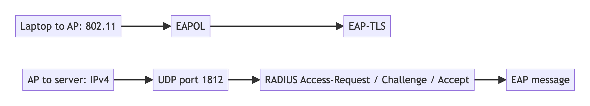
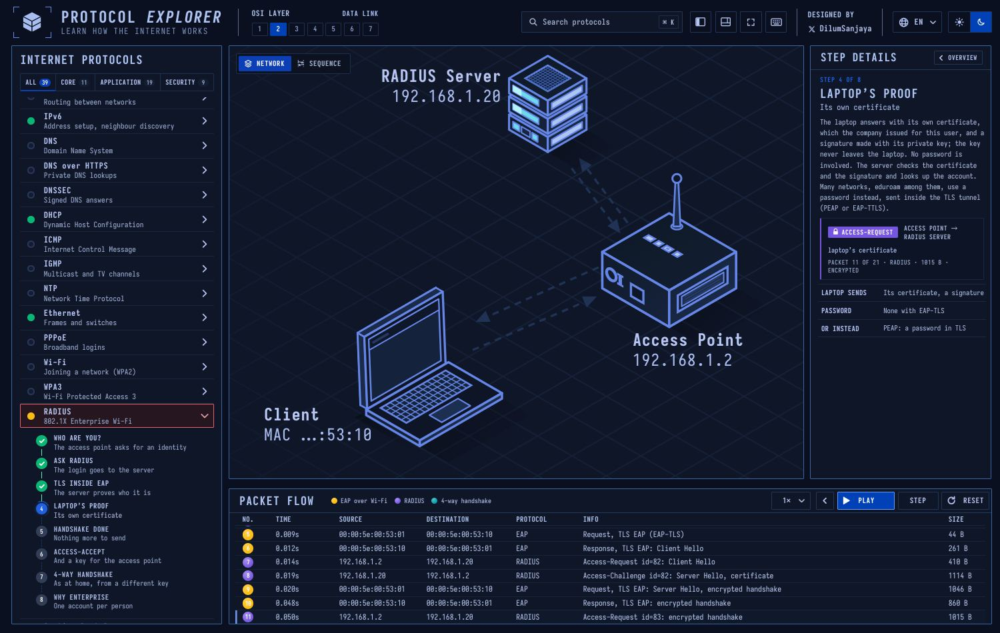
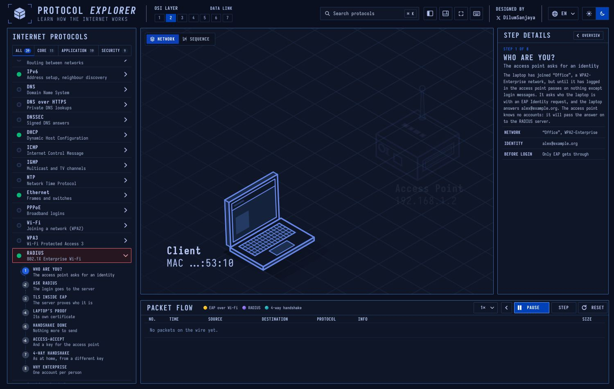
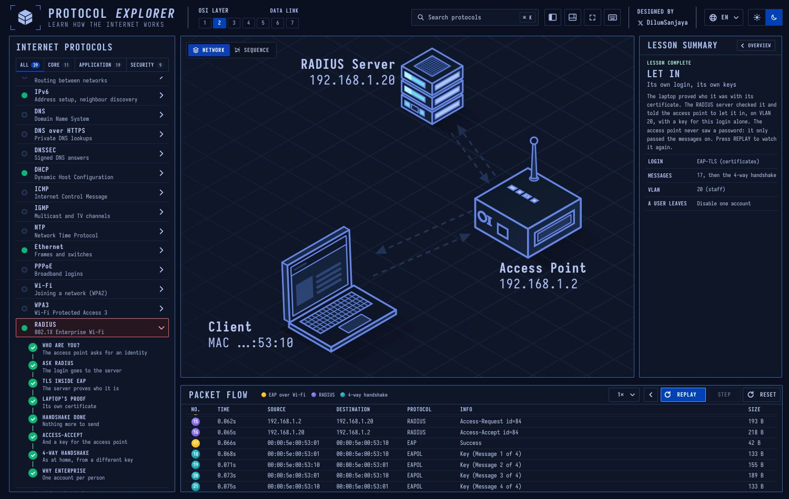
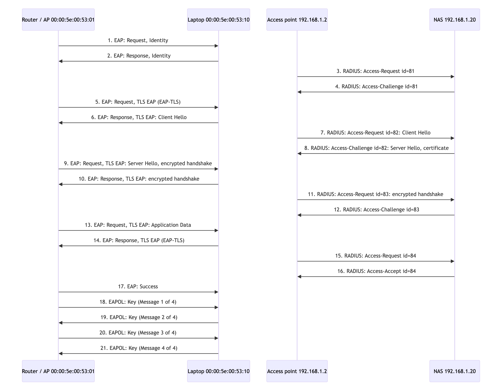
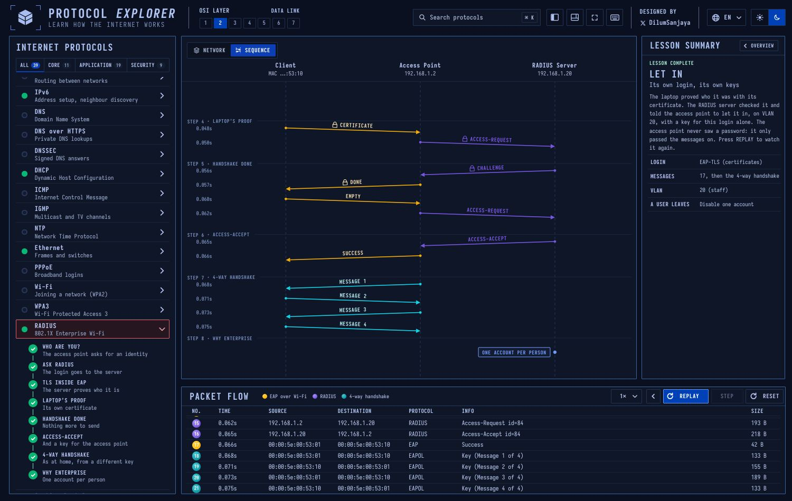

# RADIUS – 802.1X Enterprise Wi-Fi

<!-- nav -->
⬅ [24 WPA3](24-wpa3.md) · [Index](00_Protocols_Index.md) · [26 Captive Portal](26-captive-portal.md) ➡
<!-- nav -->

*Source: Protocol Explorer – https://protocol-explorer-alpha.vercel.app/ (interactive lesson #25). Screenshots captured from the live lesson; packet decodes are the site's example capture (values marked **E.G.** differ in every real capture).*

## Overview

### How the layers fit together (outer to inner)

## In-depth explanation of the example (plain-language version)

### The big picture in one minute
At an office, a university or on **eduroam**, everyone logs in with **their own identity** rather than one shared Wi-Fi password. Three parties take part:
- the **laptop** (the "supplicant", the one asking to join),
- the **access point** (the "authenticator", the doorman),
- the **RADIUS server** (the "authentication server", the one that decides).

The lesson shows **802.1X with EAP-TLS**, a login using a **certificate** (a digital ID card) instead of a password. **21 frames in 75 ms:** the conversation travels between laptop and AP over the air, and between AP and server using **RADIUS**, ending in an **Access-Accept** (yes) and the usual **4-way handshake**.

**The key idea:** the access point **knows no passwords.** It's just a **doorman**. It keeps the door closed, passes the login conversation on to the RADIUS server, and opens the door only when the server says **yes.**

> **Words you'll see:** *RADIUS* = the protocol used to talk to the login server (over UDP port 1812). *EAP* = a flexible framework for login methods. *Certificate* = a digital ID card signed by a trusted authority. *VLAN* = a separate virtual network.

---

### Step 1 – "Who are you?" – packets 1, 2
Right after joining, the AP asks the laptop for its identity, and the laptop replies with a username (often an anonymous one like `anonymous@example.org`; the real one is sent later inside encryption). At this stage only login messages can pass through the AP.

### Step 2 – The AP asks the RADIUS server – packets 3 to 5
- The AP wraps the laptop's message in a **RADIUS Access-Request**, adding details such as the laptop's MAC address and which AP and network it's using.
- All RADIUS packets are protected by a **shared secret** known only to the AP and the server.
- The server answers **Access-Challenge**: "continue the conversation," carrying the next login message ("start EAP-TLS"). The AP relays it to the laptop.

### Step 3 – A secure tunnel inside the login – packets 6 to 9
The laptop and server run a **TLS handshake carried inside the login messages**. The AP just re-packages each one: over the air on one side, RADIUS on the other. The server sends its **certificate**, and **the laptop checks it** (issued by the company's own authority to `radius.example.org`). **This check is crucial:** it stops a fake access point (an "evil twin") from collecting logins.

### Step 4 – The laptop proves who it is – packets 10 to 12
The laptop sends **its own certificate** plus a **signature made with its private key** (the key never leaves the machine). **No password is involved.** The server checks the certificate, the signature, and that the account is allowed. *Other login methods:* **PEAP** and **EAP-TTLS** (a password sent inside an encrypted tunnel, common on eduroam) and SIM-card based methods.

### Step 5 – Handshake finished – packets 13, 14
The server sends one tiny message to say the secure handshake is done. Both ends now share **secret key material** that they worked out during the handshake. Nobody on the way, **not even the access point**, has seen it.

### Step 6 – Access-Accept – packets 15 to 17
The server says **yes** (Access-Accept) and includes:
- the **success message** for the laptop (relayed in packet 17),
- **the first part of the key material for the AP**, encrypted with the shared secret,
- **which VLAN to use** (here VLAN 20, the staff network). Another user on the same AP could be placed on a different network.

### Step 7 – The 4-way handshake – packets 18 to 21
Both the AP and the laptop now hold the same master key, so they run **the same 4-way handshake as in the Wi-Fi note** to create session keys. The only difference from home Wi-Fi is where the master key comes from: there, from a shared password; here, from **this one login.** So **every user gets different keys**, and removing one account doesn't affect anyone else.

---

### The 21 frames at a glance
| Packets | What | Why |
|---|---|---|
| 1–2 | identity request and reply | who is this? |
| 3–5 | RADIUS Access-Request / Challenge | the AP forwards the login |
| 6–9 | TLS inside EAP | secure channel, laptop checks the server |
| 10–12 | client certificate and signature | the laptop proves its identity |
| 13–14 | handshake done | key material agreed |
| 15–17 | Access-Accept | server says yes, sets the VLAN |
| 18–21 | 4-way handshake | session keys |

### What to remember
- **Roles:** supplicant (laptop) – authenticator (AP or switch) – authentication server (RADIUS). **802.1X** controls access at the door, **EAP** is the login-method framework, and **RADIUS** carries the messages.
- **AAA** = Authentication (who are you?), Authorization (what may you do, e.g. which VLAN), Accounting (usage records, port 1813).
- **Always make clients check the server certificate.** Skipping it is the most common enterprise Wi-Fi mistake.
- 802.1X also protects **wired ports** on switches and VPN logins.

## Under the hood – technical details

- **Three roles.** *Supplicant* (the laptop), *authenticator* (AP or switch) and *authentication server* (RADIUS). **802.1X** is the port-based access control, **EAP** the login-method framework, **RADIUS** the transport between AP and server.
- **EAPOL.** EAP over LAN, Ethernet type `0x888E`, used between laptop and AP. While authenticating, the AP's controlled port allows only these frames.
- **RADIUS packet.** UDP port **1812** (accounting **1813**). Header: code, identifier, length and a 16-byte *authenticator*, followed by attributes (type, length, value).
- **Codes.** `1` Access-Request, `2` Access-Accept, `3` Access-Reject, `11` Access-Challenge (continue the dialogue).
- **Key attributes.** `User-Name`, `Calling-Station-Id` (the client's MAC), `Called-Station-Id` (AP MAC and SSID), `NAS-IP-Address`, **`EAP-Message`** (carries the EAP packet, fragmented into 253-byte pieces) and **`Message-Authenticator`** (an HMAC protecting the packet).
- **Shared secret.** The AP and the RADIUS server share a secret that protects attributes and authenticates replies. It never goes on the wire. **RadSec** (RADIUS over TLS, TCP 2083) is a stronger alternative.
- **EAP-TLS flow.** Identity request and response, then the server's TLS Hello, certificate and request for the client certificate, then the client's certificate and a `CertificateVerify` signature, then the end of the TLS handshake. Large messages are fragmented, which is why the frames are about 1 KB.
- **Mutual authentication.** The laptop must **validate the server certificate** (issued by the company's CA for `radius.example.org`). Skipping this check lets an *evil-twin* access point collect logins.
- **Other EAP methods.** PEAP and EAP-TTLS (a password inside a TLS tunnel), EAP-FAST, EAP-SIM/AKA (SIM cards).
- **Keys.** Both sides derive 64 bytes of key material (the MSK). The server sends the first 32 bytes to the AP in `MS-MPPE-Recv-Key`, encrypted with the shared secret. This becomes the **PMK**, followed by the usual 4-way handshake. The AP never sees the key material before this point and cannot decrypt anything before it.
- **Authorization.** The Access-Accept can carry **VLAN attributes** (`Tunnel-Type`, `Tunnel-Medium-Type`, `Tunnel-Private-Group-Id = 20`), ACLs or rate limits, so users land in different networks.
- **AAA.** Authentication (who are you), Authorization (what may you do) and Accounting (usage records).
- **Also protects.** Wired switch ports (802.1X) and VPN logins.

## Step-by-step walkthrough

### Step 1: WHO ARE YOU? – The access point asks for an identity

### Step 2: ASK RADIUS – The login goes to the server

### Step 3: TLS INSIDE EAP – The server proves who it is

### Step 4: LAPTOP’S PROOF – Its own certificate

### Step 5: HANDSHAKE DONE – Nothing more to send

### Step 6: ACCESS-ACCEPT – And a key for the access point

### Step 7: 4-WAY HANDSHAKE – As at home, from a different key

### Step 8: WHY ENTERPRISE – One account per person

### Lesson summary

## Packet flow (whole lesson)

| No. | Time | Source | Destination | Protocol | Info | Size |
|---|---|---|---|---|---|---|
| 1 | 0.000s | 00:00:5e:00:53:01 | 00:00:5e:00:53:10 | EAP | Request, Identity | 43 B |
| 2 | 0.004s | 00:00:5e:00:53:10 | 00:00:5e:00:53:01 | EAP | Response, Identity | 59 B |
| 3 | 0.006s | 192.168.1.2 | 192.168.1.20 | RADIUS | Access-Request id=81 | 190 B |
| 4 | 0.008s | 192.168.1.20 | 192.168.1.2 | RADIUS | Access-Challenge id=81 | 106 B |
| 5 | 0.009s | 00:00:5e:00:53:01 | 00:00:5e:00:53:10 | EAP | Request, TLS EAP (EAP-TLS) | 44 B |
| 6 | 0.012s | 00:00:5e:00:53:10 | 00:00:5e:00:53:01 | EAP | Response, TLS EAP: Client Hello | 261 B |
| 7 | 0.014s | 192.168.1.2 | 192.168.1.20 | RADIUS | Access-Request id=82: Client Hello | 410 B |
| 8 | 0.019s | 192.168.1.20 | 192.168.1.2 | RADIUS | Access-Challenge id=82: Server Hello, certificate | 1114 B |
| 9 | 0.020s | 00:00:5e:00:53:01 | 00:00:5e:00:53:10 | EAP | Request, TLS EAP: Server Hello, encrypted handshake | 1046 B |
| 10 | 0.048s | 00:00:5e:00:53:10 | 00:00:5e:00:53:01 | EAP | Response, TLS EAP: encrypted handshake | 860 B |
| 11 | 0.050s | 192.168.1.2 | 192.168.1.20 | RADIUS | Access-Request id=83: encrypted handshake | 1015 B |
| 12 | 0.056s | 192.168.1.20 | 192.168.1.2 | RADIUS | Access-Challenge id=83 | 133 B |
| 13 | 0.057s | 00:00:5e:00:53:01 | 00:00:5e:00:53:10 | EAP | Request, TLS EAP: Application Data | 71 B |
| 14 | 0.060s | 00:00:5e:00:53:10 | 00:00:5e:00:53:01 | EAP | Response, TLS EAP (EAP-TLS) | 44 B |
| 15 | 0.062s | 192.168.1.2 | 192.168.1.20 | RADIUS | Access-Request id=84 | 193 B |
| 16 | 0.065s | 192.168.1.20 | 192.168.1.2 | RADIUS | Access-Accept id=84 | 218 B |
| 17 | 0.066s | 00:00:5e:00:53:01 | 00:00:5e:00:53:10 | EAP | Success | 42 B |
| 18 | 0.068s | 00:00:5e:00:53:01 | 00:00:5e:00:53:10 | EAPOL | Key (Message 1 of 4) | 133 B |
| 19 | 0.071s | 00:00:5e:00:53:10 | 00:00:5e:00:53:01 | EAPOL | Key (Message 2 of 4) | 155 B |
| 20 | 0.073s | 00:00:5e:00:53:01 | 00:00:5e:00:53:10 | EAPOL | Key (Message 3 of 4) | 189 B |
| 21 | 0.075s | 00:00:5e:00:53:10 | 00:00:5e:00:53:01 | EAPOL | Key (Message 4 of 4) | 133 B |

### Sequence diagram

*The lesson's own sequence diagram:*

## Packet decoder screenshots

The lesson's decoder view for the first, middle and last packet: headers, field values and the raw hex bytes.

### Packet 1: EAP – Request, Identity

*00:00:5e:00:53:01 → 00:00:5e:00:53:10 · 43 B · t = 0.000s*

### Packet 11: RADIUS – Access-Request id=83: encrypted handshake

*192.168.1.2 → 192.168.1.20 · 1015 B · t = 0.050s*

### Packet 21: EAPOL – Key (Message 4 of 4)

*00:00:5e:00:53:10 → 00:00:5e:00:53:01 · 133 B · t = 0.075s*

---

<!-- nav -->
⬅ [24 WPA3](24-wpa3.md) · [Index](00_Protocols_Index.md) · [26 Captive Portal](26-captive-portal.md) ➡
<!-- nav -->
