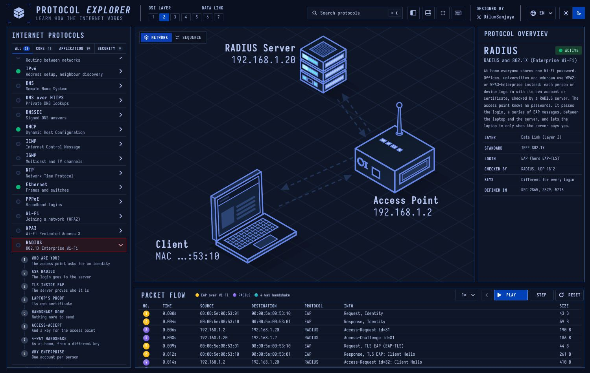
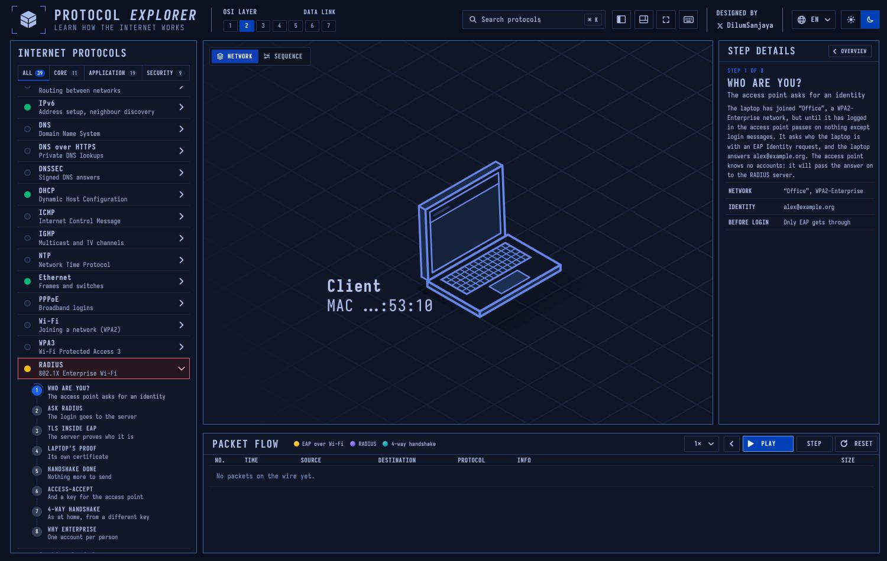
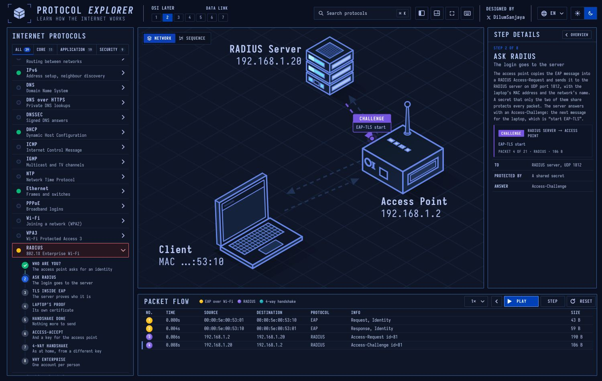
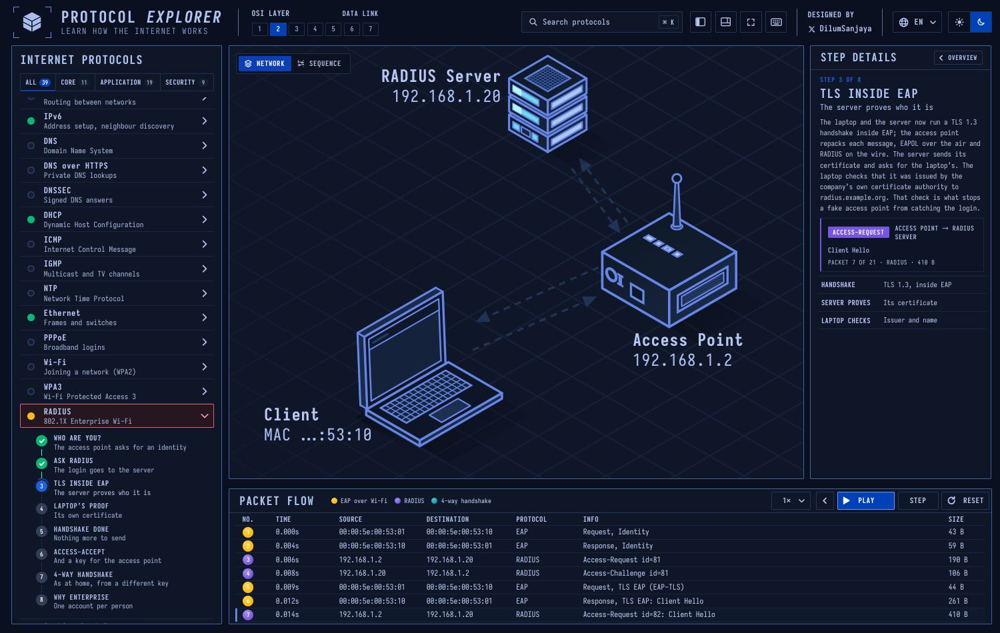
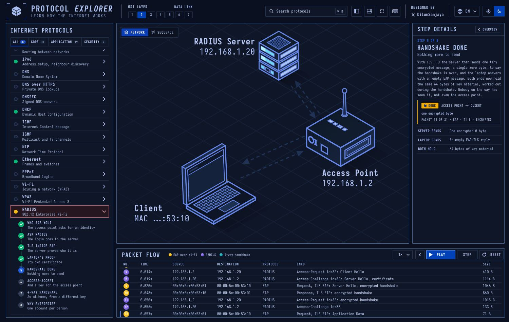
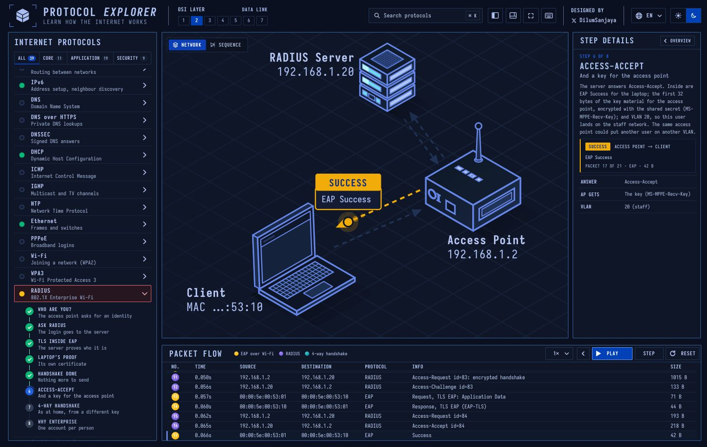
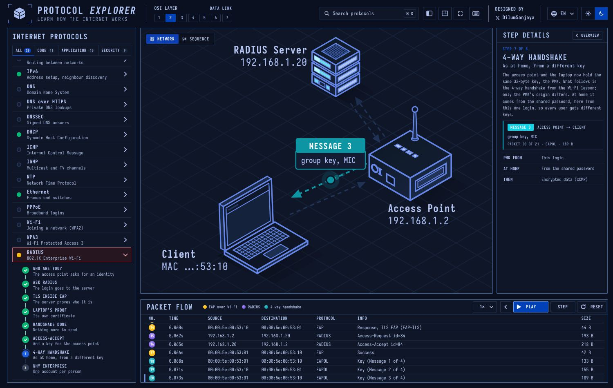
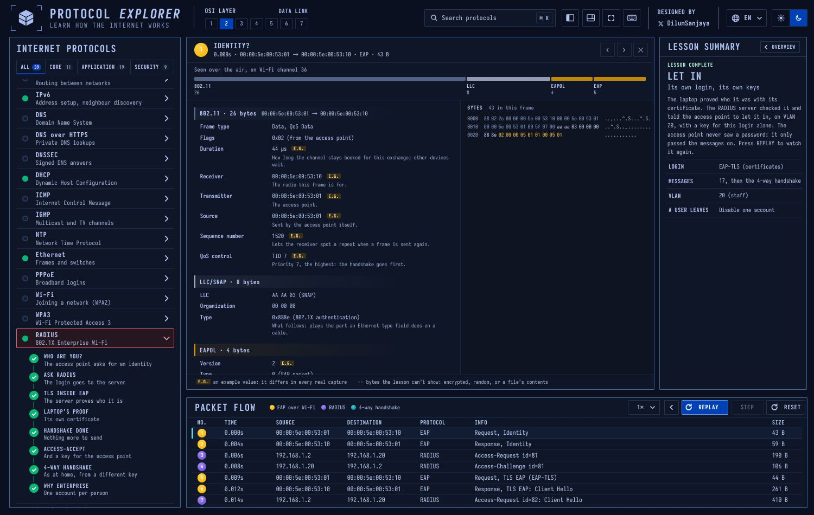
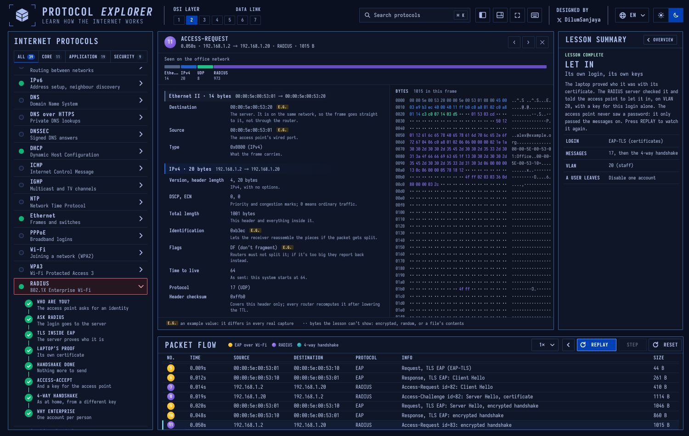
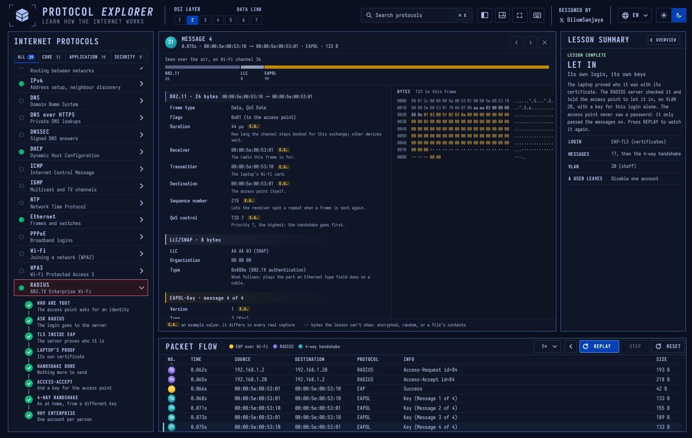

# RADIUS – 802.1X Enterprise Wi-Fi

<!-- nav -->
⬅ [24 WPA3](24-wpa3.md) · [Index](00_Protocols_Index.md) · [26 Captive Portal](26-captive-portal.md) ➡
<!-- nav -->

*Source: Protocol Explorer – https://protocol-explorer-alpha.vercel.app/ (interactive lesson #25). Screenshots captured from the live lesson; packet decodes are the site's example capture (values marked **E.G.** differ in every real capture).*

## Overview



> PROTOCOL OVERVIEW  
> RADIUS  
> ACTIVE  
> RADIUS and 802.1X (Enterprise Wi-Fi)  
> At home everyone shares one Wi-Fi password. Offices, universities and eduroam use WPA2- or WPA3-Enterprise instead: each person or device logs in with its own account or certificate, checked by a RADIUS server. The access point knows no passwords. It passes the login, a series of EAP messages, between the laptop and the server, and lets the laptop in only when the server says yes.  
> LAYER  
> Data Link (Layer 2)  
> STANDARD  
> IEEE 802.1X  
> LOGIN  
> EAP (here EAP-TLS)  
> CHECKED BY  
> RADIUS, UDP 1812  
> KEYS  
> Different for every login  
> DEFINED IN  
> RFC 2865, 3579, 5216  

## In-depth explanation of the example (plain-language version)

### The big picture in one minute
At an office, a university or on **eduroam**, everyone logs in with **their own identity** rather than one shared Wi-Fi password. Three parties take part:
- the **laptop** (the "supplicant", the one asking to join),
- the **access point** (the "authenticator", the doorman),
- the **RADIUS server** (the "authentication server", the one that decides).

The lesson shows **802.1X with EAP-TLS**, a login using a **certificate** (a digital ID card) instead of a password. **21 frames in 75 ms:** the conversation travels between laptop and AP over the air, and between AP and server using **RADIUS**, ending in an **Access-Accept** (yes) and the usual **4-way handshake**.

**The key idea:** the access point **knows no passwords.** It's just a **doorman**. It keeps the door closed, passes the login conversation on to the RADIUS server, and opens the door only when the server says **yes.**

> **Words you'll see:** *RADIUS* = the protocol used to talk to the login server (over UDP port 1812). *EAP* = a flexible framework for login methods. *Certificate* = a digital ID card signed by a trusted authority. *VLAN* = a separate virtual network.

---

### Step 1 – "Who are you?" – packets 1, 2
Right after joining, the AP asks the laptop for its identity, and the laptop replies with a username (often an anonymous one like `anonymous@example.org`; the real one is sent later inside encryption). At this stage only login messages can pass through the AP.

### Step 2 – The AP asks the RADIUS server – packets 3 to 5
- The AP wraps the laptop's message in a **RADIUS Access-Request**, adding details such as the laptop's MAC address and which AP and network it's using.
- All RADIUS packets are protected by a **shared secret** known only to the AP and the server.
- The server answers **Access-Challenge**: "continue the conversation," carrying the next login message ("start EAP-TLS"). The AP relays it to the laptop.

### Step 3 – A secure tunnel inside the login – packets 6 to 9
The laptop and server run a **TLS handshake carried inside the login messages**. The AP just re-packages each one: over the air on one side, RADIUS on the other. The server sends its **certificate**, and **the laptop checks it** (issued by the company's own authority to `radius.example.org`). **This check is crucial:** it stops a fake access point (an "evil twin") from collecting logins.

### Step 4 – The laptop proves who it is – packets 10 to 12
The laptop sends **its own certificate** plus a **signature made with its private key** (the key never leaves the machine). **No password is involved.** The server checks the certificate, the signature, and that the account is allowed. *Other login methods:* **PEAP** and **EAP-TTLS** (a password sent inside an encrypted tunnel, common on eduroam) and SIM-card based methods.

### Step 5 – Handshake finished – packets 13, 14
The server sends one tiny message to say the secure handshake is done. Both ends now share **secret key material** that they worked out during the handshake. Nobody on the way, **not even the access point**, has seen it.

### Step 6 – Access-Accept – packets 15 to 17
The server says **yes** (Access-Accept) and includes:
- the **success message** for the laptop (relayed in packet 17),
- **the first part of the key material for the AP**, encrypted with the shared secret,
- **which VLAN to use** (here VLAN 20, the staff network). Another user on the same AP could be placed on a different network.

### Step 7 – The 4-way handshake – packets 18 to 21
Both the AP and the laptop now hold the same master key, so they run **the same 4-way handshake as in the Wi-Fi note** to create session keys. The only difference from home Wi-Fi is where the master key comes from: there, from a shared password; here, from **this one login.** So **every user gets different keys**, and removing one account doesn't affect anyone else.

---

### The 21 frames at a glance
| Packets | What | Why |
|---|---|---|
| 1–2 | identity request and reply | who is this? |
| 3–5 | RADIUS Access-Request / Challenge | the AP forwards the login |
| 6–9 | TLS inside EAP | secure channel, laptop checks the server |
| 10–12 | client certificate and signature | the laptop proves its identity |
| 13–14 | handshake done | key material agreed |
| 15–17 | Access-Accept | server says yes, sets the VLAN |
| 18–21 | 4-way handshake | session keys |

### What to remember
- **Roles:** supplicant (laptop) – authenticator (AP or switch) – authentication server (RADIUS). **802.1X** controls access at the door, **EAP** is the login-method framework, and **RADIUS** carries the messages.
- **AAA** = Authentication (who are you?), Authorization (what may you do, e.g. which VLAN), Accounting (usage records, port 1813).
- **Always make clients check the server certificate.** Skipping it is the most common enterprise Wi-Fi mistake.
- 802.1X also protects **wired ports** on switches and VPN logins.

## Step-by-step walkthrough (screenshots from the lesson)

### Step 1: WHO ARE YOU? – The access point asks for an identity



> STEP 1 OF 8  
> WHO ARE YOU?  
> The access point asks for an identity  
> The laptop has joined “Office”, a WPA2-Enterprise network, but until it has logged in the access point passes on nothing except login messages. It asks who the laptop is with an EAP Identity request, and the laptop answers alex@example.org. The access point knows no accounts: it will pass the answer on to the RADIUS server.  
> NETWORK  
> “Office”, WPA2-Enterprise  
> IDENTITY  
> alex@example.org  
> BEFORE LOGIN  
> Only EAP gets through  

### Step 2: ASK RADIUS – The login goes to the server



> STEP 2 OF 8  
> ASK RADIUS  
> The login goes to the server  
> The access point copies the EAP message into a RADIUS Access-Request and sends it to the RADIUS server on UDP port 1812, with the laptop’s MAC address and the network’s name. A secret that only the two of them share protects every packet. The server answers with an Access-Challenge: the next message for the laptop, which is “start EAP-TLS”.  
> CHALLENGE  
> RADIUS SERVER → ACCESS POINT  
> EAP-TLS start  
> PACKET 4 OF 21 · RADIUS · 106 B  
> TO  
> RADIUS server, UDP 1812  
> PROTECTED BY  
> A shared secret  
> ANSWER  
> Access-Challenge  

### Step 3: TLS INSIDE EAP – The server proves who it is



> STEP 3 OF 8  
> TLS INSIDE EAP  
> The server proves who it is  
> The laptop and the server now run a TLS 1.3 handshake inside EAP; the access point repacks each message, EAPOL over the air and RADIUS on the wire. The server sends its certificate and asks for the laptop’s. The laptop checks that it was issued by the company’s own certificate authority to radius.example.org. That check is what stops a fake access point from catching the login.  
> ACCESS-REQUEST  
> ACCESS POINT → RADIUS SERVER  
> Client Hello  
> PACKET 7 OF 21 · RADIUS · 410 B  
> HANDSHAKE  
> TLS 1.3, inside EAP  
> SERVER PROVES  
> Its certificate  
> LAPTOP CHECKS  
> Issuer and name  

### Step 4: LAPTOP’S PROOF – Its own certificate


> STEP 4 OF 8  
> LAPTOP’S PROOF  
> Its own certificate  
> The laptop answers with its own certificate, which the company issued for this user, and a signature made with its private key; the key never leaves the laptop. No password is involved. The server checks the certificate and the signature and looks up the account. Many networks, eduroam among them, use a password instead, sent inside the TLS tunnel (PEAP or EAP-TTLS).  
> ACCESS-REQUEST  
> ACCESS POINT → RADIUS SERVER  
> laptop’s certificate  
> PACKET 11 OF 21 · RADIUS · 1015 B · ENCRYPTED  
> LAPTOP SENDS  
> Its certificate, a signature  
> PASSWORD  
> None with EAP-TLS  
> OR INSTEAD  
> PEAP: a password in TLS  

### Step 5: HANDSHAKE DONE – Nothing more to send



> STEP 5 OF 8  
> HANDSHAKE DONE  
> Nothing more to send  
> With TLS 1.3 the server then sends one tiny encrypted message, a single zero byte, to say the handshake is over, and the laptop answers with an empty EAP message. Both ends now hold the same 64 bytes of key material, worked out during the handshake. Nobody on the way has seen it, not even the access point.  
> DONE  
> ACCESS POINT → CLIENT  
> one encrypted byte  
> PACKET 13 OF 21 · EAP · 71 B · ENCRYPTED  
> SERVER SENDS  
> One encrypted 0 byte  
> LAPTOP SENDS  
> An empty EAP-TLS reply  
> BOTH HOLD  
> 64 bytes of key material  

### Step 6: ACCESS-ACCEPT – And a key for the access point



> STEP 6 OF 8  
> ACCESS-ACCEPT  
> And a key for the access point  
> The server answers Access-Accept. Inside are EAP Success for the laptop; the first 32 bytes of the key material for the access point, encrypted with the shared secret (MS-MPPE-Recv-Key); and VLAN 20, so this user lands on the staff network. The same access point could put another user on another VLAN.  
> SUCCESS  
> ACCESS POINT → CLIENT  
> EAP Success  
> PACKET 17 OF 21 · EAP · 42 B  
> ANSWER  
> Access-Accept  
> AP GETS  
> The key (MS-MPPE-Recv-Key)  
> VLAN  
> 20 (staff)  

### Step 7: 4-WAY HANDSHAKE – As at home, from a different key



> STEP 7 OF 8  
> 4-WAY HANDSHAKE  
> As at home, from a different key  
> The access point and the laptop now hold the same 32-byte key, the PMK. What follows is the 4-way handshake from the Wi-Fi lesson; only the PMK’s origin differs. At home it comes from the shared password, here from this one login, so every user gets different keys.  
> MESSAGE 3  
> ACCESS POINT → CLIENT  
> group key, MIC  
> PACKET 20 OF 21 · EAPOL · 189 B  
> PMK FROM  
> This login  
> AT HOME  
> From the shared password  
> THEN  
> Encrypted data (CCMP)  

### Step 8: WHY ENTERPRISE – One account per person


> STEP 1 OF 8  
> WHO ARE YOU?  
> The access point asks for an identity  
> The laptop has joined “Office”, a WPA2-Enterprise network, but until it has logged in the access point passes on nothing except login messages. It asks who the laptop is with an EAP Identity request, and the laptop answers alex@example.org. The access point knows no accounts: it will pass the answer on to the RADIUS server.  
> MESSAGE 3  
> ACCESS POINT → CLIENT  
> group key, MIC  
> PACKET 20 OF 21 · EAPOL · 189 B  
> NETWORK  
> “Office”, WPA2-Enterprise  
> IDENTITY  
> alex@example.org  
> BEFORE LOGIN  
> Only EAP gets through  

### Lesson summary


> LESSON SUMMARY  
> LESSON COMPLETE  
> LET IN  
> Its own login, its own keys  
> The laptop proved who it was with its certificate. The RADIUS server checked it and told the access point to let it in, on VLAN 20, with a key for this login alone. The access point never saw a password: it only passed the messages on. Press REPLAY to watch it again.  
> MESSAGE 4  
> CLIENT → ACCESS POINT  
> keys installed  
> PACKET 21 OF 21 · EAPOL · 133 B  
> LOGIN  
> EAP-TLS (certificates)  
> MESSAGES  
> 17, then the 4-way handshake  
> VLAN  
> 20 (staff)  
> A USER LEAVES  
> Disable one account  

## Packet flow (whole lesson)

| No. | Time | Source | Destination | Protocol | Info | Size |
|---|---|---|---|---|---|---|
| 1 | 0.000s | 00:00:5e:00:53:01 | 00:00:5e:00:53:10 | EAP | Request, Identity | 43 B |
| 2 | 0.004s | 00:00:5e:00:53:10 | 00:00:5e:00:53:01 | EAP | Response, Identity | 59 B |
| 3 | 0.006s | 192.168.1.2 | 192.168.1.20 | RADIUS | Access-Request id=81 | 190 B |
| 4 | 0.008s | 192.168.1.20 | 192.168.1.2 | RADIUS | Access-Challenge id=81 | 106 B |
| 5 | 0.009s | 00:00:5e:00:53:01 | 00:00:5e:00:53:10 | EAP | Request, TLS EAP (EAP-TLS) | 44 B |
| 6 | 0.012s | 00:00:5e:00:53:10 | 00:00:5e:00:53:01 | EAP | Response, TLS EAP: Client Hello | 261 B |
| 7 | 0.014s | 192.168.1.2 | 192.168.1.20 | RADIUS | Access-Request id=82: Client Hello | 410 B |
| 8 | 0.019s | 192.168.1.20 | 192.168.1.2 | RADIUS | Access-Challenge id=82: Server Hello, certificate | 1114 B |
| 9 | 0.020s | 00:00:5e:00:53:01 | 00:00:5e:00:53:10 | EAP | Request, TLS EAP: Server Hello, encrypted handshake | 1046 B |
| 10 | 0.048s | 00:00:5e:00:53:10 | 00:00:5e:00:53:01 | EAP | Response, TLS EAP: encrypted handshake | 860 B |
| 11 | 0.050s | 192.168.1.2 | 192.168.1.20 | RADIUS | Access-Request id=83: encrypted handshake | 1015 B |
| 12 | 0.056s | 192.168.1.20 | 192.168.1.2 | RADIUS | Access-Challenge id=83 | 133 B |
| 13 | 0.057s | 00:00:5e:00:53:01 | 00:00:5e:00:53:10 | EAP | Request, TLS EAP: Application Data | 71 B |
| 14 | 0.060s | 00:00:5e:00:53:10 | 00:00:5e:00:53:01 | EAP | Response, TLS EAP (EAP-TLS) | 44 B |
| 15 | 0.062s | 192.168.1.2 | 192.168.1.20 | RADIUS | Access-Request id=84 | 193 B |
| 16 | 0.065s | 192.168.1.20 | 192.168.1.2 | RADIUS | Access-Accept id=84 | 218 B |
| 17 | 0.066s | 00:00:5e:00:53:01 | 00:00:5e:00:53:10 | EAP | Success | 42 B |
| 18 | 0.068s | 00:00:5e:00:53:01 | 00:00:5e:00:53:10 | EAPOL | Key (Message 1 of 4) | 133 B |
| 19 | 0.071s | 00:00:5e:00:53:10 | 00:00:5e:00:53:01 | EAPOL | Key (Message 2 of 4) | 155 B |
| 20 | 0.073s | 00:00:5e:00:53:01 | 00:00:5e:00:53:10 | EAPOL | Key (Message 3 of 4) | 189 B |
| 21 | 0.075s | 00:00:5e:00:53:10 | 00:00:5e:00:53:01 | EAPOL | Key (Message 4 of 4) | 133 B |

### Sequence diagram


## Packets decoded byte by byte

Each packet below is the lesson's own decode (headers, field values and the plain-English meaning of each field). Screenshots show the first, middle and last packet in the lesson's decoder view with the raw hex bytes.

### Packet 1: EAP – Request, Identity

*00:00:5e:00:53:01 → 00:00:5e:00:53:10 · 43 B · t = 0.000s*



<details><summary>Decoded fields</summary>

```text
1
IDENTITY?
0.000s · 00:00:5e:00:53:01 → 00:00:5e:00:53:10 · EAP · 43 B
Seen over the air, on Wi-Fi channel 36
802.11
26
LLC
8
EAPOL
4
EAP
5
802.11 · 26 bytes
00:00:5e:00:53:01 → 00:00:5e:00:53:10
Frame type
Data, QoS Data
Flags
0x02 (from the access point)
Duration
44 µs E.G.

How long the channel stays booked for this exchange; other devices wait.

Receiver
00:00:5e:00:53:10 E.G.

The radio this frame is for.

Transmitter
00:00:5e:00:53:01 E.G.

The access point.

Source
00:00:5e:00:53:01 E.G.

Sent by the access point itself.

Sequence number
1520 E.G.

Lets the receiver spot a repeat when a frame is sent again.

QoS control
TID 7 E.G.

Priority 7, the highest: the handshake goes first.

LLC/SNAP · 8 bytes
LLC
AA AA 03 (SNAP)
Organization
00 00 00
Type
0x888e (802.1X authentication)

What follows: plays the part an Ethernet type field does on a cable.

EAPOL · 4 bytes
Version
2 E.G.
Type
0 (EAP packet)

Carries an EAP message. The access point copies it into a RADIUS packet for the server, and back.

Length
5 bytes
EAP · Request, Identity
Code
1 (Request)
Identifier
1 E.G.

A response carries the same number as the request it answers.

Length
5 bytes
Type
1 (Identity)

Who are you?

BYTES 43 in this frame
0000
88
02
2c
00
00
00
5e
00
53
10
00
00
5e
00
53
01
.
.
,
.
.
.
^
.
S
.
.
.
^
.
S
.
0010
00
00
5e
00
53
01
00
5f
07
00
aa
aa
03
00
00
00
.
.
^
.
S
.
.
_
.
.
.
.
.
.
.
.
0020
88
8e
02
00
00
05
01
01
00
05
01
.
.
.
.
.
.
.
.
.
.
.
E.G. an example value: it differs in every real capture
·· bytes the lesson can’t show: encrypted, random, or a file’s contents
```

</details>

### Packet 2: EAP – Response, Identity

*00:00:5e:00:53:10 → 00:00:5e:00:53:01 · 59 B · t = 0.004s*

<details><summary>Decoded fields</summary>

```text
2
IDENTITY
0.004s · 00:00:5e:00:53:10 → 00:00:5e:00:53:01 · EAP · 59 B
Seen over the air, on Wi-Fi channel 36
802.11
26
LLC
8
EAPOL
4
EAP
21
802.11 · 26 bytes
00:00:5e:00:53:10 → 00:00:5e:00:53:01
Frame type
Data, QoS Data
Flags
0x01 (to the access point)
Duration
44 µs E.G.

How long the channel stays booked for this exchange; other devices wait.

Receiver
00:00:5e:00:53:01 E.G.

The radio this frame is for.

Transmitter
00:00:5e:00:53:10 E.G.

The laptop’s Wi-Fi card.

Destination
00:00:5e:00:53:01 E.G.

The access point itself.

Sequence number
210 E.G.

Lets the receiver spot a repeat when a frame is sent again.

QoS control
TID 7 E.G.

Priority 7, the highest: the handshake goes first.

LLC/SNAP · 8 bytes
LLC
AA AA 03 (SNAP)
Organization
00 00 00
Type
0x888e (802.1X authentication)

What follows: plays the part an Ethernet type field does on a cable.

EAPOL · 4 bytes
Version
1 E.G.
Type
0 (EAP packet)

Carries an EAP message. The access point copies it into a RADIUS packet for the server, and back.

Length
21 bytes
EAP · Response, Identity
Code
2 (Response)
Identifier
1 E.G.

A response carries the same number as the request it answers.

Length
21 bytes
Type
1 (Identity)
Identity
alex@example.org

Who is logging in. The realm after the @ tells the RADIUS server (or the servers that pass requests on) where the account lives.

BYTES 59 in this frame
0000
88
01
2c
00
00
00
5e
00
53
01
00
00
5e
00
53
10
.
.
,
.
.
.
^
.
S
.
.
.
^
.
S
.
0010
00
00
5e
00
53
01
20
0d
07
00
aa
aa
03
00
00
00
.
.
^
.
S
.
.
.
.
.
.
.
.
.
.
0020
88
8e
01
00
00
15
02
01
00
15
01
61
6c
65
78
40
.
.
.
.
.
.
.
.
.
.
.
a
l
e
x
@
0030
65
78
61
6d
70
6c
65
2e
6f
72
67
e
x
a
m
p
l
e
.
o
r
g
E.G. an example value: it differs in every real capture
·· bytes the lesson can’t show: encrypted, random, or a file’s contents
```

</details>

### Packet 3: RADIUS – Access-Request id=81

*192.168.1.2 → 192.168.1.20 · 190 B · t = 0.006s*

<details><summary>Decoded fields</summary>

```text
3
ACCESS-REQUEST
0.006s · 192.168.1.2 → 192.168.1.20 · RADIUS · 190 B
Seen on the office network
Ethernet
14
IPv4
20
UDP
8
RADIUS
148
Ethernet II · 14 bytes
00:00:5e:00:53:01 → 00:00:5e:00:53:20
Destination
00:00:5e:00:53:20 E.G.

The server. It is on the same network, so the frame goes straight to it, not through the router.

Source
00:00:5e:00:53:01 E.G.

The access point’s wired port.

Type
0x0800 (IPv4)

What the frame carries.

IPv4 · 20 bytes
192.168.1.2 → 192.168.1.20
Version, header length
4, 20 bytes

IPv4, with no options.

DSCP, ECN
0, 0

Priority and congestion marks; 0 means ordinary traffic.

Total length
176 bytes

This header and everything inside it.

Identification
0xb3ea E.G.

Lets the receiver reassemble the pieces if the packet gets split.

Flags
DF (don’t fragment) E.G.

Routers must not split it; if it’s too big they report back instead.

Time to live
64

As sent: this system starts at 64.

Protocol
17 (UDP)
Header checksum
0x02ec

Covers this header only; every router recomputes it after lowering the TTL.

Source
192.168.1.2
Destination
192.168.1.20
UDP · 8 bytes
50112 → 1812
Source port
50112
Destination port
1812
Length
156 bytes

UDP header and data. That is all of UDP: no numbering, no acknowledgements.

Checksum
covers bytes not shown here

Covers the header, the data and the IP addresses.

RADIUS · Access-Request
Code
1 (Access-Request)

Should this device be let in?

Identifier
81 E.G.

A reply carries the number of the request it answers.

Length
148 bytes
Authenticator
16 bytes

Random, new in every request.

Attributes
128 bytes
Message-Authenticator
16 bytes

An HMAC-MD5 of the whole packet, keyed with the shared secret. Every packet that carries EAP must have one; since the Blast-RADIUS attack of 2024, it goes first.

User-Name
"alex@example.org"

The identity the laptop gave.

NAS-IP-Address
192.168.1.2

The access point asking.

Service-Type
2 (Framed)
Called-Station-Id
"00-00-5E-00-53-01:Office" E.G.

The access point’s MAC address and the network’s name.

Calling-Station-Id
"00-00-5E-00-53-10" E.G.

The laptop’s MAC address.

NAS-Port-Type
19 (Wireless, IEEE 802.11)
Framed-MTU
1400 bytes

Keep each EAP message small enough for one frame.

EAP-Message
type 79, 23 bytes

The EAP packet, passed on unchanged.

Code
2 (Response)
Identifier
1 E.G.

A response carries the same number as the request it answers.

Length
21 bytes
Type
1 (Identity)
Identity
alex@example.org

Who is logging in. The realm after the @ tells the RADIUS server (or the servers that pass requests on) where the account lives.

BYTES 190 in this frame
0000
00
00
5e
00
53
20
00
00
5e
00
53
01
08
00
45
00
.
.
^
.
S
.
.
^
.
S
.
.
.
E
.
0010
00
b0
b3
ea
40
00
40
11
02
ec
c0
a8
01
02
c0
a8
.
.
.
.
@
.
@
.
.
.
.
.
.
.
.
.
0020
01
14
c3
c0
07
14
00
9c
··
··
01
51
00
94
··
··
.
.
.
.
.
.
.
.
·
·
.
Q
.
.
·
·
0030
··
··
··
··
··
··
··
··
··
··
··
··
··
··
50
12
·
·
·
·
·
·
·
·
·
·
·
·
·
·
P
.
0040
··
··
··
··
··
··
··
··
··
··
··
··
··
··
··
··
·
·
·
·
·
·
·
·
·
·
·
·
·
·
·
·
0050
01
12
61
6c
65
78
40
65
78
61
6d
70
6c
65
2e
6f
.
.
a
l
e
x
@
e
x
a
m
p
l
e
.
o
0060
72
67
04
06
c0
a8
01
02
06
06
00
00
00
02
1e
1a
r
g
.
.
.
.
.
.
.
.
.
.
.
.
.
.
0070
30
30
2d
30
30
2d
35
45
2d
30
30
2d
35
33
2d
30
0
0
-
0
0
-
5
E
-
0
0
-
5
3
-
0
0080
31
3a
4f
66
66
69
63
65
1f
13
30
30
2d
30
30
2d
1
:
O
f
f
i
c
e
.
.
0
0
-
0
0
-
0090
35
45
2d
30
30
2d
35
33
2d
31
30
3d
06
00
00
00
5
E
-
0
0
-
5
3
-
1
0
=
.
.
.
.
00a0
13
0c
06
00
00
05
78
4f
17
02
01
00
15
01
61
6c
.
.
.
.
.
.
x
O
.
.
.
.
.
.
a
l
00b0
65
78
40
65
78
61
6d
70
6c
65
2e
6f
72
67
e
x
@
e
x
a
m
p
l
e
.
o
r
g
E.G. an example value: it differs in every real capture
·· bytes the lesson can’t show: encrypted, random, or a file’s contents
```

</details>

### Packet 4: RADIUS – Access-Challenge id=81

*192.168.1.20 → 192.168.1.2 · 106 B · t = 0.008s*

<details><summary>Decoded fields</summary>

```text
4
CHALLENGE
0.008s · 192.168.1.20 → 192.168.1.2 · RADIUS · 106 B
Seen on the office network
Ethernet
14
IPv4
20
UDP
8
RADIUS
64
Ethernet II · 14 bytes
00:00:5e:00:53:20 → 00:00:5e:00:53:01
Destination
00:00:5e:00:53:01 E.G.

The access point.

Source
00:00:5e:00:53:20 E.G.

The server’s network card.

Type
0x0800 (IPv4)

What the frame carries.

IPv4 · 20 bytes
192.168.1.20 → 192.168.1.2
Version, header length
4, 20 bytes

IPv4, with no options.

DSCP, ECN
0, 0

Priority and congestion marks; 0 means ordinary traffic.

Total length
92 bytes

This header and everything inside it.

Identification
0x202e E.G.

Lets the receiver reassemble the pieces if the packet gets split.

Flags
DF (don’t fragment) E.G.

Routers must not split it; if it’s too big they report back instead.

Time to live
64

As sent: this system starts at 64.

Protocol
17 (UDP)
Header checksum
0x96fc

Covers this header only; every router recomputes it after lowering the TTL.

Source
192.168.1.20
Destination
192.168.1.2
UDP · 8 bytes
1812 → 50112
Source port
1812
Destination port
50112
Length
72 bytes

UDP header and data. That is all of UDP: no numbering, no acknowledgements.

Checksum
covers bytes not shown here

Covers the header, the data and the IP addresses.

RADIUS · Access-Challenge
Code
11 (Access-Challenge)

Not yet: here is the next message for the device.

Identifier
81 E.G.

A reply carries the number of the request it answers.

Length
64 bytes
Authenticator
16 bytes

A hash of this reply, the request’s authenticator and the shared secret: only the real server could have made it.

Attributes
44 bytes
Message-Authenticator
16 bytes

An HMAC-MD5 of the whole packet, keyed with the shared secret. Every packet that carries EAP must have one; since the Blast-RADIUS attack of 2024, it goes first.

EAP-Message
type 79, 8 bytes

The EAP packet, passed on unchanged.

Code
1 (Request)
Identifier
2 E.G.

A response carries the same number as the request it answers.

Length
6 bytes
Type
13 (EAP-TLS)

A TLS handshake, carried inside EAP.

Flags
0x20 (start)

Start: the server is ready for the laptop’s Client Hello.

State
16 bytes

The server’s bookmark for this login: the access point sends it back with the next request.

BYTES 106 in this frame
0000
00
00
5e
00
53
01
00
00
5e
00
53
20
08
00
45
00
.
.
^
.
S
.
.
.
^
.
S
.
.
E
.
0010
00
5c
20
2e
40
00
40
11
96
fc
c0
a8
01
14
c0
a8
.
\
.
@
.
@
.
.
.
.
.
.
.
.
.
0020
01
02
07
14
c3
c0
00
48
··
··
0b
51
00
40
··
··
.
.
.
.
.
.
.
H
·
·
.
Q
.
@
·
·
0030
··
··
··
··
··
··
··
··
··
··
··
··
··
··
50
12
·
·
·
·
·
·
·
·
·
·
·
·
·
·
P
.
0040
··
··
··
··
··
··
··
··
··
··
··
··
··
··
··
··
·
·
·
·
·
·
·
·
·
·
·
·
·
·
·
·
0050
4f
08
01
02
00
06
0d
20
18
12
··
··
··
··
··
··
O
.
.
.
.
.
.
.
.
·
·
·
·
·
·
0060
··
··
··
··
··
··
··
··
··
··
·
·
·
·
·
·
·
·
·
·
E.G. an example value: it differs in every real capture
·· bytes the lesson can’t show: encrypted, random, or a file’s contents
```

</details>

### Packet 5: EAP – Request, TLS EAP (EAP-TLS)

*00:00:5e:00:53:01 → 00:00:5e:00:53:10 · 44 B · t = 0.009s*

<details><summary>Decoded fields</summary>

```text
5
TLS START
0.009s · 00:00:5e:00:53:01 → 00:00:5e:00:53:10 · EAP · 44 B
Seen over the air, on Wi-Fi channel 36
802.11
26
LLC
8
EAPOL
4
EAP
6
802.11 · 26 bytes
00:00:5e:00:53:01 → 00:00:5e:00:53:10
Frame type
Data, QoS Data
Flags
0x02 (from the access point)
Duration
44 µs E.G.

How long the channel stays booked for this exchange; other devices wait.

Receiver
00:00:5e:00:53:10 E.G.

The radio this frame is for.

Transmitter
00:00:5e:00:53:01 E.G.

The access point.

Source
00:00:5e:00:53:01 E.G.

Sent by the access point itself.

Sequence number
1521 E.G.

Lets the receiver spot a repeat when a frame is sent again.

QoS control
TID 7 E.G.

Priority 7, the highest: the handshake goes first.

LLC/SNAP · 8 bytes
LLC
AA AA 03 (SNAP)
Organization
00 00 00
Type
0x888e (802.1X authentication)

What follows: plays the part an Ethernet type field does on a cable.

EAPOL · 4 bytes
Version
2 E.G.
Type
0 (EAP packet)

Carries an EAP message. The access point copies it into a RADIUS packet for the server, and back.

Length
6 bytes
EAP · Request, EAP-TLS
Code
1 (Request)
Identifier
2 E.G.

A response carries the same number as the request it answers.

Length
6 bytes
Type
13 (EAP-TLS)

A TLS handshake, carried inside EAP.

Flags
0x20 (start)

Start: the server is ready for the laptop’s Client Hello.

BYTES 44 in this frame
0000
88
02
2c
00
00
00
5e
00
53
10
00
00
5e
00
53
01
.
.
,
.
.
.
^
.
S
.
.
.
^
.
S
.
0010
00
00
5e
00
53
01
10
5f
07
00
aa
aa
03
00
00
00
.
.
^
.
S
.
.
_
.
.
.
.
.
.
.
.
0020
88
8e
02
00
00
06
01
02
00
06
0d
20
.
.
.
.
.
.
.
.
.
.
.
E.G. an example value: it differs in every real capture
·· bytes the lesson can’t show: encrypted, random, or a file’s contents
```

</details>

### Packet 6: EAP – Response, TLS EAP: Client Hello

*00:00:5e:00:53:10 → 00:00:5e:00:53:01 · 261 B · t = 0.012s*

<details><summary>Decoded fields</summary>

```text
6
CLIENT HELLO
0.012s · 00:00:5e:00:53:10 → 00:00:5e:00:53:01 · EAP · 261 B
Seen over the air, on Wi-Fi channel 36
802.11
26
LLC
8
EAPOL
4
EAP
223
802.11 · 26 bytes
00:00:5e:00:53:10 → 00:00:5e:00:53:01
Frame type
Data, QoS Data
Flags
0x01 (to the access point)
Duration
44 µs E.G.

How long the channel stays booked for this exchange; other devices wait.

Receiver
00:00:5e:00:53:01 E.G.

The radio this frame is for.

Transmitter
00:00:5e:00:53:10 E.G.

The laptop’s Wi-Fi card.

Destination
00:00:5e:00:53:01 E.G.

The access point itself.

Sequence number
211 E.G.

Lets the receiver spot a repeat when a frame is sent again.

QoS control
TID 7 E.G.

Priority 7, the highest: the handshake goes first.

LLC/SNAP · 8 bytes
LLC
AA AA 03 (SNAP)
Organization
00 00 00
Type
0x888e (802.1X authentication)

What follows: plays the part an Ethernet type field does on a cable.

EAPOL · 4 bytes
Version
1 E.G.
Type
0 (EAP packet)

Carries an EAP message. The access point copies it into a RADIUS packet for the server, and back.

Length
223 bytes
EAP · Response, EAP-TLS
Code
2 (Response)
Identifier
2 E.G.

A response carries the same number as the request it answers.

Length
223 bytes
Type
13 (EAP-TLS)

A TLS handshake, carried inside EAP.

Flags
0x80 (length included)
TLS length
213 bytes

Longer TLS messages are split into pieces of about 1,000 bytes, each one acknowledged.

TLS records
213 bytes

The same TLS records as over TCP, only carried in EAP.

Inside
Client Hello: TLS 1.3, the laptop’s key share
BYTES 261 in this frame
0000
88
01
2c
00
00
00
5e
00
53
01
00
00
5e
00
53
10
.
.
,
.
.
.
^
.
S
.
.
.
^
.
S
.
0010
00
00
5e
00
53
01
30
0d
07
00
aa
aa
03
00
00
00
.
.
^
.
S
.
0
.
.
.
.
.
.
.
.
.
0020
88
8e
01
00
00
df
02
02
00
df
0d
80
00
00
00
d5
.
.
.
.
.
.
.
.
.
.
.
.
.
.
.
.
0030
··
··
··
··
··
··
··
··
··
··
··
··
··
··
··
··
·
·
·
·
·
·
·
·
·
·
·
·
·
·
·
·
0040
··
··
··
··
··
··
··
··
··
··
··
··
··
··
··
··
·
·
·
·
·
·
·
·
·
·
·
·
·
·
·
·
0050
··
··
··
··
··
··
··
··
··
··
··
··
··
··
··
··
·
·
·
·
·
·
·
·
·
·
·
·
·
·
·
·
0060
··
··
··
··
··
··
··
··
··
··
··
··
··
··
··
··
·
·
·
·
·
·
·
·
·
·
·
·
·
·
·
·
0070
··
··
··
··
··
··
··
··
··
··
··
··
··
··
··
··
·
·
·
·
·
·
·
·
·
·
·
·
·
·
·
·
0080
··
··
··
··
··
··
··
··
··
··
··
··
··
··
··
··
·
·
·
·
·
·
·
·
·
·
·
·
·
·
·
·
0090
··
··
··
··
··
··
··
··
··
··
··
··
··
··
··
··
·
·
·
·
·
·
·
·
·
·
·
·
·
·
·
·
00a0
··
··
··
··
··
··
··
··
··
··
··
··
··
··
··
··
·
·
·
·
·
·
·
·
·
·
·
·
·
·
·
·
00b0
··
··
··
··
··
··
··
··
··
··
··
··
··
··
··
··
·
·
·
·
·
·
·
·
·
·
·
·
·
·
·
·
00c0
··
··
··
··
··
··
··
··
··
··
··
··
··
··
··
··
·
·
·
·
·
·
·
·
·
·
·
·
·
·
·
·
00d0
··
··
··
··
··
··
··
··
··
··
··
··
··
··
··
··
·
·
·
·
·
·
·
·
·
·
·
·
·
·
·
·
00e0
··
··
··
··
··
··
··
··
··
··
··
··
··
··
··
··
·
·
·
·
·
·
·
·
·
·
·
·
·
·
·
·
00f0
··
··
··
··
··
··
··
··
··
··
··
··
··
··
··
··
·
·
·
·
·
·
·
·
·
·
·
·
·
·
·
·
0100
··
··
··
··
··
·
·
·
·
·
E.G. an example value: it differs in every real capture
·· bytes the lesson can’t show: encrypted, random, or a file’s contents
```

</details>

### Packet 7: RADIUS – Access-Request id=82: Client Hello

*192.168.1.2 → 192.168.1.20 · 410 B · t = 0.014s*

<details><summary>Decoded fields</summary>

```text
7
ACCESS-REQUEST
0.014s · 192.168.1.2 → 192.168.1.20 · RADIUS · 410 B
Seen on the office network
Ethernet
14
IPv4
20
UDP
8
RADIUS
368
Ethernet II · 14 bytes
00:00:5e:00:53:01 → 00:00:5e:00:53:20
Destination
00:00:5e:00:53:20 E.G.

The server. It is on the same network, so the frame goes straight to it, not through the router.

Source
00:00:5e:00:53:01 E.G.

The access point’s wired port.

Type
0x0800 (IPv4)

What the frame carries.

IPv4 · 20 bytes
192.168.1.2 → 192.168.1.20
Version, header length
4, 20 bytes

IPv4, with no options.

DSCP, ECN
0, 0

Priority and congestion marks; 0 means ordinary traffic.

Total length
396 bytes

This header and everything inside it.

Identification
0xb3eb E.G.

Lets the receiver reassemble the pieces if the packet gets split.

Flags
DF (don’t fragment) E.G.

Routers must not split it; if it’s too big they report back instead.

Time to live
64

As sent: this system starts at 64.

Protocol
17 (UDP)
Header checksum
0x020f

Covers this header only; every router recomputes it after lowering the TTL.

Source
192.168.1.2
Destination
192.168.1.20
UDP · 8 bytes
50112 → 1812
Source port
50112
Destination port
1812
Length
376 bytes

UDP header and data. That is all of UDP: no numbering, no acknowledgements.

Checksum
covers bytes not shown here

Covers the header, the data and the IP addresses.

RADIUS · Access-Request
Code
1 (Access-Request)

Should this device be let in?

Identifier
82 E.G.

A reply carries the number of the request it answers.

Length
368 bytes
Authenticator
16 bytes

Random, new in every request.

Attributes
348 bytes
Message-Authenticator
16 bytes

An HMAC-MD5 of the whole packet, keyed with the shared secret. Every packet that carries EAP must have one; since the Blast-RADIUS attack of 2024, it goes first.

User-Name
"alex@example.org"

The identity the laptop gave.

NAS-IP-Address
192.168.1.2

The access point asking.

Service-Type
2 (Framed)
Called-Station-Id
"00-00-5E-00-53-01:Office" E.G.

The access point’s MAC address and the network’s name.

Calling-Station-Id
"00-00-5E-00-53-10" E.G.

The laptop’s MAC address.

NAS-Port-Type
19 (Wireless, IEEE 802.11)
Framed-MTU
1400 bytes

Keep each EAP message small enough for one frame.

State
16 bytes

The server’s bookmark for this login: the access point sends it back with the next request.

EAP-Message
type 79, 225 bytes

The EAP packet, passed on unchanged.

Code
2 (Response)
Identifier
2 E.G.

A response carries the same number as the request it answers.

Length
223 bytes
Type
13 (EAP-TLS)

A TLS handshake, carried inside EAP.

Flags
0x80 (length included)
TLS length
213 bytes

Longer TLS messages are split into pieces of about 1,000 bytes, each one acknowledged.

TLS records
213 bytes

The same TLS records as over TCP, only carried in EAP.

Inside
Client Hello: TLS 1.3, the laptop’s key share
BYTES 410 in this frame
0000
00
00
5e
00
53
20
00
00
5e
00
53
01
08
00
45
00
.
.
^
.
S
.
.
^
.
S
.
.
.
E
.
0010
01
8c
b3
eb
40
00
40
11
02
0f
c0
a8
01
02
c0
a8
.
.
.
.
@
.
@
.
.
.
.
.
.
.
.
.
0020
01
14
c3
c0
07
14
01
78
··
··
01
52
01
70
··
··
.
.
.
.
.
.
.
x
·
·
.
R
.
p
·
·
0030
··
··
··
··
··
··
··
··
··
··
··
··
··
··
50
12
·
·
·
·
·
·
·
·
·
·
·
·
·
·
P
.
0040
··
··
··
··
··
··
··
··
··
··
··
··
··
··
··
··
·
·
·
·
·
·
·
·
·
·
·
·
·
·
·
·
0050
01
12
61
6c
65
78
40
65
78
61
6d
70
6c
65
2e
6f
.
.
a
l
e
x
@
e
x
a
m
p
l
e
.
o
0060
72
67
04
06
c0
a8
01
02
06
06
00
00
00
02
1e
1a
r
g
.
.
.
.
.
.
.
.
.
.
.
.
.
.
0070
30
30
2d
30
30
2d
35
45
2d
30
30
2d
35
33
2d
30
0
0
-
0
0
-
5
E
-
0
0
-
5
3
-
0
0080
31
3a
4f
66
66
69
63
65
1f
13
30
30
2d
30
30
2d
1
:
O
f
f
i
c
e
.
.
0
0
-
0
0
-
0090
35
45
2d
30
30
2d
35
33
2d
31
30
3d
06
00
00
00
5
E
-
0
0
-
5
3
-
1
0
=
.
.
.
.
00a0
13
0c
06
00
00
05
78
18
12
··
··
··
··
··
··
··
.
.
.
.
.
.
x
.
.
·
·
·
·
·
·
·
00b0
··
··
··
··
··
··
··
··
··
4f
e1
02
02
00
df
0d
·
·
·
·
·
·
·
·
·
O
.
.
.
.
.
.
00c0
80
00
00
00
d5
··
··
··
··
··
··
··
··
··
··
··
.
.
.
.
.
·
·
·
·
·
·
·
·
·
·
·
00d0
··
··
··
··
··
··
··
··
··
··
··
··
··
··
··
··
·
·
·
·
·
·
·
·
·
·
·
·
·
·
·
·
00e0
··
··
··
··
··
··
··
··
··
··
··
··
··
··
··
··
·
·
·
·
·
·
·
·
·
·
·
·
·
·
·
·
00f0
··
··
··
··
··
··
··
··
··
··
··
··
··
··
··
··
·
·
·
·
·
·
·
·
·
·
·
·
·
·
·
·
0100
··
··
··
··
··
··
··
··
··
··
··
··
··
··
··
··
·
·
·
·
·
·
·
·
·
·
·
·
·
·
·
·
0110
··
··
··
··
··
··
··
··
··
··
··
··
··
··
··
··
·
·
·
·
·
·
·
·
·
·
·
·
·
·
·
·
0120
··
··
··
··
··
··
··
··
··
··
··
··
··
··
··
··
·
·
·
·
·
·
·
·
·
·
·
·
·
·
·
·
0130
··
··
··
··
··
··
··
··
··
··
··
··
··
··
··
··
·
·
·
·
·
·
·
·
·
·
·
·
·
·
·
·
0140
··
··
··
··
··
··
··
··
··
··
··
··
··
··
··
··
·
·
·
·
·
·
·
·
·
·
·
·
·
·
·
·
0150
··
··
··
··
··
··
··
··
··
··
··
··
··
··
··
··
·
·
·
·
·
·
·
·
·
·
·
·
·
·
·
·
0160
··
··
··
··
··
··
··
··
··
··
··
··
··
··
··
··
·
·
·
·
·
·
·
·
·
·
·
·
·
·
·
·
0170
··
··
··
··
··
··
··
··
··
··
··
··
··
··
··
··
·
·
·
·
·
·
·
·
·
·
·
·
·
·
·
·
0180
··
··
··
··
··
··
··
··
··
··
··
··
··
··
··
··
·
·
·
·
·
·
·
·
·
·
·
·
·
·
·
·
0190
··
··
··
··
··
··
··
··
··
··
·
·
·
·
·
·
·
·
·
·
E.G. an example value: it differs in every real capture
·· bytes the lesson can’t show: encrypted, random, or a file’s contents
```

</details>

### Packet 8: RADIUS – Access-Challenge id=82: Server Hello, certificate

*192.168.1.20 → 192.168.1.2 · 1114 B · t = 0.019s*

<details><summary>Decoded fields</summary>

```text
8
CHALLENGE
0.019s · 192.168.1.20 → 192.168.1.2 · RADIUS · 1114 B
Seen on the office network
Ethernet
14
IPv4
20
UDP
8
RADIUS
1072
Ethernet II · 14 bytes
00:00:5e:00:53:20 → 00:00:5e:00:53:01
Destination
00:00:5e:00:53:01 E.G.

The access point.

Source
00:00:5e:00:53:20 E.G.

The server’s network card.

Type
0x0800 (IPv4)

What the frame carries.

IPv4 · 20 bytes
192.168.1.20 → 192.168.1.2
Version, header length
4, 20 bytes

IPv4, with no options.

DSCP, ECN
0, 0

Priority and congestion marks; 0 means ordinary traffic.

Total length
1100 bytes

This header and everything inside it.

Identification
0x202f E.G.

Lets the receiver reassemble the pieces if the packet gets split.

Flags
DF (don’t fragment) E.G.

Routers must not split it; if it’s too big they report back instead.

Time to live
64

As sent: this system starts at 64.

Protocol
17 (UDP)
Header checksum
0x930b

Covers this header only; every router recomputes it after lowering the TTL.

Source
192.168.1.20
Destination
192.168.1.2
UDP · 8 bytes
1812 → 50112
Source port
1812
Destination port
50112
Length
1080 bytes

UDP header and data. That is all of UDP: no numbering, no acknowledgements.

Checksum
covers bytes not shown here

Covers the header, the data and the IP addresses.

RADIUS · Access-Challenge
Code
11 (Access-Challenge)

Not yet: here is the next message for the device.

Identifier
82 E.G.

A reply carries the number of the request it answers.

Length
1072 bytes
Authenticator
16 bytes

A hash of this reply, the request’s authenticator and the shared secret: only the real server could have made it.

Attributes
1052 bytes
Message-Authenticator
16 bytes

An HMAC-MD5 of the whole packet, keyed with the shared secret. Every packet that carries EAP must have one; since the Blast-RADIUS attack of 2024, it goes first.

EAP-Message
type 79, 255 bytes

The EAP packet (1,008 bytes), split over 4 attributes of up to 253 bytes.

Code
1 (Request)
Identifier
3 E.G.

A response carries the same number as the request it answers.

Length
1008 bytes
Type
13 (EAP-TLS)

A TLS handshake, carried inside EAP.

Flags
0x80 (length included)
TLS length
998 bytes

Longer TLS messages are split into pieces of about 1,000 bytes, each one acknowledged.

TLS records
243 of 998 bytes
EAP-Message, continued
type 79, 255 bytes
TLS records, continued
253 more bytes
EAP-Message, continued
type 79, 255 bytes
TLS records, continued
253 more bytes
EAP-Message, continued
type 79, 251 bytes
TLS records, continued
249 more bytes
Inside
Server Hello: TLS 1.3, the server’s key share
Encrypted: certificate for radius.example.org, a request for the laptop’s certificate, signature, Finished
State
16 bytes

The server’s bookmark for this login: the access point sends it back with the next request.

BYTES 1114 in this frame
0000
00
00
5e
00
53
01
00
00
5e
00
53
20
08
00
45
00
.
.
^
.
S
.
.
.
^
.
S
.
.
E
.
0010
04
4c
20
2f
40
00
40
11
93
0b
c0
a8
01
14
c0
a8
.
L
/
@
.
@
.
.
.
.
.
.
.
.
.
0020
01
02
07
14
c3
c0
04
38
··
··
0b
52
04
30
··
··
.
.
.
.
.
.
.
8
·
·
.
R
.
0
·
·
0030
··
··
··
··
··
··
··
··
··
··
··
··
··
··
50
12
·
·
·
·
·
·
·
·
·
·
·
·
·
·
P
.
0040
··
··
··
··
··
··
··
··
··
··
··
··
··
··
··
··
·
·
·
·
·
·
·
·
·
·
·
·
·
·
·
·
0050
4f
ff
01
03
03
f0
0d
80
00
00
03
e6
··
··
··
··
O
.
.
.
.
.
.
.
.
.
.
.
·
·
·
·
0060
··
··
··
··
··
··
··
··
··
··
··
··
··
··
··
··
·
·
·
·
·
·
·
·
·
·
·
·
·
·
·
·
0070
··
··
··
··
··
··
··
··
··
··
··
··
··
··
··
··
·
·
·
·
·
·
·
·
·
·
·
·
·
·
·
·
0080
··
··
··
··
··
··
··
··
··
··
··
··
··
··
··
··
·
·
·
·
·
·
·
·
·
·
·
·
·
·
·
·
0090
··
··
··
··
··
··
··
··
··
··
··
··
··
··
··
··
·
·
·
·
·
·
·
·
·
·
·
·
·
·
·
·
00a0
··
··
··
··
··
··
··
··
··
··
··
··
··
··
··
··
·
·
·
·
·
·
·
·
·
·
·
·
·
·
·
·
00b0
··
··
··
··
··
··
··
··
··
··
··
··
··
··
··
··
·
·
·
·
·
·
·
·
·
·
·
·
·
·
·
·
00c0
··
··
··
··
··
··
··
··
··
··
··
··
··
··
··
··
·
·
·
·
·
·
·
·
·
·
·
·
·
·
·
·
00d0
··
··
··
··
··
··
··
··
··
··
··
··
··
··
··
··
·
·
·
·
·
·
·
·
·
·
·
·
·
·
·
·
00e0
··
··
··
··
··
··
··
··
··
··
··
··
··
··
··
··
·
·
·
·
·
·
·
·
·
·
·
·
·
·
·
·
00f0
··
··
··
··
··
··
··
··
··
··
··
··
··
··
··
··
·
·
·
·
·
·
·
·
·
·
·
·
·
·
·
·
0100
··
··
··
··
··
··
··
··
··
··
··
··
··
··
··
··
·
·
·
·
·
·
·
·
·
·
·
·
·
·
·
·
0110
··
··
··
··
··
··
··
··
··
··
··
··
··
··
··
··
·
·
·
·
·
·
·
·
·
·
·
·
·
·
·
·
0120
··
··
··
··
··
··
··
··
··
··
··
··
··
··
··
··
·
·
·
·
·
·
·
·
·
·
·
·
·
·
·
·
0130
··
··
··
··
··
··
··
··
··
··
··
··
··
··
··
··
·
·
·
·
·
·
·
·
·
·
·
·
·
·
·
·
0140
··
··
··
··
··
··
··
··
··
··
··
··
··
··
··
4f
·
·
·
·
·
·
·
·
·
·
·
·
·
·
·
O
0150
ff
··
··
··
··
··
··
··
··
··
··
··
··
··
··
··
.
·
·
·
·
·
·
·
·
·
·
·
·
·
·
·
0160
··
··
··
··
··
··
··
··
··
··
··
··
··
··
··
··
·
·
·
·
·
·
·
·
·
·
·
·
·
·
·
·
0170
··
··
··
··
··
··
··
··
··
··
··
··
··
··
··
··
·
·
·
·
·
·
·
·
·
·
·
·
·
·
·
·
0180
··
··
··
··
··
··
··
··
··
··
··
··
··
··
··
··
·
·
·
·
·
·
·
·
·
·
·
·
·
·
·
·
0190
··
··
··
··
··
··
··
··
··
··
··
··
··
··
··
··
·
·
·
·
·
·
·
·
·
·
·
·
·
·
·
·
01a0
··
··
··
··
··
··
··
··
··
··
··
··
··
··
··
··
·
·
·
·
·
·
·
·
·
·
·
·
·
·
·
·
01b0
··
··
··
··
··
··
··
··
··
··
··
··
··
··
··
··
·
·
·
·
·
·
·
·
·
·
·
·
·
·
·
·
01c0
··
··
··
··
··
··
··
··
··
··
··
··
··
··
··
··
·
·
·
·
·
·
·
·
·
·
·
·
·
·
·
·
01d0
··
··
··
··
··
··
··
··
··
··
··
··
··
··
··
··
·
·
·
·
·
·
·
·
·
·
·
·
·
·
·
·
01e0
··
··
··
··
··
··
··
··
··
··
··
··
··
··
··
··
·
·
·
·
·
·
·
·
·
·
·
·
·
·
·
·
01f0
··
··
··
··
··
··
··
··
··
··
··
··
··
··
··
··
·
·
·
·
·
·
·
·
·
·
·
·
·
·
·
·
0200
··
··
··
··
··
··
··
··
··
··
··
··
··
··
··
··
·
·
·
·
·
·
·
·
·
·
·
·
·
·
·
·
0210
··
··
··
··
··
··
··
··
··
··
··
··
··
··
··
··
·
·
·
·
·
·
·
·
·
·
·
·
·
·
·
·
0220
··
··
··
··
··
··
··
··
··
··
··
··
··
··
··
··
·
·
·
·
·
·
·
·
·
·
·
·
·
·
·
·
0230
··
··
··
··
··
··
··
··
··
··
··
··
··
··
··
··
·
·
·
·
·
·
·
·
·
·
·
·
·
·
·
·
0240
··
··
··
··
··
··
··
··
··
··
··
··
··
··
4f
ff
·
·
·
·
·
·
·
·
·
·
·
·
·
·
O
.
0250
··
··
··
··
··
··
··
··
··
··
··
··
··
··
··
··
·
·
·
·
·
·
·
·
·
·
·
·
·
·
·
·
0260
··
··
··
··
··
··
··
··
··
··
··
··
··
··
··
··
·
·
·
·
·
·
·
·
·
·
·
·
·
·
·
·
0270
··
··
··
··
··
··
··
··
··
··
··
··
··
··
··
··
·
·
·
·
·
·
·
·
·
·
·
·
·
·
·
·
0280
··
··
··
··
··
··
··
··
··
··
··
··
··
··
··
··
·
·
·
·
·
·
·
·
·
·
·
·
·
·
·
·
0290
··
··
··
··
··
··
··
··
··
··
··
··
··
··
··
··
·
·
·
·
·
·
·
·
·
·
·
·
·
·
·
·
02a0
··
··
··
··
··
··
··
··
··
··
··
··
··
··
··
··
·
·
·
·
·
·
·
·
·
·
·
·
·
·
·
·
02b0
··
··
··
··
··
··
··
··
··
··
··
··
··
··
··
··
·
·
·
·
·
·
·
·
·
·
·
·
·
·
·
·
02c0
··
··
··
··
··
··
··
··
··
··
··
··
··
··
··
··
·
·
·
·
·
·
·
·
·
·
·
·
·
·
·
·
02d0
··
··
··
··
··
··
··
··
··
··
··
··
··
··
··
··
·
·
·
·
·
·
·
·
·
·
·
·
·
·
·
·
02e0
··
··
··
··
··
··
··
··
··
··
··
··
··
··
··
··
·
·
·
·
·
·
·
·
·
·
·
·
·
·
·
·
02f0
··
··
··
··
··
··
··
··
··
··
··
··
··
··
··
··
·
·
·
·
·
·
·
·
·
·
·
·
·
·
·
·
0300
··
··
··
··
··
··
··
··
··
··
··
··
··
··
··
··
·
·
·
·
·
·
·
·
·
·
·
·
·
·
·
·
0310
··
··
··
··
··
··
··
··
··
··
··
··
··
··
··
··
·
·
·
·
·
·
·
·
·
·
·
·
·
·
·
·
0320
··
··
··
··
··
··
··
··
··
··
··
··
··
··
··
··
·
·
·
·
·
·
·
·
·
·
·
·
·
·
·
·
0330
··
··
··
··
··
··
··
··
··
··
··
··
··
··
··
··
·
·
·
·
·
·
·
·
·
·
·
·
·
·
·
·
0340
··
··
··
··
··
··
··
··
··
··
··
··
··
4f
fb
··
·
·
·
·
·
·
·
·
·
·
·
·
·
O
.
·
0350
··
··
··
··
··
··
··
··
··
··
··
··
··
··
··
··
·
·
·
·
·
·
·
·
·
·
·
·
·
·
·
·
0360
··
··
··
··
··
··
··
··
··
··
··
··
··
··
··
··
·
·
·
·
·
·
·
·
·
·
·
·
·
·
·
·
0370
··
··
··
··
··
··
··
··
··
··
··
··
··
··
··
··
·
·
·
·
·
·
·
·
·
·
·
·
·
·
·
·
0380
··
··
··
··
··
··
··
··
··
··
··
··
··
··
··
··
·
·
·
·
·
·
·
·
·
·
·
·
·
·
·
·
0390
··
··
··
··
··
··
··
··
··
··
··
··
··
··
··
··
·
·
·
·
·
·
·
·
·
·
·
·
·
·
·
·
03a0
··
··
··
··
··
··
··
··
··
··
··
··
··
··
··
··
·
·
·
·
·
·
·
·
·
·
·
·
·
·
·
·
03b0
··
··
··
··
··
··
··
··
··
··
··
··
··
··
··
··
·
·
·
·
·
·
·
·
·
·
·
·
·
·
·
·
03c0
··
··
··
··
··
··
··
··
··
··
··
··
··
··
··
··
·
·
·
·
·
·
·
·
·
·
·
·
·
·
·
·
03d0
··
··
··
··
··
··
··
··
··
··
··
··
··
··
··
··
·
·
·
·
·
·
·
·
·
·
·
·
·
·
·
·
03e0
··
··
··
··
··
··
··
··
··
··
··
··
··
··
··
··
·
·
·
·
·
·
·
·
·
·
·
·
·
·
·
·
03f0
··
··
··
··
··
··
··
··
··
··
··
··
··
··
··
··
·
·
·
·
·
·
·
·
·
·
·
·
·
·
·
·
0400
··
··
··
··
··
··
··
··
··
··
··
··
··
··
··
··
·
·
·
·
·
·
·
·
·
·
·
·
·
·
·
·
0410
··
··
··
··
··
··
··
··
··
··
··
··
··
··
··
··
·
·
·
·
·
·
·
·
·
·
·
·
·
·
·
·
0420
··
··
··
··
··
··
··
··
··
··
··
··
··
··
··
··
·
·
·
·
·
·
·
·
·
·
·
·
·
·
·
·
0430
··
··
··
··
··
··
··
··
··
··
··
··
··
··
··
··
·
·
·
·
·
·
·
·
·
·
·
·
·
·
·
·
0440
··
··
··
··
··
··
··
··
18
12
··
··
··
··
··
··
·
·
·
·
·
·
·
·
.
.
·
·
·
·
·
·
0450
··
··
··
··
··
··
··
··
··
··
·
·
·
·
·
·
·
·
·
·
E.G. an example value: it differs in every real capture
·· bytes the lesson can’t show: encrypted, random, or a file’s contents
```

</details>

### Packet 9: EAP – Request, TLS EAP: Server Hello, encrypted handshake

*00:00:5e:00:53:01 → 00:00:5e:00:53:10 · 1046 B · t = 0.020s*

<details><summary>Decoded fields</summary>

```text
9
SERVER HELLO
0.020s · 00:00:5e:00:53:01 → 00:00:5e:00:53:10 · EAP · 1046 B
Seen over the air, on Wi-Fi channel 36
802.11
26
LLC
8
EAPOL
4
EAP
1008
802.11 · 26 bytes
00:00:5e:00:53:01 → 00:00:5e:00:53:10
Frame type
Data, QoS Data
Flags
0x02 (from the access point)
Duration
44 µs E.G.

How long the channel stays booked for this exchange; other devices wait.

Receiver
00:00:5e:00:53:10 E.G.

The radio this frame is for.

Transmitter
00:00:5e:00:53:01 E.G.

The access point.

Source
00:00:5e:00:53:01 E.G.

Sent by the access point itself.

Sequence number
1522 E.G.

Lets the receiver spot a repeat when a frame is sent again.

QoS control
TID 7 E.G.

Priority 7, the highest: the handshake goes first.

LLC/SNAP · 8 bytes
LLC
AA AA 03 (SNAP)
Organization
00 00 00
Type
0x888e (802.1X authentication)

What follows: plays the part an Ethernet type field does on a cable.

EAPOL · 4 bytes
Version
2 E.G.
Type
0 (EAP packet)

Carries an EAP message. The access point copies it into a RADIUS packet for the server, and back.

Length
1008 bytes
EAP · Request, EAP-TLS
Code
1 (Request)
Identifier
3 E.G.

A response carries the same number as the request it answers.

Length
1008 bytes
Type
13 (EAP-TLS)

A TLS handshake, carried inside EAP.

Flags
0x80 (length included)
TLS length
998 bytes

Longer TLS messages are split into pieces of about 1,000 bytes, each one acknowledged.

TLS records
998 bytes
Inside
Server Hello: TLS 1.3, the server’s key share
Encrypted: certificate for radius.example.org, a request for the laptop’s certificate, signature, Finished
BYTES 1046 in this frame
0000
88
02
2c
00
00
00
5e
00
53
10
00
00
5e
00
53
01
.
.
,
.
.
.
^
.
S
.
.
.
^
.
S
.
0010
00
00
5e
00
53
01
20
5f
07
00
aa
aa
03
00
00
00
.
.
^
.
S
.
_
.
.
.
.
.
.
.
.
0020
88
8e
02
00
03
f0
01
03
03
f0
0d
80
00
00
03
e6
.
.
.
.
.
.
.
.
.
.
.
.
.
.
.
.
0030
··
··
··
··
··
··
··
··
··
··
··
··
··
··
··
··
·
·
·
·
·
·
·
·
·
·
·
·
·
·
·
·
0040
··
··
··
··
··
··
··
··
··
··
··
··
··
··
··
··
·
·
·
·
·
·
·
·
·
·
·
·
·
·
·
·
0050
··
··
··
··
··
··
··
··
··
··
··
··
··
··
··
··
·
·
·
·
·
·
·
·
·
·
·
·
·
·
·
·
0060
··
··
··
··
··
··
··
··
··
··
··
··
··
··
··
··
·
·
·
·
·
·
·
·
·
·
·
·
·
·
·
·
0070
··
··
··
··
··
··
··
··
··
··
··
··
··
··
··
··
·
·
·
·
·
·
·
·
·
·
·
·
·
·
·
·
0080
··
··
··
··
··
··
··
··
··
··
··
··
··
··
··
··
·
·
·
·
·
·
·
·
·
·
·
·
·
·
·
·
0090
··
··
··
··
··
··
··
··
··
··
··
··
··
··
··
··
·
·
·
·
·
·
·
·
·
·
·
·
·
·
·
·
00a0
··
··
··
··
··
··
··
··
··
··
··
··
··
··
··
··
·
·
·
·
·
·
·
·
·
·
·
·
·
·
·
·
00b0
··
··
··
··
··
··
··
··
··
··
··
··
··
··
··
··
·
·
·
·
·
·
·
·
·
·
·
·
·
·
·
·
00c0
··
··
··
··
··
··
··
··
··
··
··
··
··
··
··
··
·
·
·
·
·
·
·
·
·
·
·
·
·
·
·
·
00d0
··
··
··
··
··
··
··
··
··
··
··
··
··
··
··
··
·
·
·
·
·
·
·
·
·
·
·
·
·
·
·
·
00e0
··
··
··
··
··
··
··
··
··
··
··
··
··
··
··
··
·
·
·
·
·
·
·
·
·
·
·
·
·
·
·
·
00f0
··
··
··
··
··
··
··
··
··
··
··
··
··
··
··
··
·
·
·
·
·
·
·
·
·
·
·
·
·
·
·
·
0100
··
··
··
··
··
··
··
··
··
··
··
··
··
··
··
··
·
·
·
·
·
·
·
·
·
·
·
·
·
·
·
·
0110
··
··
··
··
··
··
··
··
··
··
··
··
··
··
··
··
·
·
·
·
·
·
·
·
·
·
·
·
·
·
·
·
0120
··
··
··
··
··
··
··
··
··
··
··
··
··
··
··
··
·
·
·
·
·
·
·
·
·
·
·
·
·
·
·
·
0130
··
··
··
··
··
··
··
··
··
··
··
··
··
··
··
··
·
·
·
·
·
·
·
·
·
·
·
·
·
·
·
·
0140
··
··
··
··
··
··
··
··
··
··
··
··
··
··
··
··
·
·
·
·
·
·
·
·
·
·
·
·
·
·
·
·
0150
··
··
··
··
··
··
··
··
··
··
··
··
··
··
··
··
·
·
·
·
·
·
·
·
·
·
·
·
·
·
·
·
0160
··
··
··
··
··
··
··
··
··
··
··
··
··
··
··
··
·
·
·
·
·
·
·
·
·
·
·
·
·
·
·
·
0170
··
··
··
··
··
··
··
··
··
··
··
··
··
··
··
··
·
·
·
·
·
·
·
·
·
·
·
·
·
·
·
·
0180
··
··
··
··
··
··
··
··
··
··
··
··
··
··
··
··
·
·
·
·
·
·
·
·
·
·
·
·
·
·
·
·
0190
··
··
··
··
··
··
··
··
··
··
··
··
··
··
··
··
·
·
·
·
·
·
·
·
·
·
·
·
·
·
·
·
01a0
··
··
··
··
··
··
··
··
··
··
··
··
··
··
··
··
·
·
·
·
·
·
·
·
·
·
·
·
·
·
·
·
01b0
··
··
··
··
··
··
··
··
··
··
··
··
··
··
··
··
·
·
·
·
·
·
·
·
·
·
·
·
·
·
·
·
01c0
··
··
··
··
··
··
··
··
··
··
··
··
··
··
··
··
·
·
·
·
·
·
·
·
·
·
·
·
·
·
·
·
01d0
··
··
··
··
··
··
··
··
··
··
··
··
··
··
··
··
·
·
·
·
·
·
·
·
·
·
·
·
·
·
·
·
01e0
··
··
··
··
··
··
··
··
··
··
··
··
··
··
··
··
·
·
·
·
·
·
·
·
·
·
·
·
·
·
·
·
01f0
··
··
··
··
··
··
··
··
··
··
··
··
··
··
··
··
·
·
·
·
·
·
·
·
·
·
·
·
·
·
·
·
0200
··
··
··
··
··
··
··
··
··
··
··
··
··
··
··
··
·
·
·
·
·
·
·
·
·
·
·
·
·
·
·
·
0210
··
··
··
··
··
··
··
··
··
··
··
··
··
··
··
··
·
·
·
·
·
·
·
·
·
·
·
·
·
·
·
·
0220
··
··
··
··
··
··
··
··
··
··
··
··
··
··
··
··
·
·
·
·
·
·
·
·
·
·
·
·
·
·
·
·
0230
··
··
··
··
··
··
··
··
··
··
··
··
··
··
··
··
·
·
·
·
·
·
·
·
·
·
·
·
·
·
·
·
0240
··
··
··
··
··
··
··
··
··
··
··
··
··
··
··
··
·
·
·
·
·
·
·
·
·
·
·
·
·
·
·
·
0250
··
··
··
··
··
··
··
··
··
··
··
··
··
··
··
··
·
·
·
·
·
·
·
·
·
·
·
·
·
·
·
·
0260
··
··
··
··
··
··
··
··
··
··
··
··
··
··
··
··
·
·
·
·
·
·
·
·
·
·
·
·
·
·
·
·
0270
··
··
··
··
··
··
··
··
··
··
··
··
··
··
··
··
·
·
·
·
·
·
·
·
·
·
·
·
·
·
·
·
0280
··
··
··
··
··
··
··
··
··
··
··
··
··
··
··
··
·
·
·
·
·
·
·
·
·
·
·
·
·
·
·
·
0290
··
··
··
··
··
··
··
··
··
··
··
··
··
··
··
··
·
·
·
·
·
·
·
·
·
·
·
·
·
·
·
·
02a0
··
··
··
··
··
··
··
··
··
··
··
··
··
··
··
··
·
·
·
·
·
·
·
·
·
·
·
·
·
·
·
·
02b0
··
··
··
··
··
··
··
··
··
··
··
··
··
··
··
··
·
·
·
·
·
·
·
·
·
·
·
·
·
·
·
·
02c0
··
··
··
··
··
··
··
··
··
··
··
··
··
··
··
··
·
·
·
·
·
·
·
·
·
·
·
·
·
·
·
·
02d0
··
··
··
··
··
··
··
··
··
··
··
··
··
··
··
··
·
·
·
·
·
·
·
·
·
·
·
·
·
·
·
·
02e0
··
··
··
··
··
··
··
··
··
··
··
··
··
··
··
··
·
·
·
·
·
·
·
·
·
·
·
·
·
·
·
·
02f0
··
··
··
··
··
··
··
··
··
··
··
··
··
··
··
··
·
·
·
·
·
·
·
·
·
·
·
·
·
·
·
·
0300
··
··
··
··
··
··
··
··
··
··
··
··
··
··
··
··
·
·
·
·
·
·
·
·
·
·
·
·
·
·
·
·
0310
··
··
··
··
··
··
··
··
··
··
··
··
··
··
··
··
·
·
·
·
·
·
·
·
·
·
·
·
·
·
·
·
0320
··
··
··
··
··
··
··
··
··
··
··
··
··
··
··
··
·
·
·
·
·
·
·
·
·
·
·
·
·
·
·
·
0330
··
··
··
··
··
··
··
··
··
··
··
··
··
··
··
··
·
·
·
·
·
·
·
·
·
·
·
·
·
·
·
·
0340
··
··
··
··
··
··
··
··
··
··
··
··
··
··
··
··
·
·
·
·
·
·
·
·
·
·
·
·
·
·
·
·
0350
··
··
··
··
··
··
··
··
··
··
··
··
··
··
··
··
·
·
·
·
·
·
·
·
·
·
·
·
·
·
·
·
0360
··
··
··
··
··
··
··
··
··
··
··
··
··
··
··
··
·
·
·
·
·
·
·
·
·
·
·
·
·
·
·
·
0370
··
··
··
··
··
··
··
··
··
··
··
··
··
··
··
··
·
·
·
·
·
·
·
·
·
·
·
·
·
·
·
·
0380
··
··
··
··
··
··
··
··
··
··
··
··
··
··
··
··
·
·
·
·
·
·
·
·
·
·
·
·
·
·
·
·
0390
··
··
··
··
··
··
··
··
··
··
··
··
··
··
··
··
·
·
·
·
·
·
·
·
·
·
·
·
·
·
·
·
03a0
··
··
··
··
··
··
··
··
··
··
··
··
··
··
··
··
·
·
·
·
·
·
·
·
·
·
·
·
·
·
·
·
03b0
··
··
··
··
··
··
··
··
··
··
··
··
··
··
··
··
·
·
·
·
·
·
·
·
·
·
·
·
·
·
·
·
03c0
··
··
··
··
··
··
··
··
··
··
··
··
··
··
··
··
·
·
·
·
·
·
·
·
·
·
·
·
·
·
·
·
03d0
··
··
··
··
··
··
··
··
··
··
··
··
··
··
··
··
·
·
·
·
·
·
·
·
·
·
·
·
·
·
·
·
03e0
··
··
··
··
··
··
··
··
··
··
··
··
··
··
··
··
·
·
·
·
·
·
·
·
·
·
·
·
·
·
·
·
03f0
··
··
··
··
··
··
··
··
··
··
··
··
··
··
··
··
·
·
·
·
·
·
·
·
·
·
·
·
·
·
·
·
0400
··
··
··
··
··
··
··
··
··
··
··
··
··
··
··
··
·
·
·
·
·
·
·
·
·
·
·
·
·
·
·
·
0410
··
··
··
··
··
··
·
·
·
·
·
·
E.G. an example value: it differs in every real capture
·· bytes the lesson can’t show: encrypted, random, or a file’s contents
```

</details>

### Packet 10: EAP – Response, TLS EAP: encrypted handshake

*00:00:5e:00:53:10 → 00:00:5e:00:53:01 · 860 B · t = 0.048s*

<details><summary>Decoded fields</summary>

```text
10
CERTIFICATE
0.048s · 00:00:5e:00:53:10 → 00:00:5e:00:53:01 · EAP · 860 B
Seen over the air, on Wi-Fi channel 36
802.11
26
LLC
8
EAPOL
4
EAP
822
802.11 · 26 bytes
00:00:5e:00:53:10 → 00:00:5e:00:53:01
Frame type
Data, QoS Data
Flags
0x01 (to the access point)
Duration
44 µs E.G.

How long the channel stays booked for this exchange; other devices wait.

Receiver
00:00:5e:00:53:01 E.G.

The radio this frame is for.

Transmitter
00:00:5e:00:53:10 E.G.

The laptop’s Wi-Fi card.

Destination
00:00:5e:00:53:01 E.G.

The access point itself.

Sequence number
212 E.G.

Lets the receiver spot a repeat when a frame is sent again.

QoS control
TID 7 E.G.

Priority 7, the highest: the handshake goes first.

LLC/SNAP · 8 bytes
LLC
AA AA 03 (SNAP)
Organization
00 00 00
Type
0x888e (802.1X authentication)

What follows: plays the part an Ethernet type field does on a cable.

EAPOL · 4 bytes
Version
1 E.G.
Type
0 (EAP packet)

Carries an EAP message. The access point copies it into a RADIUS packet for the server, and back.

Length
822 bytes
EAP · Response, EAP-TLS
Code
2 (Response)
Identifier
3 E.G.

A response carries the same number as the request it answers.

Length
822 bytes
Type
13 (EAP-TLS)

A TLS handshake, carried inside EAP.

Flags
0x80 (length included)
TLS length
812 bytes

Longer TLS messages are split into pieces of about 1,000 bytes, each one acknowledged.

TLS records
812 bytes
Inside
Encrypted: the laptop’s certificate (for alex@example.org), its signature, Finished
BYTES 860 in this frame
0000
88
01
2c
00
00
00
5e
00
53
01
00
00
5e
00
53
10
.
.
,
.
.
.
^
.
S
.
.
.
^
.
S
.
0010
00
00
5e
00
53
01
40
0d
07
00
aa
aa
03
00
00
00
.
.
^
.
S
.
@
.
.
.
.
.
.
.
.
.
0020
88
8e
01
00
03
36
02
03
03
36
0d
80
00
00
03
2c
.
.
.
.
.
6
.
.
.
6
.
.
.
.
.
,
0030
··
··
··
··
··
··
··
··
··
··
··
··
··
··
··
··
·
·
·
·
·
·
·
·
·
·
·
·
·
·
·
·
0040
··
··
··
··
··
··
··
··
··
··
··
··
··
··
··
··
·
·
·
·
·
·
·
·
·
·
·
·
·
·
·
·
0050
··
··
··
··
··
··
··
··
··
··
··
··
··
··
··
··
·
·
·
·
·
·
·
·
·
·
·
·
·
·
·
·
0060
··
··
··
··
··
··
··
··
··
··
··
··
··
··
··
··
·
·
·
·
·
·
·
·
·
·
·
·
·
·
·
·
0070
··
··
··
··
··
··
··
··
··
··
··
··
··
··
··
··
·
·
·
·
·
·
·
·
·
·
·
·
·
·
·
·
0080
··
··
··
··
··
··
··
··
··
··
··
··
··
··
··
··
·
·
·
·
·
·
·
·
·
·
·
·
·
·
·
·
0090
··
··
··
··
··
··
··
··
··
··
··
··
··
··
··
··
·
·
·
·
·
·
·
·
·
·
·
·
·
·
·
·
00a0
··
··
··
··
··
··
··
··
··
··
··
··
··
··
··
··
·
·
·
·
·
·
·
·
·
·
·
·
·
·
·
·
00b0
··
··
··
··
··
··
··
··
··
··
··
··
··
··
··
··
·
·
·
·
·
·
·
·
·
·
·
·
·
·
·
·
00c0
··
··
··
··
··
··
··
··
··
··
··
··
··
··
··
··
·
·
·
·
·
·
·
·
·
·
·
·
·
·
·
·
00d0
··
··
··
··
··
··
··
··
··
··
··
··
··
··
··
··
·
·
·
·
·
·
·
·
·
·
·
·
·
·
·
·
00e0
··
··
··
··
··
··
··
··
··
··
··
··
··
··
··
··
·
·
·
·
·
·
·
·
·
·
·
·
·
·
·
·
00f0
··
··
··
··
··
··
··
··
··
··
··
··
··
··
··
··
·
·
·
·
·
·
·
·
·
·
·
·
·
·
·
·
0100
··
··
··
··
··
··
··
··
··
··
··
··
··
··
··
··
·
·
·
·
·
·
·
·
·
·
·
·
·
·
·
·
0110
··
··
··
··
··
··
··
··
··
··
··
··
··
··
··
··
·
·
·
·
·
·
·
·
·
·
·
·
·
·
·
·
0120
··
··
··
··
··
··
··
··
··
··
··
··
··
··
··
··
·
·
·
·
·
·
·
·
·
·
·
·
·
·
·
·
0130
··
··
··
··
··
··
··
··
··
··
··
··
··
··
··
··
·
·
·
·
·
·
·
·
·
·
·
·
·
·
·
·
0140
··
··
··
··
··
··
··
··
··
··
··
··
··
··
··
··
·
·
·
·
·
·
·
·
·
·
·
·
·
·
·
·
0150
··
··
··
··
··
··
··
··
··
··
··
··
··
··
··
··
·
·
·
·
·
·
·
·
·
·
·
·
·
·
·
·
0160
··
··
··
··
··
··
··
··
··
··
··
··
··
··
··
··
·
·
·
·
·
·
·
·
·
·
·
·
·
·
·
·
0170
··
··
··
··
··
··
··
··
··
··
··
··
··
··
··
··
·
·
·
·
·
·
·
·
·
·
·
·
·
·
·
·
0180
··
··
··
··
··
··
··
··
··
··
··
··
··
··
··
··
·
·
·
·
·
·
·
·
·
·
·
·
·
·
·
·
0190
··
··
··
··
··
··
··
··
··
··
··
··
··
··
··
··
·
·
·
·
·
·
·
·
·
·
·
·
·
·
·
·
01a0
··
··
··
··
··
··
··
··
··
··
··
··
··
··
··
··
·
·
·
·
·
·
·
·
·
·
·
·
·
·
·
·
01b0
··
··
··
··
··
··
··
··
··
··
··
··
··
··
··
··
·
·
·
·
·
·
·
·
·
·
·
·
·
·
·
·
01c0
··
··
··
··
··
··
··
··
··
··
··
··
··
··
··
··
·
·
·
·
·
·
·
·
·
·
·
·
·
·
·
·
01d0
··
··
··
··
··
··
··
··
··
··
··
··
··
··
··
··
·
·
·
·
·
·
·
·
·
·
·
·
·
·
·
·
01e0
··
··
··
··
··
··
··
··
··
··
··
··
··
··
··
··
·
·
·
·
·
·
·
·
·
·
·
·
·
·
·
·
01f0
··
··
··
··
··
··
··
··
··
··
··
··
··
··
··
··
·
·
·
·
·
·
·
·
·
·
·
·
·
·
·
·
0200
··
··
··
··
··
··
··
··
··
··
··
··
··
··
··
··
·
·
·
·
·
·
·
·
·
·
·
·
·
·
·
·
0210
··
··
··
··
··
··
··
··
··
··
··
··
··
··
··
··
·
·
·
·
·
·
·
·
·
·
·
·
·
·
·
·
0220
··
··
··
··
··
··
··
··
··
··
··
··
··
··
··
··
·
·
·
·
·
·
·
·
·
·
·
·
·
·
·
·
0230
··
··
··
··
··
··
··
··
··
··
··
··
··
··
··
··
·
·
·
·
·
·
·
·
·
·
·
·
·
·
·
·
0240
··
··
··
··
··
··
··
··
··
··
··
··
··
··
··
··
·
·
·
·
·
·
·
·
·
·
·
·
·
·
·
·
0250
··
··
··
··
··
··
··
··
··
··
··
··
··
··
··
··
·
·
·
·
·
·
·
·
·
·
·
·
·
·
·
·
0260
··
··
··
··
··
··
··
··
··
··
··
··
··
··
··
··
·
·
·
·
·
·
·
·
·
·
·
·
·
·
·
·
0270
··
··
··
··
··
··
··
··
··
··
··
··
··
··
··
··
·
·
·
·
·
·
·
·
·
·
·
·
·
·
·
·
0280
··
··
··
··
··
··
··
··
··
··
··
··
··
··
··
··
·
·
·
·
·
·
·
·
·
·
·
·
·
·
·
·
0290
··
··
··
··
··
··
··
··
··
··
··
··
··
··
··
··
·
·
·
·
·
·
·
·
·
·
·
·
·
·
·
·
02a0
··
··
··
··
··
··
··
··
··
··
··
··
··
··
··
··
·
·
·
·
·
·
·
·
·
·
·
·
·
·
·
·
02b0
··
··
··
··
··
··
··
··
··
··
··
··
··
··
··
··
·
·
·
·
·
·
·
·
·
·
·
·
·
·
·
·
02c0
··
··
··
··
··
··
··
··
··
··
··
··
··
··
··
··
·
·
·
·
·
·
·
·
·
·
·
·
·
·
·
·
02d0
··
··
··
··
··
··
··
··
··
··
··
··
··
··
··
··
·
·
·
·
·
·
·
·
·
·
·
·
·
·
·
·
02e0
··
··
··
··
··
··
··
··
··
··
··
··
··
··
··
··
·
·
·
·
·
·
·
·
·
·
·
·
·
·
·
·
02f0
··
··
··
··
··
··
··
··
··
··
··
··
··
··
··
··
·
·
·
·
·
·
·
·
·
·
·
·
·
·
·
·
0300
··
··
··
··
··
··
··
··
··
··
··
··
··
··
··
··
·
·
·
·
·
·
·
·
·
·
·
·
·
·
·
·
0310
··
··
··
··
··
··
··
··
··
··
··
··
··
··
··
··
·
·
·
·
·
·
·
·
·
·
·
·
·
·
·
·
0320
··
··
··
··
··
··
··
··
··
··
··
··
··
··
··
··
·
·
·
·
·
·
·
·
·
·
·
·
·
·
·
·
0330
··
··
··
··
··
··
··
··
··
··
··
··
··
··
··
··
·
·
·
·
·
·
·
·
·
·
·
·
·
·
·
·
0340
··
··
··
··
··
··
··
··
··
··
··
··
··
··
··
··
·
·
·
·
·
·
·
·
·
·
·
·
·
·
·
·
0350
··
··
··
··
··
··
··
··
··
··
··
··
·
·
·
·
·
·
·
·
·
·
·
·
E.G. an example value: it differs in every real capture
·· bytes the lesson can’t show: encrypted, random, or a file’s contents
```

</details>

### Packet 11: RADIUS – Access-Request id=83: encrypted handshake

*192.168.1.2 → 192.168.1.20 · 1015 B · t = 0.050s*



<details><summary>Decoded fields</summary>

```text
11
ACCESS-REQUEST
0.050s · 192.168.1.2 → 192.168.1.20 · RADIUS · 1015 B
Seen on the office network
Ethernet
14
IPv4
20
UDP
8
RADIUS
973
Ethernet II · 14 bytes
00:00:5e:00:53:01 → 00:00:5e:00:53:20
Destination
00:00:5e:00:53:20 E.G.

The server. It is on the same network, so the frame goes straight to it, not through the router.

Source
00:00:5e:00:53:01 E.G.

The access point’s wired port.

Type
0x0800 (IPv4)

What the frame carries.

IPv4 · 20 bytes
192.168.1.2 → 192.168.1.20
Version, header length
4, 20 bytes

IPv4, with no options.

DSCP, ECN
0, 0

Priority and congestion marks; 0 means ordinary traffic.

Total length
1001 bytes

This header and everything inside it.

Identification
0xb3ec E.G.

Lets the receiver reassemble the pieces if the packet gets split.

Flags
DF (don’t fragment) E.G.

Routers must not split it; if it’s too big they report back instead.

Time to live
64

As sent: this system starts at 64.

Protocol
17 (UDP)
Header checksum
0xffb0

Covers this header only; every router recomputes it after lowering the TTL.

Source
192.168.1.2
Destination
192.168.1.20
UDP · 8 bytes
50112 → 1812
Source port
50112
Destination port
1812
Length
981 bytes

UDP header and data. That is all of UDP: no numbering, no acknowledgements.

Checksum
covers bytes not shown here

Covers the header, the data and the IP addresses.

RADIUS · Access-Request
Code
1 (Access-Request)

Should this device be let in?

Identifier
83 E.G.

A reply carries the number of the request it answers.

Length
973 bytes
Authenticator
16 bytes

Random, new in every request.

Attributes
953 bytes
Message-Authenticator
16 bytes

An HMAC-MD5 of the whole packet, keyed with the shared secret. Every packet that carries EAP must have one; since the Blast-RADIUS attack of 2024, it goes first.

User-Name
"alex@example.org"

The identity the laptop gave.

NAS-IP-Address
192.168.1.2

The access point asking.

Service-Type
2 (Framed)
Called-Station-Id
"00-00-5E-00-53-01:Office" E.G.

The access point’s MAC address and the network’s name.

Calling-Station-Id
"00-00-5E-00-53-10" E.G.

The laptop’s MAC address.

NAS-Port-Type
19 (Wireless, IEEE 802.11)
Framed-MTU
1400 bytes

Keep each EAP message small enough for one frame.

State
16 bytes

The server’s bookmark for this login: the access point sends it back with the next request.

EAP-Message
type 79, 255 bytes

The EAP packet (822 bytes), split over 4 attributes of up to 253 bytes.

Code
2 (Response)
Identifier
3 E.G.

A response carries the same number as the request it answers.

Length
822 bytes
Type
13 (EAP-TLS)

A TLS handshake, carried inside EAP.

Flags
0x80 (length included)
TLS length
812 bytes

Longer TLS messages are split into pieces of about 1,000 bytes, each one acknowledged.

TLS records
243 of 812 bytes
EAP-Message, continued
type 79, 255 bytes
TLS records, continued
253 more bytes
EAP-Message, continued
type 79, 255 bytes
TLS records, continued
253 more bytes
EAP-Message, continued
type 79, 65 bytes
TLS records, continued
63 more bytes
Inside
Encrypted: the laptop’s certificate (for alex@example.org), its signature, Finished
BYTES 1015 in this frame
0000
00
00
5e
00
53
20
00
00
5e
00
53
01
08
00
45
00
.
.
^
.
S
.
.
^
.
S
.
.
.
E
.
0010
03
e9
b3
ec
40
00
40
11
ff
b0
c0
a8
01
02
c0
a8
.
.
.
.
@
.
@
.
.
.
.
.
.
.
.
.
0020
01
14
c3
c0
07
14
03
d5
··
··
01
53
03
cd
··
··
.
.
.
.
.
.
.
.
·
·
.
S
.
.
·
·
0030
··
··
··
··
··
··
··
··
··
··
··
··
··
··
50
12
·
·
·
·
·
·
·
·
·
·
·
·
·
·
P
.
0040
··
··
··
··
··
··
··
··
··
··
··
··
··
··
··
··
·
·
·
·
·
·
·
·
·
·
·
·
·
·
·
·
0050
01
12
61
6c
65
78
40
65
78
61
6d
70
6c
65
2e
6f
.
.
a
l
e
x
@
e
x
a
m
p
l
e
.
o
0060
72
67
04
06
c0
a8
01
02
06
06
00
00
00
02
1e
1a
r
g
.
.
.
.
.
.
.
.
.
.
.
.
.
.
0070
30
30
2d
30
30
2d
35
45
2d
30
30
2d
35
33
2d
30
0
0
-
0
0
-
5
E
-
0
0
-
5
3
-
0
0080
31
3a
4f
66
66
69
63
65
1f
13
30
30
2d
30
30
2d
1
:
O
f
f
i
c
e
.
.
0
0
-
0
0
-
0090
35
45
2d
30
30
2d
35
33
2d
31
30
3d
06
00
00
00
5
E
-
0
0
-
5
3
-
1
0
=
.
.
.
.
00a0
13
0c
06
00
00
05
78
18
12
··
··
··
··
··
··
··
.
.
.
.
.
.
x
.
.
·
·
·
·
·
·
·
00b0
··
··
··
··
··
··
··
··
··
4f
ff
02
03
03
36
0d
·
·
·
·
·
·
·
·
·
O
.
.
.
.
6
.
00c0
80
00
00
03
2c
··
··
··
··
··
··
··
··
··
··
··
.
.
.
.
,
·
·
·
·
·
·
·
·
·
·
·
00d0
··
··
··
··
··
··
··
··
··
··
··
··
··
··
··
··
·
·
·
·
·
·
·
·
·
·
·
·
·
·
·
·
00e0
··
··
··
··
··
··
··
··
··
··
··
··
··
··
··
··
·
·
·
·
·
·
·
·
·
·
·
·
·
·
·
·
00f0
··
··
··
··
··
··
··
··
··
··
··
··
··
··
··
··
·
·
·
·
·
·
·
·
·
·
·
·
·
·
·
·
0100
··
··
··
··
··
··
··
··
··
··
··
··
··
··
··
··
·
·
·
·
·
·
·
·
·
·
·
·
·
·
·
·
0110
··
··
··
··
··
··
··
··
··
··
··
··
··
··
··
··
·
·
·
·
·
·
·
·
·
·
·
·
·
·
·
·
0120
··
··
··
··
··
··
··
··
··
··
··
··
··
··
··
··
·
·
·
·
·
·
·
·
·
·
·
·
·
·
·
·
0130
··
··
··
··
··
··
··
··
··
··
··
··
··
··
··
··
·
·
·
·
·
·
·
·
·
·
·
·
·
·
·
·
0140
··
··
··
··
··
··
··
··
··
··
··
··
··
··
··
··
·
·
·
·
·
·
·
·
·
·
·
·
·
·
·
·
0150
··
··
··
··
··
··
··
··
··
··
··
··
··
··
··
··
·
·
·
·
·
·
·
·
·
·
·
·
·
·
·
·
0160
··
··
··
··
··
··
··
··
··
··
··
··
··
··
··
··
·
·
·
·
·
·
·
·
·
·
·
·
·
·
·
·
0170
··
··
··
··
··
··
··
··
··
··
··
··
··
··
··
··
·
·
·
·
·
·
·
·
·
·
·
·
·
·
·
·
0180
··
··
··
··
··
··
··
··
··
··
··
··
··
··
··
··
·
·
·
·
·
·
·
·
·
·
·
·
·
·
·
·
0190
··
··
··
··
··
··
··
··
··
··
··
··
··
··
··
··
·
·
·
·
·
·
·
·
·
·
·
·
·
·
·
·
01a0
··
··
··
··
··
··
··
··
··
··
··
··
··
··
··
··
·
·
·
·
·
·
·
·
·
·
·
·
·
·
·
·
01b0
··
··
··
··
··
··
··
··
4f
ff
··
··
··
··
··
··
·
·
·
·
·
·
·
·
O
.
·
·
·
·
·
·
01c0
··
··
··
··
··
··
··
··
··
··
··
··
··
··
··
··
·
·
·
·
·
·
·
·
·
·
·
·
·
·
·
·
01d0
··
··
··
··
··
··
··
··
··
··
··
··
··
··
··
··
·
·
·
·
·
·
·
·
·
·
·
·
·
·
·
·
01e0
··
··
··
··
··
··
··
··
··
··
··
··
··
··
··
··
·
·
·
·
·
·
·
·
·
·
·
·
·
·
·
·
01f0
··
··
··
··
··
··
··
··
··
··
··
··
··
··
··
··
·
·
·
·
·
·
·
·
·
·
·
·
·
·
·
·
0200
··
··
··
··
··
··
··
··
··
··
··
··
··
··
··
··
·
·
·
·
·
·
·
·
·
·
·
·
·
·
·
·
0210
··
··
··
··
··
··
··
··
··
··
··
··
··
··
··
··
·
·
·
·
·
·
·
·
·
·
·
·
·
·
·
·
0220
··
··
··
··
··
··
··
··
··
··
··
··
··
··
··
··
·
·
·
·
·
·
·
·
·
·
·
·
·
·
·
·
0230
··
··
··
··
··
··
··
··
··
··
··
··
··
··
··
··
·
·
·
·
·
·
·
·
·
·
·
·
·
·
·
·
0240
··
··
··
··
··
··
··
··
··
··
··
··
··
··
··
··
·
·
·
·
·
·
·
·
·
·
·
·
·
·
·
·
0250
··
··
··
··
··
··
··
··
··
··
··
··
··
··
··
··
·
·
·
·
·
·
·
·
·
·
·
·
·
·
·
·
0260
··
··
··
··
··
··
··
··
··
··
··
··
··
··
··
··
·
·
·
·
·
·
·
·
·
·
·
·
·
·
·
·
0270
··
··
··
··
··
··
··
··
··
··
··
··
··
··
··
··
·
·
·
·
·
·
·
·
·
·
·
·
·
·
·
·
0280
··
··
··
··
··
··
··
··
··
··
··
··
··
··
··
··
·
·
·
·
·
·
·
·
·
·
·
·
·
·
·
·
0290
··
··
··
··
··
··
··
··
··
··
··
··
··
··
··
··
·
·
·
·
·
·
·
·
·
·
·
·
·
·
·
·
02a0
··
··
··
··
··
··
··
··
··
··
··
··
··
··
··
··
·
·
·
·
·
·
·
·
·
·
·
·
·
·
·
·
02b0
··
··
··
··
··
··
··
4f
ff
··
··
··
··
··
··
··
·
·
·
·
·
·
·
O
.
·
·
·
·
·
·
·
02c0
··
··
··
··
··
··
··
··
··
··
··
··
··
··
··
··
·
·
·
·
·
·
·
·
·
·
·
·
·
·
·
·
02d0
··
··
··
··
··
··
··
··
··
··
··
··
··
··
··
··
·
·
·
·
·
·
·
·
·
·
·
·
·
·
·
·
02e0
··
··
··
··
··
··
··
··
··
··
··
··
··
··
··
··
·
·
·
·
·
·
·
·
·
·
·
·
·
·
·
·
02f0
··
··
··
··
··
··
··
··
··
··
··
··
··
··
··
··
·
·
·
·
·
·
·
·
·
·
·
·
·
·
·
·
0300
··
··
··
··
··
··
··
··
··
··
··
··
··
··
··
··
·
·
·
·
·
·
·
·
·
·
·
·
·
·
·
·
0310
··
··
··
··
··
··
··
··
··
··
··
··
··
··
··
··
·
·
·
·
·
·
·
·
·
·
·
·
·
·
·
·
0320
··
··
··
··
··
··
··
··
··
··
··
··
··
··
··
··
·
·
·
·
·
·
·
·
·
·
·
·
·
·
·
·
0330
··
··
··
··
··
··
··
··
··
··
··
··
··
··
··
··
·
·
·
·
·
·
·
·
·
·
·
·
·
·
·
·
0340
··
··
··
··
··
··
··
··
··
··
··
··
··
··
··
··
·
·
·
·
·
·
·
·
·
·
·
·
·
·
·
·
0350
··
··
··
··
··
··
··
··
··
··
··
··
··
··
··
··
·
·
·
·
·
·
·
·
·
·
·
·
·
·
·
·
0360
··
··
··
··
··
··
··
··
··
··
··
··
··
··
··
··
·
·
·
·
·
·
·
·
·
·
·
·
·
·
·
·
0370
··
··
··
··
··
··
··
··
··
··
··
··
··
··
··
··
·
·
·
·
·
·
·
·
·
·
·
·
·
·
·
·
0380
··
··
··
··
··
··
··
··
··
··
··
··
··
··
··
··
·
·
·
·
·
·
·
·
·
·
·
·
·
·
·
·
0390
··
··
··
··
··
··
··
··
··
··
··
··
··
··
··
··
·
·
·
·
·
·
·
·
·
·
·
·
·
·
·
·
03a0
··
··
··
··
··
··
··
··
··
··
··
··
··
··
··
··
·
·
·
·
·
·
·
·
·
·
·
·
·
·
·
·
03b0
··
··
··
··
··
··
4f
41
··
··
··
··
··
··
··
··
·
·
·
·
·
·
O
A
·
·
·
·
·
·
·
·
03c0
··
··
··
··
··
··
··
··
··
··
··
··
··
··
··
··
·
·
·
·
·
·
·
·
·
·
·
·
·
·
·
·
03d0
··
··
··
··
··
··
··
··
··
··
··
··
··
··
··
··
·
·
·
·
·
·
·
·
·
·
·
·
·
·
·
·
03e0
··
··
··
··
··
··
··
··
··
··
··
··
··
··
··
··
·
·
·
·
·
·
·
·
·
·
·
·
·
·
·
·
03f0
··
··
··
··
··
··
··
·
·
·
·
·
·
·
E.G. an example value: it differs in every real capture
·· bytes the lesson can’t show: encrypted, random, or a file’s contents
```

</details>

### Packet 12: RADIUS – Access-Challenge id=83

*192.168.1.20 → 192.168.1.2 · 133 B · t = 0.056s*

<details><summary>Decoded fields</summary>

```text
12
CHALLENGE
0.056s · 192.168.1.20 → 192.168.1.2 · RADIUS · 133 B
Seen on the office network
Ethernet
14
IPv4
20
UDP
8
RADIUS
91
Ethernet II · 14 bytes
00:00:5e:00:53:20 → 00:00:5e:00:53:01
Destination
00:00:5e:00:53:01 E.G.

The access point.

Source
00:00:5e:00:53:20 E.G.

The server’s network card.

Type
0x0800 (IPv4)

What the frame carries.

IPv4 · 20 bytes
192.168.1.20 → 192.168.1.2
Version, header length
4, 20 bytes

IPv4, with no options.

DSCP, ECN
0, 0

Priority and congestion marks; 0 means ordinary traffic.

Total length
119 bytes

This header and everything inside it.

Identification
0x2030 E.G.

Lets the receiver reassemble the pieces if the packet gets split.

Flags
DF (don’t fragment) E.G.

Routers must not split it; if it’s too big they report back instead.

Time to live
64

As sent: this system starts at 64.

Protocol
17 (UDP)
Header checksum
0x96df

Covers this header only; every router recomputes it after lowering the TTL.

Source
192.168.1.20
Destination
192.168.1.2
UDP · 8 bytes
1812 → 50112
Source port
1812
Destination port
50112
Length
99 bytes

UDP header and data. That is all of UDP: no numbering, no acknowledgements.

Checksum
covers bytes not shown here

Covers the header, the data and the IP addresses.

RADIUS · Access-Challenge
Code
11 (Access-Challenge)

Not yet: here is the next message for the device.

Identifier
83 E.G.

A reply carries the number of the request it answers.

Length
91 bytes
Authenticator
16 bytes

A hash of this reply, the request’s authenticator and the shared secret: only the real server could have made it.

Attributes
71 bytes
Message-Authenticator
16 bytes

An HMAC-MD5 of the whole packet, keyed with the shared secret. Every packet that carries EAP must have one; since the Blast-RADIUS attack of 2024, it goes first.

EAP-Message
type 79, 35 bytes

The EAP packet, passed on unchanged.

Code
1 (Request)
Identifier
4 E.G.

A response carries the same number as the request it answers.

Length
33 bytes
Type
13 (EAP-TLS)

A TLS handshake, carried inside EAP.

Flags
0x80 (length included)
TLS length
23 bytes

Longer TLS messages are split into pieces of about 1,000 bytes, each one acknowledged.

TLS records
23 bytes
Inside
Encrypted: one 0 byte, the “commitment message”: no more handshake messages
State
16 bytes

The server’s bookmark for this login: the access point sends it back with the next request.

BYTES 133 in this frame
0000
00
00
5e
00
53
01
00
00
5e
00
53
20
08
00
45
00
.
.
^
.
S
.
.
.
^
.
S
.
.
E
.
0010
00
77
20
30
40
00
40
11
96
df
c0
a8
01
14
c0
a8
.
w
0
@
.
@
.
.
.
.
.
.
.
.
.
0020
01
02
07
14
c3
c0
00
63
··
··
0b
53
00
5b
··
··
.
.
.
.
.
.
.
c
·
·
.
S
.
[
·
·
0030
··
··
··
··
··
··
··
··
··
··
··
··
··
··
50
12
·
·
·
·
·
·
·
·
·
·
·
·
·
·
P
.
0040
··
··
··
··
··
··
··
··
··
··
··
··
··
··
··
··
·
·
·
·
·
·
·
·
·
·
·
·
·
·
·
·
0050
4f
23
01
04
00
21
0d
80
00
00
00
17
··
··
··
··
O
#
.
.
.
!
.
.
.
.
.
.
·
·
·
·
0060
··
··
··
··
··
··
··
··
··
··
··
··
··
··
··
··
·
·
·
·
·
·
·
·
·
·
·
·
·
·
·
·
0070
··
··
··
18
12
··
··
··
··
··
··
··
··
··
··
··
·
·
·
.
.
·
·
·
·
·
·
·
·
·
·
·
0080
··
··
··
··
··
·
·
·
·
·
E.G. an example value: it differs in every real capture
·· bytes the lesson can’t show: encrypted, random, or a file’s contents
```

</details>

### Packet 13: EAP – Request, TLS EAP: Application Data

*00:00:5e:00:53:01 → 00:00:5e:00:53:10 · 71 B · t = 0.057s*

<details><summary>Decoded fields</summary>

```text
13
DONE
0.057s · 00:00:5e:00:53:01 → 00:00:5e:00:53:10 · EAP · 71 B
Seen over the air, on Wi-Fi channel 36
802.11
26
LLC
8
EAPOL
4
EAP
33
802.11 · 26 bytes
00:00:5e:00:53:01 → 00:00:5e:00:53:10
Frame type
Data, QoS Data
Flags
0x02 (from the access point)
Duration
44 µs E.G.

How long the channel stays booked for this exchange; other devices wait.

Receiver
00:00:5e:00:53:10 E.G.

The radio this frame is for.

Transmitter
00:00:5e:00:53:01 E.G.

The access point.

Source
00:00:5e:00:53:01 E.G.

Sent by the access point itself.

Sequence number
1523 E.G.

Lets the receiver spot a repeat when a frame is sent again.

QoS control
TID 7 E.G.

Priority 7, the highest: the handshake goes first.

LLC/SNAP · 8 bytes
LLC
AA AA 03 (SNAP)
Organization
00 00 00
Type
0x888e (802.1X authentication)

What follows: plays the part an Ethernet type field does on a cable.

EAPOL · 4 bytes
Version
2 E.G.
Type
0 (EAP packet)

Carries an EAP message. The access point copies it into a RADIUS packet for the server, and back.

Length
33 bytes
EAP · Request, EAP-TLS
Code
1 (Request)
Identifier
4 E.G.

A response carries the same number as the request it answers.

Length
33 bytes
Type
13 (EAP-TLS)

A TLS handshake, carried inside EAP.

Flags
0x80 (length included)
TLS length
23 bytes

Longer TLS messages are split into pieces of about 1,000 bytes, each one acknowledged.

TLS records
23 bytes
Inside
Encrypted: one 0 byte, the “commitment message”: no more handshake messages
BYTES 71 in this frame
0000
88
02
2c
00
00
00
5e
00
53
10
00
00
5e
00
53
01
.
.
,
.
.
.
^
.
S
.
.
.
^
.
S
.
0010
00
00
5e
00
53
01
30
5f
07
00
aa
aa
03
00
00
00
.
.
^
.
S
.
0
_
.
.
.
.
.
.
.
.
0020
88
8e
02
00
00
21
01
04
00
21
0d
80
00
00
00
17
.
.
.
.
.
!
.
.
.
!
.
.
.
.
.
.
0030
··
··
··
··
··
··
··
··
··
··
··
··
··
··
··
··
·
·
·
·
·
·
·
·
·
·
·
·
·
·
·
·
0040
··
··
··
··
··
··
··
·
·
·
·
·
·
·
E.G. an example value: it differs in every real capture
·· bytes the lesson can’t show: encrypted, random, or a file’s contents
```

</details>

### Packet 14: EAP – Response, TLS EAP (EAP-TLS)

*00:00:5e:00:53:10 → 00:00:5e:00:53:01 · 44 B · t = 0.060s*

<details><summary>Decoded fields</summary>

```text
14
EMPTY
0.060s · 00:00:5e:00:53:10 → 00:00:5e:00:53:01 · EAP · 44 B
Seen over the air, on Wi-Fi channel 36
802.11
26
LLC
8
EAPOL
4
EAP
6
802.11 · 26 bytes
00:00:5e:00:53:10 → 00:00:5e:00:53:01
Frame type
Data, QoS Data
Flags
0x01 (to the access point)
Duration
44 µs E.G.

How long the channel stays booked for this exchange; other devices wait.

Receiver
00:00:5e:00:53:01 E.G.

The radio this frame is for.

Transmitter
00:00:5e:00:53:10 E.G.

The laptop’s Wi-Fi card.

Destination
00:00:5e:00:53:01 E.G.

The access point itself.

Sequence number
213 E.G.

Lets the receiver spot a repeat when a frame is sent again.

QoS control
TID 7 E.G.

Priority 7, the highest: the handshake goes first.

LLC/SNAP · 8 bytes
LLC
AA AA 03 (SNAP)
Organization
00 00 00
Type
0x888e (802.1X authentication)

What follows: plays the part an Ethernet type field does on a cable.

EAPOL · 4 bytes
Version
1 E.G.
Type
0 (EAP packet)

Carries an EAP message. The access point copies it into a RADIUS packet for the server, and back.

Length
6 bytes
EAP · Response, EAP-TLS
Code
2 (Response)
Identifier
4 E.G.

A response carries the same number as the request it answers.

Length
6 bytes
Type
13 (EAP-TLS)

A TLS handshake, carried inside EAP.

Flags
0x00 (no data)

Nothing to send: an empty answer that keeps the conversation going.

BYTES 44 in this frame
0000
88
01
2c
00
00
00
5e
00
53
01
00
00
5e
00
53
10
.
.
,
.
.
.
^
.
S
.
.
.
^
.
S
.
0010
00
00
5e
00
53
01
50
0d
07
00
aa
aa
03
00
00
00
.
.
^
.
S
.
P
.
.
.
.
.
.
.
.
.
0020
88
8e
01
00
00
06
02
04
00
06
0d
00
.
.
.
.
.
.
.
.
.
.
.
.
E.G. an example value: it differs in every real capture
·· bytes the lesson can’t show: encrypted, random, or a file’s contents
```

</details>

### Packet 15: RADIUS – Access-Request id=84

*192.168.1.2 → 192.168.1.20 · 193 B · t = 0.062s*

<details><summary>Decoded fields</summary>

```text
15
ACCESS-REQUEST
0.062s · 192.168.1.2 → 192.168.1.20 · RADIUS · 193 B
Seen on the office network
Ethernet
14
IPv4
20
UDP
8
RADIUS
151
Ethernet II · 14 bytes
00:00:5e:00:53:01 → 00:00:5e:00:53:20
Destination
00:00:5e:00:53:20 E.G.

The server. It is on the same network, so the frame goes straight to it, not through the router.

Source
00:00:5e:00:53:01 E.G.

The access point’s wired port.

Type
0x0800 (IPv4)

What the frame carries.

IPv4 · 20 bytes
192.168.1.2 → 192.168.1.20
Version, header length
4, 20 bytes

IPv4, with no options.

DSCP, ECN
0, 0

Priority and congestion marks; 0 means ordinary traffic.

Total length
179 bytes

This header and everything inside it.

Identification
0xb3ed E.G.

Lets the receiver reassemble the pieces if the packet gets split.

Flags
DF (don’t fragment) E.G.

Routers must not split it; if it’s too big they report back instead.

Time to live
64

As sent: this system starts at 64.

Protocol
17 (UDP)
Header checksum
0x02e6

Covers this header only; every router recomputes it after lowering the TTL.

Source
192.168.1.2
Destination
192.168.1.20
UDP · 8 bytes
50112 → 1812
Source port
50112
Destination port
1812
Length
159 bytes

UDP header and data. That is all of UDP: no numbering, no acknowledgements.

Checksum
covers bytes not shown here

Covers the header, the data and the IP addresses.

RADIUS · Access-Request
Code
1 (Access-Request)

Should this device be let in?

Identifier
84 E.G.

A reply carries the number of the request it answers.

Length
151 bytes
Authenticator
16 bytes

Random, new in every request.

Attributes
131 bytes
Message-Authenticator
16 bytes

An HMAC-MD5 of the whole packet, keyed with the shared secret. Every packet that carries EAP must have one; since the Blast-RADIUS attack of 2024, it goes first.

User-Name
"alex@example.org"

The identity the laptop gave.

NAS-IP-Address
192.168.1.2

The access point asking.

Service-Type
2 (Framed)
Called-Station-Id
"00-00-5E-00-53-01:Office" E.G.

The access point’s MAC address and the network’s name.

Calling-Station-Id
"00-00-5E-00-53-10" E.G.

The laptop’s MAC address.

NAS-Port-Type
19 (Wireless, IEEE 802.11)
Framed-MTU
1400 bytes

Keep each EAP message small enough for one frame.

State
16 bytes

The server’s bookmark for this login: the access point sends it back with the next request.

EAP-Message
type 79, 8 bytes

The EAP packet, passed on unchanged.

Code
2 (Response)
Identifier
4 E.G.

A response carries the same number as the request it answers.

Length
6 bytes
Type
13 (EAP-TLS)

A TLS handshake, carried inside EAP.

Flags
0x00 (no data)

Nothing to send: an empty answer that keeps the conversation going.

BYTES 193 in this frame
0000
00
00
5e
00
53
20
00
00
5e
00
53
01
08
00
45
00
.
.
^
.
S
.
.
^
.
S
.
.
.
E
.
0010
00
b3
b3
ed
40
00
40
11
02
e6
c0
a8
01
02
c0
a8
.
.
.
.
@
.
@
.
.
.
.
.
.
.
.
.
0020
01
14
c3
c0
07
14
00
9f
··
··
01
54
00
97
··
··
.
.
.
.
.
.
.
.
·
·
.
T
.
.
·
·
0030
··
··
··
··
··
··
··
··
··
··
··
··
··
··
50
12
·
·
·
·
·
·
·
·
·
·
·
·
·
·
P
.
0040
··
··
··
··
··
··
··
··
··
··
··
··
··
··
··
··
·
·
·
·
·
·
·
·
·
·
·
·
·
·
·
·
0050
01
12
61
6c
65
78
40
65
78
61
6d
70
6c
65
2e
6f
.
.
a
l
e
x
@
e
x
a
m
p
l
e
.
o
0060
72
67
04
06
c0
a8
01
02
06
06
00
00
00
02
1e
1a
r
g
.
.
.
.
.
.
.
.
.
.
.
.
.
.
0070
30
30
2d
30
30
2d
35
45
2d
30
30
2d
35
33
2d
30
0
0
-
0
0
-
5
E
-
0
0
-
5
3
-
0
0080
31
3a
4f
66
66
69
63
65
1f
13
30
30
2d
30
30
2d
1
:
O
f
f
i
c
e
.
.
0
0
-
0
0
-
0090
35
45
2d
30
30
2d
35
33
2d
31
30
3d
06
00
00
00
5
E
-
0
0
-
5
3
-
1
0
=
.
.
.
.
00a0
13
0c
06
00
00
05
78
18
12
··
··
··
··
··
··
··
.
.
.
.
.
.
x
.
.
·
·
·
·
·
·
·
00b0
··
··
··
··
··
··
··
··
··
4f
08
02
04
00
06
0d
·
·
·
·
·
·
·
·
·
O
.
.
.
.
.
.
00c0
00
.
E.G. an example value: it differs in every real capture
·· bytes the lesson can’t show: encrypted, random, or a file’s contents
```

</details>

### Packet 16: RADIUS – Access-Accept id=84

*192.168.1.20 → 192.168.1.2 · 218 B · t = 0.065s*

<details><summary>Decoded fields</summary>

```text
16
ACCESS-ACCEPT
0.065s · 192.168.1.20 → 192.168.1.2 · RADIUS · 218 B
Seen on the office network
Ethernet
14
IPv4
20
UDP
8
RADIUS
176
Ethernet II · 14 bytes
00:00:5e:00:53:20 → 00:00:5e:00:53:01
Destination
00:00:5e:00:53:01 E.G.

The access point.

Source
00:00:5e:00:53:20 E.G.

The server’s network card.

Type
0x0800 (IPv4)

What the frame carries.

IPv4 · 20 bytes
192.168.1.20 → 192.168.1.2
Version, header length
4, 20 bytes

IPv4, with no options.

DSCP, ECN
0, 0

Priority and congestion marks; 0 means ordinary traffic.

Total length
204 bytes

This header and everything inside it.

Identification
0x2031 E.G.

Lets the receiver reassemble the pieces if the packet gets split.

Flags
DF (don’t fragment) E.G.

Routers must not split it; if it’s too big they report back instead.

Time to live
64

As sent: this system starts at 64.

Protocol
17 (UDP)
Header checksum
0x9689

Covers this header only; every router recomputes it after lowering the TTL.

Source
192.168.1.20
Destination
192.168.1.2
UDP · 8 bytes
1812 → 50112
Source port
1812
Destination port
50112
Length
184 bytes

UDP header and data. That is all of UDP: no numbering, no acknowledgements.

Checksum
covers bytes not shown here

Covers the header, the data and the IP addresses.

RADIUS · Access-Accept
Code
2 (Access-Accept)

Yes: let it in.

Identifier
84 E.G.

A reply carries the number of the request it answers.

Length
176 bytes
Authenticator
16 bytes

A hash of this reply, the request’s authenticator and the shared secret: only the real server could have made it.

Attributes
156 bytes
Message-Authenticator
16 bytes

An HMAC-MD5 of the whole packet, keyed with the shared secret. Every packet that carries EAP must have one; since the Blast-RADIUS attack of 2024, it goes first.

Tunnel-Type
13 (VLAN)
Tunnel-Medium-Type
6 (IEEE 802)
Tunnel-Private-Group-Id
"20"

Put this device on VLAN 20, the staff network.

MS-MPPE-Recv-Key
Microsoft (311), type 17

The first 32 bytes of the key material that both ends of the TLS handshake worked out. The access point uses it as the PMK, the starting key for the 4-way handshake.

Salt, encrypted key
50 bytes

Encrypted with the shared secret, so only the access point can read the key.

MS-MPPE-Send-Key
Microsoft (311), type 16

The next 32 bytes of the key material. Wi-Fi doesn’t need them.

Salt, encrypted key
50 bytes

Encrypted with the shared secret, so only the access point can read the key.

EAP-Message
type 79, 6 bytes

The EAP packet, passed on unchanged.

Code
3 (Success)

The RADIUS server accepted the login.

Identifier
4 E.G.

A response carries the same number as the request it answers.

Length
4 bytes
BYTES 218 in this frame
0000
00
00
5e
00
53
01
00
00
5e
00
53
20
08
00
45
00
.
.
^
.
S
.
.
.
^
.
S
.
.
E
.
0010
00
cc
20
31
40
00
40
11
96
89
c0
a8
01
14
c0
a8
.
.
1
@
.
@
.
.
.
.
.
.
.
.
.
0020
01
02
07
14
c3
c0
00
b8
··
··
02
54
00
b0
··
··
.
.
.
.
.
.
.
.
·
·
.
T
.
.
·
·
0030
··
··
··
··
··
··
··
··
··
··
··
··
··
··
50
12
·
·
·
·
·
·
·
·
·
·
·
·
·
·
P
.
0040
··
··
··
··
··
··
··
··
··
··
··
··
··
··
··
··
·
·
·
·
·
·
·
·
·
·
·
·
·
·
·
·
0050
40
06
00
00
00
0d
41
06
00
00
00
06
51
04
32
30
@
.
.
.
.
.
A
.
.
.
.
.
Q
.
2
0
0060
1a
3a
00
00
01
37
11
34
··
··
··
··
··
··
··
··
.
:
.
.
.
7
.
4
·
·
·
·
·
·
·
·
0070
··
··
··
··
··
··
··
··
··
··
··
··
··
··
··
··
·
·
·
·
·
·
·
·
·
·
·
·
·
·
·
·
0080
··
··
··
··
··
··
··
··
··
··
··
··
··
··
··
··
·
·
·
·
·
·
·
·
·
·
·
·
·
·
·
·
0090
··
··
··
··
··
··
··
··
··
··
1a
3a
00
00
01
37
·
·
·
·
·
·
·
·
·
·
.
:
.
.
.
7
00a0
10
34
··
··
··
··
··
··
··
··
··
··
··
··
··
··
.
4
·
·
·
·
·
·
·
·
·
·
·
·
·
·
00b0
··
··
··
··
··
··
··
··
··
··
··
··
··
··
··
··
·
·
·
·
·
·
·
·
·
·
·
·
·
·
·
·
00c0
··
··
··
··
··
··
··
··
··
··
··
··
··
··
··
··
·
·
·
·
·
·
·
·
·
·
·
·
·
·
·
·
00d0
··
··
··
··
4f
06
03
04
00
04
·
·
·
·
O
.
.
.
.
.
E.G. an example value: it differs in every real capture
·· bytes the lesson can’t show: encrypted, random, or a file’s contents
```

</details>

### Packet 17: EAP – Success

*00:00:5e:00:53:01 → 00:00:5e:00:53:10 · 42 B · t = 0.066s*

<details><summary>Decoded fields</summary>

```text
17
SUCCESS
0.066s · 00:00:5e:00:53:01 → 00:00:5e:00:53:10 · EAP · 42 B
Seen over the air, on Wi-Fi channel 36
802.11
26
LLC
8
EAPOL
4
EAP
4
802.11 · 26 bytes
00:00:5e:00:53:01 → 00:00:5e:00:53:10
Frame type
Data, QoS Data
Flags
0x02 (from the access point)
Duration
44 µs E.G.

How long the channel stays booked for this exchange; other devices wait.

Receiver
00:00:5e:00:53:10 E.G.

The radio this frame is for.

Transmitter
00:00:5e:00:53:01 E.G.

The access point.

Source
00:00:5e:00:53:01 E.G.

Sent by the access point itself.

Sequence number
1524 E.G.

Lets the receiver spot a repeat when a frame is sent again.

QoS control
TID 7 E.G.

Priority 7, the highest: the handshake goes first.

LLC/SNAP · 8 bytes
LLC
AA AA 03 (SNAP)
Organization
00 00 00
Type
0x888e (802.1X authentication)

What follows: plays the part an Ethernet type field does on a cable.

EAPOL · 4 bytes
Version
2 E.G.
Type
0 (EAP packet)

Carries an EAP message. The access point copies it into a RADIUS packet for the server, and back.

Length
4 bytes
EAP · Success
Code
3 (Success)

The RADIUS server accepted the login.

Identifier
4 E.G.

A response carries the same number as the request it answers.

Length
4 bytes
BYTES 42 in this frame
0000
88
02
2c
00
00
00
5e
00
53
10
00
00
5e
00
53
01
.
.
,
.
.
.
^
.
S
.
.
.
^
.
S
.
0010
00
00
5e
00
53
01
40
5f
07
00
aa
aa
03
00
00
00
.
.
^
.
S
.
@
_
.
.
.
.
.
.
.
.
0020
88
8e
02
00
00
04
03
04
00
04
.
.
.
.
.
.
.
.
.
.
E.G. an example value: it differs in every real capture
·· bytes the lesson can’t show: encrypted, random, or a file’s contents
```

</details>

### Packet 18: EAPOL – Key (Message 1 of 4)

*00:00:5e:00:53:01 → 00:00:5e:00:53:10 · 133 B · t = 0.068s*

<details><summary>Decoded fields</summary>

```text
18
MESSAGE 1
0.068s · 00:00:5e:00:53:01 → 00:00:5e:00:53:10 · EAPOL · 133 B
Seen over the air, on Wi-Fi channel 36
802.11
26
LLC
8
EAPOL
99
802.11 · 26 bytes
00:00:5e:00:53:01 → 00:00:5e:00:53:10
Frame type
Data, QoS Data
Flags
0x02 (from the access point)
Duration
44 µs E.G.

How long the channel stays booked for this exchange; other devices wait.

Receiver
00:00:5e:00:53:10 E.G.

The radio this frame is for.

Transmitter
00:00:5e:00:53:01 E.G.

The access point.

Source
00:00:5e:00:53:01 E.G.

Sent by the access point itself.

Sequence number
1525 E.G.

Lets the receiver spot a repeat when a frame is sent again.

QoS control
TID 7 E.G.

Priority 7, the highest: the handshake goes first.

LLC/SNAP · 8 bytes
LLC
AA AA 03 (SNAP)
Organization
00 00 00
Type
0x888e (802.1X authentication)

What follows: plays the part an Ethernet type field does on a cable.

EAPOL-Key · message 1 of 4
Version
2 E.G.
Type
3 (Key)
Length
95 bytes
Descriptor type
2 (RSN)
Key information
0x008a: pairwise, ACK

ACK: the laptop must answer.

Key length
16 bytes

The pairwise key is 16 bytes (AES-128).

Replay counter
1

Counts up with each message from the access point; an old one sent again is ignored.

ANonce
32 random bytes

A random number from the access point.

Key IV
zeros
Key RSC
zeros
Reserved
zeros
MIC
zeros

No keys yet, so nothing to check with.

Key data length
0 bytes
BYTES 133 in this frame
0000
88
02
2c
00
00
00
5e
00
53
10
00
00
5e
00
53
01
.
.
,
.
.
.
^
.
S
.
.
.
^
.
S
.
0010
00
00
5e
00
53
01
50
5f
07
00
aa
aa
03
00
00
00
.
.
^
.
S
.
P
_
.
.
.
.
.
.
.
.
0020
88
8e
02
03
00
5f
02
00
8a
00
10
00
00
00
00
00
.
.
.
.
.
_
.
.
.
.
.
.
.
.
.
.
0030
00
00
01
··
··
··
··
··
··
··
··
··
··
··
··
··
.
.
.
·
·
·
·
·
·
·
·
·
·
·
·
·
0040
··
··
··
··
··
··
··
··
··
··
··
··
··
··
··
··
·
·
·
·
·
·
·
·
·
·
·
·
·
·
·
·
0050
··
··
··
00
00
00
00
00
00
00
00
00
00
00
00
00
·
·
·
.
.
.
.
.
.
.
.
.
.
.
.
.
0060
00
00
00
00
00
00
00
00
00
00
00
00
00
00
00
00
.
.
.
.
.
.
.
.
.
.
.
.
.
.
.
.
0070
00
00
00
00
00
00
00
00
00
00
00
00
00
00
00
00
.
.
.
.
.
.
.
.
.
.
.
.
.
.
.
.
0080
00
00
00
00
00
.
.
.
.
.
E.G. an example value: it differs in every real capture
·· bytes the lesson can’t show: encrypted, random, or a file’s contents
```

</details>

### Packet 19: EAPOL – Key (Message 2 of 4)

*00:00:5e:00:53:10 → 00:00:5e:00:53:01 · 155 B · t = 0.071s*

<details><summary>Decoded fields</summary>

```text
19
MESSAGE 2
0.071s · 00:00:5e:00:53:10 → 00:00:5e:00:53:01 · EAPOL · 155 B
Seen over the air, on Wi-Fi channel 36
802.11
26
LLC
8
EAPOL
121
802.11 · 26 bytes
00:00:5e:00:53:10 → 00:00:5e:00:53:01
Frame type
Data, QoS Data
Flags
0x01 (to the access point)
Duration
44 µs E.G.

How long the channel stays booked for this exchange; other devices wait.

Receiver
00:00:5e:00:53:01 E.G.

The radio this frame is for.

Transmitter
00:00:5e:00:53:10 E.G.

The laptop’s Wi-Fi card.

Destination
00:00:5e:00:53:01 E.G.

The access point itself.

Sequence number
214 E.G.

Lets the receiver spot a repeat when a frame is sent again.

QoS control
TID 7 E.G.

Priority 7, the highest: the handshake goes first.

LLC/SNAP · 8 bytes
LLC
AA AA 03 (SNAP)
Organization
00 00 00
Type
0x888e (802.1X authentication)

What follows: plays the part an Ethernet type field does on a cable.

EAPOL-Key · message 2 of 4
Version
1 E.G.
Type
3 (Key)
Length
117 bytes
Descriptor type
2 (RSN)
Key information
0x010a: pairwise, MIC

MIC: this message carries a check value.

Key length
0
Replay counter
1

Counts up with each message from the access point; an old one sent again is ignored.

SNonce
32 random bytes

A random number from the laptop. From both numbers, both MAC addresses and the key that comes from the password, each side works out the same session keys.

Key IV
zeros
Key RSC
zeros
Reserved
zeros
MIC
16 bytes

Worked out with the new keys: it proves the sender knows the password, and that the message wasn’t changed.

Key data length
22 bytes
RSN
WPA2: CCMP, 802.1X

Robust Security Network: how this network is protected.

Element ID, length
48, 20 bytes
Version
1
Group cipher
CCMP (AES)

Encrypts broadcasts, which every device on the network can read.

Pairwise cipher
1: CCMP (AES)

Encrypts each device’s own traffic, with keys only it and the access point have.

Key management
1: 802.1X (logins checked by a RADIUS server)
Capabilities
0x0000
BYTES 155 in this frame
0000
88
01
2c
00
00
00
5e
00
53
01
00
00
5e
00
53
10
.
.
,
.
.
.
^
.
S
.
.
.
^
.
S
.
0010
00
00
5e
00
53
01
60
0d
07
00
aa
aa
03
00
00
00
.
.
^
.
S
.
`
.
.
.
.
.
.
.
.
.
0020
88
8e
01
03
00
75
02
01
0a
00
00
00
00
00
00
00
.
.
.
.
.
u
.
.
.
.
.
.
.
.
.
.
0030
00
00
01
··
··
··
··
··
··
··
··
··
··
··
··
··
.
.
.
·
·
·
·
·
·
·
·
·
·
·
·
·
0040
··
··
··
··
··
··
··
··
··
··
··
··
··
··
··
··
·
·
·
·
·
·
·
·
·
·
·
·
·
·
·
·
0050
··
··
··
00
00
00
00
00
00
00
00
00
00
00
00
00
·
·
·
.
.
.
.
.
.
.
.
.
.
.
.
.
0060
00
00
00
00
00
00
00
00
00
00
00
00
00
00
00
00
.
.
.
.
.
.
.
.
.
.
.
.
.
.
.
.
0070
00
00
00
··
··
··
··
··
··
··
··
··
··
··
··
··
.
.
.
·
·
·
·
·
·
·
·
·
·
·
·
·
0080
··
··
··
00
16
30
14
01
00
00
0f
ac
04
01
00
00
·
·
·
.
.
0
.
.
.
.
.
.
.
.
.
.
0090
0f
ac
04
01
00
00
0f
ac
01
00
00
.
.
.
.
.
.
.
.
.
.
.
E.G. an example value: it differs in every real capture
·· bytes the lesson can’t show: encrypted, random, or a file’s contents
```

</details>

### Packet 20: EAPOL – Key (Message 3 of 4)

*00:00:5e:00:53:01 → 00:00:5e:00:53:10 · 189 B · t = 0.073s*

<details><summary>Decoded fields</summary>

```text
20
MESSAGE 3
0.073s · 00:00:5e:00:53:01 → 00:00:5e:00:53:10 · EAPOL · 189 B
Seen over the air, on Wi-Fi channel 36
802.11
26
LLC
8
EAPOL
155
802.11 · 26 bytes
00:00:5e:00:53:01 → 00:00:5e:00:53:10
Frame type
Data, QoS Data
Flags
0x02 (from the access point)
Duration
44 µs E.G.

How long the channel stays booked for this exchange; other devices wait.

Receiver
00:00:5e:00:53:10 E.G.

The radio this frame is for.

Transmitter
00:00:5e:00:53:01 E.G.

The access point.

Source
00:00:5e:00:53:01 E.G.

Sent by the access point itself.

Sequence number
1526 E.G.

Lets the receiver spot a repeat when a frame is sent again.

QoS control
TID 7 E.G.

Priority 7, the highest: the handshake goes first.

LLC/SNAP · 8 bytes
LLC
AA AA 03 (SNAP)
Organization
00 00 00
Type
0x888e (802.1X authentication)

What follows: plays the part an Ethernet type field does on a cable.

EAPOL-Key · message 3 of 4
Version
2 E.G.
Type
3 (Key)
Length
151 bytes
Descriptor type
2 (RSN)
Key information
0x13ca: pairwise, install, ACK, MIC, secure, key data encrypted

Install: start using the keys. The group key comes encrypted.

Key length
16 bytes

The pairwise key is 16 bytes (AES-128).

Replay counter
2

Counts up with each message from the access point; an old one sent again is ignored.

ANonce
32 random bytes

A random number from the access point.

Key IV
zeros
Key RSC
zeros

Where the group key’s packet numbers start.

Reserved
zeros
MIC
16 bytes

Worked out with the new keys: it proves the sender knows the password, and that the message wasn’t changed.

Key data length
56 bytes
Key data
56 bytes

Encrypted with a key from the handshake.

Inside
The access point’s RSN element
GTK: the group key, for broadcasts
BYTES 189 in this frame
0000
88
02
2c
00
00
00
5e
00
53
10
00
00
5e
00
53
01
.
.
,
.
.
.
^
.
S
.
.
.
^
.
S
.
0010
00
00
5e
00
53
01
60
5f
07
00
aa
aa
03
00
00
00
.
.
^
.
S
.
`
_
.
.
.
.
.
.
.
.
0020
88
8e
02
03
00
97
02
13
ca
00
10
00
00
00
00
00
.
.
.
.
.
.
.
.
.
.
.
.
.
.
.
.
0030
00
00
02
··
··
··
··
··
··
··
··
··
··
··
··
··
.
.
.
·
·
·
·
·
·
·
·
·
·
·
·
·
0040
··
··
··
··
··
··
··
··
··
··
··
··
··
··
··
··
·
·
·
·
·
·
·
·
·
·
·
·
·
·
·
·
0050
··
··
··
00
00
00
00
00
00
00
00
00
00
00
00
00
·
·
·
.
.
.
.
.
.
.
.
.
.
.
.
.
0060
00
00
00
00
00
00
00
00
00
00
00
00
00
00
00
00
.
.
.
.
.
.
.
.
.
.
.
.
.
.
.
.
0070
00
00
00
··
··
··
··
··
··
··
··
··
··
··
··
··
.
.
.
·
·
·
·
·
·
·
·
·
·
·
·
·
0080
··
··
··
00
38
··
··
··
··
··
··
··
··
··
··
··
·
·
·
.
8
·
·
·
·
·
·
·
·
·
·
·
0090
··
··
··
··
··
··
··
··
··
··
··
··
··
··
··
··
·
·
·
·
·
·
·
·
·
·
·
·
·
·
·
·
00a0
··
··
··
··
··
··
··
··
··
··
··
··
··
··
··
··
·
·
·
·
·
·
·
·
·
·
·
·
·
·
·
·
00b0
··
··
··
··
··
··
··
··
··
··
··
··
··
·
·
·
·
·
·
·
·
·
·
·
·
·
E.G. an example value: it differs in every real capture
·· bytes the lesson can’t show: encrypted, random, or a file’s contents
```

</details>

### Packet 21: EAPOL – Key (Message 4 of 4)

*00:00:5e:00:53:10 → 00:00:5e:00:53:01 · 133 B · t = 0.075s*



<details><summary>Decoded fields</summary>

```text
21
MESSAGE 4
0.075s · 00:00:5e:00:53:10 → 00:00:5e:00:53:01 · EAPOL · 133 B
Seen over the air, on Wi-Fi channel 36
802.11
26
LLC
8
EAPOL
99
802.11 · 26 bytes
00:00:5e:00:53:10 → 00:00:5e:00:53:01
Frame type
Data, QoS Data
Flags
0x01 (to the access point)
Duration
44 µs E.G.

How long the channel stays booked for this exchange; other devices wait.

Receiver
00:00:5e:00:53:01 E.G.

The radio this frame is for.

Transmitter
00:00:5e:00:53:10 E.G.

The laptop’s Wi-Fi card.

Destination
00:00:5e:00:53:01 E.G.

The access point itself.

Sequence number
215 E.G.

Lets the receiver spot a repeat when a frame is sent again.

QoS control
TID 7 E.G.

Priority 7, the highest: the handshake goes first.

LLC/SNAP · 8 bytes
LLC
AA AA 03 (SNAP)
Organization
00 00 00
Type
0x888e (802.1X authentication)

What follows: plays the part an Ethernet type field does on a cable.

EAPOL-Key · message 4 of 4
Version
1 E.G.
Type
3 (Key)
Length
95 bytes
Descriptor type
2 (RSN)
Key information
0x030a: pairwise, MIC, secure

Secure: the keys are in place.

Key length
0
Replay counter
2

Counts up with each message from the access point; an old one sent again is ignored.

Nonce
zeros
Key IV
zeros
Key RSC
zeros
Reserved
zeros
MIC
16 bytes

Worked out with the new keys: it proves the sender knows the password, and that the message wasn’t changed.

Key data length
0 bytes
BYTES 133 in this frame
0000
88
01
2c
00
00
00
5e
00
53
01
00
00
5e
00
53
10
.
.
,
.
.
.
^
.
S
.
.
.
^
.
S
.
0010
00
00
5e
00
53
01
70
0d
07
00
aa
aa
03
00
00
00
.
.
^
.
S
.
p
.
.
.
.
.
.
.
.
.
0020
88
8e
01
03
00
5f
02
03
0a
00
00
00
00
00
00
00
.
.
.
.
.
_
.
.
.
.
.
.
.
.
.
.
0030
00
00
02
00
00
00
00
00
00
00
00
00
00
00
00
00
.
.
.
.
.
.
.
.
.
.
.
.
.
.
.
.
0040
00
00
00
00
00
00
00
00
00
00
00
00
00
00
00
00
.
.
.
.
.
.
.
.
.
.
.
.
.
.
.
.
0050
00
00
00
00
00
00
00
00
00
00
00
00
00
00
00
00
.
.
.
.
.
.
.
.
.
.
.
.
.
.
.
.
0060
00
00
00
00
00
00
00
00
00
00
00
00
00
00
00
00
.
.
.
.
.
.
.
.
.
.
.
.
.
.
.
.
0070
00
00
00
··
··
··
··
··
··
··
··
··
··
··
··
··
.
.
.
·
·
·
·
·
·
·
·
·
·
·
·
·
0080
··
··
··
00
00
·
·
·
.
.
E.G. an example value: it differs in every real capture
·· bytes the lesson can’t show: encrypted, random, or a file’s contents
```

</details>

---

<!-- nav -->
⬅ [24 WPA3](24-wpa3.md) · [Index](00_Protocols_Index.md) · [26 Captive Portal](26-captive-portal.md) ➡
<!-- nav -->
