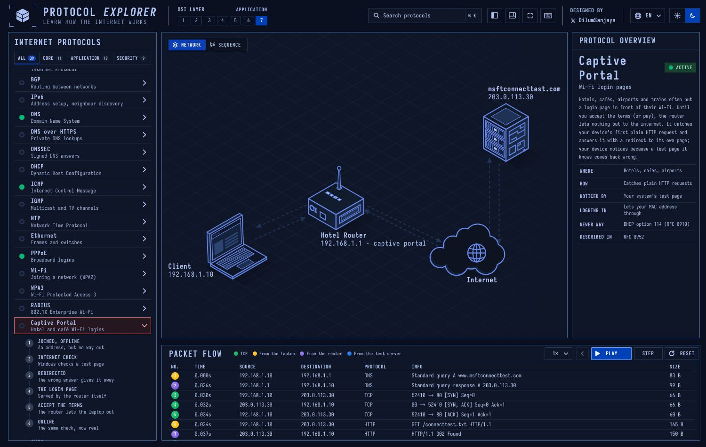
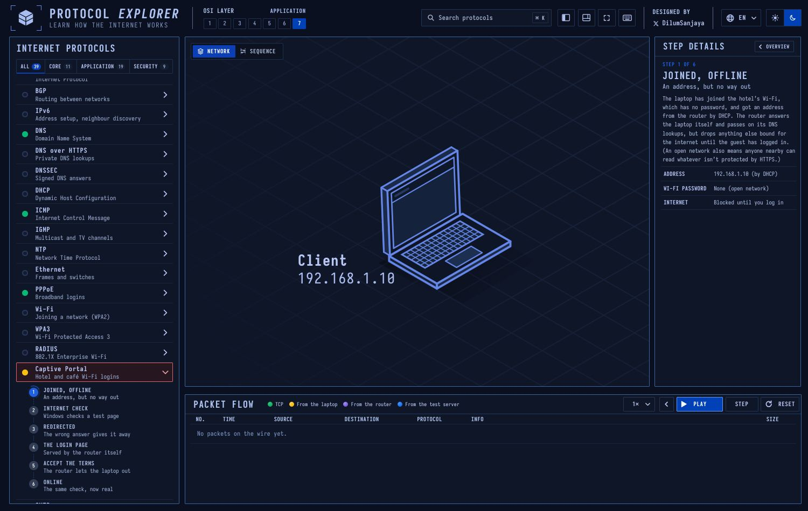
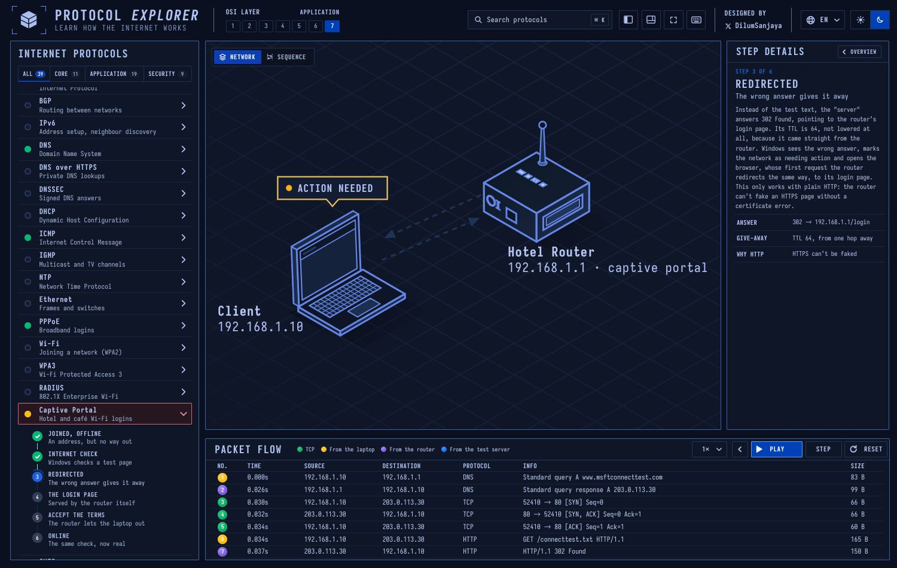
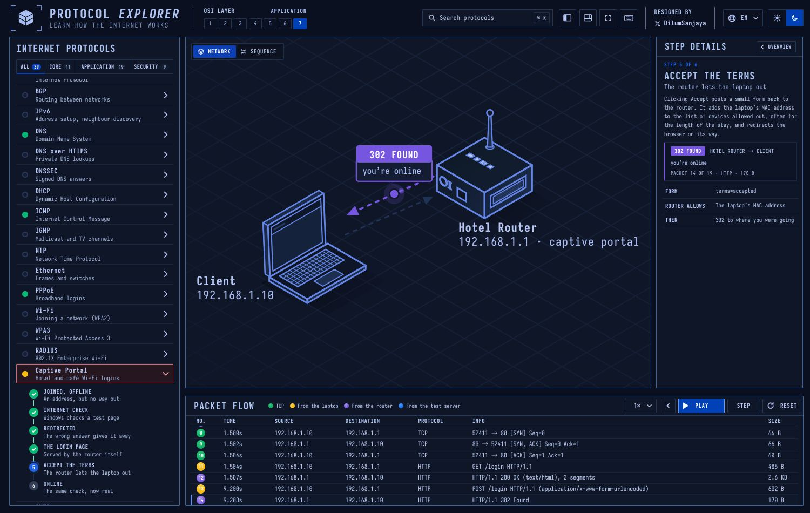
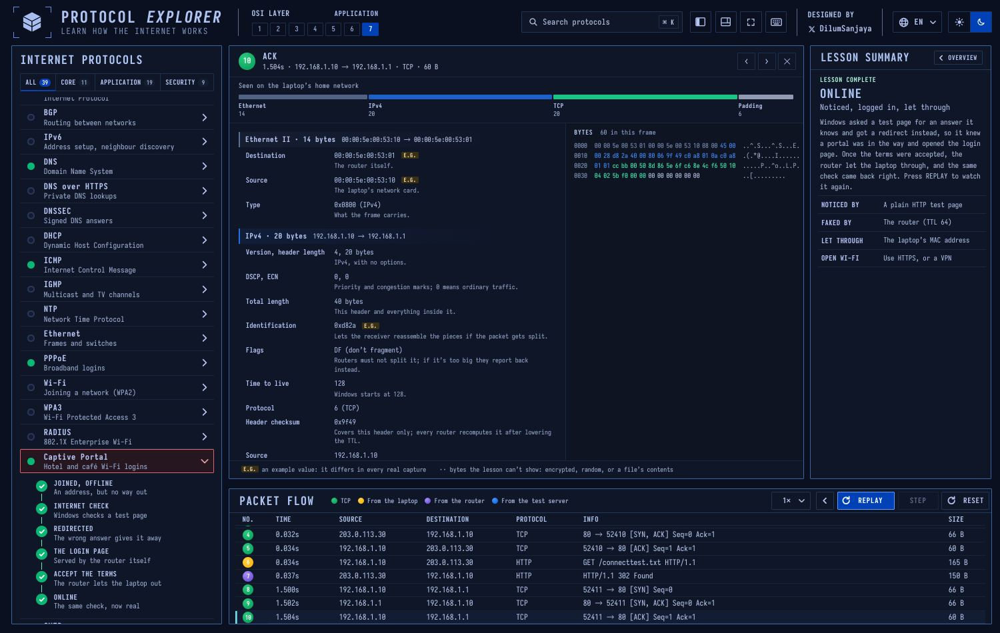
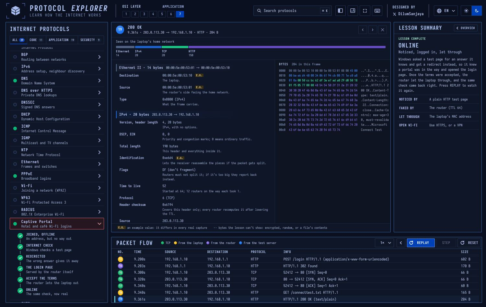

# Captive Portal – Hotel and café Wi-Fi logins

<!-- nav -->
⬅ [25 RADIUS](25-radius.md) · [Index](00_Protocols_Index.md) · [27 SMTP](27-smtp.md) ➡
<!-- nav -->

*Source: Protocol Explorer – https://protocol-explorer-alpha.vercel.app/ (interactive lesson #26). Screenshots captured from the live lesson; packet decodes are the site's example capture (values marked **E.G.** differ in every real capture).*

## Overview



> PROTOCOL OVERVIEW  
> Captive Portal  
> ACTIVE  
> Wi-Fi login pages  
> Hotels, cafés, airports and trains often put a login page in front of their Wi-Fi. Until you accept the terms (or pay), the router lets nothing out to the internet. It catches your device’s first plain HTTP request and answers it with a redirect to its own page; your device notices because a test page it knows comes back wrong.  
> WHERE  
> Hotels, cafés, airports  
> HOW  
> Catches plain HTTP requests  
> NOTICED BY  
> Your system’s test page  
> LOGGING IN  
> Lets your MAC address through  
> NEWER WAY  
> DHCP option 114 (RFC 8910)  
> DESCRIBED IN  
> RFC 8952  

## In-depth explanation of the example (plain-language version)

### The big picture in one minute
A guest connects a Windows laptop to a **hotel Wi-Fi**. Until they accept the terms, the router lets **nothing** through to the internet. The 19 packets show how the laptop **discovers** it's behind a login page, how it's **redirected** to that page, what happens when the guest clicks **Accept** (at about 9 seconds), and how the laptop finally confirms it has real internet.

**What a captive portal is.** It isn't a special protocol. It's a **trick made from ordinary DNS, HTTP and a firewall.** The router catches the device's first plain web request and answers it with **"go to my login page instead."** Phones and laptops detect this automatically using a **connectivity test** and pop up a small browser window.

Think of **a hotel receptionist who stops every guest at the door** and says "please sign the register first," and only then lets them through to the street.

> **Words you'll see:** *Redirect* (HTTP `302`) = "the page you want has moved, go here instead." *Firewall* = the rule-based gatekeeper. *Allow-list* = the list of devices permitted through.

---

### Step 1 – Join the network
The laptop connects and gets an address from DHCP (see the DHCP note). The router's firewall only allows essentials (DHCP, DNS and the router's own web page) for devices that aren't yet on its "approved" list.

### Step 2 – The internet test – packets 1 to 6
Right after connecting, Windows secretly checks whether the internet works:
1. **DNS** (1–2): it asks for `www.msftconnecttest.com` and gets an address.
2. **TCP** (3–5): it connects to that address on port 80. **The router intercepts the connection** and completes it itself, **pretending to be the real server.**
3. **HTTP** (6): `GET /connecttest.txt`. The *real* server would answer `200 OK` with exactly the text **"Microsoft Connect Test"**. Windows knows this is the only correct answer. (Apple and Android use their own test addresses with their own expected replies.)

### Step 3 – The wrong answer gives it away – packet 7
Instead of the expected text, the router replies **`302 Found`** pointing to `http://192.168.1.1/login`. A subtle hint that it's fake: its **TTL is 64**, not lowered at all, whereas a real reply from 12 routers away would arrive with 52. Windows sees "that's not the expected answer," marks the network as **"needs action"** and **opens the login page** automatically.
**Why this only works with plain HTTP:** the router can't fake an **HTTPS** reply (it has no certificate for that website), so browsers would just show a security error. That's why the test uses plain HTTP.

### Step 4 – The login page – packets 8 to 12
A new connection goes to the router itself (`192.168.1.1`) and requests `/login`. This time it really is the router, which shows the hotel's page with the **terms of use** and an **Accept** button.

### Step 5 – Accept the terms – packets 13, 14
Clicking **Accept** sends a small form (`terms=accepted`) to the router. The router **adds the laptop's MAC address (or IP) to its allowed list**, often for the length of the stay, and replies with another redirect. (Paid or voucher portals would check a code or ask a billing system or RADIUS server here.)

### Step 6 – Online – packets 15 to 19
Windows repeats the test. Now the firewall lets the connection through to the **real** server: connect (15–17), request (18), and a genuine **`200 OK` "Microsoft Connect Test"**. The **TTL is 52**, which proves that it travelled the real internet (64 minus 12 routers). Windows shows **"Connected to the internet"** and closes the pop-up.

---

### The 19 packets at a glance
| Packets | What | Why |
|---|---|---|
| 1–2 | DNS for the test site | start the internet check |
| 3–5 | TCP handshake, faked by the router | intercept |
| 6 | `GET /connecttest.txt` | the test |
| 7 | `302` redirect to the login page | reveals the portal |
| 8–12 | login page | show the terms |
| 13–14 | Accept | the router approves the device |
| 15–19 | test repeated, real `200 OK` | internet confirmed |

### What to remember
- **Captive portal = DNS/HTTP interception + redirect + allow-list.** No standard is negotiated; devices simply notice the unexpected answer.
- A **`302` redirect where fixed text was expected** is the detection signal. Newer standards let networks announce the portal's address directly.
- **Security notes:** open guest Wi-Fi is usually **unencrypted**. Never type sensitive data on a portal page served over plain HTTP. Portals can interfere with **VPNs and encrypted DNS** until you've logged in.
- MAC-based allow-lists can be faked. Portals give **access control**, not strong identity.

## Step-by-step walkthrough (screenshots from the lesson)

### Step 1: JOINED, OFFLINE – An address, but no way out



> STEP 1 OF 6  
> JOINED, OFFLINE  
> An address, but no way out  
> The laptop has joined the hotel’s Wi-Fi, which has no password, and got an address from the router by DHCP. The router answers the laptop itself and passes on its DNS lookups, but drops anything else bound for the internet until the guest has logged in. (An open network also means anyone nearby can read whatever isn’t protected by HTTPS.)  
> ADDRESS  
> 192.168.1.10 (by DHCP)  
> WI-FI PASSWORD  
> None (open network)  
> INTERNET  
> Blocked until you log in  

### Step 2: INTERNET CHECK – Windows checks a test page


> STEP 2 OF 6  
> INTERNET CHECK  
> Windows checks a test page  
> After joining any network, Windows looks up www.msftconnecttest.com (the router passes the lookup on) and asks it for /connecttest.txt over plain HTTP; the right answer is the text "Microsoft Connect Test". The router catches the connection and answers the handshake itself, in the test server’s name. The laptop can’t tell yet.  
> SYN  
> CLIENT → HOTEL ROUTER  
> to 203.0.113.30:80  
> PACKET 3 OF 19 · TCP · 66 B  
> TEST PAGE  
> msftconnecttest.com/connecttest.txt  
> EXPECTED  
> "Microsoft Connect Test"  
> ANSWERED BY  
> The router, posing as the server  

### Step 3: REDIRECTED – The wrong answer gives it away



> STEP 3 OF 6  
> REDIRECTED  
> The wrong answer gives it away  
> Instead of the test text, the "server" answers 302 Found, pointing to the router’s login page. Its TTL is 64, not lowered at all, because it came straight from the router. Windows sees the wrong answer, marks the network as needing action and opens the browser, whose first request the router redirects the same way, to its login page. This only works with plain HTTP: the router can’t fake an HTTPS page without a certificate error.  
> 302 FOUND  
> HOTEL ROUTER → CLIENT  
> Location: 192.168.1.1/login  
> PACKET 7 OF 19 · HTTP · 150 B  
> ANSWER  
> 302 → 192.168.1.1/login  
> GIVE-AWAY  
> TTL 64, from one hop away  
> WHY HTTP  
> HTTPS can’t be faked  

### Step 4: THE LOGIN PAGE – Served by the router itself


> STEP 4 OF 6  
> THE LOGIN PAGE  
> Served by the router itself  
> The browser opens http://192.168.1.1/login, a page the router serves itself: the hotel’s name, the terms of use and an Accept button. This connection really does go to the router.  
> ACK  
> CLIENT → HOTEL ROUTER  
> PACKET 10 OF 19 · TCP · 60 B  
> PAGE  
> http://192.168.1.1/login  
> SERVED BY  
> The router  
> SIZE  
> 2,400 bytes of HTML  

### Step 5: ACCEPT THE TERMS – The router lets the laptop out



> STEP 5 OF 6  
> ACCEPT THE TERMS  
> The router lets the laptop out  
> Clicking Accept posts a small form back to the router. It adds the laptop’s MAC address to the list of devices allowed out, often for the length of the stay, and redirects the browser on its way.  
> 302 FOUND  
> HOTEL ROUTER → CLIENT  
> you’re online  
> PACKET 14 OF 19 · HTTP · 170 B  
> FORM  
> terms=accepted  
> ROUTER ALLOWS  
> The laptop’s MAC address  
> THEN  
> 302 to where you were going  

### Step 6: ONLINE – The same check, now real


> STEP 6 OF 6  
> ONLINE  
> The same check, now real  
> Windows checks again. This time the router lets the connection through to the real test server, twelve routers away (its replies arrive with TTL 52), and the answer is the expected text. The network is marked as connected to the internet.  
> SYN  
> CLIENT → MSFTCONNECTTEST.COM  
> PACKET 15 OF 19 · TCP · 66 B  
> ANSWER  
> "Microsoft Connect Test"  
> REPLY TTL  
> 52 (64 − 12 routers)  
> STATUS  
> Connected to the internet  

### Lesson summary


> LESSON SUMMARY  
> LESSON COMPLETE  
> ONLINE  
> Noticed, logged in, let through  
> Windows asked a test page for an answer it knows and got a redirect instead, so it knew a portal was in the way and opened the login page. Once the terms were accepted, the router let the laptop through, and the same check came back right. Press REPLAY to watch it again.  
> 200 OK  
> MSFTCONNECTTEST.COM → CLIENT  
> "Microsoft Connect Test"  
> PACKET 19 OF 19 · HTTP · 204 B  
> NOTICED BY  
> A plain HTTP test page  
> FAKED BY  
> The router (TTL 64)  
> LET THROUGH  
> The laptop’s MAC address  
> OPEN WI-FI  
> Use HTTPS, or a VPN  

## Packet flow (whole lesson)

| No. | Time | Source | Destination | Protocol | Info | Size |
|---|---|---|---|---|---|---|
| 1 | 0.000s | 192.168.1.10 | 192.168.1.1 | DNS | Standard query A www.msftconnecttest.com | 83 B |
| 2 | 0.026s | 192.168.1.1 | 192.168.1.10 | DNS | Standard query response A 203.0.113.30 | 99 B |
| 3 | 0.030s | 192.168.1.10 | 203.0.113.30 | TCP | 52410 → 80 [SYN] Seq=0 | 66 B |
| 4 | 0.032s | 203.0.113.30 | 192.168.1.10 | TCP | 80 → 52410 [SYN, ACK] Seq=0 Ack=1 | 66 B |
| 5 | 0.034s | 192.168.1.10 | 203.0.113.30 | TCP | 52410 → 80 [ACK] Seq=1 Ack=1 | 60 B |
| 6 | 0.034s | 192.168.1.10 | 203.0.113.30 | HTTP | GET /connecttest.txt HTTP/1.1 | 165 B |
| 7 | 0.037s | 203.0.113.30 | 192.168.1.10 | HTTP | HTTP/1.1 302 Found | 150 B |
| 8 | 1.500s | 192.168.1.10 | 192.168.1.1 | TCP | 52411 → 80 [SYN] Seq=0 | 66 B |
| 9 | 1.502s | 192.168.1.1 | 192.168.1.10 | TCP | 80 → 52411 [SYN, ACK] Seq=0 Ack=1 | 66 B |
| 10 | 1.504s | 192.168.1.10 | 192.168.1.1 | TCP | 52411 → 80 [ACK] Seq=1 Ack=1 | 60 B |
| 11 | 1.504s | 192.168.1.10 | 192.168.1.1 | HTTP | GET /login HTTP/1.1 | 485 B |
| 12 | 1.507s | 192.168.1.1 | 192.168.1.10 | HTTP | HTTP/1.1 200 OK (text/html), 2 segments | 2.6 KB |
| 13 | 9.200s | 192.168.1.10 | 192.168.1.1 | HTTP | POST /login HTTP/1.1 (application/x-www-form-urlencoded) | 602 B |
| 14 | 9.203s | 192.168.1.1 | 192.168.1.10 | HTTP | HTTP/1.1 302 Found | 170 B |
| 15 | 9.300s | 192.168.1.10 | 203.0.113.30 | TCP | 52412 → 80 [SYN] Seq=0 | 66 B |
| 16 | 9.320s | 203.0.113.30 | 192.168.1.10 | TCP | 80 → 52412 [SYN, ACK] Seq=0 Ack=1 | 66 B |
| 17 | 9.340s | 192.168.1.10 | 203.0.113.30 | TCP | 52412 → 80 [ACK] Seq=1 Ack=1 | 60 B |
| 18 | 9.340s | 192.168.1.10 | 203.0.113.30 | HTTP | GET /connecttest.txt HTTP/1.1 | 165 B |
| 19 | 9.361s | 203.0.113.30 | 192.168.1.10 | HTTP | HTTP/1.1 200 OK (text/plain) | 204 B |

### Sequence diagram


## Packets decoded byte by byte

Each packet below is the lesson's own decode (headers, field values and the plain-English meaning of each field). Screenshots show the first, middle and last packet in the lesson's decoder view with the raw hex bytes.

### Packet 1: DNS – Standard query A www.msftconnecttest.com

*192.168.1.10 → 192.168.1.1 · 83 B · t = 0.000s*


<details><summary>Decoded fields</summary>

```text
1
DNS QUERY
0.000s · 192.168.1.10 → 192.168.1.1 · DNS · 83 B
Seen on the laptop’s home network
Ethernet
14
IPv4
20
UDP
8
DNS
41
Ethernet II · 14 bytes
00:00:5e:00:53:10 → 00:00:5e:00:53:01
Destination
00:00:5e:00:53:01 E.G.

The router itself.

Source
00:00:5e:00:53:10 E.G.

The laptop’s network card.

Type
0x0800 (IPv4)

What the frame carries.

IPv4 · 20 bytes
192.168.1.10 → 192.168.1.1
Version, header length
4, 20 bytes

IPv4, with no options.

DSCP, ECN
0, 0

Priority and congestion marks; 0 means ordinary traffic.

Total length
69 bytes

This header and everything inside it.

Identification
0xd825 E.G.

Lets the receiver reassemble the pieces if the packet gets split.

Flags
none E.G.

Routers may split it if a link is too small.

Time to live
128

Windows starts at 128.

Protocol
17 (UDP)
Header checksum
0xdf26

Covers this header only; every router recomputes it after lowering the TTL.

Source
192.168.1.10
Destination
192.168.1.1
UDP · 8 bytes
58133 → 53
Source port
58133
Destination port
53
Length
49 bytes

UDP header and data. That is all of UDP: no numbering, no acknowledgements.

Checksum
0x09ab

Covers the header, the data and the IP addresses.

DNS
Transaction ID
0x7e21 E.G.

Picked at random; the answer must carry the same one.

Flags
0x0100: query, RD (recursion desired)
Questions
1
Answers
0
Authority records
0
Additional records
0
Question
www.msftconnecttest.com, type A, class IN
BYTES 83 in this frame
0000
00
00
5e
00
53
01
00
00
5e
00
53
10
08
00
45
00
.
.
^
.
S
.
.
.
^
.
S
.
.
.
E
.
0010
00
45
d8
25
00
00
80
11
df
26
c0
a8
01
0a
c0
a8
.
E
.
%
.
.
.
.
.
&
.
.
.
.
.
.
0020
01
01
e3
15
00
35
00
31
09
ab
7e
21
01
00
00
01
.
.
.
.
.
5
.
1
.
.
~
!
.
.
.
.
0030
00
00
00
00
00
00
03
77
77
77
0f
6d
73
66
74
63
.
.
.
.
.
.
.
w
w
w
.
m
s
f
t
c
0040
6f
6e
6e
65
63
74
74
65
73
74
03
63
6f
6d
00
00
o
n
n
e
c
t
t
e
s
t
.
c
o
m
.
.
0050
01
00
01
.
.
.
E.G. an example value: it differs in every real capture
·· bytes the lesson can’t show: encrypted, random, or a file’s contents
```

</details>

### Packet 2: DNS – Standard query response A 203.0.113.30

*192.168.1.1 → 192.168.1.10 · 99 B · t = 0.026s*

<details><summary>Decoded fields</summary>

```text
2
DNS REPLY
0.026s · 192.168.1.1 → 192.168.1.10 · DNS · 99 B
Seen on the laptop’s home network
Ethernet
14
IPv4
20
UDP
8
DNS
57
Ethernet II · 14 bytes
00:00:5e:00:53:01 → 00:00:5e:00:53:10
Destination
00:00:5e:00:53:10 E.G.

The laptop.

Source
00:00:5e:00:53:01 E.G.

The router’s side facing the home network.

Type
0x0800 (IPv4)

What the frame carries.

IPv4 · 20 bytes
192.168.1.1 → 192.168.1.10
Version, header length
4, 20 bytes

IPv4, with no options.

DSCP, ECN
0, 0

Priority and congestion marks; 0 means ordinary traffic.

Total length
85 bytes

This header and everything inside it.

Identification
0xb257 E.G.

Lets the receiver reassemble the pieces if the packet gets split.

Flags
none E.G.

Routers may split it if a link is too small.

Time to live
64

As sent: this system starts at 64.

Protocol
17 (UDP)
Header checksum
0x44e5

Covers this header only; every router recomputes it after lowering the TTL.

Source
192.168.1.1
Destination
192.168.1.10
UDP · 8 bytes
53 → 58133
Source port
53
Destination port
58133
Length
65 bytes

UDP header and data. That is all of UDP: no numbering, no acknowledgements.

Checksum
0x290d

Covers the header, the data and the IP addresses.

DNS
Transaction ID
0x7e21 E.G.

Picked at random; the answer must carry the same one.

Flags
0x8180: response, RD (recursion desired), RA (recursion available)
Questions
1
Answers
1
Authority records
0
Additional records
0
Question
www.msftconnecttest.com, type A, class IN
Answer
www.msftconnecttest.com A 203.0.113.30 (TTL 46 s) E.G.
BYTES 99 in this frame
0000
00
00
5e
00
53
10
00
00
5e
00
53
01
08
00
45
00
.
.
^
.
S
.
.
.
^
.
S
.
.
.
E
.
0010
00
55
b2
57
00
00
40
11
44
e5
c0
a8
01
01
c0
a8
.
U
.
W
.
.
@
.
D
.
.
.
.
.
.
.
0020
01
0a
00
35
e3
15
00
41
29
0d
7e
21
81
80
00
01
.
.
.
5
.
.
.
A
)
.
~
!
.
.
.
.
0030
00
01
00
00
00
00
03
77
77
77
0f
6d
73
66
74
63
.
.
.
.
.
.
.
w
w
w
.
m
s
f
t
c
0040
6f
6e
6e
65
63
74
74
65
73
74
03
63
6f
6d
00
00
o
n
n
e
c
t
t
e
s
t
.
c
o
m
.
.
0050
01
00
01
c0
0c
00
01
00
01
00
00
00
2e
00
04
cb
.
.
.
.
.
.
.
.
.
.
.
.
.
.
.
.
0060
00
71
1e
.
q
.
E.G. an example value: it differs in every real capture
·· bytes the lesson can’t show: encrypted, random, or a file’s contents
```

</details>

### Packet 3: TCP – 52410 → 80 [SYN] Seq=0

*192.168.1.10 → 203.0.113.30 · 66 B · t = 0.030s*

<details><summary>Decoded fields</summary>

```text
3
SYN
0.030s · 192.168.1.10 → 203.0.113.30 · TCP · 66 B
Seen on the laptop’s home network
Ethernet
14
IPv4
20
TCP
32
Ethernet II · 14 bytes
00:00:5e:00:53:10 → 00:00:5e:00:53:01
Destination
00:00:5e:00:53:01 E.G.

The router: anything beyond the home network goes to it first.

Source
00:00:5e:00:53:10 E.G.

The laptop’s network card.

Type
0x0800 (IPv4)

What the frame carries.

IPv4 · 20 bytes
192.168.1.10 → 203.0.113.30
Version, header length
4, 20 bytes

IPv4, with no options.

DSCP, ECN
0, 0

Priority and congestion marks; 0 means ordinary traffic.

Total length
52 bytes

This header and everything inside it.

Identification
0xd826 E.G.

Lets the receiver reassemble the pieces if the packet gets split.

Flags
DF (don’t fragment)

Routers must not split it; if it’s too big they report back instead.

Time to live
128

Windows starts at 128.

Protocol
6 (TCP)
Header checksum
0x24cc

Covers this header only; every router recomputes it after lowering the TTL.

Source
192.168.1.10
Destination
203.0.113.30
TCP · 32 bytes
52410 → 80, SYN
Source port
52410

Picked by the laptop’s system for this connection.

Destination port
80
Sequence number
0 (relative)

This side’s starting number. Shown as 0; the real one is random.

Real sequence number
1204840328 E.G.
Acknowledgment
0 (not used yet)

A first SYN has nothing to acknowledge.

Header length
32 bytes

20 bytes, plus 12 of options.

Flags
0x002 (SYN)
Window
64240 E.G.

How much more data this side can take right now.

Checksum
0xf9ea

Covers the header, the data and the IP addresses, so damage is caught.

Urgent pointer
0
Options
12 bytes
Maximum segment size
1460 bytes

The most data this side wants in one segment.

No-op
1

Spacing, so the next option lines up.

Window scale
× 256

Window values are multiplied by this, so windows can be larger than 64 KB.

No-op
1

Spacing, so the next option lines up.

No-op
1

Spacing, so the next option lines up.

SACK permitted
yes

This side understands selective acknowledgements.

BYTES 66 in this frame
0000
00
00
5e
00
53
01
00
00
5e
00
53
10
08
00
45
00
.
.
^
.
S
.
.
.
^
.
S
.
.
.
E
.
0010
00
34
d8
26
40
00
80
06
24
cc
c0
a8
01
0a
cb
00
.
4
.
&
@
.
.
.
$
.
.
.
.
.
.
.
0020
71
1e
cc
ba
00
50
47
d0
67
88
00
00
00
00
80
02
q
.
.
.
.
P
G
.
g
.
.
.
.
.
.
.
0030
fa
f0
f9
ea
00
00
02
04
05
b4
01
03
03
08
01
01
.
.
.
.
.
.
.
.
.
.
.
.
.
.
.
.
0040
04
02
.
.
E.G. an example value: it differs in every real capture
·· bytes the lesson can’t show: encrypted, random, or a file’s contents
```

</details>

### Packet 4: TCP – 80 → 52410 [SYN, ACK] Seq=0 Ack=1

*203.0.113.30 → 192.168.1.10 · 66 B · t = 0.032s*

<details><summary>Decoded fields</summary>

```text
4
SYN-ACK
0.032s · 203.0.113.30 → 192.168.1.10 · TCP · 66 B
Seen on the laptop’s home network
Ethernet
14
IPv4
20
TCP
32
Ethernet II · 14 bytes
00:00:5e:00:53:01 → 00:00:5e:00:53:10
Destination
00:00:5e:00:53:10 E.G.

The laptop.

Source
00:00:5e:00:53:01 E.G.

The router’s side facing the home network.

Type
0x0800 (IPv4)

What the frame carries.

IPv4 · 20 bytes
203.0.113.30 → 192.168.1.10
Version, header length
4, 20 bytes

IPv4, with no options.

DSCP, ECN
0, 0

Priority and congestion marks; 0 means ordinary traffic.

Total length
52 bytes

This header and everything inside it.

Identification
0xe6d1 E.G.

Lets the receiver reassemble the pieces if the packet gets split.

Flags
DF (don’t fragment)

Routers must not split it; if it’s too big they report back instead.

Time to live
64

Sent with 64 and not lowered at all: it came from the router next door, not from a server 12 routers away.

Protocol
6 (TCP)
Header checksum
0x5621

Covers this header only; every router recomputes it after lowering the TTL.

Source
203.0.113.30
Destination
192.168.1.10
TCP · 32 bytes
80 → 52410, SYN, ACK
Source port
80
Destination port
52410
Sequence number
0 (relative)

This side’s starting number. Shown as 0; the real one is random.

Real sequence number
61904936 E.G.
Acknowledgment
1 (relative)

The next byte this side expects: everything before it has arrived.

Header length
32 bytes

20 bytes, plus 12 of options.

Flags
0x012 (SYN, ACK)
Window
64240 E.G.

How much more data this side can take right now.

Checksum
0x5e02

Covers the header, the data and the IP addresses, so damage is caught.

Urgent pointer
0
Options
12 bytes
Maximum segment size
1460 bytes

The most data this side wants in one segment.

No-op
1

Spacing, so the next option lines up.

No-op
1

Spacing, so the next option lines up.

SACK permitted
yes

This side understands selective acknowledgements.

No-op
1

Spacing, so the next option lines up.

Window scale
× 128

Window values are multiplied by this, so windows can be larger than 64 KB.

BYTES 66 in this frame
0000
00
00
5e
00
53
10
00
00
5e
00
53
01
08
00
45
00
.
.
^
.
S
.
.
.
^
.
S
.
.
.
E
.
0010
00
34
e6
d1
40
00
40
06
56
21
cb
00
71
1e
c0
a8
.
4
.
.
@
.
@
.
V
!
.
.
q
.
.
.
0020
01
0a
00
50
cc
ba
03
b0
98
28
47
d0
67
89
80
12
.
.
.
P
.
.
.
.
.
(
G
.
g
.
.
.
0030
fa
f0
5e
02
00
00
02
04
05
b4
01
01
04
02
01
03
.
.
^
.
.
.
.
.
.
.
.
.
.
.
.
.
0040
03
07
.
.
E.G. an example value: it differs in every real capture
·· bytes the lesson can’t show: encrypted, random, or a file’s contents
```

</details>

### Packet 5: TCP – 52410 → 80 [ACK] Seq=1 Ack=1

*192.168.1.10 → 203.0.113.30 · 60 B · t = 0.034s*

<details><summary>Decoded fields</summary>

```text
5
ACK
0.034s · 192.168.1.10 → 203.0.113.30 · TCP · 60 B
Seen on the laptop’s home network
Ethernet
14
IPv4
20
TCP
20
Padding
6
Ethernet II · 14 bytes
00:00:5e:00:53:10 → 00:00:5e:00:53:01
Destination
00:00:5e:00:53:01 E.G.

The router: anything beyond the home network goes to it first.

Source
00:00:5e:00:53:10 E.G.

The laptop’s network card.

Type
0x0800 (IPv4)

What the frame carries.

IPv4 · 20 bytes
192.168.1.10 → 203.0.113.30
Version, header length
4, 20 bytes

IPv4, with no options.

DSCP, ECN
0, 0

Priority and congestion marks; 0 means ordinary traffic.

Total length
40 bytes

This header and everything inside it.

Identification
0xd827 E.G.

Lets the receiver reassemble the pieces if the packet gets split.

Flags
DF (don’t fragment)

Routers must not split it; if it’s too big they report back instead.

Time to live
128

Windows starts at 128.

Protocol
6 (TCP)
Header checksum
0x24d7

Covers this header only; every router recomputes it after lowering the TTL.

Source
192.168.1.10
Destination
203.0.113.30
TCP · 20 bytes
52410 → 80, ACK
Source port
52410

Picked by the laptop’s system for this connection.

Destination port
80
Sequence number
1 (relative)

Position of this segment’s first byte, counted from this side’s SYN.

Real sequence number
1204840329 E.G.
Acknowledgment
1 (relative)

The next byte this side expects: everything before it has arrived.

Header length
20 bytes
Flags
0x010 (ACK)
Window
1026 (× 256 = 262,656 bytes) E.G.

How much more data this side can take right now.

Checksum
0x95c3

Covers the header, the data and the IP addresses, so damage is caught.

Urgent pointer
0
Ethernet padding · 6 bytes
Padding
6 zero bytes

Ethernet frames are at least 60 bytes (64 with the checksum the card adds), so short ones are padded.

BYTES 60 in this frame
0000
00
00
5e
00
53
01
00
00
5e
00
53
10
08
00
45
00
.
.
^
.
S
.
.
.
^
.
S
.
.
.
E
.
0010
00
28
d8
27
40
00
80
06
24
d7
c0
a8
01
0a
cb
00
.
(
.
'
@
.
.
.
$
.
.
.
.
.
.
.
0020
71
1e
cc
ba
00
50
47
d0
67
89
03
b0
98
29
50
10
q
.
.
.
.
P
G
.
g
.
.
.
.
)
P
.
0030
04
02
95
c3
00
00
00
00
00
00
00
00
.
.
.
.
.
.
.
.
.
.
.
.
E.G. an example value: it differs in every real capture
·· bytes the lesson can’t show: encrypted, random, or a file’s contents
```

</details>

### Packet 6: HTTP – GET /connecttest.txt HTTP/1.1

*192.168.1.10 → 203.0.113.30 · 165 B · t = 0.034s*

<details><summary>Decoded fields</summary>

```text
6
GET
0.034s · 192.168.1.10 → 203.0.113.30 · HTTP · 165 B
Seen on the laptop’s home network
Ethernet
14
IPv4
20
TCP
20
HTTP
111
Ethernet II · 14 bytes
00:00:5e:00:53:10 → 00:00:5e:00:53:01
Destination
00:00:5e:00:53:01 E.G.

The router: anything beyond the home network goes to it first.

Source
00:00:5e:00:53:10 E.G.

The laptop’s network card.

Type
0x0800 (IPv4)

What the frame carries.

IPv4 · 20 bytes
192.168.1.10 → 203.0.113.30
Version, header length
4, 20 bytes

IPv4, with no options.

DSCP, ECN
0, 0

Priority and congestion marks; 0 means ordinary traffic.

Total length
151 bytes

This header and everything inside it.

Identification
0xd828 E.G.

Lets the receiver reassemble the pieces if the packet gets split.

Flags
DF (don’t fragment)

Routers must not split it; if it’s too big they report back instead.

Time to live
128

Windows starts at 128.

Protocol
6 (TCP)
Header checksum
0x2467

Covers this header only; every router recomputes it after lowering the TTL.

Source
192.168.1.10
Destination
203.0.113.30
TCP · 20 bytes
52410 → 80, PSH, ACK
Source port
52410

Picked by the laptop’s system for this connection.

Destination port
80
Sequence number
1 (relative)

Position of this segment’s first byte, counted from this side’s SYN.

Real sequence number
1204840329 E.G.
Acknowledgment
1 (relative)

The next byte this side expects: everything before it has arrived.

Header length
20 bytes
Flags
0x018 (PSH, ACK)
Window
1026 (× 256 = 262,656 bytes) E.G.

How much more data this side can take right now.

Checksum
0xd619

Covers the header, the data and the IP addresses, so damage is caught.

Urgent pointer
0
HTTP
Text
GET /connecttest.txt HTTP/1.1␍␊
Connection: Close␍␊
User-Agent: Microsoft NCSI␍␊
Host: www.msftconnecttest.com␍␊
␍␊
BYTES 165 in this frame
0000
00
00
5e
00
53
01
00
00
5e
00
53
10
08
00
45
00
.
.
^
.
S
.
.
.
^
.
S
.
.
.
E
.
0010
00
97
d8
28
40
00
80
06
24
67
c0
a8
01
0a
cb
00
.
.
.
(
@
.
.
.
$
g
.
.
.
.
.
.
0020
71
1e
cc
ba
00
50
47
d0
67
89
03
b0
98
29
50
18
q
.
.
.
.
P
G
.
g
.
.
.
.
)
P
.
0030
04
02
d6
19
00
00
47
45
54
20
2f
63
6f
6e
6e
65
.
.
.
.
.
.
G
E
T
/
c
o
n
n
e
0040
63
74
74
65
73
74
2e
74
78
74
20
48
54
54
50
2f
c
t
t
e
s
t
.
t
x
t
H
T
T
P
/
0050
31
2e
31
0d
0a
43
6f
6e
6e
65
63
74
69
6f
6e
3a
1
.
1
.
.
C
o
n
n
e
c
t
i
o
n
:
0060
20
43
6c
6f
73
65
0d
0a
55
73
65
72
2d
41
67
65
C
l
o
s
e
.
.
U
s
e
r
-
A
g
e
0070
6e
74
3a
20
4d
69
63
72
6f
73
6f
66
74
20
4e
43
n
t
:
M
i
c
r
o
s
o
f
t
N
C
0080
53
49
0d
0a
48
6f
73
74
3a
20
77
77
77
2e
6d
73
S
I
.
.
H
o
s
t
:
w
w
w
.
m
s
0090
66
74
63
6f
6e
6e
65
63
74
74
65
73
74
2e
63
6f
f
t
c
o
n
n
e
c
t
t
e
s
t
.
c
o
00a0
6d
0d
0a
0d
0a
m
.
.
.
.
E.G. an example value: it differs in every real capture
·· bytes the lesson can’t show: encrypted, random, or a file’s contents
```

</details>

### Packet 7: HTTP – HTTP/1.1 302 Found

*203.0.113.30 → 192.168.1.10 · 150 B · t = 0.037s*

<details><summary>Decoded fields</summary>

```text
7
302 FOUND
0.037s · 203.0.113.30 → 192.168.1.10 · HTTP · 150 B
Seen on the laptop’s home network
Ethernet
14
IPv4
20
TCP
20
HTTP
96
Ethernet II · 14 bytes
00:00:5e:00:53:01 → 00:00:5e:00:53:10
Destination
00:00:5e:00:53:10 E.G.

The laptop.

Source
00:00:5e:00:53:01 E.G.

The router’s side facing the home network.

Type
0x0800 (IPv4)

What the frame carries.

IPv4 · 20 bytes
203.0.113.30 → 192.168.1.10
Version, header length
4, 20 bytes

IPv4, with no options.

DSCP, ECN
0, 0

Priority and congestion marks; 0 means ordinary traffic.

Total length
136 bytes

This header and everything inside it.

Identification
0xe6d2 E.G.

Lets the receiver reassemble the pieces if the packet gets split.

Flags
DF (don’t fragment)

Routers must not split it; if it’s too big they report back instead.

Time to live
64

Sent with 64 and not lowered at all: it came from the router next door, not from a server 12 routers away.

Protocol
6 (TCP)
Header checksum
0x55cc

Covers this header only; every router recomputes it after lowering the TTL.

Source
203.0.113.30
Destination
192.168.1.10
TCP · 20 bytes
80 → 52410, PSH, ACK
Source port
80
Destination port
52410
Sequence number
1 (relative)

Position of this segment’s first byte, counted from this side’s SYN.

Real sequence number
61904937 E.G.
Acknowledgment
112 (relative)

The next byte this side expects: everything before it has arrived.

Header length
20 bytes
Flags
0x018 (PSH, ACK)
Window
501 (× 128 = 64,128 bytes) E.G.

How much more data this side can take right now.

Checksum
0xbba7

Covers the header, the data and the IP addresses, so damage is caught.

Urgent pointer
0
HTTP
Text
HTTP/1.1 302 Found␍␊
Location: http://192.168.1.1/login␍␊
Content-Length: 0␍␊
Connection: close␍␊
␍␊
BYTES 150 in this frame
0000
00
00
5e
00
53
10
00
00
5e
00
53
01
08
00
45
00
.
.
^
.
S
.
.
.
^
.
S
.
.
.
E
.
0010
00
88
e6
d2
40
00
40
06
55
cc
cb
00
71
1e
c0
a8
.
.
.
.
@
.
@
.
U
.
.
.
q
.
.
.
0020
01
0a
00
50
cc
ba
03
b0
98
29
47
d0
67
f8
50
18
.
.
.
P
.
.
.
.
.
)
G
.
g
.
P
.
0030
01
f5
bb
a7
00
00
48
54
54
50
2f
31
2e
31
20
33
.
.
.
.
.
.
H
T
T
P
/
1
.
1
3
0040
30
32
20
46
6f
75
6e
64
0d
0a
4c
6f
63
61
74
69
0
2
F
o
u
n
d
.
.
L
o
c
a
t
i
0050
6f
6e
3a
20
68
74
74
70
3a
2f
2f
31
39
32
2e
31
o
n
:
h
t
t
p
:
/
/
1
9
2
.
1
0060
36
38
2e
31
2e
31
2f
6c
6f
67
69
6e
0d
0a
43
6f
6
8
.
1
.
1
/
l
o
g
i
n
.
.
C
o
0070
6e
74
65
6e
74
2d
4c
65
6e
67
74
68
3a
20
30
0d
n
t
e
n
t
-
L
e
n
g
t
h
:
0
.
0080
0a
43
6f
6e
6e
65
63
74
69
6f
6e
3a
20
63
6c
6f
.
C
o
n
n
e
c
t
i
o
n
:
c
l
o
0090
73
65
0d
0a
0d
0a
s
e
.
.
.
.
E.G. an example value: it differs in every real capture
·· bytes the lesson can’t show: encrypted, random, or a file’s contents
```

</details>

### Packet 8: TCP – 52411 → 80 [SYN] Seq=0

*192.168.1.10 → 192.168.1.1 · 66 B · t = 1.500s*

<details><summary>Decoded fields</summary>

```text
8
SYN
1.500s · 192.168.1.10 → 192.168.1.1 · TCP · 66 B
Seen on the laptop’s home network
Ethernet
14
IPv4
20
TCP
32
Ethernet II · 14 bytes
00:00:5e:00:53:10 → 00:00:5e:00:53:01
Destination
00:00:5e:00:53:01 E.G.

The router itself.

Source
00:00:5e:00:53:10 E.G.

The laptop’s network card.

Type
0x0800 (IPv4)

What the frame carries.

IPv4 · 20 bytes
192.168.1.10 → 192.168.1.1
Version, header length
4, 20 bytes

IPv4, with no options.

DSCP, ECN
0, 0

Priority and congestion marks; 0 means ordinary traffic.

Total length
52 bytes

This header and everything inside it.

Identification
0xd829 E.G.

Lets the receiver reassemble the pieces if the packet gets split.

Flags
DF (don’t fragment)

Routers must not split it; if it’s too big they report back instead.

Time to live
128

Windows starts at 128.

Protocol
6 (TCP)
Header checksum
0x9f3e

Covers this header only; every router recomputes it after lowering the TTL.

Source
192.168.1.10
Destination
192.168.1.1
TCP · 32 bytes
52411 → 80, SYN
Source port
52411

Picked by the laptop’s system for this connection.

Destination port
80
Sequence number
0 (relative)

This side’s starting number. Shown as 0; the real one is random.

Real sequence number
2374393454 E.G.
Acknowledgment
0 (not used yet)

A first SYN has nothing to acknowledge.

Header length
32 bytes

20 bytes, plus 12 of options.

Flags
0x002 (SYN)
Window
64240 E.G.

How much more data this side can take right now.

Checksum
0x37c3

Covers the header, the data and the IP addresses, so damage is caught.

Urgent pointer
0
Options
12 bytes
Maximum segment size
1460 bytes

The most data this side wants in one segment.

No-op
1

Spacing, so the next option lines up.

Window scale
× 256

Window values are multiplied by this, so windows can be larger than 64 KB.

No-op
1

Spacing, so the next option lines up.

No-op
1

Spacing, so the next option lines up.

SACK permitted
yes

This side understands selective acknowledgements.

BYTES 66 in this frame
0000
00
00
5e
00
53
01
00
00
5e
00
53
10
08
00
45
00
.
.
^
.
S
.
.
.
^
.
S
.
.
.
E
.
0010
00
34
d8
29
40
00
80
06
9f
3e
c0
a8
01
0a
c0
a8
.
4
.
)
@
.
.
.
.
>
.
.
.
.
.
.
0020
01
01
cc
bb
00
50
8d
86
5e
6e
00
00
00
00
80
02
.
.
.
.
.
P
.
.
^
n
.
.
.
.
.
.
0030
fa
f0
37
c3
00
00
02
04
05
b4
01
03
03
08
01
01
.
.
7
.
.
.
.
.
.
.
.
.
.
.
.
.
0040
04
02
.
.
E.G. an example value: it differs in every real capture
·· bytes the lesson can’t show: encrypted, random, or a file’s contents
```

</details>

### Packet 9: TCP – 80 → 52411 [SYN, ACK] Seq=0 Ack=1

*192.168.1.1 → 192.168.1.10 · 66 B · t = 1.502s*

<details><summary>Decoded fields</summary>

```text
9
SYN-ACK
1.502s · 192.168.1.1 → 192.168.1.10 · TCP · 66 B
Seen on the laptop’s home network
Ethernet
14
IPv4
20
TCP
32
Ethernet II · 14 bytes
00:00:5e:00:53:01 → 00:00:5e:00:53:10
Destination
00:00:5e:00:53:10 E.G.

The laptop.

Source
00:00:5e:00:53:01 E.G.

The router’s side facing the home network.

Type
0x0800 (IPv4)

What the frame carries.

IPv4 · 20 bytes
192.168.1.1 → 192.168.1.10
Version, header length
4, 20 bytes

IPv4, with no options.

DSCP, ECN
0, 0

Priority and congestion marks; 0 means ordinary traffic.

Total length
52 bytes

This header and everything inside it.

Identification
0xb258 E.G.

Lets the receiver reassemble the pieces if the packet gets split.

Flags
DF (don’t fragment)

Routers must not split it; if it’s too big they report back instead.

Time to live
64

As sent: this system starts at 64.

Protocol
6 (TCP)
Header checksum
0x0510

Covers this header only; every router recomputes it after lowering the TTL.

Source
192.168.1.1
Destination
192.168.1.10
TCP · 32 bytes
80 → 52411, SYN, ACK
Source port
80
Destination port
52411
Sequence number
0 (relative)

This side’s starting number. Shown as 0; the real one is random.

Real sequence number
3331214581 E.G.
Acknowledgment
1 (relative)

The next byte this side expects: everything before it has arrived.

Header length
32 bytes

20 bytes, plus 12 of options.

Flags
0x012 (SYN, ACK)
Window
64240 E.G.

How much more data this side can take right now.

Checksum
0x242f

Covers the header, the data and the IP addresses, so damage is caught.

Urgent pointer
0
Options
12 bytes
Maximum segment size
1460 bytes

The most data this side wants in one segment.

No-op
1

Spacing, so the next option lines up.

No-op
1

Spacing, so the next option lines up.

SACK permitted
yes

This side understands selective acknowledgements.

No-op
1

Spacing, so the next option lines up.

Window scale
× 128

Window values are multiplied by this, so windows can be larger than 64 KB.

BYTES 66 in this frame
0000
00
00
5e
00
53
10
00
00
5e
00
53
01
08
00
45
00
.
.
^
.
S
.
.
.
^
.
S
.
.
.
E
.
0010
00
34
b2
58
40
00
40
06
05
10
c0
a8
01
01
c0
a8
.
4
.
X
@
.
@
.
.
.
.
.
.
.
.
.
0020
01
0a
00
50
cc
bb
c6
8e
4c
f5
8d
86
5e
6f
80
12
.
.
.
P
.
.
.
.
L
.
.
.
^
o
.
.
0030
fa
f0
24
2f
00
00
02
04
05
b4
01
01
04
02
01
03
.
.
$
/
.
.
.
.
.
.
.
.
.
.
.
.
0040
03
07
.
.
E.G. an example value: it differs in every real capture
·· bytes the lesson can’t show: encrypted, random, or a file’s contents
```

</details>

### Packet 10: TCP – 52411 → 80 [ACK] Seq=1 Ack=1

*192.168.1.10 → 192.168.1.1 · 60 B · t = 1.504s*



<details><summary>Decoded fields</summary>

```text
10
ACK
1.504s · 192.168.1.10 → 192.168.1.1 · TCP · 60 B
Seen on the laptop’s home network
Ethernet
14
IPv4
20
TCP
20
Padding
6
Ethernet II · 14 bytes
00:00:5e:00:53:10 → 00:00:5e:00:53:01
Destination
00:00:5e:00:53:01 E.G.

The router itself.

Source
00:00:5e:00:53:10 E.G.

The laptop’s network card.

Type
0x0800 (IPv4)

What the frame carries.

IPv4 · 20 bytes
192.168.1.10 → 192.168.1.1
Version, header length
4, 20 bytes

IPv4, with no options.

DSCP, ECN
0, 0

Priority and congestion marks; 0 means ordinary traffic.

Total length
40 bytes

This header and everything inside it.

Identification
0xd82a E.G.

Lets the receiver reassemble the pieces if the packet gets split.

Flags
DF (don’t fragment)

Routers must not split it; if it’s too big they report back instead.

Time to live
128

Windows starts at 128.

Protocol
6 (TCP)
Header checksum
0x9f49

Covers this header only; every router recomputes it after lowering the TTL.

Source
192.168.1.10
Destination
192.168.1.1
TCP · 20 bytes
52411 → 80, ACK
Source port
52411

Picked by the laptop’s system for this connection.

Destination port
80
Sequence number
1 (relative)

Position of this segment’s first byte, counted from this side’s SYN.

Real sequence number
2374393455 E.G.
Acknowledgment
1 (relative)

The next byte this side expects: everything before it has arrived.

Header length
20 bytes
Flags
0x010 (ACK)
Window
1026 (× 256 = 262,656 bytes) E.G.

How much more data this side can take right now.

Checksum
0x5bf0

Covers the header, the data and the IP addresses, so damage is caught.

Urgent pointer
0
Ethernet padding · 6 bytes
Padding
6 zero bytes

Ethernet frames are at least 60 bytes (64 with the checksum the card adds), so short ones are padded.

BYTES 60 in this frame
0000
00
00
5e
00
53
01
00
00
5e
00
53
10
08
00
45
00
.
.
^
.
S
.
.
.
^
.
S
.
.
.
E
.
0010
00
28
d8
2a
40
00
80
06
9f
49
c0
a8
01
0a
c0
a8
.
(
.
*
@
.
.
.
.
I
.
.
.
.
.
.
0020
01
01
cc
bb
00
50
8d
86
5e
6f
c6
8e
4c
f6
50
10
.
.
.
.
.
P
.
.
^
o
.
.
L
.
P
.
0030
04
02
5b
f0
00
00
00
00
00
00
00
00
.
.
[
.
.
.
.
.
.
.
.
.
E.G. an example value: it differs in every real capture
·· bytes the lesson can’t show: encrypted, random, or a file’s contents
```

</details>

### Packet 11: HTTP – GET /login HTTP/1.1

*192.168.1.10 → 192.168.1.1 · 485 B · t = 1.504s*

<details><summary>Decoded fields</summary>

```text
11
GET
1.504s · 192.168.1.10 → 192.168.1.1 · HTTP · 485 B
Seen on the laptop’s home network
Ethernet
14
IPv4
20
TCP
20
HTTP
431
Ethernet II · 14 bytes
00:00:5e:00:53:10 → 00:00:5e:00:53:01
Destination
00:00:5e:00:53:01 E.G.

The router itself.

Source
00:00:5e:00:53:10 E.G.

The laptop’s network card.

Type
0x0800 (IPv4)

What the frame carries.

IPv4 · 20 bytes
192.168.1.10 → 192.168.1.1
Version, header length
4, 20 bytes

IPv4, with no options.

DSCP, ECN
0, 0

Priority and congestion marks; 0 means ordinary traffic.

Total length
471 bytes

This header and everything inside it.

Identification
0xd82b E.G.

Lets the receiver reassemble the pieces if the packet gets split.

Flags
DF (don’t fragment)

Routers must not split it; if it’s too big they report back instead.

Time to live
128

Windows starts at 128.

Protocol
6 (TCP)
Header checksum
0x9d99

Covers this header only; every router recomputes it after lowering the TTL.

Source
192.168.1.10
Destination
192.168.1.1
TCP · 20 bytes
52411 → 80, PSH, ACK
Source port
52411

Picked by the laptop’s system for this connection.

Destination port
80
Sequence number
1 (relative)

Position of this segment’s first byte, counted from this side’s SYN.

Real sequence number
2374393455 E.G.
Acknowledgment
1 (relative)

The next byte this side expects: everything before it has arrived.

Header length
20 bytes
Flags
0x018 (PSH, ACK)
Window
1026 (× 256 = 262,656 bytes) E.G.

How much more data this side can take right now.

Checksum
0x4e54

Covers the header, the data and the IP addresses, so damage is caught.

Urgent pointer
0
HTTP
Text
GET /login HTTP/1.1␍␊
Host: 192.168.1.1␍␊
Connection: keep-alive␍␊
Upgrade-Insecure-Requests: 1␍␊
User-Agent: Mozilla/5.0 (Windows NT 10.0; Win64; x64) AppleWebKit/537.36 (KHTML, like Gecko) Chrome/142.0.0.0 Safari/537.36␍␊
Accept: text/html,application/xhtml+xml,application/xml;q=0.9,image/avif,image/webp,image/apng,*/*;q=0.8,application/signed-exchange;v=b3;q=0.7␍␊
Accept-Encoding: gzip, deflate␍␊
Accept-Language: en-US,en;q=0.9␍␊
␍␊
BYTES 485 in this frame
0000
00
00
5e
00
53
01
00
00
5e
00
53
10
08
00
45
00
.
.
^
.
S
.
.
.
^
.
S
.
.
.
E
.
0010
01
d7
d8
2b
40
00
80
06
9d
99
c0
a8
01
0a
c0
a8
.
.
.
+
@
.
.
.
.
.
.
.
.
.
.
.
0020
01
01
cc
bb
00
50
8d
86
5e
6f
c6
8e
4c
f6
50
18
.
.
.
.
.
P
.
.
^
o
.
.
L
.
P
.
0030
04
02
4e
54
00
00
47
45
54
20
2f
6c
6f
67
69
6e
.
.
N
T
.
.
G
E
T
/
l
o
g
i
n
0040
20
48
54
54
50
2f
31
2e
31
0d
0a
48
6f
73
74
3a
H
T
T
P
/
1
.
1
.
.
H
o
s
t
:
0050
20
31
39
32
2e
31
36
38
2e
31
2e
31
0d
0a
43
6f
1
9
2
.
1
6
8
.
1
.
1
.
.
C
o
0060
6e
6e
65
63
74
69
6f
6e
3a
20
6b
65
65
70
2d
61
n
n
e
c
t
i
o
n
:
k
e
e
p
-
a
0070
6c
69
76
65
0d
0a
55
70
67
72
61
64
65
2d
49
6e
l
i
v
e
.
.
U
p
g
r
a
d
e
-
I
n
0080
73
65
63
75
72
65
2d
52
65
71
75
65
73
74
73
3a
s
e
c
u
r
e
-
R
e
q
u
e
s
t
s
:
0090
20
31
0d
0a
55
73
65
72
2d
41
67
65
6e
74
3a
20
1
.
.
U
s
e
r
-
A
g
e
n
t
:
00a0
4d
6f
7a
69
6c
6c
61
2f
35
2e
30
20
28
57
69
6e
M
o
z
i
l
l
a
/
5
.
0
(
W
i
n
00b0
64
6f
77
73
20
4e
54
20
31
30
2e
30
3b
20
57
69
d
o
w
s
N
T
1
0
.
0
;
W
i
00c0
6e
36
34
3b
20
78
36
34
29
20
41
70
70
6c
65
57
n
6
4
;
x
6
4
)
A
p
p
l
e
W
00d0
65
62
4b
69
74
2f
35
33
37
2e
33
36
20
28
4b
48
e
b
K
i
t
/
5
3
7
.
3
6
(
K
H
00e0
54
4d
4c
2c
20
6c
69
6b
65
20
47
65
63
6b
6f
29
T
M
L
,
l
i
k
e
G
e
c
k
o
)
00f0
20
43
68
72
6f
6d
65
2f
31
34
32
2e
30
2e
30
2e
C
h
r
o
m
e
/
1
4
2
.
0
.
0
.
0100
30
20
53
61
66
61
72
69
2f
35
33
37
2e
33
36
0d
0
S
a
f
a
r
i
/
5
3
7
.
3
6
.
0110
0a
41
63
63
65
70
74
3a
20
74
65
78
74
2f
68
74
.
A
c
c
e
p
t
:
t
e
x
t
/
h
t
0120
6d
6c
2c
61
70
70
6c
69
63
61
74
69
6f
6e
2f
78
m
l
,
a
p
p
l
i
c
a
t
i
o
n
/
x
0130
68
74
6d
6c
2b
78
6d
6c
2c
61
70
70
6c
69
63
61
h
t
m
l
+
x
m
l
,
a
p
p
l
i
c
a
0140
74
69
6f
6e
2f
78
6d
6c
3b
71
3d
30
2e
39
2c
69
t
i
o
n
/
x
m
l
;
q
=
0
.
9
,
i
0150
6d
61
67
65
2f
61
76
69
66
2c
69
6d
61
67
65
2f
m
a
g
e
/
a
v
i
f
,
i
m
a
g
e
/
0160
77
65
62
70
2c
69
6d
61
67
65
2f
61
70
6e
67
2c
w
e
b
p
,
i
m
a
g
e
/
a
p
n
g
,
0170
2a
2f
2a
3b
71
3d
30
2e
38
2c
61
70
70
6c
69
63
*
/
*
;
q
=
0
.
8
,
a
p
p
l
i
c
0180
61
74
69
6f
6e
2f
73
69
67
6e
65
64
2d
65
78
63
a
t
i
o
n
/
s
i
g
n
e
d
-
e
x
c
0190
68
61
6e
67
65
3b
76
3d
62
33
3b
71
3d
30
2e
37
h
a
n
g
e
;
v
=
b
3
;
q
=
0
.
7
01a0
0d
0a
41
63
63
65
70
74
2d
45
6e
63
6f
64
69
6e
.
.
A
c
c
e
p
t
-
E
n
c
o
d
i
n
01b0
67
3a
20
67
7a
69
70
2c
20
64
65
66
6c
61
74
65
g
:
g
z
i
p
,
d
e
f
l
a
t
e
01c0
0d
0a
41
63
63
65
70
74
2d
4c
61
6e
67
75
61
67
.
.
A
c
c
e
p
t
-
L
a
n
g
u
a
g
01d0
65
3a
20
65
6e
2d
55
53
2c
65
6e
3b
71
3d
30
2e
e
:
e
n
-
U
S
,
e
n
;
q
=
0
.
01e0
39
0d
0a
0d
0a
9
.
.
.
.
E.G. an example value: it differs in every real capture
·· bytes the lesson can’t show: encrypted, random, or a file’s contents
```

</details>

### Packet 12: HTTP – HTTP/1.1 200 OK (text/html), 2 segments

*192.168.1.1 → 192.168.1.10 · 2.6 KB · t = 1.507s*

<details><summary>Decoded fields</summary>

```text
12
200 OK
1.507s · 192.168.1.1 → 192.168.1.10 · HTTP · 2.6 KB
Seen on the laptop’s home network · This row stands for 2 TCP segments carrying a 2,505-byte message; the first segment is shown
Ethernet
14
IPv4
20
TCP
20
HTTP
1460
Ethernet II · 14 bytes
00:00:5e:00:53:01 → 00:00:5e:00:53:10
Destination
00:00:5e:00:53:10 E.G.

The laptop.

Source
00:00:5e:00:53:01 E.G.

The router’s side facing the home network.

Type
0x0800 (IPv4)

What the frame carries.

IPv4 · 20 bytes
192.168.1.1 → 192.168.1.10
Version, header length
4, 20 bytes

IPv4, with no options.

DSCP, ECN
0, 0

Priority and congestion marks; 0 means ordinary traffic.

Total length
1500 bytes

This header and everything inside it.

Identification
0xb259 E.G.

Lets the receiver reassemble the pieces if the packet gets split.

Flags
DF (don’t fragment)

Routers must not split it; if it’s too big they report back instead.

Time to live
64

As sent: this system starts at 64.

Protocol
6 (TCP)
Header checksum
0xff66

Covers this header only; every router recomputes it after lowering the TTL.

Source
192.168.1.1
Destination
192.168.1.10
TCP · 20 bytes
80 → 52411, PSH, ACK
Source port
80
Destination port
52411
Sequence number
1 (relative)

Position of this segment’s first byte, counted from this side’s SYN.

Real sequence number
3331214582 E.G.
Acknowledgment
432 (relative)

The next byte this side expects: everything before it has arrived.

Header length
20 bytes
Flags
0x018 (PSH, ACK)
Window
501 (× 128 = 64,128 bytes) E.G.

How much more data this side can take right now.

Checksum
covers bytes not shown here

Covers the header, the data and the IP addresses, so damage is caught.

Urgent pointer
0
HTTP
Text
HTTP/1.1 200 OK␍␊
Content-Type: text/html; charset=utf-8␍␊
Content-Length: 2400␍␊
Connection: keep-alive␍␊
␍␊
Body
2,400 bytes: the login page

The page itself; its contents are not part of the lesson.

BYTES 1514 in this frame
0000
00
00
5e
00
53
10
00
00
5e
00
53
01
08
00
45
00
.
.
^
.
S
.
.
.
^
.
S
.
.
.
E
.
0010
05
dc
b2
59
40
00
40
06
ff
66
c0
a8
01
01
c0
a8
.
.
.
Y
@
.
@
.
.
f
.
.
.
.
.
.
0020
01
0a
00
50
cc
bb
c6
8e
4c
f6
8d
86
60
1e
50
18
.
.
.
P
.
.
.
.
L
.
.
.
`
.
P
.
0030
01
f5
··
··
00
00
48
54
54
50
2f
31
2e
31
20
32
.
.
·
·
.
.
H
T
T
P
/
1
.
1
2
0040
30
30
20
4f
4b
0d
0a
43
6f
6e
74
65
6e
74
2d
54
0
0
O
K
.
.
C
o
n
t
e
n
t
-
T
0050
79
70
65
3a
20
74
65
78
74
2f
68
74
6d
6c
3b
20
y
p
e
:
t
e
x
t
/
h
t
m
l
;
0060
63
68
61
72
73
65
74
3d
75
74
66
2d
38
0d
0a
43
c
h
a
r
s
e
t
=
u
t
f
-
8
.
.
C
0070
6f
6e
74
65
6e
74
2d
4c
65
6e
67
74
68
3a
20
32
o
n
t
e
n
t
-
L
e
n
g
t
h
:
2
0080
34
30
30
0d
0a
43
6f
6e
6e
65
63
74
69
6f
6e
3a
4
0
0
.
.
C
o
n
n
e
c
t
i
o
n
:
0090
20
6b
65
65
70
2d
61
6c
69
76
65
0d
0a
0d
0a
··
k
e
e
p
-
a
l
i
v
e
.
.
.
.
·
00a0
··
··
··
··
··
··
··
··
··
··
··
··
··
··
··
··
·
·
·
·
·
·
·
·
·
·
·
·
·
·
·
·
00b0
··
··
··
··
··
··
··
··
··
··
··
··
··
··
··
··
·
·
·
·
·
·
·
·
·
·
·
·
·
·
·
·
00c0
··
··
··
··
··
··
··
··
··
··
··
··
··
··
··
··
·
·
·
·
·
·
·
·
·
·
·
·
·
·
·
·
00d0
··
··
··
··
··
··
··
··
··
··
··
··
··
··
··
··
·
·
·
·
·
·
·
·
·
·
·
·
·
·
·
·
00e0
··
··
··
··
··
··
··
··
··
··
··
··
··
··
··
··
·
·
·
·
·
·
·
·
·
·
·
·
·
·
·
·
00f0
··
··
··
··
··
··
··
··
··
··
··
··
··
··
··
··
·
·
·
·
·
·
·
·
·
·
·
·
·
·
·
·
0100
··
··
··
··
··
··
··
··
··
··
··
··
··
··
··
··
·
·
·
·
·
·
·
·
·
·
·
·
·
·
·
·
0110
··
··
··
··
··
··
··
··
··
··
··
··
··
··
··
··
·
·
·
·
·
·
·
·
·
·
·
·
·
·
·
·
0120
··
··
··
··
··
··
··
··
··
··
··
··
··
··
··
··
·
·
·
·
·
·
·
·
·
·
·
·
·
·
·
·
0130
··
··
··
··
··
··
··
··
··
··
··
··
··
··
··
··
·
·
·
·
·
·
·
·
·
·
·
·
·
·
·
·
0140
··
··
··
··
··
··
··
··
··
··
··
··
··
··
··
··
·
·
·
·
·
·
·
·
·
·
·
·
·
·
·
·
0150
··
··
··
··
··
··
··
··
··
··
··
··
··
··
··
··
·
·
·
·
·
·
·
·
·
·
·
·
·
·
·
·
0160
··
··
··
··
··
··
··
··
··
··
··
··
··
··
··
··
·
·
·
·
·
·
·
·
·
·
·
·
·
·
·
·
0170
··
··
··
··
··
··
··
··
··
··
··
··
··
··
··
··
·
·
·
·
·
·
·
·
·
·
·
·
·
·
·
·
0180
··
··
··
··
··
··
··
··
··
··
··
··
··
··
··
··
·
·
·
·
·
·
·
·
·
·
·
·
·
·
·
·
0190
··
··
··
··
··
··
··
··
··
··
··
··
··
··
··
··
·
·
·
·
·
·
·
·
·
·
·
·
·
·
·
·
01a0
··
··
··
··
··
··
··
··
··
··
··
··
··
··
··
··
·
·
·
·
·
·
·
·
·
·
·
·
·
·
·
·
01b0
··
··
··
··
··
··
··
··
··
··
··
··
··
··
··
··
·
·
·
·
·
·
·
·
·
·
·
·
·
·
·
·
01c0
··
··
··
··
··
··
··
··
··
··
··
··
··
··
··
··
·
·
·
·
·
·
·
·
·
·
·
·
·
·
·
·
01d0
··
··
··
··
··
··
··
··
··
··
··
··
··
··
··
··
·
·
·
·
·
·
·
·
·
·
·
·
·
·
·
·
01e0
··
··
··
··
··
··
··
··
··
··
··
··
··
··
··
··
·
·
·
·
·
·
·
·
·
·
·
·
·
·
·
·
01f0
··
··
··
··
··
··
··
··
··
··
··
··
··
··
··
··
·
·
·
·
·
·
·
·
·
·
·
·
·
·
·
·
0200
··
··
··
··
··
··
··
··
··
··
··
··
··
··
··
··
·
·
·
·
·
·
·
·
·
·
·
·
·
·
·
·
0210
··
··
··
··
··
··
··
··
··
··
··
··
··
··
··
··
·
·
·
·
·
·
·
·
·
·
·
·
·
·
·
·
0220
··
··
··
··
··
··
··
··
··
··
··
··
··
··
··
··
·
·
·
·
·
·
·
·
·
·
·
·
·
·
·
·
0230
··
··
··
··
··
··
··
··
··
··
··
··
··
··
··
··
·
·
·
·
·
·
·
·
·
·
·
·
·
·
·
·
0240
··
··
··
··
··
··
··
··
··
··
··
··
··
··
··
··
·
·
·
·
·
·
·
·
·
·
·
·
·
·
·
·
0250
··
··
··
··
··
··
··
··
··
··
··
··
··
··
··
··
·
·
·
·
·
·
·
·
·
·
·
·
·
·
·
·
0260
··
··
··
··
··
··
··
··
··
··
··
··
··
··
··
··
·
·
·
·
·
·
·
·
·
·
·
·
·
·
·
·
0270
··
··
··
··
··
··
··
··
··
··
··
··
··
··
··
··
·
·
·
·
·
·
·
·
·
·
·
·
·
·
·
·
0280
··
··
··
··
··
··
··
··
··
··
··
··
··
··
··
··
·
·
·
·
·
·
·
·
·
·
·
·
·
·
·
·
0290
··
··
··
··
··
··
··
··
··
··
··
··
··
··
··
··
·
·
·
·
·
·
·
·
·
·
·
·
·
·
·
·
02a0
··
··
··
··
··
··
··
··
··
··
··
··
··
··
··
··
·
·
·
·
·
·
·
·
·
·
·
·
·
·
·
·
02b0
··
··
··
··
··
··
··
··
··
··
··
··
··
··
··
··
·
·
·
·
·
·
·
·
·
·
·
·
·
·
·
·
02c0
··
··
··
··
··
··
··
··
··
··
··
··
··
··
··
··
·
·
·
·
·
·
·
·
·
·
·
·
·
·
·
·
02d0
··
··
··
··
··
··
··
··
··
··
··
··
··
··
··
··
·
·
·
·
·
·
·
·
·
·
·
·
·
·
·
·
02e0
··
··
··
··
··
··
··
··
··
··
··
··
··
··
··
··
·
·
·
·
·
·
·
·
·
·
·
·
·
·
·
·
02f0
··
··
··
··
··
··
··
··
··
··
··
··
··
··
··
··
·
·
·
·
·
·
·
·
·
·
·
·
·
·
·
·
0300
··
··
··
··
··
··
··
··
··
··
··
··
··
··
··
··
·
·
·
·
·
·
·
·
·
·
·
·
·
·
·
·
0310
··
··
··
··
··
··
··
··
··
··
··
··
··
··
··
··
·
·
·
·
·
·
·
·
·
·
·
·
·
·
·
·
0320
··
··
··
··
··
··
··
··
··
··
··
··
··
··
··
··
·
·
·
·
·
·
·
·
·
·
·
·
·
·
·
·
0330
··
··
··
··
··
··
··
··
··
··
··
··
··
··
··
··
·
·
·
·
·
·
·
·
·
·
·
·
·
·
·
·
0340
··
··
··
··
··
··
··
··
··
··
··
··
··
··
··
··
·
·
·
·
·
·
·
·
·
·
·
·
·
·
·
·
0350
··
··
··
··
··
··
··
··
··
··
··
··
··
··
··
··
·
·
·
·
·
·
·
·
·
·
·
·
·
·
·
·
0360
··
··
··
··
··
··
··
··
··
··
··
··
··
··
··
··
·
·
·
·
·
·
·
·
·
·
·
·
·
·
·
·
0370
··
··
··
··
··
··
··
··
··
··
··
··
··
··
··
··
·
·
·
·
·
·
·
·
·
·
·
·
·
·
·
·
0380
··
··
··
··
··
··
··
··
··
··
··
··
··
··
··
··
·
·
·
·
·
·
·
·
·
·
·
·
·
·
·
·
0390
··
··
··
··
··
··
··
··
··
··
··
··
··
··
··
··
·
·
·
·
·
·
·
·
·
·
·
·
·
·
·
·
03a0
··
··
··
··
··
··
··
··
··
··
··
··
··
··
··
··
·
·
·
·
·
·
·
·
·
·
·
·
·
·
·
·
03b0
··
··
··
··
··
··
··
··
··
··
··
··
··
··
··
··
·
·
·
·
·
·
·
·
·
·
·
·
·
·
·
·
03c0
··
··
··
··
··
··
··
··
··
··
··
··
··
··
··
··
·
·
·
·
·
·
·
·
·
·
·
·
·
·
·
·
03d0
··
··
··
··
··
··
··
··
··
··
··
··
··
··
··
··
·
·
·
·
·
·
·
·
·
·
·
·
·
·
·
·
03e0
··
··
··
··
··
··
··
··
··
··
··
··
··
··
··
··
·
·
·
·
·
·
·
·
·
·
·
·
·
·
·
·
03f0
··
··
··
··
··
··
··
··
··
··
··
··
··
··
··
··
·
·
·
·
·
·
·
·
·
·
·
·
·
·
·
·
0400
··
··
··
··
··
··
··
··
··
··
··
··
··
··
··
··
·
·
·
·
·
·
·
·
·
·
·
·
·
·
·
·
0410
··
··
··
··
··
··
··
··
··
··
··
··
··
··
··
··
·
·
·
·
·
·
·
·
·
·
·
·
·
·
·
·
0420
··
··
··
··
··
··
··
··
··
··
··
··
··
··
··
··
·
·
·
·
·
·
·
·
·
·
·
·
·
·
·
·
0430
··
··
··
··
··
··
··
··
··
··
··
··
··
··
··
··
·
·
·
·
·
·
·
·
·
·
·
·
·
·
·
·
0440
··
··
··
··
··
··
··
··
··
··
··
··
··
··
··
··
·
·
·
·
·
·
·
·
·
·
·
·
·
·
·
·
0450
··
··
··
··
··
··
··
··
··
··
··
··
··
··
··
··
·
·
·
·
·
·
·
·
·
·
·
·
·
·
·
·
0460
··
··
··
··
··
··
··
··
··
··
··
··
··
··
··
··
·
·
·
·
·
·
·
·
·
·
·
·
·
·
·
·
0470
··
··
··
··
··
··
··
··
··
··
··
··
··
··
··
··
·
·
·
·
·
·
·
·
·
·
·
·
·
·
·
·
0480
··
··
··
··
··
··
··
··
··
··
··
··
··
··
··
··
·
·
·
·
·
·
·
·
·
·
·
·
·
·
·
·
0490
··
··
··
··
··
··
··
··
··
··
··
··
··
··
··
··
·
·
·
·
·
·
·
·
·
·
·
·
·
·
·
·
04a0
··
··
··
··
··
··
··
··
··
··
··
··
··
··
··
··
·
·
·
·
·
·
·
·
·
·
·
·
·
·
·
·
04b0
··
··
··
··
··
··
··
··
··
··
··
··
··
··
··
··
·
·
·
·
·
·
·
·
·
·
·
·
·
·
·
·
04c0
··
··
··
··
··
··
··
··
··
··
··
··
··
··
··
··
·
·
·
·
·
·
·
·
·
·
·
·
·
·
·
·
04d0
··
··
··
··
··
··
··
··
··
··
··
··
··
··
··
··
·
·
·
·
·
·
·
·
·
·
·
·
·
·
·
·
04e0
··
··
··
··
··
··
··
··
··
··
··
··
··
··
··
··
·
·
·
·
·
·
·
·
·
·
·
·
·
·
·
·
04f0
··
··
··
··
··
··
··
··
··
··
··
··
··
··
··
··
·
·
·
·
·
·
·
·
·
·
·
·
·
·
·
·
0500
··
··
··
··
··
··
··
··
··
··
··
··
··
··
··
··
·
·
·
·
·
·
·
·
·
·
·
·
·
·
·
·
0510
··
··
··
··
··
··
··
··
··
··
··
··
··
··
··
··
·
·
·
·
·
·
·
·
·
·
·
·
·
·
·
·
0520
··
··
··
··
··
··
··
··
··
··
··
··
··
··
··
··
·
·
·
·
·
·
·
·
·
·
·
·
·
·
·
·
0530
··
··
··
··
··
··
··
··
··
··
··
··
··
··
··
··
·
·
·
·
·
·
·
·
·
·
·
·
·
·
·
·
0540
··
··
··
··
··
··
··
··
··
··
··
··
··
··
··
··
·
·
·
·
·
·
·
·
·
·
·
·
·
·
·
·
0550
··
··
··
··
··
··
··
··
··
··
··
··
··
··
··
··
·
·
·
·
·
·
·
·
·
·
·
·
·
·
·
·
0560
··
··
··
··
··
··
··
··
··
··
··
··
··
··
··
··
·
·
·
·
·
·
·
·
·
·
·
·
·
·
·
·
0570
··
··
··
··
··
··
··
··
··
··
··
··
··
··
··
··
·
·
·
·
·
·
·
·
·
·
·
·
·
·
·
·
0580
··
··
··
··
··
··
··
··
··
··
··
··
··
··
··
··
·
·
·
·
·
·
·
·
·
·
·
·
·
·
·
·
0590
··
··
··
··
··
··
··
··
··
··
··
··
··
··
··
··
·
·
·
·
·
·
·
·
·
·
·
·
·
·
·
·
05a0
··
··
··
··
··
··
··
··
··
··
··
··
··
··
··
··
·
·
·
·
·
·
·
·
·
·
·
·
·
·
·
·
05b0
··
··
··
··
··
··
··
··
··
··
··
··
··
··
··
··
·
·
·
·
·
·
·
·
·
·
·
·
·
·
·
·
05c0
··
··
··
··
··
··
··
··
··
··
··
··
··
··
··
··
·
·
·
·
·
·
·
·
·
·
·
·
·
·
·
·
05d0
··
··
··
··
··
··
··
··
··
··
··
··
··
··
··
··
·
·
·
·
·
·
·
·
·
·
·
·
·
·
·
·
05e0
··
··
··
··
··
··
··
··
··
··
·
·
·
·
·
·
·
·
·
·
E.G. an example value: it differs in every real capture
·· bytes the lesson can’t show: encrypted, random, or a file’s contents
```

</details>

### Packet 13: HTTP – POST /login HTTP/1.1 (application/x-www-form-urlencoded)

*192.168.1.10 → 192.168.1.1 · 602 B · t = 9.200s*

<details><summary>Decoded fields</summary>

```text
13
POST
9.200s · 192.168.1.10 → 192.168.1.1 · HTTP · 602 B
Seen on the laptop’s home network
Ethernet
14
IPv4
20
TCP
20
HTTP
548
Ethernet II · 14 bytes
00:00:5e:00:53:10 → 00:00:5e:00:53:01
Destination
00:00:5e:00:53:01 E.G.

The router itself.

Source
00:00:5e:00:53:10 E.G.

The laptop’s network card.

Type
0x0800 (IPv4)

What the frame carries.

IPv4 · 20 bytes
192.168.1.10 → 192.168.1.1
Version, header length
4, 20 bytes

IPv4, with no options.

DSCP, ECN
0, 0

Priority and congestion marks; 0 means ordinary traffic.

Total length
588 bytes

This header and everything inside it.

Identification
0xd82c E.G.

Lets the receiver reassemble the pieces if the packet gets split.

Flags
DF (don’t fragment)

Routers must not split it; if it’s too big they report back instead.

Time to live
128

Windows starts at 128.

Protocol
6 (TCP)
Header checksum
0x9d23

Covers this header only; every router recomputes it after lowering the TTL.

Source
192.168.1.10
Destination
192.168.1.1
TCP · 20 bytes
52411 → 80, PSH, ACK
Source port
52411

Picked by the laptop’s system for this connection.

Destination port
80
Sequence number
432 (relative)

Position of this segment’s first byte, counted from this side’s SYN.

Real sequence number
2374393886 E.G.
Acknowledgment
2506 (relative)

The next byte this side expects: everything before it has arrived.

Header length
20 bytes
Flags
0x018 (PSH, ACK)
Window
1026 (× 256 = 262,656 bytes) E.G.

How much more data this side can take right now.

Checksum
0x8f95

Covers the header, the data and the IP addresses, so damage is caught.

Urgent pointer
0
HTTP
Text
POST /login HTTP/1.1␍␊
Host: 192.168.1.1␍␊
Connection: keep-alive␍␊
Content-Length: 14␍␊
Content-Type: application/x-www-form-urlencoded␍␊
Origin: http://192.168.1.1␍␊
Referer: http://192.168.1.1/login␍␊
User-Agent: Mozilla/5.0 (Windows NT 10.0; Win64; x64) AppleWebKit/537.36 (KHTML, like Gecko) Chrome/142.0.0.0 Safari/537.36␍␊
Accept: text/html,application/xhtml+xml,application/xml;q=0.9,image/avif,image/webp,image/apng,*/*;q=0.8,application/signed-exchange;v=b3;q=0.7␍␊
Accept-Encoding: gzip, deflate␍␊
Accept-Language: en-US,en;q=0.9␍␊
␍␊
Body
"terms=accepted" (14 bytes)
BYTES 602 in this frame
0000
00
00
5e
00
53
01
00
00
5e
00
53
10
08
00
45
00
.
.
^
.
S
.
.
.
^
.
S
.
.
.
E
.
0010
02
4c
d8
2c
40
00
80
06
9d
23
c0
a8
01
0a
c0
a8
.
L
.
,
@
.
.
.
.
#
.
.
.
.
.
.
0020
01
01
cc
bb
00
50
8d
86
60
1e
c6
8e
56
bf
50
18
.
.
.
.
.
P
.
.
`
.
.
.
V
.
P
.
0030
04
02
8f
95
00
00
50
4f
53
54
20
2f
6c
6f
67
69
.
.
.
.
.
.
P
O
S
T
/
l
o
g
i
0040
6e
20
48
54
54
50
2f
31
2e
31
0d
0a
48
6f
73
74
n
H
T
T
P
/
1
.
1
.
.
H
o
s
t
0050
3a
20
31
39
32
2e
31
36
38
2e
31
2e
31
0d
0a
43
:
1
9
2
.
1
6
8
.
1
.
1
.
.
C
0060
6f
6e
6e
65
63
74
69
6f
6e
3a
20
6b
65
65
70
2d
o
n
n
e
c
t
i
o
n
:
k
e
e
p
-
0070
61
6c
69
76
65
0d
0a
43
6f
6e
74
65
6e
74
2d
4c
a
l
i
v
e
.
.
C
o
n
t
e
n
t
-
L
0080
65
6e
67
74
68
3a
20
31
34
0d
0a
43
6f
6e
74
65
e
n
g
t
h
:
1
4
.
.
C
o
n
t
e
0090
6e
74
2d
54
79
70
65
3a
20
61
70
70
6c
69
63
61
n
t
-
T
y
p
e
:
a
p
p
l
i
c
a
00a0
74
69
6f
6e
2f
78
2d
77
77
77
2d
66
6f
72
6d
2d
t
i
o
n
/
x
-
w
w
w
-
f
o
r
m
-
00b0
75
72
6c
65
6e
63
6f
64
65
64
0d
0a
4f
72
69
67
u
r
l
e
n
c
o
d
e
d
.
.
O
r
i
g
00c0
69
6e
3a
20
68
74
74
70
3a
2f
2f
31
39
32
2e
31
i
n
:
h
t
t
p
:
/
/
1
9
2
.
1
00d0
36
38
2e
31
2e
31
0d
0a
52
65
66
65
72
65
72
3a
6
8
.
1
.
1
.
.
R
e
f
e
r
e
r
:
00e0
20
68
74
74
70
3a
2f
2f
31
39
32
2e
31
36
38
2e
h
t
t
p
:
/
/
1
9
2
.
1
6
8
.
00f0
31
2e
31
2f
6c
6f
67
69
6e
0d
0a
55
73
65
72
2d
1
.
1
/
l
o
g
i
n
.
.
U
s
e
r
-
0100
41
67
65
6e
74
3a
20
4d
6f
7a
69
6c
6c
61
2f
35
A
g
e
n
t
:
M
o
z
i
l
l
a
/
5
0110
2e
30
20
28
57
69
6e
64
6f
77
73
20
4e
54
20
31
.
0
(
W
i
n
d
o
w
s
N
T
1
0120
30
2e
30
3b
20
57
69
6e
36
34
3b
20
78
36
34
29
0
.
0
;
W
i
n
6
4
;
x
6
4
)
0130
20
41
70
70
6c
65
57
65
62
4b
69
74
2f
35
33
37
A
p
p
l
e
W
e
b
K
i
t
/
5
3
7
0140
2e
33
36
20
28
4b
48
54
4d
4c
2c
20
6c
69
6b
65
.
3
6
(
K
H
T
M
L
,
l
i
k
e
0150
20
47
65
63
6b
6f
29
20
43
68
72
6f
6d
65
2f
31
G
e
c
k
o
)
C
h
r
o
m
e
/
1
0160
34
32
2e
30
2e
30
2e
30
20
53
61
66
61
72
69
2f
4
2
.
0
.
0
.
0
S
a
f
a
r
i
/
0170
35
33
37
2e
33
36
0d
0a
41
63
63
65
70
74
3a
20
5
3
7
.
3
6
.
.
A
c
c
e
p
t
:
0180
74
65
78
74
2f
68
74
6d
6c
2c
61
70
70
6c
69
63
t
e
x
t
/
h
t
m
l
,
a
p
p
l
i
c
0190
61
74
69
6f
6e
2f
78
68
74
6d
6c
2b
78
6d
6c
2c
a
t
i
o
n
/
x
h
t
m
l
+
x
m
l
,
01a0
61
70
70
6c
69
63
61
74
69
6f
6e
2f
78
6d
6c
3b
a
p
p
l
i
c
a
t
i
o
n
/
x
m
l
;
01b0
71
3d
30
2e
39
2c
69
6d
61
67
65
2f
61
76
69
66
q
=
0
.
9
,
i
m
a
g
e
/
a
v
i
f
01c0
2c
69
6d
61
67
65
2f
77
65
62
70
2c
69
6d
61
67
,
i
m
a
g
e
/
w
e
b
p
,
i
m
a
g
01d0
65
2f
61
70
6e
67
2c
2a
2f
2a
3b
71
3d
30
2e
38
e
/
a
p
n
g
,
*
/
*
;
q
=
0
.
8
01e0
2c
61
70
70
6c
69
63
61
74
69
6f
6e
2f
73
69
67
,
a
p
p
l
i
c
a
t
i
o
n
/
s
i
g
01f0
6e
65
64
2d
65
78
63
68
61
6e
67
65
3b
76
3d
62
n
e
d
-
e
x
c
h
a
n
g
e
;
v
=
b
0200
33
3b
71
3d
30
2e
37
0d
0a
41
63
63
65
70
74
2d
3
;
q
=
0
.
7
.
.
A
c
c
e
p
t
-
0210
45
6e
63
6f
64
69
6e
67
3a
20
67
7a
69
70
2c
20
E
n
c
o
d
i
n
g
:
g
z
i
p
,
0220
64
65
66
6c
61
74
65
0d
0a
41
63
63
65
70
74
2d
d
e
f
l
a
t
e
.
.
A
c
c
e
p
t
-
0230
4c
61
6e
67
75
61
67
65
3a
20
65
6e
2d
55
53
2c
L
a
n
g
u
a
g
e
:
e
n
-
U
S
,
0240
65
6e
3b
71
3d
30
2e
39
0d
0a
0d
0a
74
65
72
6d
e
n
;
q
=
0
.
9
.
.
.
.
t
e
r
m
0250
73
3d
61
63
63
65
70
74
65
64
s
=
a
c
c
e
p
t
e
d
E.G. an example value: it differs in every real capture
·· bytes the lesson can’t show: encrypted, random, or a file’s contents
```

</details>

### Packet 14: HTTP – HTTP/1.1 302 Found

*192.168.1.1 → 192.168.1.10 · 170 B · t = 9.203s*

<details><summary>Decoded fields</summary>

```text
14
302 FOUND
9.203s · 192.168.1.1 → 192.168.1.10 · HTTP · 170 B
Seen on the laptop’s home network
Ethernet
14
IPv4
20
TCP
20
HTTP
116
Ethernet II · 14 bytes
00:00:5e:00:53:01 → 00:00:5e:00:53:10
Destination
00:00:5e:00:53:10 E.G.

The laptop.

Source
00:00:5e:00:53:01 E.G.

The router’s side facing the home network.

Type
0x0800 (IPv4)

What the frame carries.

IPv4 · 20 bytes
192.168.1.1 → 192.168.1.10
Version, header length
4, 20 bytes

IPv4, with no options.

DSCP, ECN
0, 0

Priority and congestion marks; 0 means ordinary traffic.

Total length
156 bytes

This header and everything inside it.

Identification
0xb25a E.G.

Lets the receiver reassemble the pieces if the packet gets split.

Flags
DF (don’t fragment)

Routers must not split it; if it’s too big they report back instead.

Time to live
64

As sent: this system starts at 64.

Protocol
6 (TCP)
Header checksum
0x04a6

Covers this header only; every router recomputes it after lowering the TTL.

Source
192.168.1.1
Destination
192.168.1.10
TCP · 20 bytes
80 → 52411, PSH, ACK
Source port
80
Destination port
52411
Sequence number
2506 (relative)

Position of this segment’s first byte, counted from this side’s SYN.

Real sequence number
3331217087 E.G.
Acknowledgment
980 (relative)

The next byte this side expects: everything before it has arrived.

Header length
20 bytes
Flags
0x018 (PSH, ACK)
Window
501 (× 128 = 64,128 bytes) E.G.

How much more data this side can take right now.

Checksum
0x9d1d

Covers the header, the data and the IP addresses, so damage is caught.

Urgent pointer
0
HTTP
Text
HTTP/1.1 302 Found␍␊
Location: http://www.msftconnecttest.com/redirect␍␊
Content-Length: 0␍␊
Connection: keep-alive␍␊
␍␊
BYTES 170 in this frame
0000
00
00
5e
00
53
10
00
00
5e
00
53
01
08
00
45
00
.
.
^
.
S
.
.
.
^
.
S
.
.
.
E
.
0010
00
9c
b2
5a
40
00
40
06
04
a6
c0
a8
01
01
c0
a8
.
.
.
Z
@
.
@
.
.
.
.
.
.
.
.
.
0020
01
0a
00
50
cc
bb
c6
8e
56
bf
8d
86
62
42
50
18
.
.
.
P
.
.
.
.
V
.
.
.
b
B
P
.
0030
01
f5
9d
1d
00
00
48
54
54
50
2f
31
2e
31
20
33
.
.
.
.
.
.
H
T
T
P
/
1
.
1
3
0040
30
32
20
46
6f
75
6e
64
0d
0a
4c
6f
63
61
74
69
0
2
F
o
u
n
d
.
.
L
o
c
a
t
i
0050
6f
6e
3a
20
68
74
74
70
3a
2f
2f
77
77
77
2e
6d
o
n
:
h
t
t
p
:
/
/
w
w
w
.
m
0060
73
66
74
63
6f
6e
6e
65
63
74
74
65
73
74
2e
63
s
f
t
c
o
n
n
e
c
t
t
e
s
t
.
c
0070
6f
6d
2f
72
65
64
69
72
65
63
74
0d
0a
43
6f
6e
o
m
/
r
e
d
i
r
e
c
t
.
.
C
o
n
0080
74
65
6e
74
2d
4c
65
6e
67
74
68
3a
20
30
0d
0a
t
e
n
t
-
L
e
n
g
t
h
:
0
.
.
0090
43
6f
6e
6e
65
63
74
69
6f
6e
3a
20
6b
65
65
70
C
o
n
n
e
c
t
i
o
n
:
k
e
e
p
00a0
2d
61
6c
69
76
65
0d
0a
0d
0a
-
a
l
i
v
e
.
.
.
.
E.G. an example value: it differs in every real capture
·· bytes the lesson can’t show: encrypted, random, or a file’s contents
```

</details>

### Packet 15: TCP – 52412 → 80 [SYN] Seq=0

*192.168.1.10 → 203.0.113.30 · 66 B · t = 9.300s*

<details><summary>Decoded fields</summary>

```text
15
SYN
9.300s · 192.168.1.10 → 203.0.113.30 · TCP · 66 B
Seen on the laptop’s home network
Ethernet
14
IPv4
20
TCP
32
Ethernet II · 14 bytes
00:00:5e:00:53:10 → 00:00:5e:00:53:01
Destination
00:00:5e:00:53:01 E.G.

The router: anything beyond the home network goes to it first.

Source
00:00:5e:00:53:10 E.G.

The laptop’s network card.

Type
0x0800 (IPv4)

What the frame carries.

IPv4 · 20 bytes
192.168.1.10 → 203.0.113.30
Version, header length
4, 20 bytes

IPv4, with no options.

DSCP, ECN
0, 0

Priority and congestion marks; 0 means ordinary traffic.

Total length
52 bytes

This header and everything inside it.

Identification
0xd82d E.G.

Lets the receiver reassemble the pieces if the packet gets split.

Flags
DF (don’t fragment)

Routers must not split it; if it’s too big they report back instead.

Time to live
128

Windows starts at 128.

Protocol
6 (TCP)
Header checksum
0x24c5

Covers this header only; every router recomputes it after lowering the TTL.

Source
192.168.1.10
Destination
203.0.113.30
TCP · 32 bytes
52412 → 80, SYN
Source port
52412

Picked by the laptop’s system for this connection.

Destination port
80
Sequence number
0 (relative)

This side’s starting number. Shown as 0; the real one is random.

Real sequence number
2912954720 E.G.
Acknowledgment
0 (not used yet)

A first SYN has nothing to acknowledge.

Header length
32 bytes

20 bytes, plus 12 of options.

Flags
0x002 (SYN)
Window
64240 E.G.

How much more data this side can take right now.

Checksum
0xd240

Covers the header, the data and the IP addresses, so damage is caught.

Urgent pointer
0
Options
12 bytes
Maximum segment size
1460 bytes

The most data this side wants in one segment.

No-op
1

Spacing, so the next option lines up.

Window scale
× 256

Window values are multiplied by this, so windows can be larger than 64 KB.

No-op
1

Spacing, so the next option lines up.

No-op
1

Spacing, so the next option lines up.

SACK permitted
yes

This side understands selective acknowledgements.

BYTES 66 in this frame
0000
00
00
5e
00
53
01
00
00
5e
00
53
10
08
00
45
00
.
.
^
.
S
.
.
.
^
.
S
.
.
.
E
.
0010
00
34
d8
2d
40
00
80
06
24
c5
c0
a8
01
0a
cb
00
.
4
.
-
@
.
.
.
$
.
.
.
.
.
.
.
0020
71
1e
cc
bc
00
50
ad
a0
29
60
00
00
00
00
80
02
q
.
.
.
.
P
.
.
)
`
.
.
.
.
.
.
0030
fa
f0
d2
40
00
00
02
04
05
b4
01
03
03
08
01
01
.
.
.
@
.
.
.
.
.
.
.
.
.
.
.
.
0040
04
02
.
.
E.G. an example value: it differs in every real capture
·· bytes the lesson can’t show: encrypted, random, or a file’s contents
```

</details>

### Packet 16: TCP – 80 → 52412 [SYN, ACK] Seq=0 Ack=1

*203.0.113.30 → 192.168.1.10 · 66 B · t = 9.320s*

<details><summary>Decoded fields</summary>

```text
16
SYN-ACK
9.320s · 203.0.113.30 → 192.168.1.10 · TCP · 66 B
Seen on the laptop’s home network
Ethernet
14
IPv4
20
TCP
32
Ethernet II · 14 bytes
00:00:5e:00:53:01 → 00:00:5e:00:53:10
Destination
00:00:5e:00:53:10 E.G.

The laptop.

Source
00:00:5e:00:53:01 E.G.

The router’s side facing the home network.

Type
0x0800 (IPv4)

What the frame carries.

IPv4 · 20 bytes
203.0.113.30 → 192.168.1.10
Version, header length
4, 20 bytes

IPv4, with no options.

DSCP, ECN
0, 0

Priority and congestion marks; 0 means ordinary traffic.

Total length
52 bytes

This header and everything inside it.

Identification
0xe6d3 E.G.

Lets the receiver reassemble the pieces if the packet gets split.

Flags
DF (don’t fragment)

Routers must not split it; if it’s too big they report back instead.

Time to live
52

Started at 64; 12 routers on the way each took 1.

Protocol
6 (TCP)
Header checksum
0x621f

Covers this header only; every router recomputes it after lowering the TTL.

Source
203.0.113.30
Destination
192.168.1.10
TCP · 32 bytes
80 → 52412, SYN, ACK
Source port
80
Destination port
52412
Sequence number
0 (relative)

This side’s starting number. Shown as 0; the real one is random.

Real sequence number
1658797798 E.G.
Acknowledgment
1 (relative)

The next byte this side expects: everything before it has arrived.

Header length
32 bytes

20 bytes, plus 12 of options.

Flags
0x012 (SYN, ACK)
Window
64240 E.G.

How much more data this side can take right now.

Checksum
0x306b

Covers the header, the data and the IP addresses, so damage is caught.

Urgent pointer
0
Options
12 bytes
Maximum segment size
1460 bytes

The most data this side wants in one segment.

No-op
1

Spacing, so the next option lines up.

No-op
1

Spacing, so the next option lines up.

SACK permitted
yes

This side understands selective acknowledgements.

No-op
1

Spacing, so the next option lines up.

Window scale
× 128

Window values are multiplied by this, so windows can be larger than 64 KB.

BYTES 66 in this frame
0000
00
00
5e
00
53
10
00
00
5e
00
53
01
08
00
45
00
.
.
^
.
S
.
.
.
^
.
S
.
.
.
E
.
0010
00
34
e6
d3
40
00
34
06
62
1f
cb
00
71
1e
c0
a8
.
4
.
.
@
.
4
.
b
.
.
.
q
.
.
.
0020
01
0a
00
50
cc
bc
62
df
3e
e6
ad
a0
29
61
80
12
.
.
.
P
.
.
b
.
>
.
.
.
)
a
.
.
0030
fa
f0
30
6b
00
00
02
04
05
b4
01
01
04
02
01
03
.
.
0
k
.
.
.
.
.
.
.
.
.
.
.
.
0040
03
07
.
.
E.G. an example value: it differs in every real capture
·· bytes the lesson can’t show: encrypted, random, or a file’s contents
```

</details>

### Packet 17: TCP – 52412 → 80 [ACK] Seq=1 Ack=1

*192.168.1.10 → 203.0.113.30 · 60 B · t = 9.340s*

<details><summary>Decoded fields</summary>

```text
17
ACK
9.340s · 192.168.1.10 → 203.0.113.30 · TCP · 60 B
Seen on the laptop’s home network
Ethernet
14
IPv4
20
TCP
20
Padding
6
Ethernet II · 14 bytes
00:00:5e:00:53:10 → 00:00:5e:00:53:01
Destination
00:00:5e:00:53:01 E.G.

The router: anything beyond the home network goes to it first.

Source
00:00:5e:00:53:10 E.G.

The laptop’s network card.

Type
0x0800 (IPv4)

What the frame carries.

IPv4 · 20 bytes
192.168.1.10 → 203.0.113.30
Version, header length
4, 20 bytes

IPv4, with no options.

DSCP, ECN
0, 0

Priority and congestion marks; 0 means ordinary traffic.

Total length
40 bytes

This header and everything inside it.

Identification
0xd82e E.G.

Lets the receiver reassemble the pieces if the packet gets split.

Flags
DF (don’t fragment)

Routers must not split it; if it’s too big they report back instead.

Time to live
128

Windows starts at 128.

Protocol
6 (TCP)
Header checksum
0x24d0

Covers this header only; every router recomputes it after lowering the TTL.

Source
192.168.1.10
Destination
203.0.113.30
TCP · 20 bytes
52412 → 80, ACK
Source port
52412

Picked by the laptop’s system for this connection.

Destination port
80
Sequence number
1 (relative)

Position of this segment’s first byte, counted from this side’s SYN.

Real sequence number
2912954721 E.G.
Acknowledgment
1 (relative)

The next byte this side expects: everything before it has arrived.

Header length
20 bytes
Flags
0x010 (ACK)
Window
1026 (× 256 = 262,656 bytes) E.G.

How much more data this side can take right now.

Checksum
0x682c

Covers the header, the data and the IP addresses, so damage is caught.

Urgent pointer
0
Ethernet padding · 6 bytes
Padding
6 zero bytes

Ethernet frames are at least 60 bytes (64 with the checksum the card adds), so short ones are padded.

BYTES 60 in this frame
0000
00
00
5e
00
53
01
00
00
5e
00
53
10
08
00
45
00
.
.
^
.
S
.
.
.
^
.
S
.
.
.
E
.
0010
00
28
d8
2e
40
00
80
06
24
d0
c0
a8
01
0a
cb
00
.
(
.
.
@
.
.
.
$
.
.
.
.
.
.
.
0020
71
1e
cc
bc
00
50
ad
a0
29
61
62
df
3e
e7
50
10
q
.
.
.
.
P
.
.
)
a
b
.
>
.
P
.
0030
04
02
68
2c
00
00
00
00
00
00
00
00
.
.
h
,
.
.
.
.
.
.
.
.
E.G. an example value: it differs in every real capture
·· bytes the lesson can’t show: encrypted, random, or a file’s contents
```

</details>

### Packet 18: HTTP – GET /connecttest.txt HTTP/1.1

*192.168.1.10 → 203.0.113.30 · 165 B · t = 9.340s*

<details><summary>Decoded fields</summary>

```text
18
GET
9.340s · 192.168.1.10 → 203.0.113.30 · HTTP · 165 B
Seen on the laptop’s home network
Ethernet
14
IPv4
20
TCP
20
HTTP
111
Ethernet II · 14 bytes
00:00:5e:00:53:10 → 00:00:5e:00:53:01
Destination
00:00:5e:00:53:01 E.G.

The router: anything beyond the home network goes to it first.

Source
00:00:5e:00:53:10 E.G.

The laptop’s network card.

Type
0x0800 (IPv4)

What the frame carries.

IPv4 · 20 bytes
192.168.1.10 → 203.0.113.30
Version, header length
4, 20 bytes

IPv4, with no options.

DSCP, ECN
0, 0

Priority and congestion marks; 0 means ordinary traffic.

Total length
151 bytes

This header and everything inside it.

Identification
0xd82f E.G.

Lets the receiver reassemble the pieces if the packet gets split.

Flags
DF (don’t fragment)

Routers must not split it; if it’s too big they report back instead.

Time to live
128

Windows starts at 128.

Protocol
6 (TCP)
Header checksum
0x2460

Covers this header only; every router recomputes it after lowering the TTL.

Source
192.168.1.10
Destination
203.0.113.30
TCP · 20 bytes
52412 → 80, PSH, ACK
Source port
52412

Picked by the laptop’s system for this connection.

Destination port
80
Sequence number
1 (relative)

Position of this segment’s first byte, counted from this side’s SYN.

Real sequence number
2912954721 E.G.
Acknowledgment
1 (relative)

The next byte this side expects: everything before it has arrived.

Header length
20 bytes
Flags
0x018 (PSH, ACK)
Window
1026 (× 256 = 262,656 bytes) E.G.

How much more data this side can take right now.

Checksum
0xa882

Covers the header, the data and the IP addresses, so damage is caught.

Urgent pointer
0
HTTP
Text
GET /connecttest.txt HTTP/1.1␍␊
Connection: Close␍␊
User-Agent: Microsoft NCSI␍␊
Host: www.msftconnecttest.com␍␊
␍␊
BYTES 165 in this frame
0000
00
00
5e
00
53
01
00
00
5e
00
53
10
08
00
45
00
.
.
^
.
S
.
.
.
^
.
S
.
.
.
E
.
0010
00
97
d8
2f
40
00
80
06
24
60
c0
a8
01
0a
cb
00
.
.
.
/
@
.
.
.
$
`
.
.
.
.
.
.
0020
71
1e
cc
bc
00
50
ad
a0
29
61
62
df
3e
e7
50
18
q
.
.
.
.
P
.
.
)
a
b
.
>
.
P
.
0030
04
02
a8
82
00
00
47
45
54
20
2f
63
6f
6e
6e
65
.
.
.
.
.
.
G
E
T
/
c
o
n
n
e
0040
63
74
74
65
73
74
2e
74
78
74
20
48
54
54
50
2f
c
t
t
e
s
t
.
t
x
t
H
T
T
P
/
0050
31
2e
31
0d
0a
43
6f
6e
6e
65
63
74
69
6f
6e
3a
1
.
1
.
.
C
o
n
n
e
c
t
i
o
n
:
0060
20
43
6c
6f
73
65
0d
0a
55
73
65
72
2d
41
67
65
C
l
o
s
e
.
.
U
s
e
r
-
A
g
e
0070
6e
74
3a
20
4d
69
63
72
6f
73
6f
66
74
20
4e
43
n
t
:
M
i
c
r
o
s
o
f
t
N
C
0080
53
49
0d
0a
48
6f
73
74
3a
20
77
77
77
2e
6d
73
S
I
.
.
H
o
s
t
:
w
w
w
.
m
s
0090
66
74
63
6f
6e
6e
65
63
74
74
65
73
74
2e
63
6f
f
t
c
o
n
n
e
c
t
t
e
s
t
.
c
o
00a0
6d
0d
0a
0d
0a
m
.
.
.
.
E.G. an example value: it differs in every real capture
·· bytes the lesson can’t show: encrypted, random, or a file’s contents
```

</details>

### Packet 19: HTTP – HTTP/1.1 200 OK (text/plain)

*203.0.113.30 → 192.168.1.10 · 204 B · t = 9.361s*



<details><summary>Decoded fields</summary>

```text
19
200 OK
9.361s · 203.0.113.30 → 192.168.1.10 · HTTP · 204 B
Seen on the laptop’s home network
Ethernet
14
IPv4
20
TCP
20
HTTP
150
Ethernet II · 14 bytes
00:00:5e:00:53:01 → 00:00:5e:00:53:10
Destination
00:00:5e:00:53:10 E.G.

The laptop.

Source
00:00:5e:00:53:01 E.G.

The router’s side facing the home network.

Type
0x0800 (IPv4)

What the frame carries.

IPv4 · 20 bytes
203.0.113.30 → 192.168.1.10
Version, header length
4, 20 bytes

IPv4, with no options.

DSCP, ECN
0, 0

Priority and congestion marks; 0 means ordinary traffic.

Total length
190 bytes

This header and everything inside it.

Identification
0xe6d4 E.G.

Lets the receiver reassemble the pieces if the packet gets split.

Flags
DF (don’t fragment)

Routers must not split it; if it’s too big they report back instead.

Time to live
52

Started at 64; 12 routers on the way each took 1.

Protocol
6 (TCP)
Header checksum
0x6194

Covers this header only; every router recomputes it after lowering the TTL.

Source
203.0.113.30
Destination
192.168.1.10
TCP · 20 bytes
80 → 52412, PSH, ACK
Source port
80
Destination port
52412
Sequence number
1 (relative)

Position of this segment’s first byte, counted from this side’s SYN.

Real sequence number
1658797799 E.G.
Acknowledgment
112 (relative)

The next byte this side expects: everything before it has arrived.

Header length
20 bytes
Flags
0x018 (PSH, ACK)
Window
501 (× 128 = 64,128 bytes) E.G.

How much more data this side can take right now.

Checksum
0x0577

Covers the header, the data and the IP addresses, so damage is caught.

Urgent pointer
0
HTTP
Text
HTTP/1.1 200 OK␍␊
Content-Type: text/plain␍␊
Content-Length: 22␍␊
Connection: close␍␊
Cache-Control: max-age=30, must-revalidate␍␊
␍␊
Body
"Microsoft Connect Test" (22 bytes)
BYTES 204 in this frame
0000
00
00
5e
00
53
10
00
00
5e
00
53
01
08
00
45
00
.
.
^
.
S
.
.
.
^
.
S
.
.
.
E
.
0010
00
be
e6
d4
40
00
34
06
61
94
cb
00
71
1e
c0
a8
.
.
.
.
@
.
4
.
a
.
.
.
q
.
.
.
0020
01
0a
00
50
cc
bc
62
df
3e
e7
ad
a0
29
d0
50
18
.
.
.
P
.
.
b
.
>
.
.
.
)
.
P
.
0030
01
f5
05
77
00
00
48
54
54
50
2f
31
2e
31
20
32
.
.
.
w
.
.
H
T
T
P
/
1
.
1
2
0040
30
30
20
4f
4b
0d
0a
43
6f
6e
74
65
6e
74
2d
54
0
0
O
K
.
.
C
o
n
t
e
n
t
-
T
0050
79
70
65
3a
20
74
65
78
74
2f
70
6c
61
69
6e
0d
y
p
e
:
t
e
x
t
/
p
l
a
i
n
.
0060
0a
43
6f
6e
74
65
6e
74
2d
4c
65
6e
67
74
68
3a
.
C
o
n
t
e
n
t
-
L
e
n
g
t
h
:
0070
20
32
32
0d
0a
43
6f
6e
6e
65
63
74
69
6f
6e
3a
2
2
.
.
C
o
n
n
e
c
t
i
o
n
:
0080
20
63
6c
6f
73
65
0d
0a
43
61
63
68
65
2d
43
6f
c
l
o
s
e
.
.
C
a
c
h
e
-
C
o
0090
6e
74
72
6f
6c
3a
20
6d
61
78
2d
61
67
65
3d
33
n
t
r
o
l
:
m
a
x
-
a
g
e
=
3
00a0
30
2c
20
6d
75
73
74
2d
72
65
76
61
6c
69
64
61
0
,
m
u
s
t
-
r
e
v
a
l
i
d
a
00b0
74
65
0d
0a
0d
0a
4d
69
63
72
6f
73
6f
66
74
20
t
e
.
.
.
.
M
i
c
r
o
s
o
f
t
00c0
43
6f
6e
6e
65
63
74
20
54
65
73
74
C
o
n
n
e
c
t
T
e
s
t
E.G. an example value: it differs in every real capture
·· bytes the lesson can’t show: encrypted, random, or a file’s contents
```

</details>

---

<!-- nav -->
⬅ [25 RADIUS](25-radius.md) · [Index](00_Protocols_Index.md) · [27 SMTP](27-smtp.md) ➡
<!-- nav -->
