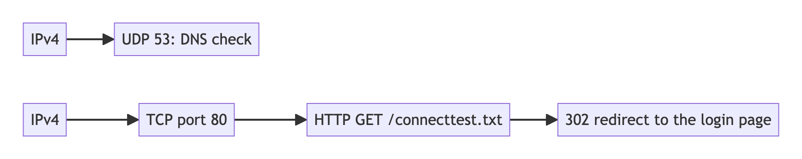
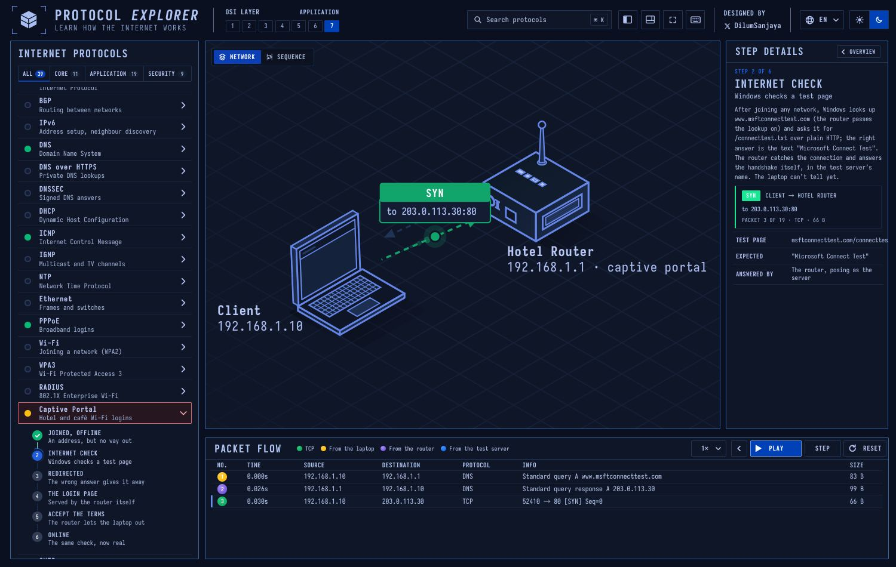
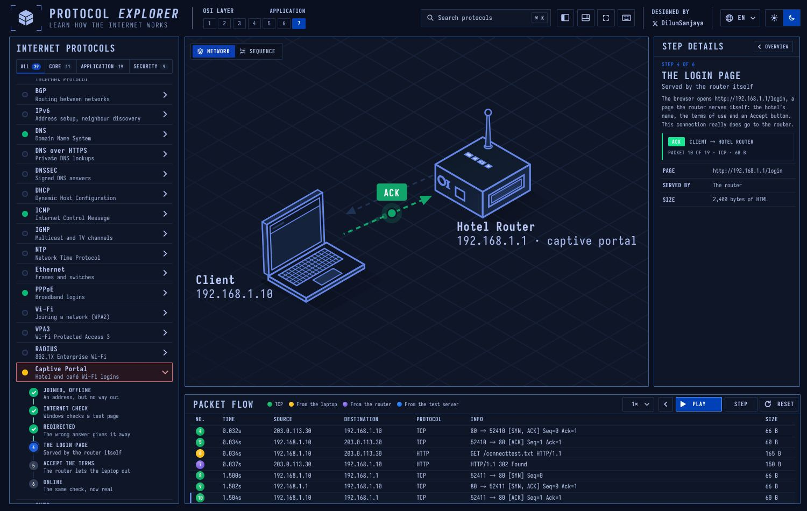
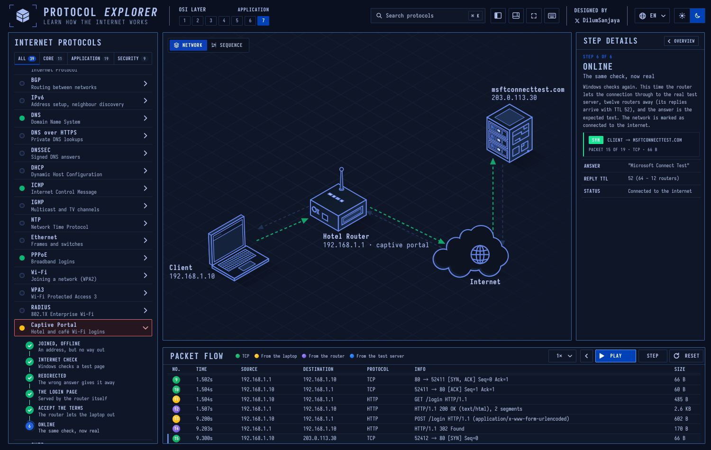
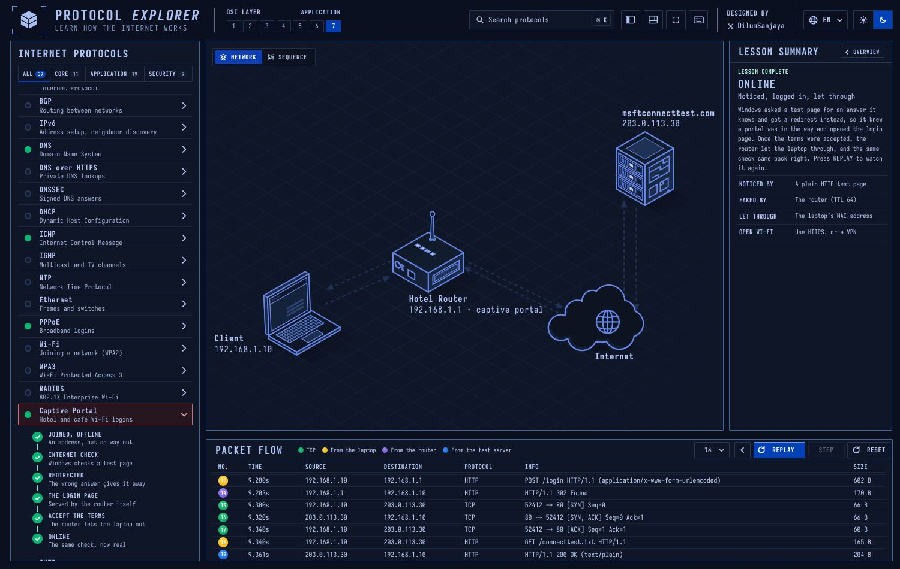
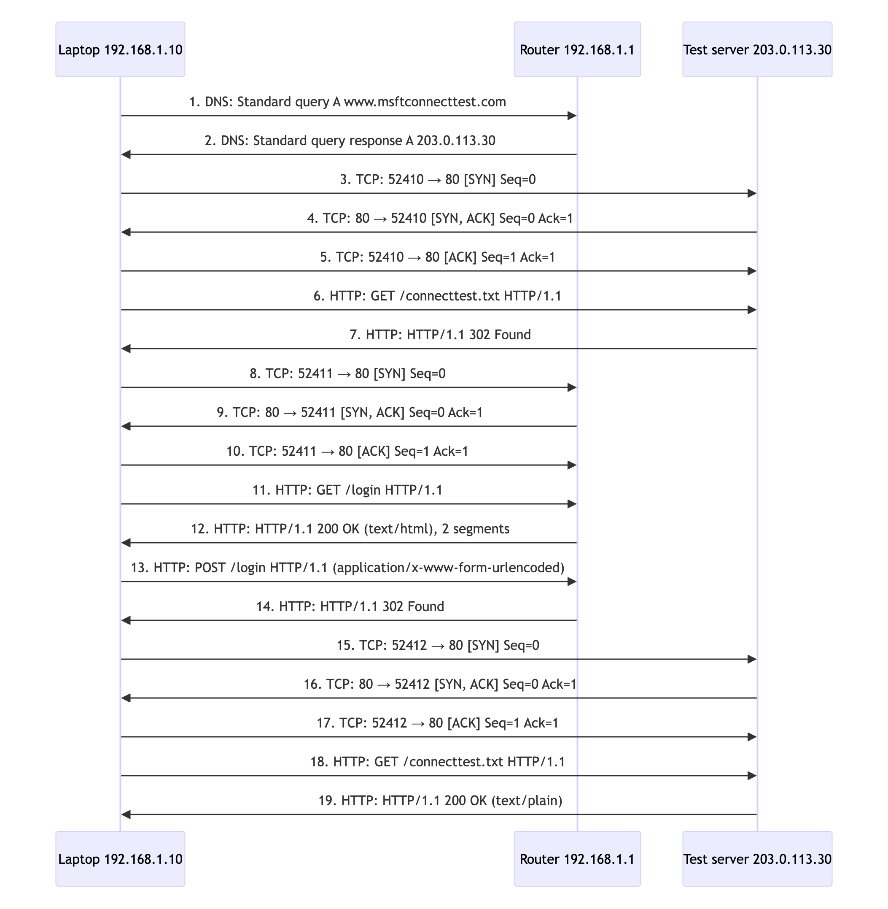
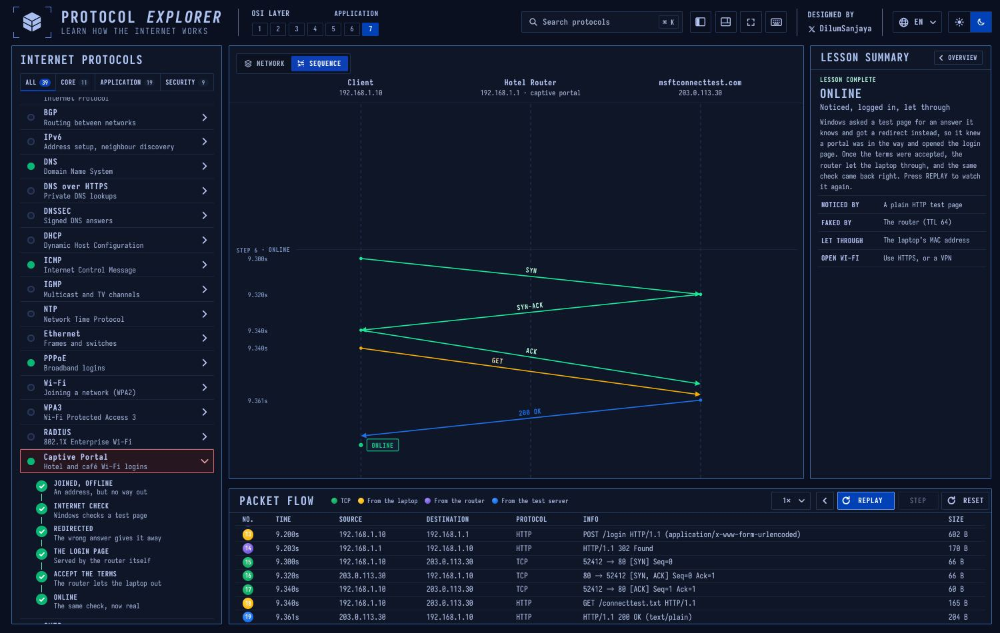
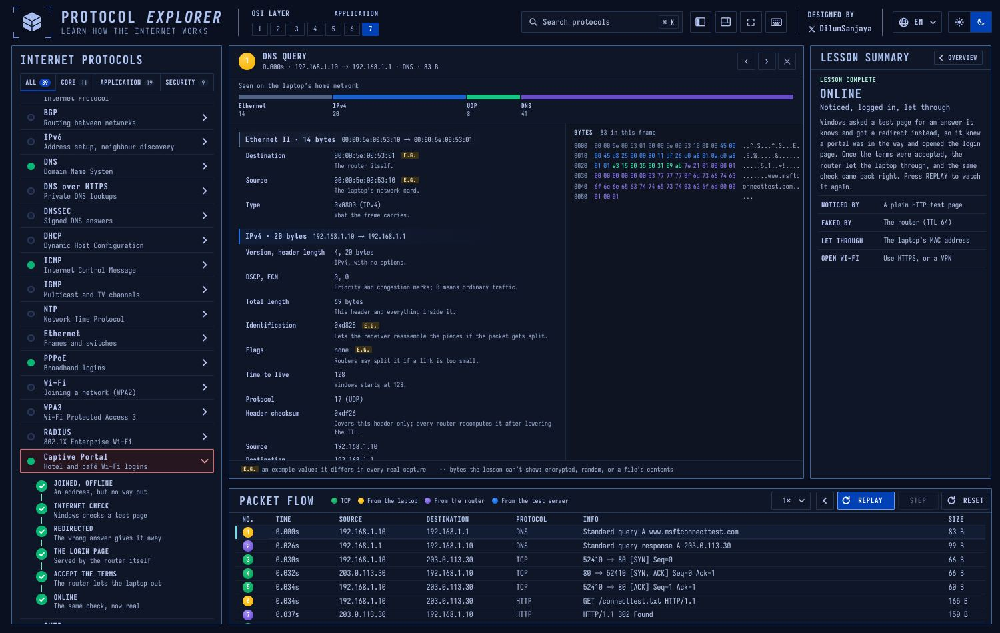

# Captive Portal – Hotel and café Wi-Fi logins

<!-- nav -->
⬅ [25 RADIUS](25-radius.md) · [Index](00_Protocols_Index.md) · [27 SMTP](27-smtp.md) ➡
<!-- nav -->

*Source: Protocol Explorer – https://protocol-explorer-alpha.vercel.app/ (interactive lesson #26). Screenshots captured from the live lesson; packet decodes are the site's example capture (values marked **E.G.** differ in every real capture).*

## Overview

### How the layers fit together (outer to inner)

## In-depth explanation of the example (plain-language version)

### The big picture in one minute
A guest connects a Windows laptop to a **hotel Wi-Fi**. Until they accept the terms, the router lets **nothing** through to the internet. The 19 packets show how the laptop **discovers** it's behind a login page, how it's **redirected** to that page, what happens when the guest clicks **Accept** (at about 9 seconds), and how the laptop finally confirms it has real internet.

**What a captive portal is.** It isn't a special protocol. It's a **trick made from ordinary DNS, HTTP and a firewall.** The router catches the device's first plain web request and answers it with **"go to my login page instead."** Phones and laptops detect this automatically using a **connectivity test** and pop up a small browser window.

Think of **a hotel receptionist who stops every guest at the door** and says "please sign the register first," and only then lets them through to the street.

> **Words you'll see:** *Redirect* (HTTP `302`) = "the page you want has moved, go here instead." *Firewall* = the rule-based gatekeeper. *Allow-list* = the list of devices permitted through.

---

### Step 1 – Join the network
The laptop connects and gets an address from DHCP (see the DHCP note). The router's firewall only allows essentials (DHCP, DNS and the router's own web page) for devices that aren't yet on its "approved" list.

### Step 2 – The internet test – packets 1 to 6
Right after connecting, Windows secretly checks whether the internet works:
1. **DNS** (1–2): it asks for `www.msftconnecttest.com` and gets an address.
2. **TCP** (3–5): it connects to that address on port 80. **The router intercepts the connection** and completes it itself, **pretending to be the real server.**
3. **HTTP** (6): `GET /connecttest.txt`. The *real* server would answer `200 OK` with exactly the text **"Microsoft Connect Test"**. Windows knows this is the only correct answer. (Apple and Android use their own test addresses with their own expected replies.)

### Step 3 – The wrong answer gives it away – packet 7
Instead of the expected text, the router replies **`302 Found`** pointing to `http://192.168.1.1/login`. A subtle hint that it's fake: its **TTL is 64**, not lowered at all, whereas a real reply from 12 routers away would arrive with 52. Windows sees "that's not the expected answer," marks the network as **"needs action"** and **opens the login page** automatically.
**Why this only works with plain HTTP:** the router can't fake an **HTTPS** reply (it has no certificate for that website), so browsers would just show a security error. That's why the test uses plain HTTP.

### Step 4 – The login page – packets 8 to 12
A new connection goes to the router itself (`192.168.1.1`) and requests `/login`. This time it really is the router, which shows the hotel's page with the **terms of use** and an **Accept** button.

### Step 5 – Accept the terms – packets 13, 14
Clicking **Accept** sends a small form (`terms=accepted`) to the router. The router **adds the laptop's MAC address (or IP) to its allowed list**, often for the length of the stay, and replies with another redirect. (Paid or voucher portals would check a code or ask a billing system or RADIUS server here.)

### Step 6 – Online – packets 15 to 19
Windows repeats the test. Now the firewall lets the connection through to the **real** server: connect (15–17), request (18), and a genuine **`200 OK` "Microsoft Connect Test"**. The **TTL is 52**, which proves that it travelled the real internet (64 minus 12 routers). Windows shows **"Connected to the internet"** and closes the pop-up.

---

### The 19 packets at a glance
| Packets | What | Why |
|---|---|---|
| 1–2 | DNS for the test site | start the internet check |
| 3–5 | TCP handshake, faked by the router | intercept |
| 6 | `GET /connecttest.txt` | the test |
| 7 | `302` redirect to the login page | reveals the portal |
| 8–12 | login page | show the terms |
| 13–14 | Accept | the router approves the device |
| 15–19 | test repeated, real `200 OK` | internet confirmed |

### What to remember
- **Captive portal = DNS/HTTP interception + redirect + allow-list.** No standard is negotiated; devices simply notice the unexpected answer.
- A **`302` redirect where fixed text was expected** is the detection signal. Newer standards let networks announce the portal's address directly.
- **Security notes:** open guest Wi-Fi is usually **unencrypted**. Never type sensitive data on a portal page served over plain HTTP. Portals can interfere with **VPNs and encrypted DNS** until you've logged in.
- MAC-based allow-lists can be faked. Portals give **access control**, not strong identity.

## Under the hood – technical details

- **No protocol.** A captive portal is a behaviour built from a firewall, DNS and HTTP interception. For devices not yet in the allow-list the router permits only DHCP, DNS and HTTP to itself.
- **Connectivity checks.** Windows requests `http://www.msftconnecttest.com/connecttest.txt` and expects the exact text `Microsoft Connect Test`. Apple requests `captive.apple.com/hotspot-detect.html` and expects `Success`. Android requests `connectivitycheck.gstatic.com/generate_204` and expects HTTP `204`.
- **Interception.** The router sits on the path, completes the TCP handshake itself and answers as if it were the test server. It replies with `302 Found` and `Location: http://192.168.1.1/login`.
- **A tell-tale.** The forged reply's **IP TTL is 64, undecremented**, whereas a real reply from 12 routers away would arrive as 52. The operating system only needs the unexpected status code to know a portal is present.
- **Why plain HTTP is used.** A router cannot forge an HTTPS reply without a valid certificate for the site, so a browser would show a certificate error. That is why the checks are plain HTTP and why browsing to HTTPS sites before logging in shows errors.
- **Login.** The portal page is served by the router (`GET /login`). Accepting terms sends `POST /login` with a form body such as `terms=accepted`. Paid or voucher portals check a code or call a billing or RADIUS server here.
- **Authorisation.** The router adds the client's **MAC address or IP** to its allow-list, often with a time limit, and replies with another `302`.
- **Verification.** The OS repeats the connectivity test. Now it reaches the real server and gets the correct body with the TTL it should have (52), so it shows "connected to the internet".
- **Standards.** RFC 8910 and RFC 8908 let networks announce the portal URL through DHCP or router advertisements and provide an API, avoiding interception.
- **Security notes.** Open guest Wi-Fi is usually unencrypted (unless WPA3 OWE is used). Don't type sensitive data on a portal served over HTTP. Portals interfere with VPNs, DNS over HTTPS and HTTPS-only modes until you log in. MAC allow-lists can be spoofed, so a portal gives access control, not strong identity.

## Step-by-step walkthrough

### Step 1: JOINED, OFFLINE – An address, but no way out

### Step 2: INTERNET CHECK – Windows checks a test page

### Step 3: REDIRECTED – The wrong answer gives it away

### Step 4: THE LOGIN PAGE – Served by the router itself

### Step 5: ACCEPT THE TERMS – The router lets the laptop out

### Step 6: ONLINE – The same check, now real

### Lesson summary

## Packet flow (whole lesson)

| No. | Time | Source | Destination | Protocol | Info | Size |
|---|---|---|---|---|---|---|
| 1 | 0.000s | 192.168.1.10 | 192.168.1.1 | DNS | Standard query A www.msftconnecttest.com | 83 B |
| 2 | 0.026s | 192.168.1.1 | 192.168.1.10 | DNS | Standard query response A 203.0.113.30 | 99 B |
| 3 | 0.030s | 192.168.1.10 | 203.0.113.30 | TCP | 52410 → 80 [SYN] Seq=0 | 66 B |
| 4 | 0.032s | 203.0.113.30 | 192.168.1.10 | TCP | 80 → 52410 [SYN, ACK] Seq=0 Ack=1 | 66 B |
| 5 | 0.034s | 192.168.1.10 | 203.0.113.30 | TCP | 52410 → 80 [ACK] Seq=1 Ack=1 | 60 B |
| 6 | 0.034s | 192.168.1.10 | 203.0.113.30 | HTTP | GET /connecttest.txt HTTP/1.1 | 165 B |
| 7 | 0.037s | 203.0.113.30 | 192.168.1.10 | HTTP | HTTP/1.1 302 Found | 150 B |
| 8 | 1.500s | 192.168.1.10 | 192.168.1.1 | TCP | 52411 → 80 [SYN] Seq=0 | 66 B |
| 9 | 1.502s | 192.168.1.1 | 192.168.1.10 | TCP | 80 → 52411 [SYN, ACK] Seq=0 Ack=1 | 66 B |
| 10 | 1.504s | 192.168.1.10 | 192.168.1.1 | TCP | 52411 → 80 [ACK] Seq=1 Ack=1 | 60 B |
| 11 | 1.504s | 192.168.1.10 | 192.168.1.1 | HTTP | GET /login HTTP/1.1 | 485 B |
| 12 | 1.507s | 192.168.1.1 | 192.168.1.10 | HTTP | HTTP/1.1 200 OK (text/html), 2 segments | 2.6 KB |
| 13 | 9.200s | 192.168.1.10 | 192.168.1.1 | HTTP | POST /login HTTP/1.1 (application/x-www-form-urlencoded) | 602 B |
| 14 | 9.203s | 192.168.1.1 | 192.168.1.10 | HTTP | HTTP/1.1 302 Found | 170 B |
| 15 | 9.300s | 192.168.1.10 | 203.0.113.30 | TCP | 52412 → 80 [SYN] Seq=0 | 66 B |
| 16 | 9.320s | 203.0.113.30 | 192.168.1.10 | TCP | 80 → 52412 [SYN, ACK] Seq=0 Ack=1 | 66 B |
| 17 | 9.340s | 192.168.1.10 | 203.0.113.30 | TCP | 52412 → 80 [ACK] Seq=1 Ack=1 | 60 B |
| 18 | 9.340s | 192.168.1.10 | 203.0.113.30 | HTTP | GET /connecttest.txt HTTP/1.1 | 165 B |
| 19 | 9.361s | 203.0.113.30 | 192.168.1.10 | HTTP | HTTP/1.1 200 OK (text/plain) | 204 B |

### Sequence diagram

*The lesson's own sequence diagram:*

## Packet decoder screenshots

The lesson's decoder view for the first, middle and last packet: headers, field values and the raw hex bytes.

### Packet 1: DNS – Standard query A www.msftconnecttest.com

*192.168.1.10 → 192.168.1.1 · 83 B · t = 0.000s*

### Packet 10: TCP – 52411 → 80 [ACK] Seq=1 Ack=1

*192.168.1.10 → 192.168.1.1 · 60 B · t = 1.504s*

### Packet 19: HTTP – HTTP/1.1 200 OK (text/plain)

*203.0.113.30 → 192.168.1.10 · 204 B · t = 9.361s*

---

<!-- nav -->
⬅ [25 RADIUS](25-radius.md) · [Index](00_Protocols_Index.md) · [27 SMTP](27-smtp.md) ➡
<!-- nav -->
