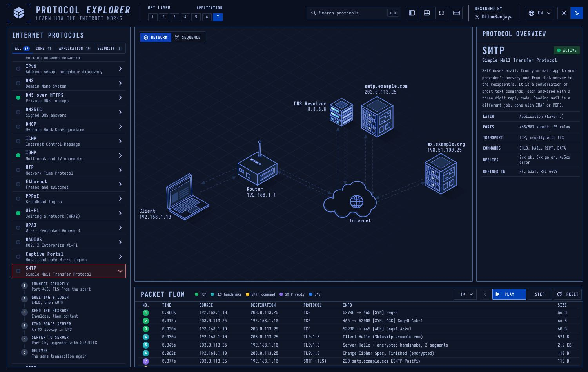
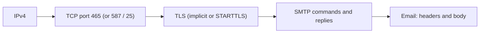
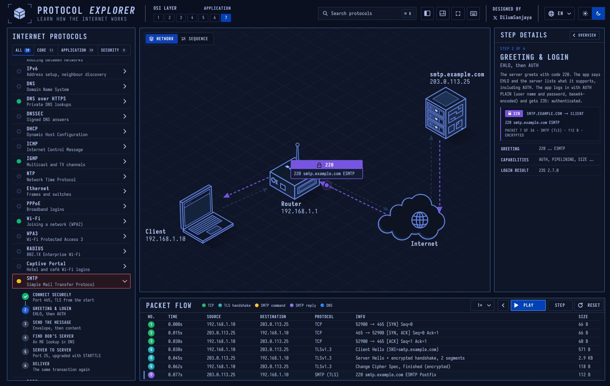
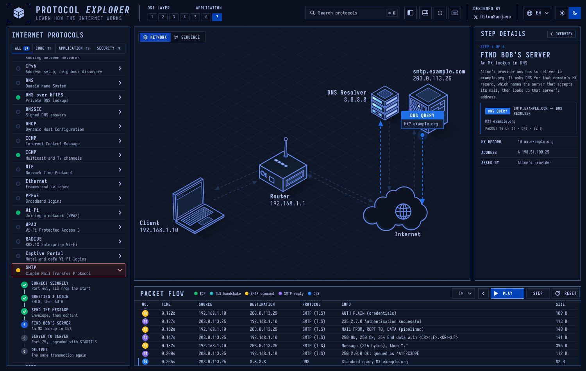
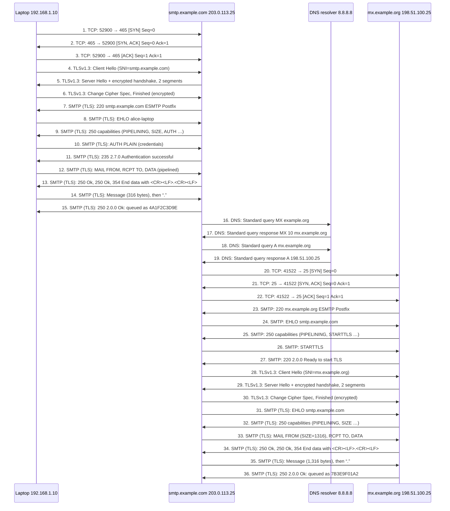
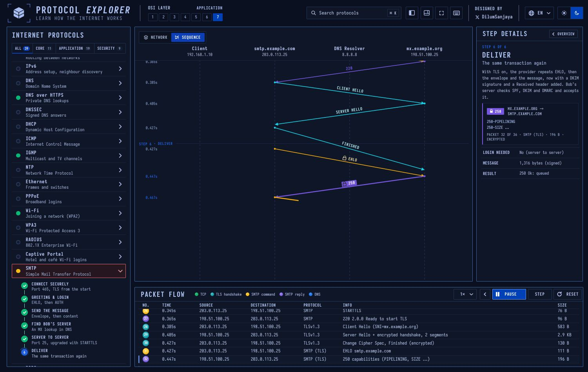
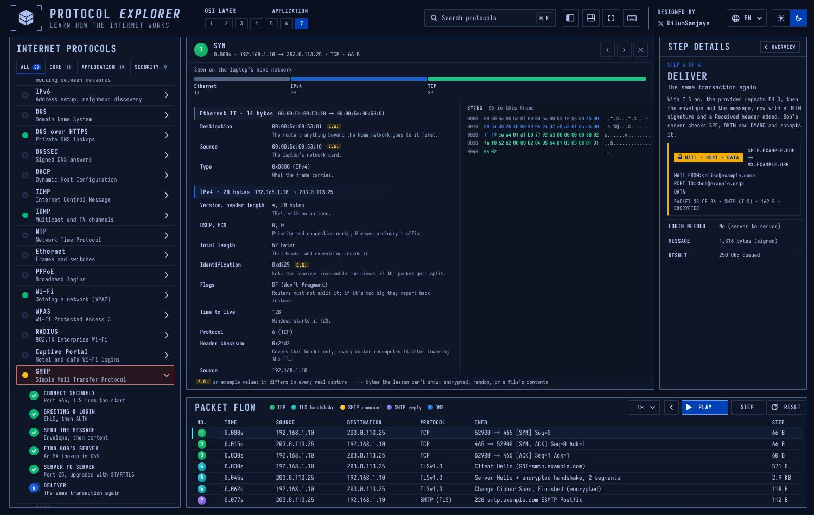
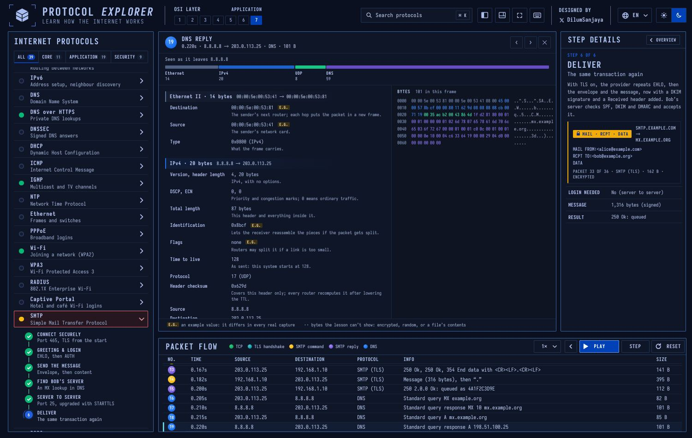
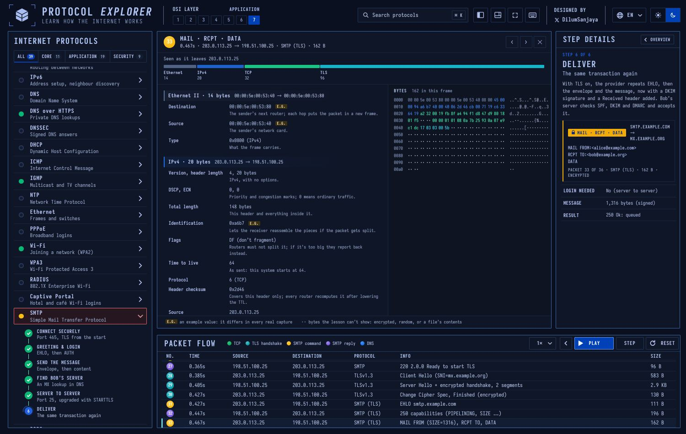

# SMTP – Simple Mail Transfer Protocol

<!-- nav -->
⬅ [26 Captive Portal](26-captive-portal.md) · [Index](00_Protocols_Index.md) · [28 POP3](28-pop3.md) ➡
<!-- nav -->

*Source: Protocol Explorer – https://protocol-explorer-alpha.vercel.app/ (interactive lesson #27). Screenshots captured from the live lesson; packet decodes are the site's example capture (values marked **E.G.** differ in every real capture).*

## Overview

### How the layers fit together (outer to inner)

## In-depth explanation of the example (plain-language version)

### The big picture in one minute
**Alice** (`alice@example.com`) sends an email to **Bob** (`bob@example.org`) from her mail app. It happens in **two hops**, and the lesson shows both: **36 packets in 0.54 seconds.**
1. **Submission** (packets 1–15): Alice's app → her provider's mail server `smtp.example.com`, using **port 465** (encrypted from the very first byte).
2. **Delivery** (packets 16–36): `smtp.example.com` finds Bob's mail server using DNS and delivers to `mx.example.org` on **port 25**, switching to encryption with **STARTTLS**.

**SMTP** only **moves** mail. It is a conversation of **short text commands**, each answered with a **three-digit reply code**. *Reading* mail is a separate job (IMAP/POP3; see their notes).

Think of **posting a letter**: you hand it to your local post office (hop 1), which looks up the address and hands it to the post office near the recipient (hop 2), which puts it in Bob's mailbox.

> **Words you'll see:** *MX record* = the DNS entry that says which server receives a domain's mail. *Envelope* = the delivery information servers use (separate from the visible From/To). *STARTTLS* = "let's switch this plain connection to an encrypted one."

---

### Step 1 – Connect and encrypt – packets 1 to 6
After the TCP handshake, Alice's app and the server run a **TLS handshake** straight away (port 465, "implicit TLS"). Another common setup is port **587**, which starts plain and upgrades with STARTTLS. From packet 7 on, everything is encrypted.

### Step 2 – Greeting and login – packets 7 to 11
- **`220 smtp.example.com ESMTP`**: the server greets: "I'm ready."
- **`EHLO alice-laptop`**: the app introduces itself.
- **`250 …`**: the server lists what it supports (sending several commands at once, maximum message size, login methods…).
- **`AUTH PLAIN …`**: Alice's username and password, in an encoded form. **Encoding isn't encryption**; this is only safe because TLS is already on. Reply: **`235 Authentication successful`.**
**Why log in?** So the server only sends mail for its own customers. Otherwise it would be an **open relay** that spammers could abuse.

### Step 3 – Send the message – packets 12 to 15
- **The envelope** (what servers use to route): `MAIL FROM:<alice@example.com>` (where bounce messages go), `RCPT TO:<bob@example.org>` (one per recipient), then `DATA`. The server answers `250 Ok` twice, then **`354`**: "go ahead and send the message."
- **The content:** headers (`From`, `To`, `Subject`, `Date`…), a blank line, then the body, ended by a line holding **only a dot (`.`)**.
- **`250 Ok: queued as 4A1F2C3D9E`**: the server has taken **responsibility** for delivery. Alice's app is finished.
*Note:* the envelope and the visible `From:` header are **separate things**. That's why faking the visible sender is easy, and why **SPF, DKIM and DMARC** exist.

### Step 4 – Find Bob's server (DNS) – packets 16 to 19
`smtp.example.com` asks DNS for the **MX record** of `example.org`: the answer is **`mx.example.org`** (with a priority; lower is preferred, and extra servers give backup). Then it asks for that server's address: `198.51.100.25`.

### Step 5 – Server to server, upgraded with STARTTLS – packets 20 to 30
Server-to-server delivery uses **port 25**. It **starts in plain text**: greeting `220 mx.example.org`, `EHLO smtp.example.com`, and the reply lists **STARTTLS**. The sender asks `STARTTLS`, gets `220 Ready to start TLS`, and both run a TLS handshake. **Caveat:** an attacker can strip the STARTTLS offer to force plain text (a *downgrade* attack). **MTA-STS** and **DANE** make TLS mandatory for a domain.

### Step 6 – Deliver – packets 31 to 36
Over TLS the provider repeats the greeting, then the envelope and the message (now 1,316 bytes, because the provider added a **`Received:` trace line** and a **DKIM signature**, a cryptographic signature that Bob's server can check using a public key in DNS). No login is needed between servers. Bob's server checks:
- **SPF**: is this server allowed to send for `example.com`?
- **DKIM**: is the signature valid?
- **DMARC**: does the sender's domain policy pass?
Then it answers **`250 Ok: queued as 7B3E9F01A2`**. Bob's mail is stored, and he reads it using IMAP or POP3.

---

### The 36 packets at a glance
| Packets | What | Why |
|---|---|---|
| 1–6 | TCP + TLS to port 465 | connect securely |
| 7–11 | greeting, EHLO, AUTH | log in |
| 12–15 | envelope + message, `250 queued` | submit the email |
| 16–19 | DNS MX and address | find Bob's server |
| 20–30 | port 25, STARTTLS, TLS | server-to-server, encrypted |
| 31–36 | envelope + message, checks | deliver to Bob's server |

### What to remember
- **Reply code families:** `2xx` success, `3xx` need more (354 = start sending), `4xx` temporary failure (try later), `5xx` permanent failure (e.g. 550 no such user).
- **Commands:** `EHLO`, `STARTTLS`, `AUTH`, `MAIL FROM`, `RCPT TO`, `DATA`, `QUIT`.
- **Ports:** **25** server-to-server, **587** submission (STARTTLS), **465** submission (TLS from the start).
- **Store and forward:** each server queues the message and retries for days. Email isn't instant or guaranteed.
- **Anti-spoofing trio:** **SPF** (allowed senders), **DKIM** (signature), **DMARC** (policy and reports).

## Under the hood – technical details

- **Conversation.** Text commands and three-digit replies, each reply line ending in CR LF. Multi-line replies use `250-` for continuation lines and `250 ` for the last line.
- **Commands.** `EHLO` (extended hello), `STARTTLS`, `AUTH`, `MAIL FROM`, `RCPT TO`, `DATA`, `RSET`, `QUIT`.
- **Reply families.** `2xx` success (`220` ready, `250` OK, `235` authenticated), `3xx` need more (`354` start the message), `4xx` temporary failure (greylisting, mailbox busy: retry later), `5xx` permanent failure (`550` no such user).
- **Extensions listed after EHLO.** `PIPELINING` (send several commands without waiting for each reply), `SIZE`, `AUTH PLAIN LOGIN`, `8BITMIME`, `ENHANCEDSTATUSCODES`, `STARTTLS`.
- **Ports.** `25` server-to-server relay; `587` submission with `STARTTLS`; `465` submission with TLS from the first byte.
- **AUTH PLAIN.** Sends `\0username\0password` encoded in base64. Base64 is encoding, not encryption, so it is only safe inside TLS.
- **Envelope vs headers.** The *envelope* (`MAIL FROM`, `RCPT TO`) is what servers use for routing and bounces. The visible `From:` and `To:` headers are part of the message content and can differ. That gap is why spoofing is easy and why SPF, DKIM and DMARC exist.
- **End of data.** The message ends with a line holding only a dot (`<CRLF>.<CRLF>`). Lines in the body that start with a dot get an extra dot (*dot-stuffing*).
- **MX lookup.** The sending server asks DNS for the domain's `MX` records (lowest priority number first) and then for the chosen host's address.
- **Opportunistic TLS.** On port 25, `STARTTLS` is optional and can be stripped by an attacker (a *downgrade attack*). **MTA-STS** and **DANE** let a domain require TLS.
- **Anti-spoofing trio.** **SPF** lists the IP addresses allowed to send for a domain. **DKIM** adds a signature over selected headers and the body, verified with a public key in DNS. **DMARC** tells receivers what to do when SPF/DKIM fail and where to send reports.
- **Store and forward.** Each server queues the message (it gets a queue ID) and retries for days. Mail is not instant or guaranteed.

## Step-by-step walkthrough (screenshots from the lesson)

### Step 1: CONNECT SECURELY – Port 465, TLS from the start

### Step 2: GREETING & LOGIN – EHLO, then AUTH

### Step 3: SEND THE MESSAGE – Envelope, then content

### Step 4: FIND BOB’S SERVER – An MX lookup in DNS

### Step 5: SERVER TO SERVER – Port 25, upgraded with STARTTLS

### Step 6: DELIVER – The same transaction again

### Lesson summary

## Packet flow (whole lesson)

| No. | Time | Source | Destination | Protocol | Info | Size |
|---|---|---|---|---|---|---|
| 1 | 0.000s | 192.168.1.10 | 203.0.113.25 | TCP | 52900 → 465 [SYN] Seq=0 | 66 B |
| 2 | 0.015s | 203.0.113.25 | 192.168.1.10 | TCP | 465 → 52900 [SYN, ACK] Seq=0 Ack=1 | 66 B |
| 3 | 0.030s | 192.168.1.10 | 203.0.113.25 | TCP | 52900 → 465 [ACK] Seq=1 Ack=1 | 60 B |
| 4 | 0.030s | 192.168.1.10 | 203.0.113.25 | TLSv1.3 | Client Hello (SNI=smtp.example.com) | 571 B |
| 5 | 0.045s | 203.0.113.25 | 192.168.1.10 | TLSv1.3 | Server Hello + encrypted handshake, 2 segments | 2.9 KB |
| 6 | 0.062s | 192.168.1.10 | 203.0.113.25 | TLSv1.3 | Change Cipher Spec, Finished (encrypted) | 118 B |
| 7 | 0.077s | 203.0.113.25 | 192.168.1.10 | SMTP (TLS) | 220 smtp.example.com ESMTP Postfix | 112 B |
| 8 | 0.092s | 192.168.1.10 | 203.0.113.25 | SMTP (TLS) | EHLO alice-laptop | 95 B |
| 9 | 0.107s | 203.0.113.25 | 192.168.1.10 | SMTP (TLS) | 250 capabilities (PIPELINING, SIZE, AUTH …) | 208 B |
| 10 | 0.122s | 192.168.1.10 | 203.0.113.25 | SMTP (TLS) | AUTH PLAIN (credentials) | 109 B |
| 11 | 0.137s | 203.0.113.25 | 192.168.1.10 | SMTP (TLS) | 235 2.7.0 Authentication successful | 113 B |
| 12 | 0.152s | 192.168.1.10 | 203.0.113.25 | SMTP (TLS) | MAIL FROM, RCPT TO, DATA (pipelined) | 140 B |
| 13 | 0.167s | 203.0.113.25 | 192.168.1.10 | SMTP (TLS) | 250 Ok, 250 Ok, 354 End data with <CR><LF>.<CR><LF> | 141 B |
| 14 | 0.182s | 192.168.1.10 | 203.0.113.25 | SMTP (TLS) | Message (316 bytes), then “.” | 395 B |
| 15 | 0.200s | 203.0.113.25 | 192.168.1.10 | SMTP (TLS) | 250 2.0.0 Ok: queued as 4A1F2C3D9E | 112 B |
| 16 | 0.205s | 203.0.113.25 | 8.8.8.8 | DNS | Standard query MX example.org | 82 B |
| 17 | 0.210s | 8.8.8.8 | 203.0.113.25 | DNS | Standard query response MX 10 mx.example.org | 101 B |
| 18 | 0.215s | 203.0.113.25 | 8.8.8.8 | DNS | Standard query A mx.example.org | 85 B |
| 19 | 0.220s | 8.8.8.8 | 203.0.113.25 | DNS | Standard query response A 198.51.100.25 | 101 B |
| 20 | 0.225s | 203.0.113.25 | 198.51.100.25 | TCP | 41522 → 25 [SYN] Seq=0 | 74 B |
| 21 | 0.245s | 198.51.100.25 | 203.0.113.25 | TCP | 25 → 41522 [SYN, ACK] Seq=0 Ack=1 | 74 B |
| 22 | 0.265s | 203.0.113.25 | 198.51.100.25 | TCP | 41522 → 25 [ACK] Seq=1 Ack=1 | 66 B |
| 23 | 0.285s | 198.51.100.25 | 203.0.113.25 | SMTP | 220 mx.example.org ESMTP Postfix | 100 B |
| 24 | 0.305s | 203.0.113.25 | 198.51.100.25 | SMTP | EHLO smtp.example.com | 89 B |
| 25 | 0.325s | 198.51.100.25 | 203.0.113.25 | SMTP | 250 capabilities (PIPELINING, STARTTLS …) | 188 B |
| 26 | 0.345s | 203.0.113.25 | 198.51.100.25 | SMTP | STARTTLS | 76 B |
| 27 | 0.365s | 198.51.100.25 | 203.0.113.25 | SMTP | 220 2.0.0 Ready to start TLS | 96 B |
| 28 | 0.385s | 203.0.113.25 | 198.51.100.25 | TLSv1.3 | Client Hello (SNI=mx.example.org) | 583 B |
| 29 | 0.405s | 198.51.100.25 | 203.0.113.25 | TLSv1.3 | Server Hello + encrypted handshake, 2 segments | 2.9 KB |
| 30 | 0.427s | 203.0.113.25 | 198.51.100.25 | TLSv1.3 | Change Cipher Spec, Finished (encrypted) | 130 B |
| 31 | 0.427s | 203.0.113.25 | 198.51.100.25 | SMTP (TLS) | EHLO smtp.example.com | 111 B |
| 32 | 0.447s | 198.51.100.25 | 203.0.113.25 | SMTP (TLS) | 250 capabilities (PIPELINING, SIZE …) | 196 B |
| 33 | 0.467s | 203.0.113.25 | 198.51.100.25 | SMTP (TLS) | MAIL FROM (SIZE=1316), RCPT TO, DATA | 162 B |
| 34 | 0.487s | 198.51.100.25 | 203.0.113.25 | SMTP (TLS) | 250 Ok, 250 Ok, 354 End data with <CR><LF>.<CR><LF> | 153 B |
| 35 | 0.507s | 203.0.113.25 | 198.51.100.25 | SMTP (TLS) | Message (1,316 bytes), then “.” | 1407 B |
| 36 | 0.538s | 198.51.100.25 | 203.0.113.25 | SMTP (TLS) | 250 2.0.0 Ok: queued as 7B3E9F01A2 | 124 B |

### Sequence diagram

*The lesson's own sequence diagram:*

## Packet decoder screenshots

The lesson's decoder view for the first, middle and last packet: headers, field values and the raw hex bytes.

### Packet 1: TCP – 52900 → 465 [SYN] Seq=0

*192.168.1.10 → 203.0.113.25 · 66 B · t = 0.000s*

### Packet 19: DNS – Standard query response A 198.51.100.25

*8.8.8.8 → 203.0.113.25 · 101 B · t = 0.220s*

### Packet 36: SMTP (TLS) – 250 2.0.0 Ok: queued as 7B3E9F01A2

*198.51.100.25 → 203.0.113.25 · 124 B · t = 0.538s*

---

<!-- nav -->
⬅ [26 Captive Portal](26-captive-portal.md) · [Index](00_Protocols_Index.md) · [28 POP3](28-pop3.md) ➡
<!-- nav -->
