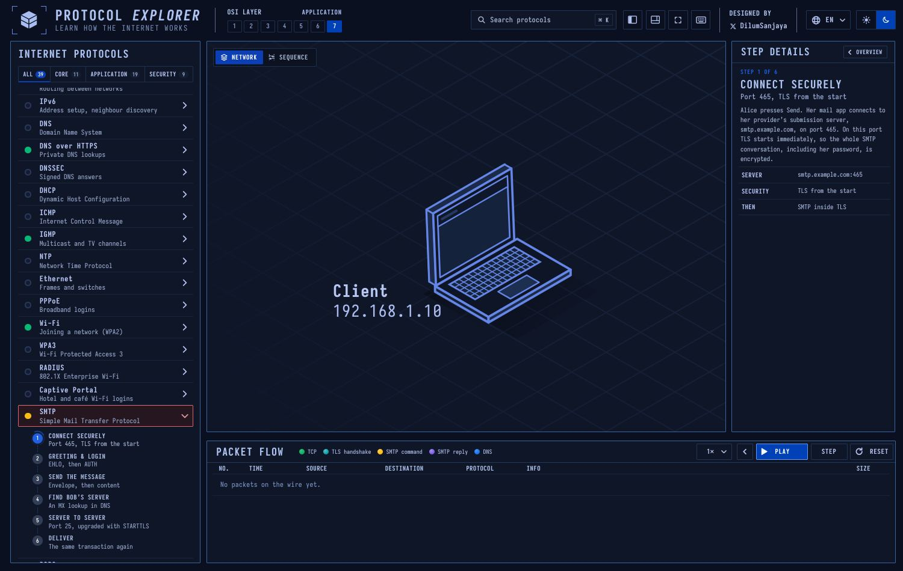
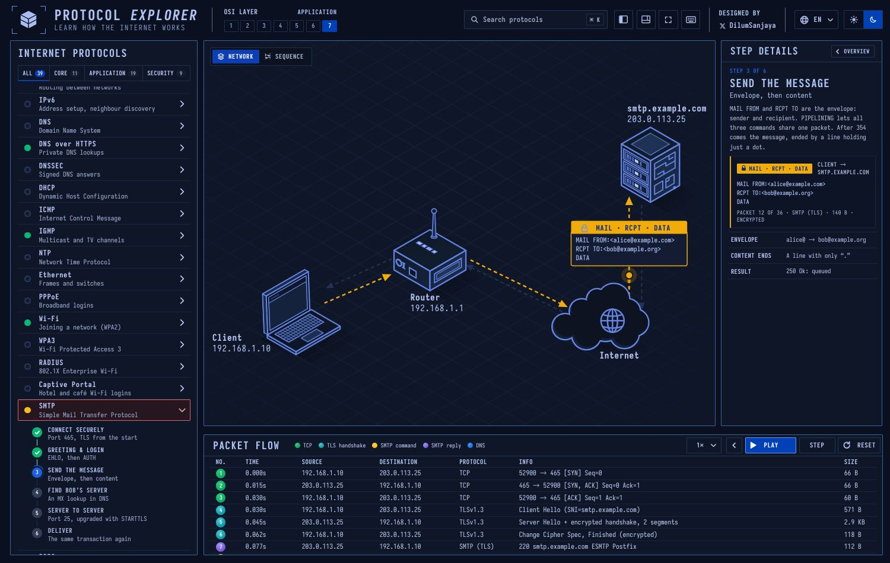
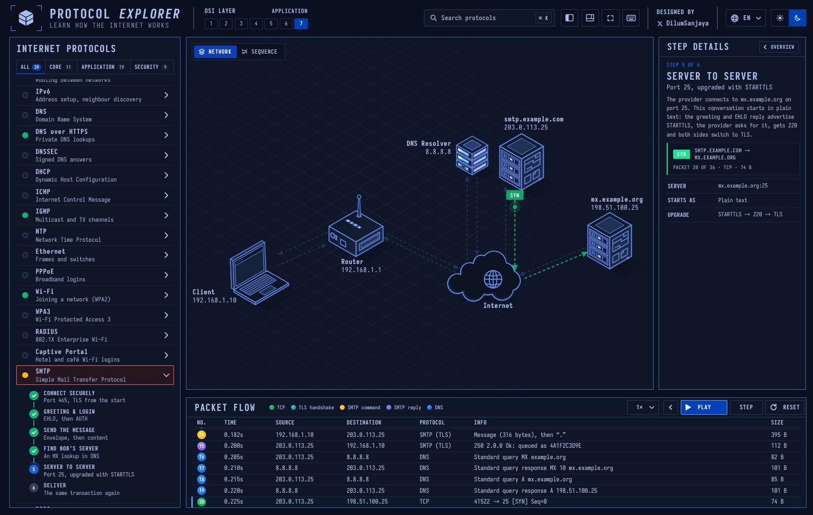
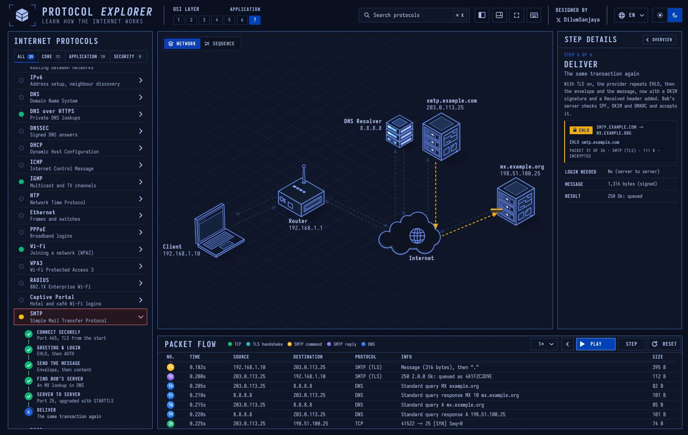
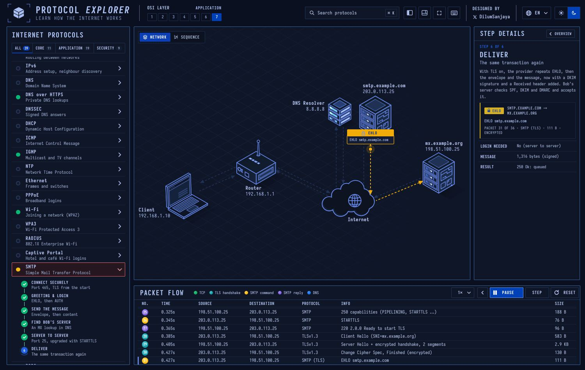

# SMTP – Simple Mail Transfer Protocol

<!-- nav -->
⬅ [26 Captive Portal](26-captive-portal.md) · [Index](00_Protocols_Index.md) · [28 POP3](28-pop3.md) ➡
<!-- nav -->

*Source: Protocol Explorer – https://protocol-explorer-alpha.vercel.app/ (interactive lesson #27). Screenshots captured from the live lesson; packet decodes are the site's example capture (values marked **E.G.** differ in every real capture).*

## Overview


> PROTOCOL OVERVIEW  
> SMTP  
> ACTIVE  
> Simple Mail Transfer Protocol  
> SMTP moves email: from your mail app to your provider’s server, and from that server to the recipient’s. It is a conversation of short text commands, each answered with a three-digit reply code. Reading mail is a different job, done with IMAP or POP3.  
> LAYER  
> Application (Layer 7)  
> PORTS  
> 465/587 submit, 25 relay  
> TRANSPORT  
> TCP, usually with TLS  
> COMMANDS  
> EHLO, MAIL, RCPT, DATA  
> REPLIES  
> 2xx ok, 3xx go on, 4/5xx error  
> DEFINED IN  
> RFC 5321, RFC 6409  

## In-depth explanation of the example (plain-language version)

### The big picture in one minute
**Alice** (`alice@example.com`) sends an email to **Bob** (`bob@example.org`) from her mail app. It happens in **two hops**, and the lesson shows both: **36 packets in 0.54 seconds.**
1. **Submission** (packets 1–15): Alice's app → her provider's mail server `smtp.example.com`, using **port 465** (encrypted from the very first byte).
2. **Delivery** (packets 16–36): `smtp.example.com` finds Bob's mail server using DNS and delivers to `mx.example.org` on **port 25**, switching to encryption with **STARTTLS**.

**SMTP** only **moves** mail. It is a conversation of **short text commands**, each answered with a **three-digit reply code**. *Reading* mail is a separate job (IMAP/POP3; see their notes).

Think of **posting a letter**: you hand it to your local post office (hop 1), which looks up the address and hands it to the post office near the recipient (hop 2), which puts it in Bob's mailbox.

> **Words you'll see:** *MX record* = the DNS entry that says which server receives a domain's mail. *Envelope* = the delivery information servers use (separate from the visible From/To). *STARTTLS* = "let's switch this plain connection to an encrypted one."

---

### Step 1 – Connect and encrypt – packets 1 to 6
After the TCP handshake, Alice's app and the server run a **TLS handshake** straight away (port 465, "implicit TLS"). Another common setup is port **587**, which starts plain and upgrades with STARTTLS. From packet 7 on, everything is encrypted.

### Step 2 – Greeting and login – packets 7 to 11
- **`220 smtp.example.com ESMTP`**: the server greets: "I'm ready."
- **`EHLO alice-laptop`**: the app introduces itself.
- **`250 …`**: the server lists what it supports (sending several commands at once, maximum message size, login methods…).
- **`AUTH PLAIN …`**: Alice's username and password, in an encoded form. **Encoding isn't encryption**; this is only safe because TLS is already on. Reply: **`235 Authentication successful`.**
**Why log in?** So the server only sends mail for its own customers. Otherwise it would be an **open relay** that spammers could abuse.

### Step 3 – Send the message – packets 12 to 15
- **The envelope** (what servers use to route): `MAIL FROM:<alice@example.com>` (where bounce messages go), `RCPT TO:<bob@example.org>` (one per recipient), then `DATA`. The server answers `250 Ok` twice, then **`354`**: "go ahead and send the message."
- **The content:** headers (`From`, `To`, `Subject`, `Date`…), a blank line, then the body, ended by a line holding **only a dot (`.`)**.
- **`250 Ok: queued as 4A1F2C3D9E`**: the server has taken **responsibility** for delivery. Alice's app is finished.
*Note:* the envelope and the visible `From:` header are **separate things**. That's why faking the visible sender is easy, and why **SPF, DKIM and DMARC** exist.

### Step 4 – Find Bob's server (DNS) – packets 16 to 19
`smtp.example.com` asks DNS for the **MX record** of `example.org`: the answer is **`mx.example.org`** (with a priority; lower is preferred, and extra servers give backup). Then it asks for that server's address: `198.51.100.25`.

### Step 5 – Server to server, upgraded with STARTTLS – packets 20 to 30
Server-to-server delivery uses **port 25**. It **starts in plain text**: greeting `220 mx.example.org`, `EHLO smtp.example.com`, and the reply lists **STARTTLS**. The sender asks `STARTTLS`, gets `220 Ready to start TLS`, and both run a TLS handshake. **Caveat:** an attacker can strip the STARTTLS offer to force plain text (a *downgrade* attack). **MTA-STS** and **DANE** make TLS mandatory for a domain.

### Step 6 – Deliver – packets 31 to 36
Over TLS the provider repeats the greeting, then the envelope and the message (now 1,316 bytes, because the provider added a **`Received:` trace line** and a **DKIM signature**, a cryptographic signature that Bob's server can check using a public key in DNS). No login is needed between servers. Bob's server checks:
- **SPF**: is this server allowed to send for `example.com`?
- **DKIM**: is the signature valid?
- **DMARC**: does the sender's domain policy pass?
Then it answers **`250 Ok: queued as 7B3E9F01A2`**. Bob's mail is stored, and he reads it using IMAP or POP3.

---

### The 36 packets at a glance
| Packets | What | Why |
|---|---|---|
| 1–6 | TCP + TLS to port 465 | connect securely |
| 7–11 | greeting, EHLO, AUTH | log in |
| 12–15 | envelope + message, `250 queued` | submit the email |
| 16–19 | DNS MX and address | find Bob's server |
| 20–30 | port 25, STARTTLS, TLS | server-to-server, encrypted |
| 31–36 | envelope + message, checks | deliver to Bob's server |

### What to remember
- **Reply code families:** `2xx` success, `3xx` need more (354 = start sending), `4xx` temporary failure (try later), `5xx` permanent failure (e.g. 550 no such user).
- **Commands:** `EHLO`, `STARTTLS`, `AUTH`, `MAIL FROM`, `RCPT TO`, `DATA`, `QUIT`.
- **Ports:** **25** server-to-server, **587** submission (STARTTLS), **465** submission (TLS from the start).
- **Store and forward:** each server queues the message and retries for days. Email isn't instant or guaranteed.
- **Anti-spoofing trio:** **SPF** (allowed senders), **DKIM** (signature), **DMARC** (policy and reports).

## Step-by-step walkthrough (screenshots from the lesson)

### Step 1: CONNECT SECURELY – Port 465, TLS from the start



> STEP 1 OF 6  
> CONNECT SECURELY  
> Port 465, TLS from the start  
> Alice presses Send. Her mail app connects to her provider’s submission server, smtp.example.com, on port 465. On this port TLS starts immediately, so the whole SMTP conversation, including her password, is encrypted.  
> SERVER  
> smtp.example.com:465  
> SECURITY  
> TLS from the start  
> THEN  
> SMTP inside TLS  

### Step 2: GREETING & LOGIN – EHLO, then AUTH


> STEP 2 OF 6  
> GREETING & LOGIN  
> EHLO, then AUTH  
> The server greets with code 220. The app says EHLO and the server lists what it supports, including AUTH. The app logs in with AUTH PLAIN (user name and password, base64-encoded) and gets 235: authenticated.  
> 220  
> SMTP.EXAMPLE.COM → CLIENT  
> 220 smtp.example.com ESMTP  
> PACKET 7 OF 36 · SMTP (TLS) · 112 B · ENCRYPTED  
> GREETING  
> 220 … ESMTP  
> CAPABILITIES  
> AUTH, PIPELINING, SIZE …  
> LOGIN RESULT  
> 235 2.7.0  

### Step 3: SEND THE MESSAGE – Envelope, then content



> STEP 3 OF 6  
> SEND THE MESSAGE  
> Envelope, then content  
> MAIL FROM and RCPT TO are the envelope: sender and recipient. PIPELINING lets all three commands share one packet. After 354 comes the message, ended by a line holding just a dot.  
> MAIL · RCPT · DATA  
> CLIENT → SMTP.EXAMPLE.COM  
> MAIL FROM:<alice@example.com>  
> RCPT TO:<bob@example.org>  
> DATA  
> PACKET 12 OF 36 · SMTP (TLS) · 140 B · ENCRYPTED  
> ENVELOPE  
> alice@ → bob@example.org  
> CONTENT ENDS  
> A line with only “.”  
> RESULT  
> 250 Ok: queued  

### Step 4: FIND BOB’S SERVER – An MX lookup in DNS


> STEP 4 OF 6  
> FIND BOB’S SERVER  
> An MX lookup in DNS  
> Alice’s provider now has to deliver to example.org. It asks DNS for that domain’s MX record, which names the server that accepts its mail, then looks up that server’s address.  
> DNS QUERY  
> SMTP.EXAMPLE.COM → DNS RESOLVER  
> MX? example.org  
> PACKET 16 OF 36 · DNS · 82 B  
> MX RECORD  
> 10 mx.example.org  
> ADDRESS  
> A 198.51.100.25  
> ASKED BY  
> Alice’s provider  

### Step 5: SERVER TO SERVER – Port 25, upgraded with STARTTLS



> STEP 5 OF 6  
> SERVER TO SERVER  
> Port 25, upgraded with STARTTLS  
> The provider connects to mx.example.org on port 25. This conversation starts in plain text: the greeting and EHLO reply advertise STARTTLS, the provider asks for it, gets 220 and both sides switch to TLS.  
> SYN  
> SMTP.EXAMPLE.COM → MX.EXAMPLE.ORG  
> PACKET 20 OF 36 · TCP · 74 B  
> SERVER  
> mx.example.org:25  
> STARTS AS  
> Plain text  
> UPGRADE  
> STARTTLS → 220 → TLS  

### Step 6: DELIVER – The same transaction again



> STEP 6 OF 6  
> DELIVER  
> The same transaction again  
> With TLS on, the provider repeats EHLO, then the envelope and the message, now with a DKIM signature and a Received header added. Bob’s server checks SPF, DKIM and DMARC and accepts it.  
> EHLO  
> SMTP.EXAMPLE.COM → MX.EXAMPLE.ORG  
> EHLO smtp.example.com  
> PACKET 31 OF 36 · SMTP (TLS) · 111 B · ENCRYPTED  
> LOGIN NEEDED  
> No (server to server)  
> MESSAGE  
> 1,316 bytes (signed)  
> RESULT  
> 250 Ok: queued  

### Lesson summary



> STEP 6 OF 6  
> DELIVER  
> The same transaction again  
> With TLS on, the provider repeats EHLO, then the envelope and the message, now with a DKIM signature and a Received header added. Bob’s server checks SPF, DKIM and DMARC and accepts it.  
> EHLO  
> SMTP.EXAMPLE.COM → MX.EXAMPLE.ORG  
> EHLO smtp.example.com  
> PACKET 31 OF 36 · SMTP (TLS) · 111 B · ENCRYPTED  
> LOGIN NEEDED  
> No (server to server)  
> MESSAGE  
> 1,316 bytes (signed)  
> RESULT  
> 250 Ok: queued  

## Packet flow (whole lesson)

| No. | Time | Source | Destination | Protocol | Info | Size |
|---|---|---|---|---|---|---|
| 1 | 0.000s | 192.168.1.10 | 203.0.113.25 | TCP | 52900 → 465 [SYN] Seq=0 | 66 B |
| 2 | 0.015s | 203.0.113.25 | 192.168.1.10 | TCP | 465 → 52900 [SYN, ACK] Seq=0 Ack=1 | 66 B |
| 3 | 0.030s | 192.168.1.10 | 203.0.113.25 | TCP | 52900 → 465 [ACK] Seq=1 Ack=1 | 60 B |
| 4 | 0.030s | 192.168.1.10 | 203.0.113.25 | TLSv1.3 | Client Hello (SNI=smtp.example.com) | 571 B |
| 5 | 0.045s | 203.0.113.25 | 192.168.1.10 | TLSv1.3 | Server Hello + encrypted handshake, 2 segments | 2.9 KB |
| 6 | 0.062s | 192.168.1.10 | 203.0.113.25 | TLSv1.3 | Change Cipher Spec, Finished (encrypted) | 118 B |
| 7 | 0.077s | 203.0.113.25 | 192.168.1.10 | SMTP (TLS) | 220 smtp.example.com ESMTP Postfix | 112 B |
| 8 | 0.092s | 192.168.1.10 | 203.0.113.25 | SMTP (TLS) | EHLO alice-laptop | 95 B |
| 9 | 0.107s | 203.0.113.25 | 192.168.1.10 | SMTP (TLS) | 250 capabilities (PIPELINING, SIZE, AUTH …) | 208 B |
| 10 | 0.122s | 192.168.1.10 | 203.0.113.25 | SMTP (TLS) | AUTH PLAIN (credentials) | 109 B |
| 11 | 0.137s | 203.0.113.25 | 192.168.1.10 | SMTP (TLS) | 235 2.7.0 Authentication successful | 113 B |
| 12 | 0.152s | 192.168.1.10 | 203.0.113.25 | SMTP (TLS) | MAIL FROM, RCPT TO, DATA (pipelined) | 140 B |
| 13 | 0.167s | 203.0.113.25 | 192.168.1.10 | SMTP (TLS) | 250 Ok, 250 Ok, 354 End data with <CR><LF>.<CR><LF> | 141 B |
| 14 | 0.182s | 192.168.1.10 | 203.0.113.25 | SMTP (TLS) | Message (316 bytes), then “.” | 395 B |
| 15 | 0.200s | 203.0.113.25 | 192.168.1.10 | SMTP (TLS) | 250 2.0.0 Ok: queued as 4A1F2C3D9E | 112 B |
| 16 | 0.205s | 203.0.113.25 | 8.8.8.8 | DNS | Standard query MX example.org | 82 B |
| 17 | 0.210s | 8.8.8.8 | 203.0.113.25 | DNS | Standard query response MX 10 mx.example.org | 101 B |
| 18 | 0.215s | 203.0.113.25 | 8.8.8.8 | DNS | Standard query A mx.example.org | 85 B |
| 19 | 0.220s | 8.8.8.8 | 203.0.113.25 | DNS | Standard query response A 198.51.100.25 | 101 B |
| 20 | 0.225s | 203.0.113.25 | 198.51.100.25 | TCP | 41522 → 25 [SYN] Seq=0 | 74 B |
| 21 | 0.245s | 198.51.100.25 | 203.0.113.25 | TCP | 25 → 41522 [SYN, ACK] Seq=0 Ack=1 | 74 B |
| 22 | 0.265s | 203.0.113.25 | 198.51.100.25 | TCP | 41522 → 25 [ACK] Seq=1 Ack=1 | 66 B |
| 23 | 0.285s | 198.51.100.25 | 203.0.113.25 | SMTP | 220 mx.example.org ESMTP Postfix | 100 B |
| 24 | 0.305s | 203.0.113.25 | 198.51.100.25 | SMTP | EHLO smtp.example.com | 89 B |
| 25 | 0.325s | 198.51.100.25 | 203.0.113.25 | SMTP | 250 capabilities (PIPELINING, STARTTLS …) | 188 B |
| 26 | 0.345s | 203.0.113.25 | 198.51.100.25 | SMTP | STARTTLS | 76 B |
| 27 | 0.365s | 198.51.100.25 | 203.0.113.25 | SMTP | 220 2.0.0 Ready to start TLS | 96 B |
| 28 | 0.385s | 203.0.113.25 | 198.51.100.25 | TLSv1.3 | Client Hello (SNI=mx.example.org) | 583 B |
| 29 | 0.405s | 198.51.100.25 | 203.0.113.25 | TLSv1.3 | Server Hello + encrypted handshake, 2 segments | 2.9 KB |
| 30 | 0.427s | 203.0.113.25 | 198.51.100.25 | TLSv1.3 | Change Cipher Spec, Finished (encrypted) | 130 B |
| 31 | 0.427s | 203.0.113.25 | 198.51.100.25 | SMTP (TLS) | EHLO smtp.example.com | 111 B |
| 32 | 0.447s | 198.51.100.25 | 203.0.113.25 | SMTP (TLS) | 250 capabilities (PIPELINING, SIZE …) | 196 B |
| 33 | 0.467s | 203.0.113.25 | 198.51.100.25 | SMTP (TLS) | MAIL FROM (SIZE=1316), RCPT TO, DATA | 162 B |
| 34 | 0.487s | 198.51.100.25 | 203.0.113.25 | SMTP (TLS) | 250 Ok, 250 Ok, 354 End data with <CR><LF>.<CR><LF> | 153 B |
| 35 | 0.507s | 203.0.113.25 | 198.51.100.25 | SMTP (TLS) | Message (1,316 bytes), then “.” | 1407 B |
| 36 | 0.538s | 198.51.100.25 | 203.0.113.25 | SMTP (TLS) | 250 2.0.0 Ok: queued as 7B3E9F01A2 | 124 B |

### Sequence diagram


## Packets decoded byte by byte

Each packet below is the lesson's own decode (headers, field values and the plain-English meaning of each field). Screenshots show the first, middle and last packet in the lesson's decoder view with the raw hex bytes.

### Packet 1: TCP – 52900 → 465 [SYN] Seq=0

*192.168.1.10 → 203.0.113.25 · 66 B · t = 0.000s*


<details><summary>Decoded fields</summary>

```text
1
SYN
0.000s · 192.168.1.10 → 203.0.113.25 · TCP · 66 B
Seen on the laptop’s home network
Ethernet
14
IPv4
20
TCP
32
Ethernet II · 14 bytes
00:00:5e:00:53:10 → 00:00:5e:00:53:01
Destination
00:00:5e:00:53:01 E.G.

The router: anything beyond the home network goes to it first.

Source
00:00:5e:00:53:10 E.G.

The laptop’s network card.

Type
0x0800 (IPv4)

What the frame carries.

IPv4 · 20 bytes
192.168.1.10 → 203.0.113.25
Version, header length
4, 20 bytes

IPv4, with no options.

DSCP, ECN
0, 0

Priority and congestion marks; 0 means ordinary traffic.

Total length
52 bytes

This header and everything inside it.

Identification
0xd825 E.G.

Lets the receiver reassemble the pieces if the packet gets split.

Flags
DF (don’t fragment)

Routers must not split it; if it’s too big they report back instead.

Time to live
128

Windows starts at 128.

Protocol
6 (TCP)
Header checksum
0x24d2

Covers this header only; every router recomputes it after lowering the TTL.

Source
192.168.1.10
Destination
203.0.113.25
TCP · 32 bytes
52900 → 465, SYN
Source port
52900

Picked by the laptop’s system for this connection.

Destination port
465
Sequence number
0 (relative)

This side’s starting number. Shown as 0; the real one is random.

Real sequence number
2960626355 E.G.
Acknowledgment
0 (not used yet)

A first SYN has nothing to acknowledge.

Header length
32 bytes

20 bytes, plus 12 of options.

Flags
0x002 (SYN)
Window
64240 E.G.

How much more data this side can take right now.

Checksum
0x62b2

Covers the header, the data and the IP addresses, so damage is caught.

Urgent pointer
0
Options
12 bytes
Maximum segment size
1460 bytes

The most data this side wants in one segment.

No-op
1

Spacing, so the next option lines up.

Window scale
× 256

Window values are multiplied by this, so windows can be larger than 64 KB.

No-op
1

Spacing, so the next option lines up.

No-op
1

Spacing, so the next option lines up.

SACK permitted
yes

This side understands selective acknowledgements.

BYTES 66 in this frame
0000
00
00
5e
00
53
01
00
00
5e
00
53
10
08
00
45
00
.
.
^
.
S
.
.
.
^
.
S
.
.
.
E
.
0010
00
34
d8
25
40
00
80
06
24
d2
c0
a8
01
0a
cb
00
.
4
.
%
@
.
.
.
$
.
.
.
.
.
.
.
0020
71
19
ce
a4
01
d1
b0
77
92
b3
00
00
00
00
80
02
q
.
.
.
.
.
.
w
.
.
.
.
.
.
.
.
0030
fa
f0
62
b2
00
00
02
04
05
b4
01
03
03
08
01
01
.
.
b
.
.
.
.
.
.
.
.
.
.
.
.
.
0040
04
02
.
.
E.G. an example value: it differs in every real capture
·· bytes the lesson can’t show: encrypted, random, or a file’s contents
```

</details>

### Packet 2: TCP – 465 → 52900 [SYN, ACK] Seq=0 Ack=1

*203.0.113.25 → 192.168.1.10 · 66 B · t = 0.015s*

<details><summary>Decoded fields</summary>

```text
2
SYN-ACK
0.015s · 203.0.113.25 → 192.168.1.10 · TCP · 66 B
Seen on the laptop’s home network
Ethernet
14
IPv4
20
TCP
32
Ethernet II · 14 bytes
00:00:5e:00:53:01 → 00:00:5e:00:53:10
Destination
00:00:5e:00:53:10 E.G.

The laptop.

Source
00:00:5e:00:53:01 E.G.

The router’s side facing the home network.

Type
0x0800 (IPv4)

What the frame carries.

IPv4 · 20 bytes
203.0.113.25 → 192.168.1.10
Version, header length
4, 20 bytes

IPv4, with no options.

DSCP, ECN
0, 0

Priority and congestion marks; 0 means ordinary traffic.

Total length
52 bytes

This header and everything inside it.

Identification
0xa6a7 E.G.

Lets the receiver reassemble the pieces if the packet gets split.

Flags
DF (don’t fragment)

Routers must not split it; if it’s too big they report back instead.

Time to live
52

Started at 64; 12 routers on the way each took 1.

Protocol
6 (TCP)
Header checksum
0xa250

Covers this header only; every router recomputes it after lowering the TTL.

Source
203.0.113.25
Destination
192.168.1.10
TCP · 32 bytes
465 → 52900, SYN, ACK
Source port
465
Destination port
52900
Sequence number
0 (relative)

This side’s starting number. Shown as 0; the real one is random.

Real sequence number
3028429062 E.G.
Acknowledgment
1 (relative)

The next byte this side expects: everything before it has arrived.

Header length
32 bytes

20 bytes, plus 12 of options.

Flags
0x012 (SYN, ACK)
Window
64240 E.G.

How much more data this side can take right now.

Checksum
0x8519

Covers the header, the data and the IP addresses, so damage is caught.

Urgent pointer
0
Options
12 bytes
Maximum segment size
1460 bytes

The most data this side wants in one segment.

No-op
1

Spacing, so the next option lines up.

No-op
1

Spacing, so the next option lines up.

SACK permitted
yes

This side understands selective acknowledgements.

No-op
1

Spacing, so the next option lines up.

Window scale
× 128

Window values are multiplied by this, so windows can be larger than 64 KB.

BYTES 66 in this frame
0000
00
00
5e
00
53
10
00
00
5e
00
53
01
08
00
45
00
.
.
^
.
S
.
.
.
^
.
S
.
.
.
E
.
0010
00
34
a6
a7
40
00
34
06
a2
50
cb
00
71
19
c0
a8
.
4
.
.
@
.
4
.
.
P
.
.
q
.
.
.
0020
01
0a
01
d1
ce
a4
b4
82
29
06
b0
77
92
b4
80
12
.
.
.
.
.
.
.
.
)
.
.
w
.
.
.
.
0030
fa
f0
85
19
00
00
02
04
05
b4
01
01
04
02
01
03
.
.
.
.
.
.
.
.
.
.
.
.
.
.
.
.
0040
03
07
.
.
E.G. an example value: it differs in every real capture
·· bytes the lesson can’t show: encrypted, random, or a file’s contents
```

</details>

### Packet 3: TCP – 52900 → 465 [ACK] Seq=1 Ack=1

*192.168.1.10 → 203.0.113.25 · 60 B · t = 0.030s*

<details><summary>Decoded fields</summary>

```text
3
ACK
0.030s · 192.168.1.10 → 203.0.113.25 · TCP · 60 B
Seen on the laptop’s home network
Ethernet
14
IPv4
20
TCP
20
Padding
6
Ethernet II · 14 bytes
00:00:5e:00:53:10 → 00:00:5e:00:53:01
Destination
00:00:5e:00:53:01 E.G.

The router: anything beyond the home network goes to it first.

Source
00:00:5e:00:53:10 E.G.

The laptop’s network card.

Type
0x0800 (IPv4)

What the frame carries.

IPv4 · 20 bytes
192.168.1.10 → 203.0.113.25
Version, header length
4, 20 bytes

IPv4, with no options.

DSCP, ECN
0, 0

Priority and congestion marks; 0 means ordinary traffic.

Total length
40 bytes

This header and everything inside it.

Identification
0xd826 E.G.

Lets the receiver reassemble the pieces if the packet gets split.

Flags
DF (don’t fragment)

Routers must not split it; if it’s too big they report back instead.

Time to live
128

Windows starts at 128.

Protocol
6 (TCP)
Header checksum
0x24dd

Covers this header only; every router recomputes it after lowering the TTL.

Source
192.168.1.10
Destination
203.0.113.25
TCP · 20 bytes
52900 → 465, ACK
Source port
52900

Picked by the laptop’s system for this connection.

Destination port
465
Sequence number
1 (relative)

Position of this segment’s first byte, counted from this side’s SYN.

Real sequence number
2960626356 E.G.
Acknowledgment
1 (relative)

The next byte this side expects: everything before it has arrived.

Header length
20 bytes
Flags
0x010 (ACK)
Window
1026 (× 256 = 262,656 bytes) E.G.

How much more data this side can take right now.

Checksum
0xbcda

Covers the header, the data and the IP addresses, so damage is caught.

Urgent pointer
0
Ethernet padding · 6 bytes
Padding
6 zero bytes

Ethernet frames are at least 60 bytes (64 with the checksum the card adds), so short ones are padded.

BYTES 60 in this frame
0000
00
00
5e
00
53
01
00
00
5e
00
53
10
08
00
45
00
.
.
^
.
S
.
.
.
^
.
S
.
.
.
E
.
0010
00
28
d8
26
40
00
80
06
24
dd
c0
a8
01
0a
cb
00
.
(
.
&
@
.
.
.
$
.
.
.
.
.
.
.
0020
71
19
ce
a4
01
d1
b0
77
92
b4
b4
82
29
07
50
10
q
.
.
.
.
.
.
w
.
.
.
.
)
.
P
.
0030
04
02
bc
da
00
00
00
00
00
00
00
00
.
.
.
.
.
.
.
.
.
.
.
.
E.G. an example value: it differs in every real capture
·· bytes the lesson can’t show: encrypted, random, or a file’s contents
```

</details>

### Packet 4: TLSv1.3 – Client Hello (SNI=smtp.example.com)

*192.168.1.10 → 203.0.113.25 · 571 B · t = 0.030s*

<details><summary>Decoded fields</summary>

```text
4
CLIENT HELLO
0.030s · 192.168.1.10 → 203.0.113.25 · TLSv1.3 · 571 B
Seen on the laptop’s home network
Ethernet
14
IPv4
20
TCP
20
TLS
517
Ethernet II · 14 bytes
00:00:5e:00:53:10 → 00:00:5e:00:53:01
Destination
00:00:5e:00:53:01 E.G.

The router: anything beyond the home network goes to it first.

Source
00:00:5e:00:53:10 E.G.

The laptop’s network card.

Type
0x0800 (IPv4)

What the frame carries.

IPv4 · 20 bytes
192.168.1.10 → 203.0.113.25
Version, header length
4, 20 bytes

IPv4, with no options.

DSCP, ECN
0, 0

Priority and congestion marks; 0 means ordinary traffic.

Total length
557 bytes

This header and everything inside it.

Identification
0xd827 E.G.

Lets the receiver reassemble the pieces if the packet gets split.

Flags
DF (don’t fragment)

Routers must not split it; if it’s too big they report back instead.

Time to live
128

Windows starts at 128.

Protocol
6 (TCP)
Header checksum
0x22d7

Covers this header only; every router recomputes it after lowering the TTL.

Source
192.168.1.10
Destination
203.0.113.25
TCP · 20 bytes
52900 → 465, PSH, ACK
Source port
52900

Picked by the laptop’s system for this connection.

Destination port
465
Sequence number
1 (relative)

Position of this segment’s first byte, counted from this side’s SYN.

Real sequence number
2960626356 E.G.
Acknowledgment
1 (relative)

The next byte this side expects: everything before it has arrived.

Header length
20 bytes
Flags
0x018 (PSH, ACK)
Window
1026 (× 256 = 262,656 bytes) E.G.

How much more data this side can take right now.

Checksum
covers bytes not shown here

Covers the header, the data and the IP addresses, so damage is caught.

Urgent pointer
0
TLS 1.3 · 1 record
Record
Handshake, 512 bytes
Content type
22 (Handshake)
Version
0x0301 (TLS 1.0)

A Client Hello’s record says TLS 1.0 so old middleboxes let it through; the real versions are offered inside.

Length
512
Handshake type
1 (Client Hello)
Length
508
Contents
508 bytes

What this client supports. Its exact contents vary from client to client; this is an example.

Server name (SNI)
smtp.example.com
Versions offered
TLS 1.3, TLS 1.2
Key share
X25519
Padding
up to 512 bytes
BYTES 571 in this frame
0000
00
00
5e
00
53
01
00
00
5e
00
53
10
08
00
45
00
.
.
^
.
S
.
.
.
^
.
S
.
.
.
E
.
0010
02
2d
d8
27
40
00
80
06
22
d7
c0
a8
01
0a
cb
00
.
-
.
'
@
.
.
.
"
.
.
.
.
.
.
.
0020
71
19
ce
a4
01
d1
b0
77
92
b4
b4
82
29
07
50
18
q
.
.
.
.
.
.
w
.
.
.
.
)
.
P
.
0030
04
02
··
··
00
00
16
03
01
02
00
01
00
01
fc
··
.
.
·
·
.
.
.
.
.
.
.
.
.
.
.
·
0040
··
··
··
··
··
··
··
··
··
··
··
··
··
··
··
··
·
·
·
·
·
·
·
·
·
·
·
·
·
·
·
·
0050
··
··
··
··
··
··
··
··
··
··
··
··
··
··
··
··
·
·
·
·
·
·
·
·
·
·
·
·
·
·
·
·
0060
··
··
··
··
··
··
··
··
··
··
··
··
··
··
··
··
·
·
·
·
·
·
·
·
·
·
·
·
·
·
·
·
0070
··
··
··
··
··
··
··
··
··
··
··
··
··
··
··
··
·
·
·
·
·
·
·
·
·
·
·
·
·
·
·
·
0080
··
··
··
··
··
··
··
··
··
··
··
··
··
··
··
··
·
·
·
·
·
·
·
·
·
·
·
·
·
·
·
·
0090
··
··
··
··
··
··
··
··
··
··
··
··
··
··
··
··
·
·
·
·
·
·
·
·
·
·
·
·
·
·
·
·
00a0
··
··
··
··
··
··
··
··
··
··
··
··
··
··
··
··
·
·
·
·
·
·
·
·
·
·
·
·
·
·
·
·
00b0
··
··
··
··
··
··
··
··
··
··
··
··
··
··
··
··
·
·
·
·
·
·
·
·
·
·
·
·
·
·
·
·
00c0
··
··
··
··
··
··
··
··
··
··
··
··
··
··
··
··
·
·
·
·
·
·
·
·
·
·
·
·
·
·
·
·
00d0
··
··
··
··
··
··
··
··
··
··
··
··
··
··
··
··
·
·
·
·
·
·
·
·
·
·
·
·
·
·
·
·
00e0
··
··
··
··
··
··
··
··
··
··
··
··
··
··
··
··
·
·
·
·
·
·
·
·
·
·
·
·
·
·
·
·
00f0
··
··
··
··
··
··
··
··
··
··
··
··
··
··
··
··
·
·
·
·
·
·
·
·
·
·
·
·
·
·
·
·
0100
··
··
··
··
··
··
··
··
··
··
··
··
··
··
··
··
·
·
·
·
·
·
·
·
·
·
·
·
·
·
·
·
0110
··
··
··
··
··
··
··
··
··
··
··
··
··
··
··
··
·
·
·
·
·
·
·
·
·
·
·
·
·
·
·
·
0120
··
··
··
··
··
··
··
··
··
··
··
··
··
··
··
··
·
·
·
·
·
·
·
·
·
·
·
·
·
·
·
·
0130
··
··
··
··
··
··
··
··
··
··
··
··
··
··
··
··
·
·
·
·
·
·
·
·
·
·
·
·
·
·
·
·
0140
··
··
··
··
··
··
··
··
··
··
··
··
··
··
··
··
·
·
·
·
·
·
·
·
·
·
·
·
·
·
·
·
0150
··
··
··
··
··
··
··
··
··
··
··
··
··
··
··
··
·
·
·
·
·
·
·
·
·
·
·
·
·
·
·
·
0160
··
··
··
··
··
··
··
··
··
··
··
··
··
··
··
··
·
·
·
·
·
·
·
·
·
·
·
·
·
·
·
·
0170
··
··
··
··
··
··
··
··
··
··
··
··
··
··
··
··
·
·
·
·
·
·
·
·
·
·
·
·
·
·
·
·
0180
··
··
··
··
··
··
··
··
··
··
··
··
··
··
··
··
·
·
·
·
·
·
·
·
·
·
·
·
·
·
·
·
0190
··
··
··
··
··
··
··
··
··
··
··
··
··
··
··
··
·
·
·
·
·
·
·
·
·
·
·
·
·
·
·
·
01a0
··
··
··
··
··
··
··
··
··
··
··
··
··
··
··
··
·
·
·
·
·
·
·
·
·
·
·
·
·
·
·
·
01b0
··
··
··
··
··
··
··
··
··
··
··
··
··
··
··
··
·
·
·
·
·
·
·
·
·
·
·
·
·
·
·
·
01c0
··
··
··
··
··
··
··
··
··
··
··
··
··
··
··
··
·
·
·
·
·
·
·
·
·
·
·
·
·
·
·
·
01d0
··
··
··
··
··
··
··
··
··
··
··
··
··
··
··
··
·
·
·
·
·
·
·
·
·
·
·
·
·
·
·
·
01e0
··
··
··
··
··
··
··
··
··
··
··
··
··
··
··
··
·
·
·
·
·
·
·
·
·
·
·
·
·
·
·
·
01f0
··
··
··
··
··
··
··
··
··
··
··
··
··
··
··
··
·
·
·
·
·
·
·
·
·
·
·
·
·
·
·
·
0200
··
··
··
··
··
··
··
··
··
··
··
··
··
··
··
··
·
·
·
·
·
·
·
·
·
·
·
·
·
·
·
·
0210
··
··
··
··
··
··
··
··
··
··
··
··
··
··
··
··
·
·
·
·
·
·
·
·
·
·
·
·
·
·
·
·
0220
··
··
··
··
··
··
··
··
··
··
··
··
··
··
··
··
·
·
·
·
·
·
·
·
·
·
·
·
·
·
·
·
0230
··
··
··
··
··
··
··
··
··
··
··
·
·
·
·
·
·
·
·
·
·
·
E.G. an example value: it differs in every real capture
·· bytes the lesson can’t show: encrypted, random, or a file’s contents
```

</details>

### Packet 5: TLSv1.3 – Server Hello + encrypted handshake, 2 segments

*203.0.113.25 → 192.168.1.10 · 2.9 KB · t = 0.045s*

<details><summary>Decoded fields</summary>

```text
5
SERVER HELLO
0.045s · 203.0.113.25 → 192.168.1.10 · TLSv1.3 · 2.9 KB
Seen on the laptop’s home network · This row stands for 2 TCP segments carrying a 2,862-byte message; the first segment is shown
Ethernet
14
IPv4
20
TCP
20
TLS
1460
Ethernet II · 14 bytes
00:00:5e:00:53:01 → 00:00:5e:00:53:10
Destination
00:00:5e:00:53:10 E.G.

The laptop.

Source
00:00:5e:00:53:01 E.G.

The router’s side facing the home network.

Type
0x0800 (IPv4)

What the frame carries.

IPv4 · 20 bytes
203.0.113.25 → 192.168.1.10
Version, header length
4, 20 bytes

IPv4, with no options.

DSCP, ECN
0, 0

Priority and congestion marks; 0 means ordinary traffic.

Total length
1500 bytes

This header and everything inside it.

Identification
0xa6a8 E.G.

Lets the receiver reassemble the pieces if the packet gets split.

Flags
DF (don’t fragment)

Routers must not split it; if it’s too big they report back instead.

Time to live
52

Started at 64; 12 routers on the way each took 1.

Protocol
6 (TCP)
Header checksum
0x9ca7

Covers this header only; every router recomputes it after lowering the TTL.

Source
203.0.113.25
Destination
192.168.1.10
TCP · 20 bytes
465 → 52900, PSH, ACK
Source port
465
Destination port
52900
Sequence number
1 (relative)

Position of this segment’s first byte, counted from this side’s SYN.

Real sequence number
3028429063 E.G.
Acknowledgment
518 (relative)

The next byte this side expects: everything before it has arrived.

Header length
20 bytes
Flags
0x018 (PSH, ACK)
Window
501 (× 128 = 64,128 bytes) E.G.

How much more data this side can take right now.

Checksum
covers bytes not shown here

Covers the header, the data and the IP addresses, so damage is caught.

Urgent pointer
0
TLS 1.3 · 3 records
Record
Handshake, 122 bytes
Content type
22 (Handshake)
Version
0x0303 (TLS 1.2)

TLS 1.3 records say 1.2 on the outside, for compatibility.

Length
122
Handshake type
2 (Server Hello)
Length
118
Contents
118 bytes

The server’s choices and its key share.

Version
TLS 1.3
Cipher suite
TLS_AES_128_GCM_SHA256
Key share
X25519
Record
Change Cipher Spec, 1 byte
Content type
20 (Change Cipher Spec)
Version
0x0303 (TLS 1.2)

TLS 1.3 records say 1.2 on the outside, for compatibility.

Length
1
Change cipher spec
1

Has no job in TLS 1.3; sent so middleboxes see a familiar handshake.

Record
Application Data, 2,724 bytes
Content type
23 (Application Data)

Every encrypted record says Application Data on the outside; the real type is inside.

Version
0x0303 (TLS 1.2)

TLS 1.3 records say 1.2 on the outside, for compatibility.

Length
2,724
Encrypted data
2,724 bytes

Ciphertext, ending in a 16-byte tag that shows any change. Only the two ends can read it.

Inside
Encrypted Extensions, Certificate (the chain), Certificate Verify (the signature), Finished
BYTES 1514 in this frame
0000
00
00
5e
00
53
10
00
00
5e
00
53
01
08
00
45
00
.
.
^
.
S
.
.
.
^
.
S
.
.
.
E
.
0010
05
dc
a6
a8
40
00
34
06
9c
a7
cb
00
71
19
c0
a8
.
.
.
.
@
.
4
.
.
.
.
.
q
.
.
.
0020
01
0a
01
d1
ce
a4
b4
82
29
07
b0
77
94
b9
50
18
.
.
.
.
.
.
.
.
)
.
.
w
.
.
P
.
0030
01
f5
··
··
00
00
16
03
03
00
7a
02
00
00
76
··
.
.
·
·
.
.
.
.
.
.
z
.
.
.
v
·
0040
··
··
··
··
··
··
··
··
··
··
··
··
··
··
··
··
·
·
·
·
·
·
·
·
·
·
·
·
·
·
·
·
0050
··
··
··
··
··
··
··
··
··
··
··
··
··
··
··
··
·
·
·
·
·
·
·
·
·
·
·
·
·
·
·
·
0060
··
··
··
··
··
··
··
··
··
··
··
··
··
··
··
··
·
·
·
·
·
·
·
·
·
·
·
·
·
·
·
·
0070
··
··
··
··
··
··
··
··
··
··
··
··
··
··
··
··
·
·
·
·
·
·
·
·
·
·
·
·
·
·
·
·
0080
··
··
··
··
··
··
··
··
··
··
··
··
··
··
··
··
·
·
·
·
·
·
·
·
·
·
·
·
·
·
·
·
0090
··
··
··
··
··
··
··
··
··
··
··
··
··
··
··
··
·
·
·
·
·
·
·
·
·
·
·
·
·
·
·
·
00a0
··
··
··
··
··
··
··
··
··
··
··
··
··
··
··
··
·
·
·
·
·
·
·
·
·
·
·
·
·
·
·
·
00b0
··
··
··
··
··
14
03
03
00
01
01
17
03
03
0a
a4
·
·
·
·
·
.
.
.
.
.
.
.
.
.
.
.
00c0
··
··
··
··
··
··
··
··
··
··
··
··
··
··
··
··
·
·
·
·
·
·
·
·
·
·
·
·
·
·
·
·
00d0
··
··
··
··
··
··
··
··
··
··
··
··
··
··
··
··
·
·
·
·
·
·
·
·
·
·
·
·
·
·
·
·
00e0
··
··
··
··
··
··
··
··
··
··
··
··
··
··
··
··
·
·
·
·
·
·
·
·
·
·
·
·
·
·
·
·
00f0
··
··
··
··
··
··
··
··
··
··
··
··
··
··
··
··
·
·
·
·
·
·
·
·
·
·
·
·
·
·
·
·
0100
··
··
··
··
··
··
··
··
··
··
··
··
··
··
··
··
·
·
·
·
·
·
·
·
·
·
·
·
·
·
·
·
0110
··
··
··
··
··
··
··
··
··
··
··
··
··
··
··
··
·
·
·
·
·
·
·
·
·
·
·
·
·
·
·
·
0120
··
··
··
··
··
··
··
··
··
··
··
··
··
··
··
··
·
·
·
·
·
·
·
·
·
·
·
·
·
·
·
·
0130
··
··
··
··
··
··
··
··
··
··
··
··
··
··
··
··
·
·
·
·
·
·
·
·
·
·
·
·
·
·
·
·
0140
··
··
··
··
··
··
··
··
··
··
··
··
··
··
··
··
·
·
·
·
·
·
·
·
·
·
·
·
·
·
·
·
0150
··
··
··
··
··
··
··
··
··
··
··
··
··
··
··
··
·
·
·
·
·
·
·
·
·
·
·
·
·
·
·
·
0160
··
··
··
··
··
··
··
··
··
··
··
··
··
··
··
··
·
·
·
·
·
·
·
·
·
·
·
·
·
·
·
·
0170
··
··
··
··
··
··
··
··
··
··
··
··
··
··
··
··
·
·
·
·
·
·
·
·
·
·
·
·
·
·
·
·
0180
··
··
··
··
··
··
··
··
··
··
··
··
··
··
··
··
·
·
·
·
·
·
·
·
·
·
·
·
·
·
·
·
0190
··
··
··
··
··
··
··
··
··
··
··
··
··
··
··
··
·
·
·
·
·
·
·
·
·
·
·
·
·
·
·
·
01a0
··
··
··
··
··
··
··
··
··
··
··
··
··
··
··
··
·
·
·
·
·
·
·
·
·
·
·
·
·
·
·
·
01b0
··
··
··
··
··
··
··
··
··
··
··
··
··
··
··
··
·
·
·
·
·
·
·
·
·
·
·
·
·
·
·
·
01c0
··
··
··
··
··
··
··
··
··
··
··
··
··
··
··
··
·
·
·
·
·
·
·
·
·
·
·
·
·
·
·
·
01d0
··
··
··
··
··
··
··
··
··
··
··
··
··
··
··
··
·
·
·
·
·
·
·
·
·
·
·
·
·
·
·
·
01e0
··
··
··
··
··
··
··
··
··
··
··
··
··
··
··
··
·
·
·
·
·
·
·
·
·
·
·
·
·
·
·
·
01f0
··
··
··
··
··
··
··
··
··
··
··
··
··
··
··
··
·
·
·
·
·
·
·
·
·
·
·
·
·
·
·
·
0200
··
··
··
··
··
··
··
··
··
··
··
··
··
··
··
··
·
·
·
·
·
·
·
·
·
·
·
·
·
·
·
·
0210
··
··
··
··
··
··
··
··
··
··
··
··
··
··
··
··
·
·
·
·
·
·
·
·
·
·
·
·
·
·
·
·
0220
··
··
··
··
··
··
··
··
··
··
··
··
··
··
··
··
·
·
·
·
·
·
·
·
·
·
·
·
·
·
·
·
0230
··
··
··
··
··
··
··
··
··
··
··
··
··
··
··
··
·
·
·
·
·
·
·
·
·
·
·
·
·
·
·
·
0240
··
··
··
··
··
··
··
··
··
··
··
··
··
··
··
··
·
·
·
·
·
·
·
·
·
·
·
·
·
·
·
·
0250
··
··
··
··
··
··
··
··
··
··
··
··
··
··
··
··
·
·
·
·
·
·
·
·
·
·
·
·
·
·
·
·
0260
··
··
··
··
··
··
··
··
··
··
··
··
··
··
··
··
·
·
·
·
·
·
·
·
·
·
·
·
·
·
·
·
0270
··
··
··
··
··
··
··
··
··
··
··
··
··
··
··
··
·
·
·
·
·
·
·
·
·
·
·
·
·
·
·
·
0280
··
··
··
··
··
··
··
··
··
··
··
··
··
··
··
··
·
·
·
·
·
·
·
·
·
·
·
·
·
·
·
·
0290
··
··
··
··
··
··
··
··
··
··
··
··
··
··
··
··
·
·
·
·
·
·
·
·
·
·
·
·
·
·
·
·
02a0
··
··
··
··
··
··
··
··
··
··
··
··
··
··
··
··
·
·
·
·
·
·
·
·
·
·
·
·
·
·
·
·
02b0
··
··
··
··
··
··
··
··
··
··
··
··
··
··
··
··
·
·
·
·
·
·
·
·
·
·
·
·
·
·
·
·
02c0
··
··
··
··
··
··
··
··
··
··
··
··
··
··
··
··
·
·
·
·
·
·
·
·
·
·
·
·
·
·
·
·
02d0
··
··
··
··
··
··
··
··
··
··
··
··
··
··
··
··
·
·
·
·
·
·
·
·
·
·
·
·
·
·
·
·
02e0
··
··
··
··
··
··
··
··
··
··
··
··
··
··
··
··
·
·
·
·
·
·
·
·
·
·
·
·
·
·
·
·
02f0
··
··
··
··
··
··
··
··
··
··
··
··
··
··
··
··
·
·
·
·
·
·
·
·
·
·
·
·
·
·
·
·
0300
··
··
··
··
··
··
··
··
··
··
··
··
··
··
··
··
·
·
·
·
·
·
·
·
·
·
·
·
·
·
·
·
0310
··
··
··
··
··
··
··
··
··
··
··
··
··
··
··
··
·
·
·
·
·
·
·
·
·
·
·
·
·
·
·
·
0320
··
··
··
··
··
··
··
··
··
··
··
··
··
··
··
··
·
·
·
·
·
·
·
·
·
·
·
·
·
·
·
·
0330
··
··
··
··
··
··
··
··
··
··
··
··
··
··
··
··
·
·
·
·
·
·
·
·
·
·
·
·
·
·
·
·
0340
··
··
··
··
··
··
··
··
··
··
··
··
··
··
··
··
·
·
·
·
·
·
·
·
·
·
·
·
·
·
·
·
0350
··
··
··
··
··
··
··
··
··
··
··
··
··
··
··
··
·
·
·
·
·
·
·
·
·
·
·
·
·
·
·
·
0360
··
··
··
··
··
··
··
··
··
··
··
··
··
··
··
··
·
·
·
·
·
·
·
·
·
·
·
·
·
·
·
·
0370
··
··
··
··
··
··
··
··
··
··
··
··
··
··
··
··
·
·
·
·
·
·
·
·
·
·
·
·
·
·
·
·
0380
··
··
··
··
··
··
··
··
··
··
··
··
··
··
··
··
·
·
·
·
·
·
·
·
·
·
·
·
·
·
·
·
0390
··
··
··
··
··
··
··
··
··
··
··
··
··
··
··
··
·
·
·
·
·
·
·
·
·
·
·
·
·
·
·
·
03a0
··
··
··
··
··
··
··
··
··
··
··
··
··
··
··
··
·
·
·
·
·
·
·
·
·
·
·
·
·
·
·
·
03b0
··
··
··
··
··
··
··
··
··
··
··
··
··
··
··
··
·
·
·
·
·
·
·
·
·
·
·
·
·
·
·
·
03c0
··
··
··
··
··
··
··
··
··
··
··
··
··
··
··
··
·
·
·
·
·
·
·
·
·
·
·
·
·
·
·
·
03d0
··
··
··
··
··
··
··
··
··
··
··
··
··
··
··
··
·
·
·
·
·
·
·
·
·
·
·
·
·
·
·
·
03e0
··
··
··
··
··
··
··
··
··
··
··
··
··
··
··
··
·
·
·
·
·
·
·
·
·
·
·
·
·
·
·
·
03f0
··
··
··
··
··
··
··
··
··
··
··
··
··
··
··
··
·
·
·
·
·
·
·
·
·
·
·
·
·
·
·
·
0400
··
··
··
··
··
··
··
··
··
··
··
··
··
··
··
··
·
·
·
·
·
·
·
·
·
·
·
·
·
·
·
·
0410
··
··
··
··
··
··
··
··
··
··
··
··
··
··
··
··
·
·
·
·
·
·
·
·
·
·
·
·
·
·
·
·
0420
··
··
··
··
··
··
··
··
··
··
··
··
··
··
··
··
·
·
·
·
·
·
·
·
·
·
·
·
·
·
·
·
0430
··
··
··
··
··
··
··
··
··
··
··
··
··
··
··
··
·
·
·
·
·
·
·
·
·
·
·
·
·
·
·
·
0440
··
··
··
··
··
··
··
··
··
··
··
··
··
··
··
··
·
·
·
·
·
·
·
·
·
·
·
·
·
·
·
·
0450
··
··
··
··
··
··
··
··
··
··
··
··
··
··
··
··
·
·
·
·
·
·
·
·
·
·
·
·
·
·
·
·
0460
··
··
··
··
··
··
··
··
··
··
··
··
··
··
··
··
·
·
·
·
·
·
·
·
·
·
·
·
·
·
·
·
0470
··
··
··
··
··
··
··
··
··
··
··
··
··
··
··
··
·
·
·
·
·
·
·
·
·
·
·
·
·
·
·
·
0480
··
··
··
··
··
··
··
··
··
··
··
··
··
··
··
··
·
·
·
·
·
·
·
·
·
·
·
·
·
·
·
·
0490
··
··
··
··
··
··
··
··
··
··
··
··
··
··
··
··
·
·
·
·
·
·
·
·
·
·
·
·
·
·
·
·
04a0
··
··
··
··
··
··
··
··
··
··
··
··
··
··
··
··
·
·
·
·
·
·
·
·
·
·
·
·
·
·
·
·
04b0
··
··
··
··
··
··
··
··
··
··
··
··
··
··
··
··
·
·
·
·
·
·
·
·
·
·
·
·
·
·
·
·
04c0
··
··
··
··
··
··
··
··
··
··
··
··
··
··
··
··
·
·
·
·
·
·
·
·
·
·
·
·
·
·
·
·
04d0
··
··
··
··
··
··
··
··
··
··
··
··
··
··
··
··
·
·
·
·
·
·
·
·
·
·
·
·
·
·
·
·
04e0
··
··
··
··
··
··
··
··
··
··
··
··
··
··
··
··
·
·
·
·
·
·
·
·
·
·
·
·
·
·
·
·
04f0
··
··
··
··
··
··
··
··
··
··
··
··
··
··
··
··
·
·
·
·
·
·
·
·
·
·
·
·
·
·
·
·
0500
··
··
··
··
··
··
··
··
··
··
··
··
··
··
··
··
·
·
·
·
·
·
·
·
·
·
·
·
·
·
·
·
0510
··
··
··
··
··
··
··
··
··
··
··
··
··
··
··
··
·
·
·
·
·
·
·
·
·
·
·
·
·
·
·
·
0520
··
··
··
··
··
··
··
··
··
··
··
··
··
··
··
··
·
·
·
·
·
·
·
·
·
·
·
·
·
·
·
·
0530
··
··
··
··
··
··
··
··
··
··
··
··
··
··
··
··
·
·
·
·
·
·
·
·
·
·
·
·
·
·
·
·
0540
··
··
··
··
··
··
··
··
··
··
··
··
··
··
··
··
·
·
·
·
·
·
·
·
·
·
·
·
·
·
·
·
0550
··
··
··
··
··
··
··
··
··
··
··
··
··
··
··
··
·
·
·
·
·
·
·
·
·
·
·
·
·
·
·
·
0560
··
··
··
··
··
··
··
··
··
··
··
··
··
··
··
··
·
·
·
·
·
·
·
·
·
·
·
·
·
·
·
·
0570
··
··
··
··
··
··
··
··
··
··
··
··
··
··
··
··
·
·
·
·
·
·
·
·
·
·
·
·
·
·
·
·
0580
··
··
··
··
··
··
··
··
··
··
··
··
··
··
··
··
·
·
·
·
·
·
·
·
·
·
·
·
·
·
·
·
0590
··
··
··
··
··
··
··
··
··
··
··
··
··
··
··
··
·
·
·
·
·
·
·
·
·
·
·
·
·
·
·
·
05a0
··
··
··
··
··
··
··
··
··
··
··
··
··
··
··
··
·
·
·
·
·
·
·
·
·
·
·
·
·
·
·
·
05b0
··
··
··
··
··
··
··
··
··
··
··
··
··
··
··
··
·
·
·
·
·
·
·
·
·
·
·
·
·
·
·
·
05c0
··
··
··
··
··
··
··
··
··
··
··
··
··
··
··
··
·
·
·
·
·
·
·
·
·
·
·
·
·
·
·
·
05d0
··
··
··
··
··
··
··
··
··
··
··
··
··
··
··
··
·
·
·
·
·
·
·
·
·
·
·
·
·
·
·
·
05e0
··
··
··
··
··
··
··
··
··
··
·
·
·
·
·
·
·
·
·
·
E.G. an example value: it differs in every real capture
·· bytes the lesson can’t show: encrypted, random, or a file’s contents
```

</details>

### Packet 6: TLSv1.3 – Change Cipher Spec, Finished (encrypted)

*192.168.1.10 → 203.0.113.25 · 118 B · t = 0.062s*

<details><summary>Decoded fields</summary>

```text
6
FINISHED
0.062s · 192.168.1.10 → 203.0.113.25 · TLSv1.3 · 118 B
Seen on the laptop’s home network
Ethernet
14
IPv4
20
TCP
20
TLS
64
Ethernet II · 14 bytes
00:00:5e:00:53:10 → 00:00:5e:00:53:01
Destination
00:00:5e:00:53:01 E.G.

The router: anything beyond the home network goes to it first.

Source
00:00:5e:00:53:10 E.G.

The laptop’s network card.

Type
0x0800 (IPv4)

What the frame carries.

IPv4 · 20 bytes
192.168.1.10 → 203.0.113.25
Version, header length
4, 20 bytes

IPv4, with no options.

DSCP, ECN
0, 0

Priority and congestion marks; 0 means ordinary traffic.

Total length
104 bytes

This header and everything inside it.

Identification
0xd828 E.G.

Lets the receiver reassemble the pieces if the packet gets split.

Flags
DF (don’t fragment)

Routers must not split it; if it’s too big they report back instead.

Time to live
128

Windows starts at 128.

Protocol
6 (TCP)
Header checksum
0x249b

Covers this header only; every router recomputes it after lowering the TTL.

Source
192.168.1.10
Destination
203.0.113.25
TCP · 20 bytes
52900 → 465, PSH, ACK
Source port
52900

Picked by the laptop’s system for this connection.

Destination port
465
Sequence number
518 (relative)

Position of this segment’s first byte, counted from this side’s SYN.

Real sequence number
2960626873 E.G.
Acknowledgment
2863 (relative)

The next byte this side expects: everything before it has arrived.

Header length
20 bytes
Flags
0x018 (PSH, ACK)
Window
1026 (× 256 = 262,656 bytes) E.G.

How much more data this side can take right now.

Checksum
covers bytes not shown here

Covers the header, the data and the IP addresses, so damage is caught.

Urgent pointer
0
TLS 1.3 · 2 records
Record
Change Cipher Spec, 1 byte
Content type
20 (Change Cipher Spec)
Version
0x0303 (TLS 1.2)

TLS 1.3 records say 1.2 on the outside, for compatibility.

Length
1
Change cipher spec
1

Has no job in TLS 1.3; sent so middleboxes see a familiar handshake.

Record
Application Data, 53 bytes
Content type
23 (Application Data)

Every encrypted record says Application Data on the outside; the real type is inside.

Version
0x0303 (TLS 1.2)

TLS 1.3 records say 1.2 on the outside, for compatibility.

Length
53
Encrypted data
53 bytes

Ciphertext, ending in a 16-byte tag that shows any change. Only the two ends can read it.

Inside
Finished: a check value over the whole handshake
BYTES 118 in this frame
0000
00
00
5e
00
53
01
00
00
5e
00
53
10
08
00
45
00
.
.
^
.
S
.
.
.
^
.
S
.
.
.
E
.
0010
00
68
d8
28
40
00
80
06
24
9b
c0
a8
01
0a
cb
00
.
h
.
(
@
.
.
.
$
.
.
.
.
.
.
.
0020
71
19
ce
a4
01
d1
b0
77
94
b9
b4
82
34
35
50
18
q
.
.
.
.
.
.
w
.
.
.
.
4
5
P
.
0030
04
02
··
··
00
00
14
03
03
00
01
01
17
03
03
00
.
.
·
·
.
.
.
.
.
.
.
.
.
.
.
.
0040
35
··
··
··
··
··
··
··
··
··
··
··
··
··
··
··
5
·
·
·
·
·
·
·
·
·
·
·
·
·
·
·
0050
··
··
··
··
··
··
··
··
··
··
··
··
··
··
··
··
·
·
·
·
·
·
·
·
·
·
·
·
·
·
·
·
0060
··
··
··
··
··
··
··
··
··
··
··
··
··
··
··
··
·
·
·
·
·
·
·
·
·
·
·
·
·
·
·
·
0070
··
··
··
··
··
··
·
·
·
·
·
·
E.G. an example value: it differs in every real capture
·· bytes the lesson can’t show: encrypted, random, or a file’s contents
```

</details>

### Packet 7: SMTP (TLS) – 220 smtp.example.com ESMTP Postfix

*203.0.113.25 → 192.168.1.10 · 112 B · t = 0.077s*

<details><summary>Decoded fields</summary>

```text
7
220
0.077s · 203.0.113.25 → 192.168.1.10 · SMTP (TLS) · 112 B
Seen on the laptop’s home network
Ethernet
14
IPv4
20
TCP
20
TLS
58
Ethernet II · 14 bytes
00:00:5e:00:53:01 → 00:00:5e:00:53:10
Destination
00:00:5e:00:53:10 E.G.

The laptop.

Source
00:00:5e:00:53:01 E.G.

The router’s side facing the home network.

Type
0x0800 (IPv4)

What the frame carries.

IPv4 · 20 bytes
203.0.113.25 → 192.168.1.10
Version, header length
4, 20 bytes

IPv4, with no options.

DSCP, ECN
0, 0

Priority and congestion marks; 0 means ordinary traffic.

Total length
98 bytes

This header and everything inside it.

Identification
0xa6a9 E.G.

Lets the receiver reassemble the pieces if the packet gets split.

Flags
DF (don’t fragment)

Routers must not split it; if it’s too big they report back instead.

Time to live
52

Started at 64; 12 routers on the way each took 1.

Protocol
6 (TCP)
Header checksum
0xa220

Covers this header only; every router recomputes it after lowering the TTL.

Source
203.0.113.25
Destination
192.168.1.10
TCP · 20 bytes
465 → 52900, PSH, ACK
Source port
465
Destination port
52900
Sequence number
2863 (relative)

Position of this segment’s first byte, counted from this side’s SYN.

Real sequence number
3028431925 E.G.
Acknowledgment
582 (relative)

The next byte this side expects: everything before it has arrived.

Header length
20 bytes
Flags
0x018 (PSH, ACK)
Window
501 (× 128 = 64,128 bytes) E.G.

How much more data this side can take right now.

Checksum
covers bytes not shown here

Covers the header, the data and the IP addresses, so damage is caught.

Urgent pointer
0
TLS 1.3 · 1 record
Record
Application Data, 53 bytes
Content type
23 (Application Data)

Every encrypted record says Application Data on the outside; the real type is inside.

Version
0x0303 (TLS 1.2)

TLS 1.3 records say 1.2 on the outside, for compatibility.

Length
53
Encrypted data
53 bytes

Ciphertext, ending in a 16-byte tag that shows any change. Only the two ends can read it.

Inside
SMTP
220 smtp.example.com ESMTP Postfix␍␊
BYTES 112 in this frame
0000
00
00
5e
00
53
10
00
00
5e
00
53
01
08
00
45
00
.
.
^
.
S
.
.
.
^
.
S
.
.
.
E
.
0010
00
62
a6
a9
40
00
34
06
a2
20
cb
00
71
19
c0
a8
.
b
.
.
@
.
4
.
.
.
.
q
.
.
.
0020
01
0a
01
d1
ce
a4
b4
82
34
35
b0
77
94
f9
50
18
.
.
.
.
.
.
.
.
4
5
.
w
.
.
P
.
0030
01
f5
··
··
00
00
17
03
03
00
35
··
··
··
··
··
.
.
·
·
.
.
.
.
.
.
5
·
·
·
·
·
0040
··
··
··
··
··
··
··
··
··
··
··
··
··
··
··
··
·
·
·
·
·
·
·
·
·
·
·
·
·
·
·
·
0050
··
··
··
··
··
··
··
··
··
··
··
··
··
··
··
··
·
·
·
·
·
·
·
·
·
·
·
·
·
·
·
·
0060
··
··
··
··
··
··
··
··
··
··
··
··
··
··
··
··
·
·
·
·
·
·
·
·
·
·
·
·
·
·
·
·
E.G. an example value: it differs in every real capture
·· bytes the lesson can’t show: encrypted, random, or a file’s contents
```

</details>

### Packet 8: SMTP (TLS) – EHLO alice-laptop

*192.168.1.10 → 203.0.113.25 · 95 B · t = 0.092s*

<details><summary>Decoded fields</summary>

```text
8
EHLO
0.092s · 192.168.1.10 → 203.0.113.25 · SMTP (TLS) · 95 B
Seen on the laptop’s home network
Ethernet
14
IPv4
20
TCP
20
TLS
41
Ethernet II · 14 bytes
00:00:5e:00:53:10 → 00:00:5e:00:53:01
Destination
00:00:5e:00:53:01 E.G.

The router: anything beyond the home network goes to it first.

Source
00:00:5e:00:53:10 E.G.

The laptop’s network card.

Type
0x0800 (IPv4)

What the frame carries.

IPv4 · 20 bytes
192.168.1.10 → 203.0.113.25
Version, header length
4, 20 bytes

IPv4, with no options.

DSCP, ECN
0, 0

Priority and congestion marks; 0 means ordinary traffic.

Total length
81 bytes

This header and everything inside it.

Identification
0xd829 E.G.

Lets the receiver reassemble the pieces if the packet gets split.

Flags
DF (don’t fragment)

Routers must not split it; if it’s too big they report back instead.

Time to live
128

Windows starts at 128.

Protocol
6 (TCP)
Header checksum
0x24b1

Covers this header only; every router recomputes it after lowering the TTL.

Source
192.168.1.10
Destination
203.0.113.25
TCP · 20 bytes
52900 → 465, PSH, ACK
Source port
52900

Picked by the laptop’s system for this connection.

Destination port
465
Sequence number
582 (relative)

Position of this segment’s first byte, counted from this side’s SYN.

Real sequence number
2960626937 E.G.
Acknowledgment
2921 (relative)

The next byte this side expects: everything before it has arrived.

Header length
20 bytes
Flags
0x018 (PSH, ACK)
Window
1026 (× 256 = 262,656 bytes) E.G.

How much more data this side can take right now.

Checksum
covers bytes not shown here

Covers the header, the data and the IP addresses, so damage is caught.

Urgent pointer
0
TLS 1.3 · 1 record
Record
Application Data, 36 bytes
Content type
23 (Application Data)

Every encrypted record says Application Data on the outside; the real type is inside.

Version
0x0303 (TLS 1.2)

TLS 1.3 records say 1.2 on the outside, for compatibility.

Length
36
Encrypted data
36 bytes

Ciphertext, ending in a 16-byte tag that shows any change. Only the two ends can read it.

Inside
SMTP
EHLO alice-laptop␍␊
BYTES 95 in this frame
0000
00
00
5e
00
53
01
00
00
5e
00
53
10
08
00
45
00
.
.
^
.
S
.
.
.
^
.
S
.
.
.
E
.
0010
00
51
d8
29
40
00
80
06
24
b1
c0
a8
01
0a
cb
00
.
Q
.
)
@
.
.
.
$
.
.
.
.
.
.
.
0020
71
19
ce
a4
01
d1
b0
77
94
f9
b4
82
34
6f
50
18
q
.
.
.
.
.
.
w
.
.
.
.
4
o
P
.
0030
04
02
··
··
00
00
17
03
03
00
24
··
··
··
··
··
.
.
·
·
.
.
.
.
.
.
$
·
·
·
·
·
0040
··
··
··
··
··
··
··
··
··
··
··
··
··
··
··
··
·
·
·
·
·
·
·
·
·
·
·
·
·
·
·
·
0050
··
··
··
··
··
··
··
··
··
··
··
··
··
··
··
·
·
·
·
·
·
·
·
·
·
·
·
·
·
·
E.G. an example value: it differs in every real capture
·· bytes the lesson can’t show: encrypted, random, or a file’s contents
```

</details>

### Packet 9: SMTP (TLS) – 250 capabilities (PIPELINING, SIZE, AUTH …)

*203.0.113.25 → 192.168.1.10 · 208 B · t = 0.107s*

<details><summary>Decoded fields</summary>

```text
9
250
0.107s · 203.0.113.25 → 192.168.1.10 · SMTP (TLS) · 208 B
Seen on the laptop’s home network
Ethernet
14
IPv4
20
TCP
20
TLS
154
Ethernet II · 14 bytes
00:00:5e:00:53:01 → 00:00:5e:00:53:10
Destination
00:00:5e:00:53:10 E.G.

The laptop.

Source
00:00:5e:00:53:01 E.G.

The router’s side facing the home network.

Type
0x0800 (IPv4)

What the frame carries.

IPv4 · 20 bytes
203.0.113.25 → 192.168.1.10
Version, header length
4, 20 bytes

IPv4, with no options.

DSCP, ECN
0, 0

Priority and congestion marks; 0 means ordinary traffic.

Total length
194 bytes

This header and everything inside it.

Identification
0xa6aa E.G.

Lets the receiver reassemble the pieces if the packet gets split.

Flags
DF (don’t fragment)

Routers must not split it; if it’s too big they report back instead.

Time to live
52

Started at 64; 12 routers on the way each took 1.

Protocol
6 (TCP)
Header checksum
0xa1bf

Covers this header only; every router recomputes it after lowering the TTL.

Source
203.0.113.25
Destination
192.168.1.10
TCP · 20 bytes
465 → 52900, PSH, ACK
Source port
465
Destination port
52900
Sequence number
2921 (relative)

Position of this segment’s first byte, counted from this side’s SYN.

Real sequence number
3028431983 E.G.
Acknowledgment
623 (relative)

The next byte this side expects: everything before it has arrived.

Header length
20 bytes
Flags
0x018 (PSH, ACK)
Window
501 (× 128 = 64,128 bytes) E.G.

How much more data this side can take right now.

Checksum
covers bytes not shown here

Covers the header, the data and the IP addresses, so damage is caught.

Urgent pointer
0
TLS 1.3 · 1 record
Record
Application Data, 149 bytes
Content type
23 (Application Data)

Every encrypted record says Application Data on the outside; the real type is inside.

Version
0x0303 (TLS 1.2)

TLS 1.3 records say 1.2 on the outside, for compatibility.

Length
149
Encrypted data
149 bytes

Ciphertext, ending in a 16-byte tag that shows any change. Only the two ends can read it.

Inside
SMTP
250-smtp.example.com␍␊
250-PIPELINING␍␊
250-SIZE 52428800␍␊
250-AUTH PLAIN LOGIN␍␊
250-ENHANCEDSTATUSCODES␍␊
250-8BITMIME␍␊
250 SMTPUTF8␍␊
BYTES 208 in this frame
0000
00
00
5e
00
53
10
00
00
5e
00
53
01
08
00
45
00
.
.
^
.
S
.
.
.
^
.
S
.
.
.
E
.
0010
00
c2
a6
aa
40
00
34
06
a1
bf
cb
00
71
19
c0
a8
.
.
.
.
@
.
4
.
.
.
.
.
q
.
.
.
0020
01
0a
01
d1
ce
a4
b4
82
34
6f
b0
77
95
22
50
18
.
.
.
.
.
.
.
.
4
o
.
w
.
"
P
.
0030
01
f5
··
··
00
00
17
03
03
00
95
··
··
··
··
··
.
.
·
·
.
.
.
.
.
.
.
·
·
·
·
·
0040
··
··
··
··
··
··
··
··
··
··
··
··
··
··
··
··
·
·
·
·
·
·
·
·
·
·
·
·
·
·
·
·
0050
··
··
··
··
··
··
··
··
··
··
··
··
··
··
··
··
·
·
·
·
·
·
·
·
·
·
·
·
·
·
·
·
0060
··
··
··
··
··
··
··
··
··
··
··
··
··
··
··
··
·
·
·
·
·
·
·
·
·
·
·
·
·
·
·
·
0070
··
··
··
··
··
··
··
··
··
··
··
··
··
··
··
··
·
·
·
·
·
·
·
·
·
·
·
·
·
·
·
·
0080
··
··
··
··
··
··
··
··
··
··
··
··
··
··
··
··
·
·
·
·
·
·
·
·
·
·
·
·
·
·
·
·
0090
··
··
··
··
··
··
··
··
··
··
··
··
··
··
··
··
·
·
·
·
·
·
·
·
·
·
·
·
·
·
·
·
00a0
··
··
··
··
··
··
··
··
··
··
··
··
··
··
··
··
·
·
·
·
·
·
·
·
·
·
·
·
·
·
·
·
00b0
··
··
··
··
··
··
··
··
··
··
··
··
··
··
··
··
·
·
·
·
·
·
·
·
·
·
·
·
·
·
·
·
00c0
··
··
··
··
··
··
··
··
··
··
··
··
··
··
··
··
·
·
·
·
·
·
·
·
·
·
·
·
·
·
·
·
E.G. an example value: it differs in every real capture
·· bytes the lesson can’t show: encrypted, random, or a file’s contents
```

</details>

### Packet 10: SMTP (TLS) – AUTH PLAIN (credentials)

*192.168.1.10 → 203.0.113.25 · 109 B · t = 0.122s*

<details><summary>Decoded fields</summary>

```text
10
AUTH
0.122s · 192.168.1.10 → 203.0.113.25 · SMTP (TLS) · 109 B
Seen on the laptop’s home network
Ethernet
14
IPv4
20
TCP
20
TLS
55
Ethernet II · 14 bytes
00:00:5e:00:53:10 → 00:00:5e:00:53:01
Destination
00:00:5e:00:53:01 E.G.

The router: anything beyond the home network goes to it first.

Source
00:00:5e:00:53:10 E.G.

The laptop’s network card.

Type
0x0800 (IPv4)

What the frame carries.

IPv4 · 20 bytes
192.168.1.10 → 203.0.113.25
Version, header length
4, 20 bytes

IPv4, with no options.

DSCP, ECN
0, 0

Priority and congestion marks; 0 means ordinary traffic.

Total length
95 bytes

This header and everything inside it.

Identification
0xd82a E.G.

Lets the receiver reassemble the pieces if the packet gets split.

Flags
DF (don’t fragment)

Routers must not split it; if it’s too big they report back instead.

Time to live
128

Windows starts at 128.

Protocol
6 (TCP)
Header checksum
0x24a2

Covers this header only; every router recomputes it after lowering the TTL.

Source
192.168.1.10
Destination
203.0.113.25
TCP · 20 bytes
52900 → 465, PSH, ACK
Source port
52900

Picked by the laptop’s system for this connection.

Destination port
465
Sequence number
623 (relative)

Position of this segment’s first byte, counted from this side’s SYN.

Real sequence number
2960626978 E.G.
Acknowledgment
3075 (relative)

The next byte this side expects: everything before it has arrived.

Header length
20 bytes
Flags
0x018 (PSH, ACK)
Window
1026 (× 256 = 262,656 bytes) E.G.

How much more data this side can take right now.

Checksum
covers bytes not shown here

Covers the header, the data and the IP addresses, so damage is caught.

Urgent pointer
0
TLS 1.3 · 1 record
Record
Application Data, 50 bytes
Content type
23 (Application Data)

Every encrypted record says Application Data on the outside; the real type is inside.

Version
0x0303 (TLS 1.2)

TLS 1.3 records say 1.2 on the outside, for compatibility.

Length
50
Encrypted data
50 bytes

Ciphertext, ending in a 16-byte tag that shows any change. Only the two ends can read it.

Inside
SMTP
AUTH PLAIN AGFsaWNlAHNlY3JldA==␍␊
BYTES 109 in this frame
0000
00
00
5e
00
53
01
00
00
5e
00
53
10
08
00
45
00
.
.
^
.
S
.
.
.
^
.
S
.
.
.
E
.
0010
00
5f
d8
2a
40
00
80
06
24
a2
c0
a8
01
0a
cb
00
.
_
.
*
@
.
.
.
$
.
.
.
.
.
.
.
0020
71
19
ce
a4
01
d1
b0
77
95
22
b4
82
35
09
50
18
q
.
.
.
.
.
.
w
.
"
.
.
5
.
P
.
0030
04
02
··
··
00
00
17
03
03
00
32
··
··
··
··
··
.
.
·
·
.
.
.
.
.
.
2
·
·
·
·
·
0040
··
··
··
··
··
··
··
··
··
··
··
··
··
··
··
··
·
·
·
·
·
·
·
·
·
·
·
·
·
·
·
·
0050
··
··
··
··
··
··
··
··
··
··
··
··
··
··
··
··
·
·
·
·
·
·
·
·
·
·
·
·
·
·
·
·
0060
··
··
··
··
··
··
··
··
··
··
··
··
··
·
·
·
·
·
·
·
·
·
·
·
·
·
E.G. an example value: it differs in every real capture
·· bytes the lesson can’t show: encrypted, random, or a file’s contents
```

</details>

### Packet 11: SMTP (TLS) – 235 2.7.0 Authentication successful

*203.0.113.25 → 192.168.1.10 · 113 B · t = 0.137s*

<details><summary>Decoded fields</summary>

```text
11
235
0.137s · 203.0.113.25 → 192.168.1.10 · SMTP (TLS) · 113 B
Seen on the laptop’s home network
Ethernet
14
IPv4
20
TCP
20
TLS
59
Ethernet II · 14 bytes
00:00:5e:00:53:01 → 00:00:5e:00:53:10
Destination
00:00:5e:00:53:10 E.G.

The laptop.

Source
00:00:5e:00:53:01 E.G.

The router’s side facing the home network.

Type
0x0800 (IPv4)

What the frame carries.

IPv4 · 20 bytes
203.0.113.25 → 192.168.1.10
Version, header length
4, 20 bytes

IPv4, with no options.

DSCP, ECN
0, 0

Priority and congestion marks; 0 means ordinary traffic.

Total length
99 bytes

This header and everything inside it.

Identification
0xa6ab E.G.

Lets the receiver reassemble the pieces if the packet gets split.

Flags
DF (don’t fragment)

Routers must not split it; if it’s too big they report back instead.

Time to live
52

Started at 64; 12 routers on the way each took 1.

Protocol
6 (TCP)
Header checksum
0xa21d

Covers this header only; every router recomputes it after lowering the TTL.

Source
203.0.113.25
Destination
192.168.1.10
TCP · 20 bytes
465 → 52900, PSH, ACK
Source port
465
Destination port
52900
Sequence number
3075 (relative)

Position of this segment’s first byte, counted from this side’s SYN.

Real sequence number
3028432137 E.G.
Acknowledgment
678 (relative)

The next byte this side expects: everything before it has arrived.

Header length
20 bytes
Flags
0x018 (PSH, ACK)
Window
501 (× 128 = 64,128 bytes) E.G.

How much more data this side can take right now.

Checksum
covers bytes not shown here

Covers the header, the data and the IP addresses, so damage is caught.

Urgent pointer
0
TLS 1.3 · 1 record
Record
Application Data, 54 bytes
Content type
23 (Application Data)

Every encrypted record says Application Data on the outside; the real type is inside.

Version
0x0303 (TLS 1.2)

TLS 1.3 records say 1.2 on the outside, for compatibility.

Length
54
Encrypted data
54 bytes

Ciphertext, ending in a 16-byte tag that shows any change. Only the two ends can read it.

Inside
SMTP
235 2.7.0 Authentication successful␍␊
BYTES 113 in this frame
0000
00
00
5e
00
53
10
00
00
5e
00
53
01
08
00
45
00
.
.
^
.
S
.
.
.
^
.
S
.
.
.
E
.
0010
00
63
a6
ab
40
00
34
06
a2
1d
cb
00
71
19
c0
a8
.
c
.
.
@
.
4
.
.
.
.
.
q
.
.
.
0020
01
0a
01
d1
ce
a4
b4
82
35
09
b0
77
95
59
50
18
.
.
.
.
.
.
.
.
5
.
.
w
.
Y
P
.
0030
01
f5
··
··
00
00
17
03
03
00
36
··
··
··
··
··
.
.
·
·
.
.
.
.
.
.
6
·
·
·
·
·
0040
··
··
··
··
··
··
··
··
··
··
··
··
··
··
··
··
·
·
·
·
·
·
·
·
·
·
·
·
·
·
·
·
0050
··
··
··
··
··
··
··
··
··
··
··
··
··
··
··
··
·
·
·
·
·
·
·
·
·
·
·
·
·
·
·
·
0060
··
··
··
··
··
··
··
··
··
··
··
··
··
··
··
··
·
·
·
·
·
·
·
·
·
·
·
·
·
·
·
·
0070
··
·
E.G. an example value: it differs in every real capture
·· bytes the lesson can’t show: encrypted, random, or a file’s contents
```

</details>

### Packet 12: SMTP (TLS) – MAIL FROM, RCPT TO, DATA (pipelined)

*192.168.1.10 → 203.0.113.25 · 140 B · t = 0.152s*

<details><summary>Decoded fields</summary>

```text
12
MAIL · RCPT · DATA
0.152s · 192.168.1.10 → 203.0.113.25 · SMTP (TLS) · 140 B
Seen on the laptop’s home network
Ethernet
14
IPv4
20
TCP
20
TLS
86
Ethernet II · 14 bytes
00:00:5e:00:53:10 → 00:00:5e:00:53:01
Destination
00:00:5e:00:53:01 E.G.

The router: anything beyond the home network goes to it first.

Source
00:00:5e:00:53:10 E.G.

The laptop’s network card.

Type
0x0800 (IPv4)

What the frame carries.

IPv4 · 20 bytes
192.168.1.10 → 203.0.113.25
Version, header length
4, 20 bytes

IPv4, with no options.

DSCP, ECN
0, 0

Priority and congestion marks; 0 means ordinary traffic.

Total length
126 bytes

This header and everything inside it.

Identification
0xd82b E.G.

Lets the receiver reassemble the pieces if the packet gets split.

Flags
DF (don’t fragment)

Routers must not split it; if it’s too big they report back instead.

Time to live
128

Windows starts at 128.

Protocol
6 (TCP)
Header checksum
0x2482

Covers this header only; every router recomputes it after lowering the TTL.

Source
192.168.1.10
Destination
203.0.113.25
TCP · 20 bytes
52900 → 465, PSH, ACK
Source port
52900

Picked by the laptop’s system for this connection.

Destination port
465
Sequence number
678 (relative)

Position of this segment’s first byte, counted from this side’s SYN.

Real sequence number
2960627033 E.G.
Acknowledgment
3134 (relative)

The next byte this side expects: everything before it has arrived.

Header length
20 bytes
Flags
0x018 (PSH, ACK)
Window
1026 (× 256 = 262,656 bytes) E.G.

How much more data this side can take right now.

Checksum
covers bytes not shown here

Covers the header, the data and the IP addresses, so damage is caught.

Urgent pointer
0
TLS 1.3 · 1 record
Record
Application Data, 81 bytes
Content type
23 (Application Data)

Every encrypted record says Application Data on the outside; the real type is inside.

Version
0x0303 (TLS 1.2)

TLS 1.3 records say 1.2 on the outside, for compatibility.

Length
81
Encrypted data
81 bytes

Ciphertext, ending in a 16-byte tag that shows any change. Only the two ends can read it.

Inside
SMTP
MAIL FROM:<alice@example.com>␍␊
RCPT TO:<bob@example.org>␍␊
DATA␍␊
BYTES 140 in this frame
0000
00
00
5e
00
53
01
00
00
5e
00
53
10
08
00
45
00
.
.
^
.
S
.
.
.
^
.
S
.
.
.
E
.
0010
00
7e
d8
2b
40
00
80
06
24
82
c0
a8
01
0a
cb
00
.
~
.
+
@
.
.
.
$
.
.
.
.
.
.
.
0020
71
19
ce
a4
01
d1
b0
77
95
59
b4
82
35
44
50
18
q
.
.
.
.
.
.
w
.
Y
.
.
5
D
P
.
0030
04
02
··
··
00
00
17
03
03
00
51
··
··
··
··
··
.
.
·
·
.
.
.
.
.
.
Q
·
·
·
·
·
0040
··
··
··
··
··
··
··
··
··
··
··
··
··
··
··
··
·
·
·
·
·
·
·
·
·
·
·
·
·
·
·
·
0050
··
··
··
··
··
··
··
··
··
··
··
··
··
··
··
··
·
·
·
·
·
·
·
·
·
·
·
·
·
·
·
·
0060
··
··
··
··
··
··
··
··
··
··
··
··
··
··
··
··
·
·
·
·
·
·
·
·
·
·
·
·
·
·
·
·
0070
··
··
··
··
··
··
··
··
··
··
··
··
··
··
··
··
·
·
·
·
·
·
·
·
·
·
·
·
·
·
·
·
0080
··
··
··
··
··
··
··
··
··
··
··
··
·
·
·
·
·
·
·
·
·
·
·
·
E.G. an example value: it differs in every real capture
·· bytes the lesson can’t show: encrypted, random, or a file’s contents
```

</details>

### Packet 13: SMTP (TLS) – 250 Ok, 250 Ok, 354 End data with <CR><LF>.<CR><LF>

*203.0.113.25 → 192.168.1.10 · 141 B · t = 0.167s*

<details><summary>Decoded fields</summary>

```text
13
250 · 250 · 354
0.167s · 203.0.113.25 → 192.168.1.10 · SMTP (TLS) · 141 B
Seen on the laptop’s home network
Ethernet
14
IPv4
20
TCP
20
TLS
87
Ethernet II · 14 bytes
00:00:5e:00:53:01 → 00:00:5e:00:53:10
Destination
00:00:5e:00:53:10 E.G.

The laptop.

Source
00:00:5e:00:53:01 E.G.

The router’s side facing the home network.

Type
0x0800 (IPv4)

What the frame carries.

IPv4 · 20 bytes
203.0.113.25 → 192.168.1.10
Version, header length
4, 20 bytes

IPv4, with no options.

DSCP, ECN
0, 0

Priority and congestion marks; 0 means ordinary traffic.

Total length
127 bytes

This header and everything inside it.

Identification
0xa6ac E.G.

Lets the receiver reassemble the pieces if the packet gets split.

Flags
DF (don’t fragment)

Routers must not split it; if it’s too big they report back instead.

Time to live
52

Started at 64; 12 routers on the way each took 1.

Protocol
6 (TCP)
Header checksum
0xa200

Covers this header only; every router recomputes it after lowering the TTL.

Source
203.0.113.25
Destination
192.168.1.10
TCP · 20 bytes
465 → 52900, PSH, ACK
Source port
465
Destination port
52900
Sequence number
3134 (relative)

Position of this segment’s first byte, counted from this side’s SYN.

Real sequence number
3028432196 E.G.
Acknowledgment
764 (relative)

The next byte this side expects: everything before it has arrived.

Header length
20 bytes
Flags
0x018 (PSH, ACK)
Window
501 (× 128 = 64,128 bytes) E.G.

How much more data this side can take right now.

Checksum
covers bytes not shown here

Covers the header, the data and the IP addresses, so damage is caught.

Urgent pointer
0
TLS 1.3 · 1 record
Record
Application Data, 82 bytes
Content type
23 (Application Data)

Every encrypted record says Application Data on the outside; the real type is inside.

Version
0x0303 (TLS 1.2)

TLS 1.3 records say 1.2 on the outside, for compatibility.

Length
82
Encrypted data
82 bytes

Ciphertext, ending in a 16-byte tag that shows any change. Only the two ends can read it.

Inside
SMTP
250 2.1.0 Ok␍␊
250 2.1.5 Ok␍␊
354 End data with <CR><LF>.<CR><LF>␍␊
BYTES 141 in this frame
0000
00
00
5e
00
53
10
00
00
5e
00
53
01
08
00
45
00
.
.
^
.
S
.
.
.
^
.
S
.
.
.
E
.
0010
00
7f
a6
ac
40
00
34
06
a2
00
cb
00
71
19
c0
a8
.
.
.
.
@
.
4
.
.
.
.
.
q
.
.
.
0020
01
0a
01
d1
ce
a4
b4
82
35
44
b0
77
95
af
50
18
.
.
.
.
.
.
.
.
5
D
.
w
.
.
P
.
0030
01
f5
··
··
00
00
17
03
03
00
52
··
··
··
··
··
.
.
·
·
.
.
.
.
.
.
R
·
·
·
·
·
0040
··
··
··
··
··
··
··
··
··
··
··
··
··
··
··
··
·
·
·
·
·
·
·
·
·
·
·
·
·
·
·
·
0050
··
··
··
··
··
··
··
··
··
··
··
··
··
··
··
··
·
·
·
·
·
·
·
·
·
·
·
·
·
·
·
·
0060
··
··
··
··
··
··
··
··
··
··
··
··
··
··
··
··
·
·
·
·
·
·
·
·
·
·
·
·
·
·
·
·
0070
··
··
··
··
··
··
··
··
··
··
··
··
··
··
··
··
·
·
·
·
·
·
·
·
·
·
·
·
·
·
·
·
0080
··
··
··
··
··
··
··
··
··
··
··
··
··
·
·
·
·
·
·
·
·
·
·
·
·
·
E.G. an example value: it differs in every real capture
·· bytes the lesson can’t show: encrypted, random, or a file’s contents
```

</details>

### Packet 14: SMTP (TLS) – Message (316 bytes), then “.”

*192.168.1.10 → 203.0.113.25 · 395 B · t = 0.182s*

<details><summary>Decoded fields</summary>

```text
14
MESSAGE
0.182s · 192.168.1.10 → 203.0.113.25 · SMTP (TLS) · 395 B
Seen on the laptop’s home network
Ethernet
14
IPv4
20
TCP
20
TLS
341
Ethernet II · 14 bytes
00:00:5e:00:53:10 → 00:00:5e:00:53:01
Destination
00:00:5e:00:53:01 E.G.

The router: anything beyond the home network goes to it first.

Source
00:00:5e:00:53:10 E.G.

The laptop’s network card.

Type
0x0800 (IPv4)

What the frame carries.

IPv4 · 20 bytes
192.168.1.10 → 203.0.113.25
Version, header length
4, 20 bytes

IPv4, with no options.

DSCP, ECN
0, 0

Priority and congestion marks; 0 means ordinary traffic.

Total length
381 bytes

This header and everything inside it.

Identification
0xd82c E.G.

Lets the receiver reassemble the pieces if the packet gets split.

Flags
DF (don’t fragment)

Routers must not split it; if it’s too big they report back instead.

Time to live
128

Windows starts at 128.

Protocol
6 (TCP)
Header checksum
0x2382

Covers this header only; every router recomputes it after lowering the TTL.

Source
192.168.1.10
Destination
203.0.113.25
TCP · 20 bytes
52900 → 465, PSH, ACK
Source port
52900

Picked by the laptop’s system for this connection.

Destination port
465
Sequence number
764 (relative)

Position of this segment’s first byte, counted from this side’s SYN.

Real sequence number
2960627119 E.G.
Acknowledgment
3221 (relative)

The next byte this side expects: everything before it has arrived.

Header length
20 bytes
Flags
0x018 (PSH, ACK)
Window
1026 (× 256 = 262,656 bytes) E.G.

How much more data this side can take right now.

Checksum
covers bytes not shown here

Covers the header, the data and the IP addresses, so damage is caught.

Urgent pointer
0
TLS 1.3 · 1 record
Record
Application Data, 336 bytes
Content type
23 (Application Data)

Every encrypted record says Application Data on the outside; the real type is inside.

Version
0x0303 (TLS 1.2)

TLS 1.3 records say 1.2 on the outside, for compatibility.

Length
336
Encrypted data
336 bytes

Ciphertext, ending in a 16-byte tag that shows any change. Only the two ends can read it.

Inside
Alice’s message (316 bytes), then a line holding only “.”
BYTES 395 in this frame
0000
00
00
5e
00
53
01
00
00
5e
00
53
10
08
00
45
00
.
.
^
.
S
.
.
.
^
.
S
.
.
.
E
.
0010
01
7d
d8
2c
40
00
80
06
23
82
c0
a8
01
0a
cb
00
.
}
.
,
@
.
.
.
#
.
.
.
.
.
.
.
0020
71
19
ce
a4
01
d1
b0
77
95
af
b4
82
35
9b
50
18
q
.
.
.
.
.
.
w
.
.
.
.
5
.
P
.
0030
04
02
··
··
00
00
17
03
03
01
50
··
··
··
··
··
.
.
·
·
.
.
.
.
.
.
P
·
·
·
·
·
0040
··
··
··
··
··
··
··
··
··
··
··
··
··
··
··
··
·
·
·
·
·
·
·
·
·
·
·
·
·
·
·
·
0050
··
··
··
··
··
··
··
··
··
··
··
··
··
··
··
··
·
·
·
·
·
·
·
·
·
·
·
·
·
·
·
·
0060
··
··
··
··
··
··
··
··
··
··
··
··
··
··
··
··
·
·
·
·
·
·
·
·
·
·
·
·
·
·
·
·
0070
··
··
··
··
··
··
··
··
··
··
··
··
··
··
··
··
·
·
·
·
·
·
·
·
·
·
·
·
·
·
·
·
0080
··
··
··
··
··
··
··
··
··
··
··
··
··
··
··
··
·
·
·
·
·
·
·
·
·
·
·
·
·
·
·
·
0090
··
··
··
··
··
··
··
··
··
··
··
··
··
··
··
··
·
·
·
·
·
·
·
·
·
·
·
·
·
·
·
·
00a0
··
··
··
··
··
··
··
··
··
··
··
··
··
··
··
··
·
·
·
·
·
·
·
·
·
·
·
·
·
·
·
·
00b0
··
··
··
··
··
··
··
··
··
··
··
··
··
··
··
··
·
·
·
·
·
·
·
·
·
·
·
·
·
·
·
·
00c0
··
··
··
··
··
··
··
··
··
··
··
··
··
··
··
··
·
·
·
·
·
·
·
·
·
·
·
·
·
·
·
·
00d0
··
··
··
··
··
··
··
··
··
··
··
··
··
··
··
··
·
·
·
·
·
·
·
·
·
·
·
·
·
·
·
·
00e0
··
··
··
··
··
··
··
··
··
··
··
··
··
··
··
··
·
·
·
·
·
·
·
·
·
·
·
·
·
·
·
·
00f0
··
··
··
··
··
··
··
··
··
··
··
··
··
··
··
··
·
·
·
·
·
·
·
·
·
·
·
·
·
·
·
·
0100
··
··
··
··
··
··
··
··
··
··
··
··
··
··
··
··
·
·
·
·
·
·
·
·
·
·
·
·
·
·
·
·
0110
··
··
··
··
··
··
··
··
··
··
··
··
··
··
··
··
·
·
·
·
·
·
·
·
·
·
·
·
·
·
·
·
0120
··
··
··
··
··
··
··
··
··
··
··
··
··
··
··
··
·
·
·
·
·
·
·
·
·
·
·
·
·
·
·
·
0130
··
··
··
··
··
··
··
··
··
··
··
··
··
··
··
··
·
·
·
·
·
·
·
·
·
·
·
·
·
·
·
·
0140
··
··
··
··
··
··
··
··
··
··
··
··
··
··
··
··
·
·
·
·
·
·
·
·
·
·
·
·
·
·
·
·
0150
··
··
··
··
··
··
··
··
··
··
··
··
··
··
··
··
·
·
·
·
·
·
·
·
·
·
·
·
·
·
·
·
0160
··
··
··
··
··
··
··
··
··
··
··
··
··
··
··
··
·
·
·
·
·
·
·
·
·
·
·
·
·
·
·
·
0170
··
··
··
··
··
··
··
··
··
··
··
··
··
··
··
··
·
·
·
·
·
·
·
·
·
·
·
·
·
·
·
·
0180
··
··
··
··
··
··
··
··
··
··
··
·
·
·
·
·
·
·
·
·
·
·
E.G. an example value: it differs in every real capture
·· bytes the lesson can’t show: encrypted, random, or a file’s contents
```

</details>

### Packet 15: SMTP (TLS) – 250 2.0.0 Ok: queued as 4A1F2C3D9E

*203.0.113.25 → 192.168.1.10 · 112 B · t = 0.200s*

<details><summary>Decoded fields</summary>

```text
15
250 QUEUED
0.200s · 203.0.113.25 → 192.168.1.10 · SMTP (TLS) · 112 B
Seen on the laptop’s home network
Ethernet
14
IPv4
20
TCP
20
TLS
58
Ethernet II · 14 bytes
00:00:5e:00:53:01 → 00:00:5e:00:53:10
Destination
00:00:5e:00:53:10 E.G.

The laptop.

Source
00:00:5e:00:53:01 E.G.

The router’s side facing the home network.

Type
0x0800 (IPv4)

What the frame carries.

IPv4 · 20 bytes
203.0.113.25 → 192.168.1.10
Version, header length
4, 20 bytes

IPv4, with no options.

DSCP, ECN
0, 0

Priority and congestion marks; 0 means ordinary traffic.

Total length
98 bytes

This header and everything inside it.

Identification
0xa6ad E.G.

Lets the receiver reassemble the pieces if the packet gets split.

Flags
DF (don’t fragment)

Routers must not split it; if it’s too big they report back instead.

Time to live
52

Started at 64; 12 routers on the way each took 1.

Protocol
6 (TCP)
Header checksum
0xa21c

Covers this header only; every router recomputes it after lowering the TTL.

Source
203.0.113.25
Destination
192.168.1.10
TCP · 20 bytes
465 → 52900, PSH, ACK
Source port
465
Destination port
52900
Sequence number
3221 (relative)

Position of this segment’s first byte, counted from this side’s SYN.

Real sequence number
3028432283 E.G.
Acknowledgment
1105 (relative)

The next byte this side expects: everything before it has arrived.

Header length
20 bytes
Flags
0x018 (PSH, ACK)
Window
501 (× 128 = 64,128 bytes) E.G.

How much more data this side can take right now.

Checksum
covers bytes not shown here

Covers the header, the data and the IP addresses, so damage is caught.

Urgent pointer
0
TLS 1.3 · 1 record
Record
Application Data, 53 bytes
Content type
23 (Application Data)

Every encrypted record says Application Data on the outside; the real type is inside.

Version
0x0303 (TLS 1.2)

TLS 1.3 records say 1.2 on the outside, for compatibility.

Length
53
Encrypted data
53 bytes

Ciphertext, ending in a 16-byte tag that shows any change. Only the two ends can read it.

Inside
SMTP
250 2.0.0 Ok: queued as 4A1F2C3D9E␍␊
BYTES 112 in this frame
0000
00
00
5e
00
53
10
00
00
5e
00
53
01
08
00
45
00
.
.
^
.
S
.
.
.
^
.
S
.
.
.
E
.
0010
00
62
a6
ad
40
00
34
06
a2
1c
cb
00
71
19
c0
a8
.
b
.
.
@
.
4
.
.
.
.
.
q
.
.
.
0020
01
0a
01
d1
ce
a4
b4
82
35
9b
b0
77
97
04
50
18
.
.
.
.
.
.
.
.
5
.
.
w
.
.
P
.
0030
01
f5
··
··
00
00
17
03
03
00
35
··
··
··
··
··
.
.
·
·
.
.
.
.
.
.
5
·
·
·
·
·
0040
··
··
··
··
··
··
··
··
··
··
··
··
··
··
··
··
·
·
·
·
·
·
·
·
·
·
·
·
·
·
·
·
0050
··
··
··
··
··
··
··
··
··
··
··
··
··
··
··
··
·
·
·
·
·
·
·
·
·
·
·
·
·
·
·
·
0060
··
··
··
··
··
··
··
··
··
··
··
··
··
··
··
··
·
·
·
·
·
·
·
·
·
·
·
·
·
·
·
·
E.G. an example value: it differs in every real capture
·· bytes the lesson can’t show: encrypted, random, or a file’s contents
```

</details>

### Packet 16: DNS – Standard query MX example.org

*203.0.113.25 → 8.8.8.8 · 82 B · t = 0.205s*

<details><summary>Decoded fields</summary>

```text
16
DNS QUERY
0.205s · 203.0.113.25 → 8.8.8.8 · DNS · 82 B
Seen as it leaves 203.0.113.25
Ethernet
14
IPv4
20
UDP
8
DNS
40
Ethernet II · 14 bytes
00:00:5e:00:53:40 → 00:00:5e:00:53:80
Destination
00:00:5e:00:53:80 E.G.

The sender’s next router; each hop puts the packet in a new frame.

Source
00:00:5e:00:53:40 E.G.

The sender’s network card.

Type
0x0800 (IPv4)

What the frame carries.

IPv4 · 20 bytes
203.0.113.25 → 8.8.8.8
Version, header length
4, 20 bytes

IPv4, with no options.

DSCP, ECN
0, 0

Priority and congestion marks; 0 means ordinary traffic.

Total length
68 bytes

This header and everything inside it.

Identification
0xa6ae E.G.

Lets the receiver reassemble the pieces if the packet gets split.

Flags
DF (don’t fragment) E.G.

Routers must not split it; if it’s too big they report back instead.

Time to live
64

As sent: this system starts at 64.

Protocol
17 (UDP)
Header checksum
0x47d1

Covers this header only; every router recomputes it after lowering the TTL.

Source
203.0.113.25
Destination
8.8.8.8
UDP · 8 bytes
44210 → 53
Source port
44210
Destination port
53
Length
48 bytes

UDP header and data. That is all of UDP: no numbering, no acknowledgements.

Checksum
0xb309

Covers the header, the data and the IP addresses.

DNS
Transaction ID
0x6e05 E.G.

Picked at random; the answer must carry the same one.

Flags
0x0100: query, RD (recursion desired)
Questions
1
Answers
0
Authority records
0
Additional records
1
Question
example.org, type MX, class IN
EDNS
UDP size 1232, DNSSEC OK = 0

Says how big a UDP answer can be. DNSSEC signatures are not asked for here, to keep the lesson short; a validating resolver like 8.8.8.8 does ask for them.

BYTES 82 in this frame
0000
00
00
5e
00
53
80
00
00
5e
00
53
40
08
00
45
00
.
.
^
.
S
.
.
.
^
.
S
@
.
.
E
.
0010
00
44
a6
ae
40
00
40
11
47
d1
cb
00
71
19
08
08
.
D
.
.
@
.
@
.
G
.
.
.
q
.
.
.
0020
08
08
ac
b2
00
35
00
30
b3
09
6e
05
01
00
00
01
.
.
.
.
.
5
.
0
.
.
n
.
.
.
.
.
0030
00
00
00
00
00
01
07
65
78
61
6d
70
6c
65
03
6f
.
.
.
.
.
.
.
e
x
a
m
p
l
e
.
o
0040
72
67
00
00
0f
00
01
00
00
29
04
d0
00
00
00
00
r
g
.
.
.
.
.
.
.
)
.
.
.
.
.
.
0050
00
00
.
.
E.G. an example value: it differs in every real capture
·· bytes the lesson can’t show: encrypted, random, or a file’s contents
```

</details>

### Packet 17: DNS – Standard query response MX 10 mx.example.org

*8.8.8.8 → 203.0.113.25 · 101 B · t = 0.210s*

<details><summary>Decoded fields</summary>

```text
17
DNS REPLY
0.210s · 8.8.8.8 → 203.0.113.25 · DNS · 101 B
Seen as it leaves 8.8.8.8
Ethernet
14
IPv4
20
UDP
8
DNS
59
Ethernet II · 14 bytes
00:00:5e:00:53:41 → 00:00:5e:00:53:81
Destination
00:00:5e:00:53:81 E.G.

The sender’s next router; each hop puts the packet in a new frame.

Source
00:00:5e:00:53:41 E.G.

The sender’s network card.

Type
0x0800 (IPv4)

What the frame carries.

IPv4 · 20 bytes
8.8.8.8 → 203.0.113.25
Version, header length
4, 20 bytes

IPv4, with no options.

DSCP, ECN
0, 0

Priority and congestion marks; 0 means ordinary traffic.

Total length
87 bytes

This header and everything inside it.

Identification
0x8bce E.G.

Lets the receiver reassemble the pieces if the packet gets split.

Flags
none E.G.

Routers may split it if a link is too small.

Time to live
128

As sent: this system starts at 128.

Protocol
17 (UDP)
Header checksum
0x629e

Covers this header only; every router recomputes it after lowering the TTL.

Source
8.8.8.8
Destination
203.0.113.25
UDP · 8 bytes
53 → 44210
Source port
53
Destination port
44210
Length
67 bytes

UDP header and data. That is all of UDP: no numbering, no acknowledgements.

Checksum
0xd300

Covers the header, the data and the IP addresses.

DNS
Transaction ID
0x6e05 E.G.

Picked at random; the answer must carry the same one.

Flags
0x8180: response, RD (recursion desired), RA (recursion available)
Questions
1
Answers
1
Authority records
0
Additional records
1
Question
example.org, type MX, class IN
Answer
example.org MX 10 mx.example.org (TTL 3,600 s) E.G.
EDNS
UDP size 1232, DNSSEC OK = 0

Says how big a UDP answer can be. DNSSEC signatures are not asked for here, to keep the lesson short; a validating resolver like 8.8.8.8 does ask for them.

BYTES 101 in this frame
0000
00
00
5e
00
53
81
00
00
5e
00
53
41
08
00
45
00
.
.
^
.
S
.
.
.
^
.
S
A
.
.
E
.
0010
00
57
8b
ce
00
00
80
11
62
9e
08
08
08
08
cb
00
.
W
.
.
.
.
.
.
b
.
.
.
.
.
.
.
0020
71
19
00
35
ac
b2
00
43
d3
00
6e
05
81
80
00
01
q
.
.
5
.
.
.
C
.
.
n
.
.
.
.
.
0030
00
01
00
00
00
01
07
65
78
61
6d
70
6c
65
03
6f
.
.
.
.
.
.
.
e
x
a
m
p
l
e
.
o
0040
72
67
00
00
0f
00
01
c0
0c
00
0f
00
01
00
00
0e
r
g
.
.
.
.
.
.
.
.
.
.
.
.
.
.
0050
10
00
07
00
0a
02
6d
78
c0
0c
00
00
29
04
d0
00
.
.
.
.
.
.
m
x
.
.
.
.
)
.
.
.
0060
00
00
00
00
00
.
.
.
.
.
E.G. an example value: it differs in every real capture
·· bytes the lesson can’t show: encrypted, random, or a file’s contents
```

</details>

### Packet 18: DNS – Standard query A mx.example.org

*203.0.113.25 → 8.8.8.8 · 85 B · t = 0.215s*

<details><summary>Decoded fields</summary>

```text
18
DNS QUERY
0.215s · 203.0.113.25 → 8.8.8.8 · DNS · 85 B
Seen as it leaves 203.0.113.25
Ethernet
14
IPv4
20
UDP
8
DNS
43
Ethernet II · 14 bytes
00:00:5e:00:53:40 → 00:00:5e:00:53:80
Destination
00:00:5e:00:53:80 E.G.

The sender’s next router; each hop puts the packet in a new frame.

Source
00:00:5e:00:53:40 E.G.

The sender’s network card.

Type
0x0800 (IPv4)

What the frame carries.

IPv4 · 20 bytes
203.0.113.25 → 8.8.8.8
Version, header length
4, 20 bytes

IPv4, with no options.

DSCP, ECN
0, 0

Priority and congestion marks; 0 means ordinary traffic.

Total length
71 bytes

This header and everything inside it.

Identification
0xa6af E.G.

Lets the receiver reassemble the pieces if the packet gets split.

Flags
DF (don’t fragment) E.G.

Routers must not split it; if it’s too big they report back instead.

Time to live
64

As sent: this system starts at 64.

Protocol
17 (UDP)
Header checksum
0x47cd

Covers this header only; every router recomputes it after lowering the TTL.

Source
203.0.113.25
Destination
8.8.8.8
UDP · 8 bytes
44210 → 53
Source port
44210
Destination port
53
Length
51 bytes

UDP header and data. That is all of UDP: no numbering, no acknowledgements.

Checksum
0xff5e

Covers the header, the data and the IP addresses.

DNS
Transaction ID
0x1fd2 E.G.

Picked at random; the answer must carry the same one.

Flags
0x0100: query, RD (recursion desired)
Questions
1
Answers
0
Authority records
0
Additional records
1
Question
mx.example.org, type A, class IN
EDNS
UDP size 1232, DNSSEC OK = 0

Says how big a UDP answer can be. DNSSEC signatures are not asked for here, to keep the lesson short; a validating resolver like 8.8.8.8 does ask for them.

BYTES 85 in this frame
0000
00
00
5e
00
53
80
00
00
5e
00
53
40
08
00
45
00
.
.
^
.
S
.
.
.
^
.
S
@
.
.
E
.
0010
00
47
a6
af
40
00
40
11
47
cd
cb
00
71
19
08
08
.
G
.
.
@
.
@
.
G
.
.
.
q
.
.
.
0020
08
08
ac
b2
00
35
00
33
ff
5e
1f
d2
01
00
00
01
.
.
.
.
.
5
.
3
.
^
.
.
.
.
.
.
0030
00
00
00
00
00
01
02
6d
78
07
65
78
61
6d
70
6c
.
.
.
.
.
.
.
m
x
.
e
x
a
m
p
l
0040
65
03
6f
72
67
00
00
01
00
01
00
00
29
04
d0
00
e
.
o
r
g
.
.
.
.
.
.
.
)
.
.
.
0050
00
00
00
00
00
.
.
.
.
.
E.G. an example value: it differs in every real capture
·· bytes the lesson can’t show: encrypted, random, or a file’s contents
```

</details>

### Packet 19: DNS – Standard query response A 198.51.100.25

*8.8.8.8 → 203.0.113.25 · 101 B · t = 0.220s*


<details><summary>Decoded fields</summary>

```text
19
DNS REPLY
0.220s · 8.8.8.8 → 203.0.113.25 · DNS · 101 B
Seen as it leaves 8.8.8.8
Ethernet
14
IPv4
20
UDP
8
DNS
59
Ethernet II · 14 bytes
00:00:5e:00:53:41 → 00:00:5e:00:53:81
Destination
00:00:5e:00:53:81 E.G.

The sender’s next router; each hop puts the packet in a new frame.

Source
00:00:5e:00:53:41 E.G.

The sender’s network card.

Type
0x0800 (IPv4)

What the frame carries.

IPv4 · 20 bytes
8.8.8.8 → 203.0.113.25
Version, header length
4, 20 bytes

IPv4, with no options.

DSCP, ECN
0, 0

Priority and congestion marks; 0 means ordinary traffic.

Total length
87 bytes

This header and everything inside it.

Identification
0x8bcf E.G.

Lets the receiver reassemble the pieces if the packet gets split.

Flags
none E.G.

Routers may split it if a link is too small.

Time to live
128

As sent: this system starts at 128.

Protocol
17 (UDP)
Header checksum
0x629d

Covers this header only; every router recomputes it after lowering the TTL.

Source
8.8.8.8
Destination
203.0.113.25
UDP · 8 bytes
53 → 44210
Source port
53
Destination port
44210
Length
67 bytes

UDP header and data. That is all of UDP: no numbering, no acknowledgements.

Checksum
0x864d

Covers the header, the data and the IP addresses.

DNS
Transaction ID
0x1fd2 E.G.

Picked at random; the answer must carry the same one.

Flags
0x8180: response, RD (recursion desired), RA (recursion available)
Questions
1
Answers
1
Authority records
0
Additional records
1
Question
mx.example.org, type A, class IN
Answer
mx.example.org A 198.51.100.25 (TTL 3,600 s) E.G.
EDNS
UDP size 1232, DNSSEC OK = 0

Says how big a UDP answer can be. DNSSEC signatures are not asked for here, to keep the lesson short; a validating resolver like 8.8.8.8 does ask for them.

BYTES 101 in this frame
0000
00
00
5e
00
53
81
00
00
5e
00
53
41
08
00
45
00
.
.
^
.
S
.
.
.
^
.
S
A
.
.
E
.
0010
00
57
8b
cf
00
00
80
11
62
9d
08
08
08
08
cb
00
.
W
.
.
.
.
.
.
b
.
.
.
.
.
.
.
0020
71
19
00
35
ac
b2
00
43
86
4d
1f
d2
81
80
00
01
q
.
.
5
.
.
.
C
.
M
.
.
.
.
.
.
0030
00
01
00
00
00
01
02
6d
78
07
65
78
61
6d
70
6c
.
.
.
.
.
.
.
m
x
.
e
x
a
m
p
l
0040
65
03
6f
72
67
00
00
01
00
01
c0
0c
00
01
00
01
e
.
o
r
g
.
.
.
.
.
.
.
.
.
.
.
0050
00
00
0e
10
00
04
c6
33
64
19
00
00
29
04
d0
00
.
.
.
.
.
.
.
3
d
.
.
.
)
.
.
.
0060
00
00
00
00
00
.
.
.
.
.
E.G. an example value: it differs in every real capture
·· bytes the lesson can’t show: encrypted, random, or a file’s contents
```

</details>

### Packet 20: TCP – 41522 → 25 [SYN] Seq=0

*203.0.113.25 → 198.51.100.25 · 74 B · t = 0.225s*

<details><summary>Decoded fields</summary>

```text
20
SYN
0.225s · 203.0.113.25 → 198.51.100.25 · TCP · 74 B
Seen as it leaves 203.0.113.25
Ethernet
14
IPv4
20
TCP
40
Ethernet II · 14 bytes
00:00:5e:00:53:40 → 00:00:5e:00:53:80
Destination
00:00:5e:00:53:80 E.G.

The sender’s next router; each hop puts the packet in a new frame.

Source
00:00:5e:00:53:40 E.G.

The sender’s network card.

Type
0x0800 (IPv4)

What the frame carries.

IPv4 · 20 bytes
203.0.113.25 → 198.51.100.25
Version, header length
4, 20 bytes

IPv4, with no options.

DSCP, ECN
0, 0

Priority and congestion marks; 0 means ordinary traffic.

Total length
60 bytes

This header and everything inside it.

Identification
0xa6b0 E.G.

Lets the receiver reassemble the pieces if the packet gets split.

Flags
DF (don’t fragment)

Routers must not split it; if it’s too big they report back instead.

Time to live
64

As sent: this system starts at 64.

Protocol
6 (TCP)
Header checksum
0x2da5

Covers this header only; every router recomputes it after lowering the TTL.

Source
203.0.113.25
Destination
198.51.100.25
TCP · 40 bytes
41522 → 25, SYN
Source port
41522
Destination port
25
Sequence number
0 (relative)

This side’s starting number. Shown as 0; the real one is random.

Real sequence number
4220494336 E.G.
Acknowledgment
0 (not used yet)

A first SYN has nothing to acknowledge.

Header length
40 bytes

20 bytes, plus 20 of options.

Flags
0x002 (SYN)
Window
64240 E.G.

How much more data this side can take right now.

Checksum
0x998e

Covers the header, the data and the IP addresses, so damage is caught.

Urgent pointer
0
Options
20 bytes
Maximum segment size
1460 bytes

The most data this side wants in one segment.

SACK permitted
yes

This side understands selective acknowledgements.

Timestamps
value 2066059800, echo 0 E.G.

Used to measure round trips; both sides offered them.

No-op
1

Spacing, so the next option lines up.

Window scale
× 128

Window values are multiplied by this, so windows can be larger than 64 KB.

BYTES 74 in this frame
0000
00
00
5e
00
53
80
00
00
5e
00
53
40
08
00
45
00
.
.
^
.
S
.
.
.
^
.
S
@
.
.
E
.
0010
00
3c
a6
b0
40
00
40
06
2d
a5
cb
00
71
19
c6
33
.
<
.
.
@
.
@
.
-
.
.
.
q
.
.
3
0020
64
19
a2
32
00
19
fb
8f
a2
00
00
00
00
00
a0
02
d
.
.
2
.
.
.
.
.
.
.
.
.
.
.
.
0030
fa
f0
99
8e
00
00
02
04
05
b4
04
02
08
0a
7b
25
.
.
.
.
.
.
.
.
.
.
.
.
.
.
{
%
0040
92
18
00
00
00
00
01
03
03
07
.
.
.
.
.
.
.
.
.
.
E.G. an example value: it differs in every real capture
·· bytes the lesson can’t show: encrypted, random, or a file’s contents
```

</details>

### Packet 21: TCP – 25 → 41522 [SYN, ACK] Seq=0 Ack=1

*198.51.100.25 → 203.0.113.25 · 74 B · t = 0.245s*

<details><summary>Decoded fields</summary>

```text
21
SYN-ACK
0.245s · 198.51.100.25 → 203.0.113.25 · TCP · 74 B
Seen as it leaves 198.51.100.25
Ethernet
14
IPv4
20
TCP
40
Ethernet II · 14 bytes
00:00:5e:00:53:42 → 00:00:5e:00:53:82
Destination
00:00:5e:00:53:82 E.G.

The sender’s next router; each hop puts the packet in a new frame.

Source
00:00:5e:00:53:42 E.G.

The sender’s network card.

Type
0x0800 (IPv4)

What the frame carries.

IPv4 · 20 bytes
198.51.100.25 → 203.0.113.25
Version, header length
4, 20 bytes

IPv4, with no options.

DSCP, ECN
0, 0

Priority and congestion marks; 0 means ordinary traffic.

Total length
60 bytes

This header and everything inside it.

Identification
0x798e E.G.

Lets the receiver reassemble the pieces if the packet gets split.

Flags
DF (don’t fragment)

Routers must not split it; if it’s too big they report back instead.

Time to live
64

As sent: this system starts at 64.

Protocol
6 (TCP)
Header checksum
0x5ac7

Covers this header only; every router recomputes it after lowering the TTL.

Source
198.51.100.25
Destination
203.0.113.25
TCP · 40 bytes
25 → 41522, SYN, ACK
Source port
25
Destination port
41522
Sequence number
0 (relative)

This side’s starting number. Shown as 0; the real one is random.

Real sequence number
4057480046 E.G.
Acknowledgment
1 (relative)

The next byte this side expects: everything before it has arrived.

Header length
40 bytes

20 bytes, plus 20 of options.

Flags
0x012 (SYN, ACK)
Window
65160 E.G.

How much more data this side can take right now.

Checksum
0x9fa2

Covers the header, the data and the IP addresses, so damage is caught.

Urgent pointer
0
Options
20 bytes
Maximum segment size
1460 bytes

The most data this side wants in one segment.

SACK permitted
yes

This side understands selective acknowledgements.

Timestamps
value 132759826, echo 2066059800 E.G.

Used to measure round trips; both sides offered them.

No-op
1

Spacing, so the next option lines up.

Window scale
× 128

Window values are multiplied by this, so windows can be larger than 64 KB.

BYTES 74 in this frame
0000
00
00
5e
00
53
82
00
00
5e
00
53
42
08
00
45
00
.
.
^
.
S
.
.
.
^
.
S
B
.
.
E
.
0010
00
3c
79
8e
40
00
40
06
5a
c7
c6
33
64
19
cb
00
.
<
y
.
@
.
@
.
Z
.
.
3
d
.
.
.
0020
71
19
00
19
a2
32
f1
d8
3b
6e
fb
8f
a2
01
a0
12
q
.
.
.
.
2
.
.
;
n
.
.
.
.
.
.
0030
fe
88
9f
a2
00
00
02
04
05
b4
04
02
08
0a
07
e9
.
.
.
.
.
.
.
.
.
.
.
.
.
.
.
.
0040
c1
12
7b
25
92
18
01
03
03
07
.
.
{
%
.
.
.
.
.
.
E.G. an example value: it differs in every real capture
·· bytes the lesson can’t show: encrypted, random, or a file’s contents
```

</details>

### Packet 22: TCP – 41522 → 25 [ACK] Seq=1 Ack=1

*203.0.113.25 → 198.51.100.25 · 66 B · t = 0.265s*

<details><summary>Decoded fields</summary>

```text
22
ACK
0.265s · 203.0.113.25 → 198.51.100.25 · TCP · 66 B
Seen as it leaves 203.0.113.25
Ethernet
14
IPv4
20
TCP
32
Ethernet II · 14 bytes
00:00:5e:00:53:40 → 00:00:5e:00:53:80
Destination
00:00:5e:00:53:80 E.G.

The sender’s next router; each hop puts the packet in a new frame.

Source
00:00:5e:00:53:40 E.G.

The sender’s network card.

Type
0x0800 (IPv4)

What the frame carries.

IPv4 · 20 bytes
203.0.113.25 → 198.51.100.25
Version, header length
4, 20 bytes

IPv4, with no options.

DSCP, ECN
0, 0

Priority and congestion marks; 0 means ordinary traffic.

Total length
52 bytes

This header and everything inside it.

Identification
0xa6b1 E.G.

Lets the receiver reassemble the pieces if the packet gets split.

Flags
DF (don’t fragment)

Routers must not split it; if it’s too big they report back instead.

Time to live
64

As sent: this system starts at 64.

Protocol
6 (TCP)
Header checksum
0x2dac

Covers this header only; every router recomputes it after lowering the TTL.

Source
203.0.113.25
Destination
198.51.100.25
TCP · 32 bytes
41522 → 25, ACK
Source port
41522
Destination port
25
Sequence number
1 (relative)

Position of this segment’s first byte, counted from this side’s SYN.

Real sequence number
4220494337 E.G.
Acknowledgment
1 (relative)

The next byte this side expects: everything before it has arrived.

Header length
32 bytes

20 bytes, plus 12 of options.

Flags
0x010 (ACK)
Window
501 (× 128 = 64,128 bytes) E.G.

How much more data this side can take right now.

Checksum
0xcada

Covers the header, the data and the IP addresses, so damage is caught.

Urgent pointer
0
Options
12 bytes
No-op
1

Spacing, so the next option lines up.

No-op
1

Spacing, so the next option lines up.

Timestamps
value 2066059840, echo 132759826 E.G.

Used to measure round trips; both sides offered them.

BYTES 66 in this frame
0000
00
00
5e
00
53
80
00
00
5e
00
53
40
08
00
45
00
.
.
^
.
S
.
.
.
^
.
S
@
.
.
E
.
0010
00
34
a6
b1
40
00
40
06
2d
ac
cb
00
71
19
c6
33
.
4
.
.
@
.
@
.
-
.
.
.
q
.
.
3
0020
64
19
a2
32
00
19
fb
8f
a2
01
f1
d8
3b
6f
80
10
d
.
.
2
.
.
.
.
.
.
.
.
;
o
.
.
0030
01
f5
ca
da
00
00
01
01
08
0a
7b
25
92
40
07
e9
.
.
.
.
.
.
.
.
.
.
{
%
.
@
.
.
0040
c1
12
.
.
E.G. an example value: it differs in every real capture
·· bytes the lesson can’t show: encrypted, random, or a file’s contents
```

</details>

### Packet 23: SMTP – 220 mx.example.org ESMTP Postfix

*198.51.100.25 → 203.0.113.25 · 100 B · t = 0.285s*

<details><summary>Decoded fields</summary>

```text
23
220
0.285s · 198.51.100.25 → 203.0.113.25 · SMTP · 100 B
Seen as it leaves 198.51.100.25
Ethernet
14
IPv4
20
TCP
32
SMTP
34
Ethernet II · 14 bytes
00:00:5e:00:53:42 → 00:00:5e:00:53:82
Destination
00:00:5e:00:53:82 E.G.

The sender’s next router; each hop puts the packet in a new frame.

Source
00:00:5e:00:53:42 E.G.

The sender’s network card.

Type
0x0800 (IPv4)

What the frame carries.

IPv4 · 20 bytes
198.51.100.25 → 203.0.113.25
Version, header length
4, 20 bytes

IPv4, with no options.

DSCP, ECN
0, 0

Priority and congestion marks; 0 means ordinary traffic.

Total length
86 bytes

This header and everything inside it.

Identification
0x798f E.G.

Lets the receiver reassemble the pieces if the packet gets split.

Flags
DF (don’t fragment)

Routers must not split it; if it’s too big they report back instead.

Time to live
64

As sent: this system starts at 64.

Protocol
6 (TCP)
Header checksum
0x5aac

Covers this header only; every router recomputes it after lowering the TTL.

Source
198.51.100.25
Destination
203.0.113.25
TCP · 32 bytes
25 → 41522, PSH, ACK
Source port
25
Destination port
41522
Sequence number
1 (relative)

Position of this segment’s first byte, counted from this side’s SYN.

Real sequence number
4057480047 E.G.
Acknowledgment
1 (relative)

The next byte this side expects: everything before it has arrived.

Header length
32 bytes

20 bytes, plus 12 of options.

Flags
0x018 (PSH, ACK)
Window
501 (× 128 = 64,128 bytes) E.G.

How much more data this side can take right now.

Checksum
0x96bb

Covers the header, the data and the IP addresses, so damage is caught.

Urgent pointer
0
Options
12 bytes
No-op
1

Spacing, so the next option lines up.

No-op
1

Spacing, so the next option lines up.

Timestamps
value 132759866, echo 2066059840 E.G.

Used to measure round trips; both sides offered them.

SMTP
Text
220 mx.example.org ESMTP Postfix␍␊
BYTES 100 in this frame
0000
00
00
5e
00
53
82
00
00
5e
00
53
42
08
00
45
00
.
.
^
.
S
.
.
.
^
.
S
B
.
.
E
.
0010
00
56
79
8f
40
00
40
06
5a
ac
c6
33
64
19
cb
00
.
V
y
.
@
.
@
.
Z
.
.
3
d
.
.
.
0020
71
19
00
19
a2
32
f1
d8
3b
6f
fb
8f
a2
01
80
18
q
.
.
.
.
2
.
.
;
o
.
.
.
.
.
.
0030
01
f5
96
bb
00
00
01
01
08
0a
07
e9
c1
3a
7b
25
.
.
.
.
.
.
.
.
.
.
.
.
.
:
{
%
0040
92
40
32
32
30
20
6d
78
2e
65
78
61
6d
70
6c
65
.
@
2
2
0
m
x
.
e
x
a
m
p
l
e
0050
2e
6f
72
67
20
45
53
4d
54
50
20
50
6f
73
74
66
.
o
r
g
E
S
M
T
P
P
o
s
t
f
0060
69
78
0d
0a
i
x
.
.
E.G. an example value: it differs in every real capture
·· bytes the lesson can’t show: encrypted, random, or a file’s contents
```

</details>

### Packet 24: SMTP – EHLO smtp.example.com

*203.0.113.25 → 198.51.100.25 · 89 B · t = 0.305s*

<details><summary>Decoded fields</summary>

```text
24
EHLO
0.305s · 203.0.113.25 → 198.51.100.25 · SMTP · 89 B
Seen as it leaves 203.0.113.25
Ethernet
14
IPv4
20
TCP
32
SMTP
23
Ethernet II · 14 bytes
00:00:5e:00:53:40 → 00:00:5e:00:53:80
Destination
00:00:5e:00:53:80 E.G.

The sender’s next router; each hop puts the packet in a new frame.

Source
00:00:5e:00:53:40 E.G.

The sender’s network card.

Type
0x0800 (IPv4)

What the frame carries.

IPv4 · 20 bytes
203.0.113.25 → 198.51.100.25
Version, header length
4, 20 bytes

IPv4, with no options.

DSCP, ECN
0, 0

Priority and congestion marks; 0 means ordinary traffic.

Total length
75 bytes

This header and everything inside it.

Identification
0xa6b2 E.G.

Lets the receiver reassemble the pieces if the packet gets split.

Flags
DF (don’t fragment)

Routers must not split it; if it’s too big they report back instead.

Time to live
64

As sent: this system starts at 64.

Protocol
6 (TCP)
Header checksum
0x2d94

Covers this header only; every router recomputes it after lowering the TTL.

Source
203.0.113.25
Destination
198.51.100.25
TCP · 32 bytes
41522 → 25, PSH, ACK
Source port
41522
Destination port
25
Sequence number
1 (relative)

Position of this segment’s first byte, counted from this side’s SYN.

Real sequence number
4220494337 E.G.
Acknowledgment
35 (relative)

The next byte this side expects: everything before it has arrived.

Header length
32 bytes

20 bytes, plus 12 of options.

Flags
0x018 (PSH, ACK)
Window
501 (× 128 = 64,128 bytes) E.G.

How much more data this side can take right now.

Checksum
0xc39e

Covers the header, the data and the IP addresses, so damage is caught.

Urgent pointer
0
Options
12 bytes
No-op
1

Spacing, so the next option lines up.

No-op
1

Spacing, so the next option lines up.

Timestamps
value 2066059880, echo 132759866 E.G.

Used to measure round trips; both sides offered them.

SMTP
Text
EHLO smtp.example.com␍␊
BYTES 89 in this frame
0000
00
00
5e
00
53
80
00
00
5e
00
53
40
08
00
45
00
.
.
^
.
S
.
.
.
^
.
S
@
.
.
E
.
0010
00
4b
a6
b2
40
00
40
06
2d
94
cb
00
71
19
c6
33
.
K
.
.
@
.
@
.
-
.
.
.
q
.
.
3
0020
64
19
a2
32
00
19
fb
8f
a2
01
f1
d8
3b
91
80
18
d
.
.
2
.
.
.
.
.
.
.
.
;
.
.
.
0030
01
f5
c3
9e
00
00
01
01
08
0a
7b
25
92
68
07
e9
.
.
.
.
.
.
.
.
.
.
{
%
.
h
.
.
0040
c1
3a
45
48
4c
4f
20
73
6d
74
70
2e
65
78
61
6d
.
:
E
H
L
O
s
m
t
p
.
e
x
a
m
0050
70
6c
65
2e
63
6f
6d
0d
0a
p
l
e
.
c
o
m
.
.
E.G. an example value: it differs in every real capture
·· bytes the lesson can’t show: encrypted, random, or a file’s contents
```

</details>

### Packet 25: SMTP – 250 capabilities (PIPELINING, STARTTLS …)

*198.51.100.25 → 203.0.113.25 · 188 B · t = 0.325s*

<details><summary>Decoded fields</summary>

```text
25
250
0.325s · 198.51.100.25 → 203.0.113.25 · SMTP · 188 B
Seen as it leaves 198.51.100.25
Ethernet
14
IPv4
20
TCP
32
SMTP
122
Ethernet II · 14 bytes
00:00:5e:00:53:42 → 00:00:5e:00:53:82
Destination
00:00:5e:00:53:82 E.G.

The sender’s next router; each hop puts the packet in a new frame.

Source
00:00:5e:00:53:42 E.G.

The sender’s network card.

Type
0x0800 (IPv4)

What the frame carries.

IPv4 · 20 bytes
198.51.100.25 → 203.0.113.25
Version, header length
4, 20 bytes

IPv4, with no options.

DSCP, ECN
0, 0

Priority and congestion marks; 0 means ordinary traffic.

Total length
174 bytes

This header and everything inside it.

Identification
0x7990 E.G.

Lets the receiver reassemble the pieces if the packet gets split.

Flags
DF (don’t fragment)

Routers must not split it; if it’s too big they report back instead.

Time to live
64

As sent: this system starts at 64.

Protocol
6 (TCP)
Header checksum
0x5a53

Covers this header only; every router recomputes it after lowering the TTL.

Source
198.51.100.25
Destination
203.0.113.25
TCP · 32 bytes
25 → 41522, PSH, ACK
Source port
25
Destination port
41522
Sequence number
35 (relative)

Position of this segment’s first byte, counted from this side’s SYN.

Real sequence number
4057480081 E.G.
Acknowledgment
24 (relative)

The next byte this side expects: everything before it has arrived.

Header length
32 bytes

20 bytes, plus 12 of options.

Flags
0x018 (PSH, ACK)
Window
501 (× 128 = 64,128 bytes) E.G.

How much more data this side can take right now.

Checksum
0xbb98

Covers the header, the data and the IP addresses, so damage is caught.

Urgent pointer
0
Options
12 bytes
No-op
1

Spacing, so the next option lines up.

No-op
1

Spacing, so the next option lines up.

Timestamps
value 132759906, echo 2066059880 E.G.

Used to measure round trips; both sides offered them.

SMTP
Text
250-mx.example.org␍␊
250-PIPELINING␍␊
250-SIZE 52428800␍␊
250-STARTTLS␍␊
250-ENHANCEDSTATUSCODES␍␊
250-8BITMIME␍␊
250 SMTPUTF8␍␊
BYTES 188 in this frame
0000
00
00
5e
00
53
82
00
00
5e
00
53
42
08
00
45
00
.
.
^
.
S
.
.
.
^
.
S
B
.
.
E
.
0010
00
ae
79
90
40
00
40
06
5a
53
c6
33
64
19
cb
00
.
.
y
.
@
.
@
.
Z
S
.
3
d
.
.
.
0020
71
19
00
19
a2
32
f1
d8
3b
91
fb
8f
a2
18
80
18
q
.
.
.
.
2
.
.
;
.
.
.
.
.
.
.
0030
01
f5
bb
98
00
00
01
01
08
0a
07
e9
c1
62
7b
25
.
.
.
.
.
.
.
.
.
.
.
.
.
b
{
%
0040
92
68
32
35
30
2d
6d
78
2e
65
78
61
6d
70
6c
65
.
h
2
5
0
-
m
x
.
e
x
a
m
p
l
e
0050
2e
6f
72
67
0d
0a
32
35
30
2d
50
49
50
45
4c
49
.
o
r
g
.
.
2
5
0
-
P
I
P
E
L
I
0060
4e
49
4e
47
0d
0a
32
35
30
2d
53
49
5a
45
20
35
N
I
N
G
.
.
2
5
0
-
S
I
Z
E
5
0070
32
34
32
38
38
30
30
0d
0a
32
35
30
2d
53
54
41
2
4
2
8
8
0
0
.
.
2
5
0
-
S
T
A
0080
52
54
54
4c
53
0d
0a
32
35
30
2d
45
4e
48
41
4e
R
T
T
L
S
.
.
2
5
0
-
E
N
H
A
N
0090
43
45
44
53
54
41
54
55
53
43
4f
44
45
53
0d
0a
C
E
D
S
T
A
T
U
S
C
O
D
E
S
.
.
00a0
32
35
30
2d
38
42
49
54
4d
49
4d
45
0d
0a
32
35
2
5
0
-
8
B
I
T
M
I
M
E
.
.
2
5
00b0
30
20
53
4d
54
50
55
54
46
38
0d
0a
0
S
M
T
P
U
T
F
8
.
.
E.G. an example value: it differs in every real capture
·· bytes the lesson can’t show: encrypted, random, or a file’s contents
```

</details>

### Packet 26: SMTP – STARTTLS

*203.0.113.25 → 198.51.100.25 · 76 B · t = 0.345s*

<details><summary>Decoded fields</summary>

```text
26
STARTTLS
0.345s · 203.0.113.25 → 198.51.100.25 · SMTP · 76 B
Seen as it leaves 203.0.113.25
Ethernet
14
IPv4
20
TCP
32
SMTP
10
Ethernet II · 14 bytes
00:00:5e:00:53:40 → 00:00:5e:00:53:80
Destination
00:00:5e:00:53:80 E.G.

The sender’s next router; each hop puts the packet in a new frame.

Source
00:00:5e:00:53:40 E.G.

The sender’s network card.

Type
0x0800 (IPv4)

What the frame carries.

IPv4 · 20 bytes
203.0.113.25 → 198.51.100.25
Version, header length
4, 20 bytes

IPv4, with no options.

DSCP, ECN
0, 0

Priority and congestion marks; 0 means ordinary traffic.

Total length
62 bytes

This header and everything inside it.

Identification
0xa6b3 E.G.

Lets the receiver reassemble the pieces if the packet gets split.

Flags
DF (don’t fragment)

Routers must not split it; if it’s too big they report back instead.

Time to live
64

As sent: this system starts at 64.

Protocol
6 (TCP)
Header checksum
0x2da0

Covers this header only; every router recomputes it after lowering the TTL.

Source
203.0.113.25
Destination
198.51.100.25
TCP · 32 bytes
41522 → 25, PSH, ACK
Source port
41522
Destination port
25
Sequence number
24 (relative)

Position of this segment’s first byte, counted from this side’s SYN.

Real sequence number
4220494360 E.G.
Acknowledgment
157 (relative)

The next byte this side expects: everything before it has arrived.

Header length
32 bytes

20 bytes, plus 12 of options.

Flags
0x018 (PSH, ACK)
Window
501 (× 128 = 64,128 bytes) E.G.

How much more data this side can take right now.

Checksum
0x871d

Covers the header, the data and the IP addresses, so damage is caught.

Urgent pointer
0
Options
12 bytes
No-op
1

Spacing, so the next option lines up.

No-op
1

Spacing, so the next option lines up.

Timestamps
value 2066059920, echo 132759906 E.G.

Used to measure round trips; both sides offered them.

SMTP
Text
STARTTLS␍␊
BYTES 76 in this frame
0000
00
00
5e
00
53
80
00
00
5e
00
53
40
08
00
45
00
.
.
^
.
S
.
.
.
^
.
S
@
.
.
E
.
0010
00
3e
a6
b3
40
00
40
06
2d
a0
cb
00
71
19
c6
33
.
>
.
.
@
.
@
.
-
.
.
.
q
.
.
3
0020
64
19
a2
32
00
19
fb
8f
a2
18
f1
d8
3c
0b
80
18
d
.
.
2
.
.
.
.
.
.
.
.
<
.
.
.
0030
01
f5
87
1d
00
00
01
01
08
0a
7b
25
92
90
07
e9
.
.
.
.
.
.
.
.
.
.
{
%
.
.
.
.
0040
c1
62
53
54
41
52
54
54
4c
53
0d
0a
.
b
S
T
A
R
T
T
L
S
.
.
E.G. an example value: it differs in every real capture
·· bytes the lesson can’t show: encrypted, random, or a file’s contents
```

</details>

### Packet 27: SMTP – 220 2.0.0 Ready to start TLS

*198.51.100.25 → 203.0.113.25 · 96 B · t = 0.365s*

<details><summary>Decoded fields</summary>

```text
27
220
0.365s · 198.51.100.25 → 203.0.113.25 · SMTP · 96 B
Seen as it leaves 198.51.100.25
Ethernet
14
IPv4
20
TCP
32
SMTP
30
Ethernet II · 14 bytes
00:00:5e:00:53:42 → 00:00:5e:00:53:82
Destination
00:00:5e:00:53:82 E.G.

The sender’s next router; each hop puts the packet in a new frame.

Source
00:00:5e:00:53:42 E.G.

The sender’s network card.

Type
0x0800 (IPv4)

What the frame carries.

IPv4 · 20 bytes
198.51.100.25 → 203.0.113.25
Version, header length
4, 20 bytes

IPv4, with no options.

DSCP, ECN
0, 0

Priority and congestion marks; 0 means ordinary traffic.

Total length
82 bytes

This header and everything inside it.

Identification
0x7991 E.G.

Lets the receiver reassemble the pieces if the packet gets split.

Flags
DF (don’t fragment)

Routers must not split it; if it’s too big they report back instead.

Time to live
64

As sent: this system starts at 64.

Protocol
6 (TCP)
Header checksum
0x5aae

Covers this header only; every router recomputes it after lowering the TTL.

Source
198.51.100.25
Destination
203.0.113.25
TCP · 32 bytes
25 → 41522, PSH, ACK
Source port
25
Destination port
41522
Sequence number
157 (relative)

Position of this segment’s first byte, counted from this side’s SYN.

Real sequence number
4057480203 E.G.
Acknowledgment
34 (relative)

The next byte this side expects: everything before it has arrived.

Header length
32 bytes

20 bytes, plus 12 of options.

Flags
0x018 (PSH, ACK)
Window
501 (× 128 = 64,128 bytes) E.G.

How much more data this side can take right now.

Checksum
0xb20c

Covers the header, the data and the IP addresses, so damage is caught.

Urgent pointer
0
Options
12 bytes
No-op
1

Spacing, so the next option lines up.

No-op
1

Spacing, so the next option lines up.

Timestamps
value 132759946, echo 2066059920 E.G.

Used to measure round trips; both sides offered them.

SMTP
Text
220 2.0.0 Ready to start TLS␍␊
BYTES 96 in this frame
0000
00
00
5e
00
53
82
00
00
5e
00
53
42
08
00
45
00
.
.
^
.
S
.
.
.
^
.
S
B
.
.
E
.
0010
00
52
79
91
40
00
40
06
5a
ae
c6
33
64
19
cb
00
.
R
y
.
@
.
@
.
Z
.
.
3
d
.
.
.
0020
71
19
00
19
a2
32
f1
d8
3c
0b
fb
8f
a2
22
80
18
q
.
.
.
.
2
.
.
<
.
.
.
.
"
.
.
0030
01
f5
b2
0c
00
00
01
01
08
0a
07
e9
c1
8a
7b
25
.
.
.
.
.
.
.
.
.
.
.
.
.
.
{
%
0040
92
90
32
32
30
20
32
2e
30
2e
30
20
52
65
61
64
.
.
2
2
0
2
.
0
.
0
R
e
a
d
0050
79
20
74
6f
20
73
74
61
72
74
20
54
4c
53
0d
0a
y
t
o
s
t
a
r
t
T
L
S
.
.
E.G. an example value: it differs in every real capture
·· bytes the lesson can’t show: encrypted, random, or a file’s contents
```

</details>

### Packet 28: TLSv1.3 – Client Hello (SNI=mx.example.org)

*203.0.113.25 → 198.51.100.25 · 583 B · t = 0.385s*

<details><summary>Decoded fields</summary>

```text
28
CLIENT HELLO
0.385s · 203.0.113.25 → 198.51.100.25 · TLSv1.3 · 583 B
Seen as it leaves 203.0.113.25
Ethernet
14
IPv4
20
TCP
32
TLS
517
Ethernet II · 14 bytes
00:00:5e:00:53:40 → 00:00:5e:00:53:80
Destination
00:00:5e:00:53:80 E.G.

The sender’s next router; each hop puts the packet in a new frame.

Source
00:00:5e:00:53:40 E.G.

The sender’s network card.

Type
0x0800 (IPv4)

What the frame carries.

IPv4 · 20 bytes
203.0.113.25 → 198.51.100.25
Version, header length
4, 20 bytes

IPv4, with no options.

DSCP, ECN
0, 0

Priority and congestion marks; 0 means ordinary traffic.

Total length
569 bytes

This header and everything inside it.

Identification
0xa6b4 E.G.

Lets the receiver reassemble the pieces if the packet gets split.

Flags
DF (don’t fragment)

Routers must not split it; if it’s too big they report back instead.

Time to live
64

As sent: this system starts at 64.

Protocol
6 (TCP)
Header checksum
0x2ba4

Covers this header only; every router recomputes it after lowering the TTL.

Source
203.0.113.25
Destination
198.51.100.25
TCP · 32 bytes
41522 → 25, PSH, ACK
Source port
41522
Destination port
25
Sequence number
34 (relative)

Position of this segment’s first byte, counted from this side’s SYN.

Real sequence number
4220494370 E.G.
Acknowledgment
187 (relative)

The next byte this side expects: everything before it has arrived.

Header length
32 bytes

20 bytes, plus 12 of options.

Flags
0x018 (PSH, ACK)
Window
501 (× 128 = 64,128 bytes) E.G.

How much more data this side can take right now.

Checksum
covers bytes not shown here

Covers the header, the data and the IP addresses, so damage is caught.

Urgent pointer
0
Options
12 bytes
No-op
1

Spacing, so the next option lines up.

No-op
1

Spacing, so the next option lines up.

Timestamps
value 2066059960, echo 132759946 E.G.

Used to measure round trips; both sides offered them.

TLS 1.3 · 1 record
Record
Handshake, 512 bytes
Content type
22 (Handshake)
Version
0x0301 (TLS 1.0)

A Client Hello’s record says TLS 1.0 so old middleboxes let it through; the real versions are offered inside.

Length
512
Handshake type
1 (Client Hello)
Length
508
Contents
508 bytes

What this client supports. Its exact contents vary from client to client; this is an example.

Server name (SNI)
mx.example.org
Versions offered
TLS 1.3, TLS 1.2
Key share
X25519
Padding
up to 512 bytes
BYTES 583 in this frame
0000
00
00
5e
00
53
80
00
00
5e
00
53
40
08
00
45
00
.
.
^
.
S
.
.
.
^
.
S
@
.
.
E
.
0010
02
39
a6
b4
40
00
40
06
2b
a4
cb
00
71
19
c6
33
.
9
.
.
@
.
@
.
+
.
.
.
q
.
.
3
0020
64
19
a2
32
00
19
fb
8f
a2
22
f1
d8
3c
29
80
18
d
.
.
2
.
.
.
.
.
"
.
.
<
)
.
.
0030
01
f5
··
··
00
00
01
01
08
0a
7b
25
92
b8
07
e9
.
.
·
·
.
.
.
.
.
.
{
%
.
.
.
.
0040
c1
8a
16
03
01
02
00
01
00
01
fc
··
··
··
··
··
.
.
.
.
.
.
.
.
.
.
.
·
·
·
·
·
0050
··
··
··
··
··
··
··
··
··
··
··
··
··
··
··
··
·
·
·
·
·
·
·
·
·
·
·
·
·
·
·
·
0060
··
··
··
··
··
··
··
··
··
··
··
··
··
··
··
··
·
·
·
·
·
·
·
·
·
·
·
·
·
·
·
·
0070
··
··
··
··
··
··
··
··
··
··
··
··
··
··
··
··
·
·
·
·
·
·
·
·
·
·
·
·
·
·
·
·
0080
··
··
··
··
··
··
··
··
··
··
··
··
··
··
··
··
·
·
·
·
·
·
·
·
·
·
·
·
·
·
·
·
0090
··
··
··
··
··
··
··
··
··
··
··
··
··
··
··
··
·
·
·
·
·
·
·
·
·
·
·
·
·
·
·
·
00a0
··
··
··
··
··
··
··
··
··
··
··
··
··
··
··
··
·
·
·
·
·
·
·
·
·
·
·
·
·
·
·
·
00b0
··
··
··
··
··
··
··
··
··
··
··
··
··
··
··
··
·
·
·
·
·
·
·
·
·
·
·
·
·
·
·
·
00c0
··
··
··
··
··
··
··
··
··
··
··
··
··
··
··
··
·
·
·
·
·
·
·
·
·
·
·
·
·
·
·
·
00d0
··
··
··
··
··
··
··
··
··
··
··
··
··
··
··
··
·
·
·
·
·
·
·
·
·
·
·
·
·
·
·
·
00e0
··
··
··
··
··
··
··
··
··
··
··
··
··
··
··
··
·
·
·
·
·
·
·
·
·
·
·
·
·
·
·
·
00f0
··
··
··
··
··
··
··
··
··
··
··
··
··
··
··
··
·
·
·
·
·
·
·
·
·
·
·
·
·
·
·
·
0100
··
··
··
··
··
··
··
··
··
··
··
··
··
··
··
··
·
·
·
·
·
·
·
·
·
·
·
·
·
·
·
·
0110
··
··
··
··
··
··
··
··
··
··
··
··
··
··
··
··
·
·
·
·
·
·
·
·
·
·
·
·
·
·
·
·
0120
··
··
··
··
··
··
··
··
··
··
··
··
··
··
··
··
·
·
·
·
·
·
·
·
·
·
·
·
·
·
·
·
0130
··
··
··
··
··
··
··
··
··
··
··
··
··
··
··
··
·
·
·
·
·
·
·
·
·
·
·
·
·
·
·
·
0140
··
··
··
··
··
··
··
··
··
··
··
··
··
··
··
··
·
·
·
·
·
·
·
·
·
·
·
·
·
·
·
·
0150
··
··
··
··
··
··
··
··
··
··
··
··
··
··
··
··
·
·
·
·
·
·
·
·
·
·
·
·
·
·
·
·
0160
··
··
··
··
··
··
··
··
··
··
··
··
··
··
··
··
·
·
·
·
·
·
·
·
·
·
·
·
·
·
·
·
0170
··
··
··
··
··
··
··
··
··
··
··
··
··
··
··
··
·
·
·
·
·
·
·
·
·
·
·
·
·
·
·
·
0180
··
··
··
··
··
··
··
··
··
··
··
··
··
··
··
··
·
·
·
·
·
·
·
·
·
·
·
·
·
·
·
·
0190
··
··
··
··
··
··
··
··
··
··
··
··
··
··
··
··
·
·
·
·
·
·
·
·
·
·
·
·
·
·
·
·
01a0
··
··
··
··
··
··
··
··
··
··
··
··
··
··
··
··
·
·
·
·
·
·
·
·
·
·
·
·
·
·
·
·
01b0
··
··
··
··
··
··
··
··
··
··
··
··
··
··
··
··
·
·
·
·
·
·
·
·
·
·
·
·
·
·
·
·
01c0
··
··
··
··
··
··
··
··
··
··
··
··
··
··
··
··
·
·
·
·
·
·
·
·
·
·
·
·
·
·
·
·
01d0
··
··
··
··
··
··
··
··
··
··
··
··
··
··
··
··
·
·
·
·
·
·
·
·
·
·
·
·
·
·
·
·
01e0
··
··
··
··
··
··
··
··
··
··
··
··
··
··
··
··
·
·
·
·
·
·
·
·
·
·
·
·
·
·
·
·
01f0
··
··
··
··
··
··
··
··
··
··
··
··
··
··
··
··
·
·
·
·
·
·
·
·
·
·
·
·
·
·
·
·
0200
··
··
··
··
··
··
··
··
··
··
··
··
··
··
··
··
·
·
·
·
·
·
·
·
·
·
·
·
·
·
·
·
0210
··
··
··
··
··
··
··
··
··
··
··
··
··
··
··
··
·
·
·
·
·
·
·
·
·
·
·
·
·
·
·
·
0220
··
··
··
··
··
··
··
··
··
··
··
··
··
··
··
··
·
·
·
·
·
·
·
·
·
·
·
·
·
·
·
·
0230
··
··
··
··
··
··
··
··
··
··
··
··
··
··
··
··
·
·
·
·
·
·
·
·
·
·
·
·
·
·
·
·
0240
··
··
··
··
··
··
··
·
·
·
·
·
·
·
E.G. an example value: it differs in every real capture
·· bytes the lesson can’t show: encrypted, random, or a file’s contents
```

</details>

### Packet 29: TLSv1.3 – Server Hello + encrypted handshake, 2 segments

*198.51.100.25 → 203.0.113.25 · 2.9 KB · t = 0.405s*

<details><summary>Decoded fields</summary>

```text
29
SERVER HELLO
0.405s · 198.51.100.25 → 203.0.113.25 · TLSv1.3 · 2.9 KB
Seen as it leaves 198.51.100.25 · This row stands for 2 TCP segments carrying a 2,862-byte message; the first segment is shown
Ethernet
14
IPv4
20
TCP
32
TLS
1448
Ethernet II · 14 bytes
00:00:5e:00:53:42 → 00:00:5e:00:53:82
Destination
00:00:5e:00:53:82 E.G.

The sender’s next router; each hop puts the packet in a new frame.

Source
00:00:5e:00:53:42 E.G.

The sender’s network card.

Type
0x0800 (IPv4)

What the frame carries.

IPv4 · 20 bytes
198.51.100.25 → 203.0.113.25
Version, header length
4, 20 bytes

IPv4, with no options.

DSCP, ECN
0, 0

Priority and congestion marks; 0 means ordinary traffic.

Total length
1500 bytes

This header and everything inside it.

Identification
0x7992 E.G.

Lets the receiver reassemble the pieces if the packet gets split.

Flags
DF (don’t fragment)

Routers must not split it; if it’s too big they report back instead.

Time to live
64

As sent: this system starts at 64.

Protocol
6 (TCP)
Header checksum
0x5523

Covers this header only; every router recomputes it after lowering the TTL.

Source
198.51.100.25
Destination
203.0.113.25
TCP · 32 bytes
25 → 41522, PSH, ACK
Source port
25
Destination port
41522
Sequence number
187 (relative)

Position of this segment’s first byte, counted from this side’s SYN.

Real sequence number
4057480233 E.G.
Acknowledgment
551 (relative)

The next byte this side expects: everything before it has arrived.

Header length
32 bytes

20 bytes, plus 12 of options.

Flags
0x018 (PSH, ACK)
Window
501 (× 128 = 64,128 bytes) E.G.

How much more data this side can take right now.

Checksum
covers bytes not shown here

Covers the header, the data and the IP addresses, so damage is caught.

Urgent pointer
0
Options
12 bytes
No-op
1

Spacing, so the next option lines up.

No-op
1

Spacing, so the next option lines up.

Timestamps
value 132759986, echo 2066059960 E.G.

Used to measure round trips; both sides offered them.

TLS 1.3 · 3 records
Record
Handshake, 122 bytes
Content type
22 (Handshake)
Version
0x0303 (TLS 1.2)

TLS 1.3 records say 1.2 on the outside, for compatibility.

Length
122
Handshake type
2 (Server Hello)
Length
118
Contents
118 bytes

The server’s choices and its key share.

Version
TLS 1.3
Cipher suite
TLS_AES_128_GCM_SHA256
Key share
X25519
Record
Change Cipher Spec, 1 byte
Content type
20 (Change Cipher Spec)
Version
0x0303 (TLS 1.2)

TLS 1.3 records say 1.2 on the outside, for compatibility.

Length
1
Change cipher spec
1

Has no job in TLS 1.3; sent so middleboxes see a familiar handshake.

Record
Application Data, 2,724 bytes
Content type
23 (Application Data)

Every encrypted record says Application Data on the outside; the real type is inside.

Version
0x0303 (TLS 1.2)

TLS 1.3 records say 1.2 on the outside, for compatibility.

Length
2,724
Encrypted data
2,724 bytes

Ciphertext, ending in a 16-byte tag that shows any change. Only the two ends can read it.

Inside
Encrypted Extensions, Certificate (the chain), Certificate Verify (the signature), Finished
BYTES 1514 in this frame
0000
00
00
5e
00
53
82
00
00
5e
00
53
42
08
00
45
00
.
.
^
.
S
.
.
.
^
.
S
B
.
.
E
.
0010
05
dc
79
92
40
00
40
06
55
23
c6
33
64
19
cb
00
.
.
y
.
@
.
@
.
U
#
.
3
d
.
.
.
0020
71
19
00
19
a2
32
f1
d8
3c
29
fb
8f
a4
27
80
18
q
.
.
.
.
2
.
.
<
)
.
.
.
'
.
.
0030
01
f5
··
··
00
00
01
01
08
0a
07
e9
c1
b2
7b
25
.
.
·
·
.
.
.
.
.
.
.
.
.
.
{
%
0040
92
b8
16
03
03
00
7a
02
00
00
76
··
··
··
··
··
.
.
.
.
.
.
z
.
.
.
v
·
·
·
·
·
0050
··
··
··
··
··
··
··
··
··
··
··
··
··
··
··
··
·
·
·
·
·
·
·
·
·
·
·
·
·
·
·
·
0060
··
··
··
··
··
··
··
··
··
··
··
··
··
··
··
··
·
·
·
·
·
·
·
·
·
·
·
·
·
·
·
·
0070
··
··
··
··
··
··
··
··
··
··
··
··
··
··
··
··
·
·
·
·
·
·
·
·
·
·
·
·
·
·
·
·
0080
··
··
··
··
··
··
··
··
··
··
··
··
··
··
··
··
·
·
·
·
·
·
·
·
·
·
·
·
·
·
·
·
0090
··
··
··
··
··
··
··
··
··
··
··
··
··
··
··
··
·
·
·
·
·
·
·
·
·
·
·
·
·
·
·
·
00a0
··
··
··
··
··
··
··
··
··
··
··
··
··
··
··
··
·
·
·
·
·
·
·
·
·
·
·
·
·
·
·
·
00b0
··
··
··
··
··
··
··
··
··
··
··
··
··
··
··
··
·
·
·
·
·
·
·
·
·
·
·
·
·
·
·
·
00c0
··
14
03
03
00
01
01
17
03
03
0a
a4
··
··
··
··
·
.
.
.
.
.
.
.
.
.
.
.
·
·
·
·
00d0
··
··
··
··
··
··
··
··
··
··
··
··
··
··
··
··
·
·
·
·
·
·
·
·
·
·
·
·
·
·
·
·
00e0
··
··
··
··
··
··
··
··
··
··
··
··
··
··
··
··
·
·
·
·
·
·
·
·
·
·
·
·
·
·
·
·
00f0
··
··
··
··
··
··
··
··
··
··
··
··
··
··
··
··
·
·
·
·
·
·
·
·
·
·
·
·
·
·
·
·
0100
··
··
··
··
··
··
··
··
··
··
··
··
··
··
··
··
·
·
·
·
·
·
·
·
·
·
·
·
·
·
·
·
0110
··
··
··
··
··
··
··
··
··
··
··
··
··
··
··
··
·
·
·
·
·
·
·
·
·
·
·
·
·
·
·
·
0120
··
··
··
··
··
··
··
··
··
··
··
··
··
··
··
··
·
·
·
·
·
·
·
·
·
·
·
·
·
·
·
·
0130
··
··
··
··
··
··
··
··
··
··
··
··
··
··
··
··
·
·
·
·
·
·
·
·
·
·
·
·
·
·
·
·
0140
··
··
··
··
··
··
··
··
··
··
··
··
··
··
··
··
·
·
·
·
·
·
·
·
·
·
·
·
·
·
·
·
0150
··
··
··
··
··
··
··
··
··
··
··
··
··
··
··
··
·
·
·
·
·
·
·
·
·
·
·
·
·
·
·
·
0160
··
··
··
··
··
··
··
··
··
··
··
··
··
··
··
··
·
·
·
·
·
·
·
·
·
·
·
·
·
·
·
·
0170
··
··
··
··
··
··
··
··
··
··
··
··
··
··
··
··
·
·
·
·
·
·
·
·
·
·
·
·
·
·
·
·
0180
··
··
··
··
··
··
··
··
··
··
··
··
··
··
··
··
·
·
·
·
·
·
·
·
·
·
·
·
·
·
·
·
0190
··
··
··
··
··
··
··
··
··
··
··
··
··
··
··
··
·
·
·
·
·
·
·
·
·
·
·
·
·
·
·
·
01a0
··
··
··
··
··
··
··
··
··
··
··
··
··
··
··
··
·
·
·
·
·
·
·
·
·
·
·
·
·
·
·
·
01b0
··
··
··
··
··
··
··
··
··
··
··
··
··
··
··
··
·
·
·
·
·
·
·
·
·
·
·
·
·
·
·
·
01c0
··
··
··
··
··
··
··
··
··
··
··
··
··
··
··
··
·
·
·
·
·
·
·
·
·
·
·
·
·
·
·
·
01d0
··
··
··
··
··
··
··
··
··
··
··
··
··
··
··
··
·
·
·
·
·
·
·
·
·
·
·
·
·
·
·
·
01e0
··
··
··
··
··
··
··
··
··
··
··
··
··
··
··
··
·
·
·
·
·
·
·
·
·
·
·
·
·
·
·
·
01f0
··
··
··
··
··
··
··
··
··
··
··
··
··
··
··
··
·
·
·
·
·
·
·
·
·
·
·
·
·
·
·
·
0200
··
··
··
··
··
··
··
··
··
··
··
··
··
··
··
··
·
·
·
·
·
·
·
·
·
·
·
·
·
·
·
·
0210
··
··
··
··
··
··
··
··
··
··
··
··
··
··
··
··
·
·
·
·
·
·
·
·
·
·
·
·
·
·
·
·
0220
··
··
··
··
··
··
··
··
··
··
··
··
··
··
··
··
·
·
·
·
·
·
·
·
·
·
·
·
·
·
·
·
0230
··
··
··
··
··
··
··
··
··
··
··
··
··
··
··
··
·
·
·
·
·
·
·
·
·
·
·
·
·
·
·
·
0240
··
··
··
··
··
··
··
··
··
··
··
··
··
··
··
··
·
·
·
·
·
·
·
·
·
·
·
·
·
·
·
·
0250
··
··
··
··
··
··
··
··
··
··
··
··
··
··
··
··
·
·
·
·
·
·
·
·
·
·
·
·
·
·
·
·
0260
··
··
··
··
··
··
··
··
··
··
··
··
··
··
··
··
·
·
·
·
·
·
·
·
·
·
·
·
·
·
·
·
0270
··
··
··
··
··
··
··
··
··
··
··
··
··
··
··
··
·
·
·
·
·
·
·
·
·
·
·
·
·
·
·
·
0280
··
··
··
··
··
··
··
··
··
··
··
··
··
··
··
··
·
·
·
·
·
·
·
·
·
·
·
·
·
·
·
·
0290
··
··
··
··
··
··
··
··
··
··
··
··
··
··
··
··
·
·
·
·
·
·
·
·
·
·
·
·
·
·
·
·
02a0
··
··
··
··
··
··
··
··
··
··
··
··
··
··
··
··
·
·
·
·
·
·
·
·
·
·
·
·
·
·
·
·
02b0
··
··
··
··
··
··
··
··
··
··
··
··
··
··
··
··
·
·
·
·
·
·
·
·
·
·
·
·
·
·
·
·
02c0
··
··
··
··
··
··
··
··
··
··
··
··
··
··
··
··
·
·
·
·
·
·
·
·
·
·
·
·
·
·
·
·
02d0
··
··
··
··
··
··
··
··
··
··
··
··
··
··
··
··
·
·
·
·
·
·
·
·
·
·
·
·
·
·
·
·
02e0
··
··
··
··
··
··
··
··
··
··
··
··
··
··
··
··
·
·
·
·
·
·
·
·
·
·
·
·
·
·
·
·
02f0
··
··
··
··
··
··
··
··
··
··
··
··
··
··
··
··
·
·
·
·
·
·
·
·
·
·
·
·
·
·
·
·
0300
··
··
··
··
··
··
··
··
··
··
··
··
··
··
··
··
·
·
·
·
·
·
·
·
·
·
·
·
·
·
·
·
0310
··
··
··
··
··
··
··
··
··
··
··
··
··
··
··
··
·
·
·
·
·
·
·
·
·
·
·
·
·
·
·
·
0320
··
··
··
··
··
··
··
··
··
··
··
··
··
··
··
··
·
·
·
·
·
·
·
·
·
·
·
·
·
·
·
·
0330
··
··
··
··
··
··
··
··
··
··
··
··
··
··
··
··
·
·
·
·
·
·
·
·
·
·
·
·
·
·
·
·
0340
··
··
··
··
··
··
··
··
··
··
··
··
··
··
··
··
·
·
·
·
·
·
·
·
·
·
·
·
·
·
·
·
0350
··
··
··
··
··
··
··
··
··
··
··
··
··
··
··
··
·
·
·
·
·
·
·
·
·
·
·
·
·
·
·
·
0360
··
··
··
··
··
··
··
··
··
··
··
··
··
··
··
··
·
·
·
·
·
·
·
·
·
·
·
·
·
·
·
·
0370
··
··
··
··
··
··
··
··
··
··
··
··
··
··
··
··
·
·
·
·
·
·
·
·
·
·
·
·
·
·
·
·
0380
··
··
··
··
··
··
··
··
··
··
··
··
··
··
··
··
·
·
·
·
·
·
·
·
·
·
·
·
·
·
·
·
0390
··
··
··
··
··
··
··
··
··
··
··
··
··
··
··
··
·
·
·
·
·
·
·
·
·
·
·
·
·
·
·
·
03a0
··
··
··
··
··
··
··
··
··
··
··
··
··
··
··
··
·
·
·
·
·
·
·
·
·
·
·
·
·
·
·
·
03b0
··
··
··
··
··
··
··
··
··
··
··
··
··
··
··
··
·
·
·
·
·
·
·
·
·
·
·
·
·
·
·
·
03c0
··
··
··
··
··
··
··
··
··
··
··
··
··
··
··
··
·
·
·
·
·
·
·
·
·
·
·
·
·
·
·
·
03d0
··
··
··
··
··
··
··
··
··
··
··
··
··
··
··
··
·
·
·
·
·
·
·
·
·
·
·
·
·
·
·
·
03e0
··
··
··
··
··
··
··
··
··
··
··
··
··
··
··
··
·
·
·
·
·
·
·
·
·
·
·
·
·
·
·
·
03f0
··
··
··
··
··
··
··
··
··
··
··
··
··
··
··
··
·
·
·
·
·
·
·
·
·
·
·
·
·
·
·
·
0400
··
··
··
··
··
··
··
··
··
··
··
··
··
··
··
··
·
·
·
·
·
·
·
·
·
·
·
·
·
·
·
·
0410
··
··
··
··
··
··
··
··
··
··
··
··
··
··
··
··
·
·
·
·
·
·
·
·
·
·
·
·
·
·
·
·
0420
··
··
··
··
··
··
··
··
··
··
··
··
··
··
··
··
·
·
·
·
·
·
·
·
·
·
·
·
·
·
·
·
0430
··
··
··
··
··
··
··
··
··
··
··
··
··
··
··
··
·
·
·
·
·
·
·
·
·
·
·
·
·
·
·
·
0440
··
··
··
··
··
··
··
··
··
··
··
··
··
··
··
··
·
·
·
·
·
·
·
·
·
·
·
·
·
·
·
·
0450
··
··
··
··
··
··
··
··
··
··
··
··
··
··
··
··
·
·
·
·
·
·
·
·
·
·
·
·
·
·
·
·
0460
··
··
··
··
··
··
··
··
··
··
··
··
··
··
··
··
·
·
·
·
·
·
·
·
·
·
·
·
·
·
·
·
0470
··
··
··
··
··
··
··
··
··
··
··
··
··
··
··
··
·
·
·
·
·
·
·
·
·
·
·
·
·
·
·
·
0480
··
··
··
··
··
··
··
··
··
··
··
··
··
··
··
··
·
·
·
·
·
·
·
·
·
·
·
·
·
·
·
·
0490
··
··
··
··
··
··
··
··
··
··
··
··
··
··
··
··
·
·
·
·
·
·
·
·
·
·
·
·
·
·
·
·
04a0
··
··
··
··
··
··
··
··
··
··
··
··
··
··
··
··
·
·
·
·
·
·
·
·
·
·
·
·
·
·
·
·
04b0
··
··
··
··
··
··
··
··
··
··
··
··
··
··
··
··
·
·
·
·
·
·
·
·
·
·
·
·
·
·
·
·
04c0
··
··
··
··
··
··
··
··
··
··
··
··
··
··
··
··
·
·
·
·
·
·
·
·
·
·
·
·
·
·
·
·
04d0
··
··
··
··
··
··
··
··
··
··
··
··
··
··
··
··
·
·
·
·
·
·
·
·
·
·
·
·
·
·
·
·
04e0
··
··
··
··
··
··
··
··
··
··
··
··
··
··
··
··
·
·
·
·
·
·
·
·
·
·
·
·
·
·
·
·
04f0
··
··
··
··
··
··
··
··
··
··
··
··
··
··
··
··
·
·
·
·
·
·
·
·
·
·
·
·
·
·
·
·
0500
··
··
··
··
··
··
··
··
··
··
··
··
··
··
··
··
·
·
·
·
·
·
·
·
·
·
·
·
·
·
·
·
0510
··
··
··
··
··
··
··
··
··
··
··
··
··
··
··
··
·
·
·
·
·
·
·
·
·
·
·
·
·
·
·
·
0520
··
··
··
··
··
··
··
··
··
··
··
··
··
··
··
··
·
·
·
·
·
·
·
·
·
·
·
·
·
·
·
·
0530
··
··
··
··
··
··
··
··
··
··
··
··
··
··
··
··
·
·
·
·
·
·
·
·
·
·
·
·
·
·
·
·
0540
··
··
··
··
··
··
··
··
··
··
··
··
··
··
··
··
·
·
·
·
·
·
·
·
·
·
·
·
·
·
·
·
0550
··
··
··
··
··
··
··
··
··
··
··
··
··
··
··
··
·
·
·
·
·
·
·
·
·
·
·
·
·
·
·
·
0560
··
··
··
··
··
··
··
··
··
··
··
··
··
··
··
··
·
·
·
·
·
·
·
·
·
·
·
·
·
·
·
·
0570
··
··
··
··
··
··
··
··
··
··
··
··
··
··
··
··
·
·
·
·
·
·
·
·
·
·
·
·
·
·
·
·
0580
··
··
··
··
··
··
··
··
··
··
··
··
··
··
··
··
·
·
·
·
·
·
·
·
·
·
·
·
·
·
·
·
0590
··
··
··
··
··
··
··
··
··
··
··
··
··
··
··
··
·
·
·
·
·
·
·
·
·
·
·
·
·
·
·
·
05a0
··
··
··
··
··
··
··
··
··
··
··
··
··
··
··
··
·
·
·
·
·
·
·
·
·
·
·
·
·
·
·
·
05b0
··
··
··
··
··
··
··
··
··
··
··
··
··
··
··
··
·
·
·
·
·
·
·
·
·
·
·
·
·
·
·
·
05c0
··
··
··
··
··
··
··
··
··
··
··
··
··
··
··
··
·
·
·
·
·
·
·
·
·
·
·
·
·
·
·
·
05d0
··
··
··
··
··
··
··
··
··
··
··
··
··
··
··
··
·
·
·
·
·
·
·
·
·
·
·
·
·
·
·
·
05e0
··
··
··
··
··
··
··
··
··
··
·
·
·
·
·
·
·
·
·
·
E.G. an example value: it differs in every real capture
·· bytes the lesson can’t show: encrypted, random, or a file’s contents
```

</details>

### Packet 30: TLSv1.3 – Change Cipher Spec, Finished (encrypted)

*203.0.113.25 → 198.51.100.25 · 130 B · t = 0.427s*

<details><summary>Decoded fields</summary>

```text
30
FINISHED
0.427s · 203.0.113.25 → 198.51.100.25 · TLSv1.3 · 130 B
Seen as it leaves 203.0.113.25
Ethernet
14
IPv4
20
TCP
32
TLS
64
Ethernet II · 14 bytes
00:00:5e:00:53:40 → 00:00:5e:00:53:80
Destination
00:00:5e:00:53:80 E.G.

The sender’s next router; each hop puts the packet in a new frame.

Source
00:00:5e:00:53:40 E.G.

The sender’s network card.

Type
0x0800 (IPv4)

What the frame carries.

IPv4 · 20 bytes
203.0.113.25 → 198.51.100.25
Version, header length
4, 20 bytes

IPv4, with no options.

DSCP, ECN
0, 0

Priority and congestion marks; 0 means ordinary traffic.

Total length
116 bytes

This header and everything inside it.

Identification
0xa6b5 E.G.

Lets the receiver reassemble the pieces if the packet gets split.

Flags
DF (don’t fragment)

Routers must not split it; if it’s too big they report back instead.

Time to live
64

As sent: this system starts at 64.

Protocol
6 (TCP)
Header checksum
0x2d68

Covers this header only; every router recomputes it after lowering the TTL.

Source
203.0.113.25
Destination
198.51.100.25
TCP · 32 bytes
41522 → 25, PSH, ACK
Source port
41522
Destination port
25
Sequence number
551 (relative)

Position of this segment’s first byte, counted from this side’s SYN.

Real sequence number
4220494887 E.G.
Acknowledgment
3049 (relative)

The next byte this side expects: everything before it has arrived.

Header length
32 bytes

20 bytes, plus 12 of options.

Flags
0x018 (PSH, ACK)
Window
501 (× 128 = 64,128 bytes) E.G.

How much more data this side can take right now.

Checksum
covers bytes not shown here

Covers the header, the data and the IP addresses, so damage is caught.

Urgent pointer
0
Options
12 bytes
No-op
1

Spacing, so the next option lines up.

No-op
1

Spacing, so the next option lines up.

Timestamps
value 2066060002, echo 132759986 E.G.

Used to measure round trips; both sides offered them.

TLS 1.3 · 2 records
Record
Change Cipher Spec, 1 byte
Content type
20 (Change Cipher Spec)
Version
0x0303 (TLS 1.2)

TLS 1.3 records say 1.2 on the outside, for compatibility.

Length
1
Change cipher spec
1

Has no job in TLS 1.3; sent so middleboxes see a familiar handshake.

Record
Application Data, 53 bytes
Content type
23 (Application Data)

Every encrypted record says Application Data on the outside; the real type is inside.

Version
0x0303 (TLS 1.2)

TLS 1.3 records say 1.2 on the outside, for compatibility.

Length
53
Encrypted data
53 bytes

Ciphertext, ending in a 16-byte tag that shows any change. Only the two ends can read it.

Inside
Finished: a check value over the whole handshake
BYTES 130 in this frame
0000
00
00
5e
00
53
80
00
00
5e
00
53
40
08
00
45
00
.
.
^
.
S
.
.
.
^
.
S
@
.
.
E
.
0010
00
74
a6
b5
40
00
40
06
2d
68
cb
00
71
19
c6
33
.
t
.
.
@
.
@
.
-
h
.
.
q
.
.
3
0020
64
19
a2
32
00
19
fb
8f
a4
27
f1
d8
47
57
80
18
d
.
.
2
.
.
.
.
.
'
.
.
G
W
.
.
0030
01
f5
··
··
00
00
01
01
08
0a
7b
25
92
e2
07
e9
.
.
·
·
.
.
.
.
.
.
{
%
.
.
.
.
0040
c1
b2
14
03
03
00
01
01
17
03
03
00
35
··
··
··
.
.
.
.
.
.
.
.
.
.
.
.
5
·
·
·
0050
··
··
··
··
··
··
··
··
··
··
··
··
··
··
··
··
·
·
·
·
·
·
·
·
·
·
·
·
·
·
·
·
0060
··
··
··
··
··
··
··
··
··
··
··
··
··
··
··
··
·
·
·
·
·
·
·
·
·
·
·
·
·
·
·
·
0070
··
··
··
··
··
··
··
··
··
··
··
··
··
··
··
··
·
·
·
·
·
·
·
·
·
·
·
·
·
·
·
·
0080
··
··
·
·
E.G. an example value: it differs in every real capture
·· bytes the lesson can’t show: encrypted, random, or a file’s contents
```

</details>

### Packet 31: SMTP (TLS) – EHLO smtp.example.com

*203.0.113.25 → 198.51.100.25 · 111 B · t = 0.427s*

<details><summary>Decoded fields</summary>

```text
31
EHLO
0.427s · 203.0.113.25 → 198.51.100.25 · SMTP (TLS) · 111 B
Seen as it leaves 203.0.113.25
Ethernet
14
IPv4
20
TCP
32
TLS
45
Ethernet II · 14 bytes
00:00:5e:00:53:40 → 00:00:5e:00:53:80
Destination
00:00:5e:00:53:80 E.G.

The sender’s next router; each hop puts the packet in a new frame.

Source
00:00:5e:00:53:40 E.G.

The sender’s network card.

Type
0x0800 (IPv4)

What the frame carries.

IPv4 · 20 bytes
203.0.113.25 → 198.51.100.25
Version, header length
4, 20 bytes

IPv4, with no options.

DSCP, ECN
0, 0

Priority and congestion marks; 0 means ordinary traffic.

Total length
97 bytes

This header and everything inside it.

Identification
0xa6b6 E.G.

Lets the receiver reassemble the pieces if the packet gets split.

Flags
DF (don’t fragment)

Routers must not split it; if it’s too big they report back instead.

Time to live
64

As sent: this system starts at 64.

Protocol
6 (TCP)
Header checksum
0x2d7a

Covers this header only; every router recomputes it after lowering the TTL.

Source
203.0.113.25
Destination
198.51.100.25
TCP · 32 bytes
41522 → 25, PSH, ACK
Source port
41522
Destination port
25
Sequence number
615 (relative)

Position of this segment’s first byte, counted from this side’s SYN.

Real sequence number
4220494951 E.G.
Acknowledgment
3049 (relative)

The next byte this side expects: everything before it has arrived.

Header length
32 bytes

20 bytes, plus 12 of options.

Flags
0x018 (PSH, ACK)
Window
501 (× 128 = 64,128 bytes) E.G.

How much more data this side can take right now.

Checksum
covers bytes not shown here

Covers the header, the data and the IP addresses, so damage is caught.

Urgent pointer
0
Options
12 bytes
No-op
1

Spacing, so the next option lines up.

No-op
1

Spacing, so the next option lines up.

Timestamps
value 2066060002, echo 132759986 E.G.

Used to measure round trips; both sides offered them.

TLS 1.3 · 1 record
Record
Application Data, 40 bytes
Content type
23 (Application Data)

Every encrypted record says Application Data on the outside; the real type is inside.

Version
0x0303 (TLS 1.2)

TLS 1.3 records say 1.2 on the outside, for compatibility.

Length
40
Encrypted data
40 bytes

Ciphertext, ending in a 16-byte tag that shows any change. Only the two ends can read it.

Inside
SMTP
EHLO smtp.example.com␍␊
BYTES 111 in this frame
0000
00
00
5e
00
53
80
00
00
5e
00
53
40
08
00
45
00
.
.
^
.
S
.
.
.
^
.
S
@
.
.
E
.
0010
00
61
a6
b6
40
00
40
06
2d
7a
cb
00
71
19
c6
33
.
a
.
.
@
.
@
.
-
z
.
.
q
.
.
3
0020
64
19
a2
32
00
19
fb
8f
a4
67
f1
d8
47
57
80
18
d
.
.
2
.
.
.
.
.
g
.
.
G
W
.
.
0030
01
f5
··
··
00
00
01
01
08
0a
7b
25
92
e2
07
e9
.
.
·
·
.
.
.
.
.
.
{
%
.
.
.
.
0040
c1
b2
17
03
03
00
28
··
··
··
··
··
··
··
··
··
.
.
.
.
.
.
(
·
·
·
·
·
·
·
·
·
0050
··
··
··
··
··
··
··
··
··
··
··
··
··
··
··
··
·
·
·
·
·
·
·
·
·
·
·
·
·
·
·
·
0060
··
··
··
··
··
··
··
··
··
··
··
··
··
··
··
·
·
·
·
·
·
·
·
·
·
·
·
·
·
·
E.G. an example value: it differs in every real capture
·· bytes the lesson can’t show: encrypted, random, or a file’s contents
```

</details>

### Packet 32: SMTP (TLS) – 250 capabilities (PIPELINING, SIZE …)

*198.51.100.25 → 203.0.113.25 · 196 B · t = 0.447s*

<details><summary>Decoded fields</summary>

```text
32
250
0.447s · 198.51.100.25 → 203.0.113.25 · SMTP (TLS) · 196 B
Seen as it leaves 198.51.100.25
Ethernet
14
IPv4
20
TCP
32
TLS
130
Ethernet II · 14 bytes
00:00:5e:00:53:42 → 00:00:5e:00:53:82
Destination
00:00:5e:00:53:82 E.G.

The sender’s next router; each hop puts the packet in a new frame.

Source
00:00:5e:00:53:42 E.G.

The sender’s network card.

Type
0x0800 (IPv4)

What the frame carries.

IPv4 · 20 bytes
198.51.100.25 → 203.0.113.25
Version, header length
4, 20 bytes

IPv4, with no options.

DSCP, ECN
0, 0

Priority and congestion marks; 0 means ordinary traffic.

Total length
182 bytes

This header and everything inside it.

Identification
0x7993 E.G.

Lets the receiver reassemble the pieces if the packet gets split.

Flags
DF (don’t fragment)

Routers must not split it; if it’s too big they report back instead.

Time to live
64

As sent: this system starts at 64.

Protocol
6 (TCP)
Header checksum
0x5a48

Covers this header only; every router recomputes it after lowering the TTL.

Source
198.51.100.25
Destination
203.0.113.25
TCP · 32 bytes
25 → 41522, PSH, ACK
Source port
25
Destination port
41522
Sequence number
3049 (relative)

Position of this segment’s first byte, counted from this side’s SYN.

Real sequence number
4057483095 E.G.
Acknowledgment
660 (relative)

The next byte this side expects: everything before it has arrived.

Header length
32 bytes

20 bytes, plus 12 of options.

Flags
0x018 (PSH, ACK)
Window
501 (× 128 = 64,128 bytes) E.G.

How much more data this side can take right now.

Checksum
covers bytes not shown here

Covers the header, the data and the IP addresses, so damage is caught.

Urgent pointer
0
Options
12 bytes
No-op
1

Spacing, so the next option lines up.

No-op
1

Spacing, so the next option lines up.

Timestamps
value 132760028, echo 2066060002 E.G.

Used to measure round trips; both sides offered them.

TLS 1.3 · 1 record
Record
Application Data, 125 bytes
Content type
23 (Application Data)

Every encrypted record says Application Data on the outside; the real type is inside.

Version
0x0303 (TLS 1.2)

TLS 1.3 records say 1.2 on the outside, for compatibility.

Length
125
Encrypted data
125 bytes

Ciphertext, ending in a 16-byte tag that shows any change. Only the two ends can read it.

Inside
SMTP
250-mx.example.org␍␊
250-PIPELINING␍␊
250-SIZE 52428800␍␊
250-ENHANCEDSTATUSCODES␍␊
250-8BITMIME␍␊
250 SMTPUTF8␍␊
BYTES 196 in this frame
0000
00
00
5e
00
53
82
00
00
5e
00
53
42
08
00
45
00
.
.
^
.
S
.
.
.
^
.
S
B
.
.
E
.
0010
00
b6
79
93
40
00
40
06
5a
48
c6
33
64
19
cb
00
.
.
y
.
@
.
@
.
Z
H
.
3
d
.
.
.
0020
71
19
00
19
a2
32
f1
d8
47
57
fb
8f
a4
94
80
18
q
.
.
.
.
2
.
.
G
W
.
.
.
.
.
.
0030
01
f5
··
··
00
00
01
01
08
0a
07
e9
c1
dc
7b
25
.
.
·
·
.
.
.
.
.
.
.
.
.
.
{
%
0040
92
e2
17
03
03
00
7d
··
··
··
··
··
··
··
··
··
.
.
.
.
.
.
}
·
·
·
·
·
·
·
·
·
0050
··
··
··
··
··
··
··
··
··
··
··
··
··
··
··
··
·
·
·
·
·
·
·
·
·
·
·
·
·
·
·
·
0060
··
··
··
··
··
··
··
··
··
··
··
··
··
··
··
··
·
·
·
·
·
·
·
·
·
·
·
·
·
·
·
·
0070
··
··
··
··
··
··
··
··
··
··
··
··
··
··
··
··
·
·
·
·
·
·
·
·
·
·
·
·
·
·
·
·
0080
··
··
··
··
··
··
··
··
··
··
··
··
··
··
··
··
·
·
·
·
·
·
·
·
·
·
·
·
·
·
·
·
0090
··
··
··
··
··
··
··
··
··
··
··
··
··
··
··
··
·
·
·
·
·
·
·
·
·
·
·
·
·
·
·
·
00a0
··
··
··
··
··
··
··
··
··
··
··
··
··
··
··
··
·
·
·
·
·
·
·
·
·
·
·
·
·
·
·
·
00b0
··
··
··
··
··
··
··
··
··
··
··
··
··
··
··
··
·
·
·
·
·
·
·
·
·
·
·
·
·
·
·
·
00c0
··
··
··
··
·
·
·
·
E.G. an example value: it differs in every real capture
·· bytes the lesson can’t show: encrypted, random, or a file’s contents
```

</details>

### Packet 33: SMTP (TLS) – MAIL FROM (SIZE=1316), RCPT TO, DATA

*203.0.113.25 → 198.51.100.25 · 162 B · t = 0.467s*

<details><summary>Decoded fields</summary>

```text
33
MAIL · RCPT · DATA
0.467s · 203.0.113.25 → 198.51.100.25 · SMTP (TLS) · 162 B
Seen as it leaves 203.0.113.25
Ethernet
14
IPv4
20
TCP
32
TLS
96
Ethernet II · 14 bytes
00:00:5e:00:53:40 → 00:00:5e:00:53:80
Destination
00:00:5e:00:53:80 E.G.

The sender’s next router; each hop puts the packet in a new frame.

Source
00:00:5e:00:53:40 E.G.

The sender’s network card.

Type
0x0800 (IPv4)

What the frame carries.

IPv4 · 20 bytes
203.0.113.25 → 198.51.100.25
Version, header length
4, 20 bytes

IPv4, with no options.

DSCP, ECN
0, 0

Priority and congestion marks; 0 means ordinary traffic.

Total length
148 bytes

This header and everything inside it.

Identification
0xa6b7 E.G.

Lets the receiver reassemble the pieces if the packet gets split.

Flags
DF (don’t fragment)

Routers must not split it; if it’s too big they report back instead.

Time to live
64

As sent: this system starts at 64.

Protocol
6 (TCP)
Header checksum
0x2d46

Covers this header only; every router recomputes it after lowering the TTL.

Source
203.0.113.25
Destination
198.51.100.25
TCP · 32 bytes
41522 → 25, PSH, ACK
Source port
41522
Destination port
25
Sequence number
660 (relative)

Position of this segment’s first byte, counted from this side’s SYN.

Real sequence number
4220494996 E.G.
Acknowledgment
3179 (relative)

The next byte this side expects: everything before it has arrived.

Header length
32 bytes

20 bytes, plus 12 of options.

Flags
0x018 (PSH, ACK)
Window
501 (× 128 = 64,128 bytes) E.G.

How much more data this side can take right now.

Checksum
covers bytes not shown here

Covers the header, the data and the IP addresses, so damage is caught.

Urgent pointer
0
Options
12 bytes
No-op
1

Spacing, so the next option lines up.

No-op
1

Spacing, so the next option lines up.

Timestamps
value 2066060042, echo 132760028 E.G.

Used to measure round trips; both sides offered them.

TLS 1.3 · 1 record
Record
Application Data, 91 bytes
Content type
23 (Application Data)

Every encrypted record says Application Data on the outside; the real type is inside.

Version
0x0303 (TLS 1.2)

TLS 1.3 records say 1.2 on the outside, for compatibility.

Length
91
Encrypted data
91 bytes

Ciphertext, ending in a 16-byte tag that shows any change. Only the two ends can read it.

Inside
SMTP
MAIL FROM:<alice@example.com> SIZE=1316␍␊
RCPT TO:<bob@example.org>␍␊
DATA␍␊
BYTES 162 in this frame
0000
00
00
5e
00
53
80
00
00
5e
00
53
40
08
00
45
00
.
.
^
.
S
.
.
.
^
.
S
@
.
.
E
.
0010
00
94
a6
b7
40
00
40
06
2d
46
cb
00
71
19
c6
33
.
.
.
.
@
.
@
.
-
F
.
.
q
.
.
3
0020
64
19
a2
32
00
19
fb
8f
a4
94
f1
d8
47
d9
80
18
d
.
.
2
.
.
.
.
.
.
.
.
G
.
.
.
0030
01
f5
··
··
00
00
01
01
08
0a
7b
25
93
0a
07
e9
.
.
·
·
.
.
.
.
.
.
{
%
.
.
.
.
0040
c1
dc
17
03
03
00
5b
··
··
··
··
··
··
··
··
··
.
.
.
.
.
.
[
·
·
·
·
·
·
·
·
·
0050
··
··
··
··
··
··
··
··
··
··
··
··
··
··
··
··
·
·
·
·
·
·
·
·
·
·
·
·
·
·
·
·
0060
··
··
··
··
··
··
··
··
··
··
··
··
··
··
··
··
·
·
·
·
·
·
·
·
·
·
·
·
·
·
·
·
0070
··
··
··
··
··
··
··
··
··
··
··
··
··
··
··
··
·
·
·
·
·
·
·
·
·
·
·
·
·
·
·
·
0080
··
··
··
··
··
··
··
··
··
··
··
··
··
··
··
··
·
·
·
·
·
·
·
·
·
·
·
·
·
·
·
·
0090
··
··
··
··
··
··
··
··
··
··
··
··
··
··
··
··
·
·
·
·
·
·
·
·
·
·
·
·
·
·
·
·
00a0
··
··
·
·
E.G. an example value: it differs in every real capture
·· bytes the lesson can’t show: encrypted, random, or a file’s contents
```

</details>

### Packet 34: SMTP (TLS) – 250 Ok, 250 Ok, 354 End data with <CR><LF>.<CR><LF>

*198.51.100.25 → 203.0.113.25 · 153 B · t = 0.487s*

<details><summary>Decoded fields</summary>

```text
33
MAIL · RCPT · DATA
0.467s · 203.0.113.25 → 198.51.100.25 · SMTP (TLS) · 162 B
Seen as it leaves 203.0.113.25
Ethernet
14
IPv4
20
TCP
32
TLS
96
Ethernet II · 14 bytes
00:00:5e:00:53:40 → 00:00:5e:00:53:80
Destination
00:00:5e:00:53:80 E.G.

The sender’s next router; each hop puts the packet in a new frame.

Source
00:00:5e:00:53:40 E.G.

The sender’s network card.

Type
0x0800 (IPv4)

What the frame carries.

IPv4 · 20 bytes
203.0.113.25 → 198.51.100.25
Version, header length
4, 20 bytes

IPv4, with no options.

DSCP, ECN
0, 0

Priority and congestion marks; 0 means ordinary traffic.

Total length
148 bytes

This header and everything inside it.

Identification
0xa6b7 E.G.

Lets the receiver reassemble the pieces if the packet gets split.

Flags
DF (don’t fragment)

Routers must not split it; if it’s too big they report back instead.

Time to live
64

As sent: this system starts at 64.

Protocol
6 (TCP)
Header checksum
0x2d46

Covers this header only; every router recomputes it after lowering the TTL.

Source
203.0.113.25
Destination
198.51.100.25
TCP · 32 bytes
41522 → 25, PSH, ACK
Source port
41522
Destination port
25
Sequence number
660 (relative)

Position of this segment’s first byte, counted from this side’s SYN.

Real sequence number
4220494996 E.G.
Acknowledgment
3179 (relative)

The next byte this side expects: everything before it has arrived.

Header length
32 bytes

20 bytes, plus 12 of options.

Flags
0x018 (PSH, ACK)
Window
501 (× 128 = 64,128 bytes) E.G.

How much more data this side can take right now.

Checksum
covers bytes not shown here

Covers the header, the data and the IP addresses, so damage is caught.

Urgent pointer
0
Options
12 bytes
No-op
1

Spacing, so the next option lines up.

No-op
1

Spacing, so the next option lines up.

Timestamps
value 2066060042, echo 132760028 E.G.

Used to measure round trips; both sides offered them.

TLS 1.3 · 1 record
Record
Application Data, 91 bytes
Content type
23 (Application Data)

Every encrypted record says Application Data on the outside; the real type is inside.

Version
0x0303 (TLS 1.2)

TLS 1.3 records say 1.2 on the outside, for compatibility.

Length
91
Encrypted data
91 bytes

Ciphertext, ending in a 16-byte tag that shows any change. Only the two ends can read it.

Inside
SMTP
MAIL FROM:<alice@example.com> SIZE=1316␍␊
RCPT TO:<bob@example.org>␍␊
DATA␍␊
BYTES 162 in this frame
0000
00
00
5e
00
53
80
00
00
5e
00
53
40
08
00
45
00
.
.
^
.
S
.
.
.
^
.
S
@
.
.
E
.
0010
00
94
a6
b7
40
00
40
06
2d
46
cb
00
71
19
c6
33
.
.
.
.
@
.
@
.
-
F
.
.
q
.
.
3
0020
64
19
a2
32
00
19
fb
8f
a4
94
f1
d8
47
d9
80
18
d
.
.
2
.
.
.
.
.
.
.
.
G
.
.
.
0030
01
f5
··
··
00
00
01
01
08
0a
7b
25
93
0a
07
e9
.
.
·
·
.
.
.
.
.
.
{
%
.
.
.
.
0040
c1
dc
17
03
03
00
5b
··
··
··
··
··
··
··
··
··
.
.
.
.
.
.
[
·
·
·
·
·
·
·
·
·
0050
··
··
··
··
··
··
··
··
··
··
··
··
··
··
··
··
·
·
·
·
·
·
·
·
·
·
·
·
·
·
·
·
0060
··
··
··
··
··
··
··
··
··
··
··
··
··
··
··
··
·
·
·
·
·
·
·
·
·
·
·
·
·
·
·
·
0070
··
··
··
··
··
··
··
··
··
··
··
··
··
··
··
··
·
·
·
·
·
·
·
·
·
·
·
·
·
·
·
·
0080
··
··
··
··
··
··
··
··
··
··
··
··
··
··
··
··
·
·
·
·
·
·
·
·
·
·
·
·
·
·
·
·
0090
··
··
··
··
··
··
··
··
··
··
··
··
··
··
··
··
·
·
·
·
·
·
·
·
·
·
·
·
·
·
·
·
00a0
··
··
·
·
E.G. an example value: it differs in every real capture
·· bytes the lesson can’t show: encrypted, random, or a file’s contents
```

</details>

### Packet 35: SMTP (TLS) – Message (1,316 bytes), then “.”

*203.0.113.25 → 198.51.100.25 · 1407 B · t = 0.507s*

<details><summary>Decoded fields</summary>

```text
33
MAIL · RCPT · DATA
0.467s · 203.0.113.25 → 198.51.100.25 · SMTP (TLS) · 162 B
Seen as it leaves 203.0.113.25
Ethernet
14
IPv4
20
TCP
32
TLS
96
Ethernet II · 14 bytes
00:00:5e:00:53:40 → 00:00:5e:00:53:80
Destination
00:00:5e:00:53:80 E.G.

The sender’s next router; each hop puts the packet in a new frame.

Source
00:00:5e:00:53:40 E.G.

The sender’s network card.

Type
0x0800 (IPv4)

What the frame carries.

IPv4 · 20 bytes
203.0.113.25 → 198.51.100.25
Version, header length
4, 20 bytes

IPv4, with no options.

DSCP, ECN
0, 0

Priority and congestion marks; 0 means ordinary traffic.

Total length
148 bytes

This header and everything inside it.

Identification
0xa6b7 E.G.

Lets the receiver reassemble the pieces if the packet gets split.

Flags
DF (don’t fragment)

Routers must not split it; if it’s too big they report back instead.

Time to live
64

As sent: this system starts at 64.

Protocol
6 (TCP)
Header checksum
0x2d46

Covers this header only; every router recomputes it after lowering the TTL.

Source
203.0.113.25
Destination
198.51.100.25
TCP · 32 bytes
41522 → 25, PSH, ACK
Source port
41522
Destination port
25
Sequence number
660 (relative)

Position of this segment’s first byte, counted from this side’s SYN.

Real sequence number
4220494996 E.G.
Acknowledgment
3179 (relative)

The next byte this side expects: everything before it has arrived.

Header length
32 bytes

20 bytes, plus 12 of options.

Flags
0x018 (PSH, ACK)
Window
501 (× 128 = 64,128 bytes) E.G.

How much more data this side can take right now.

Checksum
covers bytes not shown here

Covers the header, the data and the IP addresses, so damage is caught.

Urgent pointer
0
Options
12 bytes
No-op
1

Spacing, so the next option lines up.

No-op
1

Spacing, so the next option lines up.

Timestamps
value 2066060042, echo 132760028 E.G.

Used to measure round trips; both sides offered them.

TLS 1.3 · 1 record
Record
Application Data, 91 bytes
Content type
23 (Application Data)

Every encrypted record says Application Data on the outside; the real type is inside.

Version
0x0303 (TLS 1.2)

TLS 1.3 records say 1.2 on the outside, for compatibility.

Length
91
Encrypted data
91 bytes

Ciphertext, ending in a 16-byte tag that shows any change. Only the two ends can read it.

Inside
SMTP
MAIL FROM:<alice@example.com> SIZE=1316␍␊
RCPT TO:<bob@example.org>␍␊
DATA␍␊
BYTES 162 in this frame
0000
00
00
5e
00
53
80
00
00
5e
00
53
40
08
00
45
00
.
.
^
.
S
.
.
.
^
.
S
@
.
.
E
.
0010
00
94
a6
b7
40
00
40
06
2d
46
cb
00
71
19
c6
33
.
.
.
.
@
.
@
.
-
F
.
.
q
.
.
3
0020
64
19
a2
32
00
19
fb
8f
a4
94
f1
d8
47
d9
80
18
d
.
.
2
.
.
.
.
.
.
.
.
G
.
.
.
0030
01
f5
··
··
00
00
01
01
08
0a
7b
25
93
0a
07
e9
.
.
·
·
.
.
.
.
.
.
{
%
.
.
.
.
0040
c1
dc
17
03
03
00
5b
··
··
··
··
··
··
··
··
··
.
.
.
.
.
.
[
·
·
·
·
·
·
·
·
·
0050
··
··
··
··
··
··
··
··
··
··
··
··
··
··
··
··
·
·
·
·
·
·
·
·
·
·
·
·
·
·
·
·
0060
··
··
··
··
··
··
··
··
··
··
··
··
··
··
··
··
·
·
·
·
·
·
·
·
·
·
·
·
·
·
·
·
0070
··
··
··
··
··
··
··
··
··
··
··
··
··
··
··
··
·
·
·
·
·
·
·
·
·
·
·
·
·
·
·
·
0080
··
··
··
··
··
··
··
··
··
··
··
··
··
··
··
··
·
·
·
·
·
·
·
·
·
·
·
·
·
·
·
·
0090
··
··
··
··
··
··
··
··
··
··
··
··
··
··
··
··
·
·
·
·
·
·
·
·
·
·
·
·
·
·
·
·
00a0
··
··
·
·
E.G. an example value: it differs in every real capture
·· bytes the lesson can’t show: encrypted, random, or a file’s contents
```

</details>

### Packet 36: SMTP (TLS) – 250 2.0.0 Ok: queued as 7B3E9F01A2

*198.51.100.25 → 203.0.113.25 · 124 B · t = 0.538s*


<details><summary>Decoded fields</summary>

```text
33
MAIL · RCPT · DATA
0.467s · 203.0.113.25 → 198.51.100.25 · SMTP (TLS) · 162 B
Seen as it leaves 203.0.113.25
Ethernet
14
IPv4
20
TCP
32
TLS
96
Ethernet II · 14 bytes
00:00:5e:00:53:40 → 00:00:5e:00:53:80
Destination
00:00:5e:00:53:80 E.G.

The sender’s next router; each hop puts the packet in a new frame.

Source
00:00:5e:00:53:40 E.G.

The sender’s network card.

Type
0x0800 (IPv4)

What the frame carries.

IPv4 · 20 bytes
203.0.113.25 → 198.51.100.25
Version, header length
4, 20 bytes

IPv4, with no options.

DSCP, ECN
0, 0

Priority and congestion marks; 0 means ordinary traffic.

Total length
148 bytes

This header and everything inside it.

Identification
0xa6b7 E.G.

Lets the receiver reassemble the pieces if the packet gets split.

Flags
DF (don’t fragment)

Routers must not split it; if it’s too big they report back instead.

Time to live
64

As sent: this system starts at 64.

Protocol
6 (TCP)
Header checksum
0x2d46

Covers this header only; every router recomputes it after lowering the TTL.

Source
203.0.113.25
Destination
198.51.100.25
TCP · 32 bytes
41522 → 25, PSH, ACK
Source port
41522
Destination port
25
Sequence number
660 (relative)

Position of this segment’s first byte, counted from this side’s SYN.

Real sequence number
4220494996 E.G.
Acknowledgment
3179 (relative)

The next byte this side expects: everything before it has arrived.

Header length
32 bytes

20 bytes, plus 12 of options.

Flags
0x018 (PSH, ACK)
Window
501 (× 128 = 64,128 bytes) E.G.

How much more data this side can take right now.

Checksum
covers bytes not shown here

Covers the header, the data and the IP addresses, so damage is caught.

Urgent pointer
0
Options
12 bytes
No-op
1

Spacing, so the next option lines up.

No-op
1

Spacing, so the next option lines up.

Timestamps
value 2066060042, echo 132760028 E.G.

Used to measure round trips; both sides offered them.

TLS 1.3 · 1 record
Record
Application Data, 91 bytes
Content type
23 (Application Data)

Every encrypted record says Application Data on the outside; the real type is inside.

Version
0x0303 (TLS 1.2)

TLS 1.3 records say 1.2 on the outside, for compatibility.

Length
91
Encrypted data
91 bytes

Ciphertext, ending in a 16-byte tag that shows any change. Only the two ends can read it.

Inside
SMTP
MAIL FROM:<alice@example.com> SIZE=1316␍␊
RCPT TO:<bob@example.org>␍␊
DATA␍␊
BYTES 162 in this frame
0000
00
00
5e
00
53
80
00
00
5e
00
53
40
08
00
45
00
.
.
^
.
S
.
.
.
^
.
S
@
.
.
E
.
0010
00
94
a6
b7
40
00
40
06
2d
46
cb
00
71
19
c6
33
.
.
.
.
@
.
@
.
-
F
.
.
q
.
.
3
0020
64
19
a2
32
00
19
fb
8f
a4
94
f1
d8
47
d9
80
18
d
.
.
2
.
.
.
.
.
.
.
.
G
.
.
.
0030
01
f5
··
··
00
00
01
01
08
0a
7b
25
93
0a
07
e9
.
.
·
·
.
.
.
.
.
.
{
%
.
.
.
.
0040
c1
dc
17
03
03
00
5b
··
··
··
··
··
··
··
··
··
.
.
.
.
.
.
[
·
·
·
·
·
·
·
·
·
0050
··
··
··
··
··
··
··
··
··
··
··
··
··
··
··
··
·
·
·
·
·
·
·
·
·
·
·
·
·
·
·
·
0060
··
··
··
··
··
··
··
··
··
··
··
··
··
··
··
··
·
·
·
·
·
·
·
·
·
·
·
·
·
·
·
·
0070
··
··
··
··
··
··
··
··
··
··
··
··
··
··
··
··
·
·
·
·
·
·
·
·
·
·
·
·
·
·
·
·
0080
··
··
··
··
··
··
··
··
··
··
··
··
··
··
··
··
·
·
·
·
·
·
·
·
·
·
·
·
·
·
·
·
0090
··
··
··
··
··
··
··
··
··
··
··
··
··
··
··
··
·
·
·
·
·
·
·
·
·
·
·
·
·
·
·
·
00a0
··
··
·
·
E.G. an example value: it differs in every real capture
·· bytes the lesson can’t show: encrypted, random, or a file’s contents
```

</details>

---

<!-- nav -->
⬅ [26 Captive Portal](26-captive-portal.md) · [Index](00_Protocols_Index.md) · [28 POP3](28-pop3.md) ➡
<!-- nav -->
