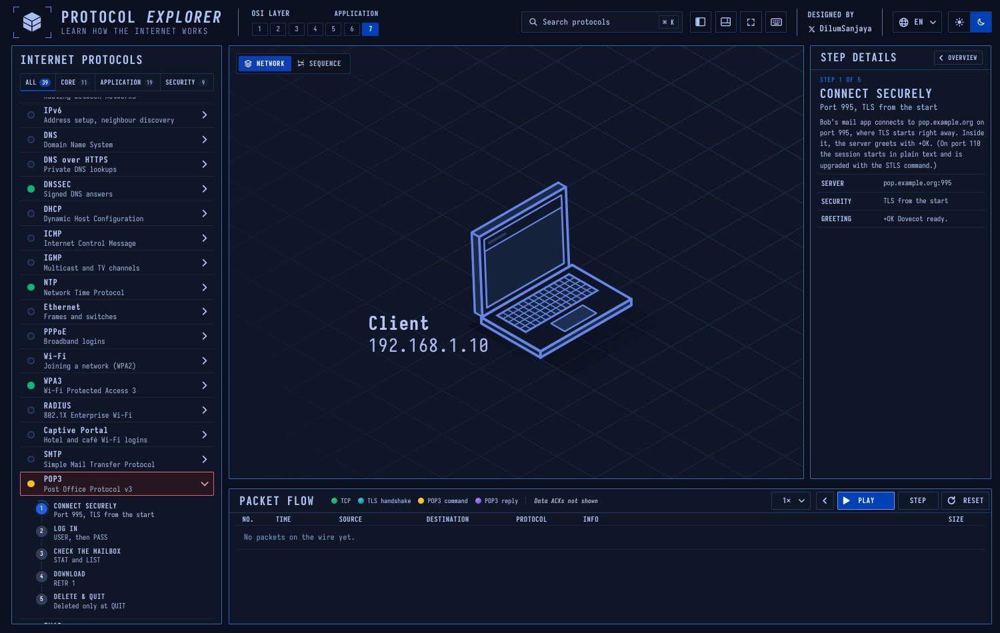
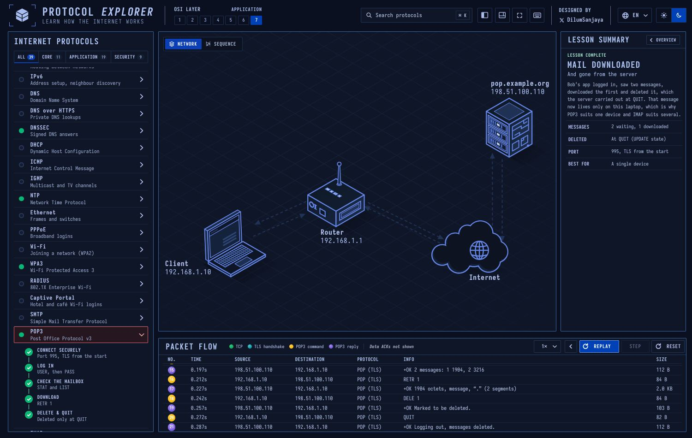
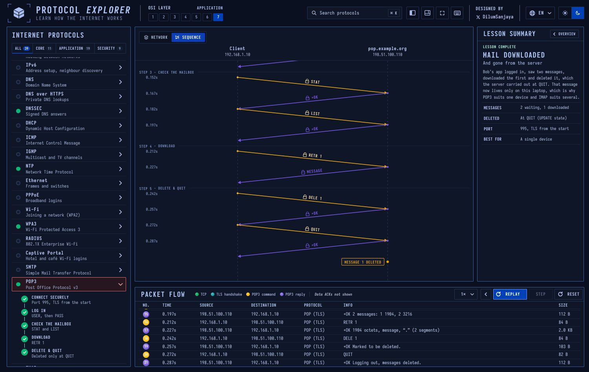
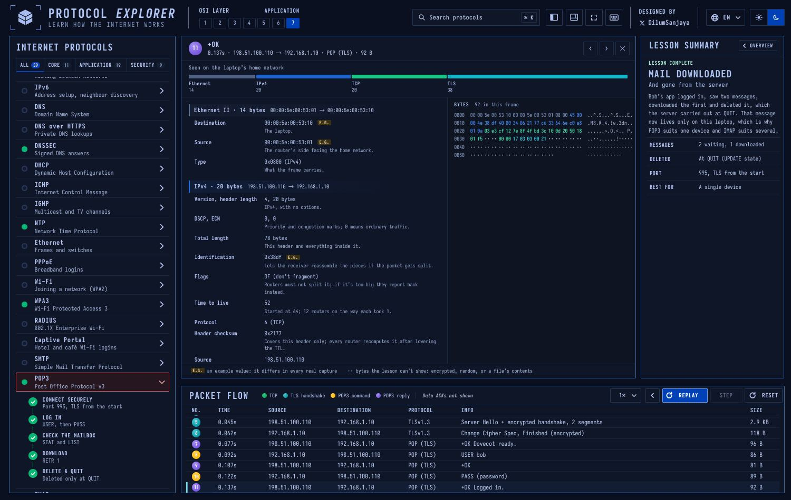

# POP3 – Post Office Protocol v3

<!-- nav -->
⬅ [27 SMTP](27-smtp.md) · [Index](00_Protocols_Index.md) · [29 IMAP](29-imap.md) ➡
<!-- nav -->

*Source: Protocol Explorer – https://protocol-explorer-alpha.vercel.app/ (interactive lesson #28). Screenshots captured from the live lesson; packet decodes are the site's example capture (values marked **E.G.** differ in every real capture).*

## Overview


> PROTOCOL OVERVIEW  
> POP3  
> ACTIVE  
> Post Office Protocol, version 3  
> POP3 lets a mail app download messages from a mailbox on a server. It was designed for one device that fetches mail and then removes it from the server. Commands are short words, and every reply starts with +OK or -ERR.  
> LAYER  
> Application (Layer 7)  
> PORTS  
> 995 (TLS), 110 (STLS)  
> TRANSPORT  
> TCP  
> MODEL  
> Download, then delete  
> REPLIES  
> +OK or -ERR  
> DEFINED IN  
> RFC 1939  

## In-depth explanation of the example (plain-language version)

### The big picture in one minute
**Bob** opens his mail app. It connects to his mail server `pop.example.org` on **port 995** and **downloads** his mail: log in, check how many messages there are (2), download message 1, mark it for deletion, and log out. **21 packets in 0.29 seconds.** (The email Alice sent in the SMTP lesson is sitting in this mailbox.)

**What POP3 is.** The *Post Office Protocol* is the simplest way to **read** mail: **connect → download → (delete) → disconnect.** It was designed for **one computer** that picks up mail and removes it from the server. Commands are short words, and **every reply begins with `+OK` (success) or `-ERR` (failure)**. (SMTP *sends* mail; POP3 and IMAP *read* it.)

Think of **collecting your letters from a PO box**: you take them home, and the box is emptied.

> **Words you'll see:** *Mailbox* = the server's storage for your mail. *Octets* = bytes. *TLS* = encryption. A line with only a dot (`.`) marks the end of a long reply.

---

### Step 1 – Connect securely – packets 1 to 7
After the TCP handshake to **port 995** (POP3 with encryption from the first byte), a TLS handshake follows. The server greets: **`+OK Dovecot ready.`** Without encryption, the password in the next step would cross the network as readable text.

### Step 2 – Log in – packets 8 to 11
`USER bob` → `+OK`, then `PASS ••••` → `+OK Logged in.` The server **locks the mailbox**, so only **one session at a time** can use it.

### Step 3 – Check the mailbox – packets 12 to 15
- **`STAT`** → `+OK 2 5120`: "2 messages, 5,120 bytes in total."
- **`LIST`** → one line per message: `1 1904` and `2 3216` (message number and size), ending with a lone `.`.
Messages have only temporary numbers (1, 2…) that can change next time. A command called **`UIDL`** gives permanent IDs so the app doesn't download the same mail twice.

### Step 4 – Download – packets 16, 17
**`RETR 1`** → `+OK 1904 octets`, followed by the **complete message** (headers and body, exactly as SMTP delivered it) and a closing `.`. Other handy commands: `TOP` (just the headers and a few lines, for a preview) and `RSET` (undo deletion marks).

### Step 5 – Delete and quit – packets 18 to 21
- **`DELE 1`** → "Marked to be deleted." It only **marks** the message.
- **`QUIT`** → "Logging out, messages deleted." The server actually removes the marked messages **only when you QUIT**. If the connection broke before that, nothing would be deleted. Many apps offer **"leave a copy on the server"**, which simply skips `DELE`.

### The three stages of a session
`AUTHORIZATION` (greeting and login) → `TRANSACTION` (STAT, LIST, RETR, DELE) → `UPDATE` (after QUIT: deletions applied, lock released).

---

### The 21 packets at a glance
| Packets | What | Why |
|---|---|---|
| 1–7 | TCP + TLS to port 995 | connect securely |
| 8–11 | USER, PASS | log in |
| 12–15 | STAT, LIST | see what's there |
| 16–17 | RETR 1 | download message 1 |
| 18–21 | DELE, QUIT | delete and log out |

### POP3 vs IMAP
| | **POP3** | **IMAP** (next note) |
|---|---|---|
| Idea | download (and usually delete from the server) | mail stays on the server |
| Several devices | poor (each has its own copy) | made for it |
| Folders and flags | none (inbox only) | yes |
| Ports | 995 (TLS), 110 (+STLS) | 993 (TLS), 143 (+STARTTLS) |

### What to remember
- Replies: **`+OK`** or **`-ERR`**. Commands: `USER, PASS, STAT, LIST, RETR, DELE, TOP, UIDL, NOOP, RSET, QUIT`.
- Good for: a single device, small server storage, keeping an offline archive. Not good for: phone + laptop + webmail all sharing one mailbox.
- Security: always use TLS (port 995, or `STLS` on 110). Avoid plain text logins.

## Step-by-step walkthrough (screenshots from the lesson)

### Step 1: CONNECT SECURELY – Port 995, TLS from the start



> STEP 1 OF 5  
> CONNECT SECURELY  
> Port 995, TLS from the start  
> Bob’s mail app connects to pop.example.org on port 995, where TLS starts right away. Inside it, the server greets with +OK. (On port 110 the session starts in plain text and is upgraded with the STLS command.)  
> SERVER  
> pop.example.org:995  
> SECURITY  
> TLS from the start  
> GREETING  
> +OK Dovecot ready.  

### Step 2: LOG IN – USER, then PASS


> STEP 2 OF 5  
> LOG IN  
> USER, then PASS  
> The app sends the user name with USER and the password with PASS. Each command gets its own +OK. Because the session is inside TLS, the password isn’t readable on the way.  
> USER  
> CLIENT → POP.EXAMPLE.ORG  
> USER bob  
> PACKET 8 OF 21 · POP (TLS) · 86 B · ENCRYPTED  
> COMMANDS  
> USER bob, PASS ••••  
> REPLIES  
> +OK, +OK Logged in.  
> PROTECTED BY  
> TLS  

### Step 3: CHECK THE MAILBOX – STAT and LIST


> STEP 3 OF 5  
> CHECK THE MAILBOX  
> STAT and LIST  
> STAT returns the number of messages and their total size: 2 messages, 5120 bytes. LIST gives each message’s number and size, ending with a line holding just a dot.  
> STAT  
> CLIENT → POP.EXAMPLE.ORG  
> STAT  
> PACKET 12 OF 21 · POP (TLS) · 82 B · ENCRYPTED  
> STAT  
> +OK 2 5120  
> MESSAGE 1  
> 1904 bytes  
> MESSAGE 2  
> 3216 bytes  

### Step 4: DOWNLOAD – RETR 1


> STEP 4 OF 5  
> DOWNLOAD  
> RETR 1  
> RETR 1 asks for the first message. The server answers +OK with its size, then the message and a closing dot: 1904 bytes plus the reply line, two TCP segments.  
> RETR 1  
> CLIENT → POP.EXAMPLE.ORG  
> RETR 1  
> PACKET 16 OF 21 · POP (TLS) · 84 B · ENCRYPTED  
> COMMAND  
> RETR 1  
> REPLY  
> +OK 1904 octets  
> SENT AS  
> 2 TCP segments  

### Step 5: DELETE & QUIT – Deleted only at QUIT


> STEP 5 OF 5  
> DELETE & QUIT  
> Deleted only at QUIT  
> DELE 1 only marks the message. The server removes it when the app says QUIT: if the connection dropped before that, nothing would be deleted. Many apps offer “leave a copy on the server”, which skips DELE.  
> DELE 1  
> CLIENT → POP.EXAMPLE.ORG  
> DELE 1  
> PACKET 18 OF 21 · POP (TLS) · 84 B · ENCRYPTED  
> DELE 1  
> Marks message 1  
> REMOVED  
> At QUIT  
> OPTION  
> Leave a copy on server  

### Lesson summary



> LESSON SUMMARY  
> LESSON COMPLETE  
> MAIL DOWNLOADED  
> And gone from the server  
> Bob’s app logged in, saw two messages, downloaded the first and deleted it, which the server carried out at QUIT. That message now lives only on this laptop, which is why POP3 suits one device and IMAP suits several.  
> +OK  
> POP.EXAMPLE.ORG → CLIENT  
> +OK Logging out,  
> messages deleted.  
> PACKET 21 OF 21 · POP (TLS) · 112 B · ENCRYPTED  
> MESSAGES  
> 2 waiting, 1 downloaded  
> DELETED  
> At QUIT (UPDATE state)  
> PORT  
> 995, TLS from the start  
> BEST FOR  
> A single device  

## Packet flow (whole lesson)

| No. | Time | Source | Destination | Protocol | Info | Size |
|---|---|---|---|---|---|---|
| 1 | 0.000s | 192.168.1.10 | 198.51.100.110 | TCP | 53010 → 995 [SYN] Seq=0 | 66 B |
| 2 | 0.015s | 198.51.100.110 | 192.168.1.10 | TCP | 995 → 53010 [SYN, ACK] Seq=0 Ack=1 | 66 B |
| 3 | 0.030s | 192.168.1.10 | 198.51.100.110 | TCP | 53010 → 995 [ACK] Seq=1 Ack=1 | 60 B |
| 4 | 0.030s | 192.168.1.10 | 198.51.100.110 | TLSv1.3 | Client Hello (SNI=pop.example.org) | 571 B |
| 5 | 0.045s | 198.51.100.110 | 192.168.1.10 | TLSv1.3 | Server Hello + encrypted handshake, 2 segments | 2.9 KB |
| 6 | 0.062s | 192.168.1.10 | 198.51.100.110 | TLSv1.3 | Change Cipher Spec, Finished (encrypted) | 118 B |
| 7 | 0.077s | 198.51.100.110 | 192.168.1.10 | POP (TLS) | +OK Dovecot ready. | 96 B |
| 8 | 0.092s | 192.168.1.10 | 198.51.100.110 | POP (TLS) | USER bob | 86 B |
| 9 | 0.107s | 198.51.100.110 | 192.168.1.10 | POP (TLS) | +OK | 81 B |
| 10 | 0.122s | 192.168.1.10 | 198.51.100.110 | POP (TLS) | PASS (password) | 89 B |
| 11 | 0.137s | 198.51.100.110 | 192.168.1.10 | POP (TLS) | +OK Logged in. | 92 B |
| 12 | 0.152s | 192.168.1.10 | 198.51.100.110 | POP (TLS) | STAT | 82 B |
| 13 | 0.167s | 198.51.100.110 | 192.168.1.10 | POP (TLS) | +OK 2 5120 | 88 B |
| 14 | 0.182s | 192.168.1.10 | 198.51.100.110 | POP (TLS) | LIST | 82 B |
| 15 | 0.197s | 198.51.100.110 | 192.168.1.10 | POP (TLS) | +OK 2 messages: 1 1904, 2 3216 | 112 B |
| 16 | 0.212s | 192.168.1.10 | 198.51.100.110 | POP (TLS) | RETR 1 | 84 B |
| 17 | 0.227s | 198.51.100.110 | 192.168.1.10 | POP (TLS) | +OK 1904 octets, message, “.” (2 segments) | 2.0 KB |
| 18 | 0.242s | 192.168.1.10 | 198.51.100.110 | POP (TLS) | DELE 1 | 84 B |
| 19 | 0.257s | 198.51.100.110 | 192.168.1.10 | POP (TLS) | +OK Marked to be deleted. | 103 B |
| 20 | 0.272s | 192.168.1.10 | 198.51.100.110 | POP (TLS) | QUIT | 82 B |
| 21 | 0.287s | 198.51.100.110 | 192.168.1.10 | POP (TLS) | +OK Logging out, messages deleted. | 112 B |

### Sequence diagram



## Packets decoded byte by byte

Each packet below is the lesson's own decode (headers, field values and the plain-English meaning of each field). Screenshots show the first, middle and last packet in the lesson's decoder view with the raw hex bytes.

### Packet 1: TCP – 53010 → 995 [SYN] Seq=0

*192.168.1.10 → 198.51.100.110 · 66 B · t = 0.000s*


<details><summary>Decoded fields</summary>

```text
1
SYN
0.000s · 192.168.1.10 → 198.51.100.110 · TCP · 66 B
Seen on the laptop’s home network
Ethernet
14
IPv4
20
TCP
32
Ethernet II · 14 bytes
00:00:5e:00:53:10 → 00:00:5e:00:53:01
Destination
00:00:5e:00:53:01 E.G.

The router: anything beyond the home network goes to it first.

Source
00:00:5e:00:53:10 E.G.

The laptop’s network card.

Type
0x0800 (IPv4)

What the frame carries.

IPv4 · 20 bytes
192.168.1.10 → 198.51.100.110
Version, header length
4, 20 bytes

IPv4, with no options.

DSCP, ECN
0, 0

Priority and congestion marks; 0 means ordinary traffic.

Total length
52 bytes

This header and everything inside it.

Identification
0xd825 E.G.

Lets the receiver reassemble the pieces if the packet gets split.

Flags
DF (don’t fragment)

Routers must not split it; if it’s too big they report back instead.

Time to live
128

Windows starts at 128.

Protocol
6 (TCP)
Header checksum
0x364a

Covers this header only; every router recomputes it after lowering the TTL.

Source
192.168.1.10
Destination
198.51.100.110
TCP · 32 bytes
53010 → 995, SYN
Source port
53010

Picked by the laptop’s system for this connection.

Destination port
995
Sequence number
0 (relative)

This side’s starting number. Shown as 0; the real one is random.

Real sequence number
1007684247 E.G.
Acknowledgment
0 (not used yet)

A first SYN has nothing to acknowledge.

Header length
32 bytes

20 bytes, plus 12 of options.

Flags
0x002 (SYN)
Window
64240 E.G.

How much more data this side can take right now.

Checksum
0x6e2e

Covers the header, the data and the IP addresses, so damage is caught.

Urgent pointer
0
Options
12 bytes
Maximum segment size
1460 bytes

The most data this side wants in one segment.

No-op
1

Spacing, so the next option lines up.

Window scale
× 256

Window values are multiplied by this, so windows can be larger than 64 KB.

No-op
1

Spacing, so the next option lines up.

No-op
1

Spacing, so the next option lines up.

SACK permitted
yes

This side understands selective acknowledgements.

BYTES 66 in this frame
0000
00
00
5e
00
53
01
00
00
5e
00
53
10
08
00
45
00
.
.
^
.
S
.
.
.
^
.
S
.
.
.
E
.
0010
00
34
d8
25
40
00
80
06
36
4a
c0
a8
01
0a
c6
33
.
4
.
%
@
.
.
.
6
J
.
.
.
.
.
3
0020
64
6e
cf
12
03
e3
3c
10
0a
97
00
00
00
00
80
02
d
n
.
.
.
.
<
.
.
.
.
.
.
.
.
.
0030
fa
f0
6e
2e
00
00
02
04
05
b4
01
03
03
08
01
01
.
.
n
.
.
.
.
.
.
.
.
.
.
.
.
.
0040
04
02
.
.
E.G. an example value: it differs in every real capture
·· bytes the lesson can’t show: encrypted, random, or a file’s contents
```

</details>

### Packet 2: TCP – 995 → 53010 [SYN, ACK] Seq=0 Ack=1

*198.51.100.110 → 192.168.1.10 · 66 B · t = 0.015s*

<details><summary>Decoded fields</summary>

```text
2
SYN-ACK
0.015s · 198.51.100.110 → 192.168.1.10 · TCP · 66 B
Seen on the laptop’s home network
Ethernet
14
IPv4
20
TCP
32
Ethernet II · 14 bytes
00:00:5e:00:53:01 → 00:00:5e:00:53:10
Destination
00:00:5e:00:53:10 E.G.

The laptop.

Source
00:00:5e:00:53:01 E.G.

The router’s side facing the home network.

Type
0x0800 (IPv4)

What the frame carries.

IPv4 · 20 bytes
198.51.100.110 → 192.168.1.10
Version, header length
4, 20 bytes

IPv4, with no options.

DSCP, ECN
0, 0

Priority and congestion marks; 0 means ordinary traffic.

Total length
52 bytes

This header and everything inside it.

Identification
0x38db E.G.

Lets the receiver reassemble the pieces if the packet gets split.

Flags
DF (don’t fragment)

Routers must not split it; if it’s too big they report back instead.

Time to live
52

Started at 64; 12 routers on the way each took 1.

Protocol
6 (TCP)
Header checksum
0x2195

Covers this header only; every router recomputes it after lowering the TTL.

Source
198.51.100.110
Destination
192.168.1.10
TCP · 32 bytes
995 → 53010, SYN, ACK
Source port
995
Destination port
53010
Sequence number
0 (relative)

This side’s starting number. Shown as 0; the real one is random.

Real sequence number
2123318345 E.G.
Acknowledgment
1 (relative)

The next byte this side expects: everything before it has arrived.

Header length
32 bytes

20 bytes, plus 12 of options.

Flags
0x012 (SYN, ACK)
Window
64240 E.G.

How much more data this side can take right now.

Checksum
0xab45

Covers the header, the data and the IP addresses, so damage is caught.

Urgent pointer
0
Options
12 bytes
Maximum segment size
1460 bytes

The most data this side wants in one segment.

No-op
1

Spacing, so the next option lines up.

No-op
1

Spacing, so the next option lines up.

SACK permitted
yes

This side understands selective acknowledgements.

No-op
1

Spacing, so the next option lines up.

Window scale
× 128

Window values are multiplied by this, so windows can be larger than 64 KB.

BYTES 66 in this frame
0000
00
00
5e
00
53
10
00
00
5e
00
53
01
08
00
45
00
.
.
^
.
S
.
.
.
^
.
S
.
.
.
E
.
0010
00
34
38
db
40
00
34
06
21
95
c6
33
64
6e
c0
a8
.
4
8
.
@
.
4
.
!
.
.
3
d
n
.
.
0020
01
0a
03
e3
cf
12
7e
8f
44
49
3c
10
0a
98
80
12
.
.
.
.
.
.
~
.
D
I
<
.
.
.
.
.
0030
fa
f0
ab
45
00
00
02
04
05
b4
01
01
04
02
01
03
.
.
.
E
.
.
.
.
.
.
.
.
.
.
.
.
0040
03
07
.
.
E.G. an example value: it differs in every real capture
·· bytes the lesson can’t show: encrypted, random, or a file’s contents
```

</details>

### Packet 3: TCP – 53010 → 995 [ACK] Seq=1 Ack=1

*192.168.1.10 → 198.51.100.110 · 60 B · t = 0.030s*

<details><summary>Decoded fields</summary>

```text
3
ACK
0.030s · 192.168.1.10 → 198.51.100.110 · TCP · 60 B
Seen on the laptop’s home network
Ethernet
14
IPv4
20
TCP
20
Padding
6
Ethernet II · 14 bytes
00:00:5e:00:53:10 → 00:00:5e:00:53:01
Destination
00:00:5e:00:53:01 E.G.

The router: anything beyond the home network goes to it first.

Source
00:00:5e:00:53:10 E.G.

The laptop’s network card.

Type
0x0800 (IPv4)

What the frame carries.

IPv4 · 20 bytes
192.168.1.10 → 198.51.100.110
Version, header length
4, 20 bytes

IPv4, with no options.

DSCP, ECN
0, 0

Priority and congestion marks; 0 means ordinary traffic.

Total length
40 bytes

This header and everything inside it.

Identification
0xd826 E.G.

Lets the receiver reassemble the pieces if the packet gets split.

Flags
DF (don’t fragment)

Routers must not split it; if it’s too big they report back instead.

Time to live
128

Windows starts at 128.

Protocol
6 (TCP)
Header checksum
0x3655

Covers this header only; every router recomputes it after lowering the TTL.

Source
192.168.1.10
Destination
198.51.100.110
TCP · 20 bytes
53010 → 995, ACK
Source port
53010

Picked by the laptop’s system for this connection.

Destination port
995
Sequence number
1 (relative)

Position of this segment’s first byte, counted from this side’s SYN.

Real sequence number
1007684248 E.G.
Acknowledgment
1 (relative)

The next byte this side expects: everything before it has arrived.

Header length
20 bytes
Flags
0x010 (ACK)
Window
1026 (× 256 = 262,656 bytes) E.G.

How much more data this side can take right now.

Checksum
0xe306

Covers the header, the data and the IP addresses, so damage is caught.

Urgent pointer
0
Ethernet padding · 6 bytes
Padding
6 zero bytes

Ethernet frames are at least 60 bytes (64 with the checksum the card adds), so short ones are padded.

BYTES 60 in this frame
0000
00
00
5e
00
53
01
00
00
5e
00
53
10
08
00
45
00
.
.
^
.
S
.
.
.
^
.
S
.
.
.
E
.
0010
00
28
d8
26
40
00
80
06
36
55
c0
a8
01
0a
c6
33
.
(
.
&
@
.
.
.
6
U
.
.
.
.
.
3
0020
64
6e
cf
12
03
e3
3c
10
0a
98
7e
8f
44
4a
50
10
d
n
.
.
.
.
<
.
.
.
~
.
D
J
P
.
0030
04
02
e3
06
00
00
00
00
00
00
00
00
.
.
.
.
.
.
.
.
.
.
.
.
E.G. an example value: it differs in every real capture
·· bytes the lesson can’t show: encrypted, random, or a file’s contents
```

</details>

### Packet 4: TLSv1.3 – Client Hello (SNI=pop.example.org)

*192.168.1.10 → 198.51.100.110 · 571 B · t = 0.030s*

<details><summary>Decoded fields</summary>

```text
4
CLIENT HELLO
0.030s · 192.168.1.10 → 198.51.100.110 · TLSv1.3 · 571 B
Seen on the laptop’s home network
Ethernet
14
IPv4
20
TCP
20
TLS
517
Ethernet II · 14 bytes
00:00:5e:00:53:10 → 00:00:5e:00:53:01
Destination
00:00:5e:00:53:01 E.G.

The router: anything beyond the home network goes to it first.

Source
00:00:5e:00:53:10 E.G.

The laptop’s network card.

Type
0x0800 (IPv4)

What the frame carries.

IPv4 · 20 bytes
192.168.1.10 → 198.51.100.110
Version, header length
4, 20 bytes

IPv4, with no options.

DSCP, ECN
0, 0

Priority and congestion marks; 0 means ordinary traffic.

Total length
557 bytes

This header and everything inside it.

Identification
0xd827 E.G.

Lets the receiver reassemble the pieces if the packet gets split.

Flags
DF (don’t fragment)

Routers must not split it; if it’s too big they report back instead.

Time to live
128

Windows starts at 128.

Protocol
6 (TCP)
Header checksum
0x344f

Covers this header only; every router recomputes it after lowering the TTL.

Source
192.168.1.10
Destination
198.51.100.110
TCP · 20 bytes
53010 → 995, PSH, ACK
Source port
53010

Picked by the laptop’s system for this connection.

Destination port
995
Sequence number
1 (relative)

Position of this segment’s first byte, counted from this side’s SYN.

Real sequence number
1007684248 E.G.
Acknowledgment
1 (relative)

The next byte this side expects: everything before it has arrived.

Header length
20 bytes
Flags
0x018 (PSH, ACK)
Window
1026 (× 256 = 262,656 bytes) E.G.

How much more data this side can take right now.

Checksum
covers bytes not shown here

Covers the header, the data and the IP addresses, so damage is caught.

Urgent pointer
0
TLS 1.3 · 1 record
Record
Handshake, 512 bytes
Content type
22 (Handshake)
Version
0x0301 (TLS 1.0)

A Client Hello’s record says TLS 1.0 so old middleboxes let it through; the real versions are offered inside.

Length
512
Handshake type
1 (Client Hello)
Length
508
Contents
508 bytes

What this client supports. Its exact contents vary from client to client; this is an example.

Server name (SNI)
pop.example.org
Versions offered
TLS 1.3, TLS 1.2
Key share
X25519
Padding
up to 512 bytes
BYTES 571 in this frame
0000
00
00
5e
00
53
01
00
00
5e
00
53
10
08
00
45
00
.
.
^
.
S
.
.
.
^
.
S
.
.
.
E
.
0010
02
2d
d8
27
40
00
80
06
34
4f
c0
a8
01
0a
c6
33
.
-
.
'
@
.
.
.
4
O
.
.
.
.
.
3
0020
64
6e
cf
12
03
e3
3c
10
0a
98
7e
8f
44
4a
50
18
d
n
.
.
.
.
<
.
.
.
~
.
D
J
P
.
0030
04
02
··
··
00
00
16
03
01
02
00
01
00
01
fc
··
.
.
·
·
.
.
.
.
.
.
.
.
.
.
.
·
0040
··
··
··
··
··
··
··
··
··
··
··
··
··
··
··
··
·
·
·
·
·
·
·
·
·
·
·
·
·
·
·
·
0050
··
··
··
··
··
··
··
··
··
··
··
··
··
··
··
··
·
·
·
·
·
·
·
·
·
·
·
·
·
·
·
·
0060
··
··
··
··
··
··
··
··
··
··
··
··
··
··
··
··
·
·
·
·
·
·
·
·
·
·
·
·
·
·
·
·
0070
··
··
··
··
··
··
··
··
··
··
··
··
··
··
··
··
·
·
·
·
·
·
·
·
·
·
·
·
·
·
·
·
0080
··
··
··
··
··
··
··
··
··
··
··
··
··
··
··
··
·
·
·
·
·
·
·
·
·
·
·
·
·
·
·
·
0090
··
··
··
··
··
··
··
··
··
··
··
··
··
··
··
··
·
·
·
·
·
·
·
·
·
·
·
·
·
·
·
·
00a0
··
··
··
··
··
··
··
··
··
··
··
··
··
··
··
··
·
·
·
·
·
·
·
·
·
·
·
·
·
·
·
·
00b0
··
··
··
··
··
··
··
··
··
··
··
··
··
··
··
··
·
·
·
·
·
·
·
·
·
·
·
·
·
·
·
·
00c0
··
··
··
··
··
··
··
··
··
··
··
··
··
··
··
··
·
·
·
·
·
·
·
·
·
·
·
·
·
·
·
·
00d0
··
··
··
··
··
··
··
··
··
··
··
··
··
··
··
··
·
·
·
·
·
·
·
·
·
·
·
·
·
·
·
·
00e0
··
··
··
··
··
··
··
··
··
··
··
··
··
··
··
··
·
·
·
·
·
·
·
·
·
·
·
·
·
·
·
·
00f0
··
··
··
··
··
··
··
··
··
··
··
··
··
··
··
··
·
·
·
·
·
·
·
·
·
·
·
·
·
·
·
·
0100
··
··
··
··
··
··
··
··
··
··
··
··
··
··
··
··
·
·
·
·
·
·
·
·
·
·
·
·
·
·
·
·
0110
··
··
··
··
··
··
··
··
··
··
··
··
··
··
··
··
·
·
·
·
·
·
·
·
·
·
·
·
·
·
·
·
0120
··
··
··
··
··
··
··
··
··
··
··
··
··
··
··
··
·
·
·
·
·
·
·
·
·
·
·
·
·
·
·
·
0130
··
··
··
··
··
··
··
··
··
··
··
··
··
··
··
··
·
·
·
·
·
·
·
·
·
·
·
·
·
·
·
·
0140
··
··
··
··
··
··
··
··
··
··
··
··
··
··
··
··
·
·
·
·
·
·
·
·
·
·
·
·
·
·
·
·
0150
··
··
··
··
··
··
··
··
··
··
··
··
··
··
··
··
·
·
·
·
·
·
·
·
·
·
·
·
·
·
·
·
0160
··
··
··
··
··
··
··
··
··
··
··
··
··
··
··
··
·
·
·
·
·
·
·
·
·
·
·
·
·
·
·
·
0170
··
··
··
··
··
··
··
··
··
··
··
··
··
··
··
··
·
·
·
·
·
·
·
·
·
·
·
·
·
·
·
·
0180
··
··
··
··
··
··
··
··
··
··
··
··
··
··
··
··
·
·
·
·
·
·
·
·
·
·
·
·
·
·
·
·
0190
··
··
··
··
··
··
··
··
··
··
··
··
··
··
··
··
·
·
·
·
·
·
·
·
·
·
·
·
·
·
·
·
01a0
··
··
··
··
··
··
··
··
··
··
··
··
··
··
··
··
·
·
·
·
·
·
·
·
·
·
·
·
·
·
·
·
01b0
··
··
··
··
··
··
··
··
··
··
··
··
··
··
··
··
·
·
·
·
·
·
·
·
·
·
·
·
·
·
·
·
01c0
··
··
··
··
··
··
··
··
··
··
··
··
··
··
··
··
·
·
·
·
·
·
·
·
·
·
·
·
·
·
·
·
01d0
··
··
··
··
··
··
··
··
··
··
··
··
··
··
··
··
·
·
·
·
·
·
·
·
·
·
·
·
·
·
·
·
01e0
··
··
··
··
··
··
··
··
··
··
··
··
··
··
··
··
·
·
·
·
·
·
·
·
·
·
·
·
·
·
·
·
01f0
··
··
··
··
··
··
··
··
··
··
··
··
··
··
··
··
·
·
·
·
·
·
·
·
·
·
·
·
·
·
·
·
0200
··
··
··
··
··
··
··
··
··
··
··
··
··
··
··
··
·
·
·
·
·
·
·
·
·
·
·
·
·
·
·
·
0210
··
··
··
··
··
··
··
··
··
··
··
··
··
··
··
··
·
·
·
·
·
·
·
·
·
·
·
·
·
·
·
·
0220
··
··
··
··
··
··
··
··
··
··
··
··
··
··
··
··
·
·
·
·
·
·
·
·
·
·
·
·
·
·
·
·
0230
··
··
··
··
··
··
··
··
··
··
··
·
·
·
·
·
·
·
·
·
·
·
E.G. an example value: it differs in every real capture
·· bytes the lesson can’t show: encrypted, random, or a file’s contents
```

</details>

### Packet 5: TLSv1.3 – Server Hello + encrypted handshake, 2 segments

*198.51.100.110 → 192.168.1.10 · 2.9 KB · t = 0.045s*

<details><summary>Decoded fields</summary>

```text
5
SERVER HELLO
0.045s · 198.51.100.110 → 192.168.1.10 · TLSv1.3 · 2.9 KB
Seen on the laptop’s home network · This row stands for 2 TCP segments carrying a 2,862-byte message; the first segment is shown
Ethernet
14
IPv4
20
TCP
20
TLS
1460
Ethernet II · 14 bytes
00:00:5e:00:53:01 → 00:00:5e:00:53:10
Destination
00:00:5e:00:53:10 E.G.

The laptop.

Source
00:00:5e:00:53:01 E.G.

The router’s side facing the home network.

Type
0x0800 (IPv4)

What the frame carries.

IPv4 · 20 bytes
198.51.100.110 → 192.168.1.10
Version, header length
4, 20 bytes

IPv4, with no options.

DSCP, ECN
0, 0

Priority and congestion marks; 0 means ordinary traffic.

Total length
1500 bytes

This header and everything inside it.

Identification
0x38dc E.G.

Lets the receiver reassemble the pieces if the packet gets split.

Flags
DF (don’t fragment)

Routers must not split it; if it’s too big they report back instead.

Time to live
52

Started at 64; 12 routers on the way each took 1.

Protocol
6 (TCP)
Header checksum
0x1bec

Covers this header only; every router recomputes it after lowering the TTL.

Source
198.51.100.110
Destination
192.168.1.10
TCP · 20 bytes
995 → 53010, PSH, ACK
Source port
995
Destination port
53010
Sequence number
1 (relative)

Position of this segment’s first byte, counted from this side’s SYN.

Real sequence number
2123318346 E.G.
Acknowledgment
518 (relative)

The next byte this side expects: everything before it has arrived.

Header length
20 bytes
Flags
0x018 (PSH, ACK)
Window
501 (× 128 = 64,128 bytes) E.G.

How much more data this side can take right now.

Checksum
covers bytes not shown here

Covers the header, the data and the IP addresses, so damage is caught.

Urgent pointer
0
TLS 1.3 · 3 records
Record
Handshake, 122 bytes
Content type
22 (Handshake)
Version
0x0303 (TLS 1.2)

TLS 1.3 records say 1.2 on the outside, for compatibility.

Length
122
Handshake type
2 (Server Hello)
Length
118
Contents
118 bytes

The server’s choices and its key share.

Version
TLS 1.3
Cipher suite
TLS_AES_128_GCM_SHA256
Key share
X25519
Record
Change Cipher Spec, 1 byte
Content type
20 (Change Cipher Spec)
Version
0x0303 (TLS 1.2)

TLS 1.3 records say 1.2 on the outside, for compatibility.

Length
1
Change cipher spec
1

Has no job in TLS 1.3; sent so middleboxes see a familiar handshake.

Record
Application Data, 2,724 bytes
Content type
23 (Application Data)

Every encrypted record says Application Data on the outside; the real type is inside.

Version
0x0303 (TLS 1.2)

TLS 1.3 records say 1.2 on the outside, for compatibility.

Length
2,724
Encrypted data
2,724 bytes

Ciphertext, ending in a 16-byte tag that shows any change. Only the two ends can read it.

Inside
Encrypted Extensions, Certificate (the chain), Certificate Verify (the signature), Finished
BYTES 1514 in this frame
0000
00
00
5e
00
53
10
00
00
5e
00
53
01
08
00
45
00
.
.
^
.
S
.
.
.
^
.
S
.
.
.
E
.
0010
05
dc
38
dc
40
00
34
06
1b
ec
c6
33
64
6e
c0
a8
.
.
8
.
@
.
4
.
.
.
.
3
d
n
.
.
0020
01
0a
03
e3
cf
12
7e
8f
44
4a
3c
10
0c
9d
50
18
.
.
.
.
.
.
~
.
D
J
<
.
.
.
P
.
0030
01
f5
··
··
00
00
16
03
03
00
7a
02
00
00
76
··
.
.
·
·
.
.
.
.
.
.
z
.
.
.
v
·
0040
··
··
··
··
··
··
··
··
··
··
··
··
··
··
··
··
·
·
·
·
·
·
·
·
·
·
·
·
·
·
·
·
0050
··
··
··
··
··
··
··
··
··
··
··
··
··
··
··
··
·
·
·
·
·
·
·
·
·
·
·
·
·
·
·
·
0060
··
··
··
··
··
··
··
··
··
··
··
··
··
··
··
··
·
·
·
·
·
·
·
·
·
·
·
·
·
·
·
·
0070
··
··
··
··
··
··
··
··
··
··
··
··
··
··
··
··
·
·
·
·
·
·
·
·
·
·
·
·
·
·
·
·
0080
··
··
··
··
··
··
··
··
··
··
··
··
··
··
··
··
·
·
·
·
·
·
·
·
·
·
·
·
·
·
·
·
0090
··
··
··
··
··
··
··
··
··
··
··
··
··
··
··
··
·
·
·
·
·
·
·
·
·
·
·
·
·
·
·
·
00a0
··
··
··
··
··
··
··
··
··
··
··
··
··
··
··
··
·
·
·
·
·
·
·
·
·
·
·
·
·
·
·
·
00b0
··
··
··
··
··
14
03
03
00
01
01
17
03
03
0a
a4
·
·
·
·
·
.
.
.
.
.
.
.
.
.
.
.
00c0
··
··
··
··
··
··
··
··
··
··
··
··
··
··
··
··
·
·
·
·
·
·
·
·
·
·
·
·
·
·
·
·
00d0
··
··
··
··
··
··
··
··
··
··
··
··
··
··
··
··
·
·
·
·
·
·
·
·
·
·
·
·
·
·
·
·
00e0
··
··
··
··
··
··
··
··
··
··
··
··
··
··
··
··
·
·
·
·
·
·
·
·
·
·
·
·
·
·
·
·
00f0
··
··
··
··
··
··
··
··
··
··
··
··
··
··
··
··
·
·
·
·
·
·
·
·
·
·
·
·
·
·
·
·
0100
··
··
··
··
··
··
··
··
··
··
··
··
··
··
··
··
·
·
·
·
·
·
·
·
·
·
·
·
·
·
·
·
0110
··
··
··
··
··
··
··
··
··
··
··
··
··
··
··
··
·
·
·
·
·
·
·
·
·
·
·
·
·
·
·
·
0120
··
··
··
··
··
··
··
··
··
··
··
··
··
··
··
··
·
·
·
·
·
·
·
·
·
·
·
·
·
·
·
·
0130
··
··
··
··
··
··
··
··
··
··
··
··
··
··
··
··
·
·
·
·
·
·
·
·
·
·
·
·
·
·
·
·
0140
··
··
··
··
··
··
··
··
··
··
··
··
··
··
··
··
·
·
·
·
·
·
·
·
·
·
·
·
·
·
·
·
0150
··
··
··
··
··
··
··
··
··
··
··
··
··
··
··
··
·
·
·
·
·
·
·
·
·
·
·
·
·
·
·
·
0160
··
··
··
··
··
··
··
··
··
··
··
··
··
··
··
··
·
·
·
·
·
·
·
·
·
·
·
·
·
·
·
·
0170
··
··
··
··
··
··
··
··
··
··
··
··
··
··
··
··
·
·
·
·
·
·
·
·
·
·
·
·
·
·
·
·
0180
··
··
··
··
··
··
··
··
··
··
··
··
··
··
··
··
·
·
·
·
·
·
·
·
·
·
·
·
·
·
·
·
0190
··
··
··
··
··
··
··
··
··
··
··
··
··
··
··
··
·
·
·
·
·
·
·
·
·
·
·
·
·
·
·
·
01a0
··
··
··
··
··
··
··
··
··
··
··
··
··
··
··
··
·
·
·
·
·
·
·
·
·
·
·
·
·
·
·
·
01b0
··
··
··
··
··
··
··
··
··
··
··
··
··
··
··
··
·
·
·
·
·
·
·
·
·
·
·
·
·
·
·
·
01c0
··
··
··
··
··
··
··
··
··
··
··
··
··
··
··
··
·
·
·
·
·
·
·
·
·
·
·
·
·
·
·
·
01d0
··
··
··
··
··
··
··
··
··
··
··
··
··
··
··
··
·
·
·
·
·
·
·
·
·
·
·
·
·
·
·
·
01e0
··
··
··
··
··
··
··
··
··
··
··
··
··
··
··
··
·
·
·
·
·
·
·
·
·
·
·
·
·
·
·
·
01f0
··
··
··
··
··
··
··
··
··
··
··
··
··
··
··
··
·
·
·
·
·
·
·
·
·
·
·
·
·
·
·
·
0200
··
··
··
··
··
··
··
··
··
··
··
··
··
··
··
··
·
·
·
·
·
·
·
·
·
·
·
·
·
·
·
·
0210
··
··
··
··
··
··
··
··
··
··
··
··
··
··
··
··
·
·
·
·
·
·
·
·
·
·
·
·
·
·
·
·
0220
··
··
··
··
··
··
··
··
··
··
··
··
··
··
··
··
·
·
·
·
·
·
·
·
·
·
·
·
·
·
·
·
0230
··
··
··
··
··
··
··
··
··
··
··
··
··
··
··
··
·
·
·
·
·
·
·
·
·
·
·
·
·
·
·
·
0240
··
··
··
··
··
··
··
··
··
··
··
··
··
··
··
··
·
·
·
·
·
·
·
·
·
·
·
·
·
·
·
·
0250
··
··
··
··
··
··
··
··
··
··
··
··
··
··
··
··
·
·
·
·
·
·
·
·
·
·
·
·
·
·
·
·
0260
··
··
··
··
··
··
··
··
··
··
··
··
··
··
··
··
·
·
·
·
·
·
·
·
·
·
·
·
·
·
·
·
0270
··
··
··
··
··
··
··
··
··
··
··
··
··
··
··
··
·
·
·
·
·
·
·
·
·
·
·
·
·
·
·
·
0280
··
··
··
··
··
··
··
··
··
··
··
··
··
··
··
··
·
·
·
·
·
·
·
·
·
·
·
·
·
·
·
·
0290
··
··
··
··
··
··
··
··
··
··
··
··
··
··
··
··
·
·
·
·
·
·
·
·
·
·
·
·
·
·
·
·
02a0
··
··
··
··
··
··
··
··
··
··
··
··
··
··
··
··
·
·
·
·
·
·
·
·
·
·
·
·
·
·
·
·
02b0
··
··
··
··
··
··
··
··
··
··
··
··
··
··
··
··
·
·
·
·
·
·
·
·
·
·
·
·
·
·
·
·
02c0
··
··
··
··
··
··
··
··
··
··
··
··
··
··
··
··
·
·
·
·
·
·
·
·
·
·
·
·
·
·
·
·
02d0
··
··
··
··
··
··
··
··
··
··
··
··
··
··
··
··
·
·
·
·
·
·
·
·
·
·
·
·
·
·
·
·
02e0
··
··
··
··
··
··
··
··
··
··
··
··
··
··
··
··
·
·
·
·
·
·
·
·
·
·
·
·
·
·
·
·
02f0
··
··
··
··
··
··
··
··
··
··
··
··
··
··
··
··
·
·
·
·
·
·
·
·
·
·
·
·
·
·
·
·
0300
··
··
··
··
··
··
··
··
··
··
··
··
··
··
··
··
·
·
·
·
·
·
·
·
·
·
·
·
·
·
·
·
0310
··
··
··
··
··
··
··
··
··
··
··
··
··
··
··
··
·
·
·
·
·
·
·
·
·
·
·
·
·
·
·
·
0320
··
··
··
··
··
··
··
··
··
··
··
··
··
··
··
··
·
·
·
·
·
·
·
·
·
·
·
·
·
·
·
·
0330
··
··
··
··
··
··
··
··
··
··
··
··
··
··
··
··
·
·
·
·
·
·
·
·
·
·
·
·
·
·
·
·
0340
··
··
··
··
··
··
··
··
··
··
··
··
··
··
··
··
·
·
·
·
·
·
·
·
·
·
·
·
·
·
·
·
0350
··
··
··
··
··
··
··
··
··
··
··
··
··
··
··
··
·
·
·
·
·
·
·
·
·
·
·
·
·
·
·
·
0360
··
··
··
··
··
··
··
··
··
··
··
··
··
··
··
··
·
·
·
·
·
·
·
·
·
·
·
·
·
·
·
·
0370
··
··
··
··
··
··
··
··
··
··
··
··
··
··
··
··
·
·
·
·
·
·
·
·
·
·
·
·
·
·
·
·
0380
··
··
··
··
··
··
··
··
··
··
··
··
··
··
··
··
·
·
·
·
·
·
·
·
·
·
·
·
·
·
·
·
0390
··
··
··
··
··
··
··
··
··
··
··
··
··
··
··
··
·
·
·
·
·
·
·
·
·
·
·
·
·
·
·
·
03a0
··
··
··
··
··
··
··
··
··
··
··
··
··
··
··
··
·
·
·
·
·
·
·
·
·
·
·
·
·
·
·
·
03b0
··
··
··
··
··
··
··
··
··
··
··
··
··
··
··
··
·
·
·
·
·
·
·
·
·
·
·
·
·
·
·
·
03c0
··
··
··
··
··
··
··
··
··
··
··
··
··
··
··
··
·
·
·
·
·
·
·
·
·
·
·
·
·
·
·
·
03d0
··
··
··
··
··
··
··
··
··
··
··
··
··
··
··
··
·
·
·
·
·
·
·
·
·
·
·
·
·
·
·
·
03e0
··
··
··
··
··
··
··
··
··
··
··
··
··
··
··
··
·
·
·
·
·
·
·
·
·
·
·
·
·
·
·
·
03f0
··
··
··
··
··
··
··
··
··
··
··
··
··
··
··
··
·
·
·
·
·
·
·
·
·
·
·
·
·
·
·
·
0400
··
··
··
··
··
··
··
··
··
··
··
··
··
··
··
··
·
·
·
·
·
·
·
·
·
·
·
·
·
·
·
·
0410
··
··
··
··
··
··
··
··
··
··
··
··
··
··
··
··
·
·
·
·
·
·
·
·
·
·
·
·
·
·
·
·
0420
··
··
··
··
··
··
··
··
··
··
··
··
··
··
··
··
·
·
·
·
·
·
·
·
·
·
·
·
·
·
·
·
0430
··
··
··
··
··
··
··
··
··
··
··
··
··
··
··
··
·
·
·
·
·
·
·
·
·
·
·
·
·
·
·
·
0440
··
··
··
··
··
··
··
··
··
··
··
··
··
··
··
··
·
·
·
·
·
·
·
·
·
·
·
·
·
·
·
·
0450
··
··
··
··
··
··
··
··
··
··
··
··
··
··
··
··
·
·
·
·
·
·
·
·
·
·
·
·
·
·
·
·
0460
··
··
··
··
··
··
··
··
··
··
··
··
··
··
··
··
·
·
·
·
·
·
·
·
·
·
·
·
·
·
·
·
0470
··
··
··
··
··
··
··
··
··
··
··
··
··
··
··
··
·
·
·
·
·
·
·
·
·
·
·
·
·
·
·
·
0480
··
··
··
··
··
··
··
··
··
··
··
··
··
··
··
··
·
·
·
·
·
·
·
·
·
·
·
·
·
·
·
·
0490
··
··
··
··
··
··
··
··
··
··
··
··
··
··
··
··
·
·
·
·
·
·
·
·
·
·
·
·
·
·
·
·
04a0
··
··
··
··
··
··
··
··
··
··
··
··
··
··
··
··
·
·
·
·
·
·
·
·
·
·
·
·
·
·
·
·
04b0
··
··
··
··
··
··
··
··
··
··
··
··
··
··
··
··
·
·
·
·
·
·
·
·
·
·
·
·
·
·
·
·
04c0
··
··
··
··
··
··
··
··
··
··
··
··
··
··
··
··
·
·
·
·
·
·
·
·
·
·
·
·
·
·
·
·
04d0
··
··
··
··
··
··
··
··
··
··
··
··
··
··
··
··
·
·
·
·
·
·
·
·
·
·
·
·
·
·
·
·
04e0
··
··
··
··
··
··
··
··
··
··
··
··
··
··
··
··
·
·
·
·
·
·
·
·
·
·
·
·
·
·
·
·
04f0
··
··
··
··
··
··
··
··
··
··
··
··
··
··
··
··
·
·
·
·
·
·
·
·
·
·
·
·
·
·
·
·
0500
··
··
··
··
··
··
··
··
··
··
··
··
··
··
··
··
·
·
·
·
·
·
·
·
·
·
·
·
·
·
·
·
0510
··
··
··
··
··
··
··
··
··
··
··
··
··
··
··
··
·
·
·
·
·
·
·
·
·
·
·
·
·
·
·
·
0520
··
··
··
··
··
··
··
··
··
··
··
··
··
··
··
··
·
·
·
·
·
·
·
·
·
·
·
·
·
·
·
·
0530
··
··
··
··
··
··
··
··
··
··
··
··
··
··
··
··
·
·
·
·
·
·
·
·
·
·
·
·
·
·
·
·
0540
··
··
··
··
··
··
··
··
··
··
··
··
··
··
··
··
·
·
·
·
·
·
·
·
·
·
·
·
·
·
·
·
0550
··
··
··
··
··
··
··
··
··
··
··
··
··
··
··
··
·
·
·
·
·
·
·
·
·
·
·
·
·
·
·
·
0560
··
··
··
··
··
··
··
··
··
··
··
··
··
··
··
··
·
·
·
·
·
·
·
·
·
·
·
·
·
·
·
·
0570
··
··
··
··
··
··
··
··
··
··
··
··
··
··
··
··
·
·
·
·
·
·
·
·
·
·
·
·
·
·
·
·
0580
··
··
··
··
··
··
··
··
··
··
··
··
··
··
··
··
·
·
·
·
·
·
·
·
·
·
·
·
·
·
·
·
0590
··
··
··
··
··
··
··
··
··
··
··
··
··
··
··
··
·
·
·
·
·
·
·
·
·
·
·
·
·
·
·
·
05a0
··
··
··
··
··
··
··
··
··
··
··
··
··
··
··
··
·
·
·
·
·
·
·
·
·
·
·
·
·
·
·
·
05b0
··
··
··
··
··
··
··
··
··
··
··
··
··
··
··
··
·
·
·
·
·
·
·
·
·
·
·
·
·
·
·
·
05c0
··
··
··
··
··
··
··
··
··
··
··
··
··
··
··
··
·
·
·
·
·
·
·
·
·
·
·
·
·
·
·
·
05d0
··
··
··
··
··
··
··
··
··
··
··
··
··
··
··
··
·
·
·
·
·
·
·
·
·
·
·
·
·
·
·
·
05e0
··
··
··
··
··
··
··
··
··
··
·
·
·
·
·
·
·
·
·
·
E.G. an example value: it differs in every real capture
·· bytes the lesson can’t show: encrypted, random, or a file’s contents
```

</details>

### Packet 6: TLSv1.3 – Change Cipher Spec, Finished (encrypted)

*192.168.1.10 → 198.51.100.110 · 118 B · t = 0.062s*

<details><summary>Decoded fields</summary>

```text
6
FINISHED
0.062s · 192.168.1.10 → 198.51.100.110 · TLSv1.3 · 118 B
Seen on the laptop’s home network
Ethernet
14
IPv4
20
TCP
20
TLS
64
Ethernet II · 14 bytes
00:00:5e:00:53:10 → 00:00:5e:00:53:01
Destination
00:00:5e:00:53:01 E.G.

The router: anything beyond the home network goes to it first.

Source
00:00:5e:00:53:10 E.G.

The laptop’s network card.

Type
0x0800 (IPv4)

What the frame carries.

IPv4 · 20 bytes
192.168.1.10 → 198.51.100.110
Version, header length
4, 20 bytes

IPv4, with no options.

DSCP, ECN
0, 0

Priority and congestion marks; 0 means ordinary traffic.

Total length
104 bytes

This header and everything inside it.

Identification
0xd828 E.G.

Lets the receiver reassemble the pieces if the packet gets split.

Flags
DF (don’t fragment)

Routers must not split it; if it’s too big they report back instead.

Time to live
128

Windows starts at 128.

Protocol
6 (TCP)
Header checksum
0x3613

Covers this header only; every router recomputes it after lowering the TTL.

Source
192.168.1.10
Destination
198.51.100.110
TCP · 20 bytes
53010 → 995, PSH, ACK
Source port
53010

Picked by the laptop’s system for this connection.

Destination port
995
Sequence number
518 (relative)

Position of this segment’s first byte, counted from this side’s SYN.

Real sequence number
1007684765 E.G.
Acknowledgment
2863 (relative)

The next byte this side expects: everything before it has arrived.

Header length
20 bytes
Flags
0x018 (PSH, ACK)
Window
1026 (× 256 = 262,656 bytes) E.G.

How much more data this side can take right now.

Checksum
covers bytes not shown here

Covers the header, the data and the IP addresses, so damage is caught.

Urgent pointer
0
TLS 1.3 · 2 records
Record
Change Cipher Spec, 1 byte
Content type
20 (Change Cipher Spec)
Version
0x0303 (TLS 1.2)

TLS 1.3 records say 1.2 on the outside, for compatibility.

Length
1
Change cipher spec
1

Has no job in TLS 1.3; sent so middleboxes see a familiar handshake.

Record
Application Data, 53 bytes
Content type
23 (Application Data)

Every encrypted record says Application Data on the outside; the real type is inside.

Version
0x0303 (TLS 1.2)

TLS 1.3 records say 1.2 on the outside, for compatibility.

Length
53
Encrypted data
53 bytes

Ciphertext, ending in a 16-byte tag that shows any change. Only the two ends can read it.

Inside
Finished: a check value over the whole handshake
BYTES 118 in this frame
0000
00
00
5e
00
53
01
00
00
5e
00
53
10
08
00
45
00
.
.
^
.
S
.
.
.
^
.
S
.
.
.
E
.
0010
00
68
d8
28
40
00
80
06
36
13
c0
a8
01
0a
c6
33
.
h
.
(
@
.
.
.
6
.
.
.
.
.
.
3
0020
64
6e
cf
12
03
e3
3c
10
0c
9d
7e
8f
4f
78
50
18
d
n
.
.
.
.
<
.
.
.
~
.
O
x
P
.
0030
04
02
··
··
00
00
14
03
03
00
01
01
17
03
03
00
.
.
·
·
.
.
.
.
.
.
.
.
.
.
.
.
0040
35
··
··
··
··
··
··
··
··
··
··
··
··
··
··
··
5
·
·
·
·
·
·
·
·
·
·
·
·
·
·
·
0050
··
··
··
··
··
··
··
··
··
··
··
··
··
··
··
··
·
·
·
·
·
·
·
·
·
·
·
·
·
·
·
·
0060
··
··
··
··
··
··
··
··
··
··
··
··
··
··
··
··
·
·
·
·
·
·
·
·
·
·
·
·
·
·
·
·
0070
··
··
··
··
··
··
·
·
·
·
·
·
E.G. an example value: it differs in every real capture
·· bytes the lesson can’t show: encrypted, random, or a file’s contents
```

</details>

### Packet 7: POP (TLS) – +OK Dovecot ready.

*198.51.100.110 → 192.168.1.10 · 96 B · t = 0.077s*

<details><summary>Decoded fields</summary>

```text
7
+OK
0.077s · 198.51.100.110 → 192.168.1.10 · POP (TLS) · 96 B
Seen on the laptop’s home network
Ethernet
14
IPv4
20
TCP
20
TLS
42
Ethernet II · 14 bytes
00:00:5e:00:53:01 → 00:00:5e:00:53:10
Destination
00:00:5e:00:53:10 E.G.

The laptop.

Source
00:00:5e:00:53:01 E.G.

The router’s side facing the home network.

Type
0x0800 (IPv4)

What the frame carries.

IPv4 · 20 bytes
198.51.100.110 → 192.168.1.10
Version, header length
4, 20 bytes

IPv4, with no options.

DSCP, ECN
0, 0

Priority and congestion marks; 0 means ordinary traffic.

Total length
82 bytes

This header and everything inside it.

Identification
0x38dd E.G.

Lets the receiver reassemble the pieces if the packet gets split.

Flags
DF (don’t fragment)

Routers must not split it; if it’s too big they report back instead.

Time to live
52

Started at 64; 12 routers on the way each took 1.

Protocol
6 (TCP)
Header checksum
0x2175

Covers this header only; every router recomputes it after lowering the TTL.

Source
198.51.100.110
Destination
192.168.1.10
TCP · 20 bytes
995 → 53010, PSH, ACK
Source port
995
Destination port
53010
Sequence number
2863 (relative)

Position of this segment’s first byte, counted from this side’s SYN.

Real sequence number
2123321208 E.G.
Acknowledgment
582 (relative)

The next byte this side expects: everything before it has arrived.

Header length
20 bytes
Flags
0x018 (PSH, ACK)
Window
501 (× 128 = 64,128 bytes) E.G.

How much more data this side can take right now.

Checksum
covers bytes not shown here

Covers the header, the data and the IP addresses, so damage is caught.

Urgent pointer
0
TLS 1.3 · 1 record
Record
Application Data, 37 bytes
Content type
23 (Application Data)

Every encrypted record says Application Data on the outside; the real type is inside.

Version
0x0303 (TLS 1.2)

TLS 1.3 records say 1.2 on the outside, for compatibility.

Length
37
Encrypted data
37 bytes

Ciphertext, ending in a 16-byte tag that shows any change. Only the two ends can read it.

Inside
POP3
+OK Dovecot ready.␍␊
BYTES 96 in this frame
0000
00
00
5e
00
53
10
00
00
5e
00
53
01
08
00
45
00
.
.
^
.
S
.
.
.
^
.
S
.
.
.
E
.
0010
00
52
38
dd
40
00
34
06
21
75
c6
33
64
6e
c0
a8
.
R
8
.
@
.
4
.
!
u
.
3
d
n
.
.
0020
01
0a
03
e3
cf
12
7e
8f
4f
78
3c
10
0c
dd
50
18
.
.
.
.
.
.
~
.
O
x
<
.
.
.
P
.
0030
01
f5
··
··
00
00
17
03
03
00
25
··
··
··
··
··
.
.
·
·
.
.
.
.
.
.
%
·
·
·
·
·
0040
··
··
··
··
··
··
··
··
··
··
··
··
··
··
··
··
·
·
·
·
·
·
·
·
·
·
·
·
·
·
·
·
0050
··
··
··
··
··
··
··
··
··
··
··
··
··
··
··
··
·
·
·
·
·
·
·
·
·
·
·
·
·
·
·
·
E.G. an example value: it differs in every real capture
·· bytes the lesson can’t show: encrypted, random, or a file’s contents
```

</details>

### Packet 8: POP (TLS) – USER bob

*192.168.1.10 → 198.51.100.110 · 86 B · t = 0.092s*

<details><summary>Decoded fields</summary>

```text
8
USER
0.092s · 192.168.1.10 → 198.51.100.110 · POP (TLS) · 86 B
Seen on the laptop’s home network
Ethernet
14
IPv4
20
TCP
20
TLS
32
Ethernet II · 14 bytes
00:00:5e:00:53:10 → 00:00:5e:00:53:01
Destination
00:00:5e:00:53:01 E.G.

The router: anything beyond the home network goes to it first.

Source
00:00:5e:00:53:10 E.G.

The laptop’s network card.

Type
0x0800 (IPv4)

What the frame carries.

IPv4 · 20 bytes
192.168.1.10 → 198.51.100.110
Version, header length
4, 20 bytes

IPv4, with no options.

DSCP, ECN
0, 0

Priority and congestion marks; 0 means ordinary traffic.

Total length
72 bytes

This header and everything inside it.

Identification
0xd829 E.G.

Lets the receiver reassemble the pieces if the packet gets split.

Flags
DF (don’t fragment)

Routers must not split it; if it’s too big they report back instead.

Time to live
128

Windows starts at 128.

Protocol
6 (TCP)
Header checksum
0x3632

Covers this header only; every router recomputes it after lowering the TTL.

Source
192.168.1.10
Destination
198.51.100.110
TCP · 20 bytes
53010 → 995, PSH, ACK
Source port
53010

Picked by the laptop’s system for this connection.

Destination port
995
Sequence number
582 (relative)

Position of this segment’s first byte, counted from this side’s SYN.

Real sequence number
1007684829 E.G.
Acknowledgment
2905 (relative)

The next byte this side expects: everything before it has arrived.

Header length
20 bytes
Flags
0x018 (PSH, ACK)
Window
1026 (× 256 = 262,656 bytes) E.G.

How much more data this side can take right now.

Checksum
covers bytes not shown here

Covers the header, the data and the IP addresses, so damage is caught.

Urgent pointer
0
TLS 1.3 · 1 record
Record
Application Data, 27 bytes
Content type
23 (Application Data)

Every encrypted record says Application Data on the outside; the real type is inside.

Version
0x0303 (TLS 1.2)

TLS 1.3 records say 1.2 on the outside, for compatibility.

Length
27
Encrypted data
27 bytes

Ciphertext, ending in a 16-byte tag that shows any change. Only the two ends can read it.

Inside
POP3
USER bob␍␊
BYTES 86 in this frame
0000
00
00
5e
00
53
01
00
00
5e
00
53
10
08
00
45
00
.
.
^
.
S
.
.
.
^
.
S
.
.
.
E
.
0010
00
48
d8
29
40
00
80
06
36
32
c0
a8
01
0a
c6
33
.
H
.
)
@
.
.
.
6
2
.
.
.
.
.
3
0020
64
6e
cf
12
03
e3
3c
10
0c
dd
7e
8f
4f
a2
50
18
d
n
.
.
.
.
<
.
.
.
~
.
O
.
P
.
0030
04
02
··
··
00
00
17
03
03
00
1b
··
··
··
··
··
.
.
·
·
.
.
.
.
.
.
.
·
·
·
·
·
0040
··
··
··
··
··
··
··
··
··
··
··
··
··
··
··
··
·
·
·
·
·
·
·
·
·
·
·
·
·
·
·
·
0050
··
··
··
··
··
··
·
·
·
·
·
·
E.G. an example value: it differs in every real capture
·· bytes the lesson can’t show: encrypted, random, or a file’s contents
```

</details>

### Packet 9: POP (TLS) – +OK

*198.51.100.110 → 192.168.1.10 · 81 B · t = 0.107s*

<details><summary>Decoded fields</summary>

```text
9
+OK
0.107s · 198.51.100.110 → 192.168.1.10 · POP (TLS) · 81 B
Seen on the laptop’s home network
Ethernet
14
IPv4
20
TCP
20
TLS
27
Ethernet II · 14 bytes
00:00:5e:00:53:01 → 00:00:5e:00:53:10
Destination
00:00:5e:00:53:10 E.G.

The laptop.

Source
00:00:5e:00:53:01 E.G.

The router’s side facing the home network.

Type
0x0800 (IPv4)

What the frame carries.

IPv4 · 20 bytes
198.51.100.110 → 192.168.1.10
Version, header length
4, 20 bytes

IPv4, with no options.

DSCP, ECN
0, 0

Priority and congestion marks; 0 means ordinary traffic.

Total length
67 bytes

This header and everything inside it.

Identification
0x38de E.G.

Lets the receiver reassemble the pieces if the packet gets split.

Flags
DF (don’t fragment)

Routers must not split it; if it’s too big they report back instead.

Time to live
52

Started at 64; 12 routers on the way each took 1.

Protocol
6 (TCP)
Header checksum
0x2183

Covers this header only; every router recomputes it after lowering the TTL.

Source
198.51.100.110
Destination
192.168.1.10
TCP · 20 bytes
995 → 53010, PSH, ACK
Source port
995
Destination port
53010
Sequence number
2905 (relative)

Position of this segment’s first byte, counted from this side’s SYN.

Real sequence number
2123321250 E.G.
Acknowledgment
614 (relative)

The next byte this side expects: everything before it has arrived.

Header length
20 bytes
Flags
0x018 (PSH, ACK)
Window
501 (× 128 = 64,128 bytes) E.G.

How much more data this side can take right now.

Checksum
covers bytes not shown here

Covers the header, the data and the IP addresses, so damage is caught.

Urgent pointer
0
TLS 1.3 · 1 record
Record
Application Data, 22 bytes
Content type
23 (Application Data)

Every encrypted record says Application Data on the outside; the real type is inside.

Version
0x0303 (TLS 1.2)

TLS 1.3 records say 1.2 on the outside, for compatibility.

Length
22
Encrypted data
22 bytes

Ciphertext, ending in a 16-byte tag that shows any change. Only the two ends can read it.

Inside
POP3
+OK␍␊
BYTES 81 in this frame
0000
00
00
5e
00
53
10
00
00
5e
00
53
01
08
00
45
00
.
.
^
.
S
.
.
.
^
.
S
.
.
.
E
.
0010
00
43
38
de
40
00
34
06
21
83
c6
33
64
6e
c0
a8
.
C
8
.
@
.
4
.
!
.
.
3
d
n
.
.
0020
01
0a
03
e3
cf
12
7e
8f
4f
a2
3c
10
0c
fd
50
18
.
.
.
.
.
.
~
.
O
.
<
.
.
.
P
.
0030
01
f5
··
··
00
00
17
03
03
00
16
··
··
··
··
··
.
.
·
·
.
.
.
.
.
.
.
·
·
·
·
·
0040
··
··
··
··
··
··
··
··
··
··
··
··
··
··
··
··
·
·
·
·
·
·
·
·
·
·
·
·
·
·
·
·
0050
··
·
E.G. an example value: it differs in every real capture
·· bytes the lesson can’t show: encrypted, random, or a file’s contents
```

</details>

### Packet 10: POP (TLS) – PASS (password)

*192.168.1.10 → 198.51.100.110 · 89 B · t = 0.122s*

<details><summary>Decoded fields</summary>

```text
10
PASS
0.122s · 192.168.1.10 → 198.51.100.110 · POP (TLS) · 89 B
Seen on the laptop’s home network
Ethernet
14
IPv4
20
TCP
20
TLS
35
Ethernet II · 14 bytes
00:00:5e:00:53:10 → 00:00:5e:00:53:01
Destination
00:00:5e:00:53:01 E.G.

The router: anything beyond the home network goes to it first.

Source
00:00:5e:00:53:10 E.G.

The laptop’s network card.

Type
0x0800 (IPv4)

What the frame carries.

IPv4 · 20 bytes
192.168.1.10 → 198.51.100.110
Version, header length
4, 20 bytes

IPv4, with no options.

DSCP, ECN
0, 0

Priority and congestion marks; 0 means ordinary traffic.

Total length
75 bytes

This header and everything inside it.

Identification
0xd82a E.G.

Lets the receiver reassemble the pieces if the packet gets split.

Flags
DF (don’t fragment)

Routers must not split it; if it’s too big they report back instead.

Time to live
128

Windows starts at 128.

Protocol
6 (TCP)
Header checksum
0x362e

Covers this header only; every router recomputes it after lowering the TTL.

Source
192.168.1.10
Destination
198.51.100.110
TCP · 20 bytes
53010 → 995, PSH, ACK
Source port
53010

Picked by the laptop’s system for this connection.

Destination port
995
Sequence number
614 (relative)

Position of this segment’s first byte, counted from this side’s SYN.

Real sequence number
1007684861 E.G.
Acknowledgment
2932 (relative)

The next byte this side expects: everything before it has arrived.

Header length
20 bytes
Flags
0x018 (PSH, ACK)
Window
1026 (× 256 = 262,656 bytes) E.G.

How much more data this side can take right now.

Checksum
covers bytes not shown here

Covers the header, the data and the IP addresses, so damage is caught.

Urgent pointer
0
TLS 1.3 · 1 record
Record
Application Data, 30 bytes
Content type
23 (Application Data)

Every encrypted record says Application Data on the outside; the real type is inside.

Version
0x0303 (TLS 1.2)

TLS 1.3 records say 1.2 on the outside, for compatibility.

Length
30
Encrypted data
30 bytes

Ciphertext, ending in a 16-byte tag that shows any change. Only the two ends can read it.

Inside
POP3
PASS secret␍␊
BYTES 89 in this frame
0000
00
00
5e
00
53
01
00
00
5e
00
53
10
08
00
45
00
.
.
^
.
S
.
.
.
^
.
S
.
.
.
E
.
0010
00
4b
d8
2a
40
00
80
06
36
2e
c0
a8
01
0a
c6
33
.
K
.
*
@
.
.
.
6
.
.
.
.
.
.
3
0020
64
6e
cf
12
03
e3
3c
10
0c
fd
7e
8f
4f
bd
50
18
d
n
.
.
.
.
<
.
.
.
~
.
O
.
P
.
0030
04
02
··
··
00
00
17
03
03
00
1e
··
··
··
··
··
.
.
·
·
.
.
.
.
.
.
.
·
·
·
·
·
0040
··
··
··
··
··
··
··
··
··
··
··
··
··
··
··
··
·
·
·
·
·
·
·
·
·
·
·
·
·
·
·
·
0050
··
··
··
··
··
··
··
··
··
·
·
·
·
·
·
·
·
·
E.G. an example value: it differs in every real capture
·· bytes the lesson can’t show: encrypted, random, or a file’s contents
```

</details>

### Packet 11: POP (TLS) – +OK Logged in.

*198.51.100.110 → 192.168.1.10 · 92 B · t = 0.137s*



<details><summary>Decoded fields</summary>

```text
11
+OK
0.137s · 198.51.100.110 → 192.168.1.10 · POP (TLS) · 92 B
Seen on the laptop’s home network
Ethernet
14
IPv4
20
TCP
20
TLS
38
Ethernet II · 14 bytes
00:00:5e:00:53:01 → 00:00:5e:00:53:10
Destination
00:00:5e:00:53:10 E.G.

The laptop.

Source
00:00:5e:00:53:01 E.G.

The router’s side facing the home network.

Type
0x0800 (IPv4)

What the frame carries.

IPv4 · 20 bytes
198.51.100.110 → 192.168.1.10
Version, header length
4, 20 bytes

IPv4, with no options.

DSCP, ECN
0, 0

Priority and congestion marks; 0 means ordinary traffic.

Total length
78 bytes

This header and everything inside it.

Identification
0x38df E.G.

Lets the receiver reassemble the pieces if the packet gets split.

Flags
DF (don’t fragment)

Routers must not split it; if it’s too big they report back instead.

Time to live
52

Started at 64; 12 routers on the way each took 1.

Protocol
6 (TCP)
Header checksum
0x2177

Covers this header only; every router recomputes it after lowering the TTL.

Source
198.51.100.110
Destination
192.168.1.10
TCP · 20 bytes
995 → 53010, PSH, ACK
Source port
995
Destination port
53010
Sequence number
2932 (relative)

Position of this segment’s first byte, counted from this side’s SYN.

Real sequence number
2123321277 E.G.
Acknowledgment
649 (relative)

The next byte this side expects: everything before it has arrived.

Header length
20 bytes
Flags
0x018 (PSH, ACK)
Window
501 (× 128 = 64,128 bytes) E.G.

How much more data this side can take right now.

Checksum
covers bytes not shown here

Covers the header, the data and the IP addresses, so damage is caught.

Urgent pointer
0
TLS 1.3 · 1 record
Record
Application Data, 33 bytes
Content type
23 (Application Data)

Every encrypted record says Application Data on the outside; the real type is inside.

Version
0x0303 (TLS 1.2)

TLS 1.3 records say 1.2 on the outside, for compatibility.

Length
33
Encrypted data
33 bytes

Ciphertext, ending in a 16-byte tag that shows any change. Only the two ends can read it.

Inside
POP3
+OK Logged in.␍␊
BYTES 92 in this frame
0000
00
00
5e
00
53
10
00
00
5e
00
53
01
08
00
45
00
.
.
^
.
S
.
.
.
^
.
S
.
.
.
E
.
0010
00
4e
38
df
40
00
34
06
21
77
c6
33
64
6e
c0
a8
.
N
8
.
@
.
4
.
!
w
.
3
d
n
.
.
0020
01
0a
03
e3
cf
12
7e
8f
4f
bd
3c
10
0d
20
50
18
.
.
.
.
.
.
~
.
O
.
<
.
.
P
.
0030
01
f5
··
··
00
00
17
03
03
00
21
··
··
··
··
··
.
.
·
·
.
.
.
.
.
.
!
·
·
·
·
·
0040
··
··
··
··
··
··
··
··
··
··
··
··
··
··
··
··
·
·
·
·
·
·
·
·
·
·
·
·
·
·
·
·
0050
··
··
··
··
··
··
··
··
··
··
··
··
·
·
·
·
·
·
·
·
·
·
·
·
E.G. an example value: it differs in every real capture
·· bytes the lesson can’t show: encrypted, random, or a file’s contents
```

</details>

### Packet 12: POP (TLS) – STAT

*192.168.1.10 → 198.51.100.110 · 82 B · t = 0.152s*

<details><summary>Decoded fields</summary>

```text
12
STAT
0.152s · 192.168.1.10 → 198.51.100.110 · POP (TLS) · 82 B
Seen on the laptop’s home network
Ethernet
14
IPv4
20
TCP
20
TLS
28
Ethernet II · 14 bytes
00:00:5e:00:53:10 → 00:00:5e:00:53:01
Destination
00:00:5e:00:53:01 E.G.

The router: anything beyond the home network goes to it first.

Source
00:00:5e:00:53:10 E.G.

The laptop’s network card.

Type
0x0800 (IPv4)

What the frame carries.

IPv4 · 20 bytes
192.168.1.10 → 198.51.100.110
Version, header length
4, 20 bytes

IPv4, with no options.

DSCP, ECN
0, 0

Priority and congestion marks; 0 means ordinary traffic.

Total length
68 bytes

This header and everything inside it.

Identification
0xd82b E.G.

Lets the receiver reassemble the pieces if the packet gets split.

Flags
DF (don’t fragment)

Routers must not split it; if it’s too big they report back instead.

Time to live
128

Windows starts at 128.

Protocol
6 (TCP)
Header checksum
0x3634

Covers this header only; every router recomputes it after lowering the TTL.

Source
192.168.1.10
Destination
198.51.100.110
TCP · 20 bytes
53010 → 995, PSH, ACK
Source port
53010

Picked by the laptop’s system for this connection.

Destination port
995
Sequence number
649 (relative)

Position of this segment’s first byte, counted from this side’s SYN.

Real sequence number
1007684896 E.G.
Acknowledgment
2970 (relative)

The next byte this side expects: everything before it has arrived.

Header length
20 bytes
Flags
0x018 (PSH, ACK)
Window
1026 (× 256 = 262,656 bytes) E.G.

How much more data this side can take right now.

Checksum
covers bytes not shown here

Covers the header, the data and the IP addresses, so damage is caught.

Urgent pointer
0
TLS 1.3 · 1 record
Record
Application Data, 23 bytes
Content type
23 (Application Data)

Every encrypted record says Application Data on the outside; the real type is inside.

Version
0x0303 (TLS 1.2)

TLS 1.3 records say 1.2 on the outside, for compatibility.

Length
23
Encrypted data
23 bytes

Ciphertext, ending in a 16-byte tag that shows any change. Only the two ends can read it.

Inside
POP3
STAT␍␊
BYTES 82 in this frame
0000
00
00
5e
00
53
01
00
00
5e
00
53
10
08
00
45
00
.
.
^
.
S
.
.
.
^
.
S
.
.
.
E
.
0010
00
44
d8
2b
40
00
80
06
36
34
c0
a8
01
0a
c6
33
.
D
.
+
@
.
.
.
6
4
.
.
.
.
.
3
0020
64
6e
cf
12
03
e3
3c
10
0d
20
7e
8f
4f
e3
50
18
d
n
.
.
.
.
<
.
.
~
.
O
.
P
.
0030
04
02
··
··
00
00
17
03
03
00
17
··
··
··
··
··
.
.
·
·
.
.
.
.
.
.
.
·
·
·
·
·
0040
··
··
··
··
··
··
··
··
··
··
··
··
··
··
··
··
·
·
·
·
·
·
·
·
·
·
·
·
·
·
·
·
0050
··
··
·
·
E.G. an example value: it differs in every real capture
·· bytes the lesson can’t show: encrypted, random, or a file’s contents
```

</details>

### Packet 13: POP (TLS) – +OK 2 5120

*198.51.100.110 → 192.168.1.10 · 88 B · t = 0.167s*

<details><summary>Decoded fields</summary>

```text
13
+OK
0.167s · 198.51.100.110 → 192.168.1.10 · POP (TLS) · 88 B
Seen on the laptop’s home network
Ethernet
14
IPv4
20
TCP
20
TLS
34
Ethernet II · 14 bytes
00:00:5e:00:53:01 → 00:00:5e:00:53:10
Destination
00:00:5e:00:53:10 E.G.

The laptop.

Source
00:00:5e:00:53:01 E.G.

The router’s side facing the home network.

Type
0x0800 (IPv4)

What the frame carries.

IPv4 · 20 bytes
198.51.100.110 → 192.168.1.10
Version, header length
4, 20 bytes

IPv4, with no options.

DSCP, ECN
0, 0

Priority and congestion marks; 0 means ordinary traffic.

Total length
74 bytes

This header and everything inside it.

Identification
0x38e0 E.G.

Lets the receiver reassemble the pieces if the packet gets split.

Flags
DF (don’t fragment)

Routers must not split it; if it’s too big they report back instead.

Time to live
52

Started at 64; 12 routers on the way each took 1.

Protocol
6 (TCP)
Header checksum
0x217a

Covers this header only; every router recomputes it after lowering the TTL.

Source
198.51.100.110
Destination
192.168.1.10
TCP · 20 bytes
995 → 53010, PSH, ACK
Source port
995
Destination port
53010
Sequence number
2970 (relative)

Position of this segment’s first byte, counted from this side’s SYN.

Real sequence number
2123321315 E.G.
Acknowledgment
677 (relative)

The next byte this side expects: everything before it has arrived.

Header length
20 bytes
Flags
0x018 (PSH, ACK)
Window
501 (× 128 = 64,128 bytes) E.G.

How much more data this side can take right now.

Checksum
covers bytes not shown here

Covers the header, the data and the IP addresses, so damage is caught.

Urgent pointer
0
TLS 1.3 · 1 record
Record
Application Data, 29 bytes
Content type
23 (Application Data)

Every encrypted record says Application Data on the outside; the real type is inside.

Version
0x0303 (TLS 1.2)

TLS 1.3 records say 1.2 on the outside, for compatibility.

Length
29
Encrypted data
29 bytes

Ciphertext, ending in a 16-byte tag that shows any change. Only the two ends can read it.

Inside
POP3
+OK 2 5120␍␊
BYTES 88 in this frame
0000
00
00
5e
00
53
10
00
00
5e
00
53
01
08
00
45
00
.
.
^
.
S
.
.
.
^
.
S
.
.
.
E
.
0010
00
4a
38
e0
40
00
34
06
21
7a
c6
33
64
6e
c0
a8
.
J
8
.
@
.
4
.
!
z
.
3
d
n
.
.
0020
01
0a
03
e3
cf
12
7e
8f
4f
e3
3c
10
0d
3c
50
18
.
.
.
.
.
.
~
.
O
.
<
.
.
<
P
.
0030
01
f5
··
··
00
00
17
03
03
00
1d
··
··
··
··
··
.
.
·
·
.
.
.
.
.
.
.
·
·
·
·
·
0040
··
··
··
··
··
··
··
··
··
··
··
··
··
··
··
··
·
·
·
·
·
·
·
·
·
·
·
·
·
·
·
·
0050
··
··
··
··
··
··
··
··
·
·
·
·
·
·
·
·
E.G. an example value: it differs in every real capture
·· bytes the lesson can’t show: encrypted, random, or a file’s contents
```

</details>

### Packet 14: POP (TLS) – LIST

*192.168.1.10 → 198.51.100.110 · 82 B · t = 0.182s*

<details><summary>Decoded fields</summary>

```text
14
LIST
0.182s · 192.168.1.10 → 198.51.100.110 · POP (TLS) · 82 B
Seen on the laptop’s home network
Ethernet
14
IPv4
20
TCP
20
TLS
28
Ethernet II · 14 bytes
00:00:5e:00:53:10 → 00:00:5e:00:53:01
Destination
00:00:5e:00:53:01 E.G.

The router: anything beyond the home network goes to it first.

Source
00:00:5e:00:53:10 E.G.

The laptop’s network card.

Type
0x0800 (IPv4)

What the frame carries.

IPv4 · 20 bytes
192.168.1.10 → 198.51.100.110
Version, header length
4, 20 bytes

IPv4, with no options.

DSCP, ECN
0, 0

Priority and congestion marks; 0 means ordinary traffic.

Total length
68 bytes

This header and everything inside it.

Identification
0xd82c E.G.

Lets the receiver reassemble the pieces if the packet gets split.

Flags
DF (don’t fragment)

Routers must not split it; if it’s too big they report back instead.

Time to live
128

Windows starts at 128.

Protocol
6 (TCP)
Header checksum
0x3633

Covers this header only; every router recomputes it after lowering the TTL.

Source
192.168.1.10
Destination
198.51.100.110
TCP · 20 bytes
53010 → 995, PSH, ACK
Source port
53010

Picked by the laptop’s system for this connection.

Destination port
995
Sequence number
677 (relative)

Position of this segment’s first byte, counted from this side’s SYN.

Real sequence number
1007684924 E.G.
Acknowledgment
3004 (relative)

The next byte this side expects: everything before it has arrived.

Header length
20 bytes
Flags
0x018 (PSH, ACK)
Window
1026 (× 256 = 262,656 bytes) E.G.

How much more data this side can take right now.

Checksum
covers bytes not shown here

Covers the header, the data and the IP addresses, so damage is caught.

Urgent pointer
0
TLS 1.3 · 1 record
Record
Application Data, 23 bytes
Content type
23 (Application Data)

Every encrypted record says Application Data on the outside; the real type is inside.

Version
0x0303 (TLS 1.2)

TLS 1.3 records say 1.2 on the outside, for compatibility.

Length
23
Encrypted data
23 bytes

Ciphertext, ending in a 16-byte tag that shows any change. Only the two ends can read it.

Inside
POP3
LIST␍␊
BYTES 82 in this frame
0000
00
00
5e
00
53
01
00
00
5e
00
53
10
08
00
45
00
.
.
^
.
S
.
.
.
^
.
S
.
.
.
E
.
0010
00
44
d8
2c
40
00
80
06
36
33
c0
a8
01
0a
c6
33
.
D
.
,
@
.
.
.
6
3
.
.
.
.
.
3
0020
64
6e
cf
12
03
e3
3c
10
0d
3c
7e
8f
50
05
50
18
d
n
.
.
.
.
<
.
.
<
~
.
P
.
P
.
0030
04
02
··
··
00
00
17
03
03
00
17
··
··
··
··
··
.
.
·
·
.
.
.
.
.
.
.
·
·
·
·
·
0040
··
··
··
··
··
··
··
··
··
··
··
··
··
··
··
··
·
·
·
·
·
·
·
·
·
·
·
·
·
·
·
·
0050
··
··
·
·
E.G. an example value: it differs in every real capture
·· bytes the lesson can’t show: encrypted, random, or a file’s contents
```

</details>

### Packet 15: POP (TLS) – +OK 2 messages: 1 1904, 2 3216

*198.51.100.110 → 192.168.1.10 · 112 B · t = 0.197s*

<details><summary>Decoded fields</summary>

```text
15
+OK
0.197s · 198.51.100.110 → 192.168.1.10 · POP (TLS) · 112 B
Seen on the laptop’s home network
Ethernet
14
IPv4
20
TCP
20
TLS
58
Ethernet II · 14 bytes
00:00:5e:00:53:01 → 00:00:5e:00:53:10
Destination
00:00:5e:00:53:10 E.G.

The laptop.

Source
00:00:5e:00:53:01 E.G.

The router’s side facing the home network.

Type
0x0800 (IPv4)

What the frame carries.

IPv4 · 20 bytes
198.51.100.110 → 192.168.1.10
Version, header length
4, 20 bytes

IPv4, with no options.

DSCP, ECN
0, 0

Priority and congestion marks; 0 means ordinary traffic.

Total length
98 bytes

This header and everything inside it.

Identification
0x38e1 E.G.

Lets the receiver reassemble the pieces if the packet gets split.

Flags
DF (don’t fragment)

Routers must not split it; if it’s too big they report back instead.

Time to live
52

Started at 64; 12 routers on the way each took 1.

Protocol
6 (TCP)
Header checksum
0x2161

Covers this header only; every router recomputes it after lowering the TTL.

Source
198.51.100.110
Destination
192.168.1.10
TCP · 20 bytes
995 → 53010, PSH, ACK
Source port
995
Destination port
53010
Sequence number
3004 (relative)

Position of this segment’s first byte, counted from this side’s SYN.

Real sequence number
2123321349 E.G.
Acknowledgment
705 (relative)

The next byte this side expects: everything before it has arrived.

Header length
20 bytes
Flags
0x018 (PSH, ACK)
Window
501 (× 128 = 64,128 bytes) E.G.

How much more data this side can take right now.

Checksum
covers bytes not shown here

Covers the header, the data and the IP addresses, so damage is caught.

Urgent pointer
0
TLS 1.3 · 1 record
Record
Application Data, 53 bytes
Content type
23 (Application Data)

Every encrypted record says Application Data on the outside; the real type is inside.

Version
0x0303 (TLS 1.2)

TLS 1.3 records say 1.2 on the outside, for compatibility.

Length
53
Encrypted data
53 bytes

Ciphertext, ending in a 16-byte tag that shows any change. Only the two ends can read it.

Inside
POP3
+OK 2 messages:␍␊
1 1904␍␊
2 3216␍␊
.␍␊
BYTES 112 in this frame
0000
00
00
5e
00
53
10
00
00
5e
00
53
01
08
00
45
00
.
.
^
.
S
.
.
.
^
.
S
.
.
.
E
.
0010
00
62
38
e1
40
00
34
06
21
61
c6
33
64
6e
c0
a8
.
b
8
.
@
.
4
.
!
a
.
3
d
n
.
.
0020
01
0a
03
e3
cf
12
7e
8f
50
05
3c
10
0d
58
50
18
.
.
.
.
.
.
~
.
P
.
<
.
.
X
P
.
0030
01
f5
··
··
00
00
17
03
03
00
35
··
··
··
··
··
.
.
·
·
.
.
.
.
.
.
5
·
·
·
·
·
0040
··
··
··
··
··
··
··
··
··
··
··
··
··
··
··
··
·
·
·
·
·
·
·
·
·
·
·
·
·
·
·
·
0050
··
··
··
··
··
··
··
··
··
··
··
··
··
··
··
··
·
·
·
·
·
·
·
·
·
·
·
·
·
·
·
·
0060
··
··
··
··
··
··
··
··
··
··
··
··
··
··
··
··
·
·
·
·
·
·
·
·
·
·
·
·
·
·
·
·
E.G. an example value: it differs in every real capture
·· bytes the lesson can’t show: encrypted, random, or a file’s contents
```

</details>

### Packet 16: POP (TLS) – RETR 1

*192.168.1.10 → 198.51.100.110 · 84 B · t = 0.212s*

<details><summary>Decoded fields</summary>

```text
16
RETR 1
0.212s · 192.168.1.10 → 198.51.100.110 · POP (TLS) · 84 B
Seen on the laptop’s home network
Ethernet
14
IPv4
20
TCP
20
TLS
30
Ethernet II · 14 bytes
00:00:5e:00:53:10 → 00:00:5e:00:53:01
Destination
00:00:5e:00:53:01 E.G.

The router: anything beyond the home network goes to it first.

Source
00:00:5e:00:53:10 E.G.

The laptop’s network card.

Type
0x0800 (IPv4)

What the frame carries.

IPv4 · 20 bytes
192.168.1.10 → 198.51.100.110
Version, header length
4, 20 bytes

IPv4, with no options.

DSCP, ECN
0, 0

Priority and congestion marks; 0 means ordinary traffic.

Total length
70 bytes

This header and everything inside it.

Identification
0xd82d E.G.

Lets the receiver reassemble the pieces if the packet gets split.

Flags
DF (don’t fragment)

Routers must not split it; if it’s too big they report back instead.

Time to live
128

Windows starts at 128.

Protocol
6 (TCP)
Header checksum
0x3630

Covers this header only; every router recomputes it after lowering the TTL.

Source
192.168.1.10
Destination
198.51.100.110
TCP · 20 bytes
53010 → 995, PSH, ACK
Source port
53010

Picked by the laptop’s system for this connection.

Destination port
995
Sequence number
705 (relative)

Position of this segment’s first byte, counted from this side’s SYN.

Real sequence number
1007684952 E.G.
Acknowledgment
3062 (relative)

The next byte this side expects: everything before it has arrived.

Header length
20 bytes
Flags
0x018 (PSH, ACK)
Window
1026 (× 256 = 262,656 bytes) E.G.

How much more data this side can take right now.

Checksum
covers bytes not shown here

Covers the header, the data and the IP addresses, so damage is caught.

Urgent pointer
0
TLS 1.3 · 1 record
Record
Application Data, 25 bytes
Content type
23 (Application Data)

Every encrypted record says Application Data on the outside; the real type is inside.

Version
0x0303 (TLS 1.2)

TLS 1.3 records say 1.2 on the outside, for compatibility.

Length
25
Encrypted data
25 bytes

Ciphertext, ending in a 16-byte tag that shows any change. Only the two ends can read it.

Inside
POP3
RETR 1␍␊
BYTES 84 in this frame
0000
00
00
5e
00
53
01
00
00
5e
00
53
10
08
00
45
00
.
.
^
.
S
.
.
.
^
.
S
.
.
.
E
.
0010
00
46
d8
2d
40
00
80
06
36
30
c0
a8
01
0a
c6
33
.
F
.
-
@
.
.
.
6
0
.
.
.
.
.
3
0020
64
6e
cf
12
03
e3
3c
10
0d
58
7e
8f
50
3f
50
18
d
n
.
.
.
.
<
.
.
X
~
.
P
?
P
.
0030
04
02
··
··
00
00
17
03
03
00
19
··
··
··
··
··
.
.
·
·
.
.
.
.
.
.
.
·
·
·
·
·
0040
··
··
··
··
··
··
··
··
··
··
··
··
··
··
··
··
·
·
·
·
·
·
·
·
·
·
·
·
·
·
·
·
0050
··
··
··
··
·
·
·
·
E.G. an example value: it differs in every real capture
·· bytes the lesson can’t show: encrypted, random, or a file’s contents
```

</details>

### Packet 17: POP (TLS) – +OK 1904 octets, message, “.” (2 segments)

*198.51.100.110 → 192.168.1.10 · 2.0 KB · t = 0.227s*

<details><summary>Decoded fields</summary>

```text
17
MESSAGE
0.227s · 198.51.100.110 → 192.168.1.10 · POP (TLS) · 2.0 KB
Seen on the laptop’s home network · This row stands for 2 TCP segments carrying a 1,946-byte message; the first segment is shown
Ethernet
14
IPv4
20
TCP
20
TLS
1460
Ethernet II · 14 bytes
00:00:5e:00:53:01 → 00:00:5e:00:53:10
Destination
00:00:5e:00:53:10 E.G.

The laptop.

Source
00:00:5e:00:53:01 E.G.

The router’s side facing the home network.

Type
0x0800 (IPv4)

What the frame carries.

IPv4 · 20 bytes
198.51.100.110 → 192.168.1.10
Version, header length
4, 20 bytes

IPv4, with no options.

DSCP, ECN
0, 0

Priority and congestion marks; 0 means ordinary traffic.

Total length
1500 bytes

This header and everything inside it.

Identification
0x38e2 E.G.

Lets the receiver reassemble the pieces if the packet gets split.

Flags
DF (don’t fragment)

Routers must not split it; if it’s too big they report back instead.

Time to live
52

Started at 64; 12 routers on the way each took 1.

Protocol
6 (TCP)
Header checksum
0x1be6

Covers this header only; every router recomputes it after lowering the TTL.

Source
198.51.100.110
Destination
192.168.1.10
TCP · 20 bytes
995 → 53010, PSH, ACK
Source port
995
Destination port
53010
Sequence number
3062 (relative)

Position of this segment’s first byte, counted from this side’s SYN.

Real sequence number
2123321407 E.G.
Acknowledgment
735 (relative)

The next byte this side expects: everything before it has arrived.

Header length
20 bytes
Flags
0x018 (PSH, ACK)
Window
501 (× 128 = 64,128 bytes) E.G.

How much more data this side can take right now.

Checksum
covers bytes not shown here

Covers the header, the data and the IP addresses, so damage is caught.

Urgent pointer
0
TLS 1.3 · 1 record
Record
Application Data, 1,941 bytes
Content type
23 (Application Data)

Every encrypted record says Application Data on the outside; the real type is inside.

Version
0x0303 (TLS 1.2)

TLS 1.3 records say 1.2 on the outside, for compatibility.

Length
1,941
Encrypted data
1,941 bytes

Ciphertext, ending in a 16-byte tag that shows any change. Only the two ends can read it.

Inside
+OK 1904 octets, the 1,904-byte message, then a line holding only “.”
BYTES 1514 in this frame
0000
00
00
5e
00
53
10
00
00
5e
00
53
01
08
00
45
00
.
.
^
.
S
.
.
.
^
.
S
.
.
.
E
.
0010
05
dc
38
e2
40
00
34
06
1b
e6
c6
33
64
6e
c0
a8
.
.
8
.
@
.
4
.
.
.
.
3
d
n
.
.
0020
01
0a
03
e3
cf
12
7e
8f
50
3f
3c
10
0d
76
50
18
.
.
.
.
.
.
~
.
P
?
<
.
.
v
P
.
0030
01
f5
··
··
00
00
17
03
03
07
95
··
··
··
··
··
.
.
·
·
.
.
.
.
.
.
.
·
·
·
·
·
0040
··
··
··
··
··
··
··
··
··
··
··
··
··
··
··
··
·
·
·
·
·
·
·
·
·
·
·
·
·
·
·
·
0050
··
··
··
··
··
··
··
··
··
··
··
··
··
··
··
··
·
·
·
·
·
·
·
·
·
·
·
·
·
·
·
·
0060
··
··
··
··
··
··
··
··
··
··
··
··
··
··
··
··
·
·
·
·
·
·
·
·
·
·
·
·
·
·
·
·
0070
··
··
··
··
··
··
··
··
··
··
··
··
··
··
··
··
·
·
·
·
·
·
·
·
·
·
·
·
·
·
·
·
0080
··
··
··
··
··
··
··
··
··
··
··
··
··
··
··
··
·
·
·
·
·
·
·
·
·
·
·
·
·
·
·
·
0090
··
··
··
··
··
··
··
··
··
··
··
··
··
··
··
··
·
·
·
·
·
·
·
·
·
·
·
·
·
·
·
·
00a0
··
··
··
··
··
··
··
··
··
··
··
··
··
··
··
··
·
·
·
·
·
·
·
·
·
·
·
·
·
·
·
·
00b0
··
··
··
··
··
··
··
··
··
··
··
··
··
··
··
··
·
·
·
·
·
·
·
·
·
·
·
·
·
·
·
·
00c0
··
··
··
··
··
··
··
··
··
··
··
··
··
··
··
··
·
·
·
·
·
·
·
·
·
·
·
·
·
·
·
·
00d0
··
··
··
··
··
··
··
··
··
··
··
··
··
··
··
··
·
·
·
·
·
·
·
·
·
·
·
·
·
·
·
·
00e0
··
··
··
··
··
··
··
··
··
··
··
··
··
··
··
··
·
·
·
·
·
·
·
·
·
·
·
·
·
·
·
·
00f0
··
··
··
··
··
··
··
··
··
··
··
··
··
··
··
··
·
·
·
·
·
·
·
·
·
·
·
·
·
·
·
·
0100
··
··
··
··
··
··
··
··
··
··
··
··
··
··
··
··
·
·
·
·
·
·
·
·
·
·
·
·
·
·
·
·
0110
··
··
··
··
··
··
··
··
··
··
··
··
··
··
··
··
·
·
·
·
·
·
·
·
·
·
·
·
·
·
·
·
0120
··
··
··
··
··
··
··
··
··
··
··
··
··
··
··
··
·
·
·
·
·
·
·
·
·
·
·
·
·
·
·
·
0130
··
··
··
··
··
··
··
··
··
··
··
··
··
··
··
··
·
·
·
·
·
·
·
·
·
·
·
·
·
·
·
·
0140
··
··
··
··
··
··
··
··
··
··
··
··
··
··
··
··
·
·
·
·
·
·
·
·
·
·
·
·
·
·
·
·
0150
··
··
··
··
··
··
··
··
··
··
··
··
··
··
··
··
·
·
·
·
·
·
·
·
·
·
·
·
·
·
·
·
0160
··
··
··
··
··
··
··
··
··
··
··
··
··
··
··
··
·
·
·
·
·
·
·
·
·
·
·
·
·
·
·
·
0170
··
··
··
··
··
··
··
··
··
··
··
··
··
··
··
··
·
·
·
·
·
·
·
·
·
·
·
·
·
·
·
·
0180
··
··
··
··
··
··
··
··
··
··
··
··
··
··
··
··
·
·
·
·
·
·
·
·
·
·
·
·
·
·
·
·
0190
··
··
··
··
··
··
··
··
··
··
··
··
··
··
··
··
·
·
·
·
·
·
·
·
·
·
·
·
·
·
·
·
01a0
··
··
··
··
··
··
··
··
··
··
··
··
··
··
··
··
·
·
·
·
·
·
·
·
·
·
·
·
·
·
·
·
01b0
··
··
··
··
··
··
··
··
··
··
··
··
··
··
··
··
·
·
·
·
·
·
·
·
·
·
·
·
·
·
·
·
01c0
··
··
··
··
··
··
··
··
··
··
··
··
··
··
··
··
·
·
·
·
·
·
·
·
·
·
·
·
·
·
·
·
01d0
··
··
··
··
··
··
··
··
··
··
··
··
··
··
··
··
·
·
·
·
·
·
·
·
·
·
·
·
·
·
·
·
01e0
··
··
··
··
··
··
··
··
··
··
··
··
··
··
··
··
·
·
·
·
·
·
·
·
·
·
·
·
·
·
·
·
01f0
··
··
··
··
··
··
··
··
··
··
··
··
··
··
··
··
·
·
·
·
·
·
·
·
·
·
·
·
·
·
·
·
0200
··
··
··
··
··
··
··
··
··
··
··
··
··
··
··
··
·
·
·
·
·
·
·
·
·
·
·
·
·
·
·
·
0210
··
··
··
··
··
··
··
··
··
··
··
··
··
··
··
··
·
·
·
·
·
·
·
·
·
·
·
·
·
·
·
·
0220
··
··
··
··
··
··
··
··
··
··
··
··
··
··
··
··
·
·
·
·
·
·
·
·
·
·
·
·
·
·
·
·
0230
··
··
··
··
··
··
··
··
··
··
··
··
··
··
··
··
·
·
·
·
·
·
·
·
·
·
·
·
·
·
·
·
0240
··
··
··
··
··
··
··
··
··
··
··
··
··
··
··
··
·
·
·
·
·
·
·
·
·
·
·
·
·
·
·
·
0250
··
··
··
··
··
··
··
··
··
··
··
··
··
··
··
··
·
·
·
·
·
·
·
·
·
·
·
·
·
·
·
·
0260
··
··
··
··
··
··
··
··
··
··
··
··
··
··
··
··
·
·
·
·
·
·
·
·
·
·
·
·
·
·
·
·
0270
··
··
··
··
··
··
··
··
··
··
··
··
··
··
··
··
·
·
·
·
·
·
·
·
·
·
·
·
·
·
·
·
0280
··
··
··
··
··
··
··
··
··
··
··
··
··
··
··
··
·
·
·
·
·
·
·
·
·
·
·
·
·
·
·
·
0290
··
··
··
··
··
··
··
··
··
··
··
··
··
··
··
··
·
·
·
·
·
·
·
·
·
·
·
·
·
·
·
·
02a0
··
··
··
··
··
··
··
··
··
··
··
··
··
··
··
··
·
·
·
·
·
·
·
·
·
·
·
·
·
·
·
·
02b0
··
··
··
··
··
··
··
··
··
··
··
··
··
··
··
··
·
·
·
·
·
·
·
·
·
·
·
·
·
·
·
·
02c0
··
··
··
··
··
··
··
··
··
··
··
··
··
··
··
··
·
·
·
·
·
·
·
·
·
·
·
·
·
·
·
·
02d0
··
··
··
··
··
··
··
··
··
··
··
··
··
··
··
··
·
·
·
·
·
·
·
·
·
·
·
·
·
·
·
·
02e0
··
··
··
··
··
··
··
··
··
··
··
··
··
··
··
··
·
·
·
·
·
·
·
·
·
·
·
·
·
·
·
·
02f0
··
··
··
··
··
··
··
··
··
··
··
··
··
··
··
··
·
·
·
·
·
·
·
·
·
·
·
·
·
·
·
·
0300
··
··
··
··
··
··
··
··
··
··
··
··
··
··
··
··
·
·
·
·
·
·
·
·
·
·
·
·
·
·
·
·
0310
··
··
··
··
··
··
··
··
··
··
··
··
··
··
··
··
·
·
·
·
·
·
·
·
·
·
·
·
·
·
·
·
0320
··
··
··
··
··
··
··
··
··
··
··
··
··
··
··
··
·
·
·
·
·
·
·
·
·
·
·
·
·
·
·
·
0330
··
··
··
··
··
··
··
··
··
··
··
··
··
··
··
··
·
·
·
·
·
·
·
·
·
·
·
·
·
·
·
·
0340
··
··
··
··
··
··
··
··
··
··
··
··
··
··
··
··
·
·
·
·
·
·
·
·
·
·
·
·
·
·
·
·
0350
··
··
··
··
··
··
··
··
··
··
··
··
··
··
··
··
·
·
·
·
·
·
·
·
·
·
·
·
·
·
·
·
0360
··
··
··
··
··
··
··
··
··
··
··
··
··
··
··
··
·
·
·
·
·
·
·
·
·
·
·
·
·
·
·
·
0370
··
··
··
··
··
··
··
··
··
··
··
··
··
··
··
··
·
·
·
·
·
·
·
·
·
·
·
·
·
·
·
·
0380
··
··
··
··
··
··
··
··
··
··
··
··
··
··
··
··
·
·
·
·
·
·
·
·
·
·
·
·
·
·
·
·
0390
··
··
··
··
··
··
··
··
··
··
··
··
··
··
··
··
·
·
·
·
·
·
·
·
·
·
·
·
·
·
·
·
03a0
··
··
··
··
··
··
··
··
··
··
··
··
··
··
··
··
·
·
·
·
·
·
·
·
·
·
·
·
·
·
·
·
03b0
··
··
··
··
··
··
··
··
··
··
··
··
··
··
··
··
·
·
·
·
·
·
·
·
·
·
·
·
·
·
·
·
03c0
··
··
··
··
··
··
··
··
··
··
··
··
··
··
··
··
·
·
·
·
·
·
·
·
·
·
·
·
·
·
·
·
03d0
··
··
··
··
··
··
··
··
··
··
··
··
··
··
··
··
·
·
·
·
·
·
·
·
·
·
·
·
·
·
·
·
03e0
··
··
··
··
··
··
··
··
··
··
··
··
··
··
··
··
·
·
·
·
·
·
·
·
·
·
·
·
·
·
·
·
03f0
··
··
··
··
··
··
··
··
··
··
··
··
··
··
··
··
·
·
·
·
·
·
·
·
·
·
·
·
·
·
·
·
0400
··
··
··
··
··
··
··
··
··
··
··
··
··
··
··
··
·
·
·
·
·
·
·
·
·
·
·
·
·
·
·
·
0410
··
··
··
··
··
··
··
··
··
··
··
··
··
··
··
··
·
·
·
·
·
·
·
·
·
·
·
·
·
·
·
·
0420
··
··
··
··
··
··
··
··
··
··
··
··
··
··
··
··
·
·
·
·
·
·
·
·
·
·
·
·
·
·
·
·
0430
··
··
··
··
··
··
··
··
··
··
··
··
··
··
··
··
·
·
·
·
·
·
·
·
·
·
·
·
·
·
·
·
0440
··
··
··
··
··
··
··
··
··
··
··
··
··
··
··
··
·
·
·
·
·
·
·
·
·
·
·
·
·
·
·
·
0450
··
··
··
··
··
··
··
··
··
··
··
··
··
··
··
··
·
·
·
·
·
·
·
·
·
·
·
·
·
·
·
·
0460
··
··
··
··
··
··
··
··
··
··
··
··
··
··
··
··
·
·
·
·
·
·
·
·
·
·
·
·
·
·
·
·
0470
··
··
··
··
··
··
··
··
··
··
··
··
··
··
··
··
·
·
·
·
·
·
·
·
·
·
·
·
·
·
·
·
0480
··
··
··
··
··
··
··
··
··
··
··
··
··
··
··
··
·
·
·
·
·
·
·
·
·
·
·
·
·
·
·
·
0490
··
··
··
··
··
··
··
··
··
··
··
··
··
··
··
··
·
·
·
·
·
·
·
·
·
·
·
·
·
·
·
·
04a0
··
··
··
··
··
··
··
··
··
··
··
··
··
··
··
··
·
·
·
·
·
·
·
·
·
·
·
·
·
·
·
·
04b0
··
··
··
··
··
··
··
··
··
··
··
··
··
··
··
··
·
·
·
·
·
·
·
·
·
·
·
·
·
·
·
·
04c0
··
··
··
··
··
··
··
··
··
··
··
··
··
··
··
··
·
·
·
·
·
·
·
·
·
·
·
·
·
·
·
·
04d0
··
··
··
··
··
··
··
··
··
··
··
··
··
··
··
··
·
·
·
·
·
·
·
·
·
·
·
·
·
·
·
·
04e0
··
··
··
··
··
··
··
··
··
··
··
··
··
··
··
··
·
·
·
·
·
·
·
·
·
·
·
·
·
·
·
·
04f0
··
··
··
··
··
··
··
··
··
··
··
··
··
··
··
··
·
·
·
·
·
·
·
·
·
·
·
·
·
·
·
·
0500
··
··
··
··
··
··
··
··
··
··
··
··
··
··
··
··
·
·
·
·
·
·
·
·
·
·
·
·
·
·
·
·
0510
··
··
··
··
··
··
··
··
··
··
··
··
··
··
··
··
·
·
·
·
·
·
·
·
·
·
·
·
·
·
·
·
0520
··
··
··
··
··
··
··
··
··
··
··
··
··
··
··
··
·
·
·
·
·
·
·
·
·
·
·
·
·
·
·
·
0530
··
··
··
··
··
··
··
··
··
··
··
··
··
··
··
··
·
·
·
·
·
·
·
·
·
·
·
·
·
·
·
·
0540
··
··
··
··
··
··
··
··
··
··
··
··
··
··
··
··
·
·
·
·
·
·
·
·
·
·
·
·
·
·
·
·
0550
··
··
··
··
··
··
··
··
··
··
··
··
··
··
··
··
·
·
·
·
·
·
·
·
·
·
·
·
·
·
·
·
0560
··
··
··
··
··
··
··
··
··
··
··
··
··
··
··
··
·
·
·
·
·
·
·
·
·
·
·
·
·
·
·
·
0570
··
··
··
··
··
··
··
··
··
··
··
··
··
··
··
··
·
·
·
·
·
·
·
·
·
·
·
·
·
·
·
·
0580
··
··
··
··
··
··
··
··
··
··
··
··
··
··
··
··
·
·
·
·
·
·
·
·
·
·
·
·
·
·
·
·
0590
··
··
··
··
··
··
··
··
··
··
··
··
··
··
··
··
·
·
·
·
·
·
·
·
·
·
·
·
·
·
·
·
05a0
··
··
··
··
··
··
··
··
··
··
··
··
··
··
··
··
·
·
·
·
·
·
·
·
·
·
·
·
·
·
·
·
05b0
··
··
··
··
··
··
··
··
··
··
··
··
··
··
··
··
·
·
·
·
·
·
·
·
·
·
·
·
·
·
·
·
05c0
··
··
··
··
··
··
··
··
··
··
··
··
··
··
··
··
·
·
·
·
·
·
·
·
·
·
·
·
·
·
·
·
05d0
··
··
··
··
··
··
··
··
··
··
··
··
··
··
··
··
·
·
·
·
·
·
·
·
·
·
·
·
·
·
·
·
05e0
··
··
··
··
··
··
··
··
··
··
·
·
·
·
·
·
·
·
·
·
E.G. an example value: it differs in every real capture
·· bytes the lesson can’t show: encrypted, random, or a file’s contents
```

</details>

### Packet 18: POP (TLS) – DELE 1

*192.168.1.10 → 198.51.100.110 · 84 B · t = 0.242s*

<details><summary>Decoded fields</summary>

```text
18
DELE 1
0.242s · 192.168.1.10 → 198.51.100.110 · POP (TLS) · 84 B
Seen on the laptop’s home network
Ethernet
14
IPv4
20
TCP
20
TLS
30
Ethernet II · 14 bytes
00:00:5e:00:53:10 → 00:00:5e:00:53:01
Destination
00:00:5e:00:53:01 E.G.

The router: anything beyond the home network goes to it first.

Source
00:00:5e:00:53:10 E.G.

The laptop’s network card.

Type
0x0800 (IPv4)

What the frame carries.

IPv4 · 20 bytes
192.168.1.10 → 198.51.100.110
Version, header length
4, 20 bytes

IPv4, with no options.

DSCP, ECN
0, 0

Priority and congestion marks; 0 means ordinary traffic.

Total length
70 bytes

This header and everything inside it.

Identification
0xd82e E.G.

Lets the receiver reassemble the pieces if the packet gets split.

Flags
DF (don’t fragment)

Routers must not split it; if it’s too big they report back instead.

Time to live
128

Windows starts at 128.

Protocol
6 (TCP)
Header checksum
0x362f

Covers this header only; every router recomputes it after lowering the TTL.

Source
192.168.1.10
Destination
198.51.100.110
TCP · 20 bytes
53010 → 995, PSH, ACK
Source port
53010

Picked by the laptop’s system for this connection.

Destination port
995
Sequence number
735 (relative)

Position of this segment’s first byte, counted from this side’s SYN.

Real sequence number
1007684982 E.G.
Acknowledgment
5008 (relative)

The next byte this side expects: everything before it has arrived.

Header length
20 bytes
Flags
0x018 (PSH, ACK)
Window
1026 (× 256 = 262,656 bytes) E.G.

How much more data this side can take right now.

Checksum
covers bytes not shown here

Covers the header, the data and the IP addresses, so damage is caught.

Urgent pointer
0
TLS 1.3 · 1 record
Record
Application Data, 25 bytes
Content type
23 (Application Data)

Every encrypted record says Application Data on the outside; the real type is inside.

Version
0x0303 (TLS 1.2)

TLS 1.3 records say 1.2 on the outside, for compatibility.

Length
25
Encrypted data
25 bytes

Ciphertext, ending in a 16-byte tag that shows any change. Only the two ends can read it.

Inside
POP3
DELE 1␍␊
BYTES 84 in this frame
0000
00
00
5e
00
53
01
00
00
5e
00
53
10
08
00
45
00
.
.
^
.
S
.
.
.
^
.
S
.
.
.
E
.
0010
00
46
d8
2e
40
00
80
06
36
2f
c0
a8
01
0a
c6
33
.
F
.
.
@
.
.
.
6
/
.
.
.
.
.
3
0020
64
6e
cf
12
03
e3
3c
10
0d
76
7e
8f
57
d9
50
18
d
n
.
.
.
.
<
.
.
v
~
.
W
.
P
.
0030
04
02
··
··
00
00
17
03
03
00
19
··
··
··
··
··
.
.
·
·
.
.
.
.
.
.
.
·
·
·
·
·
0040
··
··
··
··
··
··
··
··
··
··
··
··
··
··
··
··
·
·
·
·
·
·
·
·
·
·
·
·
·
·
·
·
0050
··
··
··
··
·
·
·
·
E.G. an example value: it differs in every real capture
·· bytes the lesson can’t show: encrypted, random, or a file’s contents
```

</details>

### Packet 19: POP (TLS) – +OK Marked to be deleted.

*198.51.100.110 → 192.168.1.10 · 103 B · t = 0.257s*

<details><summary>Decoded fields</summary>

```text
19
+OK
0.257s · 198.51.100.110 → 192.168.1.10 · POP (TLS) · 103 B
Seen on the laptop’s home network
Ethernet
14
IPv4
20
TCP
20
TLS
49
Ethernet II · 14 bytes
00:00:5e:00:53:01 → 00:00:5e:00:53:10
Destination
00:00:5e:00:53:10 E.G.

The laptop.

Source
00:00:5e:00:53:01 E.G.

The router’s side facing the home network.

Type
0x0800 (IPv4)

What the frame carries.

IPv4 · 20 bytes
198.51.100.110 → 192.168.1.10
Version, header length
4, 20 bytes

IPv4, with no options.

DSCP, ECN
0, 0

Priority and congestion marks; 0 means ordinary traffic.

Total length
89 bytes

This header and everything inside it.

Identification
0x38e3 E.G.

Lets the receiver reassemble the pieces if the packet gets split.

Flags
DF (don’t fragment)

Routers must not split it; if it’s too big they report back instead.

Time to live
52

Started at 64; 12 routers on the way each took 1.

Protocol
6 (TCP)
Header checksum
0x2168

Covers this header only; every router recomputes it after lowering the TTL.

Source
198.51.100.110
Destination
192.168.1.10
TCP · 20 bytes
995 → 53010, PSH, ACK
Source port
995
Destination port
53010
Sequence number
5008 (relative)

Position of this segment’s first byte, counted from this side’s SYN.

Real sequence number
2123323353 E.G.
Acknowledgment
765 (relative)

The next byte this side expects: everything before it has arrived.

Header length
20 bytes
Flags
0x018 (PSH, ACK)
Window
501 (× 128 = 64,128 bytes) E.G.

How much more data this side can take right now.

Checksum
covers bytes not shown here

Covers the header, the data and the IP addresses, so damage is caught.

Urgent pointer
0
TLS 1.3 · 1 record
Record
Application Data, 44 bytes
Content type
23 (Application Data)

Every encrypted record says Application Data on the outside; the real type is inside.

Version
0x0303 (TLS 1.2)

TLS 1.3 records say 1.2 on the outside, for compatibility.

Length
44
Encrypted data
44 bytes

Ciphertext, ending in a 16-byte tag that shows any change. Only the two ends can read it.

Inside
POP3
+OK Marked to be deleted.␍␊
BYTES 103 in this frame
0000
00
00
5e
00
53
10
00
00
5e
00
53
01
08
00
45
00
.
.
^
.
S
.
.
.
^
.
S
.
.
.
E
.
0010
00
59
38
e3
40
00
34
06
21
68
c6
33
64
6e
c0
a8
.
Y
8
.
@
.
4
.
!
h
.
3
d
n
.
.
0020
01
0a
03
e3
cf
12
7e
8f
57
d9
3c
10
0d
94
50
18
.
.
.
.
.
.
~
.
W
.
<
.
.
.
P
.
0030
01
f5
··
··
00
00
17
03
03
00
2c
··
··
··
··
··
.
.
·
·
.
.
.
.
.
.
,
·
·
·
·
·
0040
··
··
··
··
··
··
··
··
··
··
··
··
··
··
··
··
·
·
·
·
·
·
·
·
·
·
·
·
·
·
·
·
0050
··
··
··
··
··
··
··
··
··
··
··
··
··
··
··
··
·
·
·
·
·
·
·
·
·
·
·
·
·
·
·
·
0060
··
··
··
··
··
··
··
·
·
·
·
·
·
·
E.G. an example value: it differs in every real capture
·· bytes the lesson can’t show: encrypted, random, or a file’s contents
```

</details>

### Packet 20: POP (TLS) – QUIT

*192.168.1.10 → 198.51.100.110 · 82 B · t = 0.272s*

<details><summary>Decoded fields</summary>

```text
20
QUIT
0.272s · 192.168.1.10 → 198.51.100.110 · POP (TLS) · 82 B
Seen on the laptop’s home network
Ethernet
14
IPv4
20
TCP
20
TLS
28
Ethernet II · 14 bytes
00:00:5e:00:53:10 → 00:00:5e:00:53:01
Destination
00:00:5e:00:53:01 E.G.

The router: anything beyond the home network goes to it first.

Source
00:00:5e:00:53:10 E.G.

The laptop’s network card.

Type
0x0800 (IPv4)

What the frame carries.

IPv4 · 20 bytes
192.168.1.10 → 198.51.100.110
Version, header length
4, 20 bytes

IPv4, with no options.

DSCP, ECN
0, 0

Priority and congestion marks; 0 means ordinary traffic.

Total length
68 bytes

This header and everything inside it.

Identification
0xd82f E.G.

Lets the receiver reassemble the pieces if the packet gets split.

Flags
DF (don’t fragment)

Routers must not split it; if it’s too big they report back instead.

Time to live
128

Windows starts at 128.

Protocol
6 (TCP)
Header checksum
0x3630

Covers this header only; every router recomputes it after lowering the TTL.

Source
192.168.1.10
Destination
198.51.100.110
TCP · 20 bytes
53010 → 995, PSH, ACK
Source port
53010

Picked by the laptop’s system for this connection.

Destination port
995
Sequence number
765 (relative)

Position of this segment’s first byte, counted from this side’s SYN.

Real sequence number
1007685012 E.G.
Acknowledgment
5057 (relative)

The next byte this side expects: everything before it has arrived.

Header length
20 bytes
Flags
0x018 (PSH, ACK)
Window
1026 (× 256 = 262,656 bytes) E.G.

How much more data this side can take right now.

Checksum
covers bytes not shown here

Covers the header, the data and the IP addresses, so damage is caught.

Urgent pointer
0
TLS 1.3 · 1 record
Record
Application Data, 23 bytes
Content type
23 (Application Data)

Every encrypted record says Application Data on the outside; the real type is inside.

Version
0x0303 (TLS 1.2)

TLS 1.3 records say 1.2 on the outside, for compatibility.

Length
23
Encrypted data
23 bytes

Ciphertext, ending in a 16-byte tag that shows any change. Only the two ends can read it.

Inside
POP3
QUIT␍␊
BYTES 82 in this frame
0000
00
00
5e
00
53
01
00
00
5e
00
53
10
08
00
45
00
.
.
^
.
S
.
.
.
^
.
S
.
.
.
E
.
0010
00
44
d8
2f
40
00
80
06
36
30
c0
a8
01
0a
c6
33
.
D
.
/
@
.
.
.
6
0
.
.
.
.
.
3
0020
64
6e
cf
12
03
e3
3c
10
0d
94
7e
8f
58
0a
50
18
d
n
.
.
.
.
<
.
.
.
~
.
X
.
P
.
0030
04
02
··
··
00
00
17
03
03
00
17
··
··
··
··
··
.
.
·
·
.
.
.
.
.
.
.
·
·
·
·
·
0040
··
··
··
··
··
··
··
··
··
··
··
··
··
··
··
··
·
·
·
·
·
·
·
·
·
·
·
·
·
·
·
·
0050
··
··
·
·
E.G. an example value: it differs in every real capture
·· bytes the lesson can’t show: encrypted, random, or a file’s contents
```

</details>

### Packet 21: POP (TLS) – +OK Logging out, messages deleted.

*198.51.100.110 → 192.168.1.10 · 112 B · t = 0.287s*


<details><summary>Decoded fields</summary>

```text
21
+OK
0.287s · 198.51.100.110 → 192.168.1.10 · POP (TLS) · 112 B
Seen on the laptop’s home network
Ethernet
14
IPv4
20
TCP
20
TLS
58
Ethernet II · 14 bytes
00:00:5e:00:53:01 → 00:00:5e:00:53:10
Destination
00:00:5e:00:53:10 E.G.

The laptop.

Source
00:00:5e:00:53:01 E.G.

The router’s side facing the home network.

Type
0x0800 (IPv4)

What the frame carries.

IPv4 · 20 bytes
198.51.100.110 → 192.168.1.10
Version, header length
4, 20 bytes

IPv4, with no options.

DSCP, ECN
0, 0

Priority and congestion marks; 0 means ordinary traffic.

Total length
98 bytes

This header and everything inside it.

Identification
0x38e4 E.G.

Lets the receiver reassemble the pieces if the packet gets split.

Flags
DF (don’t fragment)

Routers must not split it; if it’s too big they report back instead.

Time to live
52

Started at 64; 12 routers on the way each took 1.

Protocol
6 (TCP)
Header checksum
0x215e

Covers this header only; every router recomputes it after lowering the TTL.

Source
198.51.100.110
Destination
192.168.1.10
TCP · 20 bytes
995 → 53010, PSH, ACK
Source port
995
Destination port
53010
Sequence number
5057 (relative)

Position of this segment’s first byte, counted from this side’s SYN.

Real sequence number
2123323402 E.G.
Acknowledgment
793 (relative)

The next byte this side expects: everything before it has arrived.

Header length
20 bytes
Flags
0x018 (PSH, ACK)
Window
501 (× 128 = 64,128 bytes) E.G.

How much more data this side can take right now.

Checksum
covers bytes not shown here

Covers the header, the data and the IP addresses, so damage is caught.

Urgent pointer
0
TLS 1.3 · 1 record
Record
Application Data, 53 bytes
Content type
23 (Application Data)

Every encrypted record says Application Data on the outside; the real type is inside.

Version
0x0303 (TLS 1.2)

TLS 1.3 records say 1.2 on the outside, for compatibility.

Length
53
Encrypted data
53 bytes

Ciphertext, ending in a 16-byte tag that shows any change. Only the two ends can read it.

Inside
POP3
+OK Logging out, messages deleted.␍␊
BYTES 112 in this frame
0000
00
00
5e
00
53
10
00
00
5e
00
53
01
08
00
45
00
.
.
^
.
S
.
.
.
^
.
S
.
.
.
E
.
0010
00
62
38
e4
40
00
34
06
21
5e
c6
33
64
6e
c0
a8
.
b
8
.
@
.
4
.
!
^
.
3
d
n
.
.
0020
01
0a
03
e3
cf
12
7e
8f
58
0a
3c
10
0d
b0
50
18
.
.
.
.
.
.
~
.
X
.
<
.
.
.
P
.
0030
01
f5
··
··
00
00
17
03
03
00
35
··
··
··
··
··
.
.
·
·
.
.
.
.
.
.
5
·
·
·
·
·
0040
··
··
··
··
··
··
··
··
··
··
··
··
··
··
··
··
·
·
·
·
·
·
·
·
·
·
·
·
·
·
·
·
0050
··
··
··
··
··
··
··
··
··
··
··
··
··
··
··
··
·
·
·
·
·
·
·
·
·
·
·
·
·
·
·
·
0060
··
··
··
··
··
··
··
··
··
··
··
··
··
··
··
··
·
·
·
·
·
·
·
·
·
·
·
·
·
·
·
·
E.G. an example value: it differs in every real capture
·· bytes the lesson can’t show: encrypted, random, or a file’s contents
```

</details>

---

<!-- nav -->
⬅ [27 SMTP](27-smtp.md) · [Index](00_Protocols_Index.md) · [29 IMAP](29-imap.md) ➡
<!-- nav -->
