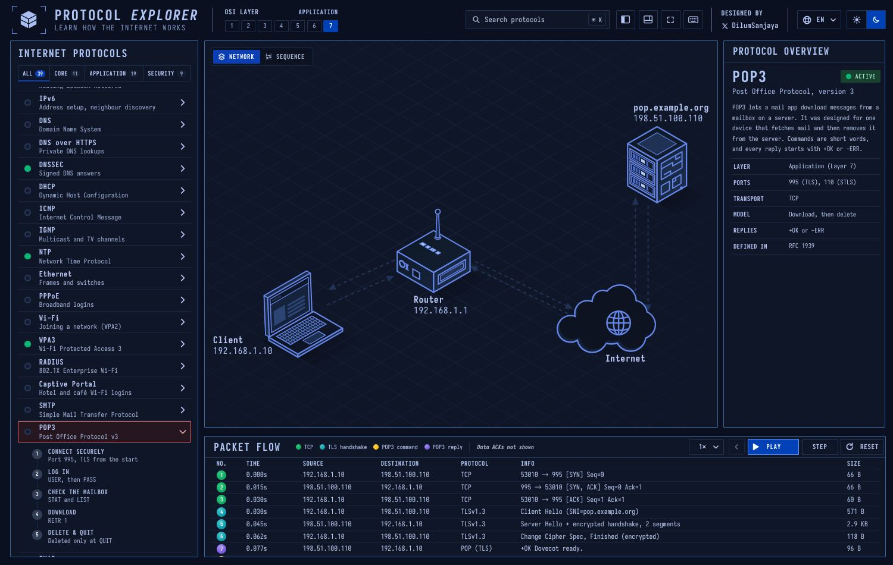
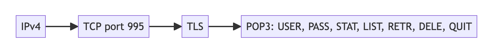
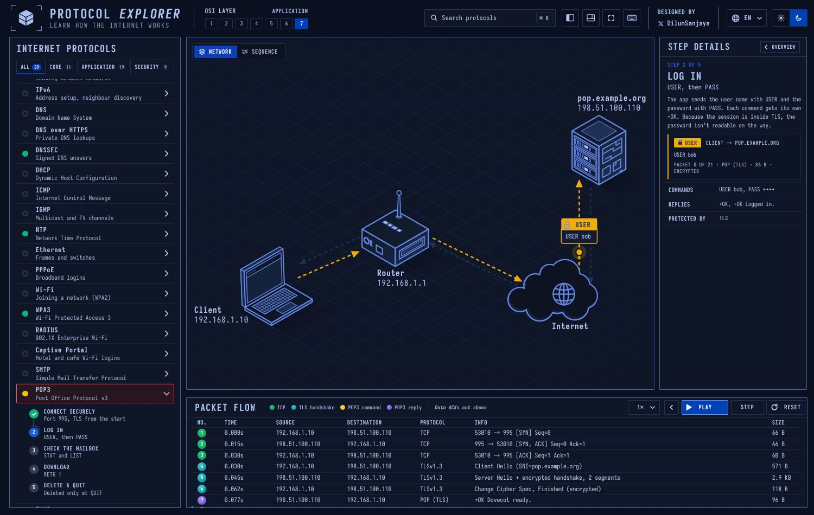
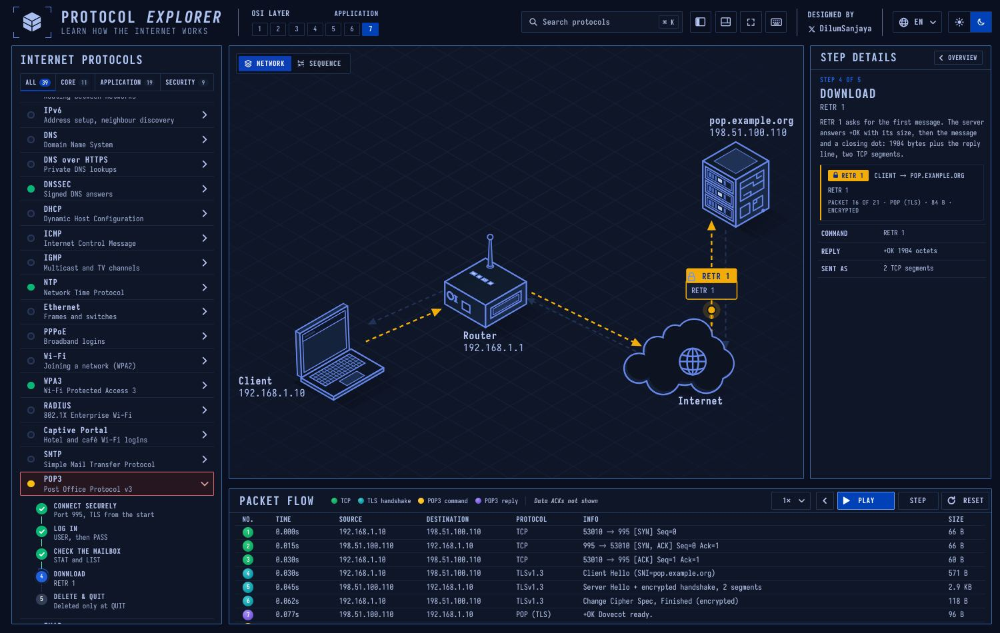
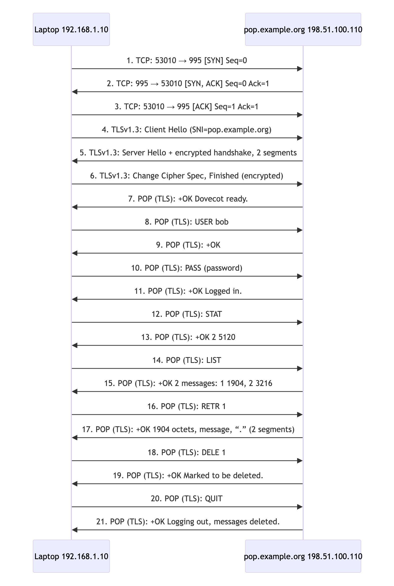
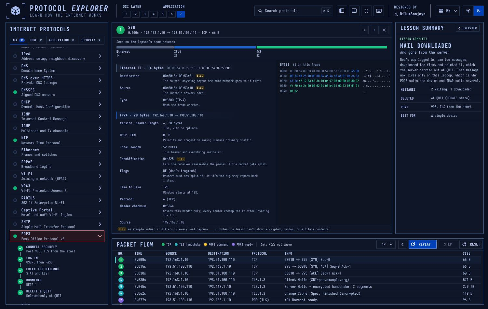
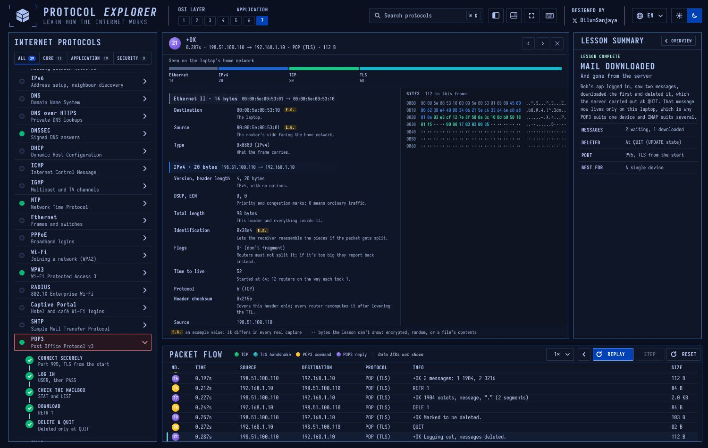

# POP3 – Post Office Protocol v3

<!-- nav -->
⬅ [27 SMTP](27-smtp.md) · [Index](00_Protocols_Index.md) · [29 IMAP](29-imap.md) ➡
<!-- nav -->

*Source: Protocol Explorer – https://protocol-explorer-alpha.vercel.app/ (interactive lesson #28). Screenshots captured from the live lesson; packet decodes are the site's example capture (values marked **E.G.** differ in every real capture).*

## Overview

### How the layers fit together (outer to inner)

## In-depth explanation of the example (plain-language version)

### The big picture in one minute
**Bob** opens his mail app. It connects to his mail server `pop.example.org` on **port 995** and **downloads** his mail: log in, check how many messages there are (2), download message 1, mark it for deletion, and log out. **21 packets in 0.29 seconds.** (The email Alice sent in the SMTP lesson is sitting in this mailbox.)

**What POP3 is.** The *Post Office Protocol* is the simplest way to **read** mail: **connect → download → (delete) → disconnect.** It was designed for **one computer** that picks up mail and removes it from the server. Commands are short words, and **every reply begins with `+OK` (success) or `-ERR` (failure)**. (SMTP *sends* mail; POP3 and IMAP *read* it.)

Think of **collecting your letters from a PO box**: you take them home, and the box is emptied.

> **Words you'll see:** *Mailbox* = the server's storage for your mail. *Octets* = bytes. *TLS* = encryption. A line with only a dot (`.`) marks the end of a long reply.

---

### Step 1 – Connect securely – packets 1 to 7
After the TCP handshake to **port 995** (POP3 with encryption from the first byte), a TLS handshake follows. The server greets: **`+OK Dovecot ready.`** Without encryption, the password in the next step would cross the network as readable text.

### Step 2 – Log in – packets 8 to 11
`USER bob` → `+OK`, then `PASS ••••` → `+OK Logged in.` The server **locks the mailbox**, so only **one session at a time** can use it.

### Step 3 – Check the mailbox – packets 12 to 15
- **`STAT`** → `+OK 2 5120`: "2 messages, 5,120 bytes in total."
- **`LIST`** → one line per message: `1 1904` and `2 3216` (message number and size), ending with a lone `.`.
Messages have only temporary numbers (1, 2…) that can change next time. A command called **`UIDL`** gives permanent IDs so the app doesn't download the same mail twice.

### Step 4 – Download – packets 16, 17
**`RETR 1`** → `+OK 1904 octets`, followed by the **complete message** (headers and body, exactly as SMTP delivered it) and a closing `.`. Other handy commands: `TOP` (just the headers and a few lines, for a preview) and `RSET` (undo deletion marks).

### Step 5 – Delete and quit – packets 18 to 21
- **`DELE 1`** → "Marked to be deleted." It only **marks** the message.
- **`QUIT`** → "Logging out, messages deleted." The server actually removes the marked messages **only when you QUIT**. If the connection broke before that, nothing would be deleted. Many apps offer **"leave a copy on the server"**, which simply skips `DELE`.

### The three stages of a session
`AUTHORIZATION` (greeting and login) → `TRANSACTION` (STAT, LIST, RETR, DELE) → `UPDATE` (after QUIT: deletions applied, lock released).

---

### The 21 packets at a glance
| Packets | What | Why |
|---|---|---|
| 1–7 | TCP + TLS to port 995 | connect securely |
| 8–11 | USER, PASS | log in |
| 12–15 | STAT, LIST | see what's there |
| 16–17 | RETR 1 | download message 1 |
| 18–21 | DELE, QUIT | delete and log out |

### POP3 vs IMAP
| | **POP3** | **IMAP** (next note) |
|---|---|---|
| Idea | download (and usually delete from the server) | mail stays on the server |
| Several devices | poor (each has its own copy) | made for it |
| Folders and flags | none (inbox only) | yes |
| Ports | 995 (TLS), 110 (+STLS) | 993 (TLS), 143 (+STARTTLS) |

### What to remember
- Replies: **`+OK`** or **`-ERR`**. Commands: `USER, PASS, STAT, LIST, RETR, DELE, TOP, UIDL, NOOP, RSET, QUIT`.
- Good for: a single device, small server storage, keeping an offline archive. Not good for: phone + laptop + webmail all sharing one mailbox.
- Security: always use TLS (port 995, or `STLS` on 110). Avoid plain text logins.

## Under the hood – technical details

- **Replies.** Every reply starts with `+OK` or `-ERR`. A reply that has several lines ends with a line containing a single dot.
- **Three states.** `AUTHORIZATION` (greeting, login), `TRANSACTION` (commands that read and mark messages) and `UPDATE` (entered after `QUIT`: deletions are applied and the lock is released).
- **Locking.** After login the mailbox is locked, so only one POP3 session can be active at a time.
- **Commands.** `USER`, `PASS`, `STAT` (message count and total bytes), `LIST` (number and size of each message), `RETR n` (download), `DELE n` (mark for deletion), `TOP n lines` (headers and a few lines, as a preview), `UIDL` (permanent unique IDs), `NOOP`, `RSET` (clears deletion marks), `QUIT`.
- **Deletion semantics.** `DELE` only *marks* a message. The server really deletes it when the session ends with `QUIT`. A dropped connection leaves everything in place. "Leave a copy on the server" means the client simply never sends `DELE`.
- **Message numbers vs UIDs.** The numbers 1, 2, 3 are valid only for the current session and may change. `UIDL` gives permanent IDs so the client doesn't download the same mail twice.
- **Ports.** `995` POP3S (TLS from the start), `110` plain with the `STLS` command to upgrade.
- **Authentication.** `USER` and `PASS` send the password in clear text unless TLS is on. Alternatives: `APOP` (challenge-based), `AUTH` with SASL mechanisms or OAuth tokens.
- **Compared with IMAP.** POP3 downloads and usually removes mail; it has no folders, flags or search, and several devices end up with different copies. IMAP keeps mail on the server and synchronises devices.
- **Good for.** A single device, small server storage, offline archiving. Not good for phone + laptop + webmail sharing one mailbox.
- **Security.** Always use TLS (995 or `STLS`).

## Step-by-step walkthrough

### Step 1: CONNECT SECURELY – Port 995, TLS from the start

### Step 2: LOG IN – USER, then PASS

### Step 3: CHECK THE MAILBOX – STAT and LIST

### Step 4: DOWNLOAD – RETR 1

### Step 5: DELETE & QUIT – Deleted only at QUIT

### Lesson summary

## Packet flow (whole lesson)

| No. | Time | Source | Destination | Protocol | Info | Size |
|---|---|---|---|---|---|---|
| 1 | 0.000s | 192.168.1.10 | 198.51.100.110 | TCP | 53010 → 995 [SYN] Seq=0 | 66 B |
| 2 | 0.015s | 198.51.100.110 | 192.168.1.10 | TCP | 995 → 53010 [SYN, ACK] Seq=0 Ack=1 | 66 B |
| 3 | 0.030s | 192.168.1.10 | 198.51.100.110 | TCP | 53010 → 995 [ACK] Seq=1 Ack=1 | 60 B |
| 4 | 0.030s | 192.168.1.10 | 198.51.100.110 | TLSv1.3 | Client Hello (SNI=pop.example.org) | 571 B |
| 5 | 0.045s | 198.51.100.110 | 192.168.1.10 | TLSv1.3 | Server Hello + encrypted handshake, 2 segments | 2.9 KB |
| 6 | 0.062s | 192.168.1.10 | 198.51.100.110 | TLSv1.3 | Change Cipher Spec, Finished (encrypted) | 118 B |
| 7 | 0.077s | 198.51.100.110 | 192.168.1.10 | POP (TLS) | +OK Dovecot ready. | 96 B |
| 8 | 0.092s | 192.168.1.10 | 198.51.100.110 | POP (TLS) | USER bob | 86 B |
| 9 | 0.107s | 198.51.100.110 | 192.168.1.10 | POP (TLS) | +OK | 81 B |
| 10 | 0.122s | 192.168.1.10 | 198.51.100.110 | POP (TLS) | PASS (password) | 89 B |
| 11 | 0.137s | 198.51.100.110 | 192.168.1.10 | POP (TLS) | +OK Logged in. | 92 B |
| 12 | 0.152s | 192.168.1.10 | 198.51.100.110 | POP (TLS) | STAT | 82 B |
| 13 | 0.167s | 198.51.100.110 | 192.168.1.10 | POP (TLS) | +OK 2 5120 | 88 B |
| 14 | 0.182s | 192.168.1.10 | 198.51.100.110 | POP (TLS) | LIST | 82 B |
| 15 | 0.197s | 198.51.100.110 | 192.168.1.10 | POP (TLS) | +OK 2 messages: 1 1904, 2 3216 | 112 B |
| 16 | 0.212s | 192.168.1.10 | 198.51.100.110 | POP (TLS) | RETR 1 | 84 B |
| 17 | 0.227s | 198.51.100.110 | 192.168.1.10 | POP (TLS) | +OK 1904 octets, message, “.” (2 segments) | 2.0 KB |
| 18 | 0.242s | 192.168.1.10 | 198.51.100.110 | POP (TLS) | DELE 1 | 84 B |
| 19 | 0.257s | 198.51.100.110 | 192.168.1.10 | POP (TLS) | +OK Marked to be deleted. | 103 B |
| 20 | 0.272s | 192.168.1.10 | 198.51.100.110 | POP (TLS) | QUIT | 82 B |
| 21 | 0.287s | 198.51.100.110 | 192.168.1.10 | POP (TLS) | +OK Logging out, messages deleted. | 112 B |

### Sequence diagram

*The lesson's own sequence diagram:*

## Packet decoder screenshots

The lesson's decoder view for the first, middle and last packet: headers, field values and the raw hex bytes.

### Packet 1: TCP – 53010 → 995 [SYN] Seq=0

*192.168.1.10 → 198.51.100.110 · 66 B · t = 0.000s*

### Packet 11: POP (TLS) – +OK Logged in.

*198.51.100.110 → 192.168.1.10 · 92 B · t = 0.137s*

### Packet 21: POP (TLS) – +OK Logging out, messages deleted.

*198.51.100.110 → 192.168.1.10 · 112 B · t = 0.287s*

---

<!-- nav -->
⬅ [27 SMTP](27-smtp.md) · [Index](00_Protocols_Index.md) · [29 IMAP](29-imap.md) ➡
<!-- nav -->
