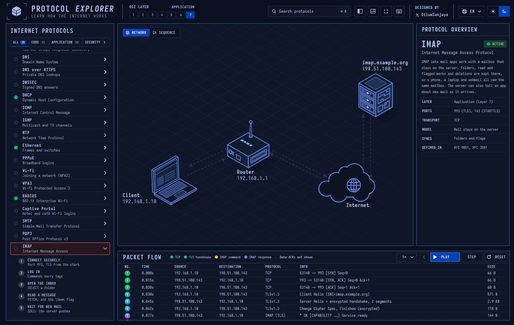
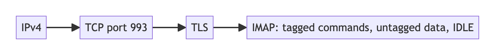
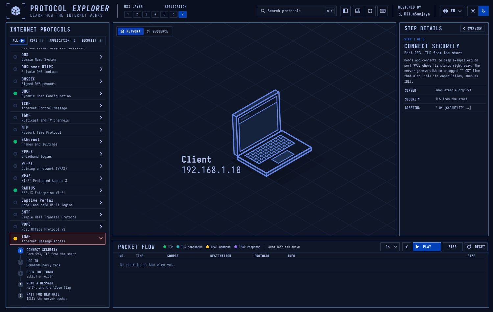
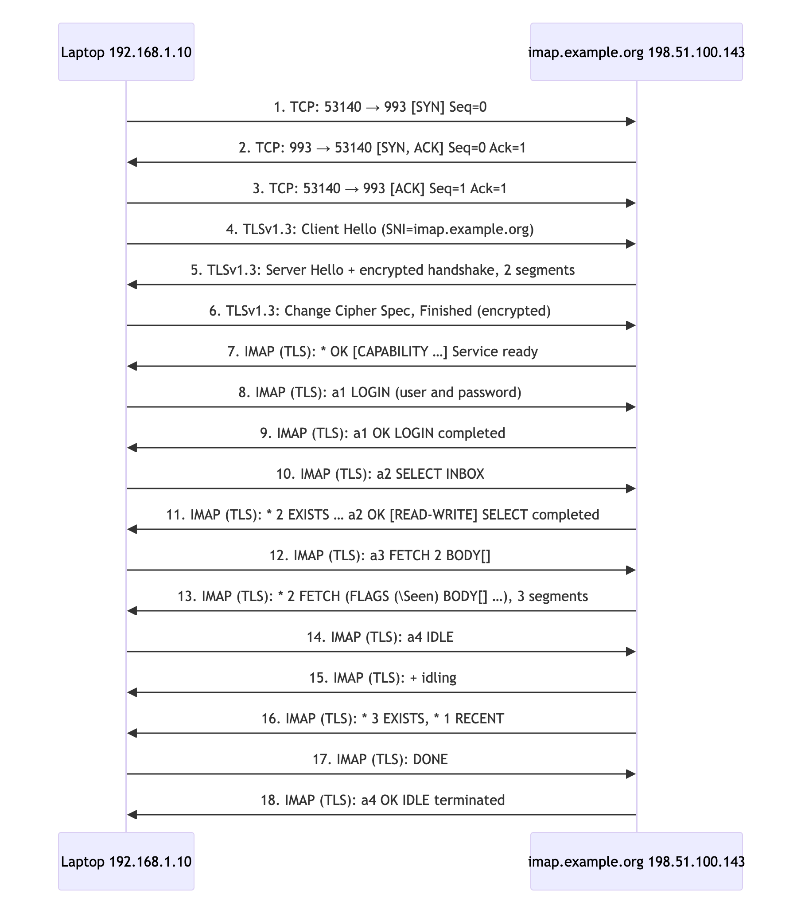
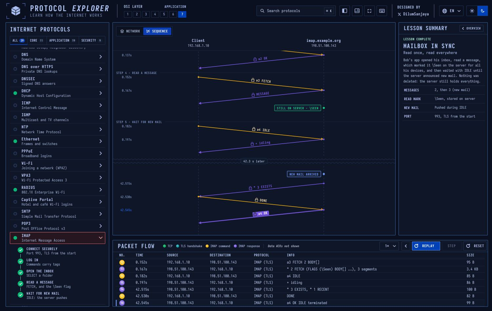

# IMAP – Internet Message Access

<!-- nav -->
⬅ [28 POP3](28-pop3.md) · [Index](00_Protocols_Index.md) · [30 FTP](30-ftp.md) ➡
<!-- nav -->

*Source: Protocol Explorer – https://protocol-explorer-alpha.vercel.app/ (interactive lesson #29). Screenshots captured from the live lesson; packet decodes are the site's example capture (values marked **E.G.** differ in every real capture).*

## Overview

### How the layers fit together (outer to inner)

## In-depth explanation of the example (plain-language version)

### The big picture in one minute
**Bob's** mail app connects to `imap.example.org` on **port 993**, logs in, opens the **INBOX** (2 messages), reads message 2, and then **waits in "IDLE" mode**. At 42 seconds Alice's new message arrives and the server **pushes a notification** to the app. **18 packets over 42.5 seconds.**

**What IMAP is.** IMAP keeps your mailbox **on the server**. **Folders, read/unread marks, flags and deletions all live there**, so your phone, laptop and webmail all see **the same mailbox in real time.** The app is just a *window* onto the server's data and downloads only what it needs (headers first, full messages on demand).

Think of **reading your mail at a mail shop where it all stays in your shelf**: you can look from any shop, and when you mark a letter "read" it's marked for everyone.

> **Words you'll see:** *Tag* = a label the client puts on each command. *Flag* = a mark on a message (Seen, Flagged…). *UID* = a permanent message ID. *Push* = the server telling you something without being asked.

---

### Step 1 – Connect securely – packets 1 to 7
TCP to **port 993** (encrypted from the start), then a TLS handshake. The server greets: **`* OK [CAPABILITY IMAP4rev1 IDLE …] Service ready`**. A line starting with `*` is an **untagged** message (information from the server). The bracket lists what the server can do, such as `IDLE`, `MOVE`, and so on.

### Step 2 – Log in – packets 8, 9
**`a1 LOGIN bob ••••••`** → **`a1 OK LOGIN completed`.** Every command starts with a **tag** the client chooses (`a1`, `a2`…), and the server ends its answer with **the same tag**. That's because **several commands can be in progress at once**, and the tag matches each reply to its request.

### Step 3 – Open the inbox – packets 10, 11
**`a2 SELECT INBOX`** → the server reports:
- `* 2 EXISTS`: there are 2 messages;
- the flags it supports (`\Seen`, `\Answered`, `\Flagged`, `\Deleted`, `\Draft`);
- `[UNSEEN 2]`: message 2 is the first unread;
- a permanent-ID "version number" (`UIDVALIDITY`), so apps can safely cache;
- `a2 OK [READ-WRITE] SELECT completed`.

### Step 4 – Read a message – packets 12, 13
**`a3 FETCH 2 BODY[]`** downloads message 2 (3.4 KB in 3 TCP segments). IMAP could also fetch just the headers or one part (to skip a big attachment). Reading it **marks it `\Seen` on the server**, so it shows as read on Bob's phone too, and **the message stays on the server.**

### Step 5 – Wait for new mail (IDLE) – packets 14 to 18
IMAP normally answers only when asked, so an app would have to keep checking. **`a4 IDLE`** says "tell me when something changes." The server replies **`+ idling`** and keeps the connection open. **42 seconds later** Alice's message arrives (by SMTP) and the server **instantly pushes** `* 3 EXISTS` and `* 1 RECENT`. The app ends the wait with **`DONE`**, the server closes the command, and the app fetches message 3. (Servers drop idle connections after about 30 minutes, so apps renew `IDLE`.)

---

### The 18 packets at a glance
| Packets | What | Why |
|---|---|---|
| 1–7 | TCP + TLS to port 993 | connect securely |
| 8–9 | LOGIN | log in |
| 10–11 | SELECT INBOX | open the folder |
| 12–13 | FETCH 2 | read message 2 |
| 14–18 | IDLE, push, DONE | instant new-mail notice |

### What to remember
- **Mail stays on the server**; flags and folders are shared by every device.
- **Message IDs:** sequence numbers (1…n, which change when messages are removed) vs **UIDs** (permanent within a folder).
- **Main commands:** `LOGIN`, `SELECT`, `LIST` (folders), `FETCH` (read), `STORE` (set flags), `SEARCH`, `COPY/MOVE`, `APPEND`, `EXPUNGE`, `IDLE`, `LOGOUT`.
- **Standard flags:** `\Seen \Answered \Flagged \Deleted \Draft \Recent`.
- **Ports:** **993** (TLS), **143** (+STARTTLS). Sending mail still uses SMTP (587 or 465).
- Compared with POP3: POP3 is simple download-and-delete; IMAP adds server-side folders, search, multi-device sync and partial downloads.

## Under the hood – technical details

- **Tags.** Each client command starts with a tag the client chooses (`a1`, `a2`). The server finishes the command with a **tagged status** (`a1 OK`, `NO`, `BAD`). Because replies are matched by tag, several commands can be in progress at once.
- **Untagged and continuation lines.** A line starting `*` is *untagged* data sent as part of a reply or by the server on its own (for example `* 3 EXISTS`). A line starting `+` means "continue" (send the next part).
- **States.** Not authenticated, authenticated, selected (a mailbox is open) and logout.
- **SELECT output.** `EXISTS` (number of messages), `RECENT`, `FLAGS`, `UNSEEN` (first unread), `UIDVALIDITY` and `UIDNEXT`.
- **UIDs.** A message has a *sequence number* (1 to n, which shifts when messages are removed) and a **UID** (permanent within the folder). As long as `UIDVALIDITY` is unchanged, a client can safely cache by UID.
- **Flags.** `\Seen`, `\Answered`, `\Flagged`, `\Deleted`, `\Draft`, `\Recent`, plus custom keywords. Flags are stored on the server and shared by every device.
- **FETCH.** The client chooses what to download: `ENVELOPE`, `BODY.PEEK[HEADER]`, a single MIME part, or the whole `BODY[]`. Fetching `BODY[]` sets `\Seen`; `BODY.PEEK[]` does not. This lets phones skip large attachments.
- **Main commands.** `LOGIN` or `AUTHENTICATE`, `SELECT`/`EXAMINE`, `LIST`, `FETCH`, `STORE` (change flags), `SEARCH`, `COPY`/`MOVE`, `APPEND`, `EXPUNGE` (permanently remove `\Deleted` messages), `IDLE`, `LOGOUT`.
- **IDLE.** The client says `IDLE` and the server holds the connection, pushing changes (`* 3 EXISTS`) the moment they happen. The client ends it with `DONE`. Servers drop idle connections after about 30 minutes, so clients re-issue `IDLE`.
- **Capabilities.** The greeting lists them: `IMAP4rev1`, `IDLE`, `UIDPLUS`, `MOVE`, `CONDSTORE`, `AUTH=PLAIN`.
- **Ports.** `993` TLS from the start, `143` with `STARTTLS`. Sending mail still uses SMTP.

## Step-by-step walkthrough

### Step 1: CONNECT SECURELY – Port 993, TLS from the start

### Step 2: LOG IN – Commands carry tags

### Step 3: OPEN THE INBOX – SELECT a folder

### Step 4: READ A MESSAGE – FETCH, and the \Seen flag

### Step 5: WAIT FOR NEW MAIL – IDLE: the server pushes

### Lesson summary

## Packet flow (whole lesson)

| No. | Time | Source | Destination | Protocol | Info | Size |
|---|---|---|---|---|---|---|
| 1 | 0.000s | 192.168.1.10 | 198.51.100.143 | TCP | 53140 → 993 [SYN] Seq=0 | 66 B |
| 2 | 0.015s | 198.51.100.143 | 192.168.1.10 | TCP | 993 → 53140 [SYN, ACK] Seq=0 Ack=1 | 66 B |
| 3 | 0.030s | 192.168.1.10 | 198.51.100.143 | TCP | 53140 → 993 [ACK] Seq=1 Ack=1 | 60 B |
| 4 | 0.030s | 192.168.1.10 | 198.51.100.143 | TLSv1.3 | Client Hello (SNI=imap.example.org) | 571 B |
| 5 | 0.045s | 198.51.100.143 | 192.168.1.10 | TLSv1.3 | Server Hello + encrypted handshake, 2 segments | 2.9 KB |
| 6 | 0.062s | 192.168.1.10 | 198.51.100.143 | TLSv1.3 | Change Cipher Spec, Finished (encrypted) | 118 B |
| 7 | 0.077s | 198.51.100.143 | 192.168.1.10 | IMAP (TLS) | * OK [CAPABILITY …] Service ready | 144 B |
| 8 | 0.092s | 192.168.1.10 | 198.51.100.143 | IMAP (TLS) | a1 LOGIN (user and password) | 97 B |
| 9 | 0.107s | 198.51.100.143 | 192.168.1.10 | IMAP (TLS) | a1 OK LOGIN completed | 99 B |
| 10 | 0.122s | 192.168.1.10 | 198.51.100.143 | IMAP (TLS) | a2 SELECT INBOX | 93 B |
| 11 | 0.137s | 198.51.100.143 | 192.168.1.10 | IMAP (TLS) | * 2 EXISTS … a2 OK [READ-WRITE] SELECT completed | 396 B |
| 12 | 0.152s | 192.168.1.10 | 198.51.100.143 | IMAP (TLS) | a3 FETCH 2 BODY[] | 95 B |
| 13 | 0.167s | 198.51.100.143 | 192.168.1.10 | IMAP (TLS) | * 2 FETCH (FLAGS (\Seen) BODY[] …), 3 segments | 3.4 KB |
| 14 | 0.182s | 192.168.1.10 | 198.51.100.143 | IMAP (TLS) | a4 IDLE | 85 B |
| 15 | 0.197s | 198.51.100.143 | 192.168.1.10 | IMAP (TLS) | + idling | 86 B |
| 16 | 42.515s | 198.51.100.143 | 192.168.1.10 | IMAP (TLS) | * 3 EXISTS, * 1 RECENT | 100 B |
| 17 | 42.530s | 192.168.1.10 | 198.51.100.143 | IMAP (TLS) | DONE | 82 B |
| 18 | 42.545s | 198.51.100.143 | 192.168.1.10 | IMAP (TLS) | a4 OK IDLE terminated | 99 B |

### Sequence diagram

*The lesson's own sequence diagram:*

## Packet decoder screenshots

The lesson's decoder view for the first, middle and last packet: headers, field values and the raw hex bytes.

### Packet 1: TCP – 53140 → 993 [SYN] Seq=0

*192.168.1.10 → 198.51.100.143 · 66 B · t = 0.000s*

### Packet 10: IMAP (TLS) – a2 SELECT INBOX

*192.168.1.10 → 198.51.100.143 · 93 B · t = 0.122s*

### Packet 18: IMAP (TLS) – a4 OK IDLE terminated

*198.51.100.143 → 192.168.1.10 · 99 B · t = 42.545s*

---

<!-- nav -->
⬅ [28 POP3](28-pop3.md) · [Index](00_Protocols_Index.md) · [30 FTP](30-ftp.md) ➡
<!-- nav -->
