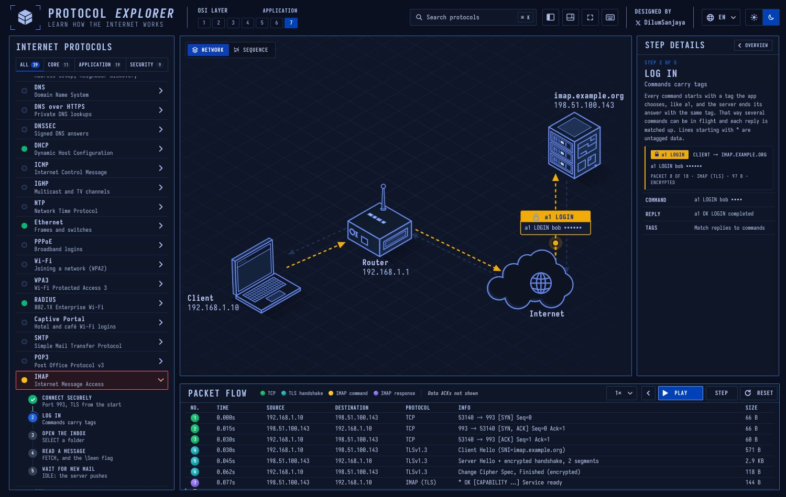
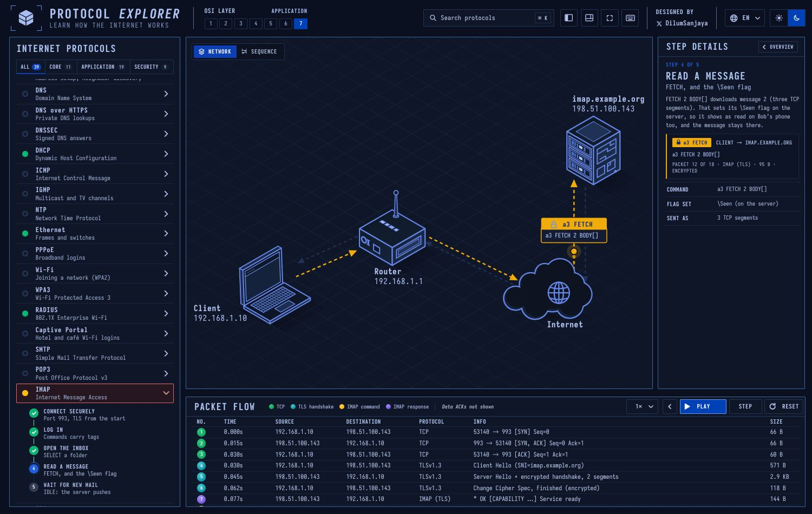
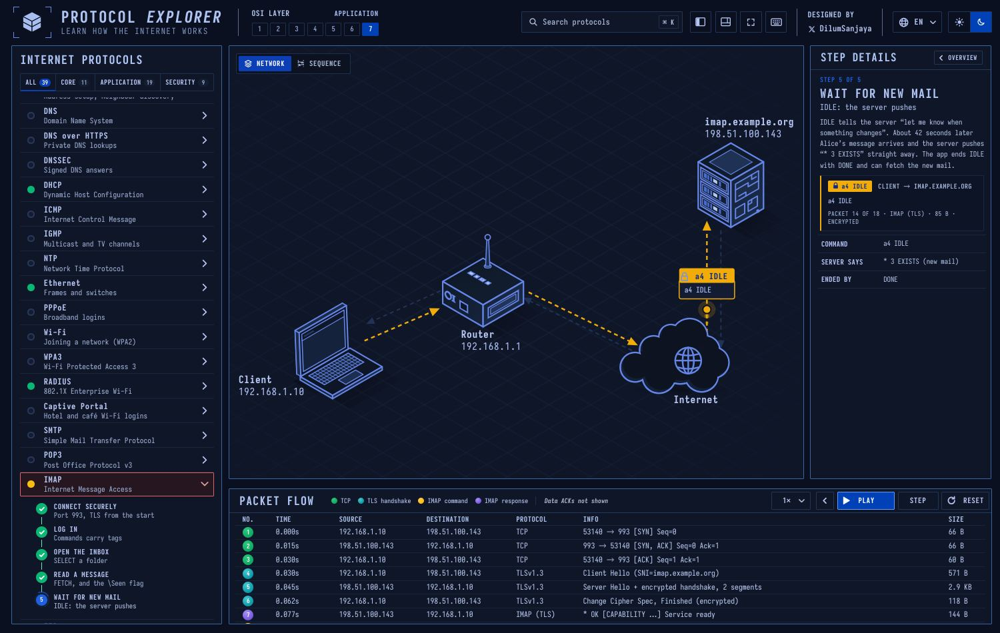
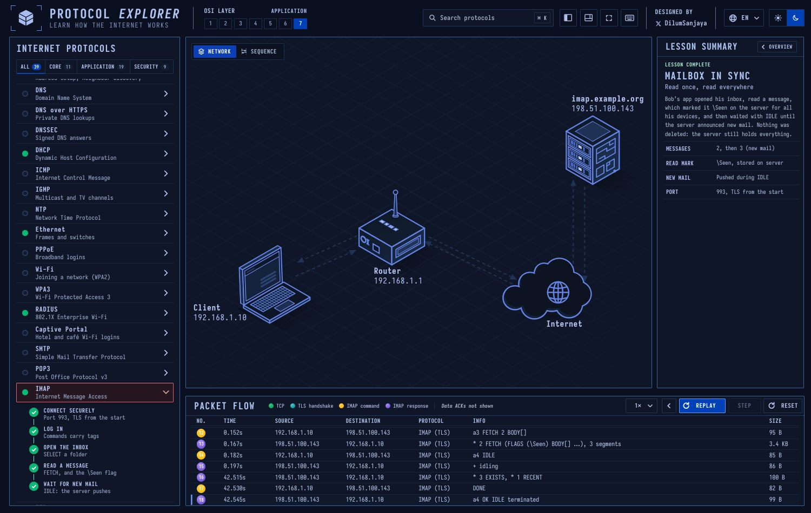
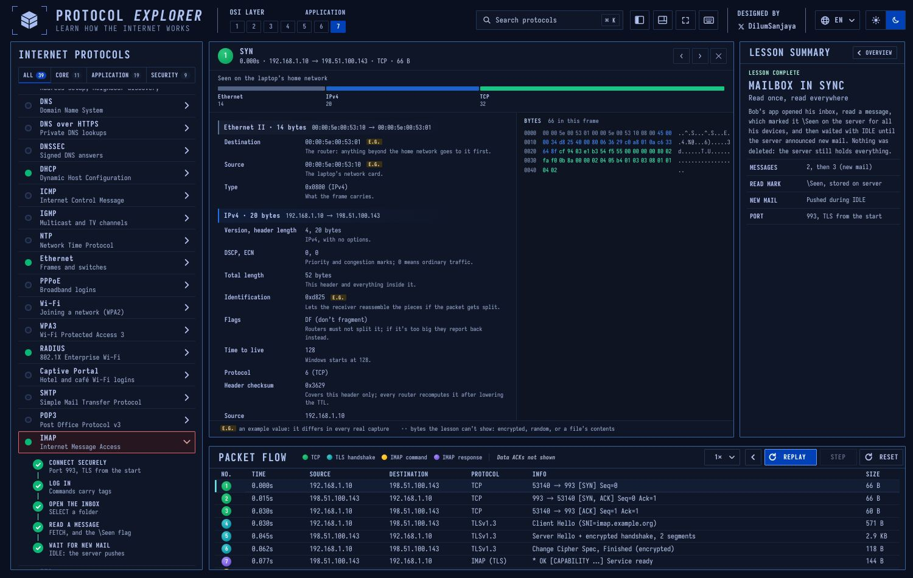
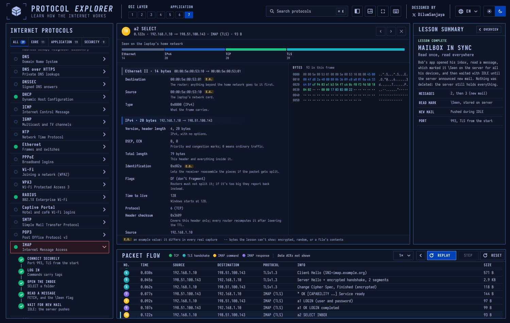
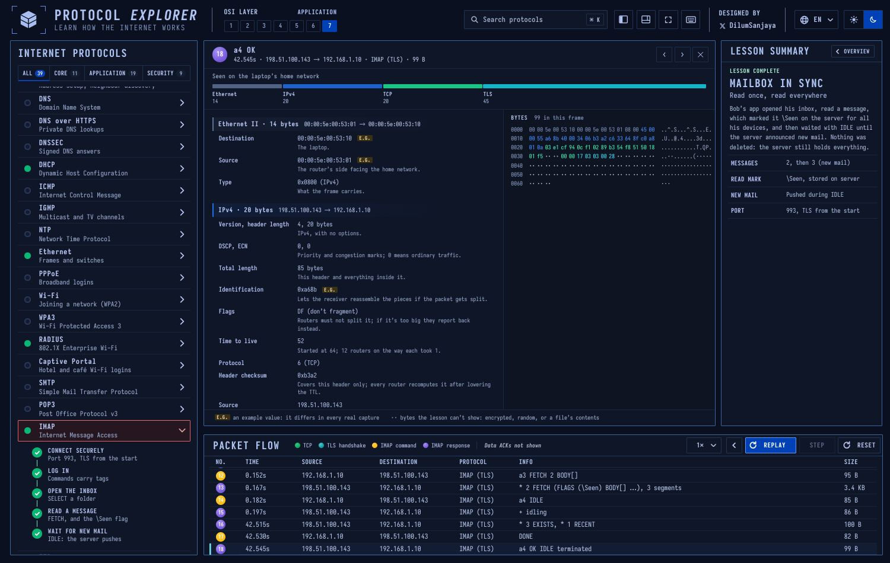

# IMAP – Internet Message Access

<!-- nav -->
⬅ [28 POP3](28-pop3.md) · [Index](00_Protocols_Index.md) · [30 FTP](30-ftp.md) ➡
<!-- nav -->

*Source: Protocol Explorer – https://protocol-explorer-alpha.vercel.app/ (interactive lesson #29). Screenshots captured from the live lesson; packet decodes are the site's example capture (values marked **E.G.** differ in every real capture).*

## Overview


> PROTOCOL OVERVIEW  
> IMAP  
> ACTIVE  
> Internet Message Access Protocol  
> IMAP lets mail apps work with a mailbox that stays on the server. Folders, read and flagged marks and deletions are kept there, so a phone, a laptop and webmail all see the same mailbox. The server can also tell an app about new mail as it arrives.  
> LAYER  
> Application (Layer 7)  
> PORTS  
> 993 (TLS), 143 (STARTTLS)  
> TRANSPORT  
> TCP  
> MODEL  
> Mail stays on the server  
> SYNCS  
> Folders and flags  
> DEFINED IN  
> RFC 9051, RFC 3501  

## In-depth explanation of the example (plain-language version)

### The big picture in one minute
**Bob's** mail app connects to `imap.example.org` on **port 993**, logs in, opens the **INBOX** (2 messages), reads message 2, and then **waits in "IDLE" mode**. At 42 seconds Alice's new message arrives and the server **pushes a notification** to the app. **18 packets over 42.5 seconds.**

**What IMAP is.** IMAP keeps your mailbox **on the server**. **Folders, read/unread marks, flags and deletions all live there**, so your phone, laptop and webmail all see **the same mailbox in real time.** The app is just a *window* onto the server's data and downloads only what it needs (headers first, full messages on demand).

Think of **reading your mail at a mail shop where it all stays in your shelf**: you can look from any shop, and when you mark a letter "read" it's marked for everyone.

> **Words you'll see:** *Tag* = a label the client puts on each command. *Flag* = a mark on a message (Seen, Flagged…). *UID* = a permanent message ID. *Push* = the server telling you something without being asked.

---

### Step 1 – Connect securely – packets 1 to 7
TCP to **port 993** (encrypted from the start), then a TLS handshake. The server greets: **`* OK [CAPABILITY IMAP4rev1 IDLE …] Service ready`**. A line starting with `*` is an **untagged** message (information from the server). The bracket lists what the server can do, such as `IDLE`, `MOVE`, and so on.

### Step 2 – Log in – packets 8, 9
**`a1 LOGIN bob ••••••`** → **`a1 OK LOGIN completed`.** Every command starts with a **tag** the client chooses (`a1`, `a2`…), and the server ends its answer with **the same tag**. That's because **several commands can be in progress at once**, and the tag matches each reply to its request.

### Step 3 – Open the inbox – packets 10, 11
**`a2 SELECT INBOX`** → the server reports:
- `* 2 EXISTS`: there are 2 messages;
- the flags it supports (`\Seen`, `\Answered`, `\Flagged`, `\Deleted`, `\Draft`);
- `[UNSEEN 2]`: message 2 is the first unread;
- a permanent-ID "version number" (`UIDVALIDITY`), so apps can safely cache;
- `a2 OK [READ-WRITE] SELECT completed`.

### Step 4 – Read a message – packets 12, 13
**`a3 FETCH 2 BODY[]`** downloads message 2 (3.4 KB in 3 TCP segments). IMAP could also fetch just the headers or one part (to skip a big attachment). Reading it **marks it `\Seen` on the server**, so it shows as read on Bob's phone too, and **the message stays on the server.**

### Step 5 – Wait for new mail (IDLE) – packets 14 to 18
IMAP normally answers only when asked, so an app would have to keep checking. **`a4 IDLE`** says "tell me when something changes." The server replies **`+ idling`** and keeps the connection open. **42 seconds later** Alice's message arrives (by SMTP) and the server **instantly pushes** `* 3 EXISTS` and `* 1 RECENT`. The app ends the wait with **`DONE`**, the server closes the command, and the app fetches message 3. (Servers drop idle connections after about 30 minutes, so apps renew `IDLE`.)

---

### The 18 packets at a glance
| Packets | What | Why |
|---|---|---|
| 1–7 | TCP + TLS to port 993 | connect securely |
| 8–9 | LOGIN | log in |
| 10–11 | SELECT INBOX | open the folder |
| 12–13 | FETCH 2 | read message 2 |
| 14–18 | IDLE, push, DONE | instant new-mail notice |

### What to remember
- **Mail stays on the server**; flags and folders are shared by every device.
- **Message IDs:** sequence numbers (1…n, which change when messages are removed) vs **UIDs** (permanent within a folder).
- **Main commands:** `LOGIN`, `SELECT`, `LIST` (folders), `FETCH` (read), `STORE` (set flags), `SEARCH`, `COPY/MOVE`, `APPEND`, `EXPUNGE`, `IDLE`, `LOGOUT`.
- **Standard flags:** `\Seen \Answered \Flagged \Deleted \Draft \Recent`.
- **Ports:** **993** (TLS), **143** (+STARTTLS). Sending mail still uses SMTP (587 or 465).
- Compared with POP3: POP3 is simple download-and-delete; IMAP adds server-side folders, search, multi-device sync and partial downloads.

## Step-by-step walkthrough (screenshots from the lesson)

### Step 1: CONNECT SECURELY – Port 993, TLS from the start


> STEP 1 OF 5  
> CONNECT SECURELY  
> Port 993, TLS from the start  
> Bob’s app connects to imap.example.org on port 993, where TLS starts right away. The server greets with an untagged “* OK” line that also lists its capabilities, such as IDLE.  
> SERVER  
> imap.example.org:993  
> SECURITY  
> TLS from the start  
> GREETING  
> * OK [CAPABILITY …]  

### Step 2: LOG IN – Commands carry tags



> STEP 2 OF 5  
> LOG IN  
> Commands carry tags  
> Every command starts with a tag the app chooses, like a1, and the server ends its answer with the same tag. That way several commands can be in flight and each reply is matched up. Lines starting with * are untagged data.  
> a1 LOGIN  
> CLIENT → IMAP.EXAMPLE.ORG  
> a1 LOGIN bob ••••••  
> PACKET 8 OF 18 · IMAP (TLS) · 97 B · ENCRYPTED  
> COMMAND  
> a1 LOGIN bob ••••  
> REPLY  
> a1 OK LOGIN completed  
> TAGS  
> Match replies to commands  

### Step 3: OPEN THE INBOX – SELECT a folder


> STEP 3 OF 5  
> OPEN THE INBOX  
> SELECT a folder  
> SELECT INBOX opens the folder. The server reports the message count, the flags it supports and the first unread message, then confirms the folder is open read-write.  
> a2 SELECT  
> CLIENT → IMAP.EXAMPLE.ORG  
> a2 SELECT INBOX  
> PACKET 10 OF 18 · IMAP (TLS) · 93 B · ENCRYPTED  
> MESSAGES  
> * 2 EXISTS  
> FIRST UNREAD  
> Message 2  
> ACCESS  
> [READ-WRITE]  

### Step 4: READ A MESSAGE – FETCH, and the \Seen flag



> STEP 4 OF 5  
> READ A MESSAGE  
> FETCH, and the \Seen flag  
> FETCH 2 BODY[] downloads message 2 (three TCP segments). That sets its \Seen flag on the server, so it shows as read on Bob’s phone too, and the message stays there.  
> a3 FETCH  
> CLIENT → IMAP.EXAMPLE.ORG  
> a3 FETCH 2 BODY[]  
> PACKET 12 OF 18 · IMAP (TLS) · 95 B · ENCRYPTED  
> COMMAND  
> a3 FETCH 2 BODY[]  
> FLAG SET  
> \Seen (on the server)  
> SENT AS  
> 3 TCP segments  

### Step 5: WAIT FOR NEW MAIL – IDLE: the server pushes



> STEP 5 OF 5  
> WAIT FOR NEW MAIL  
> IDLE: the server pushes  
> IDLE tells the server “let me know when something changes”. About 42 seconds later Alice’s message arrives and the server pushes “* 3 EXISTS” straight away. The app ends IDLE with DONE and can fetch the new mail.  
> a4 IDLE  
> CLIENT → IMAP.EXAMPLE.ORG  
> a4 IDLE  
> PACKET 14 OF 18 · IMAP (TLS) · 85 B · ENCRYPTED  
> COMMAND  
> a4 IDLE  
> SERVER SAYS  
> * 3 EXISTS (new mail)  
> ENDED BY  
> DONE  

### Lesson summary



> LESSON SUMMARY  
> LESSON COMPLETE  
> MAILBOX IN SYNC  
> Read once, read everywhere  
> Bob’s app opened his inbox, read a message, which marked it \Seen on the server for all his devices, and then waited with IDLE until the server announced new mail. Nothing was deleted: the server still holds everything.  
> a4 OK  
> IMAP.EXAMPLE.ORG → CLIENT  
> a4 OK IDLE terminated  
> PACKET 18 OF 18 · IMAP (TLS) · 99 B · ENCRYPTED  
> MESSAGES  
> 2, then 3 (new mail)  
> READ MARK  
> \Seen, stored on server  
> NEW MAIL  
> Pushed during IDLE  
> PORT  
> 993, TLS from the start  

## Packet flow (whole lesson)

| No. | Time | Source | Destination | Protocol | Info | Size |
|---|---|---|---|---|---|---|
| 1 | 0.000s | 192.168.1.10 | 198.51.100.143 | TCP | 53140 → 993 [SYN] Seq=0 | 66 B |
| 2 | 0.015s | 198.51.100.143 | 192.168.1.10 | TCP | 993 → 53140 [SYN, ACK] Seq=0 Ack=1 | 66 B |
| 3 | 0.030s | 192.168.1.10 | 198.51.100.143 | TCP | 53140 → 993 [ACK] Seq=1 Ack=1 | 60 B |
| 4 | 0.030s | 192.168.1.10 | 198.51.100.143 | TLSv1.3 | Client Hello (SNI=imap.example.org) | 571 B |
| 5 | 0.045s | 198.51.100.143 | 192.168.1.10 | TLSv1.3 | Server Hello + encrypted handshake, 2 segments | 2.9 KB |
| 6 | 0.062s | 192.168.1.10 | 198.51.100.143 | TLSv1.3 | Change Cipher Spec, Finished (encrypted) | 118 B |
| 7 | 0.077s | 198.51.100.143 | 192.168.1.10 | IMAP (TLS) | * OK [CAPABILITY …] Service ready | 144 B |
| 8 | 0.092s | 192.168.1.10 | 198.51.100.143 | IMAP (TLS) | a1 LOGIN (user and password) | 97 B |
| 9 | 0.107s | 198.51.100.143 | 192.168.1.10 | IMAP (TLS) | a1 OK LOGIN completed | 99 B |
| 10 | 0.122s | 192.168.1.10 | 198.51.100.143 | IMAP (TLS) | a2 SELECT INBOX | 93 B |
| 11 | 0.137s | 198.51.100.143 | 192.168.1.10 | IMAP (TLS) | * 2 EXISTS … a2 OK [READ-WRITE] SELECT completed | 396 B |
| 12 | 0.152s | 192.168.1.10 | 198.51.100.143 | IMAP (TLS) | a3 FETCH 2 BODY[] | 95 B |
| 13 | 0.167s | 198.51.100.143 | 192.168.1.10 | IMAP (TLS) | * 2 FETCH (FLAGS (\Seen) BODY[] …), 3 segments | 3.4 KB |
| 14 | 0.182s | 192.168.1.10 | 198.51.100.143 | IMAP (TLS) | a4 IDLE | 85 B |
| 15 | 0.197s | 198.51.100.143 | 192.168.1.10 | IMAP (TLS) | + idling | 86 B |
| 16 | 42.515s | 198.51.100.143 | 192.168.1.10 | IMAP (TLS) | * 3 EXISTS, * 1 RECENT | 100 B |
| 17 | 42.530s | 192.168.1.10 | 198.51.100.143 | IMAP (TLS) | DONE | 82 B |
| 18 | 42.545s | 198.51.100.143 | 192.168.1.10 | IMAP (TLS) | a4 OK IDLE terminated | 99 B |

### Sequence diagram


## Packets decoded byte by byte

Each packet below is the lesson's own decode (headers, field values and the plain-English meaning of each field). Screenshots show the first, middle and last packet in the lesson's decoder view with the raw hex bytes.

### Packet 1: TCP – 53140 → 993 [SYN] Seq=0

*192.168.1.10 → 198.51.100.143 · 66 B · t = 0.000s*



<details><summary>Decoded fields</summary>

```text
1
SYN
0.000s · 192.168.1.10 → 198.51.100.143 · TCP · 66 B
Seen on the laptop’s home network
Ethernet
14
IPv4
20
TCP
32
Ethernet II · 14 bytes
00:00:5e:00:53:10 → 00:00:5e:00:53:01
Destination
00:00:5e:00:53:01 E.G.

The router: anything beyond the home network goes to it first.

Source
00:00:5e:00:53:10 E.G.

The laptop’s network card.

Type
0x0800 (IPv4)

What the frame carries.

IPv4 · 20 bytes
192.168.1.10 → 198.51.100.143
Version, header length
4, 20 bytes

IPv4, with no options.

DSCP, ECN
0, 0

Priority and congestion marks; 0 means ordinary traffic.

Total length
52 bytes

This header and everything inside it.

Identification
0xd825 E.G.

Lets the receiver reassemble the pieces if the packet gets split.

Flags
DF (don’t fragment)

Routers must not split it; if it’s too big they report back instead.

Time to live
128

Windows starts at 128.

Protocol
6 (TCP)
Header checksum
0x3629

Covers this header only; every router recomputes it after lowering the TTL.

Source
192.168.1.10
Destination
198.51.100.143
TCP · 32 bytes
53140 → 993, SYN
Source port
53140

Picked by the laptop’s system for this connection.

Destination port
993
Sequence number
0 (relative)

This side’s starting number. Shown as 0; the real one is random.

Real sequence number
3008689493 E.G.
Acknowledgment
0 (not used yet)

A first SYN has nothing to acknowledge.

Header length
32 bytes

20 bytes, plus 12 of options.

Flags
0x002 (SYN)
Window
64240 E.G.

How much more data this side can take right now.

Checksum
0x0b8a

Covers the header, the data and the IP addresses, so damage is caught.

Urgent pointer
0
Options
12 bytes
Maximum segment size
1460 bytes

The most data this side wants in one segment.

No-op
1

Spacing, so the next option lines up.

Window scale
× 256

Window values are multiplied by this, so windows can be larger than 64 KB.

No-op
1

Spacing, so the next option lines up.

No-op
1

Spacing, so the next option lines up.

SACK permitted
yes

This side understands selective acknowledgements.

BYTES 66 in this frame
0000
00
00
5e
00
53
01
00
00
5e
00
53
10
08
00
45
00
.
.
^
.
S
.
.
.
^
.
S
.
.
.
E
.
0010
00
34
d8
25
40
00
80
06
36
29
c0
a8
01
0a
c6
33
.
4
.
%
@
.
.
.
6
)
.
.
.
.
.
3
0020
64
8f
cf
94
03
e1
b3
54
f5
55
00
00
00
00
80
02
d
.
.
.
.
.
.
T
.
U
.
.
.
.
.
.
0030
fa
f0
0b
8a
00
00
02
04
05
b4
01
03
03
08
01
01
.
.
.
.
.
.
.
.
.
.
.
.
.
.
.
.
0040
04
02
.
.
E.G. an example value: it differs in every real capture
·· bytes the lesson can’t show: encrypted, random, or a file’s contents
```

</details>

### Packet 2: TCP – 993 → 53140 [SYN, ACK] Seq=0 Ack=1

*198.51.100.143 → 192.168.1.10 · 66 B · t = 0.015s*

<details><summary>Decoded fields</summary>

```text
2
SYN-ACK
0.015s · 198.51.100.143 → 192.168.1.10 · TCP · 66 B
Seen on the laptop’s home network
Ethernet
14
IPv4
20
TCP
32
Ethernet II · 14 bytes
00:00:5e:00:53:01 → 00:00:5e:00:53:10
Destination
00:00:5e:00:53:10 E.G.

The laptop.

Source
00:00:5e:00:53:01 E.G.

The router’s side facing the home network.

Type
0x0800 (IPv4)

What the frame carries.

IPv4 · 20 bytes
198.51.100.143 → 192.168.1.10
Version, header length
4, 20 bytes

IPv4, with no options.

DSCP, ECN
0, 0

Priority and congestion marks; 0 means ordinary traffic.

Total length
52 bytes

This header and everything inside it.

Identification
0xa683 E.G.

Lets the receiver reassemble the pieces if the packet gets split.

Flags
DF (don’t fragment)

Routers must not split it; if it’s too big they report back instead.

Time to live
52

Started at 64; 12 routers on the way each took 1.

Protocol
6 (TCP)
Header checksum
0xb3cb

Covers this header only; every router recomputes it after lowering the TTL.

Source
198.51.100.143
Destination
192.168.1.10
TCP · 32 bytes
993 → 53140, SYN, ACK
Source port
993
Destination port
53140
Sequence number
0 (relative)

This side’s starting number. Shown as 0; the real one is random.

Real sequence number
217114695 E.G.
Acknowledgment
1 (relative)

The next byte this side expects: everything before it has arrived.

Header length
32 bytes

20 bytes, plus 12 of options.

Flags
0x012 (SYN, ACK)
Window
64240 E.G.

How much more data this side can take right now.

Checksum
0x1642

Covers the header, the data and the IP addresses, so damage is caught.

Urgent pointer
0
Options
12 bytes
Maximum segment size
1460 bytes

The most data this side wants in one segment.

No-op
1

Spacing, so the next option lines up.

No-op
1

Spacing, so the next option lines up.

SACK permitted
yes

This side understands selective acknowledgements.

No-op
1

Spacing, so the next option lines up.

Window scale
× 128

Window values are multiplied by this, so windows can be larger than 64 KB.

BYTES 66 in this frame
0000
00
00
5e
00
53
10
00
00
5e
00
53
01
08
00
45
00
.
.
^
.
S
.
.
.
^
.
S
.
.
.
E
.
0010
00
34
a6
83
40
00
34
06
b3
cb
c6
33
64
8f
c0
a8
.
4
.
.
@
.
4
.
.
.
.
3
d
.
.
.
0020
01
0a
03
e1
cf
94
0c
f0
e8
47
b3
54
f5
56
80
12
.
.
.
.
.
.
.
.
.
G
.
T
.
V
.
.
0030
fa
f0
16
42
00
00
02
04
05
b4
01
01
04
02
01
03
.
.
.
B
.
.
.
.
.
.
.
.
.
.
.
.
0040
03
07
.
.
E.G. an example value: it differs in every real capture
·· bytes the lesson can’t show: encrypted, random, or a file’s contents
```

</details>

### Packet 3: TCP – 53140 → 993 [ACK] Seq=1 Ack=1

*192.168.1.10 → 198.51.100.143 · 60 B · t = 0.030s*

<details><summary>Decoded fields</summary>

```text
3
ACK
0.030s · 192.168.1.10 → 198.51.100.143 · TCP · 60 B
Seen on the laptop’s home network
Ethernet
14
IPv4
20
TCP
20
Padding
6
Ethernet II · 14 bytes
00:00:5e:00:53:10 → 00:00:5e:00:53:01
Destination
00:00:5e:00:53:01 E.G.

The router: anything beyond the home network goes to it first.

Source
00:00:5e:00:53:10 E.G.

The laptop’s network card.

Type
0x0800 (IPv4)

What the frame carries.

IPv4 · 20 bytes
192.168.1.10 → 198.51.100.143
Version, header length
4, 20 bytes

IPv4, with no options.

DSCP, ECN
0, 0

Priority and congestion marks; 0 means ordinary traffic.

Total length
40 bytes

This header and everything inside it.

Identification
0xd826 E.G.

Lets the receiver reassemble the pieces if the packet gets split.

Flags
DF (don’t fragment)

Routers must not split it; if it’s too big they report back instead.

Time to live
128

Windows starts at 128.

Protocol
6 (TCP)
Header checksum
0x3634

Covers this header only; every router recomputes it after lowering the TTL.

Source
192.168.1.10
Destination
198.51.100.143
TCP · 20 bytes
53140 → 993, ACK
Source port
53140

Picked by the laptop’s system for this connection.

Destination port
993
Sequence number
1 (relative)

Position of this segment’s first byte, counted from this side’s SYN.

Real sequence number
3008689494 E.G.
Acknowledgment
1 (relative)

The next byte this side expects: everything before it has arrived.

Header length
20 bytes
Flags
0x010 (ACK)
Window
1026 (× 256 = 262,656 bytes) E.G.

How much more data this side can take right now.

Checksum
0x4e03

Covers the header, the data and the IP addresses, so damage is caught.

Urgent pointer
0
Ethernet padding · 6 bytes
Padding
6 zero bytes

Ethernet frames are at least 60 bytes (64 with the checksum the card adds), so short ones are padded.

BYTES 60 in this frame
0000
00
00
5e
00
53
01
00
00
5e
00
53
10
08
00
45
00
.
.
^
.
S
.
.
.
^
.
S
.
.
.
E
.
0010
00
28
d8
26
40
00
80
06
36
34
c0
a8
01
0a
c6
33
.
(
.
&
@
.
.
.
6
4
.
.
.
.
.
3
0020
64
8f
cf
94
03
e1
b3
54
f5
56
0c
f0
e8
48
50
10
d
.
.
.
.
.
.
T
.
V
.
.
.
H
P
.
0030
04
02
4e
03
00
00
00
00
00
00
00
00
.
.
N
.
.
.
.
.
.
.
.
.
E.G. an example value: it differs in every real capture
·· bytes the lesson can’t show: encrypted, random, or a file’s contents
```

</details>

### Packet 4: TLSv1.3 – Client Hello (SNI=imap.example.org)

*192.168.1.10 → 198.51.100.143 · 571 B · t = 0.030s*

<details><summary>Decoded fields</summary>

```text
4
CLIENT HELLO
0.030s · 192.168.1.10 → 198.51.100.143 · TLSv1.3 · 571 B
Seen on the laptop’s home network
Ethernet
14
IPv4
20
TCP
20
TLS
517
Ethernet II · 14 bytes
00:00:5e:00:53:10 → 00:00:5e:00:53:01
Destination
00:00:5e:00:53:01 E.G.

The router: anything beyond the home network goes to it first.

Source
00:00:5e:00:53:10 E.G.

The laptop’s network card.

Type
0x0800 (IPv4)

What the frame carries.

IPv4 · 20 bytes
192.168.1.10 → 198.51.100.143
Version, header length
4, 20 bytes

IPv4, with no options.

DSCP, ECN
0, 0

Priority and congestion marks; 0 means ordinary traffic.

Total length
557 bytes

This header and everything inside it.

Identification
0xd827 E.G.

Lets the receiver reassemble the pieces if the packet gets split.

Flags
DF (don’t fragment)

Routers must not split it; if it’s too big they report back instead.

Time to live
128

Windows starts at 128.

Protocol
6 (TCP)
Header checksum
0x342e

Covers this header only; every router recomputes it after lowering the TTL.

Source
192.168.1.10
Destination
198.51.100.143
TCP · 20 bytes
53140 → 993, PSH, ACK
Source port
53140

Picked by the laptop’s system for this connection.

Destination port
993
Sequence number
1 (relative)

Position of this segment’s first byte, counted from this side’s SYN.

Real sequence number
3008689494 E.G.
Acknowledgment
1 (relative)

The next byte this side expects: everything before it has arrived.

Header length
20 bytes
Flags
0x018 (PSH, ACK)
Window
1026 (× 256 = 262,656 bytes) E.G.

How much more data this side can take right now.

Checksum
covers bytes not shown here

Covers the header, the data and the IP addresses, so damage is caught.

Urgent pointer
0
TLS 1.3 · 1 record
Record
Handshake, 512 bytes
Content type
22 (Handshake)
Version
0x0301 (TLS 1.0)

A Client Hello’s record says TLS 1.0 so old middleboxes let it through; the real versions are offered inside.

Length
512
Handshake type
1 (Client Hello)
Length
508
Contents
508 bytes

What this client supports. Its exact contents vary from client to client; this is an example.

Server name (SNI)
imap.example.org
Versions offered
TLS 1.3, TLS 1.2
Key share
X25519
Padding
up to 512 bytes
BYTES 571 in this frame
0000
00
00
5e
00
53
01
00
00
5e
00
53
10
08
00
45
00
.
.
^
.
S
.
.
.
^
.
S
.
.
.
E
.
0010
02
2d
d8
27
40
00
80
06
34
2e
c0
a8
01
0a
c6
33
.
-
.
'
@
.
.
.
4
.
.
.
.
.
.
3
0020
64
8f
cf
94
03
e1
b3
54
f5
56
0c
f0
e8
48
50
18
d
.
.
.
.
.
.
T
.
V
.
.
.
H
P
.
0030
04
02
··
··
00
00
16
03
01
02
00
01
00
01
fc
··
.
.
·
·
.
.
.
.
.
.
.
.
.
.
.
·
0040
··
··
··
··
··
··
··
··
··
··
··
··
··
··
··
··
·
·
·
·
·
·
·
·
·
·
·
·
·
·
·
·
0050
··
··
··
··
··
··
··
··
··
··
··
··
··
··
··
··
·
·
·
·
·
·
·
·
·
·
·
·
·
·
·
·
0060
··
··
··
··
··
··
··
··
··
··
··
··
··
··
··
··
·
·
·
·
·
·
·
·
·
·
·
·
·
·
·
·
0070
··
··
··
··
··
··
··
··
··
··
··
··
··
··
··
··
·
·
·
·
·
·
·
·
·
·
·
·
·
·
·
·
0080
··
··
··
··
··
··
··
··
··
··
··
··
··
··
··
··
·
·
·
·
·
·
·
·
·
·
·
·
·
·
·
·
0090
··
··
··
··
··
··
··
··
··
··
··
··
··
··
··
··
·
·
·
·
·
·
·
·
·
·
·
·
·
·
·
·
00a0
··
··
··
··
··
··
··
··
··
··
··
··
··
··
··
··
·
·
·
·
·
·
·
·
·
·
·
·
·
·
·
·
00b0
··
··
··
··
··
··
··
··
··
··
··
··
··
··
··
··
·
·
·
·
·
·
·
·
·
·
·
·
·
·
·
·
00c0
··
··
··
··
··
··
··
··
··
··
··
··
··
··
··
··
·
·
·
·
·
·
·
·
·
·
·
·
·
·
·
·
00d0
··
··
··
··
··
··
··
··
··
··
··
··
··
··
··
··
·
·
·
·
·
·
·
·
·
·
·
·
·
·
·
·
00e0
··
··
··
··
··
··
··
··
··
··
··
··
··
··
··
··
·
·
·
·
·
·
·
·
·
·
·
·
·
·
·
·
00f0
··
··
··
··
··
··
··
··
··
··
··
··
··
··
··
··
·
·
·
·
·
·
·
·
·
·
·
·
·
·
·
·
0100
··
··
··
··
··
··
··
··
··
··
··
··
··
··
··
··
·
·
·
·
·
·
·
·
·
·
·
·
·
·
·
·
0110
··
··
··
··
··
··
··
··
··
··
··
··
··
··
··
··
·
·
·
·
·
·
·
·
·
·
·
·
·
·
·
·
0120
··
··
··
··
··
··
··
··
··
··
··
··
··
··
··
··
·
·
·
·
·
·
·
·
·
·
·
·
·
·
·
·
0130
··
··
··
··
··
··
··
··
··
··
··
··
··
··
··
··
·
·
·
·
·
·
·
·
·
·
·
·
·
·
·
·
0140
··
··
··
··
··
··
··
··
··
··
··
··
··
··
··
··
·
·
·
·
·
·
·
·
·
·
·
·
·
·
·
·
0150
··
··
··
··
··
··
··
··
··
··
··
··
··
··
··
··
·
·
·
·
·
·
·
·
·
·
·
·
·
·
·
·
0160
··
··
··
··
··
··
··
··
··
··
··
··
··
··
··
··
·
·
·
·
·
·
·
·
·
·
·
·
·
·
·
·
0170
··
··
··
··
··
··
··
··
··
··
··
··
··
··
··
··
·
·
·
·
·
·
·
·
·
·
·
·
·
·
·
·
0180
··
··
··
··
··
··
··
··
··
··
··
··
··
··
··
··
·
·
·
·
·
·
·
·
·
·
·
·
·
·
·
·
0190
··
··
··
··
··
··
··
··
··
··
··
··
··
··
··
··
·
·
·
·
·
·
·
·
·
·
·
·
·
·
·
·
01a0
··
··
··
··
··
··
··
··
··
··
··
··
··
··
··
··
·
·
·
·
·
·
·
·
·
·
·
·
·
·
·
·
01b0
··
··
··
··
··
··
··
··
··
··
··
··
··
··
··
··
·
·
·
·
·
·
·
·
·
·
·
·
·
·
·
·
01c0
··
··
··
··
··
··
··
··
··
··
··
··
··
··
··
··
·
·
·
·
·
·
·
·
·
·
·
·
·
·
·
·
01d0
··
··
··
··
··
··
··
··
··
··
··
··
··
··
··
··
·
·
·
·
·
·
·
·
·
·
·
·
·
·
·
·
01e0
··
··
··
··
··
··
··
··
··
··
··
··
··
··
··
··
·
·
·
·
·
·
·
·
·
·
·
·
·
·
·
·
01f0
··
··
··
··
··
··
··
··
··
··
··
··
··
··
··
··
·
·
·
·
·
·
·
·
·
·
·
·
·
·
·
·
0200
··
··
··
··
··
··
··
··
··
··
··
··
··
··
··
··
·
·
·
·
·
·
·
·
·
·
·
·
·
·
·
·
0210
··
··
··
··
··
··
··
··
··
··
··
··
··
··
··
··
·
·
·
·
·
·
·
·
·
·
·
·
·
·
·
·
0220
··
··
··
··
··
··
··
··
··
··
··
··
··
··
··
··
·
·
·
·
·
·
·
·
·
·
·
·
·
·
·
·
0230
··
··
··
··
··
··
··
··
··
··
··
·
·
·
·
·
·
·
·
·
·
·
E.G. an example value: it differs in every real capture
·· bytes the lesson can’t show: encrypted, random, or a file’s contents
```

</details>

### Packet 5: TLSv1.3 – Server Hello + encrypted handshake, 2 segments

*198.51.100.143 → 192.168.1.10 · 2.9 KB · t = 0.045s*

<details><summary>Decoded fields</summary>

```text
5
SERVER HELLO
0.045s · 198.51.100.143 → 192.168.1.10 · TLSv1.3 · 2.9 KB
Seen on the laptop’s home network · This row stands for 2 TCP segments carrying a 2,862-byte message; the first segment is shown
Ethernet
14
IPv4
20
TCP
20
TLS
1460
Ethernet II · 14 bytes
00:00:5e:00:53:01 → 00:00:5e:00:53:10
Destination
00:00:5e:00:53:10 E.G.

The laptop.

Source
00:00:5e:00:53:01 E.G.

The router’s side facing the home network.

Type
0x0800 (IPv4)

What the frame carries.

IPv4 · 20 bytes
198.51.100.143 → 192.168.1.10
Version, header length
4, 20 bytes

IPv4, with no options.

DSCP, ECN
0, 0

Priority and congestion marks; 0 means ordinary traffic.

Total length
1500 bytes

This header and everything inside it.

Identification
0xa684 E.G.

Lets the receiver reassemble the pieces if the packet gets split.

Flags
DF (don’t fragment)

Routers must not split it; if it’s too big they report back instead.

Time to live
52

Started at 64; 12 routers on the way each took 1.

Protocol
6 (TCP)
Header checksum
0xae22

Covers this header only; every router recomputes it after lowering the TTL.

Source
198.51.100.143
Destination
192.168.1.10
TCP · 20 bytes
993 → 53140, PSH, ACK
Source port
993
Destination port
53140
Sequence number
1 (relative)

Position of this segment’s first byte, counted from this side’s SYN.

Real sequence number
217114696 E.G.
Acknowledgment
518 (relative)

The next byte this side expects: everything before it has arrived.

Header length
20 bytes
Flags
0x018 (PSH, ACK)
Window
501 (× 128 = 64,128 bytes) E.G.

How much more data this side can take right now.

Checksum
covers bytes not shown here

Covers the header, the data and the IP addresses, so damage is caught.

Urgent pointer
0
TLS 1.3 · 3 records
Record
Handshake, 122 bytes
Content type
22 (Handshake)
Version
0x0303 (TLS 1.2)

TLS 1.3 records say 1.2 on the outside, for compatibility.

Length
122
Handshake type
2 (Server Hello)
Length
118
Contents
118 bytes

The server’s choices and its key share.

Version
TLS 1.3
Cipher suite
TLS_AES_128_GCM_SHA256
Key share
X25519
Record
Change Cipher Spec, 1 byte
Content type
20 (Change Cipher Spec)
Version
0x0303 (TLS 1.2)

TLS 1.3 records say 1.2 on the outside, for compatibility.

Length
1
Change cipher spec
1

Has no job in TLS 1.3; sent so middleboxes see a familiar handshake.

Record
Application Data, 2,724 bytes
Content type
23 (Application Data)

Every encrypted record says Application Data on the outside; the real type is inside.

Version
0x0303 (TLS 1.2)

TLS 1.3 records say 1.2 on the outside, for compatibility.

Length
2,724
Encrypted data
2,724 bytes

Ciphertext, ending in a 16-byte tag that shows any change. Only the two ends can read it.

Inside
Encrypted Extensions, Certificate (the chain), Certificate Verify (the signature), Finished
BYTES 1514 in this frame
0000
00
00
5e
00
53
10
00
00
5e
00
53
01
08
00
45
00
.
.
^
.
S
.
.
.
^
.
S
.
.
.
E
.
0010
05
dc
a6
84
40
00
34
06
ae
22
c6
33
64
8f
c0
a8
.
.
.
.
@
.
4
.
.
"
.
3
d
.
.
.
0020
01
0a
03
e1
cf
94
0c
f0
e8
48
b3
54
f7
5b
50
18
.
.
.
.
.
.
.
.
.
H
.
T
.
[
P
.
0030
01
f5
··
··
00
00
16
03
03
00
7a
02
00
00
76
··
.
.
·
·
.
.
.
.
.
.
z
.
.
.
v
·
0040
··
··
··
··
··
··
··
··
··
··
··
··
··
··
··
··
·
·
·
·
·
·
·
·
·
·
·
·
·
·
·
·
0050
··
··
··
··
··
··
··
··
··
··
··
··
··
··
··
··
·
·
·
·
·
·
·
·
·
·
·
·
·
·
·
·
0060
··
··
··
··
··
··
··
··
··
··
··
··
··
··
··
··
·
·
·
·
·
·
·
·
·
·
·
·
·
·
·
·
0070
··
··
··
··
··
··
··
··
··
··
··
··
··
··
··
··
·
·
·
·
·
·
·
·
·
·
·
·
·
·
·
·
0080
··
··
··
··
··
··
··
··
··
··
··
··
··
··
··
··
·
·
·
·
·
·
·
·
·
·
·
·
·
·
·
·
0090
··
··
··
··
··
··
··
··
··
··
··
··
··
··
··
··
·
·
·
·
·
·
·
·
·
·
·
·
·
·
·
·
00a0
··
··
··
··
··
··
··
··
··
··
··
··
··
··
··
··
·
·
·
·
·
·
·
·
·
·
·
·
·
·
·
·
00b0
··
··
··
··
··
14
03
03
00
01
01
17
03
03
0a
a4
·
·
·
·
·
.
.
.
.
.
.
.
.
.
.
.
00c0
··
··
··
··
··
··
··
··
··
··
··
··
··
··
··
··
·
·
·
·
·
·
·
·
·
·
·
·
·
·
·
·
00d0
··
··
··
··
··
··
··
··
··
··
··
··
··
··
··
··
·
·
·
·
·
·
·
·
·
·
·
·
·
·
·
·
00e0
··
··
··
··
··
··
··
··
··
··
··
··
··
··
··
··
·
·
·
·
·
·
·
·
·
·
·
·
·
·
·
·
00f0
··
··
··
··
··
··
··
··
··
··
··
··
··
··
··
··
·
·
·
·
·
·
·
·
·
·
·
·
·
·
·
·
0100
··
··
··
··
··
··
··
··
··
··
··
··
··
··
··
··
·
·
·
·
·
·
·
·
·
·
·
·
·
·
·
·
0110
··
··
··
··
··
··
··
··
··
··
··
··
··
··
··
··
·
·
·
·
·
·
·
·
·
·
·
·
·
·
·
·
0120
··
··
··
··
··
··
··
··
··
··
··
··
··
··
··
··
·
·
·
·
·
·
·
·
·
·
·
·
·
·
·
·
0130
··
··
··
··
··
··
··
··
··
··
··
··
··
··
··
··
·
·
·
·
·
·
·
·
·
·
·
·
·
·
·
·
0140
··
··
··
··
··
··
··
··
··
··
··
··
··
··
··
··
·
·
·
·
·
·
·
·
·
·
·
·
·
·
·
·
0150
··
··
··
··
··
··
··
··
··
··
··
··
··
··
··
··
·
·
·
·
·
·
·
·
·
·
·
·
·
·
·
·
0160
··
··
··
··
··
··
··
··
··
··
··
··
··
··
··
··
·
·
·
·
·
·
·
·
·
·
·
·
·
·
·
·
0170
··
··
··
··
··
··
··
··
··
··
··
··
··
··
··
··
·
·
·
·
·
·
·
·
·
·
·
·
·
·
·
·
0180
··
··
··
··
··
··
··
··
··
··
··
··
··
··
··
··
·
·
·
·
·
·
·
·
·
·
·
·
·
·
·
·
0190
··
··
··
··
··
··
··
··
··
··
··
··
··
··
··
··
·
·
·
·
·
·
·
·
·
·
·
·
·
·
·
·
01a0
··
··
··
··
··
··
··
··
··
··
··
··
··
··
··
··
·
·
·
·
·
·
·
·
·
·
·
·
·
·
·
·
01b0
··
··
··
··
··
··
··
··
··
··
··
··
··
··
··
··
·
·
·
·
·
·
·
·
·
·
·
·
·
·
·
·
01c0
··
··
··
··
··
··
··
··
··
··
··
··
··
··
··
··
·
·
·
·
·
·
·
·
·
·
·
·
·
·
·
·
01d0
··
··
··
··
··
··
··
··
··
··
··
··
··
··
··
··
·
·
·
·
·
·
·
·
·
·
·
·
·
·
·
·
01e0
··
··
··
··
··
··
··
··
··
··
··
··
··
··
··
··
·
·
·
·
·
·
·
·
·
·
·
·
·
·
·
·
01f0
··
··
··
··
··
··
··
··
··
··
··
··
··
··
··
··
·
·
·
·
·
·
·
·
·
·
·
·
·
·
·
·
0200
··
··
··
··
··
··
··
··
··
··
··
··
··
··
··
··
·
·
·
·
·
·
·
·
·
·
·
·
·
·
·
·
0210
··
··
··
··
··
··
··
··
··
··
··
··
··
··
··
··
·
·
·
·
·
·
·
·
·
·
·
·
·
·
·
·
0220
··
··
··
··
··
··
··
··
··
··
··
··
··
··
··
··
·
·
·
·
·
·
·
·
·
·
·
·
·
·
·
·
0230
··
··
··
··
··
··
··
··
··
··
··
··
··
··
··
··
·
·
·
·
·
·
·
·
·
·
·
·
·
·
·
·
0240
··
··
··
··
··
··
··
··
··
··
··
··
··
··
··
··
·
·
·
·
·
·
·
·
·
·
·
·
·
·
·
·
0250
··
··
··
··
··
··
··
··
··
··
··
··
··
··
··
··
·
·
·
·
·
·
·
·
·
·
·
·
·
·
·
·
0260
··
··
··
··
··
··
··
··
··
··
··
··
··
··
··
··
·
·
·
·
·
·
·
·
·
·
·
·
·
·
·
·
0270
··
··
··
··
··
··
··
··
··
··
··
··
··
··
··
··
·
·
·
·
·
·
·
·
·
·
·
·
·
·
·
·
0280
··
··
··
··
··
··
··
··
··
··
··
··
··
··
··
··
·
·
·
·
·
·
·
·
·
·
·
·
·
·
·
·
0290
··
··
··
··
··
··
··
··
··
··
··
··
··
··
··
··
·
·
·
·
·
·
·
·
·
·
·
·
·
·
·
·
02a0
··
··
··
··
··
··
··
··
··
··
··
··
··
··
··
··
·
·
·
·
·
·
·
·
·
·
·
·
·
·
·
·
02b0
··
··
··
··
··
··
··
··
··
··
··
··
··
··
··
··
·
·
·
·
·
·
·
·
·
·
·
·
·
·
·
·
02c0
··
··
··
··
··
··
··
··
··
··
··
··
··
··
··
··
·
·
·
·
·
·
·
·
·
·
·
·
·
·
·
·
02d0
··
··
··
··
··
··
··
··
··
··
··
··
··
··
··
··
·
·
·
·
·
·
·
·
·
·
·
·
·
·
·
·
02e0
··
··
··
··
··
··
··
··
··
··
··
··
··
··
··
··
·
·
·
·
·
·
·
·
·
·
·
·
·
·
·
·
02f0
··
··
··
··
··
··
··
··
··
··
··
··
··
··
··
··
·
·
·
·
·
·
·
·
·
·
·
·
·
·
·
·
0300
··
··
··
··
··
··
··
··
··
··
··
··
··
··
··
··
·
·
·
·
·
·
·
·
·
·
·
·
·
·
·
·
0310
··
··
··
··
··
··
··
··
··
··
··
··
··
··
··
··
·
·
·
·
·
·
·
·
·
·
·
·
·
·
·
·
0320
··
··
··
··
··
··
··
··
··
··
··
··
··
··
··
··
·
·
·
·
·
·
·
·
·
·
·
·
·
·
·
·
0330
··
··
··
··
··
··
··
··
··
··
··
··
··
··
··
··
·
·
·
·
·
·
·
·
·
·
·
·
·
·
·
·
0340
··
··
··
··
··
··
··
··
··
··
··
··
··
··
··
··
·
·
·
·
·
·
·
·
·
·
·
·
·
·
·
·
0350
··
··
··
··
··
··
··
··
··
··
··
··
··
··
··
··
·
·
·
·
·
·
·
·
·
·
·
·
·
·
·
·
0360
··
··
··
··
··
··
··
··
··
··
··
··
··
··
··
··
·
·
·
·
·
·
·
·
·
·
·
·
·
·
·
·
0370
··
··
··
··
··
··
··
··
··
··
··
··
··
··
··
··
·
·
·
·
·
·
·
·
·
·
·
·
·
·
·
·
0380
··
··
··
··
··
··
··
··
··
··
··
··
··
··
··
··
·
·
·
·
·
·
·
·
·
·
·
·
·
·
·
·
0390
··
··
··
··
··
··
··
··
··
··
··
··
··
··
··
··
·
·
·
·
·
·
·
·
·
·
·
·
·
·
·
·
03a0
··
··
··
··
··
··
··
··
··
··
··
··
··
··
··
··
·
·
·
·
·
·
·
·
·
·
·
·
·
·
·
·
03b0
··
··
··
··
··
··
··
··
··
··
··
··
··
··
··
··
·
·
·
·
·
·
·
·
·
·
·
·
·
·
·
·
03c0
··
··
··
··
··
··
··
··
··
··
··
··
··
··
··
··
·
·
·
·
·
·
·
·
·
·
·
·
·
·
·
·
03d0
··
··
··
··
··
··
··
··
··
··
··
··
··
··
··
··
·
·
·
·
·
·
·
·
·
·
·
·
·
·
·
·
03e0
··
··
··
··
··
··
··
··
··
··
··
··
··
··
··
··
·
·
·
·
·
·
·
·
·
·
·
·
·
·
·
·
03f0
··
··
··
··
··
··
··
··
··
··
··
··
··
··
··
··
·
·
·
·
·
·
·
·
·
·
·
·
·
·
·
·
0400
··
··
··
··
··
··
··
··
··
··
··
··
··
··
··
··
·
·
·
·
·
·
·
·
·
·
·
·
·
·
·
·
0410
··
··
··
··
··
··
··
··
··
··
··
··
··
··
··
··
·
·
·
·
·
·
·
·
·
·
·
·
·
·
·
·
0420
··
··
··
··
··
··
··
··
··
··
··
··
··
··
··
··
·
·
·
·
·
·
·
·
·
·
·
·
·
·
·
·
0430
··
··
··
··
··
··
··
··
··
··
··
··
··
··
··
··
·
·
·
·
·
·
·
·
·
·
·
·
·
·
·
·
0440
··
··
··
··
··
··
··
··
··
··
··
··
··
··
··
··
·
·
·
·
·
·
·
·
·
·
·
·
·
·
·
·
0450
··
··
··
··
··
··
··
··
··
··
··
··
··
··
··
··
·
·
·
·
·
·
·
·
·
·
·
·
·
·
·
·
0460
··
··
··
··
··
··
··
··
··
··
··
··
··
··
··
··
·
·
·
·
·
·
·
·
·
·
·
·
·
·
·
·
0470
··
··
··
··
··
··
··
··
··
··
··
··
··
··
··
··
·
·
·
·
·
·
·
·
·
·
·
·
·
·
·
·
0480
··
··
··
··
··
··
··
··
··
··
··
··
··
··
··
··
·
·
·
·
·
·
·
·
·
·
·
·
·
·
·
·
0490
··
··
··
··
··
··
··
··
··
··
··
··
··
··
··
··
·
·
·
·
·
·
·
·
·
·
·
·
·
·
·
·
04a0
··
··
··
··
··
··
··
··
··
··
··
··
··
··
··
··
·
·
·
·
·
·
·
·
·
·
·
·
·
·
·
·
04b0
··
··
··
··
··
··
··
··
··
··
··
··
··
··
··
··
·
·
·
·
·
·
·
·
·
·
·
·
·
·
·
·
04c0
··
··
··
··
··
··
··
··
··
··
··
··
··
··
··
··
·
·
·
·
·
·
·
·
·
·
·
·
·
·
·
·
04d0
··
··
··
··
··
··
··
··
··
··
··
··
··
··
··
··
·
·
·
·
·
·
·
·
·
·
·
·
·
·
·
·
04e0
··
··
··
··
··
··
··
··
··
··
··
··
··
··
··
··
·
·
·
·
·
·
·
·
·
·
·
·
·
·
·
·
04f0
··
··
··
··
··
··
··
··
··
··
··
··
··
··
··
··
·
·
·
·
·
·
·
·
·
·
·
·
·
·
·
·
0500
··
··
··
··
··
··
··
··
··
··
··
··
··
··
··
··
·
·
·
·
·
·
·
·
·
·
·
·
·
·
·
·
0510
··
··
··
··
··
··
··
··
··
··
··
··
··
··
··
··
·
·
·
·
·
·
·
·
·
·
·
·
·
·
·
·
0520
··
··
··
··
··
··
··
··
··
··
··
··
··
··
··
··
·
·
·
·
·
·
·
·
·
·
·
·
·
·
·
·
0530
··
··
··
··
··
··
··
··
··
··
··
··
··
··
··
··
·
·
·
·
·
·
·
·
·
·
·
·
·
·
·
·
0540
··
··
··
··
··
··
··
··
··
··
··
··
··
··
··
··
·
·
·
·
·
·
·
·
·
·
·
·
·
·
·
·
0550
··
··
··
··
··
··
··
··
··
··
··
··
··
··
··
··
·
·
·
·
·
·
·
·
·
·
·
·
·
·
·
·
0560
··
··
··
··
··
··
··
··
··
··
··
··
··
··
··
··
·
·
·
·
·
·
·
·
·
·
·
·
·
·
·
·
0570
··
··
··
··
··
··
··
··
··
··
··
··
··
··
··
··
·
·
·
·
·
·
·
·
·
·
·
·
·
·
·
·
0580
··
··
··
··
··
··
··
··
··
··
··
··
··
··
··
··
·
·
·
·
·
·
·
·
·
·
·
·
·
·
·
·
0590
··
··
··
··
··
··
··
··
··
··
··
··
··
··
··
··
·
·
·
·
·
·
·
·
·
·
·
·
·
·
·
·
05a0
··
··
··
··
··
··
··
··
··
··
··
··
··
··
··
··
·
·
·
·
·
·
·
·
·
·
·
·
·
·
·
·
05b0
··
··
··
··
··
··
··
··
··
··
··
··
··
··
··
··
·
·
·
·
·
·
·
·
·
·
·
·
·
·
·
·
05c0
··
··
··
··
··
··
··
··
··
··
··
··
··
··
··
··
·
·
·
·
·
·
·
·
·
·
·
·
·
·
·
·
05d0
··
··
··
··
··
··
··
··
··
··
··
··
··
··
··
··
·
·
·
·
·
·
·
·
·
·
·
·
·
·
·
·
05e0
··
··
··
··
··
··
··
··
··
··
·
·
·
·
·
·
·
·
·
·
E.G. an example value: it differs in every real capture
·· bytes the lesson can’t show: encrypted, random, or a file’s contents
```

</details>

### Packet 6: TLSv1.3 – Change Cipher Spec, Finished (encrypted)

*192.168.1.10 → 198.51.100.143 · 118 B · t = 0.062s*

<details><summary>Decoded fields</summary>

```text
6
FINISHED
0.062s · 192.168.1.10 → 198.51.100.143 · TLSv1.3 · 118 B
Seen on the laptop’s home network
Ethernet
14
IPv4
20
TCP
20
TLS
64
Ethernet II · 14 bytes
00:00:5e:00:53:10 → 00:00:5e:00:53:01
Destination
00:00:5e:00:53:01 E.G.

The router: anything beyond the home network goes to it first.

Source
00:00:5e:00:53:10 E.G.

The laptop’s network card.

Type
0x0800 (IPv4)

What the frame carries.

IPv4 · 20 bytes
192.168.1.10 → 198.51.100.143
Version, header length
4, 20 bytes

IPv4, with no options.

DSCP, ECN
0, 0

Priority and congestion marks; 0 means ordinary traffic.

Total length
104 bytes

This header and everything inside it.

Identification
0xd828 E.G.

Lets the receiver reassemble the pieces if the packet gets split.

Flags
DF (don’t fragment)

Routers must not split it; if it’s too big they report back instead.

Time to live
128

Windows starts at 128.

Protocol
6 (TCP)
Header checksum
0x35f2

Covers this header only; every router recomputes it after lowering the TTL.

Source
192.168.1.10
Destination
198.51.100.143
TCP · 20 bytes
53140 → 993, PSH, ACK
Source port
53140

Picked by the laptop’s system for this connection.

Destination port
993
Sequence number
518 (relative)

Position of this segment’s first byte, counted from this side’s SYN.

Real sequence number
3008690011 E.G.
Acknowledgment
2863 (relative)

The next byte this side expects: everything before it has arrived.

Header length
20 bytes
Flags
0x018 (PSH, ACK)
Window
1026 (× 256 = 262,656 bytes) E.G.

How much more data this side can take right now.

Checksum
covers bytes not shown here

Covers the header, the data and the IP addresses, so damage is caught.

Urgent pointer
0
TLS 1.3 · 2 records
Record
Change Cipher Spec, 1 byte
Content type
20 (Change Cipher Spec)
Version
0x0303 (TLS 1.2)

TLS 1.3 records say 1.2 on the outside, for compatibility.

Length
1
Change cipher spec
1

Has no job in TLS 1.3; sent so middleboxes see a familiar handshake.

Record
Application Data, 53 bytes
Content type
23 (Application Data)

Every encrypted record says Application Data on the outside; the real type is inside.

Version
0x0303 (TLS 1.2)

TLS 1.3 records say 1.2 on the outside, for compatibility.

Length
53
Encrypted data
53 bytes

Ciphertext, ending in a 16-byte tag that shows any change. Only the two ends can read it.

Inside
Finished: a check value over the whole handshake
BYTES 118 in this frame
0000
00
00
5e
00
53
01
00
00
5e
00
53
10
08
00
45
00
.
.
^
.
S
.
.
.
^
.
S
.
.
.
E
.
0010
00
68
d8
28
40
00
80
06
35
f2
c0
a8
01
0a
c6
33
.
h
.
(
@
.
.
.
5
.
.
.
.
.
.
3
0020
64
8f
cf
94
03
e1
b3
54
f7
5b
0c
f0
f3
76
50
18
d
.
.
.
.
.
.
T
.
[
.
.
.
v
P
.
0030
04
02
··
··
00
00
14
03
03
00
01
01
17
03
03
00
.
.
·
·
.
.
.
.
.
.
.
.
.
.
.
.
0040
35
··
··
··
··
··
··
··
··
··
··
··
··
··
··
··
5
·
·
·
·
·
·
·
·
·
·
·
·
·
·
·
0050
··
··
··
··
··
··
··
··
··
··
··
··
··
··
··
··
·
·
·
·
·
·
·
·
·
·
·
·
·
·
·
·
0060
··
··
··
··
··
··
··
··
··
··
··
··
··
··
··
··
·
·
·
·
·
·
·
·
·
·
·
·
·
·
·
·
0070
··
··
··
··
··
··
·
·
·
·
·
·
E.G. an example value: it differs in every real capture
·· bytes the lesson can’t show: encrypted, random, or a file’s contents
```

</details>

### Packet 7: IMAP (TLS) – * OK [CAPABILITY …] Service ready

*198.51.100.143 → 192.168.1.10 · 144 B · t = 0.077s*

<details><summary>Decoded fields</summary>

```text
7
* OK
0.077s · 198.51.100.143 → 192.168.1.10 · IMAP (TLS) · 144 B
Seen on the laptop’s home network
Ethernet
14
IPv4
20
TCP
20
TLS
90
Ethernet II · 14 bytes
00:00:5e:00:53:01 → 00:00:5e:00:53:10
Destination
00:00:5e:00:53:10 E.G.

The laptop.

Source
00:00:5e:00:53:01 E.G.

The router’s side facing the home network.

Type
0x0800 (IPv4)

What the frame carries.

IPv4 · 20 bytes
198.51.100.143 → 192.168.1.10
Version, header length
4, 20 bytes

IPv4, with no options.

DSCP, ECN
0, 0

Priority and congestion marks; 0 means ordinary traffic.

Total length
130 bytes

This header and everything inside it.

Identification
0xa685 E.G.

Lets the receiver reassemble the pieces if the packet gets split.

Flags
DF (don’t fragment)

Routers must not split it; if it’s too big they report back instead.

Time to live
52

Started at 64; 12 routers on the way each took 1.

Protocol
6 (TCP)
Header checksum
0xb37b

Covers this header only; every router recomputes it after lowering the TTL.

Source
198.51.100.143
Destination
192.168.1.10
TCP · 20 bytes
993 → 53140, PSH, ACK
Source port
993
Destination port
53140
Sequence number
2863 (relative)

Position of this segment’s first byte, counted from this side’s SYN.

Real sequence number
217117558 E.G.
Acknowledgment
582 (relative)

The next byte this side expects: everything before it has arrived.

Header length
20 bytes
Flags
0x018 (PSH, ACK)
Window
501 (× 128 = 64,128 bytes) E.G.

How much more data this side can take right now.

Checksum
covers bytes not shown here

Covers the header, the data and the IP addresses, so damage is caught.

Urgent pointer
0
TLS 1.3 · 1 record
Record
Application Data, 85 bytes
Content type
23 (Application Data)

Every encrypted record says Application Data on the outside; the real type is inside.

Version
0x0303 (TLS 1.2)

TLS 1.3 records say 1.2 on the outside, for compatibility.

Length
85
Encrypted data
85 bytes

Ciphertext, ending in a 16-byte tag that shows any change. Only the two ends can read it.

Inside
IMAP
* OK [CAPABILITY IMAP4rev1 IDLE LITERAL+ AUTH=PLAIN] Service ready␍␊
BYTES 144 in this frame
0000
00
00
5e
00
53
10
00
00
5e
00
53
01
08
00
45
00
.
.
^
.
S
.
.
.
^
.
S
.
.
.
E
.
0010
00
82
a6
85
40
00
34
06
b3
7b
c6
33
64
8f
c0
a8
.
.
.
.
@
.
4
.
.
{
.
3
d
.
.
.
0020
01
0a
03
e1
cf
94
0c
f0
f3
76
b3
54
f7
9b
50
18
.
.
.
.
.
.
.
.
.
v
.
T
.
.
P
.
0030
01
f5
··
··
00
00
17
03
03
00
55
··
··
··
··
··
.
.
·
·
.
.
.
.
.
.
U
·
·
·
·
·
0040
··
··
··
··
··
··
··
··
··
··
··
··
··
··
··
··
·
·
·
·
·
·
·
·
·
·
·
·
·
·
·
·
0050
··
··
··
··
··
··
··
··
··
··
··
··
··
··
··
··
·
·
·
·
·
·
·
·
·
·
·
·
·
·
·
·
0060
··
··
··
··
··
··
··
··
··
··
··
··
··
··
··
··
·
·
·
·
·
·
·
·
·
·
·
·
·
·
·
·
0070
··
··
··
··
··
··
··
··
··
··
··
··
··
··
··
··
·
·
·
·
·
·
·
·
·
·
·
·
·
·
·
·
0080
··
··
··
··
··
··
··
··
··
··
··
··
··
··
··
··
·
·
·
·
·
·
·
·
·
·
·
·
·
·
·
·
E.G. an example value: it differs in every real capture
·· bytes the lesson can’t show: encrypted, random, or a file’s contents
```

</details>

### Packet 8: IMAP (TLS) – a1 LOGIN (user and password)

*192.168.1.10 → 198.51.100.143 · 97 B · t = 0.092s*

<details><summary>Decoded fields</summary>

```text
8
a1 LOGIN
0.092s · 192.168.1.10 → 198.51.100.143 · IMAP (TLS) · 97 B
Seen on the laptop’s home network
Ethernet
14
IPv4
20
TCP
20
TLS
43
Ethernet II · 14 bytes
00:00:5e:00:53:10 → 00:00:5e:00:53:01
Destination
00:00:5e:00:53:01 E.G.

The router: anything beyond the home network goes to it first.

Source
00:00:5e:00:53:10 E.G.

The laptop’s network card.

Type
0x0800 (IPv4)

What the frame carries.

IPv4 · 20 bytes
192.168.1.10 → 198.51.100.143
Version, header length
4, 20 bytes

IPv4, with no options.

DSCP, ECN
0, 0

Priority and congestion marks; 0 means ordinary traffic.

Total length
83 bytes

This header and everything inside it.

Identification
0xd829 E.G.

Lets the receiver reassemble the pieces if the packet gets split.

Flags
DF (don’t fragment)

Routers must not split it; if it’s too big they report back instead.

Time to live
128

Windows starts at 128.

Protocol
6 (TCP)
Header checksum
0x3606

Covers this header only; every router recomputes it after lowering the TTL.

Source
192.168.1.10
Destination
198.51.100.143
TCP · 20 bytes
53140 → 993, PSH, ACK
Source port
53140

Picked by the laptop’s system for this connection.

Destination port
993
Sequence number
582 (relative)

Position of this segment’s first byte, counted from this side’s SYN.

Real sequence number
3008690075 E.G.
Acknowledgment
2953 (relative)

The next byte this side expects: everything before it has arrived.

Header length
20 bytes
Flags
0x018 (PSH, ACK)
Window
1026 (× 256 = 262,656 bytes) E.G.

How much more data this side can take right now.

Checksum
covers bytes not shown here

Covers the header, the data and the IP addresses, so damage is caught.

Urgent pointer
0
TLS 1.3 · 1 record
Record
Application Data, 38 bytes
Content type
23 (Application Data)

Every encrypted record says Application Data on the outside; the real type is inside.

Version
0x0303 (TLS 1.2)

TLS 1.3 records say 1.2 on the outside, for compatibility.

Length
38
Encrypted data
38 bytes

Ciphertext, ending in a 16-byte tag that shows any change. Only the two ends can read it.

Inside
IMAP
a1 LOGIN bob secret␍␊
BYTES 97 in this frame
0000
00
00
5e
00
53
01
00
00
5e
00
53
10
08
00
45
00
.
.
^
.
S
.
.
.
^
.
S
.
.
.
E
.
0010
00
53
d8
29
40
00
80
06
36
06
c0
a8
01
0a
c6
33
.
S
.
)
@
.
.
.
6
.
.
.
.
.
.
3
0020
64
8f
cf
94
03
e1
b3
54
f7
9b
0c
f0
f3
d0
50
18
d
.
.
.
.
.
.
T
.
.
.
.
.
.
P
.
0030
04
02
··
··
00
00
17
03
03
00
26
··
··
··
··
··
.
.
·
·
.
.
.
.
.
.
&
·
·
·
·
·
0040
··
··
··
··
··
··
··
··
··
··
··
··
··
··
··
··
·
·
·
·
·
·
·
·
·
·
·
·
·
·
·
·
0050
··
··
··
··
··
··
··
··
··
··
··
··
··
··
··
··
·
·
·
·
·
·
·
·
·
·
·
·
·
·
·
·
0060
··
·
E.G. an example value: it differs in every real capture
·· bytes the lesson can’t show: encrypted, random, or a file’s contents
```

</details>

### Packet 9: IMAP (TLS) – a1 OK LOGIN completed

*198.51.100.143 → 192.168.1.10 · 99 B · t = 0.107s*

<details><summary>Decoded fields</summary>

```text
9
a1 OK
0.107s · 198.51.100.143 → 192.168.1.10 · IMAP (TLS) · 99 B
Seen on the laptop’s home network
Ethernet
14
IPv4
20
TCP
20
TLS
45
Ethernet II · 14 bytes
00:00:5e:00:53:01 → 00:00:5e:00:53:10
Destination
00:00:5e:00:53:10 E.G.

The laptop.

Source
00:00:5e:00:53:01 E.G.

The router’s side facing the home network.

Type
0x0800 (IPv4)

What the frame carries.

IPv4 · 20 bytes
198.51.100.143 → 192.168.1.10
Version, header length
4, 20 bytes

IPv4, with no options.

DSCP, ECN
0, 0

Priority and congestion marks; 0 means ordinary traffic.

Total length
85 bytes

This header and everything inside it.

Identification
0xa686 E.G.

Lets the receiver reassemble the pieces if the packet gets split.

Flags
DF (don’t fragment)

Routers must not split it; if it’s too big they report back instead.

Time to live
52

Started at 64; 12 routers on the way each took 1.

Protocol
6 (TCP)
Header checksum
0xb3a7

Covers this header only; every router recomputes it after lowering the TTL.

Source
198.51.100.143
Destination
192.168.1.10
TCP · 20 bytes
993 → 53140, PSH, ACK
Source port
993
Destination port
53140
Sequence number
2953 (relative)

Position of this segment’s first byte, counted from this side’s SYN.

Real sequence number
217117648 E.G.
Acknowledgment
625 (relative)

The next byte this side expects: everything before it has arrived.

Header length
20 bytes
Flags
0x018 (PSH, ACK)
Window
501 (× 128 = 64,128 bytes) E.G.

How much more data this side can take right now.

Checksum
covers bytes not shown here

Covers the header, the data and the IP addresses, so damage is caught.

Urgent pointer
0
TLS 1.3 · 1 record
Record
Application Data, 40 bytes
Content type
23 (Application Data)

Every encrypted record says Application Data on the outside; the real type is inside.

Version
0x0303 (TLS 1.2)

TLS 1.3 records say 1.2 on the outside, for compatibility.

Length
40
Encrypted data
40 bytes

Ciphertext, ending in a 16-byte tag that shows any change. Only the two ends can read it.

Inside
IMAP
a1 OK LOGIN completed␍␊
BYTES 99 in this frame
0000
00
00
5e
00
53
10
00
00
5e
00
53
01
08
00
45
00
.
.
^
.
S
.
.
.
^
.
S
.
.
.
E
.
0010
00
55
a6
86
40
00
34
06
b3
a7
c6
33
64
8f
c0
a8
.
U
.
.
@
.
4
.
.
.
.
3
d
.
.
.
0020
01
0a
03
e1
cf
94
0c
f0
f3
d0
b3
54
f7
c6
50
18
.
.
.
.
.
.
.
.
.
.
.
T
.
.
P
.
0030
01
f5
··
··
00
00
17
03
03
00
28
··
··
··
··
··
.
.
·
·
.
.
.
.
.
.
(
·
·
·
·
·
0040
··
··
··
··
··
··
··
··
··
··
··
··
··
··
··
··
·
·
·
·
·
·
·
·
·
·
·
·
·
·
·
·
0050
··
··
··
··
··
··
··
··
··
··
··
··
··
··
··
··
·
·
·
·
·
·
·
·
·
·
·
·
·
·
·
·
0060
··
··
··
·
·
·
E.G. an example value: it differs in every real capture
·· bytes the lesson can’t show: encrypted, random, or a file’s contents
```

</details>

### Packet 10: IMAP (TLS) – a2 SELECT INBOX

*192.168.1.10 → 198.51.100.143 · 93 B · t = 0.122s*



<details><summary>Decoded fields</summary>

```text
10
a2 SELECT
0.122s · 192.168.1.10 → 198.51.100.143 · IMAP (TLS) · 93 B
Seen on the laptop’s home network
Ethernet
14
IPv4
20
TCP
20
TLS
39
Ethernet II · 14 bytes
00:00:5e:00:53:10 → 00:00:5e:00:53:01
Destination
00:00:5e:00:53:01 E.G.

The router: anything beyond the home network goes to it first.

Source
00:00:5e:00:53:10 E.G.

The laptop’s network card.

Type
0x0800 (IPv4)

What the frame carries.

IPv4 · 20 bytes
192.168.1.10 → 198.51.100.143
Version, header length
4, 20 bytes

IPv4, with no options.

DSCP, ECN
0, 0

Priority and congestion marks; 0 means ordinary traffic.

Total length
79 bytes

This header and everything inside it.

Identification
0xd82a E.G.

Lets the receiver reassemble the pieces if the packet gets split.

Flags
DF (don’t fragment)

Routers must not split it; if it’s too big they report back instead.

Time to live
128

Windows starts at 128.

Protocol
6 (TCP)
Header checksum
0x3609

Covers this header only; every router recomputes it after lowering the TTL.

Source
192.168.1.10
Destination
198.51.100.143
TCP · 20 bytes
53140 → 993, PSH, ACK
Source port
53140

Picked by the laptop’s system for this connection.

Destination port
993
Sequence number
625 (relative)

Position of this segment’s first byte, counted from this side’s SYN.

Real sequence number
3008690118 E.G.
Acknowledgment
2998 (relative)

The next byte this side expects: everything before it has arrived.

Header length
20 bytes
Flags
0x018 (PSH, ACK)
Window
1026 (× 256 = 262,656 bytes) E.G.

How much more data this side can take right now.

Checksum
covers bytes not shown here

Covers the header, the data and the IP addresses, so damage is caught.

Urgent pointer
0
TLS 1.3 · 1 record
Record
Application Data, 34 bytes
Content type
23 (Application Data)

Every encrypted record says Application Data on the outside; the real type is inside.

Version
0x0303 (TLS 1.2)

TLS 1.3 records say 1.2 on the outside, for compatibility.

Length
34
Encrypted data
34 bytes

Ciphertext, ending in a 16-byte tag that shows any change. Only the two ends can read it.

Inside
IMAP
a2 SELECT INBOX␍␊
BYTES 93 in this frame
0000
00
00
5e
00
53
01
00
00
5e
00
53
10
08
00
45
00
.
.
^
.
S
.
.
.
^
.
S
.
.
.
E
.
0010
00
4f
d8
2a
40
00
80
06
36
09
c0
a8
01
0a
c6
33
.
O
.
*
@
.
.
.
6
.
.
.
.
.
.
3
0020
64
8f
cf
94
03
e1
b3
54
f7
c6
0c
f0
f3
fd
50
18
d
.
.
.
.
.
.
T
.
.
.
.
.
.
P
.
0030
04
02
··
··
00
00
17
03
03
00
22
··
··
··
··
··
.
.
·
·
.
.
.
.
.
.
"
·
·
·
·
·
0040
··
··
··
··
··
··
··
··
··
··
··
··
··
··
··
··
·
·
·
·
·
·
·
·
·
·
·
·
·
·
·
·
0050
··
··
··
··
··
··
··
··
··
··
··
··
··
·
·
·
·
·
·
·
·
·
·
·
·
·
E.G. an example value: it differs in every real capture
·· bytes the lesson can’t show: encrypted, random, or a file’s contents
```

</details>

### Packet 11: IMAP (TLS) – * 2 EXISTS … a2 OK [READ-WRITE] SELECT completed

*198.51.100.143 → 192.168.1.10 · 396 B · t = 0.137s*

<details><summary>Decoded fields</summary>

```text
11
a2 OK
0.137s · 198.51.100.143 → 192.168.1.10 · IMAP (TLS) · 396 B
Seen on the laptop’s home network
Ethernet
14
IPv4
20
TCP
20
TLS
342
Ethernet II · 14 bytes
00:00:5e:00:53:01 → 00:00:5e:00:53:10
Destination
00:00:5e:00:53:10 E.G.

The laptop.

Source
00:00:5e:00:53:01 E.G.

The router’s side facing the home network.

Type
0x0800 (IPv4)

What the frame carries.

IPv4 · 20 bytes
198.51.100.143 → 192.168.1.10
Version, header length
4, 20 bytes

IPv4, with no options.

DSCP, ECN
0, 0

Priority and congestion marks; 0 means ordinary traffic.

Total length
382 bytes

This header and everything inside it.

Identification
0xa687 E.G.

Lets the receiver reassemble the pieces if the packet gets split.

Flags
DF (don’t fragment)

Routers must not split it; if it’s too big they report back instead.

Time to live
52

Started at 64; 12 routers on the way each took 1.

Protocol
6 (TCP)
Header checksum
0xb27d

Covers this header only; every router recomputes it after lowering the TTL.

Source
198.51.100.143
Destination
192.168.1.10
TCP · 20 bytes
993 → 53140, PSH, ACK
Source port
993
Destination port
53140
Sequence number
2998 (relative)

Position of this segment’s first byte, counted from this side’s SYN.

Real sequence number
217117693 E.G.
Acknowledgment
664 (relative)

The next byte this side expects: everything before it has arrived.

Header length
20 bytes
Flags
0x018 (PSH, ACK)
Window
501 (× 128 = 64,128 bytes) E.G.

How much more data this side can take right now.

Checksum
covers bytes not shown here

Covers the header, the data and the IP addresses, so damage is caught.

Urgent pointer
0
TLS 1.3 · 1 record
Record
Application Data, 337 bytes
Content type
23 (Application Data)

Every encrypted record says Application Data on the outside; the real type is inside.

Version
0x0303 (TLS 1.2)

TLS 1.3 records say 1.2 on the outside, for compatibility.

Length
337
Encrypted data
337 bytes

Ciphertext, ending in a 16-byte tag that shows any change. Only the two ends can read it.

Inside
IMAP
* FLAGS (\\Answered \\Flagged \\Deleted \\Seen \\Draft)␍␊
* OK [PERMANENTFLAGS (\\Answered \\Flagged \\Deleted \\Seen \\Draft \\*)] Flags permitted␍␊
* 2 EXISTS␍␊
* 0 RECENT␍␊
* OK [UNSEEN 2] Message 2 is first unseen␍␊
* OK [UIDVALIDITY 1700000000] UIDs valid␍␊
* OK [UIDNEXT 3] Predicted next UID␍␊
a2 OK [READ-WRITE] SELECT completed␍␊
BYTES 396 in this frame
0000
00
00
5e
00
53
10
00
00
5e
00
53
01
08
00
45
00
.
.
^
.
S
.
.
.
^
.
S
.
.
.
E
.
0010
01
7e
a6
87
40
00
34
06
b2
7d
c6
33
64
8f
c0
a8
.
~
.
.
@
.
4
.
.
}
.
3
d
.
.
.
0020
01
0a
03
e1
cf
94
0c
f0
f3
fd
b3
54
f7
ed
50
18
.
.
.
.
.
.
.
.
.
.
.
T
.
.
P
.
0030
01
f5
··
··
00
00
17
03
03
01
51
··
··
··
··
··
.
.
·
·
.
.
.
.
.
.
Q
·
·
·
·
·
0040
··
··
··
··
··
··
··
··
··
··
··
··
··
··
··
··
·
·
·
·
·
·
·
·
·
·
·
·
·
·
·
·
0050
··
··
··
··
··
··
··
··
··
··
··
··
··
··
··
··
·
·
·
·
·
·
·
·
·
·
·
·
·
·
·
·
0060
··
··
··
··
··
··
··
··
··
··
··
··
··
··
··
··
·
·
·
·
·
·
·
·
·
·
·
·
·
·
·
·
0070
··
··
··
··
··
··
··
··
··
··
··
··
··
··
··
··
·
·
·
·
·
·
·
·
·
·
·
·
·
·
·
·
0080
··
··
··
··
··
··
··
··
··
··
··
··
··
··
··
··
·
·
·
·
·
·
·
·
·
·
·
·
·
·
·
·
0090
··
··
··
··
··
··
··
··
··
··
··
··
··
··
··
··
·
·
·
·
·
·
·
·
·
·
·
·
·
·
·
·
00a0
··
··
··
··
··
··
··
··
··
··
··
··
··
··
··
··
·
·
·
·
·
·
·
·
·
·
·
·
·
·
·
·
00b0
··
··
··
··
··
··
··
··
··
··
··
··
··
··
··
··
·
·
·
·
·
·
·
·
·
·
·
·
·
·
·
·
00c0
··
··
··
··
··
··
··
··
··
··
··
··
··
··
··
··
·
·
·
·
·
·
·
·
·
·
·
·
·
·
·
·
00d0
··
··
··
··
··
··
··
··
··
··
··
··
··
··
··
··
·
·
·
·
·
·
·
·
·
·
·
·
·
·
·
·
00e0
··
··
··
··
··
··
··
··
··
··
··
··
··
··
··
··
·
·
·
·
·
·
·
·
·
·
·
·
·
·
·
·
00f0
··
··
··
··
··
··
··
··
··
··
··
··
··
··
··
··
·
·
·
·
·
·
·
·
·
·
·
·
·
·
·
·
0100
··
··
··
··
··
··
··
··
··
··
··
··
··
··
··
··
·
·
·
·
·
·
·
·
·
·
·
·
·
·
·
·
0110
··
··
··
··
··
··
··
··
··
··
··
··
··
··
··
··
·
·
·
·
·
·
·
·
·
·
·
·
·
·
·
·
0120
··
··
··
··
··
··
··
··
··
··
··
··
··
··
··
··
·
·
·
·
·
·
·
·
·
·
·
·
·
·
·
·
0130
··
··
··
··
··
··
··
··
··
··
··
··
··
··
··
··
·
·
·
·
·
·
·
·
·
·
·
·
·
·
·
·
0140
··
··
··
··
··
··
··
··
··
··
··
··
··
··
··
··
·
·
·
·
·
·
·
·
·
·
·
·
·
·
·
·
0150
··
··
··
··
··
··
··
··
··
··
··
··
··
··
··
··
·
·
·
·
·
·
·
·
·
·
·
·
·
·
·
·
0160
··
··
··
··
··
··
··
··
··
··
··
··
··
··
··
··
·
·
·
·
·
·
·
·
·
·
·
·
·
·
·
·
0170
··
··
··
··
··
··
··
··
··
··
··
··
··
··
··
··
·
·
·
·
·
·
·
·
·
·
·
·
·
·
·
·
0180
··
··
··
··
··
··
··
··
··
··
··
··
·
·
·
·
·
·
·
·
·
·
·
·
E.G. an example value: it differs in every real capture
·· bytes the lesson can’t show: encrypted, random, or a file’s contents
```

</details>

### Packet 12: IMAP (TLS) – a3 FETCH 2 BODY[]

*192.168.1.10 → 198.51.100.143 · 95 B · t = 0.152s*

<details><summary>Decoded fields</summary>

```text
12
a3 FETCH
0.152s · 192.168.1.10 → 198.51.100.143 · IMAP (TLS) · 95 B
Seen on the laptop’s home network
Ethernet
14
IPv4
20
TCP
20
TLS
41
Ethernet II · 14 bytes
00:00:5e:00:53:10 → 00:00:5e:00:53:01
Destination
00:00:5e:00:53:01 E.G.

The router: anything beyond the home network goes to it first.

Source
00:00:5e:00:53:10 E.G.

The laptop’s network card.

Type
0x0800 (IPv4)

What the frame carries.

IPv4 · 20 bytes
192.168.1.10 → 198.51.100.143
Version, header length
4, 20 bytes

IPv4, with no options.

DSCP, ECN
0, 0

Priority and congestion marks; 0 means ordinary traffic.

Total length
81 bytes

This header and everything inside it.

Identification
0xd82b E.G.

Lets the receiver reassemble the pieces if the packet gets split.

Flags
DF (don’t fragment)

Routers must not split it; if it’s too big they report back instead.

Time to live
128

Windows starts at 128.

Protocol
6 (TCP)
Header checksum
0x3606

Covers this header only; every router recomputes it after lowering the TTL.

Source
192.168.1.10
Destination
198.51.100.143
TCP · 20 bytes
53140 → 993, PSH, ACK
Source port
53140

Picked by the laptop’s system for this connection.

Destination port
993
Sequence number
664 (relative)

Position of this segment’s first byte, counted from this side’s SYN.

Real sequence number
3008690157 E.G.
Acknowledgment
3340 (relative)

The next byte this side expects: everything before it has arrived.

Header length
20 bytes
Flags
0x018 (PSH, ACK)
Window
1026 (× 256 = 262,656 bytes) E.G.

How much more data this side can take right now.

Checksum
covers bytes not shown here

Covers the header, the data and the IP addresses, so damage is caught.

Urgent pointer
0
TLS 1.3 · 1 record
Record
Application Data, 36 bytes
Content type
23 (Application Data)

Every encrypted record says Application Data on the outside; the real type is inside.

Version
0x0303 (TLS 1.2)

TLS 1.3 records say 1.2 on the outside, for compatibility.

Length
36
Encrypted data
36 bytes

Ciphertext, ending in a 16-byte tag that shows any change. Only the two ends can read it.

Inside
IMAP
a3 FETCH 2 BODY[]␍␊
BYTES 95 in this frame
0000
00
00
5e
00
53
01
00
00
5e
00
53
10
08
00
45
00
.
.
^
.
S
.
.
.
^
.
S
.
.
.
E
.
0010
00
51
d8
2b
40
00
80
06
36
06
c0
a8
01
0a
c6
33
.
Q
.
+
@
.
.
.
6
.
.
.
.
.
.
3
0020
64
8f
cf
94
03
e1
b3
54
f7
ed
0c
f0
f5
53
50
18
d
.
.
.
.
.
.
T
.
.
.
.
.
S
P
.
0030
04
02
··
··
00
00
17
03
03
00
24
··
··
··
··
··
.
.
·
·
.
.
.
.
.
.
$
·
·
·
·
·
0040
··
··
··
··
··
··
··
··
··
··
··
··
··
··
··
··
·
·
·
·
·
·
·
·
·
·
·
·
·
·
·
·
0050
··
··
··
··
··
··
··
··
··
··
··
··
··
··
··
·
·
·
·
·
·
·
·
·
·
·
·
·
·
·
E.G. an example value: it differs in every real capture
·· bytes the lesson can’t show: encrypted, random, or a file’s contents
```

</details>

### Packet 13: IMAP (TLS) – * 2 FETCH (FLAGS (\Seen) BODY[] …), 3 segments

*198.51.100.143 → 192.168.1.10 · 3.4 KB · t = 0.167s*

<details><summary>Decoded fields</summary>

```text
13
MESSAGE
0.167s · 198.51.100.143 → 192.168.1.10 · IMAP (TLS) · 3.4 KB
Seen on the laptop’s home network · This row stands for 3 TCP segments carrying a 3,304-byte message; the first segment is shown
Ethernet
14
IPv4
20
TCP
20
TLS
1460
Ethernet II · 14 bytes
00:00:5e:00:53:01 → 00:00:5e:00:53:10
Destination
00:00:5e:00:53:10 E.G.

The laptop.

Source
00:00:5e:00:53:01 E.G.

The router’s side facing the home network.

Type
0x0800 (IPv4)

What the frame carries.

IPv4 · 20 bytes
198.51.100.143 → 192.168.1.10
Version, header length
4, 20 bytes

IPv4, with no options.

DSCP, ECN
0, 0

Priority and congestion marks; 0 means ordinary traffic.

Total length
1500 bytes

This header and everything inside it.

Identification
0xa688 E.G.

Lets the receiver reassemble the pieces if the packet gets split.

Flags
DF (don’t fragment)

Routers must not split it; if it’s too big they report back instead.

Time to live
52

Started at 64; 12 routers on the way each took 1.

Protocol
6 (TCP)
Header checksum
0xae1e

Covers this header only; every router recomputes it after lowering the TTL.

Source
198.51.100.143
Destination
192.168.1.10
TCP · 20 bytes
993 → 53140, PSH, ACK
Source port
993
Destination port
53140
Sequence number
3340 (relative)

Position of this segment’s first byte, counted from this side’s SYN.

Real sequence number
217118035 E.G.
Acknowledgment
705 (relative)

The next byte this side expects: everything before it has arrived.

Header length
20 bytes
Flags
0x018 (PSH, ACK)
Window
501 (× 128 = 64,128 bytes) E.G.

How much more data this side can take right now.

Checksum
covers bytes not shown here

Covers the header, the data and the IP addresses, so damage is caught.

Urgent pointer
0
TLS 1.3 · 1 record
Record
Application Data, 3,299 bytes
Content type
23 (Application Data)

Every encrypted record says Application Data on the outside; the real type is inside.

Version
0x0303 (TLS 1.2)

TLS 1.3 records say 1.2 on the outside, for compatibility.

Length
3,299
Encrypted data
3,299 bytes

Ciphertext, ending in a 16-byte tag that shows any change. Only the two ends can read it.

Inside
* 2 FETCH (FLAGS (\Seen) BODY[] {3216}, the 3,216-byte message, then a3 OK FETCH completed
BYTES 1514 in this frame
0000
00
00
5e
00
53
10
00
00
5e
00
53
01
08
00
45
00
.
.
^
.
S
.
.
.
^
.
S
.
.
.
E
.
0010
05
dc
a6
88
40
00
34
06
ae
1e
c6
33
64
8f
c0
a8
.
.
.
.
@
.
4
.
.
.
.
3
d
.
.
.
0020
01
0a
03
e1
cf
94
0c
f0
f5
53
b3
54
f8
16
50
18
.
.
.
.
.
.
.
.
.
S
.
T
.
.
P
.
0030
01
f5
··
··
00
00
17
03
03
0c
e3
··
··
··
··
··
.
.
·
·
.
.
.
.
.
.
.
·
·
·
·
·
0040
··
··
··
··
··
··
··
··
··
··
··
··
··
··
··
··
·
·
·
·
·
·
·
·
·
·
·
·
·
·
·
·
0050
··
··
··
··
··
··
··
··
··
··
··
··
··
··
··
··
·
·
·
·
·
·
·
·
·
·
·
·
·
·
·
·
0060
··
··
··
··
··
··
··
··
··
··
··
··
··
··
··
··
·
·
·
·
·
·
·
·
·
·
·
·
·
·
·
·
0070
··
··
··
··
··
··
··
··
··
··
··
··
··
··
··
··
·
·
·
·
·
·
·
·
·
·
·
·
·
·
·
·
0080
··
··
··
··
··
··
··
··
··
··
··
··
··
··
··
··
·
·
·
·
·
·
·
·
·
·
·
·
·
·
·
·
0090
··
··
··
··
··
··
··
··
··
··
··
··
··
··
··
··
·
·
·
·
·
·
·
·
·
·
·
·
·
·
·
·
00a0
··
··
··
··
··
··
··
··
··
··
··
··
··
··
··
··
·
·
·
·
·
·
·
·
·
·
·
·
·
·
·
·
00b0
··
··
··
··
··
··
··
··
··
··
··
··
··
··
··
··
·
·
·
·
·
·
·
·
·
·
·
·
·
·
·
·
00c0
··
··
··
··
··
··
··
··
··
··
··
··
··
··
··
··
·
·
·
·
·
·
·
·
·
·
·
·
·
·
·
·
00d0
··
··
··
··
··
··
··
··
··
··
··
··
··
··
··
··
·
·
·
·
·
·
·
·
·
·
·
·
·
·
·
·
00e0
··
··
··
··
··
··
··
··
··
··
··
··
··
··
··
··
·
·
·
·
·
·
·
·
·
·
·
·
·
·
·
·
00f0
··
··
··
··
··
··
··
··
··
··
··
··
··
··
··
··
·
·
·
·
·
·
·
·
·
·
·
·
·
·
·
·
0100
··
··
··
··
··
··
··
··
··
··
··
··
··
··
··
··
·
·
·
·
·
·
·
·
·
·
·
·
·
·
·
·
0110
··
··
··
··
··
··
··
··
··
··
··
··
··
··
··
··
·
·
·
·
·
·
·
·
·
·
·
·
·
·
·
·
0120
··
··
··
··
··
··
··
··
··
··
··
··
··
··
··
··
·
·
·
·
·
·
·
·
·
·
·
·
·
·
·
·
0130
··
··
··
··
··
··
··
··
··
··
··
··
··
··
··
··
·
·
·
·
·
·
·
·
·
·
·
·
·
·
·
·
0140
··
··
··
··
··
··
··
··
··
··
··
··
··
··
··
··
·
·
·
·
·
·
·
·
·
·
·
·
·
·
·
·
0150
··
··
··
··
··
··
··
··
··
··
··
··
··
··
··
··
·
·
·
·
·
·
·
·
·
·
·
·
·
·
·
·
0160
··
··
··
··
··
··
··
··
··
··
··
··
··
··
··
··
·
·
·
·
·
·
·
·
·
·
·
·
·
·
·
·
0170
··
··
··
··
··
··
··
··
··
··
··
··
··
··
··
··
·
·
·
·
·
·
·
·
·
·
·
·
·
·
·
·
0180
··
··
··
··
··
··
··
··
··
··
··
··
··
··
··
··
·
·
·
·
·
·
·
·
·
·
·
·
·
·
·
·
0190
··
··
··
··
··
··
··
··
··
··
··
··
··
··
··
··
·
·
·
·
·
·
·
·
·
·
·
·
·
·
·
·
01a0
··
··
··
··
··
··
··
··
··
··
··
··
··
··
··
··
·
·
·
·
·
·
·
·
·
·
·
·
·
·
·
·
01b0
··
··
··
··
··
··
··
··
··
··
··
··
··
··
··
··
·
·
·
·
·
·
·
·
·
·
·
·
·
·
·
·
01c0
··
··
··
··
··
··
··
··
··
··
··
··
··
··
··
··
·
·
·
·
·
·
·
·
·
·
·
·
·
·
·
·
01d0
··
··
··
··
··
··
··
··
··
··
··
··
··
··
··
··
·
·
·
·
·
·
·
·
·
·
·
·
·
·
·
·
01e0
··
··
··
··
··
··
··
··
··
··
··
··
··
··
··
··
·
·
·
·
·
·
·
·
·
·
·
·
·
·
·
·
01f0
··
··
··
··
··
··
··
··
··
··
··
··
··
··
··
··
·
·
·
·
·
·
·
·
·
·
·
·
·
·
·
·
0200
··
··
··
··
··
··
··
··
··
··
··
··
··
··
··
··
·
·
·
·
·
·
·
·
·
·
·
·
·
·
·
·
0210
··
··
··
··
··
··
··
··
··
··
··
··
··
··
··
··
·
·
·
·
·
·
·
·
·
·
·
·
·
·
·
·
0220
··
··
··
··
··
··
··
··
··
··
··
··
··
··
··
··
·
·
·
·
·
·
·
·
·
·
·
·
·
·
·
·
0230
··
··
··
··
··
··
··
··
··
··
··
··
··
··
··
··
·
·
·
·
·
·
·
·
·
·
·
·
·
·
·
·
0240
··
··
··
··
··
··
··
··
··
··
··
··
··
··
··
··
·
·
·
·
·
·
·
·
·
·
·
·
·
·
·
·
0250
··
··
··
··
··
··
··
··
··
··
··
··
··
··
··
··
·
·
·
·
·
·
·
·
·
·
·
·
·
·
·
·
0260
··
··
··
··
··
··
··
··
··
··
··
··
··
··
··
··
·
·
·
·
·
·
·
·
·
·
·
·
·
·
·
·
0270
··
··
··
··
··
··
··
··
··
··
··
··
··
··
··
··
·
·
·
·
·
·
·
·
·
·
·
·
·
·
·
·
0280
··
··
··
··
··
··
··
··
··
··
··
··
··
··
··
··
·
·
·
·
·
·
·
·
·
·
·
·
·
·
·
·
0290
··
··
··
··
··
··
··
··
··
··
··
··
··
··
··
··
·
·
·
·
·
·
·
·
·
·
·
·
·
·
·
·
02a0
··
··
··
··
··
··
··
··
··
··
··
··
··
··
··
··
·
·
·
·
·
·
·
·
·
·
·
·
·
·
·
·
02b0
··
··
··
··
··
··
··
··
··
··
··
··
··
··
··
··
·
·
·
·
·
·
·
·
·
·
·
·
·
·
·
·
02c0
··
··
··
··
··
··
··
··
··
··
··
··
··
··
··
··
·
·
·
·
·
·
·
·
·
·
·
·
·
·
·
·
02d0
··
··
··
··
··
··
··
··
··
··
··
··
··
··
··
··
·
·
·
·
·
·
·
·
·
·
·
·
·
·
·
·
02e0
··
··
··
··
··
··
··
··
··
··
··
··
··
··
··
··
·
·
·
·
·
·
·
·
·
·
·
·
·
·
·
·
02f0
··
··
··
··
··
··
··
··
··
··
··
··
··
··
··
··
·
·
·
·
·
·
·
·
·
·
·
·
·
·
·
·
0300
··
··
··
··
··
··
··
··
··
··
··
··
··
··
··
··
·
·
·
·
·
·
·
·
·
·
·
·
·
·
·
·
0310
··
··
··
··
··
··
··
··
··
··
··
··
··
··
··
··
·
·
·
·
·
·
·
·
·
·
·
·
·
·
·
·
0320
··
··
··
··
··
··
··
··
··
··
··
··
··
··
··
··
·
·
·
·
·
·
·
·
·
·
·
·
·
·
·
·
0330
··
··
··
··
··
··
··
··
··
··
··
··
··
··
··
··
·
·
·
·
·
·
·
·
·
·
·
·
·
·
·
·
0340
··
··
··
··
··
··
··
··
··
··
··
··
··
··
··
··
·
·
·
·
·
·
·
·
·
·
·
·
·
·
·
·
0350
··
··
··
··
··
··
··
··
··
··
··
··
··
··
··
··
·
·
·
·
·
·
·
·
·
·
·
·
·
·
·
·
0360
··
··
··
··
··
··
··
··
··
··
··
··
··
··
··
··
·
·
·
·
·
·
·
·
·
·
·
·
·
·
·
·
0370
··
··
··
··
··
··
··
··
··
··
··
··
··
··
··
··
·
·
·
·
·
·
·
·
·
·
·
·
·
·
·
·
0380
··
··
··
··
··
··
··
··
··
··
··
··
··
··
··
··
·
·
·
·
·
·
·
·
·
·
·
·
·
·
·
·
0390
··
··
··
··
··
··
··
··
··
··
··
··
··
··
··
··
·
·
·
·
·
·
·
·
·
·
·
·
·
·
·
·
03a0
··
··
··
··
··
··
··
··
··
··
··
··
··
··
··
··
·
·
·
·
·
·
·
·
·
·
·
·
·
·
·
·
03b0
··
··
··
··
··
··
··
··
··
··
··
··
··
··
··
··
·
·
·
·
·
·
·
·
·
·
·
·
·
·
·
·
03c0
··
··
··
··
··
··
··
··
··
··
··
··
··
··
··
··
·
·
·
·
·
·
·
·
·
·
·
·
·
·
·
·
03d0
··
··
··
··
··
··
··
··
··
··
··
··
··
··
··
··
·
·
·
·
·
·
·
·
·
·
·
·
·
·
·
·
03e0
··
··
··
··
··
··
··
··
··
··
··
··
··
··
··
··
·
·
·
·
·
·
·
·
·
·
·
·
·
·
·
·
03f0
··
··
··
··
··
··
··
··
··
··
··
··
··
··
··
··
·
·
·
·
·
·
·
·
·
·
·
·
·
·
·
·
0400
··
··
··
··
··
··
··
··
··
··
··
··
··
··
··
··
·
·
·
·
·
·
·
·
·
·
·
·
·
·
·
·
0410
··
··
··
··
··
··
··
··
··
··
··
··
··
··
··
··
·
·
·
·
·
·
·
·
·
·
·
·
·
·
·
·
0420
··
··
··
··
··
··
··
··
··
··
··
··
··
··
··
··
·
·
·
·
·
·
·
·
·
·
·
·
·
·
·
·
0430
··
··
··
··
··
··
··
··
··
··
··
··
··
··
··
··
·
·
·
·
·
·
·
·
·
·
·
·
·
·
·
·
0440
··
··
··
··
··
··
··
··
··
··
··
··
··
··
··
··
·
·
·
·
·
·
·
·
·
·
·
·
·
·
·
·
0450
··
··
··
··
··
··
··
··
··
··
··
··
··
··
··
··
·
·
·
·
·
·
·
·
·
·
·
·
·
·
·
·
0460
··
··
··
··
··
··
··
··
··
··
··
··
··
··
··
··
·
·
·
·
·
·
·
·
·
·
·
·
·
·
·
·
0470
··
··
··
··
··
··
··
··
··
··
··
··
··
··
··
··
·
·
·
·
·
·
·
·
·
·
·
·
·
·
·
·
0480
··
··
··
··
··
··
··
··
··
··
··
··
··
··
··
··
·
·
·
·
·
·
·
·
·
·
·
·
·
·
·
·
0490
··
··
··
··
··
··
··
··
··
··
··
··
··
··
··
··
·
·
·
·
·
·
·
·
·
·
·
·
·
·
·
·
04a0
··
··
··
··
··
··
··
··
··
··
··
··
··
··
··
··
·
·
·
·
·
·
·
·
·
·
·
·
·
·
·
·
04b0
··
··
··
··
··
··
··
··
··
··
··
··
··
··
··
··
·
·
·
·
·
·
·
·
·
·
·
·
·
·
·
·
04c0
··
··
··
··
··
··
··
··
··
··
··
··
··
··
··
··
·
·
·
·
·
·
·
·
·
·
·
·
·
·
·
·
04d0
··
··
··
··
··
··
··
··
··
··
··
··
··
··
··
··
·
·
·
·
·
·
·
·
·
·
·
·
·
·
·
·
04e0
··
··
··
··
··
··
··
··
··
··
··
··
··
··
··
··
·
·
·
·
·
·
·
·
·
·
·
·
·
·
·
·
04f0
··
··
··
··
··
··
··
··
··
··
··
··
··
··
··
··
·
·
·
·
·
·
·
·
·
·
·
·
·
·
·
·
0500
··
··
··
··
··
··
··
··
··
··
··
··
··
··
··
··
·
·
·
·
·
·
·
·
·
·
·
·
·
·
·
·
0510
··
··
··
··
··
··
··
··
··
··
··
··
··
··
··
··
·
·
·
·
·
·
·
·
·
·
·
·
·
·
·
·
0520
··
··
··
··
··
··
··
··
··
··
··
··
··
··
··
··
·
·
·
·
·
·
·
·
·
·
·
·
·
·
·
·
0530
··
··
··
··
··
··
··
··
··
··
··
··
··
··
··
··
·
·
·
·
·
·
·
·
·
·
·
·
·
·
·
·
0540
··
··
··
··
··
··
··
··
··
··
··
··
··
··
··
··
·
·
·
·
·
·
·
·
·
·
·
·
·
·
·
·
0550
··
··
··
··
··
··
··
··
··
··
··
··
··
··
··
··
·
·
·
·
·
·
·
·
·
·
·
·
·
·
·
·
0560
··
··
··
··
··
··
··
··
··
··
··
··
··
··
··
··
·
·
·
·
·
·
·
·
·
·
·
·
·
·
·
·
0570
··
··
··
··
··
··
··
··
··
··
··
··
··
··
··
··
·
·
·
·
·
·
·
·
·
·
·
·
·
·
·
·
0580
··
··
··
··
··
··
··
··
··
··
··
··
··
··
··
··
·
·
·
·
·
·
·
·
·
·
·
·
·
·
·
·
0590
··
··
··
··
··
··
··
··
··
··
··
··
··
··
··
··
·
·
·
·
·
·
·
·
·
·
·
·
·
·
·
·
05a0
··
··
··
··
··
··
··
··
··
··
··
··
··
··
··
··
·
·
·
·
·
·
·
·
·
·
·
·
·
·
·
·
05b0
··
··
··
··
··
··
··
··
··
··
··
··
··
··
··
··
·
·
·
·
·
·
·
·
·
·
·
·
·
·
·
·
05c0
··
··
··
··
··
··
··
··
··
··
··
··
··
··
··
··
·
·
·
·
·
·
·
·
·
·
·
·
·
·
·
·
05d0
··
··
··
··
··
··
··
··
··
··
··
··
··
··
··
··
·
·
·
·
·
·
·
·
·
·
·
·
·
·
·
·
05e0
··
··
··
··
··
··
··
··
··
··
·
·
·
·
·
·
·
·
·
·
E.G. an example value: it differs in every real capture
·· bytes the lesson can’t show: encrypted, random, or a file’s contents
```

</details>

### Packet 14: IMAP (TLS) – a4 IDLE

*192.168.1.10 → 198.51.100.143 · 85 B · t = 0.182s*

<details><summary>Decoded fields</summary>

```text
14
a4 IDLE
0.182s · 192.168.1.10 → 198.51.100.143 · IMAP (TLS) · 85 B
Seen on the laptop’s home network
Ethernet
14
IPv4
20
TCP
20
TLS
31
Ethernet II · 14 bytes
00:00:5e:00:53:10 → 00:00:5e:00:53:01
Destination
00:00:5e:00:53:01 E.G.

The router: anything beyond the home network goes to it first.

Source
00:00:5e:00:53:10 E.G.

The laptop’s network card.

Type
0x0800 (IPv4)

What the frame carries.

IPv4 · 20 bytes
192.168.1.10 → 198.51.100.143
Version, header length
4, 20 bytes

IPv4, with no options.

DSCP, ECN
0, 0

Priority and congestion marks; 0 means ordinary traffic.

Total length
71 bytes

This header and everything inside it.

Identification
0xd82c E.G.

Lets the receiver reassemble the pieces if the packet gets split.

Flags
DF (don’t fragment)

Routers must not split it; if it’s too big they report back instead.

Time to live
128

Windows starts at 128.

Protocol
6 (TCP)
Header checksum
0x360f

Covers this header only; every router recomputes it after lowering the TTL.

Source
192.168.1.10
Destination
198.51.100.143
TCP · 20 bytes
53140 → 993, PSH, ACK
Source port
53140

Picked by the laptop’s system for this connection.

Destination port
993
Sequence number
705 (relative)

Position of this segment’s first byte, counted from this side’s SYN.

Real sequence number
3008690198 E.G.
Acknowledgment
6644 (relative)

The next byte this side expects: everything before it has arrived.

Header length
20 bytes
Flags
0x018 (PSH, ACK)
Window
1026 (× 256 = 262,656 bytes) E.G.

How much more data this side can take right now.

Checksum
covers bytes not shown here

Covers the header, the data and the IP addresses, so damage is caught.

Urgent pointer
0
TLS 1.3 · 1 record
Record
Application Data, 26 bytes
Content type
23 (Application Data)

Every encrypted record says Application Data on the outside; the real type is inside.

Version
0x0303 (TLS 1.2)

TLS 1.3 records say 1.2 on the outside, for compatibility.

Length
26
Encrypted data
26 bytes

Ciphertext, ending in a 16-byte tag that shows any change. Only the two ends can read it.

Inside
IMAP
a4 IDLE␍␊
BYTES 85 in this frame
0000
00
00
5e
00
53
01
00
00
5e
00
53
10
08
00
45
00
.
.
^
.
S
.
.
.
^
.
S
.
.
.
E
.
0010
00
47
d8
2c
40
00
80
06
36
0f
c0
a8
01
0a
c6
33
.
G
.
,
@
.
.
.
6
.
.
.
.
.
.
3
0020
64
8f
cf
94
03
e1
b3
54
f8
16
0c
f1
02
3b
50
18
d
.
.
.
.
.
.
T
.
.
.
.
.
;
P
.
0030
04
02
··
··
00
00
17
03
03
00
1a
··
··
··
··
··
.
.
·
·
.
.
.
.
.
.
.
·
·
·
·
·
0040
··
··
··
··
··
··
··
··
··
··
··
··
··
··
··
··
·
·
·
·
·
·
·
·
·
·
·
·
·
·
·
·
0050
··
··
··
··
··
·
·
·
·
·
E.G. an example value: it differs in every real capture
·· bytes the lesson can’t show: encrypted, random, or a file’s contents
```

</details>

### Packet 15: IMAP (TLS) – + idling

*198.51.100.143 → 192.168.1.10 · 86 B · t = 0.197s*

<details><summary>Decoded fields</summary>

```text
15
+ idling
0.197s · 198.51.100.143 → 192.168.1.10 · IMAP (TLS) · 86 B
Seen on the laptop’s home network
Ethernet
14
IPv4
20
TCP
20
TLS
32
Ethernet II · 14 bytes
00:00:5e:00:53:01 → 00:00:5e:00:53:10
Destination
00:00:5e:00:53:10 E.G.

The laptop.

Source
00:00:5e:00:53:01 E.G.

The router’s side facing the home network.

Type
0x0800 (IPv4)

What the frame carries.

IPv4 · 20 bytes
198.51.100.143 → 192.168.1.10
Version, header length
4, 20 bytes

IPv4, with no options.

DSCP, ECN
0, 0

Priority and congestion marks; 0 means ordinary traffic.

Total length
72 bytes

This header and everything inside it.

Identification
0xa689 E.G.

Lets the receiver reassemble the pieces if the packet gets split.

Flags
DF (don’t fragment)

Routers must not split it; if it’s too big they report back instead.

Time to live
52

Started at 64; 12 routers on the way each took 1.

Protocol
6 (TCP)
Header checksum
0xb3b1

Covers this header only; every router recomputes it after lowering the TTL.

Source
198.51.100.143
Destination
192.168.1.10
TCP · 20 bytes
993 → 53140, PSH, ACK
Source port
993
Destination port
53140
Sequence number
6644 (relative)

Position of this segment’s first byte, counted from this side’s SYN.

Real sequence number
217121339 E.G.
Acknowledgment
736 (relative)

The next byte this side expects: everything before it has arrived.

Header length
20 bytes
Flags
0x018 (PSH, ACK)
Window
501 (× 128 = 64,128 bytes) E.G.

How much more data this side can take right now.

Checksum
covers bytes not shown here

Covers the header, the data and the IP addresses, so damage is caught.

Urgent pointer
0
TLS 1.3 · 1 record
Record
Application Data, 27 bytes
Content type
23 (Application Data)

Every encrypted record says Application Data on the outside; the real type is inside.

Version
0x0303 (TLS 1.2)

TLS 1.3 records say 1.2 on the outside, for compatibility.

Length
27
Encrypted data
27 bytes

Ciphertext, ending in a 16-byte tag that shows any change. Only the two ends can read it.

Inside
IMAP
+ idling␍␊
BYTES 86 in this frame
0000
00
00
5e
00
53
10
00
00
5e
00
53
01
08
00
45
00
.
.
^
.
S
.
.
.
^
.
S
.
.
.
E
.
0010
00
48
a6
89
40
00
34
06
b3
b1
c6
33
64
8f
c0
a8
.
H
.
.
@
.
4
.
.
.
.
3
d
.
.
.
0020
01
0a
03
e1
cf
94
0c
f1
02
3b
b3
54
f8
35
50
18
.
.
.
.
.
.
.
.
.
;
.
T
.
5
P
.
0030
01
f5
··
··
00
00
17
03
03
00
1b
··
··
··
··
··
.
.
·
·
.
.
.
.
.
.
.
·
·
·
·
·
0040
··
··
··
··
··
··
··
··
··
··
··
··
··
··
··
··
·
·
·
·
·
·
·
·
·
·
·
·
·
·
·
·
0050
··
··
··
··
··
··
·
·
·
·
·
·
E.G. an example value: it differs in every real capture
·· bytes the lesson can’t show: encrypted, random, or a file’s contents
```

</details>

### Packet 16: IMAP (TLS) – * 3 EXISTS, * 1 RECENT

*198.51.100.143 → 192.168.1.10 · 100 B · t = 42.515s*

<details><summary>Decoded fields</summary>

```text
16
* 3 EXISTS
42.515s · 198.51.100.143 → 192.168.1.10 · IMAP (TLS) · 100 B
Seen on the laptop’s home network
Ethernet
14
IPv4
20
TCP
20
TLS
46
Ethernet II · 14 bytes
00:00:5e:00:53:01 → 00:00:5e:00:53:10
Destination
00:00:5e:00:53:10 E.G.

The laptop.

Source
00:00:5e:00:53:01 E.G.

The router’s side facing the home network.

Type
0x0800 (IPv4)

What the frame carries.

IPv4 · 20 bytes
198.51.100.143 → 192.168.1.10
Version, header length
4, 20 bytes

IPv4, with no options.

DSCP, ECN
0, 0

Priority and congestion marks; 0 means ordinary traffic.

Total length
86 bytes

This header and everything inside it.

Identification
0xa68a E.G.

Lets the receiver reassemble the pieces if the packet gets split.

Flags
DF (don’t fragment)

Routers must not split it; if it’s too big they report back instead.

Time to live
52

Started at 64; 12 routers on the way each took 1.

Protocol
6 (TCP)
Header checksum
0xb3a2

Covers this header only; every router recomputes it after lowering the TTL.

Source
198.51.100.143
Destination
192.168.1.10
TCP · 20 bytes
993 → 53140, PSH, ACK
Source port
993
Destination port
53140
Sequence number
6676 (relative)

Position of this segment’s first byte, counted from this side’s SYN.

Real sequence number
217121371 E.G.
Acknowledgment
736 (relative)

The next byte this side expects: everything before it has arrived.

Header length
20 bytes
Flags
0x018 (PSH, ACK)
Window
501 (× 128 = 64,128 bytes) E.G.

How much more data this side can take right now.

Checksum
covers bytes not shown here

Covers the header, the data and the IP addresses, so damage is caught.

Urgent pointer
0
TLS 1.3 · 1 record
Record
Application Data, 41 bytes
Content type
23 (Application Data)

Every encrypted record says Application Data on the outside; the real type is inside.

Version
0x0303 (TLS 1.2)

TLS 1.3 records say 1.2 on the outside, for compatibility.

Length
41
Encrypted data
41 bytes

Ciphertext, ending in a 16-byte tag that shows any change. Only the two ends can read it.

Inside
IMAP
* 3 EXISTS␍␊
* 1 RECENT␍␊
BYTES 100 in this frame
0000
00
00
5e
00
53
10
00
00
5e
00
53
01
08
00
45
00
.
.
^
.
S
.
.
.
^
.
S
.
.
.
E
.
0010
00
56
a6
8a
40
00
34
06
b3
a2
c6
33
64
8f
c0
a8
.
V
.
.
@
.
4
.
.
.
.
3
d
.
.
.
0020
01
0a
03
e1
cf
94
0c
f1
02
5b
b3
54
f8
35
50
18
.
.
.
.
.
.
.
.
.
[
.
T
.
5
P
.
0030
01
f5
··
··
00
00
17
03
03
00
29
··
··
··
··
··
.
.
·
·
.
.
.
.
.
.
)
·
·
·
·
·
0040
··
··
··
··
··
··
··
··
··
··
··
··
··
··
··
··
·
·
·
·
·
·
·
·
·
·
·
·
·
·
·
·
0050
··
··
··
··
··
··
··
··
··
··
··
··
··
··
··
··
·
·
·
·
·
·
·
·
·
·
·
·
·
·
·
·
0060
··
··
··
··
·
·
·
·
E.G. an example value: it differs in every real capture
·· bytes the lesson can’t show: encrypted, random, or a file’s contents
```

</details>

### Packet 17: IMAP (TLS) – DONE

*192.168.1.10 → 198.51.100.143 · 82 B · t = 42.530s*

<details><summary>Decoded fields</summary>

```text
17
DONE
42.530s · 192.168.1.10 → 198.51.100.143 · IMAP (TLS) · 82 B
Seen on the laptop’s home network
Ethernet
14
IPv4
20
TCP
20
TLS
28
Ethernet II · 14 bytes
00:00:5e:00:53:10 → 00:00:5e:00:53:01
Destination
00:00:5e:00:53:01 E.G.

The router: anything beyond the home network goes to it first.

Source
00:00:5e:00:53:10 E.G.

The laptop’s network card.

Type
0x0800 (IPv4)

What the frame carries.

IPv4 · 20 bytes
192.168.1.10 → 198.51.100.143
Version, header length
4, 20 bytes

IPv4, with no options.

DSCP, ECN
0, 0

Priority and congestion marks; 0 means ordinary traffic.

Total length
68 bytes

This header and everything inside it.

Identification
0xd82d E.G.

Lets the receiver reassemble the pieces if the packet gets split.

Flags
DF (don’t fragment)

Routers must not split it; if it’s too big they report back instead.

Time to live
128

Windows starts at 128.

Protocol
6 (TCP)
Header checksum
0x3611

Covers this header only; every router recomputes it after lowering the TTL.

Source
192.168.1.10
Destination
198.51.100.143
TCP · 20 bytes
53140 → 993, PSH, ACK
Source port
53140

Picked by the laptop’s system for this connection.

Destination port
993
Sequence number
736 (relative)

Position of this segment’s first byte, counted from this side’s SYN.

Real sequence number
3008690229 E.G.
Acknowledgment
6722 (relative)

The next byte this side expects: everything before it has arrived.

Header length
20 bytes
Flags
0x018 (PSH, ACK)
Window
1026 (× 256 = 262,656 bytes) E.G.

How much more data this side can take right now.

Checksum
covers bytes not shown here

Covers the header, the data and the IP addresses, so damage is caught.

Urgent pointer
0
TLS 1.3 · 1 record
Record
Application Data, 23 bytes
Content type
23 (Application Data)

Every encrypted record says Application Data on the outside; the real type is inside.

Version
0x0303 (TLS 1.2)

TLS 1.3 records say 1.2 on the outside, for compatibility.

Length
23
Encrypted data
23 bytes

Ciphertext, ending in a 16-byte tag that shows any change. Only the two ends can read it.

Inside
IMAP
DONE␍␊
BYTES 82 in this frame
0000
00
00
5e
00
53
01
00
00
5e
00
53
10
08
00
45
00
.
.
^
.
S
.
.
.
^
.
S
.
.
.
E
.
0010
00
44
d8
2d
40
00
80
06
36
11
c0
a8
01
0a
c6
33
.
D
.
-
@
.
.
.
6
.
.
.
.
.
.
3
0020
64
8f
cf
94
03
e1
b3
54
f8
35
0c
f1
02
89
50
18
d
.
.
.
.
.
.
T
.
5
.
.
.
.
P
.
0030
04
02
··
··
00
00
17
03
03
00
17
··
··
··
··
··
.
.
·
·
.
.
.
.
.
.
.
·
·
·
·
·
0040
··
··
··
··
··
··
··
··
··
··
··
··
··
··
··
··
·
·
·
·
·
·
·
·
·
·
·
·
·
·
·
·
0050
··
··
·
·
E.G. an example value: it differs in every real capture
·· bytes the lesson can’t show: encrypted, random, or a file’s contents
```

</details>

### Packet 18: IMAP (TLS) – a4 OK IDLE terminated

*198.51.100.143 → 192.168.1.10 · 99 B · t = 42.545s*



<details><summary>Decoded fields</summary>

```text
18
a4 OK
42.545s · 198.51.100.143 → 192.168.1.10 · IMAP (TLS) · 99 B
Seen on the laptop’s home network
Ethernet
14
IPv4
20
TCP
20
TLS
45
Ethernet II · 14 bytes
00:00:5e:00:53:01 → 00:00:5e:00:53:10
Destination
00:00:5e:00:53:10 E.G.

The laptop.

Source
00:00:5e:00:53:01 E.G.

The router’s side facing the home network.

Type
0x0800 (IPv4)

What the frame carries.

IPv4 · 20 bytes
198.51.100.143 → 192.168.1.10
Version, header length
4, 20 bytes

IPv4, with no options.

DSCP, ECN
0, 0

Priority and congestion marks; 0 means ordinary traffic.

Total length
85 bytes

This header and everything inside it.

Identification
0xa68b E.G.

Lets the receiver reassemble the pieces if the packet gets split.

Flags
DF (don’t fragment)

Routers must not split it; if it’s too big they report back instead.

Time to live
52

Started at 64; 12 routers on the way each took 1.

Protocol
6 (TCP)
Header checksum
0xb3a2

Covers this header only; every router recomputes it after lowering the TTL.

Source
198.51.100.143
Destination
192.168.1.10
TCP · 20 bytes
993 → 53140, PSH, ACK
Source port
993
Destination port
53140
Sequence number
6722 (relative)

Position of this segment’s first byte, counted from this side’s SYN.

Real sequence number
217121417 E.G.
Acknowledgment
764 (relative)

The next byte this side expects: everything before it has arrived.

Header length
20 bytes
Flags
0x018 (PSH, ACK)
Window
501 (× 128 = 64,128 bytes) E.G.

How much more data this side can take right now.

Checksum
covers bytes not shown here

Covers the header, the data and the IP addresses, so damage is caught.

Urgent pointer
0
TLS 1.3 · 1 record
Record
Application Data, 40 bytes
Content type
23 (Application Data)

Every encrypted record says Application Data on the outside; the real type is inside.

Version
0x0303 (TLS 1.2)

TLS 1.3 records say 1.2 on the outside, for compatibility.

Length
40
Encrypted data
40 bytes

Ciphertext, ending in a 16-byte tag that shows any change. Only the two ends can read it.

Inside
IMAP
a4 OK IDLE terminated␍␊
BYTES 99 in this frame
0000
00
00
5e
00
53
10
00
00
5e
00
53
01
08
00
45
00
.
.
^
.
S
.
.
.
^
.
S
.
.
.
E
.
0010
00
55
a6
8b
40
00
34
06
b3
a2
c6
33
64
8f
c0
a8
.
U
.
.
@
.
4
.
.
.
.
3
d
.
.
.
0020
01
0a
03
e1
cf
94
0c
f1
02
89
b3
54
f8
51
50
18
.
.
.
.
.
.
.
.
.
.
.
T
.
Q
P
.
0030
01
f5
··
··
00
00
17
03
03
00
28
··
··
··
··
··
.
.
·
·
.
.
.
.
.
.
(
·
·
·
·
·
0040
··
··
··
··
··
··
··
··
··
··
··
··
··
··
··
··
·
·
·
·
·
·
·
·
·
·
·
·
·
·
·
·
0050
··
··
··
··
··
··
··
··
··
··
··
··
··
··
··
··
·
·
·
·
·
·
·
·
·
·
·
·
·
·
·
·
0060
··
··
··
·
·
·
E.G. an example value: it differs in every real capture
·· bytes the lesson can’t show: encrypted, random, or a file’s contents
```

</details>

---

<!-- nav -->
⬅ [28 POP3](28-pop3.md) · [Index](00_Protocols_Index.md) · [30 FTP](30-ftp.md) ➡
<!-- nav -->
