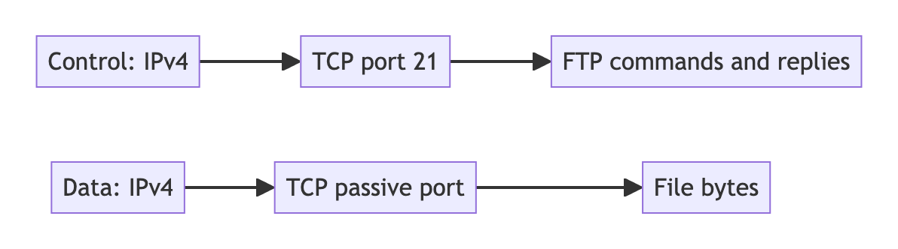
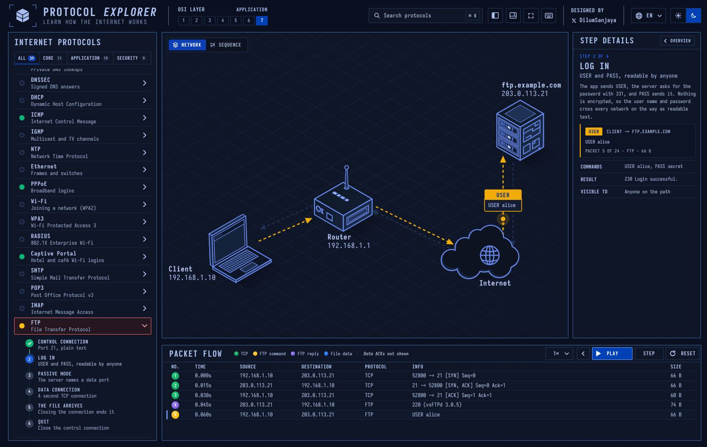
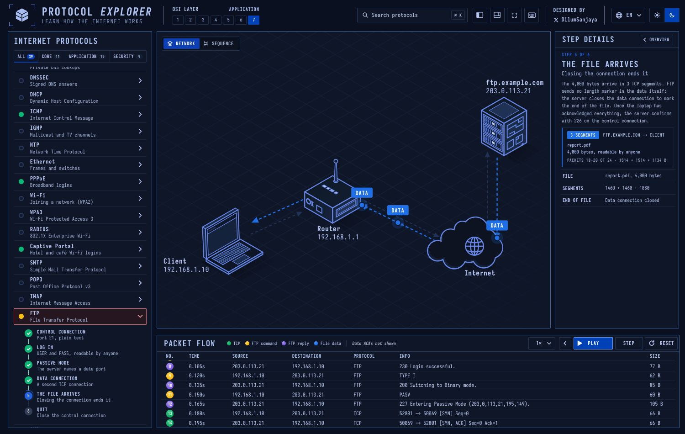
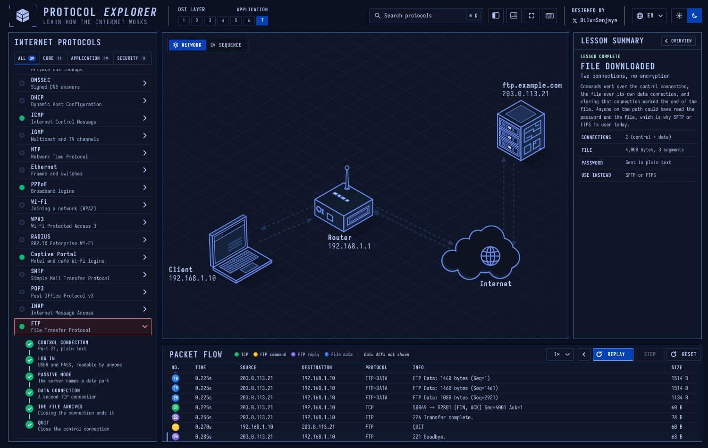
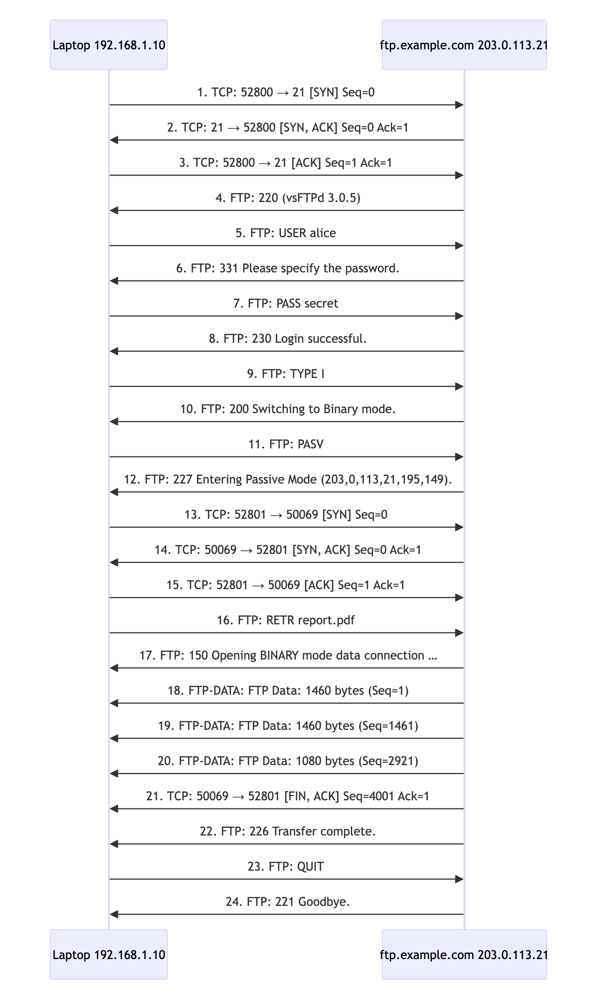
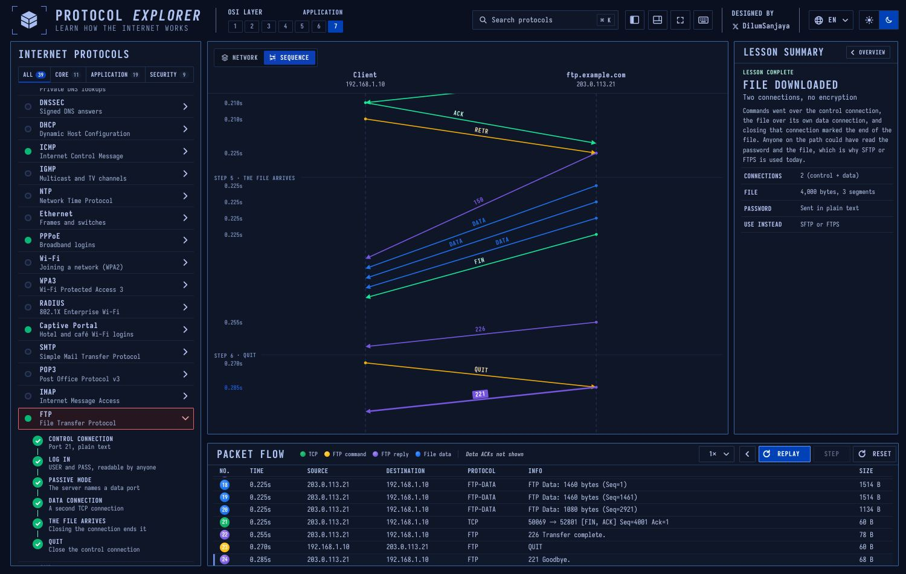
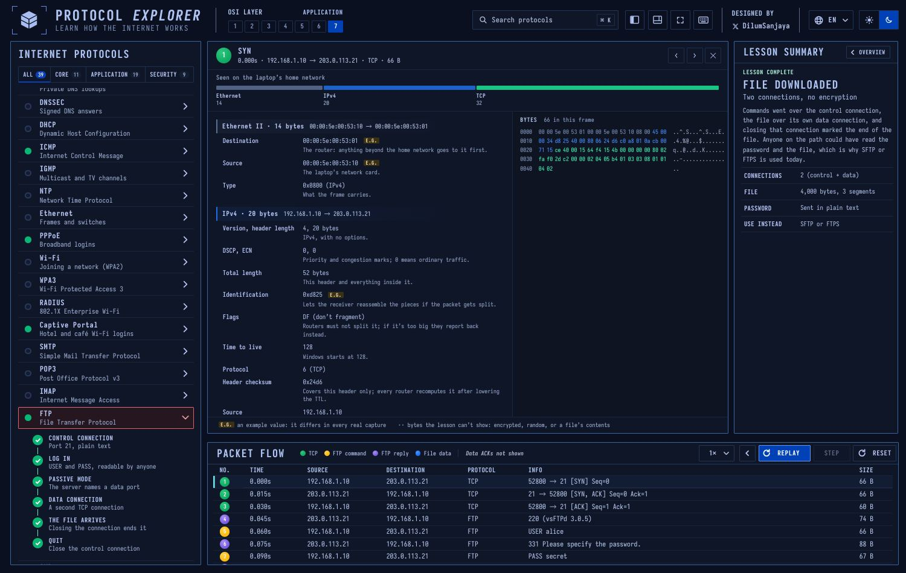

# FTP – File Transfer Protocol

<!-- nav -->
⬅ [29 IMAP](29-imap.md) · [Index](00_Protocols_Index.md) · [31 SMB](31-smb.md) ➡
<!-- nav -->

*Source: Protocol Explorer – https://protocol-explorer-alpha.vercel.app/ (interactive lesson #30). Screenshots captured from the live lesson; packet decodes are the site's example capture (values marked **E.G.** differ in every real capture).*

## Overview

### How the layers fit together (outer to inner)

## In-depth explanation of the example (plain-language version)

### The big picture in one minute
Alice's FTP program downloads a file called **`report.pdf`** (4,000 bytes) from `ftp.example.com`. **24 packets in 285 ms:** connect, log in, switch to binary mode, open a data connection in **passive mode**, ask for the file, receive it in three pieces, and say goodbye.

**What makes FTP unusual.** It uses **two separate connections**:
- a **control connection** (server port **21**) that carries **text commands and replies** and stays open for the whole session;
- a **data connection**, opened fresh **for each file or directory listing**, which carries only the file's bytes.
FTP dates from 1971 and sends **everything, including the password, as plain readable text.**

Think of **a restaurant**: you talk to the waiter at your table (control connection), but the food comes through a separate door from the kitchen (data connection).

> **Words you'll see:** *Control connection* = the command channel. *Data connection* = the file-transfer channel. *Passive mode* = the client opens the data connection. *Reply code* = a three-digit number, e.g. `230` = logged in.

---

### Step 1 – Connect – packets 1 to 4
After the TCP handshake to **port 21**, the server greets: **`220 (vsFTPd 3.0.5)`** ("ready"). Replies are a number plus text; the first digit gives the class: **1xx** in progress, **2xx** success, **3xx** need more information, **4xx** temporary failure, **5xx** permanent failure.

### Step 2 – Log in (visible to everyone) – packets 5 to 8
`USER alice` → `331 Please specify the password.` Then `PASS secret` → `230 Login successful.`
**Nothing is encrypted**, so the username and password cross the network as readable text. Anyone watching (on shared Wi-Fi, your provider, a hacked router) can read them.

### Step 3 – Binary mode and passive mode – packets 9 to 12
- **`TYPE I`** → "Switching to Binary mode." Binary mode copies the bytes exactly. (ASCII mode changes line endings and **corrupts files like PDFs**, a classic FTP mistake.)
- **`PASV`** → **`227 Entering Passive Mode (203,0,113,21,195,149)`**. The server chose a data port and tells the client as six numbers: four for the address (`203.0.113.21`) and two for the port: **195 × 256 + 149 = 50,069**.
**Active vs passive:** in *active* mode the **server connects back to the client**, which usually fails when the client is behind a router or firewall. In *passive* mode **the client connects out** to the server, which works through routers. That's why passive is the default today.

### Step 4 – The data connection – packets 13 to 17
The client opens a **second TCP connection** to port 50069 (packets 13–15). Then, on the **control** connection, it asks **`RETR report.pdf`** ("retrieve"), and the server answers **`150 Opening BINARY mode data connection`** and starts sending the file **on the data connection.**

### Step 5 – The file arrives – packets 18 to 22
The 4,000 bytes arrive as **three TCP segments** (1,460 + 1,460 + 1,080). **FTP doesn't mark the end of the file inside the data. The server simply closes the data connection** to say "that's all." Then, on the control connection: **`226 Transfer complete.`** The next file or directory listing uses a new data connection.

### Step 6 – Quit – packets 23, 24
`QUIT` → `221 Goodbye.` and the control connection closes.

---

### The 24 packets at a glance
| Packets | What | Why |
|---|---|---|
| 1–4 | connect, `220` | open the control connection |
| 5–8 | USER, PASS | log in (in plain text!) |
| 9–12 | TYPE I, PASV | binary mode, get a data port |
| 13–17 | data connection, RETR, `150` | request the file |
| 18–22 | file data, FIN, `226` | receive the file |
| 23–24 | QUIT | goodbye |

### What to remember
- **Two connections:** control (port 21) and data (per transfer). **Active** (`PORT`) vs **passive** (`PASV`/`EPSV`).
- **Common commands:** `USER, PASS, TYPE, PASV, PORT, LIST, RETR` (download), `STOR` (upload), `CWD, PWD, DELE, MKD, QUIT`.
- **Not encrypted.** Use **SFTP** (a different protocol, file transfer over SSH on port 22) or **FTPS** (FTP over TLS).
- The end of a file is signalled by **closing the data connection**, so a broken transfer can look finished. Check file sizes.
- Still used for: old systems, public software mirrors, and some device firmware or log transfers.

## Under the hood – technical details

- **Two connections.** The **control connection** (server port 21) carries commands and replies as text for the whole session. A new **data connection** is opened for every transfer or directory listing.
- **Reply codes.** `1xx` preliminary (`150` opening data connection), `2xx` success (`200`, `220` ready, `226` transfer complete, `230` logged in, `227` entering passive mode), `3xx` need more information (`331` need password), `4xx` temporary failure, `5xx` permanent failure.
- **Transfer type.** `TYPE I` (image/binary) copies bytes exactly. `TYPE A` (ASCII) converts line endings, which corrupts binary files like PDFs.
- **Active mode (`PORT`).** The client announces an address and port and the **server connects back** to it, which fails behind NAT or a firewall.
- **Passive mode (`PASV`).** The server replies `227 Entering Passive Mode (203,0,113,21,195,149)`: four numbers for the address and two for the port, 195 x 256 + 149 = **50,069**. The **client connects out** to that port, which works through NAT. `EPSV` is the IPv6-friendly variant. Servers need a range of open data ports.
- **End of file.** In stream mode FTP has no length or end marker. The server **closes the data connection** to signal the end of the file. A broken transfer can therefore look finished unless sizes are checked.
- **Commands.** `USER`, `PASS`, `TYPE`, `PASV`/`EPSV`/`PORT`, `LIST`/`NLST`, `RETR` (download), `STOR` (upload), `CWD`, `PWD`, `DELE`, `MKD`, `RMD`, `RNFR`/`RNTO` (rename), `QUIT`.
- **No encryption.** The username, password and files cross the network as readable text. FTP dates from 1971.
- **Secure alternatives.** **FTPS** is FTP with TLS (explicit `AUTH TLS` on port 21, or implicit on 990); NAT helpers then cannot read the `227` reply. **SFTP** is a different protocol that runs over SSH on port 22 and uses a single connection.
- **Still used for.** Legacy systems, public software mirrors and some device firmware or log transfers.

## Step-by-step walkthrough

### Step 1: CONTROL CONNECTION – Port 21, plain text

### Step 2: LOG IN – USER and PASS, readable by anyone

### Step 3: PASSIVE MODE – The server names a data port

### Step 4: DATA CONNECTION – A second TCP connection

### Step 5: THE FILE ARRIVES – Closing the connection ends it

### Step 6: QUIT – Close the control connection

### Lesson summary

## Packet flow (whole lesson)

| No. | Time | Source | Destination | Protocol | Info | Size |
|---|---|---|---|---|---|---|
| 1 | 0.000s | 192.168.1.10 | 203.0.113.21 | TCP | 52800 → 21 [SYN] Seq=0 | 66 B |
| 2 | 0.015s | 203.0.113.21 | 192.168.1.10 | TCP | 21 → 52800 [SYN, ACK] Seq=0 Ack=1 | 66 B |
| 3 | 0.030s | 192.168.1.10 | 203.0.113.21 | TCP | 52800 → 21 [ACK] Seq=1 Ack=1 | 60 B |
| 4 | 0.045s | 203.0.113.21 | 192.168.1.10 | FTP | 220 (vsFTPd 3.0.5) | 74 B |
| 5 | 0.060s | 192.168.1.10 | 203.0.113.21 | FTP | USER alice | 66 B |
| 6 | 0.075s | 203.0.113.21 | 192.168.1.10 | FTP | 331 Please specify the password. | 88 B |
| 7 | 0.090s | 192.168.1.10 | 203.0.113.21 | FTP | PASS secret | 67 B |
| 8 | 0.105s | 203.0.113.21 | 192.168.1.10 | FTP | 230 Login successful. | 77 B |
| 9 | 0.120s | 192.168.1.10 | 203.0.113.21 | FTP | TYPE I | 62 B |
| 10 | 0.135s | 203.0.113.21 | 192.168.1.10 | FTP | 200 Switching to Binary mode. | 85 B |
| 11 | 0.150s | 192.168.1.10 | 203.0.113.21 | FTP | PASV | 60 B |
| 12 | 0.165s | 203.0.113.21 | 192.168.1.10 | FTP | 227 Entering Passive Mode (203,0,113,21,195,149). | 105 B |
| 13 | 0.180s | 192.168.1.10 | 203.0.113.21 | TCP | 52801 → 50069 [SYN] Seq=0 | 66 B |
| 14 | 0.195s | 203.0.113.21 | 192.168.1.10 | TCP | 50069 → 52801 [SYN, ACK] Seq=0 Ack=1 | 66 B |
| 15 | 0.210s | 192.168.1.10 | 203.0.113.21 | TCP | 52801 → 50069 [ACK] Seq=1 Ack=1 | 60 B |
| 16 | 0.210s | 192.168.1.10 | 203.0.113.21 | FTP | RETR report.pdf | 71 B |
| 17 | 0.225s | 203.0.113.21 | 192.168.1.10 | FTP | 150 Opening BINARY mode data connection … | 124 B |
| 18 | 0.225s | 203.0.113.21 | 192.168.1.10 | FTP-DATA | FTP Data: 1460 bytes (Seq=1) | 1514 B |
| 19 | 0.225s | 203.0.113.21 | 192.168.1.10 | FTP-DATA | FTP Data: 1460 bytes (Seq=1461) | 1514 B |
| 20 | 0.225s | 203.0.113.21 | 192.168.1.10 | FTP-DATA | FTP Data: 1080 bytes (Seq=2921) | 1134 B |
| 21 | 0.225s | 203.0.113.21 | 192.168.1.10 | TCP | 50069 → 52801 [FIN, ACK] Seq=4001 Ack=1 | 60 B |
| 22 | 0.255s | 203.0.113.21 | 192.168.1.10 | FTP | 226 Transfer complete. | 78 B |
| 23 | 0.270s | 192.168.1.10 | 203.0.113.21 | FTP | QUIT | 60 B |
| 24 | 0.285s | 203.0.113.21 | 192.168.1.10 | FTP | 221 Goodbye. | 68 B |

### Sequence diagram

*The lesson's own sequence diagram:*

## Packet decoder screenshots

The lesson's decoder view for the first, middle and last packet: headers, field values and the raw hex bytes.

### Packet 1: TCP – 52800 → 21 [SYN] Seq=0

*192.168.1.10 → 203.0.113.21 · 66 B · t = 0.000s*

### Packet 13: TCP – 52801 → 50069 [SYN] Seq=0

*192.168.1.10 → 203.0.113.21 · 66 B · t = 0.180s*

### Packet 24: FTP – 221 Goodbye.

*203.0.113.21 → 192.168.1.10 · 68 B · t = 0.285s*

---

<!-- nav -->
⬅ [29 IMAP](29-imap.md) · [Index](00_Protocols_Index.md) · [31 SMB](31-smb.md) ➡
<!-- nav -->
