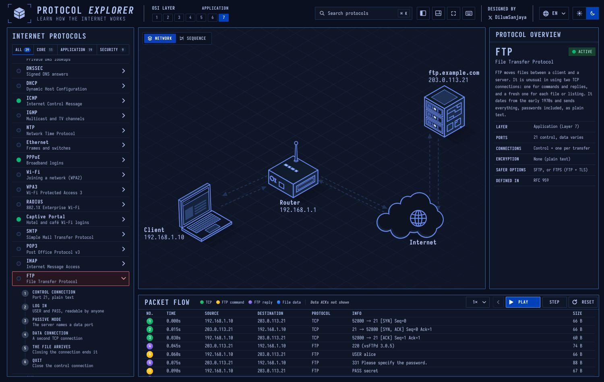
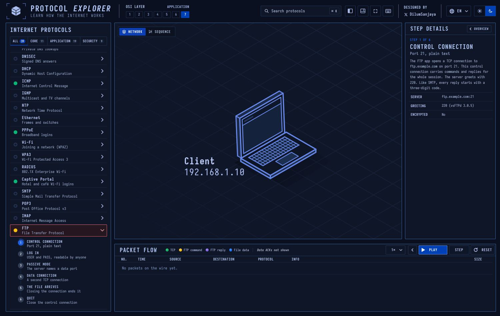
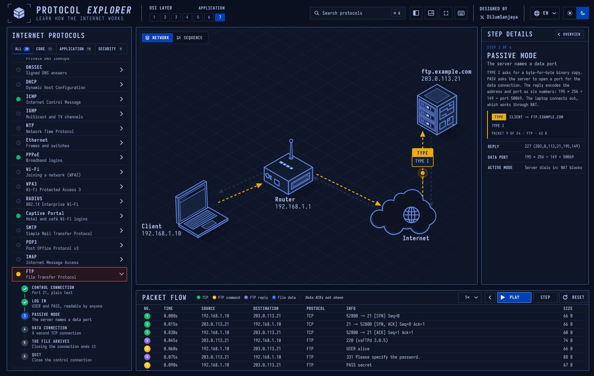
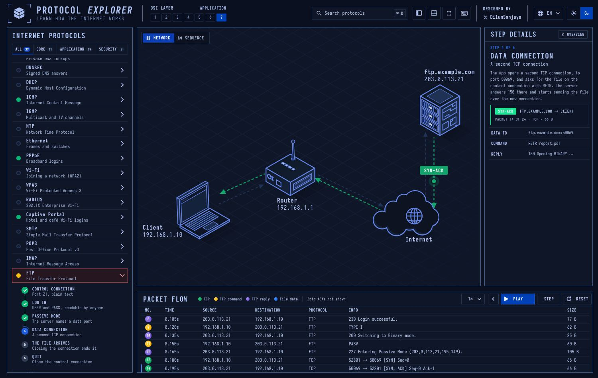
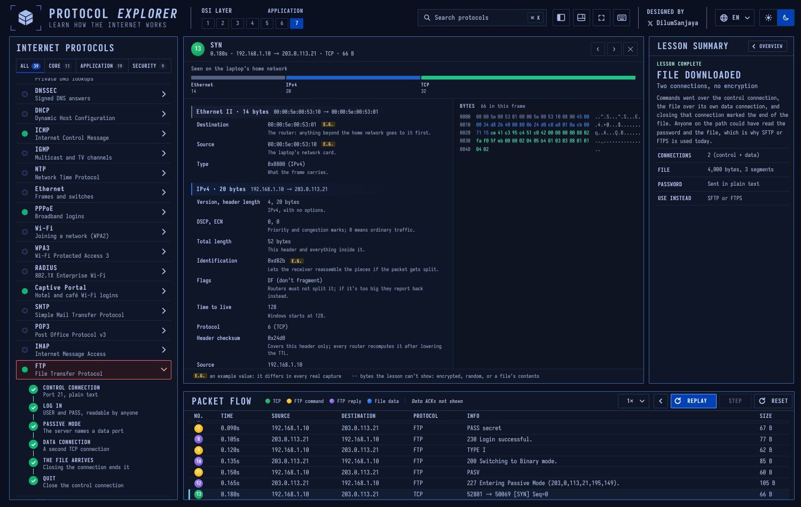
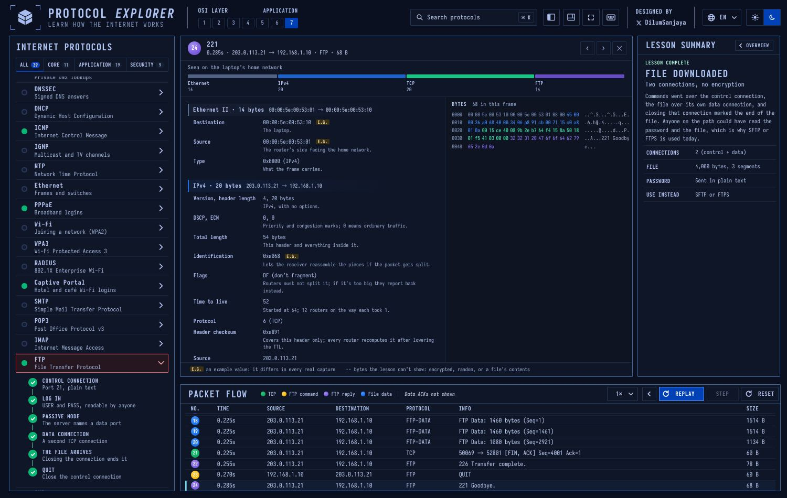

# FTP – File Transfer Protocol

<!-- nav -->
⬅ [29 IMAP](29-imap.md) · [Index](00_Protocols_Index.md) · [31 SMB](31-smb.md) ➡
<!-- nav -->

*Source: Protocol Explorer – https://protocol-explorer-alpha.vercel.app/ (interactive lesson #30). Screenshots captured from the live lesson; packet decodes are the site's example capture (values marked **E.G.** differ in every real capture).*

## Overview



> PROTOCOL OVERVIEW  
> FTP  
> ACTIVE  
> File Transfer Protocol  
> FTP moves files between a client and a server. It is unusual in using two TCP connections: one for commands and replies, and a fresh one for each file or listing. It dates from the early 1970s and sends everything, passwords included, as plain text.  
> LAYER  
> Application (Layer 7)  
> PORTS  
> 21 control, data varies  
> CONNECTIONS  
> Control + one per transfer  
> ENCRYPTION  
> None (plain text)  
> SAFER OPTIONS  
> SFTP, or FTPS (FTP + TLS)  
> DEFINED IN  
> RFC 959  

## In-depth explanation of the example (plain-language version)

### The big picture in one minute
Alice's FTP program downloads a file called **`report.pdf`** (4,000 bytes) from `ftp.example.com`. **24 packets in 285 ms:** connect, log in, switch to binary mode, open a data connection in **passive mode**, ask for the file, receive it in three pieces, and say goodbye.

**What makes FTP unusual.** It uses **two separate connections**:
- a **control connection** (server port **21**) that carries **text commands and replies** and stays open for the whole session;
- a **data connection**, opened fresh **for each file or directory listing**, which carries only the file's bytes.
FTP dates from 1971 and sends **everything, including the password, as plain readable text.**

Think of **a restaurant**: you talk to the waiter at your table (control connection), but the food comes through a separate door from the kitchen (data connection).

> **Words you'll see:** *Control connection* = the command channel. *Data connection* = the file-transfer channel. *Passive mode* = the client opens the data connection. *Reply code* = a three-digit number, e.g. `230` = logged in.

---

### Step 1 – Connect – packets 1 to 4
After the TCP handshake to **port 21**, the server greets: **`220 (vsFTPd 3.0.5)`** ("ready"). Replies are a number plus text; the first digit gives the class: **1xx** in progress, **2xx** success, **3xx** need more information, **4xx** temporary failure, **5xx** permanent failure.

### Step 2 – Log in (visible to everyone) – packets 5 to 8
`USER alice` → `331 Please specify the password.` Then `PASS secret` → `230 Login successful.`
**Nothing is encrypted**, so the username and password cross the network as readable text. Anyone watching (on shared Wi-Fi, your provider, a hacked router) can read them.

### Step 3 – Binary mode and passive mode – packets 9 to 12
- **`TYPE I`** → "Switching to Binary mode." Binary mode copies the bytes exactly. (ASCII mode changes line endings and **corrupts files like PDFs**, a classic FTP mistake.)
- **`PASV`** → **`227 Entering Passive Mode (203,0,113,21,195,149)`**. The server chose a data port and tells the client as six numbers: four for the address (`203.0.113.21`) and two for the port: **195 × 256 + 149 = 50,069**.
**Active vs passive:** in *active* mode the **server connects back to the client**, which usually fails when the client is behind a router or firewall. In *passive* mode **the client connects out** to the server, which works through routers. That's why passive is the default today.

### Step 4 – The data connection – packets 13 to 17
The client opens a **second TCP connection** to port 50069 (packets 13–15). Then, on the **control** connection, it asks **`RETR report.pdf`** ("retrieve"), and the server answers **`150 Opening BINARY mode data connection`** and starts sending the file **on the data connection.**

### Step 5 – The file arrives – packets 18 to 22
The 4,000 bytes arrive as **three TCP segments** (1,460 + 1,460 + 1,080). **FTP doesn't mark the end of the file inside the data. The server simply closes the data connection** to say "that's all." Then, on the control connection: **`226 Transfer complete.`** The next file or directory listing uses a new data connection.

### Step 6 – Quit – packets 23, 24
`QUIT` → `221 Goodbye.` and the control connection closes.

---

### The 24 packets at a glance
| Packets | What | Why |
|---|---|---|
| 1–4 | connect, `220` | open the control connection |
| 5–8 | USER, PASS | log in (in plain text!) |
| 9–12 | TYPE I, PASV | binary mode, get a data port |
| 13–17 | data connection, RETR, `150` | request the file |
| 18–22 | file data, FIN, `226` | receive the file |
| 23–24 | QUIT | goodbye |

### What to remember
- **Two connections:** control (port 21) and data (per transfer). **Active** (`PORT`) vs **passive** (`PASV`/`EPSV`).
- **Common commands:** `USER, PASS, TYPE, PASV, PORT, LIST, RETR` (download), `STOR` (upload), `CWD, PWD, DELE, MKD, QUIT`.
- **Not encrypted.** Use **SFTP** (a different protocol, file transfer over SSH on port 22) or **FTPS** (FTP over TLS).
- The end of a file is signalled by **closing the data connection**, so a broken transfer can look finished. Check file sizes.
- Still used for: old systems, public software mirrors, and some device firmware or log transfers.

## Step-by-step walkthrough (screenshots from the lesson)

### Step 1: CONTROL CONNECTION – Port 21, plain text



> STEP 1 OF 6  
> CONTROL CONNECTION  
> Port 21, plain text  
> The FTP app opens a TCP connection to ftp.example.com on port 21. This control connection carries commands and replies for the whole session. The server greets with 220. Like SMTP, every reply starts with a three-digit code.  
> SERVER  
> ftp.example.com:21  
> GREETING  
> 220 (vsFTPd 3.0.5)  
> ENCRYPTED  
> No  

### Step 2: LOG IN – USER and PASS, readable by anyone


> STEP 2 OF 6  
> LOG IN  
> USER and PASS, readable by anyone  
> The app sends USER, the server asks for the password with 331, and PASS sends it. Nothing is encrypted, so the user name and password cross every network on the way as readable text.  
> USER  
> CLIENT → FTP.EXAMPLE.COM  
> USER alice  
> PACKET 5 OF 24 · FTP · 66 B  
> COMMANDS  
> USER alice, PASS secret  
> RESULT  
> 230 Login successful.  
> VISIBLE TO  
> Anyone on the path  

### Step 3: PASSIVE MODE – The server names a data port



> STEP 3 OF 6  
> PASSIVE MODE  
> The server names a data port  
> TYPE I asks for a byte-for-byte binary copy. PASV asks the server to open a port for the data connection. The reply encodes the address and port as six numbers: 195 × 256 + 149 = port 50069. The laptop connects out, which works through NAT.  
> TYPE  
> CLIENT → FTP.EXAMPLE.COM  
> TYPE I  
> PACKET 9 OF 24 · FTP · 62 B  
> REPLY  
> 227 (203,0,113,21,195,149)  
> DATA PORT  
> 195 × 256 + 149 = 50069  
> ACTIVE MODE  
> Server dials in: NAT blocks  

### Step 4: DATA CONNECTION – A second TCP connection



> STEP 4 OF 6  
> DATA CONNECTION  
> A second TCP connection  
> The app opens a second TCP connection, to port 50069, and asks for the file on the control connection with RETR. The server answers 150 there and starts sending the file over the new connection.  
> SYN-ACK  
> FTP.EXAMPLE.COM → CLIENT  
> PACKET 14 OF 24 · TCP · 66 B  
> DATA TO  
> ftp.example.com:50069  
> COMMAND  
> RETR report.pdf  
> REPLY  
> 150 Opening BINARY …  

### Step 5: THE FILE ARRIVES – Closing the connection ends it


> STEP 5 OF 6  
> THE FILE ARRIVES  
> Closing the connection ends it  
> The 4,000 bytes arrive in 3 TCP segments. FTP sends no length marker in the data itself: the server closes the data connection to mark the end of the file. Once the laptop has acknowledged everything, the server confirms with 226 on the control connection.  
> 3 SEGMENTS  
> FTP.EXAMPLE.COM → CLIENT  
> report.pdf  
> 4,000 bytes, readable by anyone  
> PACKETS 18–20 OF 24 · 1514 + 1514 + 1134 B  
> FILE  
> report.pdf, 4,000 bytes  
> SEGMENTS  
> 1460 + 1460 + 1080  
> END OF FILE  
> Data connection closed  

### Step 6: QUIT – Close the control connection


> STEP 6 OF 6  
> QUIT  
> Close the control connection  
> QUIT ends the session and the server says goodbye with 221. For anything sensitive, SFTP (a different protocol, run over SSH) or FTPS (FTP inside TLS) gives the same job encryption.  
> QUIT  
> CLIENT → FTP.EXAMPLE.COM  
> QUIT  
> PACKET 23 OF 24 · FTP · 60 B  
> COMMAND  
> QUIT  
> REPLY  
> 221 Goodbye.  
> ENCRYPTED COUSINS  
> SFTP, FTPS  

### Lesson summary


> LESSON SUMMARY  
> LESSON COMPLETE  
> FILE DOWNLOADED  
> Two connections, no encryption  
> Commands went over the control connection, the file over its own data connection, and closing that connection marked the end of the file. Anyone on the path could have read the password and the file, which is why SFTP or FTPS is used today.  
> 221  
> FTP.EXAMPLE.COM → CLIENT  
> 221 Goodbye.  
> PACKET 24 OF 24 · FTP · 68 B  
> CONNECTIONS  
> 2 (control + data)  
> FILE  
> 4,000 bytes, 3 segments  
> PASSWORD  
> Sent in plain text  
> USE INSTEAD  
> SFTP or FTPS  

## Packet flow (whole lesson)

| No. | Time | Source | Destination | Protocol | Info | Size |
|---|---|---|---|---|---|---|
| 1 | 0.000s | 192.168.1.10 | 203.0.113.21 | TCP | 52800 → 21 [SYN] Seq=0 | 66 B |
| 2 | 0.015s | 203.0.113.21 | 192.168.1.10 | TCP | 21 → 52800 [SYN, ACK] Seq=0 Ack=1 | 66 B |
| 3 | 0.030s | 192.168.1.10 | 203.0.113.21 | TCP | 52800 → 21 [ACK] Seq=1 Ack=1 | 60 B |
| 4 | 0.045s | 203.0.113.21 | 192.168.1.10 | FTP | 220 (vsFTPd 3.0.5) | 74 B |
| 5 | 0.060s | 192.168.1.10 | 203.0.113.21 | FTP | USER alice | 66 B |
| 6 | 0.075s | 203.0.113.21 | 192.168.1.10 | FTP | 331 Please specify the password. | 88 B |
| 7 | 0.090s | 192.168.1.10 | 203.0.113.21 | FTP | PASS secret | 67 B |
| 8 | 0.105s | 203.0.113.21 | 192.168.1.10 | FTP | 230 Login successful. | 77 B |
| 9 | 0.120s | 192.168.1.10 | 203.0.113.21 | FTP | TYPE I | 62 B |
| 10 | 0.135s | 203.0.113.21 | 192.168.1.10 | FTP | 200 Switching to Binary mode. | 85 B |
| 11 | 0.150s | 192.168.1.10 | 203.0.113.21 | FTP | PASV | 60 B |
| 12 | 0.165s | 203.0.113.21 | 192.168.1.10 | FTP | 227 Entering Passive Mode (203,0,113,21,195,149). | 105 B |
| 13 | 0.180s | 192.168.1.10 | 203.0.113.21 | TCP | 52801 → 50069 [SYN] Seq=0 | 66 B |
| 14 | 0.195s | 203.0.113.21 | 192.168.1.10 | TCP | 50069 → 52801 [SYN, ACK] Seq=0 Ack=1 | 66 B |
| 15 | 0.210s | 192.168.1.10 | 203.0.113.21 | TCP | 52801 → 50069 [ACK] Seq=1 Ack=1 | 60 B |
| 16 | 0.210s | 192.168.1.10 | 203.0.113.21 | FTP | RETR report.pdf | 71 B |
| 17 | 0.225s | 203.0.113.21 | 192.168.1.10 | FTP | 150 Opening BINARY mode data connection … | 124 B |
| 18 | 0.225s | 203.0.113.21 | 192.168.1.10 | FTP-DATA | FTP Data: 1460 bytes (Seq=1) | 1514 B |
| 19 | 0.225s | 203.0.113.21 | 192.168.1.10 | FTP-DATA | FTP Data: 1460 bytes (Seq=1461) | 1514 B |
| 20 | 0.225s | 203.0.113.21 | 192.168.1.10 | FTP-DATA | FTP Data: 1080 bytes (Seq=2921) | 1134 B |
| 21 | 0.225s | 203.0.113.21 | 192.168.1.10 | TCP | 50069 → 52801 [FIN, ACK] Seq=4001 Ack=1 | 60 B |
| 22 | 0.255s | 203.0.113.21 | 192.168.1.10 | FTP | 226 Transfer complete. | 78 B |
| 23 | 0.270s | 192.168.1.10 | 203.0.113.21 | FTP | QUIT | 60 B |
| 24 | 0.285s | 203.0.113.21 | 192.168.1.10 | FTP | 221 Goodbye. | 68 B |

### Sequence diagram


## Packets decoded byte by byte

Each packet below is the lesson's own decode (headers, field values and the plain-English meaning of each field). Screenshots show the first, middle and last packet in the lesson's decoder view with the raw hex bytes.

### Packet 1: TCP – 52800 → 21 [SYN] Seq=0

*192.168.1.10 → 203.0.113.21 · 66 B · t = 0.000s*


<details><summary>Decoded fields</summary>

```text
1
SYN
0.000s · 192.168.1.10 → 203.0.113.21 · TCP · 66 B
Seen on the laptop’s home network
Ethernet
14
IPv4
20
TCP
32
Ethernet II · 14 bytes
00:00:5e:00:53:10 → 00:00:5e:00:53:01
Destination
00:00:5e:00:53:01 E.G.

The router: anything beyond the home network goes to it first.

Source
00:00:5e:00:53:10 E.G.

The laptop’s network card.

Type
0x0800 (IPv4)

What the frame carries.

IPv4 · 20 bytes
192.168.1.10 → 203.0.113.21
Version, header length
4, 20 bytes

IPv4, with no options.

DSCP, ECN
0, 0

Priority and congestion marks; 0 means ordinary traffic.

Total length
52 bytes

This header and everything inside it.

Identification
0xd825 E.G.

Lets the receiver reassemble the pieces if the packet gets split.

Flags
DF (don’t fragment)

Routers must not split it; if it’s too big they report back instead.

Time to live
128

Windows starts at 128.

Protocol
6 (TCP)
Header checksum
0x24d6

Covers this header only; every router recomputes it after lowering the TTL.

Source
192.168.1.10
Destination
203.0.113.21
TCP · 32 bytes
52800 → 21, SYN
Source port
52800

Picked by the laptop’s system for this connection.

Destination port
21
Sequence number
0 (relative)

This side’s starting number. Shown as 0; the real one is random.

Real sequence number
1693717835 E.G.
Acknowledgment
0 (not used yet)

A first SYN has nothing to acknowledge.

Header length
32 bytes

20 bytes, plus 12 of options.

Flags
0x002 (SYN)
Window
64240 E.G.

How much more data this side can take right now.

Checksum
0x2dc2

Covers the header, the data and the IP addresses, so damage is caught.

Urgent pointer
0
Options
12 bytes
Maximum segment size
1460 bytes

The most data this side wants in one segment.

No-op
1

Spacing, so the next option lines up.

Window scale
× 256

Window values are multiplied by this, so windows can be larger than 64 KB.

No-op
1

Spacing, so the next option lines up.

No-op
1

Spacing, so the next option lines up.

SACK permitted
yes

This side understands selective acknowledgements.

BYTES 66 in this frame
0000
00
00
5e
00
53
01
00
00
5e
00
53
10
08
00
45
00
.
.
^
.
S
.
.
.
^
.
S
.
.
.
E
.
0010
00
34
d8
25
40
00
80
06
24
d6
c0
a8
01
0a
cb
00
.
4
.
%
@
.
.
.
$
.
.
.
.
.
.
.
0020
71
15
ce
40
00
15
64
f4
15
4b
00
00
00
00
80
02
q
.
.
@
.
.
d
.
.
K
.
.
.
.
.
.
0030
fa
f0
2d
c2
00
00
02
04
05
b4
01
03
03
08
01
01
.
.
-
.
.
.
.
.
.
.
.
.
.
.
.
.
0040
04
02
.
.
E.G. an example value: it differs in every real capture
·· bytes the lesson can’t show: encrypted, random, or a file’s contents
```

</details>

### Packet 2: TCP – 21 → 52800 [SYN, ACK] Seq=0 Ack=1

*203.0.113.21 → 192.168.1.10 · 66 B · t = 0.015s*

<details><summary>Decoded fields</summary>

```text
2
SYN-ACK
0.015s · 203.0.113.21 → 192.168.1.10 · TCP · 66 B
Seen on the laptop’s home network
Ethernet
14
IPv4
20
TCP
32
Ethernet II · 14 bytes
00:00:5e:00:53:01 → 00:00:5e:00:53:10
Destination
00:00:5e:00:53:10 E.G.

The laptop.

Source
00:00:5e:00:53:01 E.G.

The router’s side facing the home network.

Type
0x0800 (IPv4)

What the frame carries.

IPv4 · 20 bytes
203.0.113.21 → 192.168.1.10
Version, header length
4, 20 bytes

IPv4, with no options.

DSCP, ECN
0, 0

Priority and congestion marks; 0 means ordinary traffic.

Total length
52 bytes

This header and everything inside it.

Identification
0xa05b E.G.

Lets the receiver reassemble the pieces if the packet gets split.

Flags
DF (don’t fragment)

Routers must not split it; if it’s too big they report back instead.

Time to live
52

Started at 64; 12 routers on the way each took 1.

Protocol
6 (TCP)
Header checksum
0xa8a0

Covers this header only; every router recomputes it after lowering the TTL.

Source
203.0.113.21
Destination
192.168.1.10
TCP · 32 bytes
21 → 52800, SYN, ACK
Source port
21
Destination port
52800
Sequence number
0 (relative)

This side’s starting number. Shown as 0; the real one is random.

Real sequence number
144387513 E.G.
Acknowledgment
1 (relative)

The next byte this side expects: everything before it has arrived.

Header length
32 bytes

20 bytes, plus 12 of options.

Flags
0x012 (SYN, ACK)
Window
64240 E.G.

How much more data this side can take right now.

Checksum
0xf75d

Covers the header, the data and the IP addresses, so damage is caught.

Urgent pointer
0
Options
12 bytes
Maximum segment size
1460 bytes

The most data this side wants in one segment.

No-op
1

Spacing, so the next option lines up.

No-op
1

Spacing, so the next option lines up.

SACK permitted
yes

This side understands selective acknowledgements.

No-op
1

Spacing, so the next option lines up.

Window scale
× 128

Window values are multiplied by this, so windows can be larger than 64 KB.

BYTES 66 in this frame
0000
00
00
5e
00
53
10
00
00
5e
00
53
01
08
00
45
00
.
.
^
.
S
.
.
.
^
.
S
.
.
.
E
.
0010
00
34
a0
5b
40
00
34
06
a8
a0
cb
00
71
15
c0
a8
.
4
.
[
@
.
4
.
.
.
.
.
q
.
.
.
0020
01
0a
00
15
ce
40
08
9b
2d
b9
64
f4
15
4c
80
12
.
.
.
.
.
@
.
.
-
.
d
.
.
L
.
.
0030
fa
f0
f7
5d
00
00
02
04
05
b4
01
01
04
02
01
03
.
.
.
]
.
.
.
.
.
.
.
.
.
.
.
.
0040
03
07
.
.
E.G. an example value: it differs in every real capture
·· bytes the lesson can’t show: encrypted, random, or a file’s contents
```

</details>

### Packet 3: TCP – 52800 → 21 [ACK] Seq=1 Ack=1

*192.168.1.10 → 203.0.113.21 · 60 B · t = 0.030s*

<details><summary>Decoded fields</summary>

```text
3
ACK
0.030s · 192.168.1.10 → 203.0.113.21 · TCP · 60 B
Seen on the laptop’s home network
Ethernet
14
IPv4
20
TCP
20
Padding
6
Ethernet II · 14 bytes
00:00:5e:00:53:10 → 00:00:5e:00:53:01
Destination
00:00:5e:00:53:01 E.G.

The router: anything beyond the home network goes to it first.

Source
00:00:5e:00:53:10 E.G.

The laptop’s network card.

Type
0x0800 (IPv4)

What the frame carries.

IPv4 · 20 bytes
192.168.1.10 → 203.0.113.21
Version, header length
4, 20 bytes

IPv4, with no options.

DSCP, ECN
0, 0

Priority and congestion marks; 0 means ordinary traffic.

Total length
40 bytes

This header and everything inside it.

Identification
0xd826 E.G.

Lets the receiver reassemble the pieces if the packet gets split.

Flags
DF (don’t fragment)

Routers must not split it; if it’s too big they report back instead.

Time to live
128

Windows starts at 128.

Protocol
6 (TCP)
Header checksum
0x24e1

Covers this header only; every router recomputes it after lowering the TTL.

Source
192.168.1.10
Destination
203.0.113.21
TCP · 20 bytes
52800 → 21, ACK
Source port
52800

Picked by the laptop’s system for this connection.

Destination port
21
Sequence number
1 (relative)

Position of this segment’s first byte, counted from this side’s SYN.

Real sequence number
1693717836 E.G.
Acknowledgment
1 (relative)

The next byte this side expects: everything before it has arrived.

Header length
20 bytes
Flags
0x010 (ACK)
Window
1026 (× 256 = 262,656 bytes) E.G.

How much more data this side can take right now.

Checksum
0x2f1f

Covers the header, the data and the IP addresses, so damage is caught.

Urgent pointer
0
Ethernet padding · 6 bytes
Padding
6 zero bytes

Ethernet frames are at least 60 bytes (64 with the checksum the card adds), so short ones are padded.

BYTES 60 in this frame
0000
00
00
5e
00
53
01
00
00
5e
00
53
10
08
00
45
00
.
.
^
.
S
.
.
.
^
.
S
.
.
.
E
.
0010
00
28
d8
26
40
00
80
06
24
e1
c0
a8
01
0a
cb
00
.
(
.
&
@
.
.
.
$
.
.
.
.
.
.
.
0020
71
15
ce
40
00
15
64
f4
15
4c
08
9b
2d
ba
50
10
q
.
.
@
.
.
d
.
.
L
.
.
-
.
P
.
0030
04
02
2f
1f
00
00
00
00
00
00
00
00
.
.
/
.
.
.
.
.
.
.
.
.
E.G. an example value: it differs in every real capture
·· bytes the lesson can’t show: encrypted, random, or a file’s contents
```

</details>

### Packet 4: FTP – 220 (vsFTPd 3.0.5)

*203.0.113.21 → 192.168.1.10 · 74 B · t = 0.045s*

<details><summary>Decoded fields</summary>

```text
4
220
0.045s · 203.0.113.21 → 192.168.1.10 · FTP · 74 B
Seen on the laptop’s home network
Ethernet
14
IPv4
20
TCP
20
FTP
20
Ethernet II · 14 bytes
00:00:5e:00:53:01 → 00:00:5e:00:53:10
Destination
00:00:5e:00:53:10 E.G.

The laptop.

Source
00:00:5e:00:53:01 E.G.

The router’s side facing the home network.

Type
0x0800 (IPv4)

What the frame carries.

IPv4 · 20 bytes
203.0.113.21 → 192.168.1.10
Version, header length
4, 20 bytes

IPv4, with no options.

DSCP, ECN
0, 0

Priority and congestion marks; 0 means ordinary traffic.

Total length
60 bytes

This header and everything inside it.

Identification
0xa05c E.G.

Lets the receiver reassemble the pieces if the packet gets split.

Flags
DF (don’t fragment)

Routers must not split it; if it’s too big they report back instead.

Time to live
52

Started at 64; 12 routers on the way each took 1.

Protocol
6 (TCP)
Header checksum
0xa897

Covers this header only; every router recomputes it after lowering the TTL.

Source
203.0.113.21
Destination
192.168.1.10
TCP · 20 bytes
21 → 52800, PSH, ACK
Source port
21
Destination port
52800
Sequence number
1 (relative)

Position of this segment’s first byte, counted from this side’s SYN.

Real sequence number
144387514 E.G.
Acknowledgment
1 (relative)

The next byte this side expects: everything before it has arrived.

Header length
20 bytes
Flags
0x018 (PSH, ACK)
Window
501 (× 128 = 64,128 bytes) E.G.

How much more data this side can take right now.

Checksum
0xd500

Covers the header, the data and the IP addresses, so damage is caught.

Urgent pointer
0
FTP
Text
220 (vsFTPd 3.0.5)␍␊
BYTES 74 in this frame
0000
00
00
5e
00
53
10
00
00
5e
00
53
01
08
00
45
00
.
.
^
.
S
.
.
.
^
.
S
.
.
.
E
.
0010
00
3c
a0
5c
40
00
34
06
a8
97
cb
00
71
15
c0
a8
.
<
.
\
@
.
4
.
.
.
.
.
q
.
.
.
0020
01
0a
00
15
ce
40
08
9b
2d
ba
64
f4
15
4c
50
18
.
.
.
.
.
@
.
.
-
.
d
.
.
L
P
.
0030
01
f5
d5
00
00
00
32
32
30
20
28
76
73
46
54
50
.
.
.
.
.
.
2
2
0
(
v
s
F
T
P
0040
64
20
33
2e
30
2e
35
29
0d
0a
d
3
.
0
.
5
)
.
.
E.G. an example value: it differs in every real capture
·· bytes the lesson can’t show: encrypted, random, or a file’s contents
```

</details>

### Packet 5: FTP – USER alice

*192.168.1.10 → 203.0.113.21 · 66 B · t = 0.060s*

<details><summary>Decoded fields</summary>

```text
5
USER
0.060s · 192.168.1.10 → 203.0.113.21 · FTP · 66 B
Seen on the laptop’s home network
Ethernet
14
IPv4
20
TCP
20
FTP
12
Ethernet II · 14 bytes
00:00:5e:00:53:10 → 00:00:5e:00:53:01
Destination
00:00:5e:00:53:01 E.G.

The router: anything beyond the home network goes to it first.

Source
00:00:5e:00:53:10 E.G.

The laptop’s network card.

Type
0x0800 (IPv4)

What the frame carries.

IPv4 · 20 bytes
192.168.1.10 → 203.0.113.21
Version, header length
4, 20 bytes

IPv4, with no options.

DSCP, ECN
0, 0

Priority and congestion marks; 0 means ordinary traffic.

Total length
52 bytes

This header and everything inside it.

Identification
0xd827 E.G.

Lets the receiver reassemble the pieces if the packet gets split.

Flags
DF (don’t fragment)

Routers must not split it; if it’s too big they report back instead.

Time to live
128

Windows starts at 128.

Protocol
6 (TCP)
Header checksum
0x24d4

Covers this header only; every router recomputes it after lowering the TTL.

Source
192.168.1.10
Destination
203.0.113.21
TCP · 20 bytes
52800 → 21, PSH, ACK
Source port
52800

Picked by the laptop’s system for this connection.

Destination port
21
Sequence number
1 (relative)

Position of this segment’s first byte, counted from this side’s SYN.

Real sequence number
1693717836 E.G.
Acknowledgment
21 (relative)

The next byte this side expects: everything before it has arrived.

Header length
20 bytes
Flags
0x018 (PSH, ACK)
Window
1026 (× 256 = 262,656 bytes) E.G.

How much more data this side can take right now.

Checksum
0x9717

Covers the header, the data and the IP addresses, so damage is caught.

Urgent pointer
0
FTP
Text
USER alice␍␊
BYTES 66 in this frame
0000
00
00
5e
00
53
01
00
00
5e
00
53
10
08
00
45
00
.
.
^
.
S
.
.
.
^
.
S
.
.
.
E
.
0010
00
34
d8
27
40
00
80
06
24
d4
c0
a8
01
0a
cb
00
.
4
.
'
@
.
.
.
$
.
.
.
.
.
.
.
0020
71
15
ce
40
00
15
64
f4
15
4c
08
9b
2d
ce
50
18
q
.
.
@
.
.
d
.
.
L
.
.
-
.
P
.
0030
04
02
97
17
00
00
55
53
45
52
20
61
6c
69
63
65
.
.
.
.
.
.
U
S
E
R
a
l
i
c
e
0040
0d
0a
.
.
E.G. an example value: it differs in every real capture
·· bytes the lesson can’t show: encrypted, random, or a file’s contents
```

</details>

### Packet 6: FTP – 331 Please specify the password.

*203.0.113.21 → 192.168.1.10 · 88 B · t = 0.075s*

<details><summary>Decoded fields</summary>

```text
6
331
0.075s · 203.0.113.21 → 192.168.1.10 · FTP · 88 B
Seen on the laptop’s home network
Ethernet
14
IPv4
20
TCP
20
FTP
34
Ethernet II · 14 bytes
00:00:5e:00:53:01 → 00:00:5e:00:53:10
Destination
00:00:5e:00:53:10 E.G.

The laptop.

Source
00:00:5e:00:53:01 E.G.

The router’s side facing the home network.

Type
0x0800 (IPv4)

What the frame carries.

IPv4 · 20 bytes
203.0.113.21 → 192.168.1.10
Version, header length
4, 20 bytes

IPv4, with no options.

DSCP, ECN
0, 0

Priority and congestion marks; 0 means ordinary traffic.

Total length
74 bytes

This header and everything inside it.

Identification
0xa05d E.G.

Lets the receiver reassemble the pieces if the packet gets split.

Flags
DF (don’t fragment)

Routers must not split it; if it’s too big they report back instead.

Time to live
52

Started at 64; 12 routers on the way each took 1.

Protocol
6 (TCP)
Header checksum
0xa888

Covers this header only; every router recomputes it after lowering the TTL.

Source
203.0.113.21
Destination
192.168.1.10
TCP · 20 bytes
21 → 52800, PSH, ACK
Source port
21
Destination port
52800
Sequence number
21 (relative)

Position of this segment’s first byte, counted from this side’s SYN.

Real sequence number
144387534 E.G.
Acknowledgment
13 (relative)

The next byte this side expects: everything before it has arrived.

Header length
20 bytes
Flags
0x018 (PSH, ACK)
Window
501 (× 128 = 64,128 bytes) E.G.

How much more data this side can take right now.

Checksum
0xe9c0

Covers the header, the data and the IP addresses, so damage is caught.

Urgent pointer
0
FTP
Text
331 Please specify the password.␍␊
BYTES 88 in this frame
0000
00
00
5e
00
53
10
00
00
5e
00
53
01
08
00
45
00
.
.
^
.
S
.
.
.
^
.
S
.
.
.
E
.
0010
00
4a
a0
5d
40
00
34
06
a8
88
cb
00
71
15
c0
a8
.
J
.
]
@
.
4
.
.
.
.
.
q
.
.
.
0020
01
0a
00
15
ce
40
08
9b
2d
ce
64
f4
15
58
50
18
.
.
.
.
.
@
.
.
-
.
d
.
.
X
P
.
0030
01
f5
e9
c0
00
00
33
33
31
20
50
6c
65
61
73
65
.
.
.
.
.
.
3
3
1
P
l
e
a
s
e
0040
20
73
70
65
63
69
66
79
20
74
68
65
20
70
61
73
s
p
e
c
i
f
y
t
h
e
p
a
s
0050
73
77
6f
72
64
2e
0d
0a
s
w
o
r
d
.
.
.
E.G. an example value: it differs in every real capture
·· bytes the lesson can’t show: encrypted, random, or a file’s contents
```

</details>

### Packet 7: FTP – PASS secret

*192.168.1.10 → 203.0.113.21 · 67 B · t = 0.090s*

<details><summary>Decoded fields</summary>

```text
7
PASS
0.090s · 192.168.1.10 → 203.0.113.21 · FTP · 67 B
Seen on the laptop’s home network
Ethernet
14
IPv4
20
TCP
20
FTP
13
Ethernet II · 14 bytes
00:00:5e:00:53:10 → 00:00:5e:00:53:01
Destination
00:00:5e:00:53:01 E.G.

The router: anything beyond the home network goes to it first.

Source
00:00:5e:00:53:10 E.G.

The laptop’s network card.

Type
0x0800 (IPv4)

What the frame carries.

IPv4 · 20 bytes
192.168.1.10 → 203.0.113.21
Version, header length
4, 20 bytes

IPv4, with no options.

DSCP, ECN
0, 0

Priority and congestion marks; 0 means ordinary traffic.

Total length
53 bytes

This header and everything inside it.

Identification
0xd828 E.G.

Lets the receiver reassemble the pieces if the packet gets split.

Flags
DF (don’t fragment)

Routers must not split it; if it’s too big they report back instead.

Time to live
128

Windows starts at 128.

Protocol
6 (TCP)
Header checksum
0x24d2

Covers this header only; every router recomputes it after lowering the TTL.

Source
192.168.1.10
Destination
203.0.113.21
TCP · 20 bytes
52800 → 21, PSH, ACK
Source port
52800

Picked by the laptop’s system for this connection.

Destination port
21
Sequence number
13 (relative)

Position of this segment’s first byte, counted from this side’s SYN.

Real sequence number
1693717848 E.G.
Acknowledgment
55 (relative)

The next byte this side expects: everything before it has arrived.

Header length
20 bytes
Flags
0x018 (PSH, ACK)
Window
1026 (× 256 = 262,656 bytes) E.G.

How much more data this side can take right now.

Checksum
0x14ea

Covers the header, the data and the IP addresses, so damage is caught.

Urgent pointer
0
FTP
Text
PASS secret␍␊
BYTES 67 in this frame
0000
00
00
5e
00
53
01
00
00
5e
00
53
10
08
00
45
00
.
.
^
.
S
.
.
.
^
.
S
.
.
.
E
.
0010
00
35
d8
28
40
00
80
06
24
d2
c0
a8
01
0a
cb
00
.
5
.
(
@
.
.
.
$
.
.
.
.
.
.
.
0020
71
15
ce
40
00
15
64
f4
15
58
08
9b
2d
f0
50
18
q
.
.
@
.
.
d
.
.
X
.
.
-
.
P
.
0030
04
02
14
ea
00
00
50
41
53
53
20
73
65
63
72
65
.
.
.
.
.
.
P
A
S
S
s
e
c
r
e
0040
74
0d
0a
t
.
.
E.G. an example value: it differs in every real capture
·· bytes the lesson can’t show: encrypted, random, or a file’s contents
```

</details>

### Packet 8: FTP – 230 Login successful.

*203.0.113.21 → 192.168.1.10 · 77 B · t = 0.105s*

<details><summary>Decoded fields</summary>

```text
8
230
0.105s · 203.0.113.21 → 192.168.1.10 · FTP · 77 B
Seen on the laptop’s home network
Ethernet
14
IPv4
20
TCP
20
FTP
23
Ethernet II · 14 bytes
00:00:5e:00:53:01 → 00:00:5e:00:53:10
Destination
00:00:5e:00:53:10 E.G.

The laptop.

Source
00:00:5e:00:53:01 E.G.

The router’s side facing the home network.

Type
0x0800 (IPv4)

What the frame carries.

IPv4 · 20 bytes
203.0.113.21 → 192.168.1.10
Version, header length
4, 20 bytes

IPv4, with no options.

DSCP, ECN
0, 0

Priority and congestion marks; 0 means ordinary traffic.

Total length
63 bytes

This header and everything inside it.

Identification
0xa05e E.G.

Lets the receiver reassemble the pieces if the packet gets split.

Flags
DF (don’t fragment)

Routers must not split it; if it’s too big they report back instead.

Time to live
52

Started at 64; 12 routers on the way each took 1.

Protocol
6 (TCP)
Header checksum
0xa892

Covers this header only; every router recomputes it after lowering the TTL.

Source
203.0.113.21
Destination
192.168.1.10
TCP · 20 bytes
21 → 52800, PSH, ACK
Source port
21
Destination port
52800
Sequence number
55 (relative)

Position of this segment’s first byte, counted from this side’s SYN.

Real sequence number
144387568 E.G.
Acknowledgment
26 (relative)

The next byte this side expects: everything before it has arrived.

Header length
20 bytes
Flags
0x018 (PSH, ACK)
Window
501 (× 128 = 64,128 bytes) E.G.

How much more data this side can take right now.

Checksum
0x4f45

Covers the header, the data and the IP addresses, so damage is caught.

Urgent pointer
0
FTP
Text
230 Login successful.␍␊
BYTES 77 in this frame
0000
00
00
5e
00
53
10
00
00
5e
00
53
01
08
00
45
00
.
.
^
.
S
.
.
.
^
.
S
.
.
.
E
.
0010
00
3f
a0
5e
40
00
34
06
a8
92
cb
00
71
15
c0
a8
.
?
.
^
@
.
4
.
.
.
.
.
q
.
.
.
0020
01
0a
00
15
ce
40
08
9b
2d
f0
64
f4
15
65
50
18
.
.
.
.
.
@
.
.
-
.
d
.
.
e
P
.
0030
01
f5
4f
45
00
00
32
33
30
20
4c
6f
67
69
6e
20
.
.
O
E
.
.
2
3
0
L
o
g
i
n
0040
73
75
63
63
65
73
73
66
75
6c
2e
0d
0a
s
u
c
c
e
s
s
f
u
l
.
.
.
E.G. an example value: it differs in every real capture
·· bytes the lesson can’t show: encrypted, random, or a file’s contents
```

</details>

### Packet 9: FTP – TYPE I

*192.168.1.10 → 203.0.113.21 · 62 B · t = 0.120s*

<details><summary>Decoded fields</summary>

```text
9
TYPE
0.120s · 192.168.1.10 → 203.0.113.21 · FTP · 62 B
Seen on the laptop’s home network
Ethernet
14
IPv4
20
TCP
20
FTP
8
Ethernet II · 14 bytes
00:00:5e:00:53:10 → 00:00:5e:00:53:01
Destination
00:00:5e:00:53:01 E.G.

The router: anything beyond the home network goes to it first.

Source
00:00:5e:00:53:10 E.G.

The laptop’s network card.

Type
0x0800 (IPv4)

What the frame carries.

IPv4 · 20 bytes
192.168.1.10 → 203.0.113.21
Version, header length
4, 20 bytes

IPv4, with no options.

DSCP, ECN
0, 0

Priority and congestion marks; 0 means ordinary traffic.

Total length
48 bytes

This header and everything inside it.

Identification
0xd829 E.G.

Lets the receiver reassemble the pieces if the packet gets split.

Flags
DF (don’t fragment)

Routers must not split it; if it’s too big they report back instead.

Time to live
128

Windows starts at 128.

Protocol
6 (TCP)
Header checksum
0x24d6

Covers this header only; every router recomputes it after lowering the TTL.

Source
192.168.1.10
Destination
203.0.113.21
TCP · 20 bytes
52800 → 21, PSH, ACK
Source port
52800

Picked by the laptop’s system for this connection.

Destination port
21
Sequence number
26 (relative)

Position of this segment’s first byte, counted from this side’s SYN.

Real sequence number
1693717861 E.G.
Acknowledgment
78 (relative)

The next byte this side expects: everything before it has arrived.

Header length
20 bytes
Flags
0x018 (PSH, ACK)
Window
1026 (× 256 = 262,656 bytes) E.G.

How much more data this side can take right now.

Checksum
0x5cb7

Covers the header, the data and the IP addresses, so damage is caught.

Urgent pointer
0
FTP
Text
TYPE I␍␊
BYTES 62 in this frame
0000
00
00
5e
00
53
01
00
00
5e
00
53
10
08
00
45
00
.
.
^
.
S
.
.
.
^
.
S
.
.
.
E
.
0010
00
30
d8
29
40
00
80
06
24
d6
c0
a8
01
0a
cb
00
.
0
.
)
@
.
.
.
$
.
.
.
.
.
.
.
0020
71
15
ce
40
00
15
64
f4
15
65
08
9b
2e
07
50
18
q
.
.
@
.
.
d
.
.
e
.
.
.
.
P
.
0030
04
02
5c
b7
00
00
54
59
50
45
20
49
0d
0a
.
.
\
.
.
.
T
Y
P
E
I
.
.
E.G. an example value: it differs in every real capture
·· bytes the lesson can’t show: encrypted, random, or a file’s contents
```

</details>

### Packet 10: FTP – 200 Switching to Binary mode.

*203.0.113.21 → 192.168.1.10 · 85 B · t = 0.135s*

<details><summary>Decoded fields</summary>

```text
10
200
0.135s · 203.0.113.21 → 192.168.1.10 · FTP · 85 B
Seen on the laptop’s home network
Ethernet
14
IPv4
20
TCP
20
FTP
31
Ethernet II · 14 bytes
00:00:5e:00:53:01 → 00:00:5e:00:53:10
Destination
00:00:5e:00:53:10 E.G.

The laptop.

Source
00:00:5e:00:53:01 E.G.

The router’s side facing the home network.

Type
0x0800 (IPv4)

What the frame carries.

IPv4 · 20 bytes
203.0.113.21 → 192.168.1.10
Version, header length
4, 20 bytes

IPv4, with no options.

DSCP, ECN
0, 0

Priority and congestion marks; 0 means ordinary traffic.

Total length
71 bytes

This header and everything inside it.

Identification
0xa05f E.G.

Lets the receiver reassemble the pieces if the packet gets split.

Flags
DF (don’t fragment)

Routers must not split it; if it’s too big they report back instead.

Time to live
52

Started at 64; 12 routers on the way each took 1.

Protocol
6 (TCP)
Header checksum
0xa889

Covers this header only; every router recomputes it after lowering the TTL.

Source
203.0.113.21
Destination
192.168.1.10
TCP · 20 bytes
21 → 52800, PSH, ACK
Source port
21
Destination port
52800
Sequence number
78 (relative)

Position of this segment’s first byte, counted from this side’s SYN.

Real sequence number
144387591 E.G.
Acknowledgment
34 (relative)

The next byte this side expects: everything before it has arrived.

Header length
20 bytes
Flags
0x018 (PSH, ACK)
Window
501 (× 128 = 64,128 bytes) E.G.

How much more data this side can take right now.

Checksum
0xface

Covers the header, the data and the IP addresses, so damage is caught.

Urgent pointer
0
FTP
Text
200 Switching to Binary mode.␍␊
BYTES 85 in this frame
0000
00
00
5e
00
53
10
00
00
5e
00
53
01
08
00
45
00
.
.
^
.
S
.
.
.
^
.
S
.
.
.
E
.
0010
00
47
a0
5f
40
00
34
06
a8
89
cb
00
71
15
c0
a8
.
G
.
_
@
.
4
.
.
.
.
.
q
.
.
.
0020
01
0a
00
15
ce
40
08
9b
2e
07
64
f4
15
6d
50
18
.
.
.
.
.
@
.
.
.
.
d
.
.
m
P
.
0030
01
f5
fa
ce
00
00
32
30
30
20
53
77
69
74
63
68
.
.
.
.
.
.
2
0
0
S
w
i
t
c
h
0040
69
6e
67
20
74
6f
20
42
69
6e
61
72
79
20
6d
6f
i
n
g
t
o
B
i
n
a
r
y
m
o
0050
64
65
2e
0d
0a
d
e
.
.
.
E.G. an example value: it differs in every real capture
·· bytes the lesson can’t show: encrypted, random, or a file’s contents
```

</details>

### Packet 11: FTP – PASV

*192.168.1.10 → 203.0.113.21 · 60 B · t = 0.150s*

<details><summary>Decoded fields</summary>

```text
11
PASV
0.150s · 192.168.1.10 → 203.0.113.21 · FTP · 60 B
Seen on the laptop’s home network
Ethernet
14
IPv4
20
TCP
20
FTP
6
Ethernet II · 14 bytes
00:00:5e:00:53:10 → 00:00:5e:00:53:01
Destination
00:00:5e:00:53:01 E.G.

The router: anything beyond the home network goes to it first.

Source
00:00:5e:00:53:10 E.G.

The laptop’s network card.

Type
0x0800 (IPv4)

What the frame carries.

IPv4 · 20 bytes
192.168.1.10 → 203.0.113.21
Version, header length
4, 20 bytes

IPv4, with no options.

DSCP, ECN
0, 0

Priority and congestion marks; 0 means ordinary traffic.

Total length
46 bytes

This header and everything inside it.

Identification
0xd82a E.G.

Lets the receiver reassemble the pieces if the packet gets split.

Flags
DF (don’t fragment)

Routers must not split it; if it’s too big they report back instead.

Time to live
128

Windows starts at 128.

Protocol
6 (TCP)
Header checksum
0x24d7

Covers this header only; every router recomputes it after lowering the TTL.

Source
192.168.1.10
Destination
203.0.113.21
TCP · 20 bytes
52800 → 21, PSH, ACK
Source port
52800

Picked by the laptop’s system for this connection.

Destination port
21
Sequence number
34 (relative)

Position of this segment’s first byte, counted from this side’s SYN.

Real sequence number
1693717869 E.G.
Acknowledgment
109 (relative)

The next byte this side expects: everything before it has arrived.

Header length
20 bytes
Flags
0x018 (PSH, ACK)
Window
1026 (× 256 = 262,656 bytes) E.G.

How much more data this side can take right now.

Checksum
0x7de2

Covers the header, the data and the IP addresses, so damage is caught.

Urgent pointer
0
FTP
Text
PASV␍␊
BYTES 60 in this frame
0000
00
00
5e
00
53
01
00
00
5e
00
53
10
08
00
45
00
.
.
^
.
S
.
.
.
^
.
S
.
.
.
E
.
0010
00
2e
d8
2a
40
00
80
06
24
d7
c0
a8
01
0a
cb
00
.
.
.
*
@
.
.
.
$
.
.
.
.
.
.
.
0020
71
15
ce
40
00
15
64
f4
15
6d
08
9b
2e
26
50
18
q
.
.
@
.
.
d
.
.
m
.
.
.
&
P
.
0030
04
02
7d
e2
00
00
50
41
53
56
0d
0a
.
.
}
.
.
.
P
A
S
V
.
.
E.G. an example value: it differs in every real capture
·· bytes the lesson can’t show: encrypted, random, or a file’s contents
```

</details>

### Packet 12: FTP – 227 Entering Passive Mode (203,0,113,21,195,149).

*203.0.113.21 → 192.168.1.10 · 105 B · t = 0.165s*

<details><summary>Decoded fields</summary>

```text
12
227
0.165s · 203.0.113.21 → 192.168.1.10 · FTP · 105 B
Seen on the laptop’s home network
Ethernet
14
IPv4
20
TCP
20
FTP
51
Ethernet II · 14 bytes
00:00:5e:00:53:01 → 00:00:5e:00:53:10
Destination
00:00:5e:00:53:10 E.G.

The laptop.

Source
00:00:5e:00:53:01 E.G.

The router’s side facing the home network.

Type
0x0800 (IPv4)

What the frame carries.

IPv4 · 20 bytes
203.0.113.21 → 192.168.1.10
Version, header length
4, 20 bytes

IPv4, with no options.

DSCP, ECN
0, 0

Priority and congestion marks; 0 means ordinary traffic.

Total length
91 bytes

This header and everything inside it.

Identification
0xa060 E.G.

Lets the receiver reassemble the pieces if the packet gets split.

Flags
DF (don’t fragment)

Routers must not split it; if it’s too big they report back instead.

Time to live
52

Started at 64; 12 routers on the way each took 1.

Protocol
6 (TCP)
Header checksum
0xa874

Covers this header only; every router recomputes it after lowering the TTL.

Source
203.0.113.21
Destination
192.168.1.10
TCP · 20 bytes
21 → 52800, PSH, ACK
Source port
21
Destination port
52800
Sequence number
109 (relative)

Position of this segment’s first byte, counted from this side’s SYN.

Real sequence number
144387622 E.G.
Acknowledgment
40 (relative)

The next byte this side expects: everything before it has arrived.

Header length
20 bytes
Flags
0x018 (PSH, ACK)
Window
501 (× 128 = 64,128 bytes) E.G.

How much more data this side can take right now.

Checksum
0x83da

Covers the header, the data and the IP addresses, so damage is caught.

Urgent pointer
0
FTP
Text
227 Entering Passive Mode (203,0,113,21,195,149).␍␊
BYTES 105 in this frame
0000
00
00
5e
00
53
10
00
00
5e
00
53
01
08
00
45
00
.
.
^
.
S
.
.
.
^
.
S
.
.
.
E
.
0010
00
5b
a0
60
40
00
34
06
a8
74
cb
00
71
15
c0
a8
.
[
.
`
@
.
4
.
.
t
.
.
q
.
.
.
0020
01
0a
00
15
ce
40
08
9b
2e
26
64
f4
15
73
50
18
.
.
.
.
.
@
.
.
.
&
d
.
.
s
P
.
0030
01
f5
83
da
00
00
32
32
37
20
45
6e
74
65
72
69
.
.
.
.
.
.
2
2
7
E
n
t
e
r
i
0040
6e
67
20
50
61
73
73
69
76
65
20
4d
6f
64
65
20
n
g
P
a
s
s
i
v
e
M
o
d
e
0050
28
32
30
33
2c
30
2c
31
31
33
2c
32
31
2c
31
39
(
2
0
3
,
0
,
1
1
3
,
2
1
,
1
9
0060
35
2c
31
34
39
29
2e
0d
0a
5
,
1
4
9
)
.
.
.
E.G. an example value: it differs in every real capture
·· bytes the lesson can’t show: encrypted, random, or a file’s contents
```

</details>

### Packet 13: TCP – 52801 → 50069 [SYN] Seq=0

*192.168.1.10 → 203.0.113.21 · 66 B · t = 0.180s*



<details><summary>Decoded fields</summary>

```text
13
SYN
0.180s · 192.168.1.10 → 203.0.113.21 · TCP · 66 B
Seen on the laptop’s home network
Ethernet
14
IPv4
20
TCP
32
Ethernet II · 14 bytes
00:00:5e:00:53:10 → 00:00:5e:00:53:01
Destination
00:00:5e:00:53:01 E.G.

The router: anything beyond the home network goes to it first.

Source
00:00:5e:00:53:10 E.G.

The laptop’s network card.

Type
0x0800 (IPv4)

What the frame carries.

IPv4 · 20 bytes
192.168.1.10 → 203.0.113.21
Version, header length
4, 20 bytes

IPv4, with no options.

DSCP, ECN
0, 0

Priority and congestion marks; 0 means ordinary traffic.

Total length
52 bytes

This header and everything inside it.

Identification
0xd82b E.G.

Lets the receiver reassemble the pieces if the packet gets split.

Flags
DF (don’t fragment)

Routers must not split it; if it’s too big they report back instead.

Time to live
128

Windows starts at 128.

Protocol
6 (TCP)
Header checksum
0x24d0

Covers this header only; every router recomputes it after lowering the TTL.

Source
192.168.1.10
Destination
203.0.113.21
TCP · 32 bytes
52801 → 50069, SYN
Source port
52801

Picked by the laptop’s system for this connection.

Destination port
50069
Sequence number
0 (relative)

This side’s starting number. Shown as 0; the real one is random.

Real sequence number
3293691970 E.G.
Acknowledgment
0 (not used yet)

A first SYN has nothing to acknowledge.

Header length
32 bytes

20 bytes, plus 12 of options.

Flags
0x002 (SYN)
Window
64240 E.G.

How much more data this side can take right now.

Checksum
0x5feb

Covers the header, the data and the IP addresses, so damage is caught.

Urgent pointer
0
Options
12 bytes
Maximum segment size
1460 bytes

The most data this side wants in one segment.

No-op
1

Spacing, so the next option lines up.

Window scale
× 256

Window values are multiplied by this, so windows can be larger than 64 KB.

No-op
1

Spacing, so the next option lines up.

No-op
1

Spacing, so the next option lines up.

SACK permitted
yes

This side understands selective acknowledgements.

BYTES 66 in this frame
0000
00
00
5e
00
53
01
00
00
5e
00
53
10
08
00
45
00
.
.
^
.
S
.
.
.
^
.
S
.
.
.
E
.
0010
00
34
d8
2b
40
00
80
06
24
d0
c0
a8
01
0a
cb
00
.
4
.
+
@
.
.
.
$
.
.
.
.
.
.
.
0020
71
15
ce
41
c3
95
c4
51
c0
42
00
00
00
00
80
02
q
.
.
A
.
.
.
Q
.
B
.
.
.
.
.
.
0030
fa
f0
5f
eb
00
00
02
04
05
b4
01
03
03
08
01
01
.
.
_
.
.
.
.
.
.
.
.
.
.
.
.
.
0040
04
02
.
.
E.G. an example value: it differs in every real capture
·· bytes the lesson can’t show: encrypted, random, or a file’s contents
```

</details>

### Packet 14: TCP – 50069 → 52801 [SYN, ACK] Seq=0 Ack=1

*203.0.113.21 → 192.168.1.10 · 66 B · t = 0.195s*

<details><summary>Decoded fields</summary>

```text
14
SYN-ACK
0.195s · 203.0.113.21 → 192.168.1.10 · TCP · 66 B
Seen on the laptop’s home network
Ethernet
14
IPv4
20
TCP
32
Ethernet II · 14 bytes
00:00:5e:00:53:01 → 00:00:5e:00:53:10
Destination
00:00:5e:00:53:10 E.G.

The laptop.

Source
00:00:5e:00:53:01 E.G.

The router’s side facing the home network.

Type
0x0800 (IPv4)

What the frame carries.

IPv4 · 20 bytes
203.0.113.21 → 192.168.1.10
Version, header length
4, 20 bytes

IPv4, with no options.

DSCP, ECN
0, 0

Priority and congestion marks; 0 means ordinary traffic.

Total length
52 bytes

This header and everything inside it.

Identification
0xa061 E.G.

Lets the receiver reassemble the pieces if the packet gets split.

Flags
DF (don’t fragment)

Routers must not split it; if it’s too big they report back instead.

Time to live
52

Started at 64; 12 routers on the way each took 1.

Protocol
6 (TCP)
Header checksum
0xa89a

Covers this header only; every router recomputes it after lowering the TTL.

Source
203.0.113.21
Destination
192.168.1.10
TCP · 32 bytes
50069 → 52801, SYN, ACK
Source port
50069
Destination port
52801
Sequence number
0 (relative)

This side’s starting number. Shown as 0; the real one is random.

Real sequence number
4251863372 E.G.
Acknowledgment
1 (relative)

The next byte this side expects: everything before it has arrived.

Header length
32 bytes

20 bytes, plus 12 of options.

Flags
0x012 (SYN, ACK)
Window
64240 E.G.

How much more data this side can take right now.

Checksum
0x1920

Covers the header, the data and the IP addresses, so damage is caught.

Urgent pointer
0
Options
12 bytes
Maximum segment size
1460 bytes

The most data this side wants in one segment.

No-op
1

Spacing, so the next option lines up.

No-op
1

Spacing, so the next option lines up.

SACK permitted
yes

This side understands selective acknowledgements.

No-op
1

Spacing, so the next option lines up.

Window scale
× 128

Window values are multiplied by this, so windows can be larger than 64 KB.

BYTES 66 in this frame
0000
00
00
5e
00
53
10
00
00
5e
00
53
01
08
00
45
00
.
.
^
.
S
.
.
.
^
.
S
.
.
.
E
.
0010
00
34
a0
61
40
00
34
06
a8
9a
cb
00
71
15
c0
a8
.
4
.
a
@
.
4
.
.
.
.
.
q
.
.
.
0020
01
0a
c3
95
ce
41
fd
6e
49
4c
c4
51
c0
43
80
12
.
.
.
.
.
A
.
n
I
L
.
Q
.
C
.
.
0030
fa
f0
19
20
00
00
02
04
05
b4
01
01
04
02
01
03
.
.
.
.
.
.
.
.
.
.
.
.
.
.
.
0040
03
07
.
.
E.G. an example value: it differs in every real capture
·· bytes the lesson can’t show: encrypted, random, or a file’s contents
```

</details>

### Packet 15: TCP – 52801 → 50069 [ACK] Seq=1 Ack=1

*192.168.1.10 → 203.0.113.21 · 60 B · t = 0.210s*

<details><summary>Decoded fields</summary>

```text
15
ACK
0.210s · 192.168.1.10 → 203.0.113.21 · TCP · 60 B
Seen on the laptop’s home network
Ethernet
14
IPv4
20
TCP
20
Padding
6
Ethernet II · 14 bytes
00:00:5e:00:53:10 → 00:00:5e:00:53:01
Destination
00:00:5e:00:53:01 E.G.

The router: anything beyond the home network goes to it first.

Source
00:00:5e:00:53:10 E.G.

The laptop’s network card.

Type
0x0800 (IPv4)

What the frame carries.

IPv4 · 20 bytes
192.168.1.10 → 203.0.113.21
Version, header length
4, 20 bytes

IPv4, with no options.

DSCP, ECN
0, 0

Priority and congestion marks; 0 means ordinary traffic.

Total length
40 bytes

This header and everything inside it.

Identification
0xd82c E.G.

Lets the receiver reassemble the pieces if the packet gets split.

Flags
DF (don’t fragment)

Routers must not split it; if it’s too big they report back instead.

Time to live
128

Windows starts at 128.

Protocol
6 (TCP)
Header checksum
0x24db

Covers this header only; every router recomputes it after lowering the TTL.

Source
192.168.1.10
Destination
203.0.113.21
TCP · 20 bytes
52801 → 50069, ACK
Source port
52801

Picked by the laptop’s system for this connection.

Destination port
50069
Sequence number
1 (relative)

Position of this segment’s first byte, counted from this side’s SYN.

Real sequence number
3293691971 E.G.
Acknowledgment
1 (relative)

The next byte this side expects: everything before it has arrived.

Header length
20 bytes
Flags
0x010 (ACK)
Window
1026 (× 256 = 262,656 bytes) E.G.

How much more data this side can take right now.

Checksum
0x50e1

Covers the header, the data and the IP addresses, so damage is caught.

Urgent pointer
0
Ethernet padding · 6 bytes
Padding
6 zero bytes

Ethernet frames are at least 60 bytes (64 with the checksum the card adds), so short ones are padded.

BYTES 60 in this frame
0000
00
00
5e
00
53
01
00
00
5e
00
53
10
08
00
45
00
.
.
^
.
S
.
.
.
^
.
S
.
.
.
E
.
0010
00
28
d8
2c
40
00
80
06
24
db
c0
a8
01
0a
cb
00
.
(
.
,
@
.
.
.
$
.
.
.
.
.
.
.
0020
71
15
ce
41
c3
95
c4
51
c0
43
fd
6e
49
4d
50
10
q
.
.
A
.
.
.
Q
.
C
.
n
I
M
P
.
0030
04
02
50
e1
00
00
00
00
00
00
00
00
.
.
P
.
.
.
.
.
.
.
.
.
E.G. an example value: it differs in every real capture
·· bytes the lesson can’t show: encrypted, random, or a file’s contents
```

</details>

### Packet 16: FTP – RETR report.pdf

*192.168.1.10 → 203.0.113.21 · 71 B · t = 0.210s*

<details><summary>Decoded fields</summary>

```text
16
RETR
0.210s · 192.168.1.10 → 203.0.113.21 · FTP · 71 B
Seen on the laptop’s home network
Ethernet
14
IPv4
20
TCP
20
FTP
17
Ethernet II · 14 bytes
00:00:5e:00:53:10 → 00:00:5e:00:53:01
Destination
00:00:5e:00:53:01 E.G.

The router: anything beyond the home network goes to it first.

Source
00:00:5e:00:53:10 E.G.

The laptop’s network card.

Type
0x0800 (IPv4)

What the frame carries.

IPv4 · 20 bytes
192.168.1.10 → 203.0.113.21
Version, header length
4, 20 bytes

IPv4, with no options.

DSCP, ECN
0, 0

Priority and congestion marks; 0 means ordinary traffic.

Total length
57 bytes

This header and everything inside it.

Identification
0xd82d E.G.

Lets the receiver reassemble the pieces if the packet gets split.

Flags
DF (don’t fragment)

Routers must not split it; if it’s too big they report back instead.

Time to live
128

Windows starts at 128.

Protocol
6 (TCP)
Header checksum
0x24c9

Covers this header only; every router recomputes it after lowering the TTL.

Source
192.168.1.10
Destination
203.0.113.21
TCP · 20 bytes
52800 → 21, PSH, ACK
Source port
52800

Picked by the laptop’s system for this connection.

Destination port
21
Sequence number
40 (relative)

Position of this segment’s first byte, counted from this side’s SYN.

Real sequence number
1693717875 E.G.
Acknowledgment
160 (relative)

The next byte this side expects: everything before it has arrived.

Header length
20 bytes
Flags
0x018 (PSH, ACK)
Window
1026 (× 256 = 262,656 bytes) E.G.

How much more data this side can take right now.

Checksum
0x3db3

Covers the header, the data and the IP addresses, so damage is caught.

Urgent pointer
0
FTP
Text
RETR report.pdf␍␊
BYTES 71 in this frame
0000
00
00
5e
00
53
01
00
00
5e
00
53
10
08
00
45
00
.
.
^
.
S
.
.
.
^
.
S
.
.
.
E
.
0010
00
39
d8
2d
40
00
80
06
24
c9
c0
a8
01
0a
cb
00
.
9
.
-
@
.
.
.
$
.
.
.
.
.
.
.
0020
71
15
ce
40
00
15
64
f4
15
73
08
9b
2e
59
50
18
q
.
.
@
.
.
d
.
.
s
.
.
.
Y
P
.
0030
04
02
3d
b3
00
00
52
45
54
52
20
72
65
70
6f
72
.
.
=
.
.
.
R
E
T
R
r
e
p
o
r
0040
74
2e
70
64
66
0d
0a
t
.
p
d
f
.
.
E.G. an example value: it differs in every real capture
·· bytes the lesson can’t show: encrypted, random, or a file’s contents
```

</details>

### Packet 17: FTP – 150 Opening BINARY mode data connection …

*203.0.113.21 → 192.168.1.10 · 124 B · t = 0.225s*

<details><summary>Decoded fields</summary>

```text
17
150
0.225s · 203.0.113.21 → 192.168.1.10 · FTP · 124 B
Seen on the laptop’s home network
Ethernet
14
IPv4
20
TCP
20
FTP
70
Ethernet II · 14 bytes
00:00:5e:00:53:01 → 00:00:5e:00:53:10
Destination
00:00:5e:00:53:10 E.G.

The laptop.

Source
00:00:5e:00:53:01 E.G.

The router’s side facing the home network.

Type
0x0800 (IPv4)

What the frame carries.

IPv4 · 20 bytes
203.0.113.21 → 192.168.1.10
Version, header length
4, 20 bytes

IPv4, with no options.

DSCP, ECN
0, 0

Priority and congestion marks; 0 means ordinary traffic.

Total length
110 bytes

This header and everything inside it.

Identification
0xa062 E.G.

Lets the receiver reassemble the pieces if the packet gets split.

Flags
DF (don’t fragment)

Routers must not split it; if it’s too big they report back instead.

Time to live
52

Started at 64; 12 routers on the way each took 1.

Protocol
6 (TCP)
Header checksum
0xa85f

Covers this header only; every router recomputes it after lowering the TTL.

Source
203.0.113.21
Destination
192.168.1.10
TCP · 20 bytes
21 → 52800, PSH, ACK
Source port
21
Destination port
52800
Sequence number
160 (relative)

Position of this segment’s first byte, counted from this side’s SYN.

Real sequence number
144387673 E.G.
Acknowledgment
57 (relative)

The next byte this side expects: everything before it has arrived.

Header length
20 bytes
Flags
0x018 (PSH, ACK)
Window
501 (× 128 = 64,128 bytes) E.G.

How much more data this side can take right now.

Checksum
0xe4b5

Covers the header, the data and the IP addresses, so damage is caught.

Urgent pointer
0
FTP
Text
150 Opening BINARY mode data connection for report.pdf (4000 bytes).␍␊
BYTES 124 in this frame
0000
00
00
5e
00
53
10
00
00
5e
00
53
01
08
00
45
00
.
.
^
.
S
.
.
.
^
.
S
.
.
.
E
.
0010
00
6e
a0
62
40
00
34
06
a8
5f
cb
00
71
15
c0
a8
.
n
.
b
@
.
4
.
.
_
.
.
q
.
.
.
0020
01
0a
00
15
ce
40
08
9b
2e
59
64
f4
15
84
50
18
.
.
.
.
.
@
.
.
.
Y
d
.
.
.
P
.
0030
01
f5
e4
b5
00
00
31
35
30
20
4f
70
65
6e
69
6e
.
.
.
.
.
.
1
5
0
O
p
e
n
i
n
0040
67
20
42
49
4e
41
52
59
20
6d
6f
64
65
20
64
61
g
B
I
N
A
R
Y
m
o
d
e
d
a
0050
74
61
20
63
6f
6e
6e
65
63
74
69
6f
6e
20
66
6f
t
a
c
o
n
n
e
c
t
i
o
n
f
o
0060
72
20
72
65
70
6f
72
74
2e
70
64
66
20
28
34
30
r
r
e
p
o
r
t
.
p
d
f
(
4
0
0070
30
30
20
62
79
74
65
73
29
2e
0d
0a
0
0
b
y
t
e
s
)
.
.
.
E.G. an example value: it differs in every real capture
·· bytes the lesson can’t show: encrypted, random, or a file’s contents
```

</details>

### Packet 18: FTP-DATA – FTP Data: 1460 bytes (Seq=1)

*203.0.113.21 → 192.168.1.10 · 1514 B · t = 0.225s*

<details><summary>Decoded fields</summary>

```text
18
DATA
0.225s · 203.0.113.21 → 192.168.1.10 · FTP-DATA · 1514 B
Seen on the laptop’s home network
Ethernet
14
IPv4
20
TCP
20
FTP data
1460
Ethernet II · 14 bytes
00:00:5e:00:53:01 → 00:00:5e:00:53:10
Destination
00:00:5e:00:53:10 E.G.

The laptop.

Source
00:00:5e:00:53:01 E.G.

The router’s side facing the home network.

Type
0x0800 (IPv4)

What the frame carries.

IPv4 · 20 bytes
203.0.113.21 → 192.168.1.10
Version, header length
4, 20 bytes

IPv4, with no options.

DSCP, ECN
0, 0

Priority and congestion marks; 0 means ordinary traffic.

Total length
1500 bytes

This header and everything inside it.

Identification
0xa063 E.G.

Lets the receiver reassemble the pieces if the packet gets split.

Flags
DF (don’t fragment)

Routers must not split it; if it’s too big they report back instead.

Time to live
52

Started at 64; 12 routers on the way each took 1.

Protocol
6 (TCP)
Header checksum
0xa2f0

Covers this header only; every router recomputes it after lowering the TTL.

Source
203.0.113.21
Destination
192.168.1.10
TCP · 20 bytes
50069 → 52801, ACK
Source port
50069
Destination port
52801
Sequence number
1 (relative)

Position of this segment’s first byte, counted from this side’s SYN.

Real sequence number
4251863373 E.G.
Acknowledgment
1 (relative)

The next byte this side expects: everything before it has arrived.

Header length
20 bytes
Flags
0x010 (ACK)
Window
501 (× 128 = 64,128 bytes) E.G.

How much more data this side can take right now.

Checksum
covers bytes not shown here

Covers the header, the data and the IP addresses, so damage is caught.

Urgent pointer
0
FTP data
Data
1,460 bytes: report.pdf, bytes 1–1460

The file itself, unencrypted: anyone on the path could read it.

BYTES 1514 in this frame
0000
00
00
5e
00
53
10
00
00
5e
00
53
01
08
00
45
00
.
.
^
.
S
.
.
.
^
.
S
.
.
.
E
.
0010
05
dc
a0
63
40
00
34
06
a2
f0
cb
00
71
15
c0
a8
.
.
.
c
@
.
4
.
.
.
.
.
q
.
.
.
0020
01
0a
c3
95
ce
41
fd
6e
49
4d
c4
51
c0
43
50
10
.
.
.
.
.
A
.
n
I
M
.
Q
.
C
P
.
0030
01
f5
··
··
00
00
··
··
··
··
··
··
··
··
··
··
.
.
·
·
.
.
·
·
·
·
·
·
·
·
·
·
0040
··
··
··
··
··
··
··
··
··
··
··
··
··
··
··
··
·
·
·
·
·
·
·
·
·
·
·
·
·
·
·
·
0050
··
··
··
··
··
··
··
··
··
··
··
··
··
··
··
··
·
·
·
·
·
·
·
·
·
·
·
·
·
·
·
·
0060
··
··
··
··
··
··
··
··
··
··
··
··
··
··
··
··
·
·
·
·
·
·
·
·
·
·
·
·
·
·
·
·
0070
··
··
··
··
··
··
··
··
··
··
··
··
··
··
··
··
·
·
·
·
·
·
·
·
·
·
·
·
·
·
·
·
0080
··
··
··
··
··
··
··
··
··
··
··
··
··
··
··
··
·
·
·
·
·
·
·
·
·
·
·
·
·
·
·
·
0090
··
··
··
··
··
··
··
··
··
··
··
··
··
··
··
··
·
·
·
·
·
·
·
·
·
·
·
·
·
·
·
·
00a0
··
··
··
··
··
··
··
··
··
··
··
··
··
··
··
··
·
·
·
·
·
·
·
·
·
·
·
·
·
·
·
·
00b0
··
··
··
··
··
··
··
··
··
··
··
··
··
··
··
··
·
·
·
·
·
·
·
·
·
·
·
·
·
·
·
·
00c0
··
··
··
··
··
··
··
··
··
··
··
··
··
··
··
··
·
·
·
·
·
·
·
·
·
·
·
·
·
·
·
·
00d0
··
··
··
··
··
··
··
··
··
··
··
··
··
··
··
··
·
·
·
·
·
·
·
·
·
·
·
·
·
·
·
·
00e0
··
··
··
··
··
··
··
··
··
··
··
··
··
··
··
··
·
·
·
·
·
·
·
·
·
·
·
·
·
·
·
·
00f0
··
··
··
··
··
··
··
··
··
··
··
··
··
··
··
··
·
·
·
·
·
·
·
·
·
·
·
·
·
·
·
·
0100
··
··
··
··
··
··
··
··
··
··
··
··
··
··
··
··
·
·
·
·
·
·
·
·
·
·
·
·
·
·
·
·
0110
··
··
··
··
··
··
··
··
··
··
··
··
··
··
··
··
·
·
·
·
·
·
·
·
·
·
·
·
·
·
·
·
0120
··
··
··
··
··
··
··
··
··
··
··
··
··
··
··
··
·
·
·
·
·
·
·
·
·
·
·
·
·
·
·
·
0130
··
··
··
··
··
··
··
··
··
··
··
··
··
··
··
··
·
·
·
·
·
·
·
·
·
·
·
·
·
·
·
·
0140
··
··
··
··
··
··
··
··
··
··
··
··
··
··
··
··
·
·
·
·
·
·
·
·
·
·
·
·
·
·
·
·
0150
··
··
··
··
··
··
··
··
··
··
··
··
··
··
··
··
·
·
·
·
·
·
·
·
·
·
·
·
·
·
·
·
0160
··
··
··
··
··
··
··
··
··
··
··
··
··
··
··
··
·
·
·
·
·
·
·
·
·
·
·
·
·
·
·
·
0170
··
··
··
··
··
··
··
··
··
··
··
··
··
··
··
··
·
·
·
·
·
·
·
·
·
·
·
·
·
·
·
·
0180
··
··
··
··
··
··
··
··
··
··
··
··
··
··
··
··
·
·
·
·
·
·
·
·
·
·
·
·
·
·
·
·
0190
··
··
··
··
··
··
··
··
··
··
··
··
··
··
··
··
·
·
·
·
·
·
·
·
·
·
·
·
·
·
·
·
01a0
··
··
··
··
··
··
··
··
··
··
··
··
··
··
··
··
·
·
·
·
·
·
·
·
·
·
·
·
·
·
·
·
01b0
··
··
··
··
··
··
··
··
··
··
··
··
··
··
··
··
·
·
·
·
·
·
·
·
·
·
·
·
·
·
·
·
01c0
··
··
··
··
··
··
··
··
··
··
··
··
··
··
··
··
·
·
·
·
·
·
·
·
·
·
·
·
·
·
·
·
01d0
··
··
··
··
··
··
··
··
··
··
··
··
··
··
··
··
·
·
·
·
·
·
·
·
·
·
·
·
·
·
·
·
01e0
··
··
··
··
··
··
··
··
··
··
··
··
··
··
··
··
·
·
·
·
·
·
·
·
·
·
·
·
·
·
·
·
01f0
··
··
··
··
··
··
··
··
··
··
··
··
··
··
··
··
·
·
·
·
·
·
·
·
·
·
·
·
·
·
·
·
0200
··
··
··
··
··
··
··
··
··
··
··
··
··
··
··
··
·
·
·
·
·
·
·
·
·
·
·
·
·
·
·
·
0210
··
··
··
··
··
··
··
··
··
··
··
··
··
··
··
··
·
·
·
·
·
·
·
·
·
·
·
·
·
·
·
·
0220
··
··
··
··
··
··
··
··
··
··
··
··
··
··
··
··
·
·
·
·
·
·
·
·
·
·
·
·
·
·
·
·
0230
··
··
··
··
··
··
··
··
··
··
··
··
··
··
··
··
·
·
·
·
·
·
·
·
·
·
·
·
·
·
·
·
0240
··
··
··
··
··
··
··
··
··
··
··
··
··
··
··
··
·
·
·
·
·
·
·
·
·
·
·
·
·
·
·
·
0250
··
··
··
··
··
··
··
··
··
··
··
··
··
··
··
··
·
·
·
·
·
·
·
·
·
·
·
·
·
·
·
·
0260
··
··
··
··
··
··
··
··
··
··
··
··
··
··
··
··
·
·
·
·
·
·
·
·
·
·
·
·
·
·
·
·
0270
··
··
··
··
··
··
··
··
··
··
··
··
··
··
··
··
·
·
·
·
·
·
·
·
·
·
·
·
·
·
·
·
0280
··
··
··
··
··
··
··
··
··
··
··
··
··
··
··
··
·
·
·
·
·
·
·
·
·
·
·
·
·
·
·
·
0290
··
··
··
··
··
··
··
··
··
··
··
··
··
··
··
··
·
·
·
·
·
·
·
·
·
·
·
·
·
·
·
·
02a0
··
··
··
··
··
··
··
··
··
··
··
··
··
··
··
··
·
·
·
·
·
·
·
·
·
·
·
·
·
·
·
·
02b0
··
··
··
··
··
··
··
··
··
··
··
··
··
··
··
··
·
·
·
·
·
·
·
·
·
·
·
·
·
·
·
·
02c0
··
··
··
··
··
··
··
··
··
··
··
··
··
··
··
··
·
·
·
·
·
·
·
·
·
·
·
·
·
·
·
·
02d0
··
··
··
··
··
··
··
··
··
··
··
··
··
··
··
··
·
·
·
·
·
·
·
·
·
·
·
·
·
·
·
·
02e0
··
··
··
··
··
··
··
··
··
··
··
··
··
··
··
··
·
·
·
·
·
·
·
·
·
·
·
·
·
·
·
·
02f0
··
··
··
··
··
··
··
··
··
··
··
··
··
··
··
··
·
·
·
·
·
·
·
·
·
·
·
·
·
·
·
·
0300
··
··
··
··
··
··
··
··
··
··
··
··
··
··
··
··
·
·
·
·
·
·
·
·
·
·
·
·
·
·
·
·
0310
··
··
··
··
··
··
··
··
··
··
··
··
··
··
··
··
·
·
·
·
·
·
·
·
·
·
·
·
·
·
·
·
0320
··
··
··
··
··
··
··
··
··
··
··
··
··
··
··
··
·
·
·
·
·
·
·
·
·
·
·
·
·
·
·
·
0330
··
··
··
··
··
··
··
··
··
··
··
··
··
··
··
··
·
·
·
·
·
·
·
·
·
·
·
·
·
·
·
·
0340
··
··
··
··
··
··
··
··
··
··
··
··
··
··
··
··
·
·
·
·
·
·
·
·
·
·
·
·
·
·
·
·
0350
··
··
··
··
··
··
··
··
··
··
··
··
··
··
··
··
·
·
·
·
·
·
·
·
·
·
·
·
·
·
·
·
0360
··
··
··
··
··
··
··
··
··
··
··
··
··
··
··
··
·
·
·
·
·
·
·
·
·
·
·
·
·
·
·
·
0370
··
··
··
··
··
··
··
··
··
··
··
··
··
··
··
··
·
·
·
·
·
·
·
·
·
·
·
·
·
·
·
·
0380
··
··
··
··
··
··
··
··
··
··
··
··
··
··
··
··
·
·
·
·
·
·
·
·
·
·
·
·
·
·
·
·
0390
··
··
··
··
··
··
··
··
··
··
··
··
··
··
··
··
·
·
·
·
·
·
·
·
·
·
·
·
·
·
·
·
03a0
··
··
··
··
··
··
··
··
··
··
··
··
··
··
··
··
·
·
·
·
·
·
·
·
·
·
·
·
·
·
·
·
03b0
··
··
··
··
··
··
··
··
··
··
··
··
··
··
··
··
·
·
·
·
·
·
·
·
·
·
·
·
·
·
·
·
03c0
··
··
··
··
··
··
··
··
··
··
··
··
··
··
··
··
·
·
·
·
·
·
·
·
·
·
·
·
·
·
·
·
03d0
··
··
··
··
··
··
··
··
··
··
··
··
··
··
··
··
·
·
·
·
·
·
·
·
·
·
·
·
·
·
·
·
03e0
··
··
··
··
··
··
··
··
··
··
··
··
··
··
··
··
·
·
·
·
·
·
·
·
·
·
·
·
·
·
·
·
03f0
··
··
··
··
··
··
··
··
··
··
··
··
··
··
··
··
·
·
·
·
·
·
·
·
·
·
·
·
·
·
·
·
0400
··
··
··
··
··
··
··
··
··
··
··
··
··
··
··
··
·
·
·
·
·
·
·
·
·
·
·
·
·
·
·
·
0410
··
··
··
··
··
··
··
··
··
··
··
··
··
··
··
··
·
·
·
·
·
·
·
·
·
·
·
·
·
·
·
·
0420
··
··
··
··
··
··
··
··
··
··
··
··
··
··
··
··
·
·
·
·
·
·
·
·
·
·
·
·
·
·
·
·
0430
··
··
··
··
··
··
··
··
··
··
··
··
··
··
··
··
·
·
·
·
·
·
·
·
·
·
·
·
·
·
·
·
0440
··
··
··
··
··
··
··
··
··
··
··
··
··
··
··
··
·
·
·
·
·
·
·
·
·
·
·
·
·
·
·
·
0450
··
··
··
··
··
··
··
··
··
··
··
··
··
··
··
··
·
·
·
·
·
·
·
·
·
·
·
·
·
·
·
·
0460
··
··
··
··
··
··
··
··
··
··
··
··
··
··
··
··
·
·
·
·
·
·
·
·
·
·
·
·
·
·
·
·
0470
··
··
··
··
··
··
··
··
··
··
··
··
··
··
··
··
·
·
·
·
·
·
·
·
·
·
·
·
·
·
·
·
0480
··
··
··
··
··
··
··
··
··
··
··
··
··
··
··
··
·
·
·
·
·
·
·
·
·
·
·
·
·
·
·
·
0490
··
··
··
··
··
··
··
··
··
··
··
··
··
··
··
··
·
·
·
·
·
·
·
·
·
·
·
·
·
·
·
·
04a0
··
··
··
··
··
··
··
··
··
··
··
··
··
··
··
··
·
·
·
·
·
·
·
·
·
·
·
·
·
·
·
·
04b0
··
··
··
··
··
··
··
··
··
··
··
··
··
··
··
··
·
·
·
·
·
·
·
·
·
·
·
·
·
·
·
·
04c0
··
··
··
··
··
··
··
··
··
··
··
··
··
··
··
··
·
·
·
·
·
·
·
·
·
·
·
·
·
·
·
·
04d0
··
··
··
··
··
··
··
··
··
··
··
··
··
··
··
··
·
·
·
·
·
·
·
·
·
·
·
·
·
·
·
·
04e0
··
··
··
··
··
··
··
··
··
··
··
··
··
··
··
··
·
·
·
·
·
·
·
·
·
·
·
·
·
·
·
·
04f0
··
··
··
··
··
··
··
··
··
··
··
··
··
··
··
··
·
·
·
·
·
·
·
·
·
·
·
·
·
·
·
·
0500
··
··
··
··
··
··
··
··
··
··
··
··
··
··
··
··
·
·
·
·
·
·
·
·
·
·
·
·
·
·
·
·
0510
··
··
··
··
··
··
··
··
··
··
··
··
··
··
··
··
·
·
·
·
·
·
·
·
·
·
·
·
·
·
·
·
0520
··
··
··
··
··
··
··
··
··
··
··
··
··
··
··
··
·
·
·
·
·
·
·
·
·
·
·
·
·
·
·
·
0530
··
··
··
··
··
··
··
··
··
··
··
··
··
··
··
··
·
·
·
·
·
·
·
·
·
·
·
·
·
·
·
·
0540
··
··
··
··
··
··
··
··
··
··
··
··
··
··
··
··
·
·
·
·
·
·
·
·
·
·
·
·
·
·
·
·
0550
··
··
··
··
··
··
··
··
··
··
··
··
··
··
··
··
·
·
·
·
·
·
·
·
·
·
·
·
·
·
·
·
0560
··
··
··
··
··
··
··
··
··
··
··
··
··
··
··
··
·
·
·
·
·
·
·
·
·
·
·
·
·
·
·
·
0570
··
··
··
··
··
··
··
··
··
··
··
··
··
··
··
··
·
·
·
·
·
·
·
·
·
·
·
·
·
·
·
·
0580
··
··
··
··
··
··
··
··
··
··
··
··
··
··
··
··
·
·
·
·
·
·
·
·
·
·
·
·
·
·
·
·
0590
··
··
··
··
··
··
··
··
··
··
··
··
··
··
··
··
·
·
·
·
·
·
·
·
·
·
·
·
·
·
·
·
05a0
··
··
··
··
··
··
··
··
··
··
··
··
··
··
··
··
·
·
·
·
·
·
·
·
·
·
·
·
·
·
·
·
05b0
··
··
··
··
··
··
··
··
··
··
··
··
··
··
··
··
·
·
·
·
·
·
·
·
·
·
·
·
·
·
·
·
05c0
··
··
··
··
··
··
··
··
··
··
··
··
··
··
··
··
·
·
·
·
·
·
·
·
·
·
·
·
·
·
·
·
05d0
··
··
··
··
··
··
··
··
··
··
··
··
··
··
··
··
·
·
·
·
·
·
·
·
·
·
·
·
·
·
·
·
05e0
··
··
··
··
··
··
··
··
··
··
·
·
·
·
·
·
·
·
·
·
E.G. an example value: it differs in every real capture
·· bytes the lesson can’t show: encrypted, random, or a file’s contents
```

</details>

### Packet 19: FTP-DATA – FTP Data: 1460 bytes (Seq=1461)

*203.0.113.21 → 192.168.1.10 · 1514 B · t = 0.225s*

<details><summary>Decoded fields</summary>

```text
19
DATA
0.225s · 203.0.113.21 → 192.168.1.10 · FTP-DATA · 1514 B
Seen on the laptop’s home network
Ethernet
14
IPv4
20
TCP
20
FTP data
1460
Ethernet II · 14 bytes
00:00:5e:00:53:01 → 00:00:5e:00:53:10
Destination
00:00:5e:00:53:10 E.G.

The laptop.

Source
00:00:5e:00:53:01 E.G.

The router’s side facing the home network.

Type
0x0800 (IPv4)

What the frame carries.

IPv4 · 20 bytes
203.0.113.21 → 192.168.1.10
Version, header length
4, 20 bytes

IPv4, with no options.

DSCP, ECN
0, 0

Priority and congestion marks; 0 means ordinary traffic.

Total length
1500 bytes

This header and everything inside it.

Identification
0xa064 E.G.

Lets the receiver reassemble the pieces if the packet gets split.

Flags
DF (don’t fragment)

Routers must not split it; if it’s too big they report back instead.

Time to live
52

Started at 64; 12 routers on the way each took 1.

Protocol
6 (TCP)
Header checksum
0xa2ef

Covers this header only; every router recomputes it after lowering the TTL.

Source
203.0.113.21
Destination
192.168.1.10
TCP · 20 bytes
50069 → 52801, ACK
Source port
50069
Destination port
52801
Sequence number
1461 (relative)

Position of this segment’s first byte, counted from this side’s SYN.

Real sequence number
4251864833 E.G.
Acknowledgment
1 (relative)

The next byte this side expects: everything before it has arrived.

Header length
20 bytes
Flags
0x010 (ACK)
Window
501 (× 128 = 64,128 bytes) E.G.

How much more data this side can take right now.

Checksum
covers bytes not shown here

Covers the header, the data and the IP addresses, so damage is caught.

Urgent pointer
0
FTP data
Data
1,460 bytes: report.pdf, bytes 1461–2920

The file itself, unencrypted: anyone on the path could read it.

BYTES 1514 in this frame
0000
00
00
5e
00
53
10
00
00
5e
00
53
01
08
00
45
00
.
.
^
.
S
.
.
.
^
.
S
.
.
.
E
.
0010
05
dc
a0
64
40
00
34
06
a2
ef
cb
00
71
15
c0
a8
.
.
.
d
@
.
4
.
.
.
.
.
q
.
.
.
0020
01
0a
c3
95
ce
41
fd
6e
4f
01
c4
51
c0
43
50
10
.
.
.
.
.
A
.
n
O
.
.
Q
.
C
P
.
0030
01
f5
··
··
00
00
··
··
··
··
··
··
··
··
··
··
.
.
·
·
.
.
·
·
·
·
·
·
·
·
·
·
0040
··
··
··
··
··
··
··
··
··
··
··
··
··
··
··
··
·
·
·
·
·
·
·
·
·
·
·
·
·
·
·
·
0050
··
··
··
··
··
··
··
··
··
··
··
··
··
··
··
··
·
·
·
·
·
·
·
·
·
·
·
·
·
·
·
·
0060
··
··
··
··
··
··
··
··
··
··
··
··
··
··
··
··
·
·
·
·
·
·
·
·
·
·
·
·
·
·
·
·
0070
··
··
··
··
··
··
··
··
··
··
··
··
··
··
··
··
·
·
·
·
·
·
·
·
·
·
·
·
·
·
·
·
0080
··
··
··
··
··
··
··
··
··
··
··
··
··
··
··
··
·
·
·
·
·
·
·
·
·
·
·
·
·
·
·
·
0090
··
··
··
··
··
··
··
··
··
··
··
··
··
··
··
··
·
·
·
·
·
·
·
·
·
·
·
·
·
·
·
·
00a0
··
··
··
··
··
··
··
··
··
··
··
··
··
··
··
··
·
·
·
·
·
·
·
·
·
·
·
·
·
·
·
·
00b0
··
··
··
··
··
··
··
··
··
··
··
··
··
··
··
··
·
·
·
·
·
·
·
·
·
·
·
·
·
·
·
·
00c0
··
··
··
··
··
··
··
··
··
··
··
··
··
··
··
··
·
·
·
·
·
·
·
·
·
·
·
·
·
·
·
·
00d0
··
··
··
··
··
··
··
··
··
··
··
··
··
··
··
··
·
·
·
·
·
·
·
·
·
·
·
·
·
·
·
·
00e0
··
··
··
··
··
··
··
··
··
··
··
··
··
··
··
··
·
·
·
·
·
·
·
·
·
·
·
·
·
·
·
·
00f0
··
··
··
··
··
··
··
··
··
··
··
··
··
··
··
··
·
·
·
·
·
·
·
·
·
·
·
·
·
·
·
·
0100
··
··
··
··
··
··
··
··
··
··
··
··
··
··
··
··
·
·
·
·
·
·
·
·
·
·
·
·
·
·
·
·
0110
··
··
··
··
··
··
··
··
··
··
··
··
··
··
··
··
·
·
·
·
·
·
·
·
·
·
·
·
·
·
·
·
0120
··
··
··
··
··
··
··
··
··
··
··
··
··
··
··
··
·
·
·
·
·
·
·
·
·
·
·
·
·
·
·
·
0130
··
··
··
··
··
··
··
··
··
··
··
··
··
··
··
··
·
·
·
·
·
·
·
·
·
·
·
·
·
·
·
·
0140
··
··
··
··
··
··
··
··
··
··
··
··
··
··
··
··
·
·
·
·
·
·
·
·
·
·
·
·
·
·
·
·
0150
··
··
··
··
··
··
··
··
··
··
··
··
··
··
··
··
·
·
·
·
·
·
·
·
·
·
·
·
·
·
·
·
0160
··
··
··
··
··
··
··
··
··
··
··
··
··
··
··
··
·
·
·
·
·
·
·
·
·
·
·
·
·
·
·
·
0170
··
··
··
··
··
··
··
··
··
··
··
··
··
··
··
··
·
·
·
·
·
·
·
·
·
·
·
·
·
·
·
·
0180
··
··
··
··
··
··
··
··
··
··
··
··
··
··
··
··
·
·
·
·
·
·
·
·
·
·
·
·
·
·
·
·
0190
··
··
··
··
··
··
··
··
··
··
··
··
··
··
··
··
·
·
·
·
·
·
·
·
·
·
·
·
·
·
·
·
01a0
··
··
··
··
··
··
··
··
··
··
··
··
··
··
··
··
·
·
·
·
·
·
·
·
·
·
·
·
·
·
·
·
01b0
··
··
··
··
··
··
··
··
··
··
··
··
··
··
··
··
·
·
·
·
·
·
·
·
·
·
·
·
·
·
·
·
01c0
··
··
··
··
··
··
··
··
··
··
··
··
··
··
··
··
·
·
·
·
·
·
·
·
·
·
·
·
·
·
·
·
01d0
··
··
··
··
··
··
··
··
··
··
··
··
··
··
··
··
·
·
·
·
·
·
·
·
·
·
·
·
·
·
·
·
01e0
··
··
··
··
··
··
··
··
··
··
··
··
··
··
··
··
·
·
·
·
·
·
·
·
·
·
·
·
·
·
·
·
01f0
··
··
··
··
··
··
··
··
··
··
··
··
··
··
··
··
·
·
·
·
·
·
·
·
·
·
·
·
·
·
·
·
0200
··
··
··
··
··
··
··
··
··
··
··
··
··
··
··
··
·
·
·
·
·
·
·
·
·
·
·
·
·
·
·
·
0210
··
··
··
··
··
··
··
··
··
··
··
··
··
··
··
··
·
·
·
·
·
·
·
·
·
·
·
·
·
·
·
·
0220
··
··
··
··
··
··
··
··
··
··
··
··
··
··
··
··
·
·
·
·
·
·
·
·
·
·
·
·
·
·
·
·
0230
··
··
··
··
··
··
··
··
··
··
··
··
··
··
··
··
·
·
·
·
·
·
·
·
·
·
·
·
·
·
·
·
0240
··
··
··
··
··
··
··
··
··
··
··
··
··
··
··
··
·
·
·
·
·
·
·
·
·
·
·
·
·
·
·
·
0250
··
··
··
··
··
··
··
··
··
··
··
··
··
··
··
··
·
·
·
·
·
·
·
·
·
·
·
·
·
·
·
·
0260
··
··
··
··
··
··
··
··
··
··
··
··
··
··
··
··
·
·
·
·
·
·
·
·
·
·
·
·
·
·
·
·
0270
··
··
··
··
··
··
··
··
··
··
··
··
··
··
··
··
·
·
·
·
·
·
·
·
·
·
·
·
·
·
·
·
0280
··
··
··
··
··
··
··
··
··
··
··
··
··
··
··
··
·
·
·
·
·
·
·
·
·
·
·
·
·
·
·
·
0290
··
··
··
··
··
··
··
··
··
··
··
··
··
··
··
··
·
·
·
·
·
·
·
·
·
·
·
·
·
·
·
·
02a0
··
··
··
··
··
··
··
··
··
··
··
··
··
··
··
··
·
·
·
·
·
·
·
·
·
·
·
·
·
·
·
·
02b0
··
··
··
··
··
··
··
··
··
··
··
··
··
··
··
··
·
·
·
·
·
·
·
·
·
·
·
·
·
·
·
·
02c0
··
··
··
··
··
··
··
··
··
··
··
··
··
··
··
··
·
·
·
·
·
·
·
·
·
·
·
·
·
·
·
·
02d0
··
··
··
··
··
··
··
··
··
··
··
··
··
··
··
··
·
·
·
·
·
·
·
·
·
·
·
·
·
·
·
·
02e0
··
··
··
··
··
··
··
··
··
··
··
··
··
··
··
··
·
·
·
·
·
·
·
·
·
·
·
·
·
·
·
·
02f0
··
··
··
··
··
··
··
··
··
··
··
··
··
··
··
··
·
·
·
·
·
·
·
·
·
·
·
·
·
·
·
·
0300
··
··
··
··
··
··
··
··
··
··
··
··
··
··
··
··
·
·
·
·
·
·
·
·
·
·
·
·
·
·
·
·
0310
··
··
··
··
··
··
··
··
··
··
··
··
··
··
··
··
·
·
·
·
·
·
·
·
·
·
·
·
·
·
·
·
0320
··
··
··
··
··
··
··
··
··
··
··
··
··
··
··
··
·
·
·
·
·
·
·
·
·
·
·
·
·
·
·
·
0330
··
··
··
··
··
··
··
··
··
··
··
··
··
··
··
··
·
·
·
·
·
·
·
·
·
·
·
·
·
·
·
·
0340
··
··
··
··
··
··
··
··
··
··
··
··
··
··
··
··
·
·
·
·
·
·
·
·
·
·
·
·
·
·
·
·
0350
··
··
··
··
··
··
··
··
··
··
··
··
··
··
··
··
·
·
·
·
·
·
·
·
·
·
·
·
·
·
·
·
0360
··
··
··
··
··
··
··
··
··
··
··
··
··
··
··
··
·
·
·
·
·
·
·
·
·
·
·
·
·
·
·
·
0370
··
··
··
··
··
··
··
··
··
··
··
··
··
··
··
··
·
·
·
·
·
·
·
·
·
·
·
·
·
·
·
·
0380
··
··
··
··
··
··
··
··
··
··
··
··
··
··
··
··
·
·
·
·
·
·
·
·
·
·
·
·
·
·
·
·
0390
··
··
··
··
··
··
··
··
··
··
··
··
··
··
··
··
·
·
·
·
·
·
·
·
·
·
·
·
·
·
·
·
03a0
··
··
··
··
··
··
··
··
··
··
··
··
··
··
··
··
·
·
·
·
·
·
·
·
·
·
·
·
·
·
·
·
03b0
··
··
··
··
··
··
··
··
··
··
··
··
··
··
··
··
·
·
·
·
·
·
·
·
·
·
·
·
·
·
·
·
03c0
··
··
··
··
··
··
··
··
··
··
··
··
··
··
··
··
·
·
·
·
·
·
·
·
·
·
·
·
·
·
·
·
03d0
··
··
··
··
··
··
··
··
··
··
··
··
··
··
··
··
·
·
·
·
·
·
·
·
·
·
·
·
·
·
·
·
03e0
··
··
··
··
··
··
··
··
··
··
··
··
··
··
··
··
·
·
·
·
·
·
·
·
·
·
·
·
·
·
·
·
03f0
··
··
··
··
··
··
··
··
··
··
··
··
··
··
··
··
·
·
·
·
·
·
·
·
·
·
·
·
·
·
·
·
0400
··
··
··
··
··
··
··
··
··
··
··
··
··
··
··
··
·
·
·
·
·
·
·
·
·
·
·
·
·
·
·
·
0410
··
··
··
··
··
··
··
··
··
··
··
··
··
··
··
··
·
·
·
·
·
·
·
·
·
·
·
·
·
·
·
·
0420
··
··
··
··
··
··
··
··
··
··
··
··
··
··
··
··
·
·
·
·
·
·
·
·
·
·
·
·
·
·
·
·
0430
··
··
··
··
··
··
··
··
··
··
··
··
··
··
··
··
·
·
·
·
·
·
·
·
·
·
·
·
·
·
·
·
0440
··
··
··
··
··
··
··
··
··
··
··
··
··
··
··
··
·
·
·
·
·
·
·
·
·
·
·
·
·
·
·
·
0450
··
··
··
··
··
··
··
··
··
··
··
··
··
··
··
··
·
·
·
·
·
·
·
·
·
·
·
·
·
·
·
·
0460
··
··
··
··
··
··
··
··
··
··
··
··
··
··
··
··
·
·
·
·
·
·
·
·
·
·
·
·
·
·
·
·
0470
··
··
··
··
··
··
··
··
··
··
··
··
··
··
··
··
·
·
·
·
·
·
·
·
·
·
·
·
·
·
·
·
0480
··
··
··
··
··
··
··
··
··
··
··
··
··
··
··
··
·
·
·
·
·
·
·
·
·
·
·
·
·
·
·
·
0490
··
··
··
··
··
··
··
··
··
··
··
··
··
··
··
··
·
·
·
·
·
·
·
·
·
·
·
·
·
·
·
·
04a0
··
··
··
··
··
··
··
··
··
··
··
··
··
··
··
··
·
·
·
·
·
·
·
·
·
·
·
·
·
·
·
·
04b0
··
··
··
··
··
··
··
··
··
··
··
··
··
··
··
··
·
·
·
·
·
·
·
·
·
·
·
·
·
·
·
·
04c0
··
··
··
··
··
··
··
··
··
··
··
··
··
··
··
··
·
·
·
·
·
·
·
·
·
·
·
·
·
·
·
·
04d0
··
··
··
··
··
··
··
··
··
··
··
··
··
··
··
··
·
·
·
·
·
·
·
·
·
·
·
·
·
·
·
·
04e0
··
··
··
··
··
··
··
··
··
··
··
··
··
··
··
··
·
·
·
·
·
·
·
·
·
·
·
·
·
·
·
·
04f0
··
··
··
··
··
··
··
··
··
··
··
··
··
··
··
··
·
·
·
·
·
·
·
·
·
·
·
·
·
·
·
·
0500
··
··
··
··
··
··
··
··
··
··
··
··
··
··
··
··
·
·
·
·
·
·
·
·
·
·
·
·
·
·
·
·
0510
··
··
··
··
··
··
··
··
··
··
··
··
··
··
··
··
·
·
·
·
·
·
·
·
·
·
·
·
·
·
·
·
0520
··
··
··
··
··
··
··
··
··
··
··
··
··
··
··
··
·
·
·
·
·
·
·
·
·
·
·
·
·
·
·
·
0530
··
··
··
··
··
··
··
··
··
··
··
··
··
··
··
··
·
·
·
·
·
·
·
·
·
·
·
·
·
·
·
·
0540
··
··
··
··
··
··
··
··
··
··
··
··
··
··
··
··
·
·
·
·
·
·
·
·
·
·
·
·
·
·
·
·
0550
··
··
··
··
··
··
··
··
··
··
··
··
··
··
··
··
·
·
·
·
·
·
·
·
·
·
·
·
·
·
·
·
0560
··
··
··
··
··
··
··
··
··
··
··
··
··
··
··
··
·
·
·
·
·
·
·
·
·
·
·
·
·
·
·
·
0570
··
··
··
··
··
··
··
··
··
··
··
··
··
··
··
··
·
·
·
·
·
·
·
·
·
·
·
·
·
·
·
·
0580
··
··
··
··
··
··
··
··
··
··
··
··
··
··
··
··
·
·
·
·
·
·
·
·
·
·
·
·
·
·
·
·
0590
··
··
··
··
··
··
··
··
··
··
··
··
··
··
··
··
·
·
·
·
·
·
·
·
·
·
·
·
·
·
·
·
05a0
··
··
··
··
··
··
··
··
··
··
··
··
··
··
··
··
·
·
·
·
·
·
·
·
·
·
·
·
·
·
·
·
05b0
··
··
··
··
··
··
··
··
··
··
··
··
··
··
··
··
·
·
·
·
·
·
·
·
·
·
·
·
·
·
·
·
05c0
··
··
··
··
··
··
··
··
··
··
··
··
··
··
··
··
·
·
·
·
·
·
·
·
·
·
·
·
·
·
·
·
05d0
··
··
··
··
··
··
··
··
··
··
··
··
··
··
··
··
·
·
·
·
·
·
·
·
·
·
·
·
·
·
·
·
05e0
··
··
··
··
··
··
··
··
··
··
·
·
·
·
·
·
·
·
·
·
E.G. an example value: it differs in every real capture
·· bytes the lesson can’t show: encrypted, random, or a file’s contents
```

</details>

### Packet 20: FTP-DATA – FTP Data: 1080 bytes (Seq=2921)

*203.0.113.21 → 192.168.1.10 · 1134 B · t = 0.225s*

<details><summary>Decoded fields</summary>

```text
20
DATA
0.225s · 203.0.113.21 → 192.168.1.10 · FTP-DATA · 1134 B
Seen on the laptop’s home network
Ethernet
14
IPv4
20
TCP
20
FTP data
1080
Ethernet II · 14 bytes
00:00:5e:00:53:01 → 00:00:5e:00:53:10
Destination
00:00:5e:00:53:10 E.G.

The laptop.

Source
00:00:5e:00:53:01 E.G.

The router’s side facing the home network.

Type
0x0800 (IPv4)

What the frame carries.

IPv4 · 20 bytes
203.0.113.21 → 192.168.1.10
Version, header length
4, 20 bytes

IPv4, with no options.

DSCP, ECN
0, 0

Priority and congestion marks; 0 means ordinary traffic.

Total length
1120 bytes

This header and everything inside it.

Identification
0xa065 E.G.

Lets the receiver reassemble the pieces if the packet gets split.

Flags
DF (don’t fragment)

Routers must not split it; if it’s too big they report back instead.

Time to live
52

Started at 64; 12 routers on the way each took 1.

Protocol
6 (TCP)
Header checksum
0xa46a

Covers this header only; every router recomputes it after lowering the TTL.

Source
203.0.113.21
Destination
192.168.1.10
TCP · 20 bytes
50069 → 52801, PSH, ACK
Source port
50069
Destination port
52801
Sequence number
2921 (relative)

Position of this segment’s first byte, counted from this side’s SYN.

Real sequence number
4251866293 E.G.
Acknowledgment
1 (relative)

The next byte this side expects: everything before it has arrived.

Header length
20 bytes
Flags
0x018 (PSH, ACK)
Window
501 (× 128 = 64,128 bytes) E.G.

How much more data this side can take right now.

Checksum
covers bytes not shown here

Covers the header, the data and the IP addresses, so damage is caught.

Urgent pointer
0
FTP data
Data
1,080 bytes: report.pdf, bytes 2921–4000

The file itself, unencrypted: anyone on the path could read it.

BYTES 1134 in this frame
0000
00
00
5e
00
53
10
00
00
5e
00
53
01
08
00
45
00
.
.
^
.
S
.
.
.
^
.
S
.
.
.
E
.
0010
04
60
a0
65
40
00
34
06
a4
6a
cb
00
71
15
c0
a8
.
`
.
e
@
.
4
.
.
j
.
.
q
.
.
.
0020
01
0a
c3
95
ce
41
fd
6e
54
b5
c4
51
c0
43
50
18
.
.
.
.
.
A
.
n
T
.
.
Q
.
C
P
.
0030
01
f5
··
··
00
00
··
··
··
··
··
··
··
··
··
··
.
.
·
·
.
.
·
·
·
·
·
·
·
·
·
·
0040
··
··
··
··
··
··
··
··
··
··
··
··
··
··
··
··
·
·
·
·
·
·
·
·
·
·
·
·
·
·
·
·
0050
··
··
··
··
··
··
··
··
··
··
··
··
··
··
··
··
·
·
·
·
·
·
·
·
·
·
·
·
·
·
·
·
0060
··
··
··
··
··
··
··
··
··
··
··
··
··
··
··
··
·
·
·
·
·
·
·
·
·
·
·
·
·
·
·
·
0070
··
··
··
··
··
··
··
··
··
··
··
··
··
··
··
··
·
·
·
·
·
·
·
·
·
·
·
·
·
·
·
·
0080
··
··
··
··
··
··
··
··
··
··
··
··
··
··
··
··
·
·
·
·
·
·
·
·
·
·
·
·
·
·
·
·
0090
··
··
··
··
··
··
··
··
··
··
··
··
··
··
··
··
·
·
·
·
·
·
·
·
·
·
·
·
·
·
·
·
00a0
··
··
··
··
··
··
··
··
··
··
··
··
··
··
··
··
·
·
·
·
·
·
·
·
·
·
·
·
·
·
·
·
00b0
··
··
··
··
··
··
··
··
··
··
··
··
··
··
··
··
·
·
·
·
·
·
·
·
·
·
·
·
·
·
·
·
00c0
··
··
··
··
··
··
··
··
··
··
··
··
··
··
··
··
·
·
·
·
·
·
·
·
·
·
·
·
·
·
·
·
00d0
··
··
··
··
··
··
··
··
··
··
··
··
··
··
··
··
·
·
·
·
·
·
·
·
·
·
·
·
·
·
·
·
00e0
··
··
··
··
··
··
··
··
··
··
··
··
··
··
··
··
·
·
·
·
·
·
·
·
·
·
·
·
·
·
·
·
00f0
··
··
··
··
··
··
··
··
··
··
··
··
··
··
··
··
·
·
·
·
·
·
·
·
·
·
·
·
·
·
·
·
0100
··
··
··
··
··
··
··
··
··
··
··
··
··
··
··
··
·
·
·
·
·
·
·
·
·
·
·
·
·
·
·
·
0110
··
··
··
··
··
··
··
··
··
··
··
··
··
··
··
··
·
·
·
·
·
·
·
·
·
·
·
·
·
·
·
·
0120
··
··
··
··
··
··
··
··
··
··
··
··
··
··
··
··
·
·
·
·
·
·
·
·
·
·
·
·
·
·
·
·
0130
··
··
··
··
··
··
··
··
··
··
··
··
··
··
··
··
·
·
·
·
·
·
·
·
·
·
·
·
·
·
·
·
0140
··
··
··
··
··
··
··
··
··
··
··
··
··
··
··
··
·
·
·
·
·
·
·
·
·
·
·
·
·
·
·
·
0150
··
··
··
··
··
··
··
··
··
··
··
··
··
··
··
··
·
·
·
·
·
·
·
·
·
·
·
·
·
·
·
·
0160
··
··
··
··
··
··
··
··
··
··
··
··
··
··
··
··
·
·
·
·
·
·
·
·
·
·
·
·
·
·
·
·
0170
··
··
··
··
··
··
··
··
··
··
··
··
··
··
··
··
·
·
·
·
·
·
·
·
·
·
·
·
·
·
·
·
0180
··
··
··
··
··
··
··
··
··
··
··
··
··
··
··
··
·
·
·
·
·
·
·
·
·
·
·
·
·
·
·
·
0190
··
··
··
··
··
··
··
··
··
··
··
··
··
··
··
··
·
·
·
·
·
·
·
·
·
·
·
·
·
·
·
·
01a0
··
··
··
··
··
··
··
··
··
··
··
··
··
··
··
··
·
·
·
·
·
·
·
·
·
·
·
·
·
·
·
·
01b0
··
··
··
··
··
··
··
··
··
··
··
··
··
··
··
··
·
·
·
·
·
·
·
·
·
·
·
·
·
·
·
·
01c0
··
··
··
··
··
··
··
··
··
··
··
··
··
··
··
··
·
·
·
·
·
·
·
·
·
·
·
·
·
·
·
·
01d0
··
··
··
··
··
··
··
··
··
··
··
··
··
··
··
··
·
·
·
·
·
·
·
·
·
·
·
·
·
·
·
·
01e0
··
··
··
··
··
··
··
··
··
··
··
··
··
··
··
··
·
·
·
·
·
·
·
·
·
·
·
·
·
·
·
·
01f0
··
··
··
··
··
··
··
··
··
··
··
··
··
··
··
··
·
·
·
·
·
·
·
·
·
·
·
·
·
·
·
·
0200
··
··
··
··
··
··
··
··
··
··
··
··
··
··
··
··
·
·
·
·
·
·
·
·
·
·
·
·
·
·
·
·
0210
··
··
··
··
··
··
··
··
··
··
··
··
··
··
··
··
·
·
·
·
·
·
·
·
·
·
·
·
·
·
·
·
0220
··
··
··
··
··
··
··
··
··
··
··
··
··
··
··
··
·
·
·
·
·
·
·
·
·
·
·
·
·
·
·
·
0230
··
··
··
··
··
··
··
··
··
··
··
··
··
··
··
··
·
·
·
·
·
·
·
·
·
·
·
·
·
·
·
·
0240
··
··
··
··
··
··
··
··
··
··
··
··
··
··
··
··
·
·
·
·
·
·
·
·
·
·
·
·
·
·
·
·
0250
··
··
··
··
··
··
··
··
··
··
··
··
··
··
··
··
·
·
·
·
·
·
·
·
·
·
·
·
·
·
·
·
0260
··
··
··
··
··
··
··
··
··
··
··
··
··
··
··
··
·
·
·
·
·
·
·
·
·
·
·
·
·
·
·
·
0270
··
··
··
··
··
··
··
··
··
··
··
··
··
··
··
··
·
·
·
·
·
·
·
·
·
·
·
·
·
·
·
·
0280
··
··
··
··
··
··
··
··
··
··
··
··
··
··
··
··
·
·
·
·
·
·
·
·
·
·
·
·
·
·
·
·
0290
··
··
··
··
··
··
··
··
··
··
··
··
··
··
··
··
·
·
·
·
·
·
·
·
·
·
·
·
·
·
·
·
02a0
··
··
··
··
··
··
··
··
··
··
··
··
··
··
··
··
·
·
·
·
·
·
·
·
·
·
·
·
·
·
·
·
02b0
··
··
··
··
··
··
··
··
··
··
··
··
··
··
··
··
·
·
·
·
·
·
·
·
·
·
·
·
·
·
·
·
02c0
··
··
··
··
··
··
··
··
··
··
··
··
··
··
··
··
·
·
·
·
·
·
·
·
·
·
·
·
·
·
·
·
02d0
··
··
··
··
··
··
··
··
··
··
··
··
··
··
··
··
·
·
·
·
·
·
·
·
·
·
·
·
·
·
·
·
02e0
··
··
··
··
··
··
··
··
··
··
··
··
··
··
··
··
·
·
·
·
·
·
·
·
·
·
·
·
·
·
·
·
02f0
··
··
··
··
··
··
··
··
··
··
··
··
··
··
··
··
·
·
·
·
·
·
·
·
·
·
·
·
·
·
·
·
0300
··
··
··
··
··
··
··
··
··
··
··
··
··
··
··
··
·
·
·
·
·
·
·
·
·
·
·
·
·
·
·
·
0310
··
··
··
··
··
··
··
··
··
··
··
··
··
··
··
··
·
·
·
·
·
·
·
·
·
·
·
·
·
·
·
·
0320
··
··
··
··
··
··
··
··
··
··
··
··
··
··
··
··
·
·
·
·
·
·
·
·
·
·
·
·
·
·
·
·
0330
··
··
··
··
··
··
··
··
··
··
··
··
··
··
··
··
·
·
·
·
·
·
·
·
·
·
·
·
·
·
·
·
0340
··
··
··
··
··
··
··
··
··
··
··
··
··
··
··
··
·
·
·
·
·
·
·
·
·
·
·
·
·
·
·
·
0350
··
··
··
··
··
··
··
··
··
··
··
··
··
··
··
··
·
·
·
·
·
·
·
·
·
·
·
·
·
·
·
·
0360
··
··
··
··
··
··
··
··
··
··
··
··
··
··
··
··
·
·
·
·
·
·
·
·
·
·
·
·
·
·
·
·
0370
··
··
··
··
··
··
··
··
··
··
··
··
··
··
··
··
·
·
·
·
·
·
·
·
·
·
·
·
·
·
·
·
0380
··
··
··
··
··
··
··
··
··
··
··
··
··
··
··
··
·
·
·
·
·
·
·
·
·
·
·
·
·
·
·
·
0390
··
··
··
··
··
··
··
··
··
··
··
··
··
··
··
··
·
·
·
·
·
·
·
·
·
·
·
·
·
·
·
·
03a0
··
··
··
··
··
··
··
··
··
··
··
··
··
··
··
··
·
·
·
·
·
·
·
·
·
·
·
·
·
·
·
·
03b0
··
··
··
··
··
··
··
··
··
··
··
··
··
··
··
··
·
·
·
·
·
·
·
·
·
·
·
·
·
·
·
·
03c0
··
··
··
··
··
··
··
··
··
··
··
··
··
··
··
··
·
·
·
·
·
·
·
·
·
·
·
·
·
·
·
·
03d0
··
··
··
··
··
··
··
··
··
··
··
··
··
··
··
··
·
·
·
·
·
·
·
·
·
·
·
·
·
·
·
·
03e0
··
··
··
··
··
··
··
··
··
··
··
··
··
··
··
··
·
·
·
·
·
·
·
·
·
·
·
·
·
·
·
·
03f0
··
··
··
··
··
··
··
··
··
··
··
··
··
··
··
··
·
·
·
·
·
·
·
·
·
·
·
·
·
·
·
·
0400
··
··
··
··
··
··
··
··
··
··
··
··
··
··
··
··
·
·
·
·
·
·
·
·
·
·
·
·
·
·
·
·
0410
··
··
··
··
··
··
··
··
··
··
··
··
··
··
··
··
·
·
·
·
·
·
·
·
·
·
·
·
·
·
·
·
0420
··
··
··
··
··
··
··
··
··
··
··
··
··
··
··
··
·
·
·
·
·
·
·
·
·
·
·
·
·
·
·
·
0430
··
··
··
··
··
··
··
··
··
··
··
··
··
··
··
··
·
·
·
·
·
·
·
·
·
·
·
·
·
·
·
·
0440
··
··
··
··
··
··
··
··
··
··
··
··
··
··
··
··
·
·
·
·
·
·
·
·
·
·
·
·
·
·
·
·
0450
··
··
··
··
··
··
··
··
··
··
··
··
··
··
··
··
·
·
·
·
·
·
·
·
·
·
·
·
·
·
·
·
0460
··
··
··
··
··
··
··
··
··
··
··
··
··
··
·
·
·
·
·
·
·
·
·
·
·
·
·
·
E.G. an example value: it differs in every real capture
·· bytes the lesson can’t show: encrypted, random, or a file’s contents
```

</details>

### Packet 21: TCP – 50069 → 52801 [FIN, ACK] Seq=4001 Ack=1

*203.0.113.21 → 192.168.1.10 · 60 B · t = 0.225s*

<details><summary>Decoded fields</summary>

```text
21
FIN
0.225s · 203.0.113.21 → 192.168.1.10 · TCP · 60 B
Seen on the laptop’s home network
Ethernet
14
IPv4
20
TCP
20
Padding
6
Ethernet II · 14 bytes
00:00:5e:00:53:01 → 00:00:5e:00:53:10
Destination
00:00:5e:00:53:10 E.G.

The laptop.

Source
00:00:5e:00:53:01 E.G.

The router’s side facing the home network.

Type
0x0800 (IPv4)

What the frame carries.

IPv4 · 20 bytes
203.0.113.21 → 192.168.1.10
Version, header length
4, 20 bytes

IPv4, with no options.

DSCP, ECN
0, 0

Priority and congestion marks; 0 means ordinary traffic.

Total length
40 bytes

This header and everything inside it.

Identification
0xa066 E.G.

Lets the receiver reassemble the pieces if the packet gets split.

Flags
DF (don’t fragment)

Routers must not split it; if it’s too big they report back instead.

Time to live
52

Started at 64; 12 routers on the way each took 1.

Protocol
6 (TCP)
Header checksum
0xa8a1

Covers this header only; every router recomputes it after lowering the TTL.

Source
203.0.113.21
Destination
192.168.1.10
TCP · 20 bytes
50069 → 52801, FIN, ACK
Source port
50069
Destination port
52801
Sequence number
4001 (relative)

Position of this segment’s first byte, counted from this side’s SYN.

Real sequence number
4251867373 E.G.
Acknowledgment
1 (relative)

The next byte this side expects: everything before it has arrived.

Header length
20 bytes
Flags
0x011 (FIN, ACK)
Window
501 (× 128 = 64,128 bytes) E.G.

How much more data this side can take right now.

Checksum
0x434d

Covers the header, the data and the IP addresses, so damage is caught.

Urgent pointer
0
Ethernet padding · 6 bytes
Padding
6 zero bytes

Ethernet frames are at least 60 bytes (64 with the checksum the card adds), so short ones are padded.

BYTES 60 in this frame
0000
00
00
5e
00
53
10
00
00
5e
00
53
01
08
00
45
00
.
.
^
.
S
.
.
.
^
.
S
.
.
.
E
.
0010
00
28
a0
66
40
00
34
06
a8
a1
cb
00
71
15
c0
a8
.
(
.
f
@
.
4
.
.
.
.
.
q
.
.
.
0020
01
0a
c3
95
ce
41
fd
6e
58
ed
c4
51
c0
43
50
11
.
.
.
.
.
A
.
n
X
.
.
Q
.
C
P
.
0030
01
f5
43
4d
00
00
00
00
00
00
00
00
.
.
C
M
.
.
.
.
.
.
.
.
E.G. an example value: it differs in every real capture
·· bytes the lesson can’t show: encrypted, random, or a file’s contents
```

</details>

### Packet 22: FTP – 226 Transfer complete.

*203.0.113.21 → 192.168.1.10 · 78 B · t = 0.255s*

<details><summary>Decoded fields</summary>

```text
22
226
0.255s · 203.0.113.21 → 192.168.1.10 · FTP · 78 B
Seen on the laptop’s home network
Ethernet
14
IPv4
20
TCP
20
FTP
24
Ethernet II · 14 bytes
00:00:5e:00:53:01 → 00:00:5e:00:53:10
Destination
00:00:5e:00:53:10 E.G.

The laptop.

Source
00:00:5e:00:53:01 E.G.

The router’s side facing the home network.

Type
0x0800 (IPv4)

What the frame carries.

IPv4 · 20 bytes
203.0.113.21 → 192.168.1.10
Version, header length
4, 20 bytes

IPv4, with no options.

DSCP, ECN
0, 0

Priority and congestion marks; 0 means ordinary traffic.

Total length
64 bytes

This header and everything inside it.

Identification
0xa067 E.G.

Lets the receiver reassemble the pieces if the packet gets split.

Flags
DF (don’t fragment)

Routers must not split it; if it’s too big they report back instead.

Time to live
52

Started at 64; 12 routers on the way each took 1.

Protocol
6 (TCP)
Header checksum
0xa888

Covers this header only; every router recomputes it after lowering the TTL.

Source
203.0.113.21
Destination
192.168.1.10
TCP · 20 bytes
21 → 52800, PSH, ACK
Source port
21
Destination port
52800
Sequence number
230 (relative)

Position of this segment’s first byte, counted from this side’s SYN.

Real sequence number
144387743 E.G.
Acknowledgment
57 (relative)

The next byte this side expects: everything before it has arrived.

Header length
20 bytes
Flags
0x018 (PSH, ACK)
Window
501 (× 128 = 64,128 bytes) E.G.

How much more data this side can take right now.

Checksum
0x60f9

Covers the header, the data and the IP addresses, so damage is caught.

Urgent pointer
0
FTP
Text
226 Transfer complete.␍␊
BYTES 78 in this frame
0000
00
00
5e
00
53
10
00
00
5e
00
53
01
08
00
45
00
.
.
^
.
S
.
.
.
^
.
S
.
.
.
E
.
0010
00
40
a0
67
40
00
34
06
a8
88
cb
00
71
15
c0
a8
.
@
.
g
@
.
4
.
.
.
.
.
q
.
.
.
0020
01
0a
00
15
ce
40
08
9b
2e
9f
64
f4
15
84
50
18
.
.
.
.
.
@
.
.
.
.
d
.
.
.
P
.
0030
01
f5
60
f9
00
00
32
32
36
20
54
72
61
6e
73
66
.
.
`
.
.
.
2
2
6
T
r
a
n
s
f
0040
65
72
20
63
6f
6d
70
6c
65
74
65
2e
0d
0a
e
r
c
o
m
p
l
e
t
e
.
.
.
E.G. an example value: it differs in every real capture
·· bytes the lesson can’t show: encrypted, random, or a file’s contents
```

</details>

### Packet 23: FTP – QUIT

*192.168.1.10 → 203.0.113.21 · 60 B · t = 0.270s*

<details><summary>Decoded fields</summary>

```text
23
QUIT
0.270s · 192.168.1.10 → 203.0.113.21 · FTP · 60 B
Seen on the laptop’s home network
Ethernet
14
IPv4
20
TCP
20
FTP
6
Ethernet II · 14 bytes
00:00:5e:00:53:10 → 00:00:5e:00:53:01
Destination
00:00:5e:00:53:01 E.G.

The router: anything beyond the home network goes to it first.

Source
00:00:5e:00:53:10 E.G.

The laptop’s network card.

Type
0x0800 (IPv4)

What the frame carries.

IPv4 · 20 bytes
192.168.1.10 → 203.0.113.21
Version, header length
4, 20 bytes

IPv4, with no options.

DSCP, ECN
0, 0

Priority and congestion marks; 0 means ordinary traffic.

Total length
46 bytes

This header and everything inside it.

Identification
0xd82e E.G.

Lets the receiver reassemble the pieces if the packet gets split.

Flags
DF (don’t fragment)

Routers must not split it; if it’s too big they report back instead.

Time to live
128

Windows starts at 128.

Protocol
6 (TCP)
Header checksum
0x24d3

Covers this header only; every router recomputes it after lowering the TTL.

Source
192.168.1.10
Destination
203.0.113.21
TCP · 20 bytes
52800 → 21, PSH, ACK
Source port
52800

Picked by the laptop’s system for this connection.

Destination port
21
Sequence number
57 (relative)

Position of this segment’s first byte, counted from this side’s SYN.

Real sequence number
1693717892 E.G.
Acknowledgment
254 (relative)

The next byte this side expects: everything before it has arrived.

Header length
20 bytes
Flags
0x018 (PSH, ACK)
Window
1026 (× 256 = 262,656 bytes) E.G.

How much more data this side can take right now.

Checksum
0x8628

Covers the header, the data and the IP addresses, so damage is caught.

Urgent pointer
0
FTP
Text
QUIT␍␊
BYTES 60 in this frame
0000
00
00
5e
00
53
01
00
00
5e
00
53
10
08
00
45
00
.
.
^
.
S
.
.
.
^
.
S
.
.
.
E
.
0010
00
2e
d8
2e
40
00
80
06
24
d3
c0
a8
01
0a
cb
00
.
.
.
.
@
.
.
.
$
.
.
.
.
.
.
.
0020
71
15
ce
40
00
15
64
f4
15
84
08
9b
2e
b7
50
18
q
.
.
@
.
.
d
.
.
.
.
.
.
.
P
.
0030
04
02
86
28
00
00
51
55
49
54
0d
0a
.
.
.
(
.
.
Q
U
I
T
.
.
E.G. an example value: it differs in every real capture
·· bytes the lesson can’t show: encrypted, random, or a file’s contents
```

</details>

### Packet 24: FTP – 221 Goodbye.

*203.0.113.21 → 192.168.1.10 · 68 B · t = 0.285s*



<details><summary>Decoded fields</summary>

```text
24
221
0.285s · 203.0.113.21 → 192.168.1.10 · FTP · 68 B
Seen on the laptop’s home network
Ethernet
14
IPv4
20
TCP
20
FTP
14
Ethernet II · 14 bytes
00:00:5e:00:53:01 → 00:00:5e:00:53:10
Destination
00:00:5e:00:53:10 E.G.

The laptop.

Source
00:00:5e:00:53:01 E.G.

The router’s side facing the home network.

Type
0x0800 (IPv4)

What the frame carries.

IPv4 · 20 bytes
203.0.113.21 → 192.168.1.10
Version, header length
4, 20 bytes

IPv4, with no options.

DSCP, ECN
0, 0

Priority and congestion marks; 0 means ordinary traffic.

Total length
54 bytes

This header and everything inside it.

Identification
0xa068 E.G.

Lets the receiver reassemble the pieces if the packet gets split.

Flags
DF (don’t fragment)

Routers must not split it; if it’s too big they report back instead.

Time to live
52

Started at 64; 12 routers on the way each took 1.

Protocol
6 (TCP)
Header checksum
0xa891

Covers this header only; every router recomputes it after lowering the TTL.

Source
203.0.113.21
Destination
192.168.1.10
TCP · 20 bytes
21 → 52800, PSH, ACK
Source port
21
Destination port
52800
Sequence number
254 (relative)

Position of this segment’s first byte, counted from this side’s SYN.

Real sequence number
144387767 E.G.
Acknowledgment
63 (relative)

The next byte this side expects: everything before it has arrived.

Header length
20 bytes
Flags
0x018 (PSH, ACK)
Window
501 (× 128 = 64,128 bytes) E.G.

How much more data this side can take right now.

Checksum
0x4103

Covers the header, the data and the IP addresses, so damage is caught.

Urgent pointer
0
FTP
Text
221 Goodbye.␍␊
BYTES 68 in this frame
0000
00
00
5e
00
53
10
00
00
5e
00
53
01
08
00
45
00
.
.
^
.
S
.
.
.
^
.
S
.
.
.
E
.
0010
00
36
a0
68
40
00
34
06
a8
91
cb
00
71
15
c0
a8
.
6
.
h
@
.
4
.
.
.
.
.
q
.
.
.
0020
01
0a
00
15
ce
40
08
9b
2e
b7
64
f4
15
8a
50
18
.
.
.
.
.
@
.
.
.
.
d
.
.
.
P
.
0030
01
f5
41
03
00
00
32
32
31
20
47
6f
6f
64
62
79
.
.
A
.
.
.
2
2
1
G
o
o
d
b
y
0040
65
2e
0d
0a
e
.
.
.
E.G. an example value: it differs in every real capture
·· bytes the lesson can’t show: encrypted, random, or a file’s contents
```

</details>

---

<!-- nav -->
⬅ [29 IMAP](29-imap.md) · [Index](00_Protocols_Index.md) · [31 SMB](31-smb.md) ➡
<!-- nav -->
