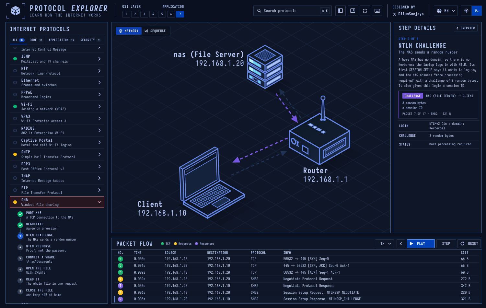
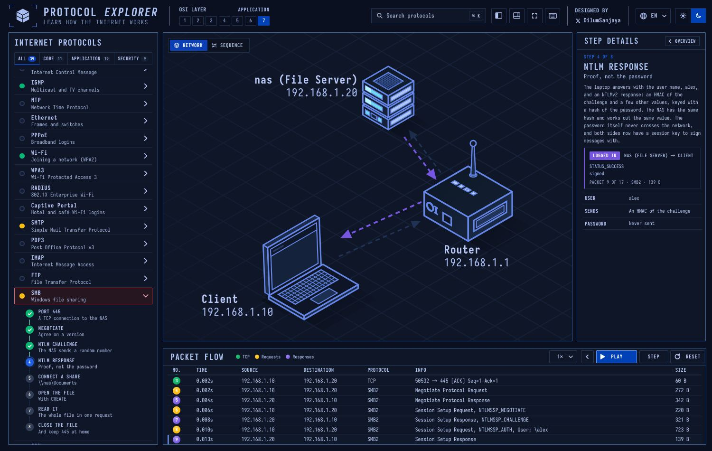
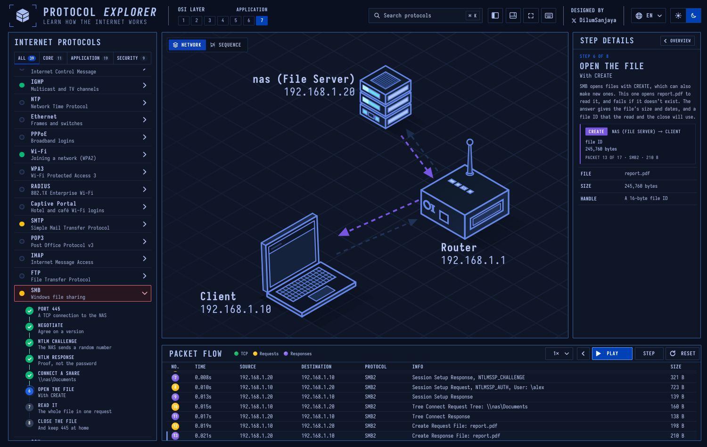
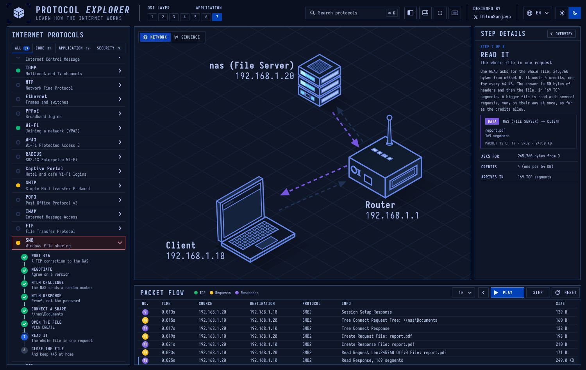
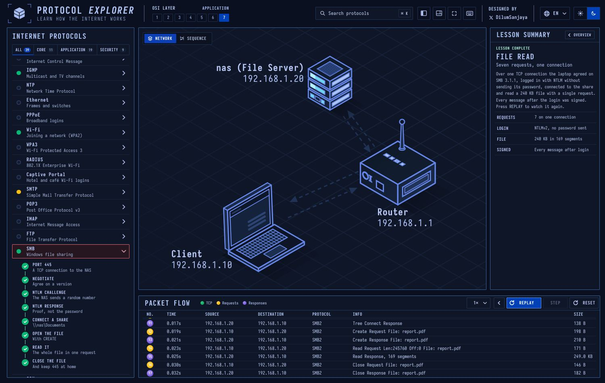
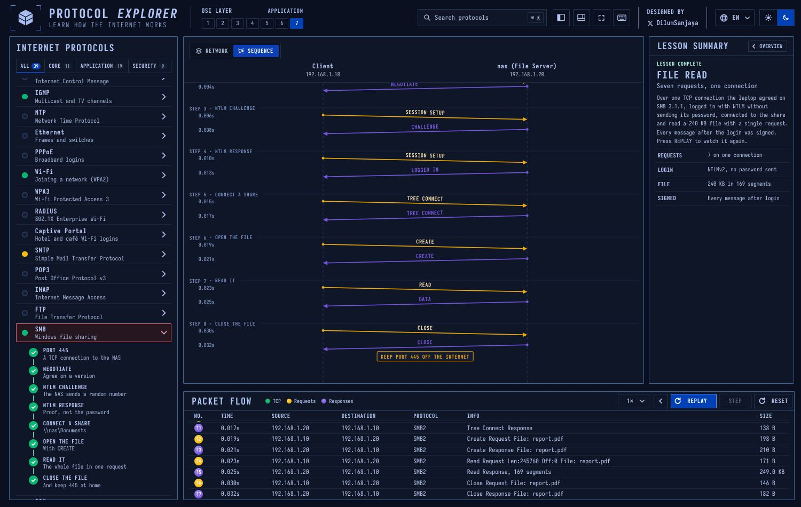
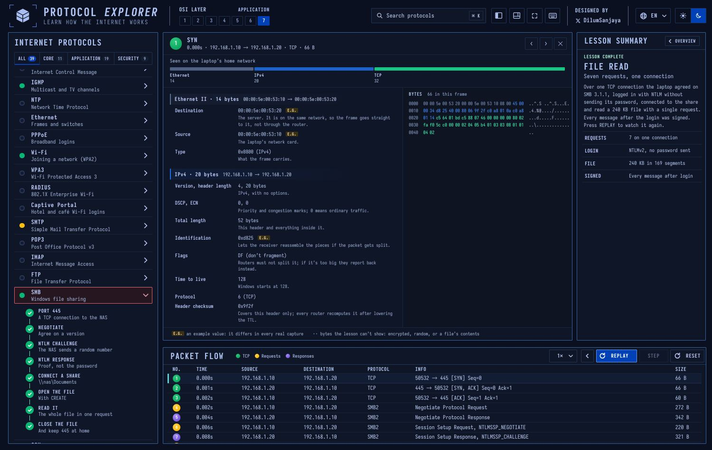

# SMB – Windows file sharing

<!-- nav -->
⬅ [30 FTP](30-ftp.md) · [Index](00_Protocols_Index.md) · [32 SSH](32-ssh.md) ➡
<!-- nav -->

*Source: Protocol Explorer – https://protocol-explorer-alpha.vercel.app/ (interactive lesson #31). Screenshots captured from the live lesson; packet decodes are the site's example capture (values marked **E.G.** differ in every real capture).*

## Overview


> PROTOCOL OVERVIEW  
> SMB  
> ACTIVE  
> Server Message Block (SMB 3)  
> SMB is how Windows shares files and printers: \\server\share in File Explorer, a mapped network drive, a NAS at home. macOS and Linux speak it too. Over one TCP connection to port 445 the client agrees on a version, logs in and connects to a share, then opens, reads, writes and closes files with numbered requests.  
> LAYER  
> Application (Layer 7)  
> PORT  
> TCP 445  
> VERSION  
> SMB 3.1.1  
> LOGIN  
> NTLM or Kerberos  
> PROTECTION  
> Signing, optional encryption  
> DEFINED IN  
> MS-SMB2 (Microsoft)  

## In-depth explanation of the example (plain-language version)

### The big picture in one minute
On a home network, the laptop opens **`\\nas\Documents\report.pdf`** from a **NAS** (a network storage box, the same one found with ARP in the Ethernet lesson). The 17 packets (about 32 ms) show everything SMB does: **agree on a version**, **log in** using NTLM, **connect to a shared folder**, **open the file**, **read it** (245,760 bytes) and **close it**, all over **one TCP connection to port 445**.

**What SMB is.** *Server Message Block* is the protocol behind **Windows file sharing** (`\\server\share`, mapped drives, network printers). macOS and Linux (via Samba) speak it too. It is a **request/response** protocol: each request has a **command** and a **message number**, and once you're logged in, the messages also carry a **session ID** and a **share ID**.

Think of **a library**: you walk in and agree on the rules (negotiate), show your card (log in), pick a section (connect to a share), borrow a book (open), read it, and return it (close).

> **Words you'll see:** *Share* = a shared folder. *NTLM* = a password-based login method. *Signing* = adding a signature so tampering is detected. *Dialect* = a version of the protocol.

---

### Step 1 – Connect – packets 1 to 3
A TCP handshake to **port 445**. **Never expose port 445 to the internet.**

### Step 2 – Agree on a version – packets 4, 5
- The laptop lists every version it knows (**2.0.2, 2.1, 3.0, 3.0.2, 3.1.1**), says **signing is required**, and offers some security features.
- The NAS picks **3.1.1**, the newest both support.
- Both sides keep a **running fingerprint (a SHA-512 hash) of every message** until login finishes, and mix it into the keys. **If an attacker tampered with these messages, for instance to force an older, weaker version, the keys wouldn't match and the login would fail.** This protects against downgrade attacks.

### Step 3 – The login challenge – packets 6, 7
A home NAS has no Windows domain, so there's no Kerberos. The laptop uses **NTLM**:
- **Request (6):** "I'd like to log in with NTLM."
- **Response (7):** "More steps needed," plus a **random challenge** (8 random bytes) and a session ID.

### Step 4 – The login proof – packets 8, 9
The laptop sends its **username** and a **scrambled proof** made from the **password, the server's challenge, its own challenge and a timestamp**. The NAS knows the same password fingerprint, calculates the same value and compares. **The password never crosses the network.** Both sides also derive a **session key** used for signing. Result: **`STATUS_SUCCESS`**. (In a company domain you'd see Kerberos tickets here instead.)

### Step 5 – Connect to the share – packets 10, 11
The laptop asks to connect to **`\\nas\Documents`** and receives a **share ID** plus its **access rights**. From now on **every message is signed** with a short signature made using the session key, so tampering or forgery is detected. (SMB 3 can also **encrypt** each message; it isn't turned on here.)

### Step 6 – Open the file – packets 12, 13
The command is called **`CREATE`** (it can also create files). Here it **opens `report.pdf` for reading and fails if it doesn't exist.** The reply gives a **file handle** (used by later commands), the size **245,760 bytes**, and timestamps.

### Step 7 – Read – packets 14, 15
**One `READ` request for the entire file.** SMB controls the flow with **credits**: each request uses credits in proportion to its size (1 per 64 KB), and the server grants more in each reply. The answer arrives as **about 249 KB in 169 TCP segments.** For bigger files the client sends **several reads at once** within its credit limit.

### Step 8 – Close – packets 16, 17
**`CLOSE`** hands the file handle back. **The connection stays open for the next file.** Only **signing** protects these messages here, so **anyone on the network could read the file as it passed.** Turn on SMB encryption for sensitive data.

---

### The 17 packets at a glance
| Packets | What | Why |
|---|---|---|
| 1–3 | TCP handshake (port 445) | connect |
| 4–5 | Negotiate | pick version 3.1.1 |
| 6–9 | Session Setup (NTLM) | log in |
| 10–11 | Tree Connect | attach to the `Documents` share |
| 12–13 | Create | open the file |
| 14–15 | Read | get the data |
| 16–17 | Close | return the file |

### What to remember
- **Sequence:** `NEGOTIATE → SESSION_SETUP → TREE_CONNECT → CREATE → READ/WRITE → CLOSE → TREE_DISCONNECT → LOGOFF`.
- **IDs:** Message ID (per request), Session ID (the login), Tree ID (the share), File ID (the open file).
- **SMB1 is obsolete and dangerous.** The **WannaCry** worm (2017) spread through a flaw in it. Disable SMB1.
- **Security features:** protection against downgrade (3.1.1), message signing, **encryption** and **SMB over QUIC** (file access without a VPN).
- Keep **port 445 off the internet**. NTLM is weak, so prefer Kerberos in company networks.

## Step-by-step walkthrough (screenshots from the lesson)

### Step 1: PORT 445 – A TCP connection to the NAS


> STEP 1 OF 8  
> PORT 445  
> A TCP connection to the NAS  
> The laptop opens \\nas\Documents, a shared folder on the NAS. It finds nas’s address with a local name lookup and opens a TCP connection to port 445. The packets pass through the home router to the NAS and never leave the home network.  
> SERVER  
> nas, 192.168.1.20  
> PORT  
> TCP 445  
> STAYS  
> On the home network  

### Step 2: NEGOTIATE – Agree on a version


> STEP 2 OF 8  
> NEGOTIATE  
> Agree on a version  
> The laptop lists every SMB version it speaks, from 2.0.2 to 3.1.1, and says it requires signing. The NAS picks 3.1.1, the newest. Both sides keep a SHA-512 hash of everything exchanged from here until the login is done. It goes into the keys, so if anyone changed these messages on the way, to force an older version for instance, the login would fail.  
> NEGOTIATE  
> NAS (FILE SERVER) → CLIENT  
> SMB 3.1.1  
> PACKET 5 OF 17 · SMB2 · 342 B  
> OFFERED  
> 2.0.2 to 3.1.1  
> CHOSEN  
> SMB 3.1.1  
> TAMPER CHECK  
> SHA-512 of the exchange  

### Step 3: NTLM CHALLENGE – The NAS sends a random number



> STEP 3 OF 8  
> NTLM CHALLENGE  
> The NAS sends a random number  
> A home NAS has no domain, so there is no Kerberos: the laptop logs in with NTLM. Its first SESSION_SETUP says it wants to log in, and the NAS answers “more processing required” with a challenge of 8 random bytes. It also gives this login a session ID.  
> CHALLENGE  
> NAS (FILE SERVER) → CLIENT  
> 8 random bytes  
> a session ID  
> PACKET 7 OF 17 · SMB2 · 321 B  
> LOGIN  
> NTLMv2 (in a domain: Kerberos)  
> CHALLENGE  
> 8 random bytes  
> STATUS  
> More processing required  

### Step 4: NTLM RESPONSE – Proof, not the password



> STEP 4 OF 8  
> NTLM RESPONSE  
> Proof, not the password  
> The laptop answers with the user name, alex, and an NTLMv2 response: an HMAC of the challenge and a few other values, keyed with a hash of the password. The NAS has the same hash and works out the same value. The password itself never crosses the network, and both sides now have a session key to sign messages with.  
> LOGGED IN  
> NAS (FILE SERVER) → CLIENT  
> STATUS_SUCCESS  
> signed  
> PACKET 9 OF 17 · SMB2 · 139 B  
> USER  
> alex  
> SENDS  
> An HMAC of the challenge  
> PASSWORD  
> Never sent  

### Step 5: CONNECT A SHARE – \\nas\Documents


> STEP 5 OF 8  
> CONNECT A SHARE  
> \\nas\Documents  
> TREE_CONNECT asks for the share by its full name, \\nas\Documents. The answer gives it a tree ID and says what this user may do there. Every message is now signed: each carries a tag over the whole message, made with a key from the login, so a changed or forged message would be caught.  
> TREE CONNECT  
> CLIENT → NAS (FILE SERVER)  
> \\nas\Documents  
> PACKET 10 OF 17 · SMB2 · 160 B  
> SHARE  
> \\nas\Documents  
> TREE ID  
> 0x00002a51  
> EVERY MESSAGE  
> Signed (AES-GMAC)  

### Step 6: OPEN THE FILE – With CREATE



> STEP 6 OF 8  
> OPEN THE FILE  
> With CREATE  
> SMB opens files with CREATE, which can also make new ones. This one opens report.pdf to read it, and fails if it doesn’t exist. The answer gives the file’s size and dates, and a file ID that the read and the close will use.  
> CREATE  
> NAS (FILE SERVER) → CLIENT  
> file ID  
> 245,760 bytes  
> PACKET 13 OF 17 · SMB2 · 210 B  
> FILE  
> report.pdf  
> SIZE  
> 245,760 bytes  
> HANDLE  
> A 16-byte file ID  

### Step 7: READ IT – The whole file in one request



> STEP 7 OF 8  
> READ IT  
> The whole file in one request  
> One READ asks for the whole file, 245,760 bytes from offset 0. It costs 4 credits, one for every 64 KB. The answer is 80 bytes of headers and then the file, in 169 TCP segments. A bigger file is read with several requests, many on their way at once, as far as the credits allow.  
> DATA  
> NAS (FILE SERVER) → CLIENT  
> report.pdf  
> 169 segments  
> PACKET 15 OF 17 · SMB2 · 249.0 KB  
> ASKS FOR  
> 245,760 bytes from 0  
> CREDITS  
> 4 (one per 64 KB)  
> ARRIVES IN  
> 169 TCP segments  

### Step 8: CLOSE THE FILE – And keep 445 at home


> STEP 8 OF 8  
> CLOSE THE FILE  
> And keep 445 at home  
> CLOSE hands the file ID back; the connection stays open for the next file. SMB 3 can also encrypt every message with AES-GCM, for one share or a whole server. Here only signing protects the messages, so anyone on the network could read the file as it passed. Port 445 should never be reachable from the internet: the WannaCry worm (2017) spread through a flaw in the old SMB1.  
> CLOSE  
> NAS (FILE SERVER) → CLIENT  
> done  
> PACKET 17 OF 17 · SMB2 · 182 B  
> ENCRYPTION  
> SMB 3: AES-GCM, optional  
> SMB1  
> Switched off: old, unsafe  
> PORT 445  
> Never open to the internet  

### Lesson summary



> LESSON SUMMARY  
> LESSON COMPLETE  
> FILE READ  
> Seven requests, one connection  
> Over one TCP connection the laptop agreed on SMB 3.1.1, logged in with NTLM without sending its password, connected to the share and read a 240 KB file with a single request. Every message after the login was signed. Press REPLAY to watch it again.  
> CLOSE  
> NAS (FILE SERVER) → CLIENT  
> done  
> PACKET 17 OF 17 · SMB2 · 182 B  
> REQUESTS  
> 7 on one connection  
> LOGIN  
> NTLMv2, no password sent  
> FILE  
> 240 KB in 169 segments  
> SIGNED  
> Every message after login  

## Packet flow (whole lesson)

| No. | Time | Source | Destination | Protocol | Info | Size |
|---|---|---|---|---|---|---|
| 1 | 0.000s | 192.168.1.10 | 192.168.1.20 | TCP | 50532 → 445 [SYN] Seq=0 | 66 B |
| 2 | 0.001s | 192.168.1.20 | 192.168.1.10 | TCP | 445 → 50532 [SYN, ACK] Seq=0 Ack=1 | 66 B |
| 3 | 0.002s | 192.168.1.10 | 192.168.1.20 | TCP | 50532 → 445 [ACK] Seq=1 Ack=1 | 60 B |
| 4 | 0.002s | 192.168.1.10 | 192.168.1.20 | SMB2 | Negotiate Protocol Request | 272 B |
| 5 | 0.004s | 192.168.1.20 | 192.168.1.10 | SMB2 | Negotiate Protocol Response | 342 B |
| 6 | 0.006s | 192.168.1.10 | 192.168.1.20 | SMB2 | Session Setup Request, NTLMSSP_NEGOTIATE | 220 B |
| 7 | 0.008s | 192.168.1.20 | 192.168.1.10 | SMB2 | Session Setup Response, NTLMSSP_CHALLENGE | 321 B |
| 8 | 0.010s | 192.168.1.10 | 192.168.1.20 | SMB2 | Session Setup Request, NTLMSSP_AUTH, User: \alex | 723 B |
| 9 | 0.013s | 192.168.1.20 | 192.168.1.10 | SMB2 | Session Setup Response | 139 B |
| 10 | 0.015s | 192.168.1.10 | 192.168.1.20 | SMB2 | Tree Connect Request Tree: \\nas\Documents | 160 B |
| 11 | 0.017s | 192.168.1.20 | 192.168.1.10 | SMB2 | Tree Connect Response | 138 B |
| 12 | 0.019s | 192.168.1.10 | 192.168.1.20 | SMB2 | Create Request File: report.pdf | 198 B |
| 13 | 0.021s | 192.168.1.20 | 192.168.1.10 | SMB2 | Create Response File: report.pdf | 210 B |
| 14 | 0.023s | 192.168.1.10 | 192.168.1.20 | SMB2 | Read Request Len:245760 Off:0 File: report.pdf | 171 B |
| 15 | 0.025s | 192.168.1.20 | 192.168.1.10 | SMB2 | Read Response, 169 segments | 249.0 KB |
| 16 | 0.030s | 192.168.1.10 | 192.168.1.20 | SMB2 | Close Request File: report.pdf | 146 B |
| 17 | 0.032s | 192.168.1.20 | 192.168.1.10 | SMB2 | Close Response File: report.pdf | 182 B |

### Sequence diagram



## Packets decoded byte by byte

Each packet below is the lesson's own decode (headers, field values and the plain-English meaning of each field). Screenshots show the first, middle and last packet in the lesson's decoder view with the raw hex bytes.

### Packet 1: TCP – 50532 → 445 [SYN] Seq=0

*192.168.1.10 → 192.168.1.20 · 66 B · t = 0.000s*



<details><summary>Decoded fields</summary>

```text
1
SYN
0.000s · 192.168.1.10 → 192.168.1.20 · TCP · 66 B
Seen on the laptop’s home network
Ethernet
14
IPv4
20
TCP
32
Ethernet II · 14 bytes
00:00:5e:00:53:10 → 00:00:5e:00:53:20
Destination
00:00:5e:00:53:20 E.G.

The server. It is on the same network, so the frame goes straight to it, not through the router.

Source
00:00:5e:00:53:10 E.G.

The laptop’s network card.

Type
0x0800 (IPv4)

What the frame carries.

IPv4 · 20 bytes
192.168.1.10 → 192.168.1.20
Version, header length
4, 20 bytes

IPv4, with no options.

DSCP, ECN
0, 0

Priority and congestion marks; 0 means ordinary traffic.

Total length
52 bytes

This header and everything inside it.

Identification
0xd825 E.G.

Lets the receiver reassemble the pieces if the packet gets split.

Flags
DF (don’t fragment)

Routers must not split it; if it’s too big they report back instead.

Time to live
128

Windows starts at 128.

Protocol
6 (TCP)
Header checksum
0x9f2f

Covers this header only; every router recomputes it after lowering the TTL.

Source
192.168.1.10
Destination
192.168.1.20
TCP · 32 bytes
50532 → 445, SYN
Source port
50532

Picked by the laptop’s system for this connection.

Destination port
445
Sequence number
0 (relative)

This side’s starting number. Shown as 0; the real one is random.

Real sequence number
3314026310 E.G.
Acknowledgment
0 (not used yet)

A first SYN has nothing to acknowledge.

Header length
32 bytes

20 bytes, plus 12 of options.

Flags
0x002 (SYN)
Window
64240 E.G.

How much more data this side can take right now.

Checksum
0x5cc0

Covers the header, the data and the IP addresses, so damage is caught.

Urgent pointer
0
Options
12 bytes
Maximum segment size
1460 bytes

The most data this side wants in one segment.

No-op
1

Spacing, so the next option lines up.

Window scale
× 256

Window values are multiplied by this, so windows can be larger than 64 KB.

No-op
1

Spacing, so the next option lines up.

No-op
1

Spacing, so the next option lines up.

SACK permitted
yes

This side understands selective acknowledgements.

BYTES 66 in this frame
0000
00
00
5e
00
53
20
00
00
5e
00
53
10
08
00
45
00
.
.
^
.
S
.
.
^
.
S
.
.
.
E
.
0010
00
34
d8
25
40
00
80
06
9f
2f
c0
a8
01
0a
c0
a8
.
4
.
%
@
.
.
.
.
/
.
.
.
.
.
.
0020
01
14
c5
64
01
bd
c5
88
07
46
00
00
00
00
80
02
.
.
.
d
.
.
.
.
.
F
.
.
.
.
.
.
0030
fa
f0
5c
c0
00
00
02
04
05
b4
01
03
03
08
01
01
.
.
\
.
.
.
.
.
.
.
.
.
.
.
.
.
0040
04
02
.
.
E.G. an example value: it differs in every real capture
·· bytes the lesson can’t show: encrypted, random, or a file’s contents
```

</details>

### Packet 2: TCP – 445 → 50532 [SYN, ACK] Seq=0 Ack=1

*192.168.1.20 → 192.168.1.10 · 66 B · t = 0.001s*

<details><summary>Decoded fields</summary>

```text
2
SYN-ACK
0.001s · 192.168.1.20 → 192.168.1.10 · TCP · 66 B
Seen on the laptop’s home network
Ethernet
14
IPv4
20
TCP
32
Ethernet II · 14 bytes
00:00:5e:00:53:20 → 00:00:5e:00:53:10
Destination
00:00:5e:00:53:10 E.G.

The laptop.

Source
00:00:5e:00:53:20 E.G.

The server’s network card.

Type
0x0800 (IPv4)

What the frame carries.

IPv4 · 20 bytes
192.168.1.20 → 192.168.1.10
Version, header length
4, 20 bytes

IPv4, with no options.

DSCP, ECN
0, 0

Priority and congestion marks; 0 means ordinary traffic.

Total length
52 bytes

This header and everything inside it.

Identification
0x202e E.G.

Lets the receiver reassemble the pieces if the packet gets split.

Flags
DF (don’t fragment)

Routers must not split it; if it’s too big they report back instead.

Time to live
64

As sent: this system starts at 64.

Protocol
6 (TCP)
Header checksum
0x9727

Covers this header only; every router recomputes it after lowering the TTL.

Source
192.168.1.20
Destination
192.168.1.10
TCP · 32 bytes
445 → 50532, SYN, ACK
Source port
445
Destination port
50532
Sequence number
0 (relative)

This side’s starting number. Shown as 0; the real one is random.

Real sequence number
3500988679 E.G.
Acknowledgment
1 (relative)

The next byte this side expects: everything before it has arrived.

Header length
32 bytes

20 bytes, plus 12 of options.

Flags
0x012 (SYN, ACK)
Window
64240 E.G.

How much more data this side can take right now.

Checksum
0xb2fb

Covers the header, the data and the IP addresses, so damage is caught.

Urgent pointer
0
Options
12 bytes
Maximum segment size
1460 bytes

The most data this side wants in one segment.

No-op
1

Spacing, so the next option lines up.

No-op
1

Spacing, so the next option lines up.

SACK permitted
yes

This side understands selective acknowledgements.

No-op
1

Spacing, so the next option lines up.

Window scale
× 128

Window values are multiplied by this, so windows can be larger than 64 KB.

BYTES 66 in this frame
0000
00
00
5e
00
53
10
00
00
5e
00
53
20
08
00
45
00
.
.
^
.
S
.
.
.
^
.
S
.
.
E
.
0010
00
34
20
2e
40
00
40
06
97
27
c0
a8
01
14
c0
a8
.
4
.
@
.
@
.
.
'
.
.
.
.
.
.
0020
01
0a
01
bd
c5
64
d0
ac
d9
07
c5
88
07
47
80
12
.
.
.
.
.
d
.
.
.
.
.
.
.
G
.
.
0030
fa
f0
b2
fb
00
00
02
04
05
b4
01
01
04
02
01
03
.
.
.
.
.
.
.
.
.
.
.
.
.
.
.
.
0040
03
07
.
.
E.G. an example value: it differs in every real capture
·· bytes the lesson can’t show: encrypted, random, or a file’s contents
```

</details>

### Packet 3: TCP – 50532 → 445 [ACK] Seq=1 Ack=1

*192.168.1.10 → 192.168.1.20 · 60 B · t = 0.002s*

<details><summary>Decoded fields</summary>

```text
3
ACK
0.002s · 192.168.1.10 → 192.168.1.20 · TCP · 60 B
Seen on the laptop’s home network
Ethernet
14
IPv4
20
TCP
20
Padding
6
Ethernet II · 14 bytes
00:00:5e:00:53:10 → 00:00:5e:00:53:20
Destination
00:00:5e:00:53:20 E.G.

The server. It is on the same network, so the frame goes straight to it, not through the router.

Source
00:00:5e:00:53:10 E.G.

The laptop’s network card.

Type
0x0800 (IPv4)

What the frame carries.

IPv4 · 20 bytes
192.168.1.10 → 192.168.1.20
Version, header length
4, 20 bytes

IPv4, with no options.

DSCP, ECN
0, 0

Priority and congestion marks; 0 means ordinary traffic.

Total length
40 bytes

This header and everything inside it.

Identification
0xd826 E.G.

Lets the receiver reassemble the pieces if the packet gets split.

Flags
DF (don’t fragment)

Routers must not split it; if it’s too big they report back instead.

Time to live
128

Windows starts at 128.

Protocol
6 (TCP)
Header checksum
0x9f3a

Covers this header only; every router recomputes it after lowering the TTL.

Source
192.168.1.10
Destination
192.168.1.20
TCP · 20 bytes
50532 → 445, ACK
Source port
50532

Picked by the laptop’s system for this connection.

Destination port
445
Sequence number
1 (relative)

Position of this segment’s first byte, counted from this side’s SYN.

Real sequence number
3314026311 E.G.
Acknowledgment
1 (relative)

The next byte this side expects: everything before it has arrived.

Header length
20 bytes
Flags
0x010 (ACK)
Window
1026 (× 256 = 262,656 bytes) E.G.

How much more data this side can take right now.

Checksum
0xeabc

Covers the header, the data and the IP addresses, so damage is caught.

Urgent pointer
0
Ethernet padding · 6 bytes
Padding
6 zero bytes

Ethernet frames are at least 60 bytes (64 with the checksum the card adds), so short ones are padded.

BYTES 60 in this frame
0000
00
00
5e
00
53
20
00
00
5e
00
53
10
08
00
45
00
.
.
^
.
S
.
.
^
.
S
.
.
.
E
.
0010
00
28
d8
26
40
00
80
06
9f
3a
c0
a8
01
0a
c0
a8
.
(
.
&
@
.
.
.
.
:
.
.
.
.
.
.
0020
01
14
c5
64
01
bd
c5
88
07
47
d0
ac
d9
08
50
10
.
.
.
d
.
.
.
.
.
G
.
.
.
.
P
.
0030
04
02
ea
bc
00
00
00
00
00
00
00
00
.
.
.
.
.
.
.
.
.
.
.
.
E.G. an example value: it differs in every real capture
·· bytes the lesson can’t show: encrypted, random, or a file’s contents
```

</details>

### Packet 4: SMB2 – Negotiate Protocol Request

*192.168.1.10 → 192.168.1.20 · 272 B · t = 0.002s*

<details><summary>Decoded fields</summary>

```text
4
NEGOTIATE
0.002s · 192.168.1.10 → 192.168.1.20 · SMB2 · 272 B
Seen on the laptop’s home network
Ethernet
14
IPv4
20
TCP
20
SMB2
218
Ethernet II · 14 bytes
00:00:5e:00:53:10 → 00:00:5e:00:53:20
Destination
00:00:5e:00:53:20 E.G.

The server. It is on the same network, so the frame goes straight to it, not through the router.

Source
00:00:5e:00:53:10 E.G.

The laptop’s network card.

Type
0x0800 (IPv4)

What the frame carries.

IPv4 · 20 bytes
192.168.1.10 → 192.168.1.20
Version, header length
4, 20 bytes

IPv4, with no options.

DSCP, ECN
0, 0

Priority and congestion marks; 0 means ordinary traffic.

Total length
258 bytes

This header and everything inside it.

Identification
0xd827 E.G.

Lets the receiver reassemble the pieces if the packet gets split.

Flags
DF (don’t fragment)

Routers must not split it; if it’s too big they report back instead.

Time to live
128

Windows starts at 128.

Protocol
6 (TCP)
Header checksum
0x9e5f

Covers this header only; every router recomputes it after lowering the TTL.

Source
192.168.1.10
Destination
192.168.1.20
TCP · 20 bytes
50532 → 445, PSH, ACK
Source port
50532

Picked by the laptop’s system for this connection.

Destination port
445
Sequence number
1 (relative)

Position of this segment’s first byte, counted from this side’s SYN.

Real sequence number
3314026311 E.G.
Acknowledgment
1 (relative)

The next byte this side expects: everything before it has arrived.

Header length
20 bytes
Flags
0x018 (PSH, ACK)
Window
1026 (× 256 = 262,656 bytes) E.G.

How much more data this side can take right now.

Checksum
covers bytes not shown here

Covers the header, the data and the IP addresses, so damage is caught.

Urgent pointer
0
SMB2 · NEGOTIATE request
Length
214 bytes

On port 445 every SMB message starts with its length, a leftover from NetBIOS.

Header
64 bytes
Protocol
0xFE "SMB" (SMB2 or 3)

SMB1 messages started 0xFF "SMB". SMB1 is switched off in Windows today.

Header size
64
Credit charge
1
Channel sequence
0
Command
0 (NEGOTIATE)
Credits asked for
1 E.G.

Credits limit how many requests the laptop may have waiting at once. The server hands them out.

Flags
0x00000000
Next command
0 (none chained)
Message ID
0

Counts up with each request; the response carries the same number.

Reserved
0x0000feff E.G.
Tree ID
0 (no share yet)
Session ID
0 (not logged in yet)
Signature
zeros (not signed)
NEGOTIATE request
150 bytes
Structure size
36
Dialect count
5
Security mode
0x0002 (signing required)

Recent versions of Windows 11 require signing by default.

Reserved
0
Capabilities
0x0000007f E.G.

DFS, leases, large reads and writes, multichannel, persistent handles, directory leases, encryption.

Client GUID
16 bytes E.G.

A random ID for this computer.

Negotiate contexts
at offset 112, 4 of them
Dialects
2.0.2, 2.1, 3.0, 3.0.2, 3.1.1

Every version the laptop speaks. The server picks the newest it also knows.

Padding
2 bytes
Contexts
102 bytes E.G.

SMB 3.1.1 extras, each in its own small block.

Inside
Pre-authentication integrity: SHA-512, and a 32-byte random salt
Encryption: AES-128-GCM, AES-128-CCM, AES-256-GCM, AES-256-CCM
Signing: AES-GMAC, AES-CMAC, HMAC-SHA256
The server’s name: nas
BYTES 272 in this frame
0000
00
00
5e
00
53
20
00
00
5e
00
53
10
08
00
45
00
.
.
^
.
S
.
.
^
.
S
.
.
.
E
.
0010
01
02
d8
27
40
00
80
06
9e
5f
c0
a8
01
0a
c0
a8
.
.
.
'
@
.
.
.
.
_
.
.
.
.
.
.
0020
01
14
c5
64
01
bd
c5
88
07
47
d0
ac
d9
08
50
18
.
.
.
d
.
.
.
.
.
G
.
.
.
.
P
.
0030
04
02
··
··
00
00
00
00
00
d6
fe
53
4d
42
40
00
.
.
·
·
.
.
.
.
.
.
.
S
M
B
@
.
0040
01
00
00
00
00
00
00
00
01
00
00
00
00
00
00
00
.
.
.
.
.
.
.
.
.
.
.
.
.
.
.
.
0050
00
00
00
00
00
00
00
00
00
00
ff
fe
00
00
00
00
.
.
.
.
.
.
.
.
.
.
.
.
.
.
.
.
0060
00
00
00
00
00
00
00
00
00
00
00
00
00
00
00
00
.
.
.
.
.
.
.
.
.
.
.
.
.
.
.
.
0070
00
00
00
00
00
00
00
00
00
00
24
00
05
00
02
00
.
.
.
.
.
.
.
.
.
.
$
.
.
.
.
.
0080
00
00
7f
00
00
00
··
··
··
··
··
··
··
··
··
··
.
.
.
.
.
.
·
·
·
·
·
·
·
·
·
·
0090
··
··
··
··
··
··
70
00
00
00
04
00
00
00
02
02
·
·
·
·
·
·
p
.
.
.
.
.
.
.
.
.
00a0
10
02
00
03
02
03
11
03
00
00
··
··
··
··
··
··
.
.
.
.
.
.
.
.
.
.
·
·
·
·
·
·
00b0
··
··
··
··
··
··
··
··
··
··
··
··
··
··
··
··
·
·
·
·
·
·
·
·
·
·
·
·
·
·
·
·
00c0
··
··
··
··
··
··
··
··
··
··
··
··
··
··
··
··
·
·
·
·
·
·
·
·
·
·
·
·
·
·
·
·
00d0
··
··
··
··
··
··
··
··
··
··
··
··
··
··
··
··
·
·
·
·
·
·
·
·
·
·
·
·
·
·
·
·
00e0
··
··
··
··
··
··
··
··
··
··
··
··
··
··
··
··
·
·
·
·
·
·
·
·
·
·
·
·
·
·
·
·
00f0
··
··
··
··
··
··
··
··
··
··
··
··
··
··
··
··
·
·
·
·
·
·
·
·
·
·
·
·
·
·
·
·
0100
··
··
··
··
··
··
··
··
··
··
··
··
··
··
··
··
·
·
·
·
·
·
·
·
·
·
·
·
·
·
·
·
E.G. an example value: it differs in every real capture
·· bytes the lesson can’t show: encrypted, random, or a file’s contents
```

</details>

### Packet 5: SMB2 – Negotiate Protocol Response

*192.168.1.20 → 192.168.1.10 · 342 B · t = 0.004s*

<details><summary>Decoded fields</summary>

```text
5
NEGOTIATE
0.004s · 192.168.1.20 → 192.168.1.10 · SMB2 · 342 B
Seen on the laptop’s home network
Ethernet
14
IPv4
20
TCP
20
SMB2
288
Ethernet II · 14 bytes
00:00:5e:00:53:20 → 00:00:5e:00:53:10
Destination
00:00:5e:00:53:10 E.G.

The laptop.

Source
00:00:5e:00:53:20 E.G.

The server’s network card.

Type
0x0800 (IPv4)

What the frame carries.

IPv4 · 20 bytes
192.168.1.20 → 192.168.1.10
Version, header length
4, 20 bytes

IPv4, with no options.

DSCP, ECN
0, 0

Priority and congestion marks; 0 means ordinary traffic.

Total length
328 bytes

This header and everything inside it.

Identification
0x202f E.G.

Lets the receiver reassemble the pieces if the packet gets split.

Flags
DF (don’t fragment)

Routers must not split it; if it’s too big they report back instead.

Time to live
64

As sent: this system starts at 64.

Protocol
6 (TCP)
Header checksum
0x9612

Covers this header only; every router recomputes it after lowering the TTL.

Source
192.168.1.20
Destination
192.168.1.10
TCP · 20 bytes
445 → 50532, PSH, ACK
Source port
445
Destination port
50532
Sequence number
1 (relative)

Position of this segment’s first byte, counted from this side’s SYN.

Real sequence number
3500988680 E.G.
Acknowledgment
219 (relative)

The next byte this side expects: everything before it has arrived.

Header length
20 bytes
Flags
0x018 (PSH, ACK)
Window
501 (× 128 = 64,128 bytes) E.G.

How much more data this side can take right now.

Checksum
covers bytes not shown here

Covers the header, the data and the IP addresses, so damage is caught.

Urgent pointer
0
SMB2 · NEGOTIATE response
Length
284 bytes

On port 445 every SMB message starts with its length, a leftover from NetBIOS.

Header
64 bytes
Protocol
0xFE "SMB" (SMB2 or 3)

SMB1 messages started 0xFF "SMB". SMB1 is switched off in Windows today.

Header size
64
Credit charge
1
Status
0x00000000 (STATUS_SUCCESS)
Command
0 (NEGOTIATE)
Credits granted
1 E.G.
Flags
0x00000001 (response)
Next command
0 (none chained)
Message ID
0
Reserved
0x0000feff E.G.
Tree ID
0 (no share yet)
Session ID
0 (not logged in yet)
Signature
zeros (not signed)
NEGOTIATE response
220 bytes
Structure size
65
Security mode
0x0001 (signing enabled)
Dialect
0x0311 (SMB 3.1.1)

The newest version both sides speak.

Context count
3
Server GUID
16 bytes E.G.
Capabilities
0x00000006 E.G.

Leases, large reads and writes.

Largest read, write
8 MB each E.G.

The most data one request may carry: transactions, reads and writes.

System time
7 Nov 2026, 09:41:00 E.G.
Security buffer
offset 128, 74 bytes
Context offset
208
Security blob
74 bytes E.G.

GSS-API and SPNEGO wrapping, around NTLMSSP.

Inside
The login methods the server accepts: NTLMSSP
Padding
6 bytes
Contexts
76 bytes E.G.
Inside
Pre-authentication integrity: SHA-512, and the server’s own salt
Encryption: AES-128-GCM
Signing: AES-GMAC
BYTES 342 in this frame
0000
00
00
5e
00
53
10
00
00
5e
00
53
20
08
00
45
00
.
.
^
.
S
.
.
.
^
.
S
.
.
E
.
0010
01
48
20
2f
40
00
40
06
96
12
c0
a8
01
14
c0
a8
.
H
/
@
.
@
.
.
.
.
.
.
.
.
.
0020
01
0a
01
bd
c5
64
d0
ac
d9
08
c5
88
08
21
50
18
.
.
.
.
.
d
.
.
.
.
.
.
.
!
P
.
0030
01
f5
··
··
00
00
00
00
01
1c
fe
53
4d
42
40
00
.
.
·
·
.
.
.
.
.
.
.
S
M
B
@
.
0040
01
00
00
00
00
00
00
00
01
00
01
00
00
00
00
00
.
.
.
.
.
.
.
.
.
.
.
.
.
.
.
.
0050
00
00
00
00
00
00
00
00
00
00
ff
fe
00
00
00
00
.
.
.
.
.
.
.
.
.
.
.
.
.
.
.
.
0060
00
00
00
00
00
00
00
00
00
00
00
00
00
00
00
00
.
.
.
.
.
.
.
.
.
.
.
.
.
.
.
.
0070
00
00
00
00
00
00
00
00
00
00
41
00
01
00
11
03
.
.
.
.
.
.
.
.
.
.
A
.
.
.
.
.
0080
03
00
··
··
··
··
··
··
··
··
··
··
··
··
··
··
.
.
·
·
·
·
·
·
·
·
·
·
·
·
·
·
0090
··
··
06
00
00
00
00
00
80
00
00
00
80
00
00
00
·
·
.
.
.
.
.
.
.
.
.
.
.
.
.
.
00a0
80
00
00
5e
bd
18
9c
6e
dd
01
00
00
00
00
00
00
.
.
.
^
.
.
.
n
.
.
.
.
.
.
.
.
00b0
00
00
80
00
4a
00
d0
00
00
00
··
··
··
··
··
··
.
.
.
.
J
.
.
.
.
.
·
·
·
·
·
·
00c0
··
··
··
··
··
··
··
··
··
··
··
··
··
··
··
··
·
·
·
·
·
·
·
·
·
·
·
·
·
·
·
·
00d0
··
··
··
··
··
··
··
··
··
··
··
··
··
··
··
··
·
·
·
·
·
·
·
·
·
·
·
·
·
·
·
·
00e0
··
··
··
··
··
··
··
··
··
··
··
··
··
··
··
··
·
·
·
·
·
·
·
·
·
·
·
·
·
·
·
·
00f0
··
··
··
··
··
··
··
··
··
··
··
··
··
··
··
··
·
·
·
·
·
·
·
·
·
·
·
·
·
·
·
·
0100
··
··
··
··
00
00
00
00
00
00
··
··
··
··
··
··
·
·
·
·
.
.
.
.
.
.
·
·
·
·
·
·
0110
··
··
··
··
··
··
··
··
··
··
··
··
··
··
··
··
·
·
·
·
·
·
·
·
·
·
·
·
·
·
·
·
0120
··
··
··
··
··
··
··
··
··
··
··
··
··
··
··
··
·
·
·
·
·
·
·
·
·
·
·
·
·
·
·
·
0130
··
··
··
··
··
··
··
··
··
··
··
··
··
··
··
··
·
·
·
·
·
·
·
·
·
·
·
·
·
·
·
·
0140
··
··
··
··
··
··
··
··
··
··
··
··
··
··
··
··
·
·
·
·
·
·
·
·
·
·
·
·
·
·
·
·
0150
··
··
··
··
··
··
·
·
·
·
·
·
E.G. an example value: it differs in every real capture
·· bytes the lesson can’t show: encrypted, random, or a file’s contents
```

</details>

### Packet 6: SMB2 – Session Setup Request, NTLMSSP_NEGOTIATE

*192.168.1.10 → 192.168.1.20 · 220 B · t = 0.006s*

<details><summary>Decoded fields</summary>

```text
6
SESSION SETUP
0.006s · 192.168.1.10 → 192.168.1.20 · SMB2 · 220 B
Seen on the laptop’s home network
Ethernet
14
IPv4
20
TCP
20
SMB2
166
Ethernet II · 14 bytes
00:00:5e:00:53:10 → 00:00:5e:00:53:20
Destination
00:00:5e:00:53:20 E.G.

The server. It is on the same network, so the frame goes straight to it, not through the router.

Source
00:00:5e:00:53:10 E.G.

The laptop’s network card.

Type
0x0800 (IPv4)

What the frame carries.

IPv4 · 20 bytes
192.168.1.10 → 192.168.1.20
Version, header length
4, 20 bytes

IPv4, with no options.

DSCP, ECN
0, 0

Priority and congestion marks; 0 means ordinary traffic.

Total length
206 bytes

This header and everything inside it.

Identification
0xd828 E.G.

Lets the receiver reassemble the pieces if the packet gets split.

Flags
DF (don’t fragment)

Routers must not split it; if it’s too big they report back instead.

Time to live
128

Windows starts at 128.

Protocol
6 (TCP)
Header checksum
0x9e92

Covers this header only; every router recomputes it after lowering the TTL.

Source
192.168.1.10
Destination
192.168.1.20
TCP · 20 bytes
50532 → 445, PSH, ACK
Source port
50532

Picked by the laptop’s system for this connection.

Destination port
445
Sequence number
219 (relative)

Position of this segment’s first byte, counted from this side’s SYN.

Real sequence number
3314026529 E.G.
Acknowledgment
289 (relative)

The next byte this side expects: everything before it has arrived.

Header length
20 bytes
Flags
0x018 (PSH, ACK)
Window
1026 (× 256 = 262,656 bytes) E.G.

How much more data this side can take right now.

Checksum
covers bytes not shown here

Covers the header, the data and the IP addresses, so damage is caught.

Urgent pointer
0
SMB2 · SESSION_SETUP request
Length
162 bytes

On port 445 every SMB message starts with its length, a leftover from NetBIOS.

Header
64 bytes
Protocol
0xFE "SMB" (SMB2 or 3)

SMB1 messages started 0xFF "SMB". SMB1 is switched off in Windows today.

Header size
64
Credit charge
1
Channel sequence
0
Command
1 (SESSION_SETUP)
Credits asked for
33 E.G.

Credits limit how many requests the laptop may have waiting at once. The server hands them out.

Flags
0x00000000
Next command
0 (none chained)
Message ID
1

Counts up with each request; the response carries the same number.

Reserved
0x0000feff E.G.
Tree ID
0 (no share yet)
Session ID
0 (not logged in yet)
Signature
zeros (not signed)
SESSION_SETUP request
98 bytes
Structure size
25
Flags
0
Security mode
0x02 (signing required)
Capabilities
0x00000001 (DFS)
Channel
0
Security buffer
offset 88, 74 bytes
Previous session
0
Security blob
74 bytes E.G.

GSS-API and SPNEGO wrapping, around NTLMSSP.

Inside
NTLMSSP NEGOTIATE: the NTLM options the laptop supports
BYTES 220 in this frame
0000
00
00
5e
00
53
20
00
00
5e
00
53
10
08
00
45
00
.
.
^
.
S
.
.
^
.
S
.
.
.
E
.
0010
00
ce
d8
28
40
00
80
06
9e
92
c0
a8
01
0a
c0
a8
.
.
.
(
@
.
.
.
.
.
.
.
.
.
.
.
0020
01
14
c5
64
01
bd
c5
88
08
21
d0
ac
da
28
50
18
.
.
.
d
.
.
.
.
.
!
.
.
.
(
P
.
0030
04
02
··
··
00
00
00
00
00
a2
fe
53
4d
42
40
00
.
.
·
·
.
.
.
.
.
.
.
S
M
B
@
.
0040
01
00
00
00
00
00
01
00
21
00
00
00
00
00
00
00
.
.
.
.
.
.
.
.
!
.
.
.
.
.
.
.
0050
00
00
01
00
00
00
00
00
00
00
ff
fe
00
00
00
00
.
.
.
.
.
.
.
.
.
.
.
.
.
.
.
.
0060
00
00
00
00
00
00
00
00
00
00
00
00
00
00
00
00
.
.
.
.
.
.
.
.
.
.
.
.
.
.
.
.
0070
00
00
00
00
00
00
00
00
00
00
19
00
00
02
01
00
.
.
.
.
.
.
.
.
.
.
.
.
.
.
.
.
0080
00
00
00
00
00
00
58
00
4a
00
00
00
00
00
00
00
.
.
.
.
.
.
X
.
J
.
.
.
.
.
.
.
0090
00
00
··
··
··
··
··
··
··
··
··
··
··
··
··
··
.
.
·
·
·
·
·
·
·
·
·
·
·
·
·
·
00a0
··
··
··
··
··
··
··
··
··
··
··
··
··
··
··
··
·
·
·
·
·
·
·
·
·
·
·
·
·
·
·
·
00b0
··
··
··
··
··
··
··
··
··
··
··
··
··
··
··
··
·
·
·
·
·
·
·
·
·
·
·
·
·
·
·
·
00c0
··
··
··
··
··
··
··
··
··
··
··
··
··
··
··
··
·
·
·
·
·
·
·
·
·
·
·
·
·
·
·
·
00d0
··
··
··
··
··
··
··
··
··
··
··
··
·
·
·
·
·
·
·
·
·
·
·
·
E.G. an example value: it differs in every real capture
·· bytes the lesson can’t show: encrypted, random, or a file’s contents
```

</details>

### Packet 7: SMB2 – Session Setup Response, NTLMSSP_CHALLENGE

*192.168.1.20 → 192.168.1.10 · 321 B · t = 0.008s*

<details><summary>Decoded fields</summary>

```text
7
CHALLENGE
0.008s · 192.168.1.20 → 192.168.1.10 · SMB2 · 321 B
Seen on the laptop’s home network
Ethernet
14
IPv4
20
TCP
20
SMB2
267
Ethernet II · 14 bytes
00:00:5e:00:53:20 → 00:00:5e:00:53:10
Destination
00:00:5e:00:53:10 E.G.

The laptop.

Source
00:00:5e:00:53:20 E.G.

The server’s network card.

Type
0x0800 (IPv4)

What the frame carries.

IPv4 · 20 bytes
192.168.1.20 → 192.168.1.10
Version, header length
4, 20 bytes

IPv4, with no options.

DSCP, ECN
0, 0

Priority and congestion marks; 0 means ordinary traffic.

Total length
307 bytes

This header and everything inside it.

Identification
0x2030 E.G.

Lets the receiver reassemble the pieces if the packet gets split.

Flags
DF (don’t fragment)

Routers must not split it; if it’s too big they report back instead.

Time to live
64

As sent: this system starts at 64.

Protocol
6 (TCP)
Header checksum
0x9626

Covers this header only; every router recomputes it after lowering the TTL.

Source
192.168.1.20
Destination
192.168.1.10
TCP · 20 bytes
445 → 50532, PSH, ACK
Source port
445
Destination port
50532
Sequence number
289 (relative)

Position of this segment’s first byte, counted from this side’s SYN.

Real sequence number
3500988968 E.G.
Acknowledgment
385 (relative)

The next byte this side expects: everything before it has arrived.

Header length
20 bytes
Flags
0x018 (PSH, ACK)
Window
501 (× 128 = 64,128 bytes) E.G.

How much more data this side can take right now.

Checksum
covers bytes not shown here

Covers the header, the data and the IP addresses, so damage is caught.

Urgent pointer
0
SMB2 · SESSION_SETUP response
Length
263 bytes

On port 445 every SMB message starts with its length, a leftover from NetBIOS.

Header
64 bytes
Protocol
0xFE "SMB" (SMB2 or 3)

SMB1 messages started 0xFF "SMB". SMB1 is switched off in Windows today.

Header size
64
Credit charge
1
Status
0xc0000016 (STATUS_MORE_PROCESSING_REQUIRED)

Not an error: the login needs another round.

Command
1 (SESSION_SETUP)
Credits granted
33 E.G.
Flags
0x00000001 (response)
Next command
0 (none chained)
Message ID
1
Reserved
0x0000feff E.G.
Tree ID
0 (no share yet)
Session ID
0x00007a419c000025 E.G.

The server’s number for this login, from now on in every message.

Signature
zeros (not signed)
SESSION_SETUP response
199 bytes
Structure size
9
Session flags
0
Security buffer
offset 72, 191 bytes
Security blob
191 bytes E.G.

GSS-API and SPNEGO wrapping, around NTLMSSP.

Inside
NTLMSSP CHALLENGE: an 8-byte random challenge
The NAS’s names and its clock
BYTES 321 in this frame
0000
00
00
5e
00
53
10
00
00
5e
00
53
20
08
00
45
00
.
.
^
.
S
.
.
.
^
.
S
.
.
E
.
0010
01
33
20
30
40
00
40
06
96
26
c0
a8
01
14
c0
a8
.
3
0
@
.
@
.
.
&
.
.
.
.
.
.
0020
01
0a
01
bd
c5
64
d0
ac
da
28
c5
88
08
c7
50
18
.
.
.
.
.
d
.
.
.
(
.
.
.
.
P
.
0030
01
f5
··
··
00
00
00
00
01
07
fe
53
4d
42
40
00
.
.
·
·
.
.
.
.
.
.
.
S
M
B
@
.
0040
01
00
16
00
00
c0
01
00
21
00
01
00
00
00
00
00
.
.
.
.
.
.
.
.
!
.
.
.
.
.
.
.
0050
00
00
01
00
00
00
00
00
00
00
ff
fe
00
00
00
00
.
.
.
.
.
.
.
.
.
.
.
.
.
.
.
.
0060
00
00
25
00
00
9c
41
7a
00
00
00
00
00
00
00
00
.
.
%
.
.
.
A
z
.
.
.
.
.
.
.
.
0070
00
00
00
00
00
00
00
00
00
00
09
00
00
00
48
00
.
.
.
.
.
.
.
.
.
.
.
.
.
.
H
.
0080
bf
00
··
··
··
··
··
··
··
··
··
··
··
··
··
··
.
.
·
·
·
·
·
·
·
·
·
·
·
·
·
·
0090
··
··
··
··
··
··
··
··
··
··
··
··
··
··
··
··
·
·
·
·
·
·
·
·
·
·
·
·
·
·
·
·
00a0
··
··
··
··
··
··
··
··
··
··
··
··
··
··
··
··
·
·
·
·
·
·
·
·
·
·
·
·
·
·
·
·
00b0
··
··
··
··
··
··
··
··
··
··
··
··
··
··
··
··
·
·
·
·
·
·
·
·
·
·
·
·
·
·
·
·
00c0
··
··
··
··
··
··
··
··
··
··
··
··
··
··
··
··
·
·
·
·
·
·
·
·
·
·
·
·
·
·
·
·
00d0
··
··
··
··
··
··
··
··
··
··
··
··
··
··
··
··
·
·
·
·
·
·
·
·
·
·
·
·
·
·
·
·
00e0
··
··
··
··
··
··
··
··
··
··
··
··
··
··
··
··
·
·
·
·
·
·
·
·
·
·
·
·
·
·
·
·
00f0
··
··
··
··
··
··
··
··
··
··
··
··
··
··
··
··
·
·
·
·
·
·
·
·
·
·
·
·
·
·
·
·
0100
··
··
··
··
··
··
··
··
··
··
··
··
··
··
··
··
·
·
·
·
·
·
·
·
·
·
·
·
·
·
·
·
0110
··
··
··
··
··
··
··
··
··
··
··
··
··
··
··
··
·
·
·
·
·
·
·
·
·
·
·
·
·
·
·
·
0120
··
··
··
··
··
··
··
··
··
··
··
··
··
··
··
··
·
·
·
·
·
·
·
·
·
·
·
·
·
·
·
·
0130
··
··
··
··
··
··
··
··
··
··
··
··
··
··
··
··
·
·
·
·
·
·
·
·
·
·
·
·
·
·
·
·
0140
··
·
E.G. an example value: it differs in every real capture
·· bytes the lesson can’t show: encrypted, random, or a file’s contents
```

</details>

### Packet 8: SMB2 – Session Setup Request, NTLMSSP_AUTH, User: \alex

*192.168.1.10 → 192.168.1.20 · 723 B · t = 0.010s*

<details><summary>Decoded fields</summary>

```text
8
SESSION SETUP
0.010s · 192.168.1.10 → 192.168.1.20 · SMB2 · 723 B
Seen on the laptop’s home network
Ethernet
14
IPv4
20
TCP
20
SMB2
669
Ethernet II · 14 bytes
00:00:5e:00:53:10 → 00:00:5e:00:53:20
Destination
00:00:5e:00:53:20 E.G.

The server. It is on the same network, so the frame goes straight to it, not through the router.

Source
00:00:5e:00:53:10 E.G.

The laptop’s network card.

Type
0x0800 (IPv4)

What the frame carries.

IPv4 · 20 bytes
192.168.1.10 → 192.168.1.20
Version, header length
4, 20 bytes

IPv4, with no options.

DSCP, ECN
0, 0

Priority and congestion marks; 0 means ordinary traffic.

Total length
709 bytes

This header and everything inside it.

Identification
0xd829 E.G.

Lets the receiver reassemble the pieces if the packet gets split.

Flags
DF (don’t fragment)

Routers must not split it; if it’s too big they report back instead.

Time to live
128

Windows starts at 128.

Protocol
6 (TCP)
Header checksum
0x9c9a

Covers this header only; every router recomputes it after lowering the TTL.

Source
192.168.1.10
Destination
192.168.1.20
TCP · 20 bytes
50532 → 445, PSH, ACK
Source port
50532

Picked by the laptop’s system for this connection.

Destination port
445
Sequence number
385 (relative)

Position of this segment’s first byte, counted from this side’s SYN.

Real sequence number
3314026695 E.G.
Acknowledgment
556 (relative)

The next byte this side expects: everything before it has arrived.

Header length
20 bytes
Flags
0x018 (PSH, ACK)
Window
1026 (× 256 = 262,656 bytes) E.G.

How much more data this side can take right now.

Checksum
covers bytes not shown here

Covers the header, the data and the IP addresses, so damage is caught.

Urgent pointer
0
SMB2 · SESSION_SETUP request
Length
665 bytes

On port 445 every SMB message starts with its length, a leftover from NetBIOS.

Header
64 bytes
Protocol
0xFE "SMB" (SMB2 or 3)

SMB1 messages started 0xFF "SMB". SMB1 is switched off in Windows today.

Header size
64
Credit charge
1
Channel sequence
0
Command
1 (SESSION_SETUP)
Credits asked for
33 E.G.

Credits limit how many requests the laptop may have waiting at once. The server hands them out.

Flags
0x00000000
Next command
0 (none chained)
Message ID
2

Counts up with each request; the response carries the same number.

Reserved
0x0000feff E.G.
Tree ID
0 (no share yet)
Session ID
0x00007a419c000025 E.G.
Signature
zeros (not signed)
SESSION_SETUP request
601 bytes
Structure size
25
Flags
0
Security mode
0x02 (signing required)
Capabilities
0x00000001 (DFS)
Channel
0
Security buffer
offset 88, 577 bytes
Previous session
0
Security blob
577 bytes E.G.

GSS-API and SPNEGO wrapping, around NTLMSSP.

Inside
NTLMSSP AUTH: user alex, computer ALEX-PC
NTLMv2 response: an HMAC of the challenge, keyed with a hash of the password
A key for signing, encrypted
BYTES 723 in this frame
0000
00
00
5e
00
53
20
00
00
5e
00
53
10
08
00
45
00
.
.
^
.
S
.
.
^
.
S
.
.
.
E
.
0010
02
c5
d8
29
40
00
80
06
9c
9a
c0
a8
01
0a
c0
a8
.
.
.
)
@
.
.
.
.
.
.
.
.
.
.
.
0020
01
14
c5
64
01
bd
c5
88
08
c7
d0
ac
db
33
50
18
.
.
.
d
.
.
.
.
.
.
.
.
.
3
P
.
0030
04
02
··
··
00
00
00
00
02
99
fe
53
4d
42
40
00
.
.
·
·
.
.
.
.
.
.
.
S
M
B
@
.
0040
01
00
00
00
00
00
01
00
21
00
00
00
00
00
00
00
.
.
.
.
.
.
.
.
!
.
.
.
.
.
.
.
0050
00
00
02
00
00
00
00
00
00
00
ff
fe
00
00
00
00
.
.
.
.
.
.
.
.
.
.
.
.
.
.
.
.
0060
00
00
25
00
00
9c
41
7a
00
00
00
00
00
00
00
00
.
.
%
.
.
.
A
z
.
.
.
.
.
.
.
.
0070
00
00
00
00
00
00
00
00
00
00
19
00
00
02
01
00
.
.
.
.
.
.
.
.
.
.
.
.
.
.
.
.
0080
00
00
00
00
00
00
58
00
41
02
00
00
00
00
00
00
.
.
.
.
.
.
X
.
A
.
.
.
.
.
.
.
0090
00
00
··
··
··
··
··
··
··
··
··
··
··
··
··
··
.
.
·
·
·
·
·
·
·
·
·
·
·
·
·
·
00a0
··
··
··
··
··
··
··
··
··
··
··
··
··
··
··
··
·
·
·
·
·
·
·
·
·
·
·
·
·
·
·
·
00b0
··
··
··
··
··
··
··
··
··
··
··
··
··
··
··
··
·
·
·
·
·
·
·
·
·
·
·
·
·
·
·
·
00c0
··
··
··
··
··
··
··
··
··
··
··
··
··
··
··
··
·
·
·
·
·
·
·
·
·
·
·
·
·
·
·
·
00d0
··
··
··
··
··
··
··
··
··
··
··
··
··
··
··
··
·
·
·
·
·
·
·
·
·
·
·
·
·
·
·
·
00e0
··
··
··
··
··
··
··
··
··
··
··
··
··
··
··
··
·
·
·
·
·
·
·
·
·
·
·
·
·
·
·
·
00f0
··
··
··
··
··
··
··
··
··
··
··
··
··
··
··
··
·
·
·
·
·
·
·
·
·
·
·
·
·
·
·
·
0100
··
··
··
··
··
··
··
··
··
··
··
··
··
··
··
··
·
·
·
·
·
·
·
·
·
·
·
·
·
·
·
·
0110
··
··
··
··
··
··
··
··
··
··
··
··
··
··
··
··
·
·
·
·
·
·
·
·
·
·
·
·
·
·
·
·
0120
··
··
··
··
··
··
··
··
··
··
··
··
··
··
··
··
·
·
·
·
·
·
·
·
·
·
·
·
·
·
·
·
0130
··
··
··
··
··
··
··
··
··
··
··
··
··
··
··
··
·
·
·
·
·
·
·
·
·
·
·
·
·
·
·
·
0140
··
··
··
··
··
··
··
··
··
··
··
··
··
··
··
··
·
·
·
·
·
·
·
·
·
·
·
·
·
·
·
·
0150
··
··
··
··
··
··
··
··
··
··
··
··
··
··
··
··
·
·
·
·
·
·
·
·
·
·
·
·
·
·
·
·
0160
··
··
··
··
··
··
··
··
··
··
··
··
··
··
··
··
·
·
·
·
·
·
·
·
·
·
·
·
·
·
·
·
0170
··
··
··
··
··
··
··
··
··
··
··
··
··
··
··
··
·
·
·
·
·
·
·
·
·
·
·
·
·
·
·
·
0180
··
··
··
··
··
··
··
··
··
··
··
··
··
··
··
··
·
·
·
·
·
·
·
·
·
·
·
·
·
·
·
·
0190
··
··
··
··
··
··
··
··
··
··
··
··
··
··
··
··
·
·
·
·
·
·
·
·
·
·
·
·
·
·
·
·
01a0
··
··
··
··
··
··
··
··
··
··
··
··
··
··
··
··
·
·
·
·
·
·
·
·
·
·
·
·
·
·
·
·
01b0
··
··
··
··
··
··
··
··
··
··
··
··
··
··
··
··
·
·
·
·
·
·
·
·
·
·
·
·
·
·
·
·
01c0
··
··
··
··
··
··
··
··
··
··
··
··
··
··
··
··
·
·
·
·
·
·
·
·
·
·
·
·
·
·
·
·
01d0
··
··
··
··
··
··
··
··
··
··
··
··
··
··
··
··
·
·
·
·
·
·
·
·
·
·
·
·
·
·
·
·
01e0
··
··
··
··
··
··
··
··
··
··
··
··
··
··
··
··
·
·
·
·
·
·
·
·
·
·
·
·
·
·
·
·
01f0
··
··
··
··
··
··
··
··
··
··
··
··
··
··
··
··
·
·
·
·
·
·
·
·
·
·
·
·
·
·
·
·
0200
··
··
··
··
··
··
··
··
··
··
··
··
··
··
··
··
·
·
·
·
·
·
·
·
·
·
·
·
·
·
·
·
0210
··
··
··
··
··
··
··
··
··
··
··
··
··
··
··
··
·
·
·
·
·
·
·
·
·
·
·
·
·
·
·
·
0220
··
··
··
··
··
··
··
··
··
··
··
··
··
··
··
··
·
·
·
·
·
·
·
·
·
·
·
·
·
·
·
·
0230
··
··
··
··
··
··
··
··
··
··
··
··
··
··
··
··
·
·
·
·
·
·
·
·
·
·
·
·
·
·
·
·
0240
··
··
··
··
··
··
··
··
··
··
··
··
··
··
··
··
·
·
·
·
·
·
·
·
·
·
·
·
·
·
·
·
0250
··
··
··
··
··
··
··
··
··
··
··
··
··
··
··
··
·
·
·
·
·
·
·
·
·
·
·
·
·
·
·
·
0260
··
··
··
··
··
··
··
··
··
··
··
··
··
··
··
··
·
·
·
·
·
·
·
·
·
·
·
·
·
·
·
·
0270
··
··
··
··
··
··
··
··
··
··
··
··
··
··
··
··
·
·
·
·
·
·
·
·
·
·
·
·
·
·
·
·
0280
··
··
··
··
··
··
··
··
··
··
··
··
··
··
··
··
·
·
·
·
·
·
·
·
·
·
·
·
·
·
·
·
0290
··
··
··
··
··
··
··
··
··
··
··
··
··
··
··
··
·
·
·
·
·
·
·
·
·
·
·
·
·
·
·
·
02a0
··
··
··
··
··
··
··
··
··
··
··
··
··
··
··
··
·
·
·
·
·
·
·
·
·
·
·
·
·
·
·
·
02b0
··
··
··
··
··
··
··
··
··
··
··
··
··
··
··
··
·
·
·
·
·
·
·
·
·
·
·
·
·
·
·
·
02c0
··
··
··
··
··
··
··
··
··
··
··
··
··
··
··
··
·
·
·
·
·
·
·
·
·
·
·
·
·
·
·
·
02d0
··
··
··
·
·
·
E.G. an example value: it differs in every real capture
·· bytes the lesson can’t show: encrypted, random, or a file’s contents
```

</details>

### Packet 9: SMB2 – Session Setup Response

*192.168.1.20 → 192.168.1.10 · 139 B · t = 0.013s*


<details><summary>Decoded fields</summary>

```text
9
LOGGED IN
0.013s · 192.168.1.20 → 192.168.1.10 · SMB2 · 139 B
Seen on the laptop’s home network
Ethernet
14
IPv4
20
TCP
20
SMB2
85
Ethernet II · 14 bytes
00:00:5e:00:53:20 → 00:00:5e:00:53:10
Destination
00:00:5e:00:53:10 E.G.

The laptop.

Source
00:00:5e:00:53:20 E.G.

The server’s network card.

Type
0x0800 (IPv4)

What the frame carries.

IPv4 · 20 bytes
192.168.1.20 → 192.168.1.10
Version, header length
4, 20 bytes

IPv4, with no options.

DSCP, ECN
0, 0

Priority and congestion marks; 0 means ordinary traffic.

Total length
125 bytes

This header and everything inside it.

Identification
0x2031 E.G.

Lets the receiver reassemble the pieces if the packet gets split.

Flags
DF (don’t fragment)

Routers must not split it; if it’s too big they report back instead.

Time to live
64

As sent: this system starts at 64.

Protocol
6 (TCP)
Header checksum
0x96db

Covers this header only; every router recomputes it after lowering the TTL.

Source
192.168.1.20
Destination
192.168.1.10
TCP · 20 bytes
445 → 50532, PSH, ACK
Source port
445
Destination port
50532
Sequence number
556 (relative)

Position of this segment’s first byte, counted from this side’s SYN.

Real sequence number
3500989235 E.G.
Acknowledgment
1054 (relative)

The next byte this side expects: everything before it has arrived.

Header length
20 bytes
Flags
0x018 (PSH, ACK)
Window
501 (× 128 = 64,128 bytes) E.G.

How much more data this side can take right now.

Checksum
covers bytes not shown here

Covers the header, the data and the IP addresses, so damage is caught.

Urgent pointer
0
SMB2 · SESSION_SETUP response
Length
81 bytes

On port 445 every SMB message starts with its length, a leftover from NetBIOS.

Header
64 bytes
Protocol
0xFE "SMB" (SMB2 or 3)

SMB1 messages started 0xFF "SMB". SMB1 is switched off in Windows today.

Header size
64
Credit charge
1
Status
0x00000000 (STATUS_SUCCESS)
Command
1 (SESSION_SETUP)
Credits granted
64 E.G.
Flags
0x00000009 (response, signed)
Next command
0 (none chained)
Message ID
2
Reserved
0x0000feff E.G.
Tree ID
0 (no share yet)
Session ID
0x00007a419c000025 E.G.
Signature
16 bytes

AES-GMAC over the whole message, with a key from the login: a changed or forged message would be caught.

SESSION_SETUP response
17 bytes
Structure size
9
Session flags
0
Security buffer
offset 72, 9 bytes
Security blob
SPNEGO: accept-completed

The login is complete.

BYTES 139 in this frame
0000
00
00
5e
00
53
10
00
00
5e
00
53
20
08
00
45
00
.
.
^
.
S
.
.
.
^
.
S
.
.
E
.
0010
00
7d
20
31
40
00
40
06
96
db
c0
a8
01
14
c0
a8
.
}
1
@
.
@
.
.
.
.
.
.
.
.
.
0020
01
0a
01
bd
c5
64
d0
ac
db
33
c5
88
0b
64
50
18
.
.
.
.
.
d
.
.
.
3
.
.
.
d
P
.
0030
01
f5
··
··
00
00
00
00
00
51
fe
53
4d
42
40
00
.
.
·
·
.
.
.
.
.
Q
.
S
M
B
@
.
0040
01
00
00
00
00
00
01
00
40
00
09
00
00
00
00
00
.
.
.
.
.
.
.
.
@
.
.
.
.
.
.
.
0050
00
00
02
00
00
00
00
00
00
00
ff
fe
00
00
00
00
.
.
.
.
.
.
.
.
.
.
.
.
.
.
.
.
0060
00
00
25
00
00
9c
41
7a
00
00
··
··
··
··
··
··
.
.
%
.
.
.
A
z
.
.
·
·
·
·
·
·
0070
··
··
··
··
··
··
··
··
··
··
09
00
00
00
48
00
·
·
·
·
·
·
·
·
·
·
.
.
.
.
H
.
0080
09
00
a1
07
30
05
a0
03
0a
01
00
.
.
.
.
0
.
.
.
.
.
.
E.G. an example value: it differs in every real capture
·· bytes the lesson can’t show: encrypted, random, or a file’s contents
```

</details>

### Packet 10: SMB2 – Tree Connect Request Tree: \\nas\Documents

*192.168.1.10 → 192.168.1.20 · 160 B · t = 0.015s*

<details><summary>Decoded fields</summary>

```text
10
TREE CONNECT
0.015s · 192.168.1.10 → 192.168.1.20 · SMB2 · 160 B
Seen on the laptop’s home network
Ethernet
14
IPv4
20
TCP
20
SMB2
106
Ethernet II · 14 bytes
00:00:5e:00:53:10 → 00:00:5e:00:53:20
Destination
00:00:5e:00:53:20 E.G.

The server. It is on the same network, so the frame goes straight to it, not through the router.

Source
00:00:5e:00:53:10 E.G.

The laptop’s network card.

Type
0x0800 (IPv4)

What the frame carries.

IPv4 · 20 bytes
192.168.1.10 → 192.168.1.20
Version, header length
4, 20 bytes

IPv4, with no options.

DSCP, ECN
0, 0

Priority and congestion marks; 0 means ordinary traffic.

Total length
146 bytes

This header and everything inside it.

Identification
0xd82a E.G.

Lets the receiver reassemble the pieces if the packet gets split.

Flags
DF (don’t fragment)

Routers must not split it; if it’s too big they report back instead.

Time to live
128

Windows starts at 128.

Protocol
6 (TCP)
Header checksum
0x9ecc

Covers this header only; every router recomputes it after lowering the TTL.

Source
192.168.1.10
Destination
192.168.1.20
TCP · 20 bytes
50532 → 445, PSH, ACK
Source port
50532

Picked by the laptop’s system for this connection.

Destination port
445
Sequence number
1054 (relative)

Position of this segment’s first byte, counted from this side’s SYN.

Real sequence number
3314027364 E.G.
Acknowledgment
641 (relative)

The next byte this side expects: everything before it has arrived.

Header length
20 bytes
Flags
0x018 (PSH, ACK)
Window
1026 (× 256 = 262,656 bytes) E.G.

How much more data this side can take right now.

Checksum
covers bytes not shown here

Covers the header, the data and the IP addresses, so damage is caught.

Urgent pointer
0
SMB2 · TREE_CONNECT request
Length
102 bytes

On port 445 every SMB message starts with its length, a leftover from NetBIOS.

Header
64 bytes
Protocol
0xFE "SMB" (SMB2 or 3)

SMB1 messages started 0xFF "SMB". SMB1 is switched off in Windows today.

Header size
64
Credit charge
1
Channel sequence
0
Command
3 (TREE_CONNECT)
Credits asked for
64 E.G.

Credits limit how many requests the laptop may have waiting at once. The server hands them out.

Flags
0x00000008 (signed)
Next command
0 (none chained)
Message ID
3

Counts up with each request; the response carries the same number.

Reserved
0x0000feff E.G.
Tree ID
0 (no share yet)
Session ID
0x00007a419c000025 E.G.
Signature
16 bytes

AES-GMAC over the whole message, with a key from the login: a changed or forged message would be caught.

TREE_CONNECT request
38 bytes
Structure size
9
Flags
0
Path
offset 72, 30 bytes
Share
\\nas\Documents

Server and share name, in UTF-16.

BYTES 160 in this frame
0000
00
00
5e
00
53
20
00
00
5e
00
53
10
08
00
45
00
.
.
^
.
S
.
.
^
.
S
.
.
.
E
.
0010
00
92
d8
2a
40
00
80
06
9e
cc
c0
a8
01
0a
c0
a8
.
.
.
*
@
.
.
.
.
.
.
.
.
.
.
.
0020
01
14
c5
64
01
bd
c5
88
0b
64
d0
ac
db
88
50
18
.
.
.
d
.
.
.
.
.
d
.
.
.
.
P
.
0030
04
02
··
··
00
00
00
00
00
66
fe
53
4d
42
40
00
.
.
·
·
.
.
.
.
.
f
.
S
M
B
@
.
0040
01
00
00
00
00
00
03
00
40
00
08
00
00
00
00
00
.
.
.
.
.
.
.
.
@
.
.
.
.
.
.
.
0050
00
00
03
00
00
00
00
00
00
00
ff
fe
00
00
00
00
.
.
.
.
.
.
.
.
.
.
.
.
.
.
.
.
0060
00
00
25
00
00
9c
41
7a
00
00
··
··
··
··
··
··
.
.
%
.
.
.
A
z
.
.
·
·
·
·
·
·
0070
··
··
··
··
··
··
··
··
··
··
09
00
00
00
48
00
·
·
·
·
·
·
·
·
·
·
.
.
.
.
H
.
0080
1e
00
5c
00
5c
00
6e
00
61
00
73
00
5c
00
44
00
.
.
\
.
\
.
n
.
a
.
s
.
\
.
D
.
0090
6f
00
63
00
75
00
6d
00
65
00
6e
00
74
00
73
00
o
.
c
.
u
.
m
.
e
.
n
.
t
.
s
.
E.G. an example value: it differs in every real capture
·· bytes the lesson can’t show: encrypted, random, or a file’s contents
```

</details>

### Packet 11: SMB2 – Tree Connect Response

*192.168.1.20 → 192.168.1.10 · 138 B · t = 0.017s*

<details><summary>Decoded fields</summary>

```text
11
TREE CONNECT
0.017s · 192.168.1.20 → 192.168.1.10 · SMB2 · 138 B
Seen on the laptop’s home network
Ethernet
14
IPv4
20
TCP
20
SMB2
84
Ethernet II · 14 bytes
00:00:5e:00:53:20 → 00:00:5e:00:53:10
Destination
00:00:5e:00:53:10 E.G.

The laptop.

Source
00:00:5e:00:53:20 E.G.

The server’s network card.

Type
0x0800 (IPv4)

What the frame carries.

IPv4 · 20 bytes
192.168.1.20 → 192.168.1.10
Version, header length
4, 20 bytes

IPv4, with no options.

DSCP, ECN
0, 0

Priority and congestion marks; 0 means ordinary traffic.

Total length
124 bytes

This header and everything inside it.

Identification
0x2032 E.G.

Lets the receiver reassemble the pieces if the packet gets split.

Flags
DF (don’t fragment)

Routers must not split it; if it’s too big they report back instead.

Time to live
64

As sent: this system starts at 64.

Protocol
6 (TCP)
Header checksum
0x96db

Covers this header only; every router recomputes it after lowering the TTL.

Source
192.168.1.20
Destination
192.168.1.10
TCP · 20 bytes
445 → 50532, PSH, ACK
Source port
445
Destination port
50532
Sequence number
641 (relative)

Position of this segment’s first byte, counted from this side’s SYN.

Real sequence number
3500989320 E.G.
Acknowledgment
1160 (relative)

The next byte this side expects: everything before it has arrived.

Header length
20 bytes
Flags
0x018 (PSH, ACK)
Window
501 (× 128 = 64,128 bytes) E.G.

How much more data this side can take right now.

Checksum
covers bytes not shown here

Covers the header, the data and the IP addresses, so damage is caught.

Urgent pointer
0
SMB2 · TREE_CONNECT response
Length
80 bytes

On port 445 every SMB message starts with its length, a leftover from NetBIOS.

Header
64 bytes
Protocol
0xFE "SMB" (SMB2 or 3)

SMB1 messages started 0xFF "SMB". SMB1 is switched off in Windows today.

Header size
64
Credit charge
1
Status
0x00000000 (STATUS_SUCCESS)
Command
3 (TREE_CONNECT)
Credits granted
64 E.G.
Flags
0x00000009 (response, signed)
Next command
0 (none chained)
Message ID
3
Reserved
0x0000feff E.G.
Tree ID
0x00002a51 E.G.

The number for this share; later requests carry it.

Session ID
0x00007a419c000025 E.G.
Signature
16 bytes

AES-GMAC over the whole message, with a key from the login: a changed or forged message would be caught.

TREE_CONNECT response
16 bytes
Structure size
16
Share type
1 (disk)
Share flags
0x00000000

Encryption not required for this share; signing still protects every message.

Capabilities
0
Access
0x001f01ff (full control)

What this user may do in the share.

BYTES 138 in this frame
0000
00
00
5e
00
53
10
00
00
5e
00
53
20
08
00
45
00
.
.
^
.
S
.
.
.
^
.
S
.
.
E
.
0010
00
7c
20
32
40
00
40
06
96
db
c0
a8
01
14
c0
a8
.
|
2
@
.
@
.
.
.
.
.
.
.
.
.
0020
01
0a
01
bd
c5
64
d0
ac
db
88
c5
88
0b
ce
50
18
.
.
.
.
.
d
.
.
.
.
.
.
.
.
P
.
0030
01
f5
··
··
00
00
00
00
00
50
fe
53
4d
42
40
00
.
.
·
·
.
.
.
.
.
P
.
S
M
B
@
.
0040
01
00
00
00
00
00
03
00
40
00
09
00
00
00
00
00
.
.
.
.
.
.
.
.
@
.
.
.
.
.
.
.
0050
00
00
03
00
00
00
00
00
00
00
ff
fe
00
00
51
2a
.
.
.
.
.
.
.
.
.
.
.
.
.
.
Q
*
0060
00
00
25
00
00
9c
41
7a
00
00
··
··
··
··
··
··
.
.
%
.
.
.
A
z
.
.
·
·
·
·
·
·
0070
··
··
··
··
··
··
··
··
··
··
10
00
01
00
00
00
·
·
·
·
·
·
·
·
·
·
.
.
.
.
.
.
0080
00
00
00
00
00
00
ff
01
1f
00
.
.
.
.
.
.
.
.
.
.
E.G. an example value: it differs in every real capture
·· bytes the lesson can’t show: encrypted, random, or a file’s contents
```

</details>

### Packet 12: SMB2 – Create Request File: report.pdf

*192.168.1.10 → 192.168.1.20 · 198 B · t = 0.019s*

<details><summary>Decoded fields</summary>

```text
12
CREATE
0.019s · 192.168.1.10 → 192.168.1.20 · SMB2 · 198 B
Seen on the laptop’s home network
Ethernet
14
IPv4
20
TCP
20
SMB2
144
Ethernet II · 14 bytes
00:00:5e:00:53:10 → 00:00:5e:00:53:20
Destination
00:00:5e:00:53:20 E.G.

The server. It is on the same network, so the frame goes straight to it, not through the router.

Source
00:00:5e:00:53:10 E.G.

The laptop’s network card.

Type
0x0800 (IPv4)

What the frame carries.

IPv4 · 20 bytes
192.168.1.10 → 192.168.1.20
Version, header length
4, 20 bytes

IPv4, with no options.

DSCP, ECN
0, 0

Priority and congestion marks; 0 means ordinary traffic.

Total length
184 bytes

This header and everything inside it.

Identification
0xd82b E.G.

Lets the receiver reassemble the pieces if the packet gets split.

Flags
DF (don’t fragment)

Routers must not split it; if it’s too big they report back instead.

Time to live
128

Windows starts at 128.

Protocol
6 (TCP)
Header checksum
0x9ea5

Covers this header only; every router recomputes it after lowering the TTL.

Source
192.168.1.10
Destination
192.168.1.20
TCP · 20 bytes
50532 → 445, PSH, ACK
Source port
50532

Picked by the laptop’s system for this connection.

Destination port
445
Sequence number
1160 (relative)

Position of this segment’s first byte, counted from this side’s SYN.

Real sequence number
3314027470 E.G.
Acknowledgment
725 (relative)

The next byte this side expects: everything before it has arrived.

Header length
20 bytes
Flags
0x018 (PSH, ACK)
Window
1026 (× 256 = 262,656 bytes) E.G.

How much more data this side can take right now.

Checksum
covers bytes not shown here

Covers the header, the data and the IP addresses, so damage is caught.

Urgent pointer
0
SMB2 · CREATE request
Length
140 bytes

On port 445 every SMB message starts with its length, a leftover from NetBIOS.

Header
64 bytes
Protocol
0xFE "SMB" (SMB2 or 3)

SMB1 messages started 0xFF "SMB". SMB1 is switched off in Windows today.

Header size
64
Credit charge
1
Channel sequence
0
Command
5 (CREATE)
Credits asked for
64 E.G.

Credits limit how many requests the laptop may have waiting at once. The server hands them out.

Flags
0x00000008 (signed)
Next command
0 (none chained)
Message ID
4

Counts up with each request; the response carries the same number.

Reserved
0x0000feff E.G.
Tree ID
0x00002a51 E.G.
Session ID
0x00007a419c000025 E.G.
Signature
16 bytes

AES-GMAC over the whole message, with a key from the login: a changed or forged message would be caught.

CREATE request
76 bytes
Structure size
57
Oplock, impersonation
none, 2 (impersonation)
Reserved
16 zero bytes
Desired access
0x00120089 (read)

Read the data, its attributes and its permissions.

File attributes
0
Share access
0x00000001 (read)

Others may read the file while it is open, but not change it.

Disposition
1 (open, fail if missing)
Options
0x00000040 (a file, not a folder)
Name
offset 120, 20 bytes
Create contexts
none
File name
report.pdf

Relative to the share.

BYTES 198 in this frame
0000
00
00
5e
00
53
20
00
00
5e
00
53
10
08
00
45
00
.
.
^
.
S
.
.
^
.
S
.
.
.
E
.
0010
00
b8
d8
2b
40
00
80
06
9e
a5
c0
a8
01
0a
c0
a8
.
.
.
+
@
.
.
.
.
.
.
.
.
.
.
.
0020
01
14
c5
64
01
bd
c5
88
0b
ce
d0
ac
db
dc
50
18
.
.
.
d
.
.
.
.
.
.
.
.
.
.
P
.
0030
04
02
··
··
00
00
00
00
00
8c
fe
53
4d
42
40
00
.
.
·
·
.
.
.
.
.
.
.
S
M
B
@
.
0040
01
00
00
00
00
00
05
00
40
00
08
00
00
00
00
00
.
.
.
.
.
.
.
.
@
.
.
.
.
.
.
.
0050
00
00
04
00
00
00
00
00
00
00
ff
fe
00
00
51
2a
.
.
.
.
.
.
.
.
.
.
.
.
.
.
Q
*
0060
00
00
25
00
00
9c
41
7a
00
00
··
··
··
··
··
··
.
.
%
.
.
.
A
z
.
.
·
·
·
·
·
·
0070
··
··
··
··
··
··
··
··
··
··
39
00
00
00
02
00
·
·
·
·
·
·
·
·
·
·
9
.
.
.
.
.
0080
00
00
00
00
00
00
00
00
00
00
00
00
00
00
00
00
.
.
.
.
.
.
.
.
.
.
.
.
.
.
.
.
0090
00
00
89
00
12
00
00
00
00
00
01
00
00
00
01
00
.
.
.
.
.
.
.
.
.
.
.
.
.
.
.
.
00a0
00
00
40
00
00
00
78
00
14
00
00
00
00
00
00
00
.
.
@
.
.
.
x
.
.
.
.
.
.
.
.
.
00b0
00
00
72
00
65
00
70
00
6f
00
72
00
74
00
2e
00
.
.
r
.
e
.
p
.
o
.
r
.
t
.
.
.
00c0
70
00
64
00
66
00
p
.
d
.
f
.
E.G. an example value: it differs in every real capture
·· bytes the lesson can’t show: encrypted, random, or a file’s contents
```

</details>

### Packet 13: SMB2 – Create Response File: report.pdf

*192.168.1.20 → 192.168.1.10 · 210 B · t = 0.021s*

<details><summary>Decoded fields</summary>

```text
13
CREATE
0.021s · 192.168.1.20 → 192.168.1.10 · SMB2 · 210 B
Seen on the laptop’s home network
Ethernet
14
IPv4
20
TCP
20
SMB2
156
Ethernet II · 14 bytes
00:00:5e:00:53:20 → 00:00:5e:00:53:10
Destination
00:00:5e:00:53:10 E.G.

The laptop.

Source
00:00:5e:00:53:20 E.G.

The server’s network card.

Type
0x0800 (IPv4)

What the frame carries.

IPv4 · 20 bytes
192.168.1.20 → 192.168.1.10
Version, header length
4, 20 bytes

IPv4, with no options.

DSCP, ECN
0, 0

Priority and congestion marks; 0 means ordinary traffic.

Total length
196 bytes

This header and everything inside it.

Identification
0x2033 E.G.

Lets the receiver reassemble the pieces if the packet gets split.

Flags
DF (don’t fragment)

Routers must not split it; if it’s too big they report back instead.

Time to live
64

As sent: this system starts at 64.

Protocol
6 (TCP)
Header checksum
0x9692

Covers this header only; every router recomputes it after lowering the TTL.

Source
192.168.1.20
Destination
192.168.1.10
TCP · 20 bytes
445 → 50532, PSH, ACK
Source port
445
Destination port
50532
Sequence number
725 (relative)

Position of this segment’s first byte, counted from this side’s SYN.

Real sequence number
3500989404 E.G.
Acknowledgment
1304 (relative)

The next byte this side expects: everything before it has arrived.

Header length
20 bytes
Flags
0x018 (PSH, ACK)
Window
501 (× 128 = 64,128 bytes) E.G.

How much more data this side can take right now.

Checksum
covers bytes not shown here

Covers the header, the data and the IP addresses, so damage is caught.

Urgent pointer
0
SMB2 · CREATE response
Length
152 bytes

On port 445 every SMB message starts with its length, a leftover from NetBIOS.

Header
64 bytes
Protocol
0xFE "SMB" (SMB2 or 3)

SMB1 messages started 0xFF "SMB". SMB1 is switched off in Windows today.

Header size
64
Credit charge
1
Status
0x00000000 (STATUS_SUCCESS)
Command
5 (CREATE)
Credits granted
64 E.G.
Flags
0x00000009 (response, signed)
Next command
0 (none chained)
Message ID
4
Reserved
0x0000feff E.G.
Tree ID
0x00002a51 E.G.
Session ID
0x00007a419c000025 E.G.
Signature
16 bytes

AES-GMAC over the whole message, with a key from the login: a changed or forged message would be caught.

CREATE response
88 bytes
Structure size
89
Oplock, flags
none, 0
Action
1 (opened)
Times
created, accessed, written, changed E.G.

Windows FILETIME: 100-nanosecond steps since 1601.

Allocation size
245760 bytes
File size
245,760 bytes
Attributes
0x00000020 (archive)
File ID
5d 3a 00 00 … E.G.

The handle for the open file: reads and the close name it.

Create contexts
none
BYTES 210 in this frame
0000
00
00
5e
00
53
10
00
00
5e
00
53
20
08
00
45
00
.
.
^
.
S
.
.
.
^
.
S
.
.
E
.
0010
00
c4
20
33
40
00
40
06
96
92
c0
a8
01
14
c0
a8
.
.
3
@
.
@
.
.
.
.
.
.
.
.
.
0020
01
0a
01
bd
c5
64
d0
ac
db
dc
c5
88
0c
5e
50
18
.
.
.
.
.
d
.
.
.
.
.
.
.
^
P
.
0030
01
f5
··
··
00
00
00
00
00
98
fe
53
4d
42
40
00
.
.
·
·
.
.
.
.
.
.
.
S
M
B
@
.
0040
01
00
00
00
00
00
05
00
40
00
09
00
00
00
00
00
.
.
.
.
.
.
.
.
@
.
.
.
.
.
.
.
0050
00
00
04
00
00
00
00
00
00
00
ff
fe
00
00
51
2a
.
.
.
.
.
.
.
.
.
.
.
.
.
.
Q
*
0060
00
00
25
00
00
9c
41
7a
00
00
··
··
··
··
··
··
.
.
%
.
.
.
A
z
.
.
·
·
·
·
·
·
0070
··
··
··
··
··
··
··
··
··
··
59
00
00
00
01
00
·
·
·
·
·
·
·
·
·
·
Y
.
.
.
.
.
0080
00
00
80
61
f1
73
52
5a
dd
01
80
60
99
0e
98
6e
.
.
.
a
.
s
R
Z
.
.
.
`
.
.
.
n
0090
dd
01
80
5b
c8
09
ea
6a
dd
01
80
5b
c8
09
ea
6a
.
.
.
[
.
.
.
j
.
.
.
[
.
.
.
j
00a0
dd
01
00
c0
03
00
00
00
00
00
00
c0
03
00
00
00
.
.
.
.
.
.
.
.
.
.
.
.
.
.
.
.
00b0
00
00
20
00
00
00
00
00
00
00
5d
3a
00
00
00
00
.
.
.
.
.
.
.
.
.
]
:
.
.
.
.
00c0
00
00
91
2c
7e
0b
00
00
00
00
00
00
00
00
00
00
.
.
.
,
~
.
.
.
.
.
.
.
.
.
.
.
00d0
00
00
.
.
E.G. an example value: it differs in every real capture
·· bytes the lesson can’t show: encrypted, random, or a file’s contents
```

</details>

### Packet 14: SMB2 – Read Request Len:245760 Off:0 File: report.pdf

*192.168.1.10 → 192.168.1.20 · 171 B · t = 0.023s*

<details><summary>Decoded fields</summary>

```text
14
READ
0.023s · 192.168.1.10 → 192.168.1.20 · SMB2 · 171 B
Seen on the laptop’s home network
Ethernet
14
IPv4
20
TCP
20
SMB2
117
Ethernet II · 14 bytes
00:00:5e:00:53:10 → 00:00:5e:00:53:20
Destination
00:00:5e:00:53:20 E.G.

The server. It is on the same network, so the frame goes straight to it, not through the router.

Source
00:00:5e:00:53:10 E.G.

The laptop’s network card.

Type
0x0800 (IPv4)

What the frame carries.

IPv4 · 20 bytes
192.168.1.10 → 192.168.1.20
Version, header length
4, 20 bytes

IPv4, with no options.

DSCP, ECN
0, 0

Priority and congestion marks; 0 means ordinary traffic.

Total length
157 bytes

This header and everything inside it.

Identification
0xd82c E.G.

Lets the receiver reassemble the pieces if the packet gets split.

Flags
DF (don’t fragment)

Routers must not split it; if it’s too big they report back instead.

Time to live
128

Windows starts at 128.

Protocol
6 (TCP)
Header checksum
0x9ebf

Covers this header only; every router recomputes it after lowering the TTL.

Source
192.168.1.10
Destination
192.168.1.20
TCP · 20 bytes
50532 → 445, PSH, ACK
Source port
50532

Picked by the laptop’s system for this connection.

Destination port
445
Sequence number
1304 (relative)

Position of this segment’s first byte, counted from this side’s SYN.

Real sequence number
3314027614 E.G.
Acknowledgment
881 (relative)

The next byte this side expects: everything before it has arrived.

Header length
20 bytes
Flags
0x018 (PSH, ACK)
Window
1026 (× 256 = 262,656 bytes) E.G.

How much more data this side can take right now.

Checksum
covers bytes not shown here

Covers the header, the data and the IP addresses, so damage is caught.

Urgent pointer
0
SMB2 · READ request
Length
113 bytes

On port 445 every SMB message starts with its length, a leftover from NetBIOS.

Header
64 bytes
Protocol
0xFE "SMB" (SMB2 or 3)

SMB1 messages started 0xFF "SMB". SMB1 is switched off in Windows today.

Header size
64
Credit charge
4

A big read costs one credit per 64 KB.

Channel sequence
0
Command
8 (READ)
Credits asked for
64 E.G.

Credits limit how many requests the laptop may have waiting at once. The server hands them out.

Flags
0x00000008 (signed)
Next command
0 (none chained)
Message ID
5

Counts up with each request; the response carries the same number.

Reserved
0x0000feff E.G.
Tree ID
0x00002a51 E.G.
Session ID
0x00007a419c000025 E.G.
Signature
16 bytes

AES-GMAC over the whole message, with a key from the login: a changed or forged message would be caught.

READ request
49 bytes
Structure size
49
Padding, flags
0x50, 0

Where the server should put the data in its answer: 80 bytes in, right after the headers.

Length
245,760 bytes

The whole file in one request.

Offset
0
File ID
5d 3a 00 00 … E.G.

The handle for the open file: reads and the close name it.

Minimum, channel, remaining
0, 0, 0
Channel info
none
BYTES 171 in this frame
0000
00
00
5e
00
53
20
00
00
5e
00
53
10
08
00
45
00
.
.
^
.
S
.
.
^
.
S
.
.
.
E
.
0010
00
9d
d8
2c
40
00
80
06
9e
bf
c0
a8
01
0a
c0
a8
.
.
.
,
@
.
.
.
.
.
.
.
.
.
.
.
0020
01
14
c5
64
01
bd
c5
88
0c
5e
d0
ac
dc
78
50
18
.
.
.
d
.
.
.
.
.
^
.
.
.
x
P
.
0030
04
02
··
··
00
00
00
00
00
71
fe
53
4d
42
40
00
.
.
·
·
.
.
.
.
.
q
.
S
M
B
@
.
0040
04
00
00
00
00
00
08
00
40
00
08
00
00
00
00
00
.
.
.
.
.
.
.
.
@
.
.
.
.
.
.
.
0050
00
00
05
00
00
00
00
00
00
00
ff
fe
00
00
51
2a
.
.
.
.
.
.
.
.
.
.
.
.
.
.
Q
*
0060
00
00
25
00
00
9c
41
7a
00
00
··
··
··
··
··
··
.
.
%
.
.
.
A
z
.
.
·
·
·
·
·
·
0070
··
··
··
··
··
··
··
··
··
··
31
00
50
00
00
c0
·
·
·
·
·
·
·
·
·
·
1
.
P
.
.
.
0080
03
00
00
00
00
00
00
00
00
00
5d
3a
00
00
00
00
.
.
.
.
.
.
.
.
.
.
]
:
.
.
.
.
0090
00
00
91
2c
7e
0b
00
00
00
00
00
00
00
00
00
00
.
.
.
,
~
.
.
.
.
.
.
.
.
.
.
.
00a0
00
00
00
00
00
00
00
00
00
00
00
.
.
.
.
.
.
.
.
.
.
.
E.G. an example value: it differs in every real capture
·· bytes the lesson can’t show: encrypted, random, or a file’s contents
```

</details>

### Packet 15: SMB2 – Read Response, 169 segments

*192.168.1.20 → 192.168.1.10 · 249.0 KB · t = 0.025s*

<details><summary>Decoded fields</summary>

```text
15
DATA
0.025s · 192.168.1.20 → 192.168.1.10 · SMB2 · 249.0 KB
Seen on the laptop’s home network · This row stands for 169 TCP segments carrying a 245,844-byte message; the first segment is shown
Ethernet
14
IPv4
20
TCP
20
SMB2
1460
Ethernet II · 14 bytes
00:00:5e:00:53:20 → 00:00:5e:00:53:10
Destination
00:00:5e:00:53:10 E.G.

The laptop.

Source
00:00:5e:00:53:20 E.G.

The server’s network card.

Type
0x0800 (IPv4)

What the frame carries.

IPv4 · 20 bytes
192.168.1.20 → 192.168.1.10
Version, header length
4, 20 bytes

IPv4, with no options.

DSCP, ECN
0, 0

Priority and congestion marks; 0 means ordinary traffic.

Total length
1500 bytes

This header and everything inside it.

Identification
0x2034 E.G.

Lets the receiver reassemble the pieces if the packet gets split.

Flags
DF (don’t fragment)

Routers must not split it; if it’s too big they report back instead.

Time to live
64

As sent: this system starts at 64.

Protocol
6 (TCP)
Header checksum
0x9179

Covers this header only; every router recomputes it after lowering the TTL.

Source
192.168.1.20
Destination
192.168.1.10
TCP · 20 bytes
445 → 50532, PSH, ACK
Source port
445
Destination port
50532
Sequence number
881 (relative)

Position of this segment’s first byte, counted from this side’s SYN.

Real sequence number
3500989560 E.G.
Acknowledgment
1421 (relative)

The next byte this side expects: everything before it has arrived.

Header length
20 bytes
Flags
0x018 (PSH, ACK)
Window
501 (× 128 = 64,128 bytes) E.G.

How much more data this side can take right now.

Checksum
covers bytes not shown here

Covers the header, the data and the IP addresses, so damage is caught.

Urgent pointer
0
SMB2 · READ response
Length
245,840 bytes

On port 445 every SMB message starts with its length, a leftover from NetBIOS.

Header
64 bytes
Protocol
0xFE "SMB" (SMB2 or 3)

SMB1 messages started 0xFF "SMB". SMB1 is switched off in Windows today.

Header size
64
Credit charge
4

A big read costs one credit per 64 KB.

Status
0x00000000 (STATUS_SUCCESS)
Command
8 (READ)
Credits granted
64 E.G.
Flags
0x00000009 (response, signed)
Next command
0 (none chained)
Message ID
5
Reserved
0x0000feff E.G.
Tree ID
0x00002a51 E.G.
Session ID
0x00007a419c000025 E.G.
Signature
16 bytes

AES-GMAC over the whole message, with a key from the login: a changed or forged message would be caught.

READ response
245,776 bytes
Structure size
17
Data offset
80
Data length
245,760 bytes
Remaining, flags
0, 0
Data
245,760 bytes

The file itself; its contents are not part of the lesson.

BYTES 1514 in this frame
0000
00
00
5e
00
53
10
00
00
5e
00
53
20
08
00
45
00
.
.
^
.
S
.
.
.
^
.
S
.
.
E
.
0010
05
dc
20
34
40
00
40
06
91
79
c0
a8
01
14
c0
a8
.
.
4
@
.
@
.
.
y
.
.
.
.
.
.
0020
01
0a
01
bd
c5
64
d0
ac
dc
78
c5
88
0c
d3
50
18
.
.
.
.
.
d
.
.
.
x
.
.
.
.
P
.
0030
01
f5
··
··
00
00
00
03
c0
50
fe
53
4d
42
40
00
.
.
·
·
.
.
.
.
.
P
.
S
M
B
@
.
0040
04
00
00
00
00
00
08
00
40
00
09
00
00
00
00
00
.
.
.
.
.
.
.
.
@
.
.
.
.
.
.
.
0050
00
00
05
00
00
00
00
00
00
00
ff
fe
00
00
51
2a
.
.
.
.
.
.
.
.
.
.
.
.
.
.
Q
*
0060
00
00
25
00
00
9c
41
7a
00
00
··
··
··
··
··
··
.
.
%
.
.
.
A
z
.
.
·
·
·
·
·
·
0070
··
··
··
··
··
··
··
··
··
··
11
00
50
00
00
c0
·
·
·
·
·
·
·
·
·
·
.
.
P
.
.
.
0080
03
00
00
00
00
00
00
00
00
00
··
··
··
··
··
··
.
.
.
.
.
.
.
.
.
.
·
·
·
·
·
·
0090
··
··
··
··
··
··
··
··
··
··
··
··
··
··
··
··
·
·
·
·
·
·
·
·
·
·
·
·
·
·
·
·
00a0
··
··
··
··
··
··
··
··
··
··
··
··
··
··
··
··
·
·
·
·
·
·
·
·
·
·
·
·
·
·
·
·
00b0
··
··
··
··
··
··
··
··
··
··
··
··
··
··
··
··
·
·
·
·
·
·
·
·
·
·
·
·
·
·
·
·
00c0
··
··
··
··
··
··
··
··
··
··
··
··
··
··
··
··
·
·
·
·
·
·
·
·
·
·
·
·
·
·
·
·
00d0
··
··
··
··
··
··
··
··
··
··
··
··
··
··
··
··
·
·
·
·
·
·
·
·
·
·
·
·
·
·
·
·
00e0
··
··
··
··
··
··
··
··
··
··
··
··
··
··
··
··
·
·
·
·
·
·
·
·
·
·
·
·
·
·
·
·
00f0
··
··
··
··
··
··
··
··
··
··
··
··
··
··
··
··
·
·
·
·
·
·
·
·
·
·
·
·
·
·
·
·
0100
··
··
··
··
··
··
··
··
··
··
··
··
··
··
··
··
·
·
·
·
·
·
·
·
·
·
·
·
·
·
·
·
0110
··
··
··
··
··
··
··
··
··
··
··
··
··
··
··
··
·
·
·
·
·
·
·
·
·
·
·
·
·
·
·
·
0120
··
··
··
··
··
··
··
··
··
··
··
··
··
··
··
··
·
·
·
·
·
·
·
·
·
·
·
·
·
·
·
·
0130
··
··
··
··
··
··
··
··
··
··
··
··
··
··
··
··
·
·
·
·
·
·
·
·
·
·
·
·
·
·
·
·
0140
··
··
··
··
··
··
··
··
··
··
··
··
··
··
··
··
·
·
·
·
·
·
·
·
·
·
·
·
·
·
·
·
0150
··
··
··
··
··
··
··
··
··
··
··
··
··
··
··
··
·
·
·
·
·
·
·
·
·
·
·
·
·
·
·
·
0160
··
··
··
··
··
··
··
··
··
··
··
··
··
··
··
··
·
·
·
·
·
·
·
·
·
·
·
·
·
·
·
·
0170
··
··
··
··
··
··
··
··
··
··
··
··
··
··
··
··
·
·
·
·
·
·
·
·
·
·
·
·
·
·
·
·
0180
··
··
··
··
··
··
··
··
··
··
··
··
··
··
··
··
·
·
·
·
·
·
·
·
·
·
·
·
·
·
·
·
0190
··
··
··
··
··
··
··
··
··
··
··
··
··
··
··
··
·
·
·
·
·
·
·
·
·
·
·
·
·
·
·
·
01a0
··
··
··
··
··
··
··
··
··
··
··
··
··
··
··
··
·
·
·
·
·
·
·
·
·
·
·
·
·
·
·
·
01b0
··
··
··
··
··
··
··
··
··
··
··
··
··
··
··
··
·
·
·
·
·
·
·
·
·
·
·
·
·
·
·
·
01c0
··
··
··
··
··
··
··
··
··
··
··
··
··
··
··
··
·
·
·
·
·
·
·
·
·
·
·
·
·
·
·
·
01d0
··
··
··
··
··
··
··
··
··
··
··
··
··
··
··
··
·
·
·
·
·
·
·
·
·
·
·
·
·
·
·
·
01e0
··
··
··
··
··
··
··
··
··
··
··
··
··
··
··
··
·
·
·
·
·
·
·
·
·
·
·
·
·
·
·
·
01f0
··
··
··
··
··
··
··
··
··
··
··
··
··
··
··
··
·
·
·
·
·
·
·
·
·
·
·
·
·
·
·
·
0200
··
··
··
··
··
··
··
··
··
··
··
··
··
··
··
··
·
·
·
·
·
·
·
·
·
·
·
·
·
·
·
·
0210
··
··
··
··
··
··
··
··
··
··
··
··
··
··
··
··
·
·
·
·
·
·
·
·
·
·
·
·
·
·
·
·
0220
··
··
··
··
··
··
··
··
··
··
··
··
··
··
··
··
·
·
·
·
·
·
·
·
·
·
·
·
·
·
·
·
0230
··
··
··
··
··
··
··
··
··
··
··
··
··
··
··
··
·
·
·
·
·
·
·
·
·
·
·
·
·
·
·
·
0240
··
··
··
··
··
··
··
··
··
··
··
··
··
··
··
··
·
·
·
·
·
·
·
·
·
·
·
·
·
·
·
·
0250
··
··
··
··
··
··
··
··
··
··
··
··
··
··
··
··
·
·
·
·
·
·
·
·
·
·
·
·
·
·
·
·
0260
··
··
··
··
··
··
··
··
··
··
··
··
··
··
··
··
·
·
·
·
·
·
·
·
·
·
·
·
·
·
·
·
0270
··
··
··
··
··
··
··
··
··
··
··
··
··
··
··
··
·
·
·
·
·
·
·
·
·
·
·
·
·
·
·
·
0280
··
··
··
··
··
··
··
··
··
··
··
··
··
··
··
··
·
·
·
·
·
·
·
·
·
·
·
·
·
·
·
·
0290
··
··
··
··
··
··
··
··
··
··
··
··
··
··
··
··
·
·
·
·
·
·
·
·
·
·
·
·
·
·
·
·
02a0
··
··
··
··
··
··
··
··
··
··
··
··
··
··
··
··
·
·
·
·
·
·
·
·
·
·
·
·
·
·
·
·
02b0
··
··
··
··
··
··
··
··
··
··
··
··
··
··
··
··
·
·
·
·
·
·
·
·
·
·
·
·
·
·
·
·
02c0
··
··
··
··
··
··
··
··
··
··
··
··
··
··
··
··
·
·
·
·
·
·
·
·
·
·
·
·
·
·
·
·
02d0
··
··
··
··
··
··
··
··
··
··
··
··
··
··
··
··
·
·
·
·
·
·
·
·
·
·
·
·
·
·
·
·
02e0
··
··
··
··
··
··
··
··
··
··
··
··
··
··
··
··
·
·
·
·
·
·
·
·
·
·
·
·
·
·
·
·
02f0
··
··
··
··
··
··
··
··
··
··
··
··
··
··
··
··
·
·
·
·
·
·
·
·
·
·
·
·
·
·
·
·
0300
··
··
··
··
··
··
··
··
··
··
··
··
··
··
··
··
·
·
·
·
·
·
·
·
·
·
·
·
·
·
·
·
0310
··
··
··
··
··
··
··
··
··
··
··
··
··
··
··
··
·
·
·
·
·
·
·
·
·
·
·
·
·
·
·
·
0320
··
··
··
··
··
··
··
··
··
··
··
··
··
··
··
··
·
·
·
·
·
·
·
·
·
·
·
·
·
·
·
·
0330
··
··
··
··
··
··
··
··
··
··
··
··
··
··
··
··
·
·
·
·
·
·
·
·
·
·
·
·
·
·
·
·
0340
··
··
··
··
··
··
··
··
··
··
··
··
··
··
··
··
·
·
·
·
·
·
·
·
·
·
·
·
·
·
·
·
0350
··
··
··
··
··
··
··
··
··
··
··
··
··
··
··
··
·
·
·
·
·
·
·
·
·
·
·
·
·
·
·
·
0360
··
··
··
··
··
··
··
··
··
··
··
··
··
··
··
··
·
·
·
·
·
·
·
·
·
·
·
·
·
·
·
·
0370
··
··
··
··
··
··
··
··
··
··
··
··
··
··
··
··
·
·
·
·
·
·
·
·
·
·
·
·
·
·
·
·
0380
··
··
··
··
··
··
··
··
··
··
··
··
··
··
··
··
·
·
·
·
·
·
·
·
·
·
·
·
·
·
·
·
0390
··
··
··
··
··
··
··
··
··
··
··
··
··
··
··
··
·
·
·
·
·
·
·
·
·
·
·
·
·
·
·
·
03a0
··
··
··
··
··
··
··
··
··
··
··
··
··
··
··
··
·
·
·
·
·
·
·
·
·
·
·
·
·
·
·
·
03b0
··
··
··
··
··
··
··
··
··
··
··
··
··
··
··
··
·
·
·
·
·
·
·
·
·
·
·
·
·
·
·
·
03c0
··
··
··
··
··
··
··
··
··
··
··
··
··
··
··
··
·
·
·
·
·
·
·
·
·
·
·
·
·
·
·
·
03d0
··
··
··
··
··
··
··
··
··
··
··
··
··
··
··
··
·
·
·
·
·
·
·
·
·
·
·
·
·
·
·
·
03e0
··
··
··
··
··
··
··
··
··
··
··
··
··
··
··
··
·
·
·
·
·
·
·
·
·
·
·
·
·
·
·
·
03f0
··
··
··
··
··
··
··
··
··
··
··
··
··
··
··
··
·
·
·
·
·
·
·
·
·
·
·
·
·
·
·
·
0400
··
··
··
··
··
··
··
··
··
··
··
··
··
··
··
··
·
·
·
·
·
·
·
·
·
·
·
·
·
·
·
·
0410
··
··
··
··
··
··
··
··
··
··
··
··
··
··
··
··
·
·
·
·
·
·
·
·
·
·
·
·
·
·
·
·
0420
··
··
··
··
··
··
··
··
··
··
··
··
··
··
··
··
·
·
·
·
·
·
·
·
·
·
·
·
·
·
·
·
0430
··
··
··
··
··
··
··
··
··
··
··
··
··
··
··
··
·
·
·
·
·
·
·
·
·
·
·
·
·
·
·
·
0440
··
··
··
··
··
··
··
··
··
··
··
··
··
··
··
··
·
·
·
·
·
·
·
·
·
·
·
·
·
·
·
·
0450
··
··
··
··
··
··
··
··
··
··
··
··
··
··
··
··
·
·
·
·
·
·
·
·
·
·
·
·
·
·
·
·
0460
··
··
··
··
··
··
··
··
··
··
··
··
··
··
··
··
·
·
·
·
·
·
·
·
·
·
·
·
·
·
·
·
0470
··
··
··
··
··
··
··
··
··
··
··
··
··
··
··
··
·
·
·
·
·
·
·
·
·
·
·
·
·
·
·
·
0480
··
··
··
··
··
··
··
··
··
··
··
··
··
··
··
··
·
·
·
·
·
·
·
·
·
·
·
·
·
·
·
·
0490
··
··
··
··
··
··
··
··
··
··
··
··
··
··
··
··
·
·
·
·
·
·
·
·
·
·
·
·
·
·
·
·
04a0
··
··
··
··
··
··
··
··
··
··
··
··
··
··
··
··
·
·
·
·
·
·
·
·
·
·
·
·
·
·
·
·
04b0
··
··
··
··
··
··
··
··
··
··
··
··
··
··
··
··
·
·
·
·
·
·
·
·
·
·
·
·
·
·
·
·
04c0
··
··
··
··
··
··
··
··
··
··
··
··
··
··
··
··
·
·
·
·
·
·
·
·
·
·
·
·
·
·
·
·
04d0
··
··
··
··
··
··
··
··
··
··
··
··
··
··
··
··
·
·
·
·
·
·
·
·
·
·
·
·
·
·
·
·
04e0
··
··
··
··
··
··
··
··
··
··
··
··
··
··
··
··
·
·
·
·
·
·
·
·
·
·
·
·
·
·
·
·
04f0
··
··
··
··
··
··
··
··
··
··
··
··
··
··
··
··
·
·
·
·
·
·
·
·
·
·
·
·
·
·
·
·
0500
··
··
··
··
··
··
··
··
··
··
··
··
··
··
··
··
·
·
·
·
·
·
·
·
·
·
·
·
·
·
·
·
0510
··
··
··
··
··
··
··
··
··
··
··
··
··
··
··
··
·
·
·
·
·
·
·
·
·
·
·
·
·
·
·
·
0520
··
··
··
··
··
··
··
··
··
··
··
··
··
··
··
··
·
·
·
·
·
·
·
·
·
·
·
·
·
·
·
·
0530
··
··
··
··
··
··
··
··
··
··
··
··
··
··
··
··
·
·
·
·
·
·
·
·
·
·
·
·
·
·
·
·
0540
··
··
··
··
··
··
··
··
··
··
··
··
··
··
··
··
·
·
·
·
·
·
·
·
·
·
·
·
·
·
·
·
0550
··
··
··
··
··
··
··
··
··
··
··
··
··
··
··
··
·
·
·
·
·
·
·
·
·
·
·
·
·
·
·
·
0560
··
··
··
··
··
··
··
··
··
··
··
··
··
··
··
··
·
·
·
·
·
·
·
·
·
·
·
·
·
·
·
·
0570
··
··
··
··
··
··
··
··
··
··
··
··
··
··
··
··
·
·
·
·
·
·
·
·
·
·
·
·
·
·
·
·
0580
··
··
··
··
··
··
··
··
··
··
··
··
··
··
··
··
·
·
·
·
·
·
·
·
·
·
·
·
·
·
·
·
0590
··
··
··
··
··
··
··
··
··
··
··
··
··
··
··
··
·
·
·
·
·
·
·
·
·
·
·
·
·
·
·
·
05a0
··
··
··
··
··
··
··
··
··
··
··
··
··
··
··
··
·
·
·
·
·
·
·
·
·
·
·
·
·
·
·
·
05b0
··
··
··
··
··
··
··
··
··
··
··
··
··
··
··
··
·
·
·
·
·
·
·
·
·
·
·
·
·
·
·
·
05c0
··
··
··
··
··
··
··
··
··
··
··
··
··
··
··
··
·
·
·
·
·
·
·
·
·
·
·
·
·
·
·
·
05d0
··
··
··
··
··
··
··
··
··
··
··
··
··
··
··
··
·
·
·
·
·
·
·
·
·
·
·
·
·
·
·
·
05e0
··
··
··
··
··
··
··
··
··
··
·
·
·
·
·
·
·
·
·
·
E.G. an example value: it differs in every real capture
·· bytes the lesson can’t show: encrypted, random, or a file’s contents
```

</details>

### Packet 16: SMB2 – Close Request File: report.pdf

*192.168.1.10 → 192.168.1.20 · 146 B · t = 0.030s*

<details><summary>Decoded fields</summary>

```text
16
CLOSE
0.030s · 192.168.1.10 → 192.168.1.20 · SMB2 · 146 B
Seen on the laptop’s home network
Ethernet
14
IPv4
20
TCP
20
SMB2
92
Ethernet II · 14 bytes
00:00:5e:00:53:10 → 00:00:5e:00:53:20
Destination
00:00:5e:00:53:20 E.G.

The server. It is on the same network, so the frame goes straight to it, not through the router.

Source
00:00:5e:00:53:10 E.G.

The laptop’s network card.

Type
0x0800 (IPv4)

What the frame carries.

IPv4 · 20 bytes
192.168.1.10 → 192.168.1.20
Version, header length
4, 20 bytes

IPv4, with no options.

DSCP, ECN
0, 0

Priority and congestion marks; 0 means ordinary traffic.

Total length
132 bytes

This header and everything inside it.

Identification
0xd82d E.G.

Lets the receiver reassemble the pieces if the packet gets split.

Flags
DF (don’t fragment)

Routers must not split it; if it’s too big they report back instead.

Time to live
128

Windows starts at 128.

Protocol
6 (TCP)
Header checksum
0x9ed7

Covers this header only; every router recomputes it after lowering the TTL.

Source
192.168.1.10
Destination
192.168.1.20
TCP · 20 bytes
50532 → 445, PSH, ACK
Source port
50532

Picked by the laptop’s system for this connection.

Destination port
445
Sequence number
1421 (relative)

Position of this segment’s first byte, counted from this side’s SYN.

Real sequence number
3314027731 E.G.
Acknowledgment
246725 (relative)

The next byte this side expects: everything before it has arrived.

Header length
20 bytes
Flags
0x018 (PSH, ACK)
Window
1026 (× 256 = 262,656 bytes) E.G.

How much more data this side can take right now.

Checksum
covers bytes not shown here

Covers the header, the data and the IP addresses, so damage is caught.

Urgent pointer
0
SMB2 · CLOSE request
Length
88 bytes

On port 445 every SMB message starts with its length, a leftover from NetBIOS.

Header
64 bytes
Protocol
0xFE "SMB" (SMB2 or 3)

SMB1 messages started 0xFF "SMB". SMB1 is switched off in Windows today.

Header size
64
Credit charge
1
Channel sequence
0
Command
6 (CLOSE)
Credits asked for
64 E.G.

Credits limit how many requests the laptop may have waiting at once. The server hands them out.

Flags
0x00000008 (signed)
Next command
0 (none chained)
Message ID
9

Counts up with each request; the response carries the same number.

Reserved
0x0000feff E.G.
Tree ID
0x00002a51 E.G.
Session ID
0x00007a419c000025 E.G.
Signature
16 bytes

AES-GMAC over the whole message, with a key from the login: a changed or forged message would be caught.

CLOSE request
24 bytes
Structure size
24
Flags
0
File ID
5d 3a 00 00 … E.G.

The handle for the open file: reads and the close name it.

BYTES 146 in this frame
0000
00
00
5e
00
53
20
00
00
5e
00
53
10
08
00
45
00
.
.
^
.
S
.
.
^
.
S
.
.
.
E
.
0010
00
84
d8
2d
40
00
80
06
9e
d7
c0
a8
01
0a
c0
a8
.
.
.
-
@
.
.
.
.
.
.
.
.
.
.
.
0020
01
14
c5
64
01
bd
c5
88
0c
d3
d0
b0
9c
cc
50
18
.
.
.
d
.
.
.
.
.
.
.
.
.
.
P
.
0030
04
02
··
··
00
00
00
00
00
58
fe
53
4d
42
40
00
.
.
·
·
.
.
.
.
.
X
.
S
M
B
@
.
0040
01
00
00
00
00
00
06
00
40
00
08
00
00
00
00
00
.
.
.
.
.
.
.
.
@
.
.
.
.
.
.
.
0050
00
00
09
00
00
00
00
00
00
00
ff
fe
00
00
51
2a
.
.
.
.
.
.
.
.
.
.
.
.
.
.
Q
*
0060
00
00
25
00
00
9c
41
7a
00
00
··
··
··
··
··
··
.
.
%
.
.
.
A
z
.
.
·
·
·
·
·
·
0070
··
··
··
··
··
··
··
··
··
··
18
00
00
00
00
00
·
·
·
·
·
·
·
·
·
·
.
.
.
.
.
.
0080
00
00
5d
3a
00
00
00
00
00
00
91
2c
7e
0b
00
00
.
.
]
:
.
.
.
.
.
.
.
,
~
.
.
.
0090
00
00
.
.
E.G. an example value: it differs in every real capture
·· bytes the lesson can’t show: encrypted, random, or a file’s contents
```

</details>

### Packet 17: SMB2 – Close Response File: report.pdf

*192.168.1.20 → 192.168.1.10 · 182 B · t = 0.032s*


<details><summary>Decoded fields</summary>

```text
17
CLOSE
0.032s · 192.168.1.20 → 192.168.1.10 · SMB2 · 182 B
Seen on the laptop’s home network
Ethernet
14
IPv4
20
TCP
20
SMB2
128
Ethernet II · 14 bytes
00:00:5e:00:53:20 → 00:00:5e:00:53:10
Destination
00:00:5e:00:53:10 E.G.

The laptop.

Source
00:00:5e:00:53:20 E.G.

The server’s network card.

Type
0x0800 (IPv4)

What the frame carries.

IPv4 · 20 bytes
192.168.1.20 → 192.168.1.10
Version, header length
4, 20 bytes

IPv4, with no options.

DSCP, ECN
0, 0

Priority and congestion marks; 0 means ordinary traffic.

Total length
168 bytes

This header and everything inside it.

Identification
0x2035 E.G.

Lets the receiver reassemble the pieces if the packet gets split.

Flags
DF (don’t fragment)

Routers must not split it; if it’s too big they report back instead.

Time to live
64

As sent: this system starts at 64.

Protocol
6 (TCP)
Header checksum
0x96ac

Covers this header only; every router recomputes it after lowering the TTL.

Source
192.168.1.20
Destination
192.168.1.10
TCP · 20 bytes
445 → 50532, PSH, ACK
Source port
445
Destination port
50532
Sequence number
246725 (relative)

Position of this segment’s first byte, counted from this side’s SYN.

Real sequence number
3501235404 E.G.
Acknowledgment
1513 (relative)

The next byte this side expects: everything before it has arrived.

Header length
20 bytes
Flags
0x018 (PSH, ACK)
Window
501 (× 128 = 64,128 bytes) E.G.

How much more data this side can take right now.

Checksum
covers bytes not shown here

Covers the header, the data and the IP addresses, so damage is caught.

Urgent pointer
0
SMB2 · CLOSE response
Length
124 bytes

On port 445 every SMB message starts with its length, a leftover from NetBIOS.

Header
64 bytes
Protocol
0xFE "SMB" (SMB2 or 3)

SMB1 messages started 0xFF "SMB". SMB1 is switched off in Windows today.

Header size
64
Credit charge
1
Status
0x00000000 (STATUS_SUCCESS)
Command
6 (CLOSE)
Credits granted
64 E.G.
Flags
0x00000009 (response, signed)
Next command
0 (none chained)
Message ID
9
Reserved
0x0000feff E.G.
Tree ID
0x00002a51 E.G.
Session ID
0x00007a419c000025 E.G.
Signature
16 bytes

AES-GMAC over the whole message, with a key from the login: a changed or forged message would be caught.

CLOSE response
60 bytes
Structure size
60
Flags
0

The laptop didn’t ask for the file’s details, so the rest is zeros.

Times, sizes, attributes
52 zero bytes
BYTES 182 in this frame
0000
00
00
5e
00
53
10
00
00
5e
00
53
20
08
00
45
00
.
.
^
.
S
.
.
.
^
.
S
.
.
E
.
0010
00
a8
20
35
40
00
40
06
96
ac
c0
a8
01
14
c0
a8
.
.
5
@
.
@
.
.
.
.
.
.
.
.
.
0020
01
0a
01
bd
c5
64
d0
b0
9c
cc
c5
88
0d
2f
50
18
.
.
.
.
.
d
.
.
.
.
.
.
.
/
P
.
0030
01
f5
··
··
00
00
00
00
00
7c
fe
53
4d
42
40
00
.
.
·
·
.
.
.
.
.
|
.
S
M
B
@
.
0040
01
00
00
00
00
00
06
00
40
00
09
00
00
00
00
00
.
.
.
.
.
.
.
.
@
.
.
.
.
.
.
.
0050
00
00
09
00
00
00
00
00
00
00
ff
fe
00
00
51
2a
.
.
.
.
.
.
.
.
.
.
.
.
.
.
Q
*
0060
00
00
25
00
00
9c
41
7a
00
00
··
··
··
··
··
··
.
.
%
.
.
.
A
z
.
.
·
·
·
·
·
·
0070
··
··
··
··
··
··
··
··
··
··
3c
00
00
00
00
00
·
·
·
·
·
·
·
·
·
·
<
.
.
.
.
.
0080
00
00
00
00
00
00
00
00
00
00
00
00
00
00
00
00
.
.
.
.
.
.
.
.
.
.
.
.
.
.
.
.
0090
00
00
00
00
00
00
00
00
00
00
00
00
00
00
00
00
.
.
.
.
.
.
.
.
.
.
.
.
.
.
.
.
00a0
00
00
00
00
00
00
00
00
00
00
00
00
00
00
00
00
.
.
.
.
.
.
.
.
.
.
.
.
.
.
.
.
00b0
00
00
00
00
00
00
.
.
.
.
.
.
E.G. an example value: it differs in every real capture
·· bytes the lesson can’t show: encrypted, random, or a file’s contents
```

</details>

---

<!-- nav -->
⬅ [30 FTP](30-ftp.md) · [Index](00_Protocols_Index.md) · [32 SSH](32-ssh.md) ➡
<!-- nav -->
